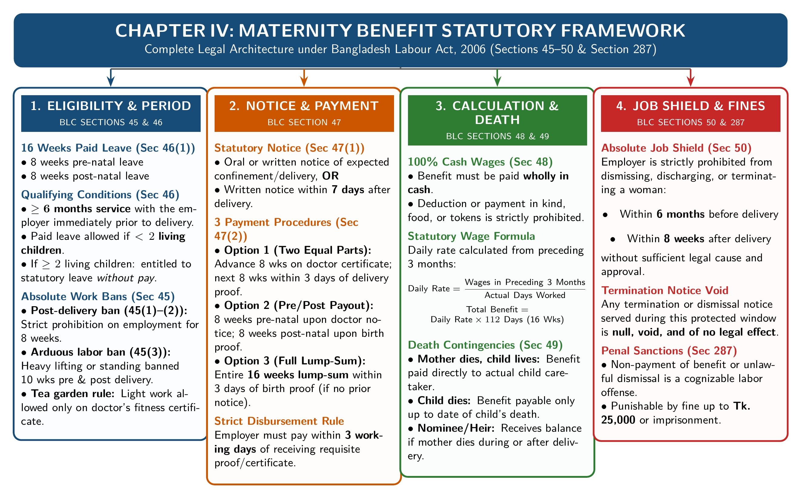

[← Previous: L05.3: Applied Factory Compliance and Adult Hours](L05.3_Applied_Factory_Compliance_and_Adult_Hours.md) | [🏠 Index](00_Index.md) | [Next: L07.1: Fire Safety Precautions (Section 62) →](L07.1_Fire_Safety_Precautions_Sec_62.md)

---

# L06.1: Maternity Benefits (Sections 45 to 50)

> **Section:** Section A (CO1 · Legal Issues · Shoaib Islam Sir) | **Priority:** 🔴 Essential Target (📌 Shoaib Sir's #1 Chapter 3 Final Exam Target) | **Exam Frequency:** Prescribed as #1 Target for 2026 Final
> **Subtopics Covered:** `L06.1` (Sec 45: Work prohibition), `L06.2` (Sec 46: Right to benefit and conditions), `L06.3` (Sec 47: Notice and 3 payment options), `L06.4` (Sec 48: Wage calculation and cash payment), `L06.5` (Sec 49: Death of mother or child), `L06.6` (Sec 50: Dismissal protection)
> **Sources:** BLC 2006 Chapter IV (Sections 45 to 50), SI Sir Notes (`Chapter-3.md`), SI Sir Slides (`Chapter-3 slide.md` Slide 10), Shoaib Sir Voice Note

## Why This Topic Matters

Shoaib Sir highlighted Maternity Benefit as the top target in Chapter 3. He warned that scripts will face strict grading. You must know the exact section numbers from Section 45 to Section 50. You must also state timelines, qualification rules, and wage calculations without mistakes. A clear grasp of these rules secures full marks in direct questions and case scenarios.

---

## 📝 Key Definitions

> **Maternity Benefit:** "Every woman worker shall be entitled to maternity benefit from her employer for the period of 8 weeks preceding the expected day of her delivery and 8 weeks immediately following the day of her delivery, and her employer shall be bound to give her this benefit." (The Bangladesh Labour Act, 2006, Section 46(1))

This provision grants female workers paid rest around childbirth. The employer pays this cash benefit so the worker can recover safely without losing her income.

> **Prohibition of Work (Section 45):** "No employer shall knowingly engage a woman in his establishment during the 8 weeks immediately following the day of her delivery." (Section 45(1))

The statute protects maternal health. It bans employers from assigning work to mothers for 8 weeks after childbirth. It also bans the woman herself from working anywhere during this period.

> **Benefit Amount (Section 48):** "The maternity benefit which is payable under this Act shall be paid at the rate of daily, weekly or monthly average wages... and such payment shall be made wholly in cash." (Section 48(1))

The employer cannot pay with food, tokens, or goods. Payment must be made entirely in legal cash based on actual past earnings.

---

## Core Theory: Complete Statutory Framework (Sections 45 to 50)

Chapter IV of the Bangladesh Labour Act, 2006 covers Sections 45 to 50. It builds a complete safety net for pregnant and nursing female workers.

*Figure 6.1: Comprehensive Statutory Framework for Maternity Benefits under BLC Sections 45 to 50 (Source: Bangladesh Labour Act 2006, Chapter IV, Sections 45–50 & Section 287)*

---

## 1. Section 45: Prohibition of Employment of Women Workers

Section 45 bans work during risky periods. It contains three clear rules:

### A. Absolute Post-Delivery Work Ban (Section 45(1) & 45(2))
1. **Employer Ban:** An employer cannot knowingly employ any woman during the 8 weeks right after childbirth.
2. **Worker Ban:** The woman worker herself cannot work in any industrial establishment during those same 8 weeks.
3. **Strict Liability:** This creates a strict two-sided ban. Both parties must honor it.

### B. Ban on Arduous Labor (Section 45(3))
An employer cannot give a woman worker hard physical tasks under two conditions:
- The work involves heavy lifting, long standing, or health hazards.
- The employer knows or the woman states that delivery is expected within 10 weeks.
- The employer knows she delivered a child within the past 10 weeks.

### C. Tea Estate Exception (Section 45(3) Proviso)
Women working in tea gardens may take light work.
- An approved tea estate medical officer must certify her fitness.
- The employer must pay full regular wages for this light work.
- This pay comes in addition to her statutory maternity benefit.

---

## 2. Section 46: Right to Maternity Benefit and Employer Liability

Section 46 sets the core right to paid leave and lists three conditions:

### A. Benefit Duration (Section 46(1))
- Every female worker has a legal right to 16 weeks of paid maternity benefit.
- The leave covers 8 weeks before delivery and 8 weeks after delivery.
- The employer is legally bound to pay this sum.

### B. Qualifying Service Test (Section 46(1) Proviso)
- The worker must complete at least 6 months of service under the employer before delivery.
- If she worked less than 6 months, she receives unpaid leave but no cash benefit.

### C. Child Count Restriction (Section 46(2))
- A woman cannot receive cash maternity benefit if she already has 2 or more living children.
- In that case, she receives only standard leave due to her, like sick or casual leave.

| Statutory Condition | Legal Requirement | Legal Consequence |
| :--- | :--- | :--- |
| **Duration of Leave** | 16 weeks (8 weeks pre-natal + 8 weeks post-natal) | Full daily wages paid during leave |
| **Qualifying Service** | Minimum 6 months continuous work before delivery | Less than 6 months means no cash benefit |
| **Surviving Children** | Must have fewer than 2 living children | 2 or more living children gives ordinary leave only |

---

## 3. Section 47: Notice Procedure and 3 Statutory Payment Options

Section 47 sets the claiming process and payment timelines.

### A. Giving Notice
1. **Pre-Natal Notice (Section 47(1)):** A pregnant worker gives oral or written notice that she expects childbirth within 8 weeks. She names a nominee in this notice. The employer must grant leave starting the very next day.
2. **Post-Natal Notice (Section 47(2)):** If she did not give pre-natal notice, she must give notice within 7 days after delivery. The employer grants leave from the delivery day for 8 weeks.

### B. Three Statutory Payment Options (Section 47(4))
The employer must pay using whichever option the woman chooses:

1. **Option 1 (Split Payment: Pre-Natal and Post-Natal):**
   - The first 8 weeks are paid within 3 working days after showing a doctor's certificate of expected delivery.
   - The second 8 weeks are paid within 3 working days after showing proof of birth.
2. **Option 2 (Two Installments: Both After Delivery):**
   - The first 8 weeks are paid within 3 working days after showing proof of birth.
   - The next 8 weeks are paid within 8 weeks after submitting that proof.
3. **Option 3 (Single Lump Sum):**
   - The employer pays all 16 weeks in one lump sum.
   - This payment is due within 3 working days after showing proof of birth.

### C. Submission of Birth Proof (Section 47(4) Proviso & 47(5))
- The mother must submit proof of birth within 3 months of delivery.
- Valid proof includes an extract from the register under the *Births and Deaths Registration Act, 2004*.
- A certificate from a registered doctor or other employer-accepted proof is also valid.

---

## 4. Section 48: Amount and Calculation of Maternity Benefit

Section 48 explains how to calculate cash benefits.

### A. Cash Mandate (Section 48(1))
The entire benefit must be paid wholly in legal cash. No deductions or vouchers are permitted.

### B. The Calculation Formula (Section 48(2))
Divide total wages earned in the preceding 3 months by actual days worked in that period:

$$
\text{Daily Average Wage} = \frac{\text{Total Wages Earned in Preceding 3 Months}}{\text{Total Days Actually Worked in That Period}}
$$

The total entitlement covers 16 weeks, which equals 112 calendar days:

$$
\text{Total Maternity Benefit} = \text{Daily Average Wage} \times 112\text{ days}
$$

### C. Step-by-Step Worked Numerical Example
- **Given Case:** A female electronics assembler earned BDT 36,000 across 75 actual working days during the past 3 months.
- **Step 1: Compute Daily Average Wage:**

$$
\text{Daily Average Wage} = \frac{\text{BDT } 36{,}000}{75\text{ days}} = \text{BDT } 480\text{ per day}
$$

- **Step 2: Compute Total Benefit for 16 Weeks (112 Days):**

$$
\text{Total Maternity Benefit} = \text{BDT } 480 \times 112 = \text{BDT } 53{,}760
$$

The employer must pay this exact amount of BDT 53,760 in cash.

---

## 5. Section 49: Benefit Payment upon Death of Woman or Child

Section 49 handles tragic contingencies during childbirth:

### A. Mother Dies at or After Delivery (Section 49(1))
- **If the newborn child lives:** The employer pays all due benefits to the person who takes care of the child.
- **If the newborn child does not live:** The employer pays the money to the mother's nominee. If she left no nomination, the funds go to her legal heir.

### B. Mother Dies Before Childbirth (Section 49(2))
- The employer is liable only for the period up to and including her death day.
- Unpaid dues go to her nominee or legal representative.
- If the employer already paid advance money exceeding this liability, the employer cannot recover that excess.

---

## 6. Section 50: Protection Against Dismissal and Termination

Section 50 protects pregnant workers from arbitrary firing.

### A. Protected Window
The protection covers the period from **6 months before delivery** to **8 weeks after delivery**.

### B. Shield Against Job Loss
- An employer cannot dismiss, discharge, or terminate a woman worker without sufficient cause in this window.
- If an employer fires her without sufficient cause, she still keeps her full maternity benefit.
- Routine administrative restructuring or minor infractions do not count as sufficient cause.

> [!tip] Memory Hook: **The Section 45 to 50 Number Ladder**
> Use this simple 6-rung ladder to recall every section in the exam:
> - **45 (Work Ban):** 8 weeks after delivery and 10 weeks arduous work ban.
> - **46 (Right & Limits):** 16 weeks total, 6 months service, under 2 living children.
> - **47 (Notice & 3 Options):** Give notice, pick 1 of 3 options, paid within 3 working days.
> - **48 (Cash Wages):** Past 3 months wages divided by actual days worked times 112 days.
> - **49 (Death Rules):** Child caretaker, nominee, or legal heir; no recovery of excess.
> - **50 (Dismissal Shield):** Safe from firing from 6 months before to 8 weeks after.

> [!tip] Memory Hook: **The Power of 3s in Section 47 and 48**
> - **3** payment options available to the worker.
> - **3** working days to pay after submitting doctor or birth proof.
> - **3** months maximum to submit proof of birth after delivery.
> - **3** preceding months used to calculate the average daily wage.

---

## Exam Variants

| Year / Source | Question / Scenario | Marks | Key Focus / Takeaway |
| :--- | :--- | :---: | :--- |
| **Model Q1 (Sec 45)** | Under what rules does BLC 2006 prohibit work for women around childbirth? | 03 | 8 weeks post-delivery ban and 10 weeks arduous work restriction. |
| **Model Q2 (Sec 46)** | Explain conditions governing benefit rights and employer liability. | 04 | 16 weeks duration, 6 months service test, under 2 living children rule. |
| **Model Q3 (Ch. IV)** | Discuss the complete statutory framework of maternity benefits under BLC 2006. | 05 | Comprehensive synthesis of Sections 45 to 50. |
| **Model Q4 (Sec 47)** | State the notice procedure and three statutory payout options. | 04 | Prior notice, 7-day post notice, 3 options, 3-day payout window. |
| **Model Q5 (Sec 48)** | How is maternity benefit calculated? Provide a numerical example. | 03 | 3-month wage formula, cash mandate, and 112-day worked example. |
| **Model Q6 (Sec 49)** | State the payment rules if the mother or child dies. | 03 | Child caretaker, nominee, legal heir, and no excess recovery. |
| **Model Q7 (Sec 50)** | Applied case study: Employer fires pregnant worker to dodge maternity pay. | 04 | 4-step case study format proving firing illegal under Section 50. |

---

## 🏆 Golden Questions (Past Exam Archive & Model Answers)

### 🎯 GQ1 · Model Exam Question · Prohibition of Employment (Section 45) (03 Marks)

> **Appeared:** Prescribed Model Question (SI Sir Chapter 3 Target) · (03 Marks)

**Question:**
Under what circumstances does the Bangladesh Labour Act, 2006 prohibit the employment of women workers before and after childbirth? State the statutory rules under Section 45.

**Full Answer:**

**Section 45** of the Bangladesh Labour Act, 2006 sets three mandatory restrictions on employing women around childbirth:

1. **Absolute Post-Delivery Prohibition (Section 45(1) & 45(2)):**
   - No employer may knowingly engage any woman in work during the 8 weeks right after childbirth.
   - No woman may work in any establishment during these same 8 weeks.
   - This rule creates a strict dual legal ban on both employers and workers.

2. **Pre-Delivery and Post-Delivery Restrictions on Arduous Labor (Section 45(3)):**
   - An employer cannot assign a woman worker to arduous labor, long standing, or health-damaging tasks.
   - This restriction applies if the employer believes or the woman informs that delivery is expected within 10 weeks.
   - It also applies if she delivered a child within the preceding 10 weeks.

3. **Tea Plantation Worker Exception (Section 45(3) Proviso):**
   - A female tea estate worker may perform certified light work.
   - An approved medical officer must certify her fitness for that work.
   - The employer pays normal wages for this work in addition to her statutory maternity benefit.

---

### 🎯 GQ2 · Model Exam Question · Conditions for Maternity Benefit (Section 46) (04 Marks)

> **Appeared:** Prescribed Model Question (SI Sir Chapter 3 Target) · (04 Marks)

**Question:**
Explain the conditions governing maternity benefit rights and employer liability under Section 46 of the Bangladesh Labour Act, 2006.

**Full Answer:**

Under **Section 46** of the Bangladesh Labour Act, 2006, the right to maternity benefit depends on three statutory rules:

1. **Duration of Benefit (Section 46(1)):**
   - Every employed woman is entitled to paid maternity benefit for 16 weeks total.
   - The benefit covers 8 weeks before delivery and 8 weeks right after delivery.
   - The employer is legally bound to pay this benefit.

2. **Qualifying Service Requirement (Section 46(1) Proviso):**
   - The worker must have worked under the employer for at least 6 months before delivery.
   - If she worked less than 6 months, she receives no cash maternity benefit.

3. **Parity Limit Based on Living Children (Section 46(2)):**
   - No cash maternity benefit is payable if the woman has 2 or more living children at delivery.
   - In that case, she receives only standard leave due to her, such as casual or sick leave.

| Statutory Condition | Legal Rule Under Section 46 | Outcome / Effect |
| :--- | :--- | :--- |
| **Benefit Duration** | 16 weeks (8 weeks pre-natal + 8 weeks post-natal) | Paid leave with full average daily wages |
| **Minimum Service** | At least 6 months before delivery | Disqualified from cash benefit if under 6 months |
| **Living Children** | Must have fewer than 2 living children | Unpaid or ordinary leave only if 2 or more children |

---

### 🎯 GQ3 · Model Exam Question · Comprehensive Maternity Framework (Sections 45 to 50) (05 Marks)

> **Appeared:** Prescribed Model Question (SI Sir Chapter 3 Target) · (05 Marks)

**Question:**
Discuss the statutory rules regarding maternity welfare facilities and benefits under Chapter IV of the Bangladesh Labour Code, 2006.

**Full Answer:**

Chapter IV (**Sections 45 to 50**) of the Act protects female workers around childbirth. It sets six core rules:

1. **Work Ban (Section 45):**
   - Employers cannot employ a woman for 8 weeks after delivery.
   - Arduous labor and long standing are banned for 10 weeks before and 10 weeks after delivery.

2. **Right and Duration of Benefit (Section 46):**
   - Female workers receive 16 weeks of paid maternity leave (8 weeks before and 8 weeks after delivery).
   - Entitlement requires at least 6 months of continuous service before delivery.
   - Women with 2 or more living children receive unpaid ordinary leave only.

3. **Notice and Claim Procedure (Section 47):**
   - The worker gives oral or written notice before delivery or within 7 days after delivery.
   - The notice names a nominee who receives benefits if the mother dies.
   - The employer must disburse payment within 3 working days after receiving medical proof.

4. **Calculation of Benefit (Section 48):**
   - The employer must pay the entire benefit in cash.
   - The rate equals the daily average wage earned over the preceding 3 months divided by actual working days.

5. **Death Contingencies (Section 49):**
   - If the mother dies leaving a living child, the employer pays benefits to the child's caretaker.
   - If both mother and child die, the benefit goes to her nominee or legal representative.

6. **Dismissal Protection (Section 50):**
   - An employer cannot dismiss or terminate a woman worker without sufficient cause.
   - This protection lasts from 6 months before delivery until 8 weeks after delivery.

---

### 🎯 GQ4 · Model Exam Question · Notice Procedure and Payment Options (Section 47) (04 Marks)

> **Appeared:** Prescribed Model Question (SI Sir Chapter 3 Target) · (04 Marks)

**Question:**
Describe the procedure regarding notice and disbursement of maternity benefits under Section 47 of the Bangladesh Labour Act, 2006. State the three statutory options available for payment.

**Full Answer:**

Under **Section 47** of the Bangladesh Labour Act, 2006, notice and benefit disbursement follow clear statutory steps:

1. **Notice Requirements:**
   - **Notice Before Delivery (Section 47(1)):** A pregnant woman gives oral or written notice expecting delivery within 8 weeks. She names a nominee for payment in case of death. The employer must grant leave starting the next day.
   - **Notice After Delivery (Section 47(2)):** Without advance notice, she must notify the employer within 7 days of delivery. The employer grants leave for 8 weeks from delivery day.

2. **Three Statutory Payment Options (Section 47(4)):**
   The employer must pay using the method chosen by the worker:
   - **Option 1 (Two Installments: Before and After Delivery):**
     - First 8 weeks: Paid within 3 working days after showing a doctor's certificate of expected delivery.
     - Remaining 8 weeks: Paid within 3 working days after showing proof of birth.
   - **Option 2 (Two Installments: Both After Delivery):**
     - First 8 weeks: Paid within 3 working days after showing proof of birth.
     - Next 8 weeks: Paid within 8 weeks after showing that proof.
   - **Option 3 (Single Lump Sum):**
     - The employer pays all 16 weeks in one lump sum.
     - This payment is due within 3 working days after showing proof of birth.

3. **Statutory Proof and Deadlines (Section 47(4) Proviso & 47(5)):**
   - The worker must produce proof of birth within 3 months of delivery.
   - Valid proof includes an official birth register extract or a registered doctor's certificate.

---

### 🎯 GQ5 · Model Exam Question · Wage Calculation and Numerical Example (Section 48) (03 Marks)

> **Appeared:** Prescribed Model Question (SI Sir Chapter 3 Target) · (03 Marks)

**Question:**
Explain how the amount of maternity benefit is calculated under Section 48 of the Bangladesh Labour Act, 2006. Illustrate with a concise numerical example.

**Full Answer:**

**Section 48** of the Bangladesh Labour Act, 2006 sets the calculation method and payment mode:

1. **Payment Mode (Section 48(1)):**
   - The employer must pay maternity benefit wholly in cash.
   - It is calculated using daily, weekly, or monthly average wages.

2. **Statutory Wage Formula (Section 48(2)):**
   - Divide total wages earned during the preceding 3 months by actual days worked in that period:

$$
\text{Daily Average Wage} = \frac{\text{Total Wages Earned in Preceding 3 Months}}{\text{Total Days Actually Worked in That Period}}
$$

   - Total entitlement covers 16 weeks, which equals 112 calendar days:

$$
\text{Total Maternity Benefit} = \text{Daily Average Wage} \times 112\text{ days}
$$

3. **Numerical Illustration:**
   - Suppose a female worker earns BDT 36,000 across 75 actual working days during the past 3 months.
   - Her daily average wage is:

$$
\text{Daily Average Wage} = \frac{\text{BDT } 36{,}000}{75\text{ days}} = \text{BDT } 480\text{ per day}
$$

   - Her total benefit for 16 weeks (112 days) is:

$$
\text{Total Maternity Benefit} = \text{BDT } 480 \times 112 = \text{BDT } 53{,}760
$$

   - The employer must pay this entire sum of BDT 53,760 in legal cash.

---

### 🎯 GQ6 · Model Exam Question · Payment on Death of Woman or Child (Section 49) (03 Marks)

> **Appeared:** Prescribed Model Question (SI Sir Chapter 3 Target) · (03 Marks)

**Question:**
State the rules under Section 49 of the Bangladesh Labour Act, 2006 when a mother or newborn child dies.

**Full Answer:**

**Section 49** of the Bangladesh Labour Act, 2006 governs payment when a woman worker dies during her maternity period:

1. **Death at Delivery or During the Next 8 Weeks (Section 49(1)):**
   - **If the newborn child survives:** The employer pays all due benefits to the person who takes care of the child.
   - **If the newborn child does not survive:** The employer pays the benefit to her nominee under Section 47(1). If she left no nomination, the money goes to her legal representative.

2. **Death Prior to Childbirth (Section 49(2)):**
   - Suppose the woman dies before delivery during pre-natal leave. The employer is liable only up to her day of death.
   - The employer pays any unpaid balance to her nominee or legal representative.

3. **Protection Against Recovery (Section 49(2)):**
   - An employer might pay advance benefits that exceed the amount earned before her death.
   - The employer cannot legally recover this excess payment from her legal representative.

---

### 🎯 GQ7 · Model Case Study · Protection Against Dismissal (Section 50) (04 Marks)

> **Appeared:** Prescribed Model Case Study (SI Sir Applied Target) · (04 Marks)

**Question:**
An employer dismisses a female quality inspector citing departmental restructuring. The dismissal notice was issued when she was six months pregnant, shortly after she informed management of her condition. The company refused to disburse maternity benefits, arguing that she was no longer on company payroll on her delivery date. Evaluate the legality of the employer's actions under Section 50 of the Bangladesh Labour Act, 2006.

**Full Answer:**

#### 1. Facts and Issue of the Case
An employer dismissed a six-month pregnant worker citing departmental restructuring. The dismissal occurred right after she disclosed her pregnancy. The employer refused maternity benefits because she was not on the payroll at delivery. The legal issue is whether this dismissal is lawful and whether she retains her right to maternity benefits.

#### 2. Applicable Law and Section
**Section 50** of the Bangladesh Labour Act, 2006 (*Restrictions on termination of employment of a woman in certain cases*).

#### 3. Legal Analysis
- **Section 50** protects women workers from dismissal around childbirth.
- An employer cannot dismiss, discharge, or terminate a woman worker without sufficient cause.
- This legal protection lasts from 6 months before delivery until 8 weeks after delivery.
- Routine administrative restructuring does not constitute sufficient cause under the Act.
- When an employer fires a woman without sufficient cause in this window, she retains all maternity benefits.
- She gave proper notice and completed the required 6 months of qualifying service. Her statutory rights remain fully intact.

#### 4. Direct Conclusion
The employer's dismissal and refusal to pay maternity benefits violate **Section 50**. The termination cannot strip away her statutory rights. The employer must pay her the full 16-week maternity benefit in cash.

---

## ⚡ Exam Tips & Common Mistakes

1. **Always Cite the 16-Week Split:** Maternity benefit lasts 16 weeks total. State clearly: 8 weeks before delivery and 8 weeks after.
2. **Remember the 6-Month Service Rule:** A worker needs at least 6 months of service before delivery to receive cash benefits.
3. **Do Not Forget the Child Count Rule:** Cash maternity benefits apply only if she has fewer than 2 living children. If she has 2 or more, she gets ordinary leave only.
4. **Note the 3-Month Window for Birth Proof:** Under Section 47(4), birth proof must be produced within 3 months of delivery.
5. **Always State the Wage Formula Clearly:** In Section 48, divide past 3 months' wages by actual days worked. Then multiply by 112 days.
6. **Apply the 4-Step Case Framework:** For applied questions like Section 50, always write: 1. Facts and Issue, 2. Applicable Law, 3. Legal Analysis, 4. Direct Conclusion.

## 🔗 Related Topics

- [L05.1: BLC Core Definitions and Age Classes](L05.1_BLC_Core_Definitions_and_Age_Classes.md)
- [L05.2: Adolescent Working Hours (Section 41)](L05.2_Adolescent_Working_Hours_Sec_41.md)
- [L07.1: Fire Safety Precautions (Section 62)](L07.1_Fire_Safety_Precautions_Sec_62.md)
- [L08.1: Welfare Measures (Sections 89 to 99)](L08.1_Welfare_Measures_Sec_89_to_99.md)

---

[← Previous: L05.3: Applied Factory Compliance and Adult Hours](L05.3_Applied_Factory_Compliance_and_Adult_Hours.md) | [🏠 Index](00_Index.md) | [Next: L07.1: Fire Safety Precautions (Section 62) →](L07.1_Fire_Safety_Precautions_Sec_62.md)
