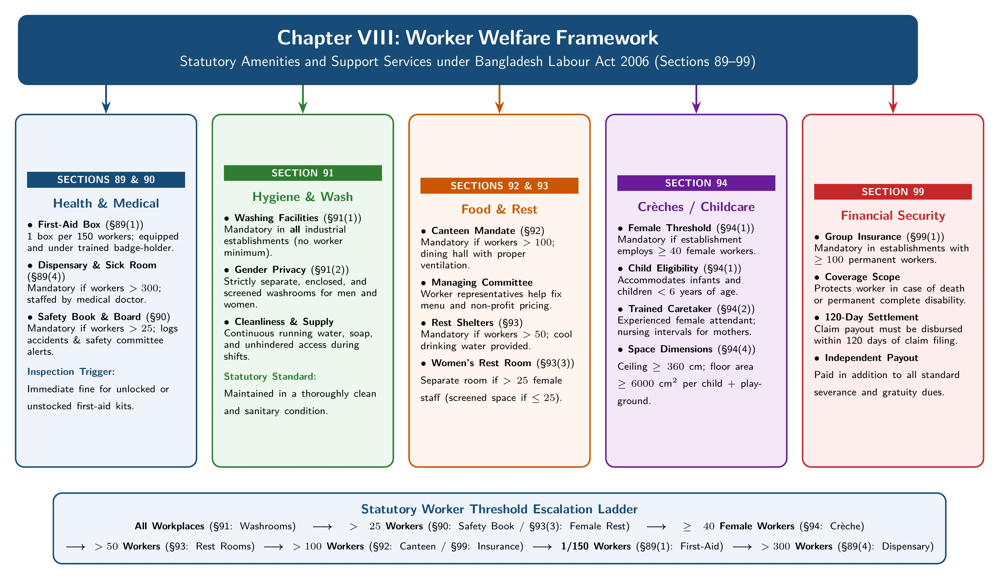
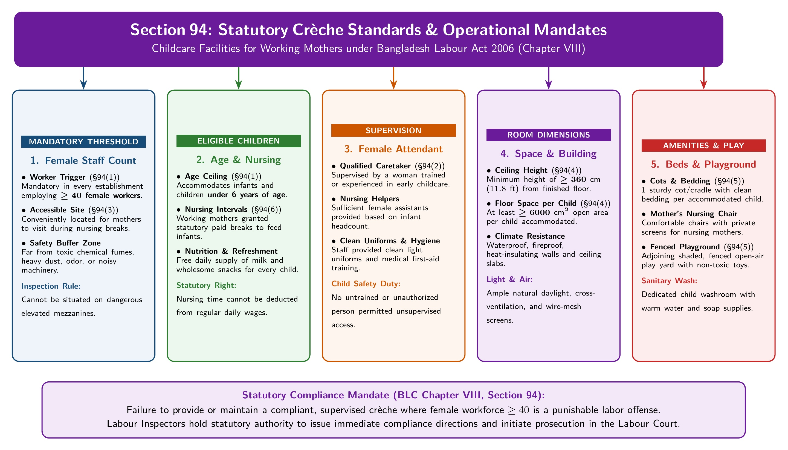
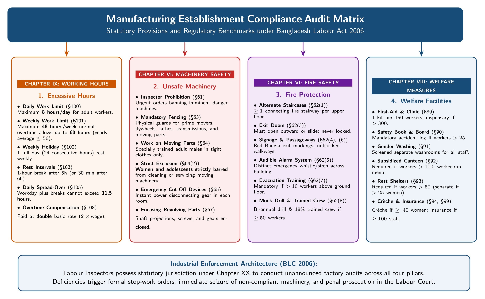

[← Previous: L07.2: Machinery Safety and Workplace Duties](L07.2_Machinery_Safety_and_Workplace_Duties.md) | [🏠 Index](00_Index.md) | [Next: L09.1: Termination of Employment (Sections 20 to 27) →](L09.1_Termination_of_Employment_Sec_20_to_27.md)

---

# L08.1: Welfare Measures (Sections 89 to 99)

> **Section:** Section A (CO1 · Legal Issues · Shoaib Islam Sir) | **Priority:** 🟠 High (📌 Prescribed as "Full Topic Important" by Shoaib Sir [05:30–05:55] and Raidah §15) | **Exam Frequency:** Tested in 2025 Law-CT2 Q.1; Suggested Target for 2026 Final
> **Subtopics Covered:** `L08.1` (Sec 89: First-aid appliances and dispensary), `L08.2` (Sec 90 & 90A: Safety record book, safety board, safety committee), `L08.3` (Sec 91: Washing facilities), `L08.4` (Sec 92: Canteens and managing committee), `L08.5` (Sec 93: Shelters, rest rooms, and lunch rooms), `L08.6` (Sec 94: Rooms for children / crèches), `L08.7` (Sec 99: Compulsory group insurance)
> **Sources:** BLC 2006 Chapter VIII (Sections 89 to 99), SI Sir Notes (`Chapter-3.md`), Raidah Class Notes (§15), Shoaib Sir Voice Note

## Why This Topic Matters

Shoaib Sir marked Chapter VIII as a full-topic exam priority. Factory workers need health care, clean washrooms, decent food, and safe childcare. The Bangladesh Labour Act sets strict worker counts for each welfare benefit. You will lose marks if you mix up numbers like 25, 40, 50, 100, 150, or 300. Learn this ladder once, and you can solve both theory questions and applied factory compliance problems with ease.

---

## 📝 Key Definitions

> **First-Aid Appliances (Section 89(1)):** "In every establishment the first-aid box or cupboard equipped with the contents prescribed by rules shall be provided to be readily accessible during all working hours." (The Bangladesh Labour Act, 2006)

Every factory must keep first-aid boxes ready for quick use. They help treat shop-floor injuries right away before a doctor arrives.

> **Canteen (Section 92(1)):** "In an establishment where more than 100 (one hundred) workers are ordinarily employed, adequate number of canteens shall be provided for their use." (The Bangladesh Labour Act, 2006)

A canteen gives workers a clean space to buy cheap, wholesome meals. It stops workers from eating near dirty machines.

> **Rooms for Children (Section 94(1)):** "In every establishment, where 40 (forty) or more female workers are ordinarily employed, one or more suitable rooms shall be provided and maintained for the use of their children who are under the age of 6 (six) years." (The Bangladesh Labour Act, 2006)

A crèche provides safe childcare inside the factory. It lets working mothers nurse and visit their young children during shift breaks.

> **Compulsory Group Insurance (Section 99(1)):** "In an establishment where at least 100 (one hundred) permanent workers are employed, the employer shall introduce group insurance under the existing insurance laws." (The Bangladesh Labour Act, 2006, as amended in 2013)

This policy protects worker families against death and permanent disability. The payout comes on top of all standard end-of-service money.

---

## Core Theory: The Welfare Framework (Sections 89 to 99)

Chapter VIII of the Bangladesh Labour Act, 2006 groups worker welfare into clear statutory services:

*Figure 1: Comprehensive Worker Welfare Facilities Framework under BLC Sections 89 to 94 (Source: Bangladesh Labour Act 2006, Chapter VIII)*

---

## The Welfare Worker-Count Threshold Ladder

Most exam questions test the minimum worker counts that trigger each welfare duty. Memorize this single sorted ladder to answer any question quickly.

> [!tip] Memory Hook: Worker Threshold Ladder (0 → 25 → 40 → 50 → 100 → 150 → 300)
> Run through the numbers from smallest to largest:
> - **0 workers (All workplaces):** Clean, separate, screened washing facilities for men and women (`Sec 91`).
> - **More than 25 workers:** Compulsory safety record book and safety board (`Sec 90`). Also triggers a separate women's rest room if female staff exceeds 25 (`Sec 93(3)`).
> - **40 or more female workers:** Rooms for children / crèches for kids under 6 years (`Sec 94`).
> - **More than 50 workers:** Rest rooms, shelters, and lunch rooms with drinking water (`Sec 93`). Also triggers a joint Safety Committee (`Sec 90A`).
> - **More than 100 workers:** Subsidized canteens run with worker representatives (`Sec 92`).
> - **100 or more permanent workers:** Compulsory group life and disability insurance (`Sec 99`).
> - **1 box per 150 workers:** First-aid box with a trained, badged first-aider on duty (`Sec 89(2)`).
> - **300 or more workers:** Full sick room and dispensary with doctors and nurses (`Sec 89(5)`).
> - **500 or more workers:** Certified Welfare Officer (`Sec 89(8)`).
> - **5,000 or more workers:** Permanent full-scale medical center (`Sec 89(6)`).

---

## Master Statutory Threshold Summary Table

Here is the complete reference table for Chapter VIII:

| Section | Welfare Amenity | Mandatory Worker Threshold | Key Statutory Requirement | Penalty or Rule Detail |
| :--- | :--- | :--- | :--- | :--- |
| **Sec 89(1)–(4)** | First-Aid Boxes | 1 box per 150 workers | Prescribed items, trained first-aider wearing a badge | Must be accessible during all work hours |
| **Sec 89(5)** | Sick Room and Dispensary | 300 or more workers | Prescribed room size, medical gear, doctor and nurse | Must stay ready during work hours |
| **Sec 89(6)** | Permanent Medical Center | 5,000 or more workers | Full medical center run by the employer | Added by the 2013 Amendment |
| **Sec 89(7)** | Occupational Disease Care | All affected workers | Full treatment at employer expense until completely cured | Covers workplace illnesses and injuries |
| **Sec 89(8)** | Welfare Officer | 500 or more workers | Certified welfare officer appointed to assist workers | Added by the 2013 Amendment |
| **Sec 90** | Safety Record Book and Board | More than 25 workers | Compulsory record book and prominent hazard warning board | Must follow government rules |
| **Sec 90A** | Factory Safety Committee | 50 or more workers | Joint committee with equal management and worker members | Added by the 2013 Amendment |
| **Sec 91** | Washing Facilities | All establishments | Adequate, clean, separate, screened for men and women | Conveniently accessible at all times |
| **Sec 92** | Factory Canteen | More than 100 workers | Clean dining hall, managing committee with worker members | Non-profit, subsidized food prices |
| **Sec 93** | Shelters and Lunch Rooms | More than 50 workers | Ventilated rooms, cool temperature, clean drinking water | Separate shelter room if over 25 female workers |
| **Sec 94** | Rooms for Children (Crèche) | 40 or more female workers | Accommodates kids under 6 years, cots, toys, playground | Height $\ge 360\text{ cm}$, area $\ge 6000\text{ sq. cm}$/child |
| **Sec 94A** | Housing for Disabled Staff | Housing estates | Priority in residential quarter allotment | Added by the 2013 Amendment |
| **Sec 95–97** | Tea Plantation Amenities | All tea plantations | Free housing, daily goods store, primary school if 25+ kids | Medical centers in plantation grounds |
| **Sec 98** | Newspaper Worker Health | Newspaper houses | Free medical care for worker and legal dependents | Covers spouse, children, invalid parents |
| **Sec 99** | Compulsory Group Insurance | 100+ permanent workers | Group life policy; paid in addition to all service dues | Joint claim payout within 120 days |

---

## 1. Section 89: First-Aid Appliances, Dispensaries, and Medical Care

Section 89 sets a tiered medical care structure based on factory workforce size:

### A. First-Aid Box Mandate (Section 89(1) & 89(2))
1. **Readily Accessible Equipment:** Every factory must provide first-aid boxes or cupboards. They must contain all supplies listed in government rules. Workers must have free access to them during all working hours.
2. **The 150-Worker Ratio:** The employer must supply at least one first-aid box for every 150 workers ordinarily employed.
3. **No Mixed Storage:** First-aid boxes must hold only medical supplies. No tools or personal items may sit inside.

### B. Trained Person in Charge and Badge (Section 89(3) & 89(4))
1. **Certified First-Aider:** A responsible person trained in first-aid treatment must take charge of each box.
2. **Constant Availability:** This person must stay on site and remain available during all shifts.
3. **Workroom Notice:** The employer must post a clear notice in every workroom naming the trained first-aider.
4. **Identification Badge:** The designated first-aider must wear an official badge during all working hours so workers can spot them fast.

### C. Sick Room and Dispensary at 300 Workers (Section 89(5))
When an establishment employs 300 or more workers:
- The employer must set up and maintain a dedicated sick room and dispensary.
- The room must meet statutory dimensions set by rules.
- It must contain full clinical equipment and basic medicines.
- Qualified medical doctors and registered nursing staff must run the dispensary.

### D. Medical Centers and Welfare Officers (Section 89(6), 89(7) & 89(8))
The 2013 Amendment added three vital health mandates:
- **Permanent Medical Center (Section 89(6)):** Workplaces with 5,000 or more workers must build and operate a permanent medical clinic.
- **Continuous Medical Treatment (Section 89(7)):** Employers must pay for treating workplace disease or injury. Treatment continues under a specialist doctor at employer expense until full recovery.
- **Welfare Officer (Section 89(8)):** Workplaces with 500 or more workers must hire a qualified welfare officer.

---

## 2. Sections 90 & 90A: Safety Records, Safety Boards, and Committees

Workplace safety needs constant documentation and open dialogue:

### A. Safety Record Book and Safety Board (Section 90)
Every factory employing more than 25 workers must keep two safety items:
1. **Safety Record Book:** An official ledger recording all accidents, dangerous occurrences, and equipment inspections.
2. **Safety Information Board:** A prominent board hung near entrances or work floors. It displays hazard warnings, accident statistics, and emergency safety rules in clear Bangla.

### B. Safety Committee (Section 90A)
Under the 2013 Amendment, every factory with 50 or more workers must form a joint Safety Committee:
- The committee brings worker representatives and management together.
- It inspects factory floors, pinpoints fire and machine risks, and ensures safe work habits.
- Worker members help build mutual trust on safety issues.

---

## 3. Section 91: Washing Facilities

Personal cleanliness protects health and human dignity on the factory floor:

### A. General Standards and Cleanliness (Section 91(1)(a) & 91(1)(c))
1. **Adequate Facilities:** Every employer must provide sufficient, suitable washing and bathing places for all workers.
2. **Easy Access:** Washrooms must sit near workrooms so workers reach them without walking through danger zones.
3. **Clean Condition:** Staff must clean washrooms regularly and maintain running water and good drainage.

### B. Gender Separation and Privacy Screening (Section 91(1)(b))
1. **Strict Gender Division:** Employers must supply separate washing spaces for male and female workers.
2. **Proper Screening:** Washrooms must have opaque partitions and secure doors so workers have complete privacy.

### C. Government Process Rules (Section 91(2))
The Government can issue special washing standards for dirty or toxic trades. Factories handling lead, arsenic, tanning liquids, or glass dust must supply specialized showers and decontamination basins.

---

## 4. Section 92: Canteen Facilities and Worker Participation

Proper nutrition keeps workers alert and cuts down on industrial fatigue:

### A. Canteen Threshold at 100 Workers (Section 92(1))
Every establishment employing more than 100 workers must provide an adequate number of canteens.

### B. Canteen Managing Committee (Section 92(2))
The canteen is not run by management alone:
1. **Joint Management:** A Canteen Managing Committee runs the daily service.
2. **Worker Representation:** The committee must include elected or nominated worker representatives. Workers make up between 20% and 50% of committee seats under factory rules.
3. **Construction Standards:** Rules fix dining hall floor area, kitchen ventilation, fly screening, clean water taps, and waste disposal.

### C. Subsidized Food Charges (Section 92(3))
1. **Food Menu:** The managing committee selects which nutritious meals, snacks, and drinks to serve.
2. **Non-Profit Pricing:** Food charges are set on a non-profit basis. The employer covers building costs, cooking fuel, water, and staff wages. Workers pay only for raw grocery ingredients.

---

## 5. Section 93: Rest Rooms, Shelters, and Lunch Rooms

Continuous physical labor demands clean rest areas away from loud machinery:

### A. Rest Facilities Threshold at 50 Workers (Section 93(1))
Every workplace with more than 50 workers must provide:
1. **Shelters or Rest Rooms:** Suitable rooms where workers can relax during shift breaks.
2. **Lunch Room:** A clean space with tables, benches, and drinking water. Workers eat food brought from home here.

### B. Dining Room Rules and Eating Bans (Section 93(1) Provisos)
1. **Canteen Integration:** A canteen built under Section 92 counts as a rest room and lunch room. The employer does not need to build a second room.
2. **Prohibition of Eating in Workrooms:** Workers must never eat food inside production workrooms when a lunch room exists. This prevents food poisoning from factory dust, chemicals, and machine oil.

### C. Physical Room Conditions (Section 93(2))
- Rooms must have sufficient natural and artificial light.
- Rooms must have open windows and ceiling fans to keep temperatures cool and comfortable.
- Maintenance staff must keep all rest spaces clean and free from clutter.

### D. Female Worker Thresholds (Section 93(3))
Section 93(3) uses a specific female employment count:
- **More than 25 female workers:** The employer must build a completely separate rest room for women.
- **25 or fewer female workers:** A separate room is not mandatory. The employer may provide screened, private partitions inside the common rest space.

---

## 6. Section 94: Rooms for Children (Crèches)

Section 94 helps working women keep their jobs while raising young infants:

*Figure 2: Section 94 Statutory Crèche Standards, Dimensions, and Operational Mandates (Source: Bangladesh Labour Act 2006, Section 94)*

### A. Crèche Threshold and Age Limits (Section 94(1))
1. **Mandatory Threshold:** Every establishment employing 40 or more female workers must provide rooms for children.
2. **Age Cutoff:** The crèche accommodates children under 6 years of age belonging to working mothers.

### B. Room Caretaker and Location Safety (Section 94(2) & 94(3))
1. **Trained Attendant:** A woman trained or experienced in childcare must supervise the crèche.
2. **Easy Access:** Mothers must be able to reach the crèche quickly during nursing intervals.
3. **Safe Location:** The crèche must sit far away from toxic fumes, chemical dust, strong smells, or loud machinery.

### C. Construction and Space Dimensions (Section 94(4) & 94(5))
1. **Solid Construction:** Walls and roofs must use sturdy, heat-resisting, waterproof building materials.
2. **Room Height:** The ceiling must be at least 360 centimetres high from the finished floor.
3. **Floor Area per Child:** Each child must have at least 6000 square centimetres of open floor space.

> [!note] Statutory Dimension Clarification ($6000\text{ sq. cm}$ vs $600\text{ sq. cm}$)
> The original English print of the 2006 Act shows "$600\text{ sq. cm}$". That is an obvious printing typo. An area of $600\text{ sq. cm}$ equals only $20\text{ cm} \times 30\text{ cm}$, which cannot fit an infant. The official Bangla gazette and labour regulations require $6000\text{ sq. cm}$ (about $0.6\text{ m}^2$). In your exam answer, write $6000\text{ sq. cm}$ and add a short note mentioning the $600\text{ sq. cm}$ typo in the English text to impress the examiner.

### D. Child Furniture, Mother Seats, and Playgrounds (Section 94(6), 94(7) & 94(8))
1. **Cots and Bedding:** The employer must supply one clean cot or cradle with fresh bedding for every child.
2. **Nursing Chairs:** The room must have at least one comfortable chair for each mother while feeding or holding her baby.
3. **Toys:** The employer must supply clean, safe toys for older children.
4. **Open-Air Playground:** The factory must maintain a fenced, shady open-air playground for older toddlers. The Chief Inspector can waive this rule in writing only if factory land is too small.

---

## 7. Section 94A: Housing Priority for Handicapped Workers

Section 94A was added by the 2013 Labour Amendment:
- When an industrial establishment provides housing quarters for its workforce, it must give priority to workers with disabilities.
- Ground floor rooms and barrier-free units must go to disabled workers first to assist their mobility.

---

## 8. Sections 95 to 98: Specialized Sector Welfare Amenities

The Labour Act adds special welfare rules for specific industries:

### A. Tea Plantation Amenities (Sections 95 to 97)
- **Recreation and Schools (Section 95):** Tea estates must provide sports fields. If an estate has more than 25 children aged 6 to 12 years, the employer must run a primary school.
- **Housing (Section 96):** The tea planter must give free housing quarters to every worker and their resident family.
- **Daily Goods Stores (Section 97):** Planters must open stores within easy reach. Workers can buy food and supplies at fair prices.

### B. Newspaper Worker Medical Care (Section 98)
Every newspaper establishment must provide free medical treatment to all working journalists, press employees, and their legal dependents. Dependents include spouses, children, widowed mothers, and disabled parents living with the worker.

---

## 9. Section 99: Compulsory Group Insurance

Section 99 gives factory families a crucial financial shield:

### A. Coverage Threshold at 100 Permanent Workers (Section 99(1))
Every establishment employing 100 or more permanent workers must purchase group insurance under existing insurance laws.

*(Note: The original 2006 Act set this threshold at 200 permanent workers. The 2013 Amendment lowered it to 100 permanent workers).*

### B. Benefit Settlement and Direct Payouts (Section 99(2))
1. **Extra Compensation:** Insurance claims do not replace statutory retrenchment pay, gratuity, or provident funds. The policy payout comes on top of all standard benefits.
2. **Employer Duty on Death:** If a worker dies, the employer must file the insurance claim. The employer must collect the money from the insurance firm and hand it directly to the worker's family.
3. **Strict 120-Day Settlement Deadline:** The insurer and employer must settle the claim together within 120 days of raising it.

---

## Exam Variants

| Year or Source | Question Prompt Summary | Marks | Key Focus or Result |
| :--- | :--- | :---: | :--- |
| **Model Q.1** | Statutory provisions for first-aid boxes and sick rooms under Section 89 | 04 | 1 box per 150 workers; sick room & dispensary at 300+ workers |
| **Model Q.2** | Key welfare measures under Chapter VIII and statutory threshold table | 05 | Comprehensive summary table of Sections 89 to 99 thresholds |
| **Model Q.3** | Safety record book, safety board, and committee under Sections 90 & 90A | 02 | Record book & board at > 25 workers; committee at 50+ workers |
| **Model Q.4** | Legal requirements for washing facilities under Section 91 | 02 | Clean, adequate, separate, screened for male and female staff |
| **Model Q.5** | Statutory rules governing factory canteens under Section 92 | 03 | Mandatory at > 100 workers; joint managing committee sets food prices |
| **Model Q.6** | Shelters, rest rooms, and lunch rooms under Section 93 | 03 | > 50 workers; separate room if > 25 women; no eating in workrooms |
| **Model Q.7** | Rooms for children (crèches) requirements under Section 94 | 04 | $\ge 40$ women; kids $< 6$ yrs; height $\ge 360\text{ cm}$; area $\ge 6000\text{ sq. cm}$ |
| **Model Q.8** | Compulsory group insurance rules under Section 99 | 02 | $\ge 100$ permanent workers; additional to dues; 120-day claim payout |
| **2025 Law-CT2 Q.1** | Factory compliance problem on hours, machinery, fire, and welfare | 10 | Applied analysis linking Chapter VIII welfare rules to factory defects |

---

## 🏆 Golden Questions (Past Exam Archive & Model Answers)

### 🎯 GQ1 · Model Question 1 · Section 89 First-Aid and Dispensary Rules (04 Marks)

> **Appeared:** Suggested Exam Topic (Chapter VIII) · Part (b) or (c) · (04 Marks)

**Question:**  
State the statutory provisions regarding first-aid appliances under Section 89 of the Bangladesh Labour Act, 2006. When is a factory required to provide a sick room and dispensary?

**Full Answer:**

Under **Section 89** of the **Bangladesh Labour Act, 2006**, every employer must maintain adequate first-aid appliances for rapid injury care:

1. **Accessibility and Equipment (Section 89(1)):**  
   Every establishment must supply first-aid boxes or cupboards. They must contain all supplies prescribed by rules. Staff must be able to reach them easily during all working hours.

2. **Ratio of First-Aid Boxes (Section 89(2)):**  
   The employer must provide at least one first-aid box for every **150 workers** ordinarily employed.

3. **Trained Person in Charge (Section 89(3)):**  
   A responsible person trained in first-aid treatment must take charge of each box. This person must remain on site and available throughout all work shifts.

4. **Notice and Identification Badge (Section 89(4)):**  
   The employer must post a notice in every workroom naming the first-aider. The first-aider must wear an identification badge during all working hours.

5. **Dispensary and Sick Room Requirement (Section 89(5)):**  
   A sick room with an attached dispensary is mandatory in establishments employing **300 or more workers**. It must satisfy these conditions:
   - Built to statutory room dimensions.
   - Fully stocked with clinical apparatus and basic medicines.
   - Staffed by qualified medical doctors and registered nursing staff.

6. **Medical Centers and Welfare Officers (2013 Amendment):**  
   - Establishments with **500 or more workers** must hire a certified welfare officer (Section 89(8)).
   - Establishments with **5,000 or more workers** must operate a permanent medical center (Section 89(6)).

---

### 🎯 GQ2 · Model Question 2 · Chapter VIII Welfare Measures Summary and Threshold Table (05 Marks)

> **Appeared:** Suggested Comprehensive Question · Part (b) or (c) · (05 Marks)

**Question:**  
Summarize the key welfare measures provided under Chapter VIII of the Bangladesh Labour Act, 2006. Present the statutory threshold requirements in a summary table.

**Full Answer:**

**Chapter VIII (Sections 89 to 99)** of the **Bangladesh Labour Act, 2006** requires employers to provide welfare amenities. These amenities protect worker health, dignity, and output.

#### Statutory Threshold Summary Table

| Section | Welfare Measure | Minimum Worker Threshold | Key Statutory Mandate |
| :--- | :--- | :--- | :--- |
| **Sec 89(2)** | First-Aid Box | 1 box per 150 workers | Prescribed items, trained first-aider wearing a badge |
| **Sec 89(5)** | Dispensary & Sick Room | 300 or more workers | Equipped clinic staffed by medical doctors and nurses |
| **Sec 89(6)** | Permanent Medical Center | 5,000 or more workers | Full hospital or clinic facility run by the employer |
| **Sec 89(8)** | Welfare Officer | 500 or more workers | Certified welfare officer appointed to assist workers |
| **Sec 90** | Safety Record Book & Board | More than 25 workers | Compulsory incident logbook and prominent safety notice board |
| **Sec 90A** | Safety Committee | 50 or more workers | Joint committee with equal management and worker members |
| **Sec 91** | Washing Facilities | All establishments | Clean, adequate, separate, screened for male and female staff |
| **Sec 92** | Canteen | More than 100 workers | Non-profit subsidized food managed with worker representatives |
| **Sec 93** | Rest Rooms & Lunch Rooms | More than 50 workers | Ventilated rooms, drinking water; separate room if > 25 women |
| **Sec 94** | Rooms for Children (Crèche) | 40 or more female workers | Accommodates kids under 6 yrs, cots, toys, fenced playground |
| **Sec 99** | Compulsory Group Insurance | 100+ permanent workers | Group life policy; claim paid directly to family in 120 days |

#### Operational Core
1. **Emergency Medical Care:** First-aid boxes handle minor cuts on the floor. Sick rooms provide clinical care for serious injuries.
2. **Workplace Hygiene:** Screened washrooms ensure personal privacy and dignity for both male and female staff.
3. **Food and Rest:** Canteens and dining rooms give workers clean spaces to eat away from hazardous machines.
4. **Child and Family Welfare:** Crèches let nursing mothers earn a living without risking infant safety.

---

### 🎯 GQ3 · Model Question 3 · Safety Record Book, Board, and Committee Rules (02 Marks)

> **Appeared:** Suggested Exam Topic (Chapter VIII) · Part (a) · (02 Marks)

**Question:**  
What rules govern safety records, boards, and committees under Sections 90 and 90A of BLC 2006?

**Full Answer:**

Under the **Bangladesh Labour Act, 2006**:

1. **Safety Record Book and Safety Board (Section 90):**  
   Every establishment employing **more than 25 workers** must maintain an official safety record book. The employer must also display a safety information board in a noticeable place. This board informs workers of hazard warnings and safety precautions.

2. **Constitution of Safety Committee (Section 90A):**  
   Under the 2013 Amendment, every factory employing **50 or more workers** must form a Safety Committee. This committee includes equal members from management and workers. It inspects factory floors and helps eliminate workplace hazards.

---

### 🎯 GQ4 · Model Question 4 · Statutory Washing Facilities Requirements (02 Marks)

> **Appeared:** Suggested Exam Topic (Chapter VIII) · Part (a) · (02 Marks)

**Question:**  
What are the legal requirements regarding washing facilities under Section 91 of the Bangladesh Labour Act, 2006?

**Full Answer:**

Under **Section 91** of the **Bangladesh Labour Act, 2006**, every employer must supply suitable washing amenities:

1. **Adequate and Clean Facilities (Section 91(1)(a) & 91(1)(c)):**  
   The employer must provide sufficient washing and bathing places for all workers. These facilities must be easy to reach and kept clean at all times.

2. **Gender Separation and Screening (Section 91(1)(b)):**  
   Washing spaces must be strictly separate for male and female workers. They must have proper privacy screens and doors.

3. **Special Industrial Standards (Section 91(2)):**  
   The Government may establish higher washing standards for factories that handle toxic chemicals, glass dust, or hazardous substances.

---

### 🎯 GQ5 · Model Question 5 · Statutory Canteen Provisions and Managing Committee (03 Marks)

> **Appeared:** Suggested Exam Topic (Chapter VIII) · Part (a) or (b) · (03 Marks)

**Question:**  
Explain the statutory rules governing canteens under Section 92 of the Bangladesh Labour Act, 2006.

**Full Answer:**

Under **Section 92** of the **Bangladesh Labour Act, 2006**, factory canteens must follow these rules:

1. **Mandatory Employment Threshold (Section 92(1)):**  
   Every establishment employing **more than 100 workers** must provide an adequate number of clean canteens.

2. **Canteen Managing Committee (Section 92(2)(b)):**  
   The canteen must be run by a managing committee. This committee includes worker representatives so workers participate in canteen decisions.

3. **Food Quality and Subsidized Charges (Section 92(3)):**  
   The managing committee selects the foodstuffs served and fixes meal prices. Canteens must operate on a non-profit, subsidized basis. The employer covers operating overheads while workers pay only for raw grocery ingredients.

4. **Building and Hygiene Standards (Section 92(2)(a)):**  
   Government rules define construction standards, room space, dining tables, kitchen hygiene, and ventilation for the canteen building.

---

### 🎯 GQ6 · Model Question 6 · Shelters, Rest Rooms, and Lunch Room Rules (03 Marks)

> **Appeared:** Suggested Exam Topic (Chapter VIII) · Part (a) or (b) · (03 Marks)

**Question:**  
What does Section 93 of the Bangladesh Labour Act, 2006 provide regarding shelters, rest rooms, and lunch rooms?

**Full Answer:**

Under **Section 93** of the **Bangladesh Labour Act, 2006**, employers must provide dedicated rest facilities:

1. **Employment Threshold (Section 93(1)):**  
   Every establishment employing **more than 50 workers** must supply adequate shelters or rest rooms. It must also provide a lunch room with clean drinking water so workers can eat meals brought from home.

2. **Canteen Integration (Section 93(1) Proviso):**  
   A canteen maintained under Section 92 fulfills this rest room and lunch room duty. The employer does not need to build two separate facilities.

3. **Ban on Eating in Workrooms (Section 93(1) Proviso):**  
   Workers must not eat food inside active workrooms when a lunch room exists. This prevents health risks from industrial dust and toxic chemicals.

4. **Ventilation and Lighting (Section 93(2)):**  
   Rest rooms and lunch rooms must have plenty of light and fresh air. They must be kept clean, cool, and comfortable.

5. **Female Worker Standards (Section 93(3)):**  
   - If female workers exceed **25**, the employer must provide a completely separate rest room for women.
   - If female workers number **25 or fewer**, separate screened spaces inside the common room are sufficient.

---

### 🎯 GQ7 · Model Question 7 · Rooms for Children (Crèche) Specifications (04 Marks)

> **Appeared:** Suggested Exam Topic (Chapter VIII) · Part (b) or (c) · (04 Marks)

**Question:**  
Detail the statutory requirements for providing rooms for children (crèches) under Section 94 of the Bangladesh Labour Act, 2006.

**Full Answer:**

Under **Section 94** of the **Bangladesh Labour Act, 2006**, employers must provide childcare amenities for working mothers:

1. **Threshold and Beneficiaries (Section 94(1)):**  
   A crèche is mandatory in every establishment employing **40 or more female workers**. It accommodates children **under 6 years of age**.

2. **Location Standards (Section 94(3)):**  
   The crèche must sit near work floors so mothers reach it easily during nursing intervals. It must not be located near toxic fumes, heavy dust, bad odors, or loud machinery.

3. **Construction and Materials (Section 94(4)):**  
   The crèche must be solidly built. Walls and roofs must use heat-resisting, waterproof building materials.

4. **Room Dimensions (Section 94(5)):**  
   - Room height must be at least **$360\text{ cm}$** from the floor to the lowest part of the ceiling.
   - Floor area must be at least **$6000\text{ sq. cm}$** per child. *(Note: The English translation in the original 2006 print shows $600\text{ sq. cm}$, which is an obvious printing typo for $6000\text{ sq. cm}$).*

5. **Furniture and Amenities (Section 94(7)):**  
   - At least one clean cot or cradle with fresh bedding for each child.
   - At least one chair for each mother while feeding or tending to her baby.
   - A good supply of safe toys for older children.

6. **Trained Caretaker (Section 94(2)):**  
   A woman trained or experienced in child and infant care must supervise the crèche.

7. **Open-Air Playground (Section 94(8)):**  
   The employer must provide a fenced, shady open-air playground for older toddlers. The Chief Inspector can grant a written exemption only if factory space is too restricted.

---

### 🎯 GQ8 · Model Question 8 · Compulsory Group Insurance Provisions (02 Marks)

> **Appeared:** Suggested Exam Topic (Chapter VIII) · Part (a) · (02 Marks)

**Question:**  
What does Section 99 of the Bangladesh Labour Act, 2006 require regarding compulsory group insurance?

**Full Answer:**

Under **Section 99** of the **Bangladesh Labour Act, 2006** (as amended in 2013):

1. **Mandatory Threshold (Section 99(1)):**  
   Every establishment employing at least **100 permanent workers** must introduce group insurance under existing insurance laws. *(Note: The original 2006 Act set this threshold at 200 permanent workers, lowered to 100 in 2013).*

2. **Additional Financial Benefit (Section 99(2)):**  
   The insurance payout comes on top of all other service benefits, including gratuity and provident funds.

3. **Employer Duty on Death (Section 99(2)):**  
   If a worker dies, the employer must recover the insurance money from the insurer. The employer must disburse the amount directly to the worker's legal dependents.

4. **Settlement Deadline (Section 99(2)):**  
   The insurer and employer must settle and disburse the insurance claim within **120 days** from the date of raising it.

---

### 🎯 GQ9 · 2025 Law-CT2 Q.1 · Multi-Issue Factory Compliance Case Study (10 Marks)

> **Appeared:** 2025 ECE 2nd Year Even Semester Law-CT2 Q.1 · (10 Marks)

**Question:**  
A manufacturing establishment has problems involving excessive working hours, unsafe machinery, inadequate fire protection, and insufficient welfare facilities. Analyze which provisions of the Bangladesh Labour Code apply to each problem.

**Full Answer:**

The **Bangladesh Labour Act, 2006 (BLC 2006)** establishes statutory standards across four distinct chapters to resolve each problem:

*Figure 3: Welfare and Safety Compliance Audit Scenarios and Statutory Provisions Matrix (Source: Bangladesh Labour Act 2006, Chapters VI, VIII, IX)*

#### 1. Excessive Working Hours (Chapter IX: Working Hours and Leave)
- **Daily Hours (Section 100):** No adult worker can work more than **8 hours** in any day.
- **Weekly Hours (Section 101):** Normal weekly hours cannot exceed **48 hours**. Overtime allows work up to **60 hours** in a week, provided the yearly average stays within 56 hours per week.
- **Weekly Rest (Section 102):** Every worker must receive one full day (24 consecutive hours) of rest each week.
- **Rest Interval (Section 103):** Workers need a 1-hour break after 5 continuous hours (or 30 minutes after 6 hours).
- **Daily Spread-Over (Section 105):** The total workday, including rest intervals, cannot exceed **11.5 hours** in any single day.
- **Overtime Rate (Section 108):** Hours beyond normal limits earn double basic wages ($2 \times \text{ordinary wage rate}$).

#### 2. Unsafe Machinery (Chapter VI: Safety)
- **Urgent Prohibition Orders (Section 61):** The Inspector can ban dangerous machines until the factory repairs them.
- **Fencing of Machinery (Section 63):** Moving machine parts, flywheels, and transmission gear must have secure guards.
- **Work Near Moving Machinery (Section 64):** Only trained adult men in tight clothing may lubricate moving parts. Women and adolescents are strictly barred.
- **Power Cut-Off Devices (Section 65):** Workrooms must have emergency power switches and belt shifters for instantaneous power disconnection.
- **Casing of New Machinery (Section 67):** Revolving shafts, gears, and bolts must be completely encased to prevent worker entanglement.

#### 3. Inadequate Fire Protection (Chapter VI: Safety, Section 62)
- **Alternative Emergency Exits (Section 62(1)):** Every floor must provide an alternative emergency staircase and certified firefighting equipment.
- **Door Construction (Section 62(3)):** Exit doors must never be locked during working hours. Doors must open outwards or slide smoothly.
- **Visual Signage (Section 62(4)):** Fire exits must be clearly marked in prominent **red Bangla letters** (*জরুরী নির্গমন পথ*).
- **Audible Warning Alarms (Section 62(5)):** The establishment must install audible whistle or siren alarms across all workrooms.
- **Clear Passageways (Section 62(6)):** Stairways and aisles must remain free from boxes, raw materials, and obstructions.
- **Mock Fire Drills (Section 62(8)):** Factories with 50+ workers must run mock fire drills every 6 months.

#### 4. Insufficient Welfare Facilities (Chapter VIII: Welfare Measures)
To solve welfare shortfalls, the establishment must implement Chapter VIII provisions based on workforce counts:
- **First-Aid Boxes (Section 89(1)–(4)):** Provide at least one equipped first-aid box for every **150 workers**. A trained, badged first-aider must be on duty.
- **Dispensary and Sick Room (Section 89(5)):** Workplaces with 300+ workers must provide an equipped dispensary with medical staff.
- **Safety Record Book (Section 90):** Workplaces with 25+ workers must keep an accident book and safety board.
- **Safety Committee (Section 90A):** Factories with 50+ workers must form a joint worker-management safety committee.
- **Washing Facilities (Section 91):** Provide clean, accessible washrooms with separate and screened spaces for male and female workers.
- **Canteen (Section 92):** Workplaces with 100+ workers must run a subsidized canteen with worker representatives.
- **Rest Rooms and Lunch Rooms (Section 93):** Workplaces with 50+ workers must build rest rooms with drinking water. Women get a separate room if over 25.
- **Rooms for Children (Section 94):** Workplaces with 40+ female workers must provide a crèche for children under 6 years. It must have trained female caretakers, cots, nursing chairs, toys, and an open playground.
- **Compulsory Group Insurance (Section 99):** Workplaces with 100+ permanent workers must buy group insurance. Claims settle within 120 days.

---

## ⚡ Exam Tips & Common Mistakes

1. **Keep the Worker Ladder Accurate:** Shoaib Sir inspects numbers closely. Remember the ladder: 25 (safety book), 40 (crèche), 50 (rest room), 100 (canteen), 150 (first-aid), and 300 (dispensary).
2. **Point Out the English Translation Typo:** When quoting Section 94(5), state that the floor area per child is $6000\text{ sq. cm}$. Mention that the English version prints $600\text{ sq. cm}$ as a known typo. This shows real mastery of statutory details.
3. **Remember the 2013 Amendments:** Always cite 2013 updates for bonus marks. Cite Section 90A (Safety Committee), Section 89(8) (Welfare Officer), Section 89(6) (Medical Center), and Section 99(1) (Group Insurance).
4. **Canteen vs Lunch Room:** A Section 92 canteen satisfies the Section 93 lunch room requirement. But a basic lunch room does not count as a canteen.

---

## 🔗 Related Topics

- [L05.1: BLC Core Definitions and Age Classes](L05.1_BLC_Core_Definitions_and_Age_Classes.md)
- [L06.1: Maternity Benefits (Sections 45 to 50)](L06.1_Maternity_Benefits_Sec_45_to_50.md)
- [L07.1: Fire Safety Precautions (Section 62)](L07.1_Fire_Safety_Precautions_Sec_62.md)
- [L07.2: Machinery Safety and Workplace Duties](L07.2_Machinery_Safety_and_Workplace_Duties.md)
- [L09.1: Termination of Employment (Sections 20 to 27)](L09.1_Termination_of_Employment_Sec_20_to_27.md)

---

[← Previous: L07.2: Machinery Safety and Workplace Duties](L07.2_Machinery_Safety_and_Workplace_Duties.md) | [🏠 Index](00_Index.md) | [Next: L09.1: Termination of Employment (Sections 20 to 27) →](L09.1_Termination_of_Employment_Sec_20_to_27.md)
