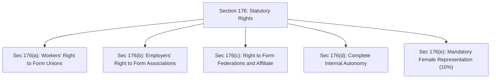
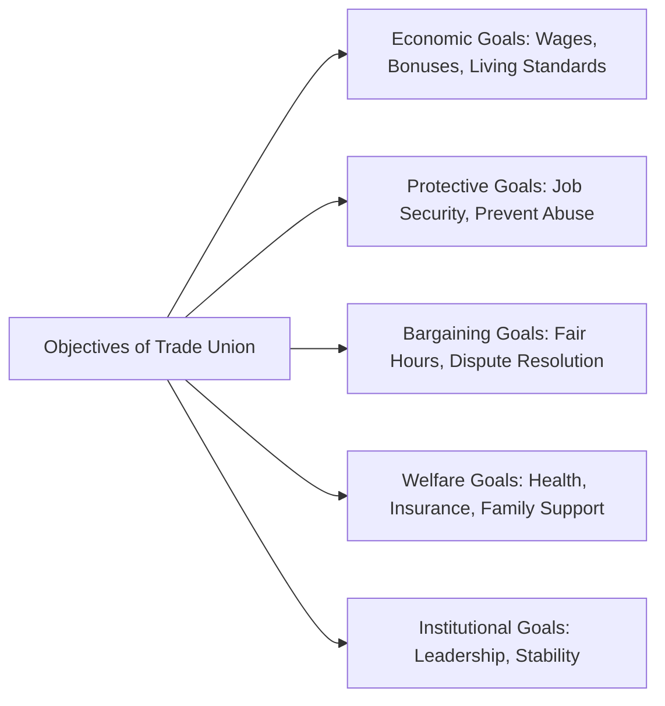
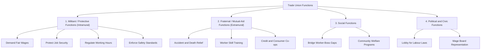

[← Previous: L09.1: Termination of Employment (Sections 20 to 27)](L09.1_Termination_of_Employment_Sec_20_to_27.md) | [🏠 Index](00_Index.md) | [Next: L10.2: Trade Union Registration and Cancellation →](L10.2_Trade_Union_Registration_and_Cancellation.md)

---

# L10.1: Trade Union Basics, Objectives, and Functions

> **Section:** Section A (CO1 · Legal Issues · Shoaib Islam Sir) | **Priority:** 🔴 Essential | **Exam Frequency:** 2024 Final Q.3(a) (02m) · Prescribed in Voice Note
> **Subtopics Covered:** `L10.1` (Definition & Nature of a Trade Union · Sec 176), `L10.2` (Key Objectives of a Trade Union · 2024 Q.3(a)), `L10.3` (Functions of a Trade Union: Militant, Fraternal, Social, Political)
> **Sources:** SI Sir Notes (`Chapter-4.md`), SI Sir Slides (`Chapter-4 slide.md`), BLC 2006 (`Chapter XIII Sec 175–176`), Shoaib Sir Voice Note

## Why This Topic Matters

Trade unions protect workers against unfair treatment and managerial abuse. In the 2024 Final Exam, Question 3(a) asked directly for the key objectives of a trade union. Shoaib Sir also highlighted trade union functions in his final suggestion voice note. 

In your exam, you must clearly distinguish objectives from functions. Objectives are the ultimate goals a union wants to achieve. Functions are the day-to-day activities a union performs to reach those goals. Confusing the two costs marks quickly. This note gives you exact definitions, structured points, clear tables, and memory aids to score full marks.

---

## 📝 Key Definitions

> **Trade Union (Ordinary Meaning):** "In ordinary language the term 'Trade Union' means an association of workers." (SI Sir Notes, Chapter 4)

A trade union is a continuous body of workers. Workers unite to improve their job terms and increase their bargaining power.

> **Trade Union (Statutory Definition):** "Trade union means an association of workers or employers formed under Chapter XIII, and includes a federation of trade unions." (BLC 2006, Section 2(61) / Section 2(15))

Under Bangladesh labour law, both workers and employers can form trade unions. The statutory definition also includes federations of trade unions.

> **Trade Union (Bombay Industrial Relations Act, 1956):** "Trade Union means any combination, whether temporary or permanent, formed primarily to regulate the relations between workmen and employers, or between workmen and workmen, or between employers and employers, or for imposing restrictive conditions on the conduct of any trade or business, and includes any Federation of two or more Trade Unions." (SI Sir Notes & Slides, Chapter 4)

This broader definition emphasizes three relationships: worker to employer, worker to worker, and employer to employer. It also covers rules that control trade conditions.

> **Industrial Dispute:** "Industrial dispute means any dispute or difference between employers and employers, or between employers and workers, or between workers and workers, which is connected with the employment or non-employment or the terms of employment or with the conditions of work of any person." (BLC 2006, Section 2(62))

An industrial dispute is any formal disagreement over jobs, pay, or factory working conditions. Trade unions represent workers directly in these disputes.

---

## Nature of a Trade Union and Right to Form Unions (Section 176)

### 1. Why Workers Form Trade Unions

An individual worker has very little bargaining power against a wealthy factory owner. If a single worker asks for better pay, the owner can easily fire that worker. 

When workers organize into a trade union, they pool their collective strength. They negotiate as one united group. This collective bargaining balances power between capital and labour. It shields workers from unfair dismissals, low wages, and dangerous working conditions.

### 2. Definition of Worker in Chapter XIII (Section 175)

Section 175 broadens the definition of worker for trade union matters:

1. **Included Workers:** It includes any worker defined under Section 2(65). It also includes any worker who was laid off, retrenched, discharged, or dismissed in connection with an industrial dispute.
2. **Excluded Persons:** It strictly excludes three groups from forming or joining worker unions:
   - Security staff and watch and ward personnel.
   - Fire-fighting staff.
   - Confidential assistants to top management.

### 3. Statutory Rights Under Section 176

Section 176 of the Bangladesh Labour Act, 2006 guarantees basic rights to workers and employers:

1. **Workers' Right to Form Unions (Section 176(a)):**
   - All workers have the right to form and join trade unions of their own choice.
   - They do not need prior approval from the employer or the government.
   - The primary purpose is to regulate relations between workers and employers, or among workers.

2. **Employers' Right to Form Unions (Section 176(b)):**
   - Employers also have the statutory right to form their own trade associations or unions.
   - They use these associations to coordinate wage standards and represent industry interests.

3. **Right to Form Federations and Affiliate (Section 176(c)):**
   - Registered trade unions have the right to join together and form federations.
   - Trade unions and federations can affiliate with national and international worker bodies. Examples include the International Labour Organization (ILO) networks.

4. **Internal Autonomy (Section 176(d)):**
   - Trade unions have full democratic independence.
   - They write their own constitutions and rules.
   - They elect their officers freely without outside interference.
   - They organize their daily administration and plan their activities independently.

5. **Mandatory Female Representation (Section 176(e)):**
   - This rule was added by the 2013 Labour Amendment.
   - Suppose women make up at least 20% of the total workers in an establishment.
   - The union executive committee must then include at least 10% female members.
   - *Example:* Suppose a factory has 1,000 workers and 600 are women (60%). An executive committee of 20 officers must include at least 2 women.

> [!tip] Memory Hook: Section 176 Rights (`W-E-F-A-G`)
> Remember the five statutory rights under Section 176 using **W-E-F-A-G**:
> - **W** = Workers can form unions freely (`Sec 176(a)`).
> - **E** = Employers can form associations (`Sec 176(b)`).
> - **F** = Federations can form and affiliate abroad (`Sec 176(c)`).
> - **A** = Autonomy to write rules and elect leaders (`Sec 176(d)`).
> - **G** = Gender quota of 10% women if workforce has 20% women (`Sec 176(e)`).

---

## Key Objectives of a Trade Union

A trade union is set up to achieve clear long-term goals. In `Chapter-4.md`, course notes outline ten primary objectives. You can organize them into five logical groups:

### 1. Economic Objectives
1. **Improve Living Standards:** Secure living wages that keep pace with inflation and price hikes.
2. **Improve Financial Support:** Win fringe benefits, sickness allowances, pensions, and provident funds.
3. **Share Factory Profits:** Secure annual festival bonuses and statutory profit-sharing payments (WPPF).

### 2. Protective Objectives
4. **Protect Worker Interests:** Prevent wrongful discharges, arbitrary retrenchments, and unfair punishments.
5. **Prevent Exploitation:** Shield workers from unsafe overtime, hazardous tasks, and abusive supervisors.

### 3. Bargaining and Relational Objectives
6. **Negotiate Terms of Work:** Engage in collective bargaining over wages, shift hours, and leave policies.
7. **Promote Industrial Peace:** Build stable relations with management to avoid unnecessary factory shutdowns.

### 4. Welfare Objectives
8. **Provide Mutual Welfare:** Set up cooperative group funds, medical schemes, and death benefits for worker families.
9. **Improve Social Standing:** Elevate the dignity, respect, and social status of factory workers.

### 5. Institutional Objectives
10. **Build Leadership and Stability:** Train responsible worker leaders to run democratic workplace institutions.

---

## Core Functions of a Trade Union

While objectives describe what a union wants to accomplish, functions describe the real work a union does. Industrial management groups trade union functions into four recognized classes:

### 1. Militant or Protective Functions (Intramural)
These functions focus directly on factory conditions. They protect workers during daily employment:
- **Securing Fair Wages:** Demand pay scales that match worker skill, productivity, and rising living costs.
- **Defending Job Security:** Oppose wrongful retrenchments and dismissals. Compel employers to follow strict legal procedures under Section 20 and Section 23 of BLC 2006.
- **Regulating Working Hours:** Enforce statutory limits on daily shifts, rest intervals, and overtime pay.
- **Ensuring Workplace Safety:** Inspect work floors to ensure clean drinking water, fire exits, and safety guards on dangerous machines.
- **Direct Action when Law Permits:** Call for lawful strikes or picketing as a final tool during collective bargaining deadlocks.

### 2. Fraternal or Mutual-Aid Functions (Extramural)
These functions help workers outside the direct production line. They provide self-help and solidarity:
- **Accident and Death Relief:** Maintain mutual funds to support families when a worker gets injured or dies.
- **Education and Training:** Run night classes and technical training sessions to improve worker literacy and technical skills.
- **Cooperative Welfare:** Set up subsidized canteens, affordable housing schemes, and credit cooperatives to free workers from predatory moneylenders.
- **Recreation:** Organize cultural events, sports matches, and library rooms to build worker community.

### 3. Social Functions
These functions connect the union with the wider public:
- **Bridging the Communication Gap:** In large modern factories, workers rarely meet top executives. The union acts as a direct bridge. It brings worker grievances to executive attention before anger boils over.
- **Community Outreach:** Organize health drives, blood donations, and clean water campaigns in worker neighborhoods.

### 4. Political and Civic Functions
These functions give workers a voice in government policy:
- **Legislative Advocacy:** Lobby the national parliament for worker-friendly labour laws and safety codes.
- **Minimum Wage Representation:** Nominate worker delegates to the Minimum Wages Board. These delegates present real cost-of-living data to establish fair legal wage floors.

> [!tip] Memory Hook: Four Functions of a Trade Union (`M-F-S-P`)
> Remember the four core functions using **M-F-S-P**:
> - **M** = **Militant** (wages, job defense, safety, strikes inside the factory).
> - **F** = **Fraternal** (mutual aid, training, insurance, co-ops outside work).
> - **S** = **Social** (bridge worker-boss gap, community health and welfare).
> - **P** = **Political** (lobby for labour legislation, wage board seats).

---

## Comparison: Objectives vs. Functions of a Trade Union

Students often confuse objectives with functions. Use this clear contrast table in your exam answers:

| Feature / Dimension | Objectives of a Trade Union | Functions of a Trade Union |
| :--- | :--- | :--- |
| **Basic Meaning** | The ultimate goals and targets the union aims to achieve. | The actual operational tasks and activities the union performs. |
| **Question Answered** | *"What do we want to achieve?"* | *"What actions do we take every day?"* |
| **Time Horizon** | Long-term and visionary. | Short-term and ongoing operational work. |
| **Focus** | Desired outcomes (e.g., fair living standards, industrial harmony). | Practical methods (e.g., handling grievances, inspecting fire exits, running credit co-ops). |
| **Core Categories** | Economic, protective, bargaining, welfare, and institutional. | Militant (intramural), fraternal (extramural), social, and political. |
| **Typical Example** | Securing higher living standards and workplace safety. | Bargaining for pay raises, filing court appeals against unlawful firing, and providing emergency injury relief. |

---

## Exam Variants

| Year / Source | Question Summary | Marks | Key Focus / Takeaway |
| :--- | :--- | :---: | :--- |
| **2024 Final Q.3(a)** | List key objectives of the trade union. | 02 | List 4 to 6 concise, bulleted objectives covering wages, job security, bargaining, and welfare. |
| **Model Exam Q1** | Define trade union and state statutory rights under Section 176. | 02 | Give the Section 2(61) definition and the five Section 176 rights (`W-E-F-A-G`). |
| **Model Exam Q2** | Explain the four recognized categories of trade union functions. | 04 | Group functions into Militant, Fraternal, Social, and Political with workplace examples. |

---

## 🏆 Golden Questions (Past Exam Archive & Model Answers)

### 🎯 GQ1 · 2024 Final Q.3(a) · Key Objectives of a Trade Union (02 Marks)

> **Appeared:** 2024 Final Exam Question 3(a) · (02 Marks)

**Question:**
List the key objectives of the trade union.

**Full Answer:**

A trade union is organized to protect worker rights and maintain industrial harmony. The key objectives are:

1. **Improve Living Standards:** Secure fair living wages, festival bonuses, and retirement benefits for workers.
2. **Protect Worker Interests:** Safeguard workers against arbitrary dismissals, unlawful retrenchments, and unfair disciplinary action.
3. **Collective Bargaining:** Negotiate fair working hours, leave policies, and safe shift schedules with factory management.
4. **Prevent Exploitation:** Shield vulnerable workers from unfair labour practices and managerial harassment.
5. **Promote Industrial Peace:** Resolve labor disputes through peaceful bipartite talks and build mutual trust.
6. **Provide Mutual Welfare:** Establish group insurance funds, medical support, and educational assistance for worker families.
7. **Develop Worker Leadership:** Build democratic worker representation and stable leadership on the factory floor.

*(Tip: Writing 5 to 6 concise points earns full 2 marks.)*

---

### 🎯 GQ2 · Model Exam Question · Trade Union Definition & Rights Under Section 176 (02 Marks)

> **Appeared:** Prescribed Model Question · Shoaib Sir Voice Note Blueprint · (02 Marks)

**Question:**
Define Trade Union under the Bangladesh Labour Act, 2006. State the statutory rights of workers and employers to form and join trade unions under Section 176.

**Full Answer:**

#### 1. Statutory Definition (Section 2(61))
Under the Bangladesh Labour Act, 2006, a trade union means any association of workers or employers formed under Chapter XIII. The term also includes a federation of trade unions.

#### 2. Statutory Rights Under Section 176
Section 176 guarantees five basic rights:
1. **Workers' Right (Section 176(a)):** All workers can form and join trade unions of their choice without prior permission.
2. **Employers' Right (Section 176(b)):** Employers have the equal right to form and join employer associations.
3. **Federation and Affiliation (Section 176(c)):** Trade unions can combine into federations and affiliate with national or international worker organizations.
4. **Internal Autonomy (Section 176(d)):** Trade unions can write constitutions, elect representatives freely, and organize their activities.
5. **Gender Representation (Section 176(e)):** If women make up $\ge 20\%$ of workers, the executive committee must have $\ge 10\%$ women.

---

### 🎯 GQ3 · Model Exam Question · Four Categories of Trade Union Functions (04 Marks)

> **Appeared:** Prescribed Model Question · Shoaib Sir Voice Note Blueprint · (04 Marks)

**Question:**
Explain the core functions of a trade union in modern industry. Group these functions into their recognized categories.

**Full Answer:**

In modern industry, trade unions perform four distinct categories of functions:

#### 1. Militant or Protective Functions (Intramural)
These functions operate directly inside the factory to protect employment rights:
- **Wage Fixing:** Negotiate living wages and overtime pay that match worker skill and inflation.
- **Job Security:** Defend workers against unlawful dismissals and arbitrary retrenchments.
- **Regulating Hours:** Enforce statutory limits on daily shifts, rest intervals, and weekly holidays.
- **Workplace Safety:** Compel management to maintain fire exits, clean drinking water, and machinery guards.

#### 2. Fraternal or Mutual-Aid Functions (Extramural)
These functions support workers and their families outside regular job duties:
- **Emergency Relief:** Provide financial aid and insurance payouts in case of occupational injury or death.
- **Skill Training:** Organize technical classes and literacy programs to improve worker competence.
- **Cooperative Benefits:** Operate credit cooperatives and subsidized canteens to lower worker living costs.

#### 3. Social Functions
These functions connect factory staff with the wider community:
- **Bridging the Communication Gap:** Act as a direct communication channel between top management and factory-floor workers.
- **Community Welfare:** Run health camps, eye clinics, and sanitation campaigns in worker neighborhoods.

#### 4. Political and Civic Functions
These functions give organized labour a voice in government policy:
- **Legislative Advocacy:** Lobby lawmakers for stronger occupational safety rules and protective labour laws.
- **Wage Boards:** Nominate worker delegates to the Minimum Wages Board to help set lawful pay floors.

---

## ⚡ Exam Tips & Common Mistakes

1. **Do Not Mix Objectives and Functions:** Objectives are ultimate targets (e.g., fair living standards). Functions are concrete actions (e.g., collective bargaining, operating credit cooperatives). State this difference clearly if asked.
2. **Remember the Gender Quota Numbers:** Under Section 176(e), if women form $\ge 20\%$ of workers, the committee must have $\ge 10\%$ women. Write both numbers.
3. **Know Excluded Staff Under Section 175:** Security guards, fire-fighters, and confidential assistants cannot join worker trade unions. Mentioning this exclusion scores bonus credit.
4. **Short Answers Need Crisp Bullets:** For 2-mark questions like 2024 Q.3(a), provide 5 or 6 clear bullet points. Avoid writing long narrative paragraphs.

---

## 🔗 Related Topics

- [L09.1: Termination of Employment (Sections 20 to 27)](L09.1_Termination_of_Employment_Sec_20_to_27.md)
- [L10.2: Trade Union Registration and Cancellation](L10.2_Trade_Union_Registration_and_Cancellation.md)
- [L10.3: Trade Union Legal Status, Rights, and Applied Role](L10.3_Trade_Union_Legal_Status_Rights_and_Applied_Role.md)
- [L11.1: Collective Bargaining and CBA (Section 202)](L11.1_Collective_Bargaining_and_CBA_Sec_202.md)

---

[← Previous: L09.1: Termination of Employment (Sections 20 to 27)](L09.1_Termination_of_Employment_Sec_20_to_27.md) | [🏠 Index](00_Index.md) | [Next: L10.2: Trade Union Registration and Cancellation →](L10.2_Trade_Union_Registration_and_Cancellation.md)
