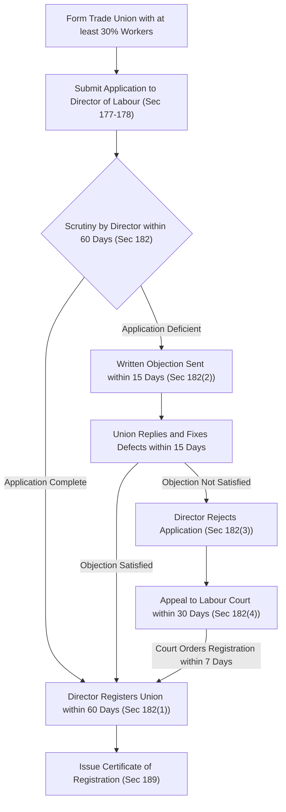

[← Previous: L10.1: Trade Union Basics, Objectives, and Functions](L10.1_Trade_Union_Basics_Objectives_and_Functions.md) | [🏠 Index](00_Index.md) | [Next: L10.3: Trade Union Legal Status, Rights, and Applied Role →](L10.3_Trade_Union_Legal_Status_Rights_and_Applied_Role.md)

---

# L10.2: Trade Union Registration and Cancellation

> **Section:** Section A (CO1 · Legal Issues · Shoaib Islam Sir) | **Priority:** 🔴 Essential | **Exam Frequency:** 2024 Final Q.3(b) (04m)
> **Subtopics Covered:** `L10.4` (Registration Process of a Trade Union · Sec 177–189), `L10.5` (Cancellation of Registration · Sec 190)
> **Sources:** SI Sir Notes (`Chapter-4.md`), SI Sir Slides (`Chapter-4 slide.md`), BLC 2006 (`Chapter XIII Sec 177–192`), `Topicwise_Answer/L10_Trade_Union.md`

## Why This Topic Matters

Trade union registration and cancellation are high-yield procedural topics under the Bangladesh Labour Act, 2006. The registration process appeared directly in the 2024 Final Exam as a 4-mark question. Shoaib Sir evaluates procedural questions with extreme strictness. Any wrong day count, wrong percentage, or wrong section number costs marks quickly. You must know the exact steps, the 30% membership threshold, and the 7 grounds for cancellation.

---

## 📝 Key Definitions

> **Registration of Trade Union:** "Registration of a trade union is the process by which the trade union gets the legal existence as an entity that is separated from its members." (SI Sir Notes & Slides, Chapter 4)

Registration gives an informal worker association independent legal standing. It turns the union into an artificial legal person under labor law.

> **Registrar of Trade Unions:** "The Registrar of Trade Unions ... shall mean the Director of Labour or any representative authorized by him in this behalf." (BLC 2006, Section 177(2))

The Director of Labour is the statutory authority who receives union applications. This office examines constitutions, verifies member lists, and grants registration certificates.

> **Registered Trade Union:** "Trade union means an association of workers or employers formed under Chapter XIII, and includes a federation of trade unions." (BLC 2006, Section 2(15) & Section 194)

A registered trade union is a union that has received a formal certificate of registration from the Director of Labour.

---

## Step-by-Step Registration Process (Sections 177 to 189)

An unregistered worker association has no legal status. Chapter XIII of the Bangladesh Labour Act, 2006 (BLA 2006) sets out a strict registration process.

### 1. Application for Registration (Section 177)

1. **Who Applies:** Any trade union may apply for registration.
2. **Authorized Signatures:** The application must carry the signatures of both the Chairman and the Secretary of the trade union.
3. **Receiving Authority:** The application goes to the Registrar of Trade Unions of the concerned area. Under Section 177(2), this authority is the Director of Labour or an authorized representative.

### 2. Requirements for the Application (Section 178)

Under Section 178, the application must include specific statements and official documents:

1. **Basic Union Particulars (Section 178(2)(a)):**
   - The name of the trade union.
   - The address of its head office.
   - The date of formation of the union.
   - The names, father's and mother's names, ages, addresses, jobs, and union posts of all officers.
   - A statement of all paying members.
   - The name of the establishment and total number of workers employed in it.
   - In the case of a federation, the names, addresses, and registration numbers of all member unions.
2. **Mandatory Enclosures (Section 178(2)(b)–(d)):**
   - Three copies of the constitution of the trade union.
   - A copy of the member resolution adopting the constitution, signed by the chairman of the meeting.
   - A copy of the member resolution authorizing the Chairman and Secretary to apply for registration.
   - For a federation, a copy of the resolution from each member union agreeing to join the federation.

### 3. Preconditions for Registration (Section 179)

Section 179 sets strict statutory conditions that the union and its constitution must satisfy before registration:

1. **Mandatory 30% Membership Threshold (Section 179(2)):**
   - A workers' union cannot register unless it has at least **30% of all workers** in the establishment.
   - If one employer runs several connected establishments for the same industry, they count as a single establishment.
   - *Why this rule exists:* It prevents weak paper unions. It also ensures that the union holds genuine bargaining strength.
2. **Verification of Membership (Section 179(2a)):**
   - The Director of Labour verifies the member list by visiting the establishment or checking official employer payroll records.
3. **Establishment Limit (Section 179(5)):**
   - No establishment or group of establishments may have more than **three registered trade unions** at any time.
4. **Mandatory Constitutional Terms (Section 179(1)):**
   - The trade union constitution must state the union name, address, and lawful objects.
   - It must specify fund sources and approved spending purposes.
   - It must include an admission form. The applicant declares they belong to no other union in the factory.
   - It must state member benefits and any conditions for fines or forfeiture.
   - It must provide for maintaining a member list with inspection rights for all members.
   - It must set rules for amending or repealing the constitution.
   - It must require safe maintenance of funds and an annual audit.
   - It must allow members and officers to inspect account books.
   - It must fix officer election rules for a term between 2 and 3 years.
   - It must set executive committee size between **5 and 35 members**.
   - It must outline a clear procedure for no-confidence motions against officers.
   - It must schedule executive committee meetings at least once every 3 months. General body meetings must happen at least once every year.

### 4. Disqualification of Officers and Members (Section 180)

A person cannot serve as an officer or member of a trade union if:

1. A court convicted them of a criminal offense involving moral turpitude, unless 2 years have passed since their release.
2. They do not work in the establishment where the union operates.
   - *Exception:* In nationalized industrial sectors, up to 10% of executive officers may be non-workers.

### 5. Mandatory Registers to Maintain (Section 181)

Every registered trade union must maintain three official books:

1. **Register of Members:** Records member names and membership dues paid.
2. **Accounts Book:** Shows all receipts and expenses.
3. **Minute Book:** Records all minutes of executive and general meetings.

### 6. Scrutiny, Timelines, and Labour Court Appeal (Section 182)

Section 182 governs the decision process of the Director of Labour:

1. **60-Day Mandate (Section 182(1)):**
   - The Director of Labour must register the union within **60 days** of receiving a complete application.
2. **Objections and Deficiencies (Section 182(2)):**
   - If the application has errors, the Director sends written objections within **15 days**.
   - The trade union must reply and correct the defects within **15 days** of receiving the notice.
3. **Decision (Section 182(3)):**
   - If the union fixes all defects, the Director registers the union.
   - If the union fails to fix the defects, the Director rejects the application.
4. **Appeal to the Labour Court (Section 182(4)–(5)):**
   - The union may appeal to the Labour Court within **30 days** of rejection or upon expiry of the 60-day limit.
   - The Labour Court hears the appeal. It may order the Director to register the union within **7 days**, or dismiss the appeal.
5. **Appeal to Labour Appellate Tribunal (Section 182(6)):**
   - Any aggrieved party may appeal against the Labour Court decision to the Tribunal within **30 days**.

### 7. Certificate of Registration (Section 189)

Under Section 189, the Director of Labour issues a formal certificate of registration. This certificate serves as **conclusive legal evidence** that the union is duly registered under Chapter XIII.

### 8. Legal Protection While Application Is Pending (Sections 186 & 187)

Employers cannot retaliate against workers who try to register a union:

1. **No Worsening of Service Terms (Section 186(1)):**
   - Registration protects union officers while the application is pending.
   - The employer cannot alter their service conditions to their disadvantage without prior written permission from the Director of Labour.
2. **No Simple Termination (Section 186(2)):**
   - The employer cannot terminate any union member under Section 26 while the registration application is pending.
3. **Protection Against Transfer (Section 187):**
   - The Chairman and General Secretary of a trade union cannot be transferred from one district to another without their consent.

---

## Cancellation of Registration (Section 190)

Registration gives legal status to a union. But the Director of Labour can cancel this registration under specific legal conditions.

### 1. Seven Statutory Grounds for Cancellation (Section 190(1))

Under Section 190(1), the Director of Labour may cancel union registration on seven grounds:

1. **Union Request:** The trade union itself applies in writing for cancellation.
2. **Dissolution:** The trade union has ceased to exist.
3. **Fraud or Deceit:** The union obtained registration through fraud or misrepresentation of facts.
4. **Constitutional Breach:** The union violated basic provisions of its own constitution.
5. **Unfair Labour Practice:** The union committed an unfair labour practice under Section 196.
6. **Loss of Minimum Membership:** Union membership fell below the statutory 30% threshold required under Section 179(2).
7. **Statutory Breach:** The union violated any provision of Chapter XIII of BLA 2006 or the Labour Rules.

### 2. Mandatory Procedure: Prior Permission from Labour Court (Section 190(2)–(4))

The Director of Labour cannot cancel union registration on personal whim:

1. **Inquiry and Application (Section 190(2)):**
   - The Director conducts an inquiry into the allegations.
   - If satisfied that cancellation is necessary, the Director must apply to the **Labour Court** for prior permission.
2. **Cancellation Timeline (Section 190(3)):**
   - Upon receiving permission from the Labour Court, the Director must cancel the registration within **30 days**.
3. **Three-Month Limit for Unfair Labour Practices (Section 190(4)):**
   - For an unfair labour practice, the cancellation request must reach the Labour Court within **3 months**.

### 3. Right of Appeal and Interim Protection (Section 191)

1. **Appeal to the Tribunal (Section 191(1)):**
   - Any aggrieved party may appeal to the Labour Appellate Tribunal within **30 days** of the order. The Tribunal decision is final.
2. **Interim Right to Function (Section 191(2)):**
   - While an appeal is pending before the Tribunal, the trade union may continue operating normally.

### 4. Legal Effect of Cancellation (Section 192)

1. **No Operation:** An unregistered union or a union whose registration is cancelled cannot function as a trade union.
2. **No Fund Collection:** No person may collect funds for an unregistered or cancelled union. Only normal entry fees for a new union are allowed.

> [!tip] Memory Hook: **15-15-60-30-7 Timeline Chain**
> Master the registration timeline with this chain:
> - **15 Days** $\rightarrow$ Director sends written objection to defects.
> - **15 Days** $\rightarrow$ Union replies and cures defects.
> - **60 Days** $\rightarrow$ Statutory deadline for Director to register the union.
> - **30 Days** $\rightarrow$ Time to appeal rejection to the Labour Court.
> - **7 Days** $\rightarrow$ Labour Court deadline ordering Director to register the union.

> [!tip] Memory Hook: **R-D-F-C-U-M-S (The 7 Grounds for Cancellation)**
> Remember the word **R-D-F-C-U-M-S** to list all 7 grounds under Section 190(1):
> - **R** $\rightarrow$ **R**equest by the union itself.
> - **D** $\rightarrow$ **D**issolution (union ceased to exist).
> - **F** $\rightarrow$ **F**raud or misrepresentation.
> - **C** $\rightarrow$ **C**onstitution basic rules violated.
> - **U** $\rightarrow$ **U**nfair labour practice committed (3-month filing limit).
> - **M** $\rightarrow$ **M**embership fell below the mandatory 30% mark.
> - **S** $\rightarrow$ **S**tatutory breach of Chapter XIII or Labour Rules.

---

## Exam Variants

| Year / Source | Question / Scenario | Marks | Key Focus / Takeaway |
| :--- | :--- | :---: | :--- |
| **2024 Final Q.3(b)** | Explain the process of registration of a trade union under BLC 2006. | 04 | Sec 177 to 189: Application, 30% threshold, 60-day limit, objections, certificate. |
| **Model Question 1** | State preconditions for registration and the 30% membership rule under Sec 179. | 04 | Mandatory 30% threshold, constitution rules, max 3 unions limit. |
| **Model Question 2** | State the 7 grounds and procedure for cancellation of registration under Sec 190. | 03 / 04 | Sec 190(1) grounds + Labour Court permission rule + Sec 191 appeal. |

---

## 🏆 Golden Questions (Past Exam Archive & Model Answers)

### 🎯 GQ1 · 2024 Q.3(b) · Registration Process of a Trade Union (04 Marks)

> **Appeared:** 2024 Final Exam · Question 3(b) · Section A · CO1 · (04 Marks)

**Question:**

Explain the process of registration of a trade union as outlined in the Bangladesh Labor Code 2006.

**Full Answer:**

Under Chapter XIII of the Bangladesh Labour Act, 2006, the registration process involves the following statutory steps:

**1. Application for Registration (Section 177):**
- The union Chairman and Secretary sign the application. They submit it to the Registrar of Trade Unions (Director of Labour).

**2. Particulars Accompanying Application (Section 178):**
- The application must provide the union name, head office address, and date of formation.
- It must state the names, parents' names, ages, addresses, jobs, and union posts of all officers.
- It must state total paying members, establishment name, and total workers employed.
- It must include three copies of the union constitution. It also needs member resolutions adopting the rules and authorizing officers to apply.

**3. Statutory Preconditions (Section 179):**
- **30% Threshold (Section 179(2)):** The trade union must represent at least **30% of total workers** in the establishment.
- **Constitutional Rules (Section 179(1)):** The constitution must set lawful objects, fund safety, and annual general meetings. It must also fix an executive committee of 5 to 35 members.
- **Establishment Limit (Section 179(5)):** An establishment can have at most three registered trade unions.

**4. Scrutiny, Timelines, and Appeal (Section 182):**
- **60-Day Mandate (Section 182(1)):** The Director of Labour must register the union within 60 days of receiving the application.
- **Objections (Section 182(2)):** If the application has errors, the Director issues written objections within 15 days. The union must reply within 15 days.
- **Appeal (Section 182(4)–(5)):** If the Director rejects the application, the union may appeal to the Labour Court within 30 days. The Labour Court can direct registration within 7 days.

**5. Certificate of Registration (Section 189):**
- The Director of Labour issues a certificate of registration. This certificate serves as conclusive evidence of valid registration.

---

### 🎯 GQ2 · Model Exam Question 1 · Preconditions for Registration and the 30% Threshold (04 Marks)

> **Appeared:** Suggested Exam Topic · Chapter 4 · Target: Section A Part (b) or (c) · (04 Marks)

**Question:**

What are the statutory preconditions for trade union registration under Section 179 of BLA 2006? Explain the mandatory 30% membership threshold.

**Full Answer:**

Under **Section 179** of the Bangladesh Labour Act, 2006, a trade union must satisfy several strict statutory conditions before registration:

**1. Mandatory 30% Membership Threshold (Section 179(2)):**
- A workers' trade union must enroll at least **30% of total workers** employed in the establishment.
- Where one employer runs several connected establishments for the same industry, they count as one establishment.
- *Legal Objective:* This minimum requirement stops employers from creating fake paper unions. It ensures the registered union has real collective bargaining power.
- *Verification (Section 179(2a)):* The Director of Labour verifies this threshold by visiting the workplace or inspecting company records.

**2. Mandatory Constitutional Provisions (Section 179(1)):**
The union constitution must include:
1. **Objects and Funds:** Clear statements of lawful union objects, fund sources, and permissible spending.
2. **Membership Admission and No Dual Membership:** Every applicant must sign a declaration. The worker must state that they belong to no other union in that establishment.
3. **Meetings:** Executive committee meetings at least once every 3 months. General body meetings at least once every year.
4. **Election and Terms:** Election of officers for a term between 2 and 3 years.
5. **Executive Size:** An executive committee of 5 to 35 members.
6. **Safe Custody and Audit:** Union funds must stay secure with an annual audit. Members keep the right to inspect account books.
7. **No-Confidence Rule:** A clear procedure for no-confidence motions against officers.

**3. Maximum Limit on Unions (Section 179(5)):**
- No establishment or group of establishments may have more than three registered trade unions at any time.

---

### 🎯 GQ3 · Model Exam Question 2 · Cancellation of Registration of Trade Union (04 Marks)

> **Appeared:** Suggested Exam Topic · Chapter 4 · Target: Section A Part (b) · (04 Marks)

**Question:**

On what grounds can the Director of Labour cancel trade union registration under Section 190 of BLA 2006? State the mandatory cancellation procedure and appeal rights.

**Full Answer:**

Under **Section 190** of BLA 2006, the Director may cancel union registration under strict court oversight.

**1. Seven Grounds for Cancellation (Section 190(1)):**
1. **Application by Union:** The trade union applies for its own cancellation.
2. **Dissolution:** The trade union has ceased to exist.
3. **Fraud:** The union obtained registration through fraud or false statements.
4. **Constitutional Violation:** The union violated basic provisions of its constitution.
5. **Unfair Labour Practice:** The union committed an unfair labour practice under Section 196.
6. **Loss of Minimum Membership:** Union membership fell below the statutory 30% threshold.
7. **Statutory Breach:** The union breached any provision of Chapter XIII or the Labour Rules.

**2. Mandatory Procedure (Section 190(2)–(4)):**
- The Director of Labour cannot cancel registration on personal discretion.
- The Director must hold an inquiry and submit an application to the **Labour Court** praying for permission.
- The Director must cancel registration within **30 days** of receiving Labour Court permission.
- For unfair labour practices, the application must reach the Labour Court within **3 months** of the incident.

**3. Appeal and Protection (Section 191):**
- An aggrieved party may appeal to the Labour Appellate Tribunal within **30 days**.
- Under Section 191(2), the trade union may continue operating until the Tribunal resolves the appeal.

---

## ⚡ Exam Tips & Common Mistakes

1. **Remember the 30% Rule:** Always cite Section 179(2). Never write "majority of workers" or "50%". The statutory threshold in Bangladesh is strictly **30% of total workers**.
2. **Do Not Forget the Labour Court Rule:** For Section 190 cancellation, never say the Director acts alone. The Director always needs prior permission from the **Labour Court**.
3. **Write the Exact Timeline:** Remember `15 -> 15 -> 60 -> 30 -> 7`. Mentioning these exact day counts scores top marks from Shoaib Sir.
4. **Limit on Unions:** Always note Section 179(5). No establishment can have more than **three** registered trade unions.

---

## 🔗 Related Topics

- [L10.1: Trade Union Basics, Objectives, and Functions](L10.1_Trade_Union_Basics_Objectives_and_Functions.md)
- [L10.3: Trade Union Legal Status, Rights, and Applied Role](L10.3_Trade_Union_Legal_Status_Rights_and_Applied_Role.md)
- [L11.1: Collective Bargaining and CBA (Section 202)](L11.1_Collective_Bargaining_and_CBA_Sec_202.md)
- [L12.1: Unfair Labour Practices (Sections 195 & 196)](L12.1_Unfair_Labour_Practices_Sec_195_and_196.md)

---

[← Previous: L10.1: Trade Union Basics, Objectives, and Functions](L10.1_Trade_Union_Basics_Objectives_and_Functions.md) | [🏠 Index](00_Index.md) | [Next: L10.3: Trade Union Legal Status, Rights, and Applied Role →](L10.3_Trade_Union_Legal_Status_Rights_and_Applied_Role.md)
