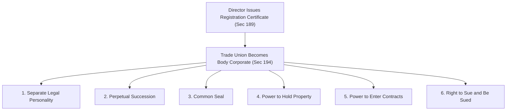
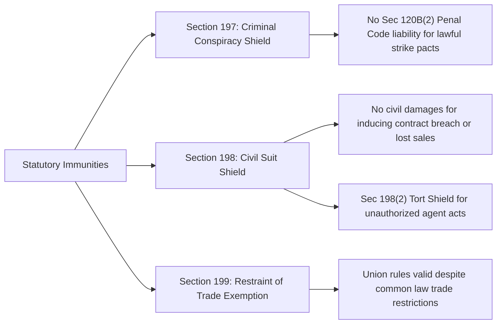
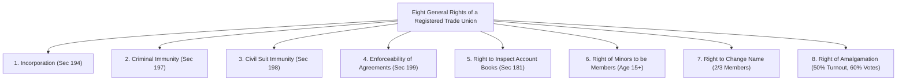
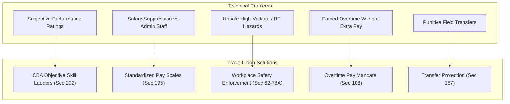

[← Previous: L10.2: Trade Union Registration and Cancellation](L10.2_Trade_Union_Registration_and_Cancellation.md) | [🏠 Index](00_Index.md) | [Next: L11.1: Collective Bargaining and CBA (Section 202) →](L11.1_Collective_Bargaining_and_CBA_Sec_202.md)

---

# L10.3: Trade Union Legal Status, Rights, and Applied Role

> **Section:** Section A (CO1 · Legal Issues · Shoaib Islam Sir) | **Priority:** 🔴 Essential | **Exam Frequency:** 2024 Final Q.8(c) (04m) · Prescribed in Voice Note
> **Subtopics Covered:** `L10.6` (Legal Status & Incorporation · Sec 194), `L10.7` (Rights & Privileges: Sec 197–199 & 8 General Rights), `L10.8` (Applied: Preventing Bias Against Technical Staff · 2024 Q.8(c))
> **Sources:** SI Sir Notes (`Chapter-4.md`), SI Sir Slides (`Chapter-4 slide.md`), BLC 2006 (`Chapter XIII Sec 194, 197–199`), Shoaib Sir Voice Note

## Why This Topic Matters

Registration gives a trade union real legal power. Without registration, workers have no corporate identity or property rights. They also lack legal protection during strikes or collective talks. 

Shoaib Sir emphasized in his final suggestion voice note that Chapter 4 questions test applied legal reasoning. In the 2024 Final Exam, Question 8(c) tested how trade unions prevent workplace bias against technical personnel. In this note, you will master corporate status under Section 194 and statutory immunities under Sections 197 to 199. You will also learn the eight general rights and the four-step case framework.

---

## 📝 Key Definitions

> **Incorporation of Trade Union:** "Every registered trade union shall be a body corporate by the name under which it is registered, and it shall have perpetual succession and a common seal, and shall have power to enter into contract and to acquire, hold and dispose of property, both movable and immovable, and shall by the said name sue or be sued." (BLC 2006, Section 194(1))

Registration creates a separate legal person. The trade union exists independently from the workers who belong to it.

> **Immunity from Criminal Conspiracy:** "No officer or member of a trade union or a collective bargaining agent shall be liable to punishment under section 120B(2) of the Penal Code, 1860 ... in respect of any agreement made between the members thereof for the purpose of furthering any such object of the trade union ... unless the agreement is an agreement to commit an offence." (BLC 2006, Section 197)

Union members can agree to stop work or demand higher wages without facing criminal conspiracy charges. But this protection does not cover real criminal offenses.

> **Immunity from Civil Suit:** "No suit or other legal proceedings shall lie against any trade union or collective bargaining agent or its any officer or member in respect of any act done or action taken in contemplation or furtherance of an industrial dispute to which the trade union is a party on any of the following grounds only: (a) such act induces any person to break a contract of employment; (b) such act interferes with trade, business or employment of some other person; or (c) such act fails the right of any person to apply his capital or labour at his discretion." (BLC 2006, Section 198(1))

Employers cannot sue registered unions in civil court for economic losses caused by lawful trade disputes.

> **Enforceability of Agreements:** "Even if other laws say otherwise, an agreement between the members of a trade union shall not be void or voidable by reason only that any of its objects is a restraint for any trade and commerce." (BLC 2006, Section 199)

Internal union agreements remain legally valid even if they restrict trade or business.

---

## Legal Status and Incorporation of a Registered Trade Union (Section 194)

### 1. The Transformation at Registration

Before registration, a trade union is only an informal club of workers. It has no legal standing. It cannot own land, open a corporate bank account, or file a court claim in its own name.

The Director issues the certificate under Section 189. Then, Section 194 turns the union into an artificial legal person.

### 2. Six Core Corporate Attributes Under Section 194(1)

1. **Body Corporate with Separate Identity:**
   - The registered trade union exists as a distinct legal person under its registered name.
   - Its assets and debts belong to the union itself, not to its individual worker members.

2. **Perpetual Succession:**
   - The union enjoys unbroken life.
   - Workers may join, quit, retire, or pass away. Executive leaders may change during elections. None of these changes affect the legal existence of the union.

3. **Common Seal:**
   - The union possesses its own official seal.
   - The seal acts as the signature of the corporate entity on formal deeds, contracts, and legal notices.

4. **Power to Acquire, Hold, and Dispose of Property:**
   - The union can buy and own movable property (office furniture, bank accounts, vehicles).
   - It can also own immovable property (office land, union buildings).
   - It can sell, lease, or mortgage these properties in its own registered name.

5. **Power to Enter into Contracts:**
   - The union can enter into valid commercial contracts.
   - It can sign office leases, purchase supplies, hire lawyers, and contract with service providers.

6. **Right to Sue and Be Sued:**
   - The union can file lawsuits in court in its own registered name.
   - Outside parties and employers can also sue the trade union directly under that name.

### 3. Exclusion of General Corporate Laws (Section 194(2))

Section 194(2) states that general corporate statutes do not apply to registered trade unions:
- The Societies Registration Act, 1860.
- The Co-operative Societies Ordinance, 1985.
- The Companies Act, 1994.

Any trade union registration under these general corporate laws is null and void. A trade union can only exist and register under the Bangladesh Labour Act.

> [!tip] Memory Hook: Six Corporate Traits (`B-P-C-P-C-S`)
> Remember the six corporate traits under Section 194(1) using **B-P-C-P-C-S**:
> - **B** = **Body Corporate** (separate legal entity).
> - **P** = **Perpetual Succession** (unbroken existence).
> - **C** = **Common Seal** (official corporate signature).
> - **P** = **Property Power** (buy, hold, and sell movable and immovable assets).
> - **C** = **Contract Power** (enter legally binding agreements).
> - **S** = **Sue and Be Sued** (stand as plaintiff or defendant in court).

---

## Rights and Privileges of a Registered Trade Union

The Bangladesh Labour Act, 2006 grants special protections to registered unions. Without these rights, employers could use regular criminal and civil courts to shut down strikes and collective bargaining talks.

### 1. Three Core Statutory Immunities (Sections 197 to 199)

#### A. Immunity from Criminal Conspiracy (Section 197)
- Under Section 120B(2) of the Penal Code 1860, an agreement to commit an unlawful act is a criminal conspiracy.
- In ordinary law, an agreement among workers to stop work could count as a criminal conspiracy.
- Section 197 creates a complete shield. No officer or member faces prosecution under Section 120B(2) for agreements made to pursue constitutional union objects.
- *The Exception:* This shield fails if members agree to commit an actual crime. Arson, assault, and vandalism receive no legal protection.

#### B. Immunity from Civil Suits in Trade Disputes (Section 198)
- During strikes and labour protests, employers often suffer large financial losses. Under common law, employers could sue unions for inducing breach of employment contracts or interfering with business sales.
- Section 198(1) bars civil courts from hearing any lawsuit against a registered union or its officers on three specific grounds:
  1. Inducing another person to break an employment contract.
  2. Interfering with the trade, business, or employment of another person.
  3. Interfering with the right of any person to dispose of capital or labour freely.
- *Tort Liability Shield (Section 198(2)):* A union is not liable in civil court for torts committed by an agent. This shield applies if the agent acted without executive knowledge or against express orders.

#### C. Enforceability of Agreements in Restraint of Trade (Section 199)
- Section 27 of the Contract Act 1872 states that agreements in restraint of trade are void.
- Trade union rules often tell members not to work below a certain wage or not to accept certain job conditions.
- Section 199 overrides ordinary contract law. Internal union agreements remain valid even if their terms restrain trade or business.
- *Statutory Limit:* Civil courts cannot award financial damages if a member breaks internal rules on selling goods or providing labor.

---

### 2. The Eight General Rights Recognized in Course Notes

In `Chapter-4.md`, SI Sir compiles eight essential rights and privileges of registered trade unions:

| # | Right / Privilege | Statutory Basis | Specific Conditions and Rules |
| :---: | :--- | :--- | :--- |
| **1** | **Incorporation** | Section 194 | Gains corporate status, perpetual succession, common seal, property rights, and power to sue or be sued. |
| **2** | **Criminal Immunity** | Section 197 | Protected against Section 120B(2) Penal Code conspiracy charges for lawful union agreements. |
| **3** | **Civil Suit Immunity** | Section 198 | Civil courts cannot award damages for inducing contract breach or interfering with business sales. |
| **4** | **Enforceability of Agreements** | Section 199 | Internal member agreements remain valid despite general rules against restraint of trade. |
| **5** | **Inspection of Account Books** | Section 181 | Any union officer or member has the right to inspect union account books and membership registers at designated times. |
| **6** | **Minor Membership** | Course Notes & BLC | Any worker aged **15 years or older** can join a registered trade union and enjoy full membership privileges. Under labour law, minor means a person under 18 years. |
| **7** | **Change of Name** | Course Notes & BLC | A registered union can change its name if: (1) at least **two-thirds ($2/3$)** of total members agree; and (2) the proposed new name is not identical to any existing registered union. |
| **8** | **Amalgamation of Unions** | Course Notes & BLC | Two or more registered trade unions can merge into a single union if: (1) at least **50% of eligible members** record their votes; and (2) at least **60% of recorded votes** support the merger. |

> [!tip] Memory Hook: Eight Rights (`3 Immunities + 5 Organizational Powers`)
> Split the eight rights into two neat groups:
> - **3 Legal Immunities:** Criminal conspiracy shield (`Sec 197`), civil suit shield (`Sec 198`), restraint of trade validity (`Sec 199`).
> - **5 Organizational Powers:** Corporate status (`Sec 194`), book inspection (`Sec 181`), minor membership (age 15+), name change ($2/3$ vote), amalgamation.

---

## Applied Role: Preventing Workplace Bias Against Technical Staff

### 1. The Applied Challenge in ECE and Engineering Workplaces

Technical staff in engineering plants, telecom operators, and automated factories face specific workplace challenges:
- **Salary Gaps:** Technical field engineers often receive lower base salaries than administrative or sales managers with equal experience.
- **Subjective Appraisals:** Performance ratings often depend on personal manager bias rather than verifiable technical metrics (uptime, bug fixes, system reliability).
- **Hazardous Duties:** Technical staff often handle high-voltage switchgear, climb microwave towers, or work near RF radiation without adequate safety gear.
- **Uncompensated Night Shifts:** Management frequently orders engineers to perform midnight firmware updates or emergency fiber repairs without statutory overtime pay.
- **Arbitrary Transfers:** Employers may threaten outspoken junior engineers with sudden transfers to remote field stations.

---

### 2. How Trade Unions Protect Technical Personnel

Trade unions use five legal tools to eliminate managerial bias against technical staff:

1. **Worker Status Under Section 2(65):**
   - Section 2(65) defines any person employed for technical, skilled, manual, or clerical work as a "worker".
   - Unless an engineer holds executive hire-and-fire authority, the engineer is legally a worker. The engineer enjoys full protection under the Bangladesh Labour Act.

2. **Prohibition of Unfair Labour Practices (Section 195):**
   - Under Section 195(b) and 195(c), employers cannot discriminate against any worker in recruitment, promotion, or working conditions.
   - Management might bypass a technician for demanding safety gear. The union can file an unfair labour practice complaint before the Labour Court.

3. **Objective Promotion Ladders via CBA (Section 202):**
   - Through Collective Bargaining Agreements, the union negotiates objective promotion rules.
   - Promotions depend on skill certifications, exam scores, and verifiable project delivery rather than managerial favoritism.

4. **Safety and Overtime Enforcement (Sections 62 to 78A and Section 108):**
   - The union monitors physical factory floors and transmitter sites.
   - It compels management to supply personal protective equipment (PPE), insulated gloves, and safety harnesses.
   - It also enforces Section 108. Section 108 guarantees double the ordinary basic wage rate for all overtime hours worked.

5. **Transfer Protection (Section 187):**
   - Section 187 prohibits the transfer of union officers from one district to another without their consent.
   - This prevents employers from banishing technical union leaders to isolated outposts.

---

### 3. Critical Evaluation: Benefits vs. Potential Limitations

In analytical exam questions, Shoaib Sir looks for a balanced critical evaluation:

#### Positive Benefits
- **Collective Bargaining Strength:** Individual junior engineers have little power against multi-million dollar corporations. The union gives them collective negotiating weight.
- **Legal Defense:** Unions provide legal counsel and cover court expenses when technicians face wrongful discharge.
- **Pay Equity:** Unions eliminate arbitrary pay differences between departments through transparent salary scales.

#### Potential Limitations and Risks
- **Dominance by Non-Technical Workers:** In general industrial plants, non-technical manual workers outnumber technical staff. General union leaders may focus only on basic manual wages and overlook specialized engineering hazards.
- **Rigid Seniority Rules:** Trade unions often prefer promotion based strictly on years of service. This seniority system can frustrate talented young engineers who deserve faster promotion based on exceptional skill.
- **Resistance to New Automation:** Some unions resist automated tools out of fear of job cuts. This resistance can slow down technical productivity.

#### Practical Recommendation for ECE Engineers
Technical staff must not avoid trade union activities. Under Section 179(1)(k), technical professionals should stand for election to executive committee seats. Active involvement ensures collective bargaining agreements reflect engineering safety, skill-based pay, and professional development.

---

## Exam Variants

| Year / Source | Question Summary | Marks | Key Focus / Takeaway |
| :--- | :--- | :---: | :--- |
| **2024 Final Q.8(c)** | Critically evaluate role of trade unions in preventing bias against technical staff. | 04 | Use 4-step framework: context, legal sections (`Sec 2(65), 195, 202`), critical review (benefits vs. limits), direct conclusion. |
| **Model Exam Q1** | Explain legal status and incorporation of a registered trade union under Section 194. | 04 | State the six corporate attributes (`B-P-C-P-C-S`) and the exclusion of general corporate statutes under `Sec 194(2)`. |
| **Model Exam Q2** | Discuss statutory immunities under Sections 197–199 and the eight general rights. | 04 | Cover criminal conspiracy shield (`Sec 197`), civil suit shield (`Sec 198`), restraint of trade (`Sec 199`), and key voting quorums. |

---

## 🏆 Golden Questions (Past Exam Archive & Model Answers)

### 🎯 GQ1 · 2024 Final Q.8(c) · Role of Trade Unions in Preventing Bias Against Technical Staff (04 Marks)

> **Appeared:** 2024 Final Exam Question 8(c) · Section B · CO1 · (04 Marks)

**Question:**
Critically evaluate the role of trade unions in preventing workplace discrimination or bias agent technical staff.  
*(Note: "bias agent" is printed in original exam paper; refers to "bias against")*

**Full Answer:**

We evaluate this applied scenario using the four-step legal framework:

#### 1. Facts and Workplace Context
Technical personnel in engineering plants, telecom operators, and automated factories face unique workplace challenges. Common biases include wage gaps compared to office staff, subjective promotions, and unpaid night shifts. Technicians may also face high-voltage hazards without proper gear.

#### 2. Applicable Law and Statutory Sections
- **Section 2(65) of BLC 2006:** Classifies technical, skilled, and manual employees as statutory "workers".
- **Section 195(b)–(c) of BLC 2006:** Outlaws employer discrimination in hiring, promotion, or working conditions as an Unfair Labour Practice.
- **Section 202(24)(a) of BLC 2006:** Authorizes the CBA to negotiate binding agreements on wages and promotion rules.
- **Sections 108 & 187 of BLC 2006:** Guarantees double overtime pay and shields union officers against arbitrary district transfers.

#### 3. Critical Evaluation
- **Positive Protective Role:**
  1. *Objective Promotion Criteria:* Unions negotiate transparent promotion ladders based on technical certifications and exam benchmarks rather than managerial favoritism.
  2. *Standardized Salary Scales:* Collective agreements establish clear salary bands that prevent wage suppression against junior engineers.
  3. *Safety Enforcement:* Unions compel employers to supply certified safety gear under Sections 62 to 78A. They enforce safe shop-floor conditions.
  4. *Legal Representation:* An employer might fire an engineer for refusing unsafe work. The union finances legal defense before the Labour Court.
- **Limitations and Risks:**
  1. General unions are often dominated by manual staff who may overlook specialized technical safety concerns like RF radiation.
  2. Strict seniority-based promotion rules favored by unions can slow down career progression for high-performing young engineers.

#### 4. Direct Conclusion
Trade unions serve as an essential collective shield against managerial bias for technical staff. Under BLC 2006, unions convert individual vulnerability into collective bargaining strength. Technical personnel should run for union executive seats under Section 179(1)(k). This ensures collective agreements reflect engineering safety, fair pay, and objective merit.

---

### 🎯 GQ2 · Model Exam Question · Legal Status & Corporate Personality (04 Marks)

> **Appeared:** Prescribed Model Question · Shoaib Sir Voice Note Blueprint · (04 Marks)

**Question:**
State the legal status of a registered trade union under Section 194 of the Bangladesh Labour Act, 2006. What corporate attributes arise upon registration?

**Full Answer:**

Under **Section 194** of the Bangladesh Labour Act, 2006, registration converts an informal worker association into an independent legal entity.

#### 1. Six Corporate Attributes (Section 194(1))
1. **Body Corporate:** Every registered trade union becomes a body corporate under its registered name. It exists as an artificial legal entity separate from its members.
2. **Perpetual Succession:** The union enjoys unbroken continuity. Changes in leadership, worker resignations, or deaths do not affect its legal existence.
3. **Common Seal:** The union possesses an official common seal. It uses this seal to authenticate formal contracts, deeds, and official documents.
4. **Power to Hold Property:** The union can acquire, hold, and sell property. This covers movable assets (vehicles, accounts) and immovable assets (land, buildings).
5. **Power to Contract:** The union can enter into legally binding contracts in its own corporate name.
6. **Right to Sue and Be Sued:** The union can file court cases in its registered name. Outside parties and employers can also sue the union under that name.

#### 2. Exclusion of General Corporate Laws (Section 194(2))
General corporate statutes do not apply to registered trade unions:
- The Societies Registration Act, 1860.
- The Co-operative Societies Ordinance, 1985.
- The Companies Act, 1994.

Any trade union registration under these general corporate laws is void. A trade union can only exist and register under Chapter XIII of the Bangladesh Labour Act.

---

### 🎯 GQ3 · Model Exam Question · Statutory Immunities & General Rights (04 Marks)

> **Appeared:** Prescribed Model Question · Shoaib Sir Voice Note Blueprint · (04 Marks)

**Question:**
Explain the statutory immunities of a registered trade union under Sections 197 to 199 of BLC 2006. Also list its key general rights.

**Full Answer:**

The Bangladesh Labour Act grants trade unions statutory immunities. These shields allow unions to lead trade disputes without fear of common-law liability.

#### 1. Three Statutory Immunities (Sections 197 to 199)
1. **Immunity from Criminal Conspiracy (Section 197):**
   - Union leaders and members are immune from criminal conspiracy under Section 120B(2) of the Penal Code 1860. This shield covers lawful agreements pursuing union objects.
   - *Exception:* This immunity does not protect any agreement to commit an actual criminal offense.
2. **Immunity from Civil Suit (Section 198):**
   - Civil courts cannot entertain lawsuits against a union or its officers during a trade dispute on these grounds:
     - Inducing breach of an employment contract.
     - Interfering with trade, business, or employment of another person.
     - Interfering with another person's right to dispose of capital or labour.
   - *Tort Shield (Section 198(2)):* The union is not liable for agent torts done without executive knowledge or against express orders.
3. **Enforceability of Agreements in Restraint of Trade (Section 199):**
   - Internal union agreements are not void or voidable merely because their objects restrain trade or commerce.

#### 2. Key General Rights from Course Notes
- **Inspection of Account Books (Section 181):** Officers and members may inspect union account books and member rolls at scheduled times.
- **Minor Membership:** Any worker aged 15 or older can become a union member and enjoy full membership privileges.
- **Change of Name:** A union may change its name if at least two-thirds ($2/3$) of total members agree. The new name must be unique.
- **Amalgamation:** Two or more unions may merge if at least 50% of eligible members vote. At least 60% of recorded votes must support the merger.

---

## ⚡ Exam Tips & Common Mistakes

1. **State Exact Voting Quorums:** For name changes, write **$2/3$ of total members**. For amalgamation, write **$\ge 50\%$ voter turnout** and **$\ge 60\%$ recorded votes in favor**. Missing these numbers loses marks.
2. **Minor Age Rule:** Minors can join a trade union at age **15 or older**. Under the Trade Unions Act, a minor is any person under **18 years**. State both ages clearly.
3. **Use the 4-Step Framework for Applied Questions:** When answering 2024 Q.8(c) or similar case questions, always organize your answer into:
   - 1. Facts and Workplace Context
   - 2. Applicable Law and Sections
   - 3. Critical Evaluation (Benefits vs. Limitations)
   - 4. Direct Conclusion
4. **Know Exceptions to Immunity:** Section 197 shields against conspiracy charges, but never against real crimes like violence or property damage. Section 198(2) protects against agent torts only if the agent acted without executive knowledge or against clear orders.

---

## 🔗 Related Topics

- [L10.1: Trade Union Basics, Objectives, and Functions](L10.1_Trade_Union_Basics_Objectives_and_Functions.md)
- [L10.2: Trade Union Registration and Cancellation](L10.2_Trade_Union_Registration_and_Cancellation.md)
- [L11.1: Collective Bargaining and CBA (Section 202)](L11.1_Collective_Bargaining_and_CBA_Sec_202.md)
- [L12.1: Unfair Labour Practices (Sections 195 and 196)](L12.1_Unfair_Labour_Practices_Sec_195_and_196.md)

---

[← Previous: L10.2: Trade Union Registration and Cancellation](L10.2_Trade_Union_Registration_and_Cancellation.md) | [🏠 Index](00_Index.md) | [Next: L11.1: Collective Bargaining and CBA (Section 202) →](L11.1_Collective_Bargaining_and_CBA_Sec_202.md)
