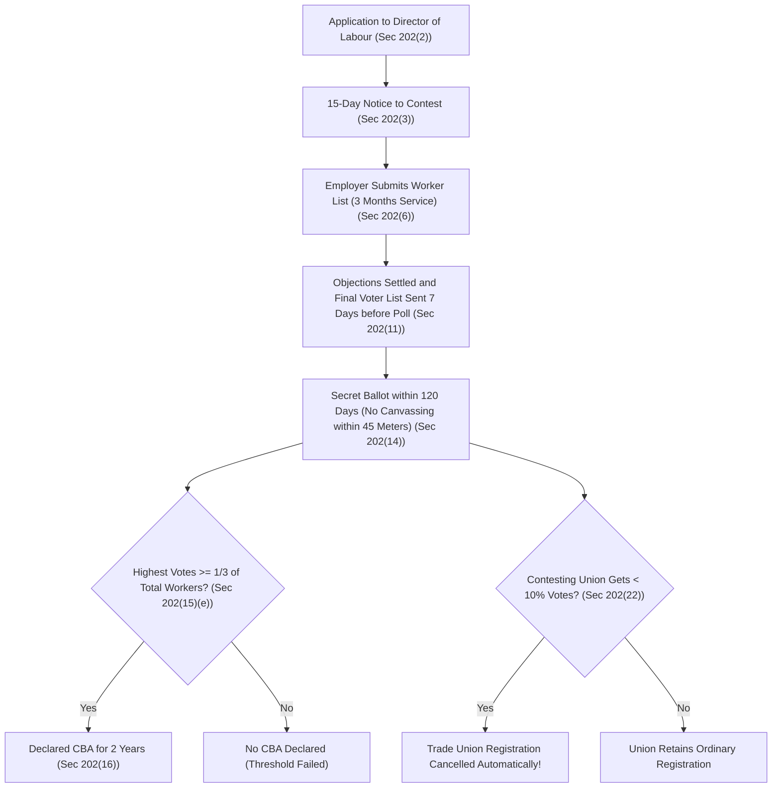

[← Previous: L10.3: Trade Union Legal Status, Rights, and Applied Role](L10.3_Trade_Union_Legal_Status_Rights_and_Applied_Role.md) | [🏠 Index](00_Index.md) | [Next: L11.2: Industrial Disputes and Settlement Ladder (Section 210) →](L11.2_Industrial_Disputes_and_Settlement_Ladder_Sec_210.md)

---

# L11.1: Collective Bargaining and CBA (Section 202)

> **Section:** Section A (CO1 · Legal Issues · Shoaib Islam Sir) | **Priority:** 🔴 Essential | **Exam Frequency:** High (Asked in 2023 Q.4(a), 2024 Q.8(a), Core BLC Chapter XIII)  
> **Subtopics Covered:** `L11.1` (Collective Bargaining: definition, features, and importance), `L11.2` (Collective Bargaining Agent / CBA: determination under Section 202 and exclusive powers under Section 202(24))  
> **Sources:** SI Sir Notes (`Chapter-4.md`), SI Sir Slides (`Chapter-4 slide.md`), BLC 2006 (`Chapter_13_Trade_Unions_and_Industrial_Relations.md` Sections 202, 202A, 203)

## Why This Topic Matters

Shoaib Sir frequently tests collective bargaining and the Collective Bargaining Agent (CBA). This topic appeared in both 2023 and 2024 final exams. You must know the exact election steps under Section 202. You must also know the five exclusive powers under Section 202(24). Remembering exact numbers like 120 days, one-third membership, and 10% vote cutoff will secure full marks.

---

## 📝 Key Definitions

> **Collective Bargaining:** "Collective bargaining is the process in which working people, through their unions, negotiate contracts with their employers to determine their terms of employment, including pay, benefits, hours, leave, job health and safety policies, ways to balance work and family, and more." (SI Sir Class Notes · Chapter 4)

In simple words, collective bargaining is teamwork negotiation. Workers join together through their union to negotiate wages and working conditions with their employer.

> **Collective Bargaining Agent (CBA):** "A collective bargaining agent is a registered trade union elected by secret ballot. Where there is only one registered trade union in an establishment that trade union shall be deemed to be the collective bargaining agent for such establishment." (BLC 2006, Section 202(1) and SI Sir Notes)

In simple words, the CBA is the only union with legal power to negotiate with the employer. It speaks for all workers in the factory.

---

## Core Features and Importance of Collective Bargaining

### What Is Collective Bargaining?

An individual worker has very little bargaining power against a large factory owner. If a worker bargains alone, the employer can easily say no or fire the worker.

Through collective bargaining, all workers speak with one united voice. They negotiate as an equal partner with management. The final goal is to sign a written agreement called a **Memorandum of Settlement**.

### Five Essential Features of Collective Bargaining

1. **Collective Action:** Workers do not bargain as single persons. They negotiate together through their certified trade union.
2. **Bipartite Dialogue:** The talks happen directly between the employer and the union. Outside parties or courts do not control the meeting.
3. **Continuous Process:** Bargaining does not end when a contract is signed. It continues every day through contract implementation and resolving worker complaints.
4. **Mutual Compromise:** Both sides give up some demands. Workers balance wage requests with company profit. Employers balance cost targets with worker safety and happiness.
5. **Legally Binding Agreement:** Once signed, the agreement binds the employer and all workers in that factory.

### Why Collective Bargaining Matters in Industry

- **Stops Unfair Labour Practices:** It sets fixed wage scales and fair workplace rules. This stops bosses from showing favoritism.
- **Protects Industrial Peace:** Workers solve disagreements across a conference table. This prevents costly strikes, protests, and lock-outs.
- **Raises Wages and Living Standards:** Union bargaining wins higher pay, health benefits, and retirement funds for workers.
- **Boosts Factory Productivity:** When workers help make company rules, morale rises. Happy workers stay longer and produce more goods.

---

## Determination of Collective Bargaining Agent (Section 202)

### What Is a Collective Bargaining Agent?

Many factories have several registered trade unions. If every union negotiated on its own, chaos would follow.

To prevent confusion, the Bangladesh Labour Act 2006 recognizes only **one** union as the official bargaining agent. That chosen union is the **Collective Bargaining Agent (CBA)**.

The rules to determine the CBA depend on how many unions exist in the factory.

### Case 1: Single Registered Trade Union (Section 202(1), (5))

When only one registered trade union exists in an establishment:

- It is automatically treated as the CBA (`Section 202(1)`).
- **Mandatory Condition (`Section 202(5)`):** At least **one-third ($\frac{1}{3}$)** of all factory workers must be paid members.
- If it has less than one-third of the workers, it cannot act as the CBA.

### Case 2: Multiple Registered Trade Unions (Section 202(2)–(15))

When two or more registered trade unions exist in a factory:

- Any registered trade union or the employer may apply to the Director of Labour.
- The Director of Labour must hold a secret ballot within **120 days** of receiving the application (`Section 202(2)`).
- Alternatively, under the 2013 amendment, the unions may nominate an election commissioner from among themselves to conduct the election.

### Step-by-Step Secret Ballot Procedure

1. **Notice to Contest (`Section 202(3)`):**
   - The Director of Labour sends a written notice to all registered unions in the factory.
   - Each union must reply within **15 days** stating whether it will contest the ballot.
   - If a union fails to reply within 15 days, the law assumes it will not participate (`Section 202(4)`).

2. **Employer Submits Worker List (`Section 202(6)`):**
   - The employer must submit a verified list of all workers employed for at least **3 months**.
   - The list must exclude casual and substitute (badli) workers.
   - The list includes worker names, parents' names, age, branch, workplace, and ticket numbers.

3. **Objections and Certified Voter List (`Section 202(8)–(11)`):**
   - The Director publishes the draft list in his office and the factory.
   - Unions submit objections within a set time.
   - The Director settles all objections. He sends the final certified voter list to contesting unions at least **7 days** before voting day (`Section 202(11)`).

4. **Conducting the Secret Ballot (`Section 202(13)–(15)`):**
   - The employer must provide voting facilities but cannot influence the election.
   - **45-Meter Rule:** No person can campaign or canvas for votes within **45 meters** of any polling station (`Section 202(14)`).
   - Polling stations have sealed ballot boxes witnessed by union representatives.

5. **Winning Threshold (`Section 202(15)(e)`):**
   - The union with the highest votes wins.
   - **Crucial Rule:** The winning union must get votes from at least **one-third ($\frac{1}{3}$)** of all workers in the factory.
   - A simple majority of cast votes is not enough. Total votes must reach one-third of all factory workers.

6. **The 10% Penalty Rule (`Section 202(22)`):**
   - Any union getting less than **10%** of total votes cast loses its trade union registration automatically!
   - This strict rule stops tiny, nuisance unions from crowding the election.

> [!tip] Memory Hook: CBA Magic Numbers
> Remember this quick number chain for Section 202:  
> **120d** (ballot window) $\rightarrow$ **15d** (contest reply) $\rightarrow$ **3m** (worker service) $\rightarrow$ **7d** (final voter list) $\rightarrow$ **45m** (no canvassing zone) $\rightarrow$ **$\frac{1}{3}$** (winning threshold) $\rightarrow$ **10%** (registration cancellation cutoff) $\rightarrow$ **2y** (tenure).

### Tenure and Interim Rules of the CBA (Section 202(16)–(20))

- **Normal Tenure (`Section 202(16)`):** The CBA holds office for **2 years** from the date of declaration. For a group of establishments, the tenure is **3 years**.
- **No Early Challenge:** No new election can be held during this 2-year period.
- **Next Election Application (`Section 202(17)`):** Apply **150 to 120 days** before the current CBA tenure ends.
- **Interim Rule (`Section 202(19)`):** If delays hold up an election, the old CBA continues.

---

## Exclusive Statutory Powers and Rights of the CBA (Section 202(24))

An ordinary registered trade union has basic rights. But only the certified CBA holds the exclusive statutory powers listed under **Section 202(24)**.

### Five Exclusive Statutory Powers

1. **Bargain with the Employer (`Section 202(24)(a)`):**
   - The CBA has the exclusive right to negotiate on worker conditions, unemployment, service rules, and the physical working environment.
   - The employer cannot negotiate with uncertified minority unions.

2. **Represent Workers in Legal Proceedings (`Section 202(24)(b)`):**
   - The CBA represents all workers or any worker in conciliation, arbitration, and Labour Court proceedings.

3. **Give Strike Notice and Declare Strike (`Section 202(24)(c)`):**
   - Only the CBA can issue a lawful strike notice under Chapter XIV.
   - A minority trade union cannot call a lawful strike.

4. **Nominate Worker Representatives to Key Bodies (`Section 202(24)(d)`):**
   - The CBA nominates worker representatives to:
     - Factory welfare committees.
     - Provident fund management committees.
     - Board of Trustees of the Workers' Participation Fund (WPPF) under Chapter XV.

5. **Conduct Legal Cases for Workers (`Section 202(24)(e)`):**
   - The CBA can file and run court cases for any worker or group of workers.

### Additional Rights: Office Room and Specialists

- **Office Room Allotment (`Section 202(26)`):** The employer must provide an office room inside the factory for the CBA.
- **Assistance from Specialists (`Section 202A`):** The CBA or employer may hire outside specialists to help during talks.

> [!tip] Memory Hook: Five Exclusive Powers of CBA (B-R-S-N-C)
> - **B** $\rightarrow$ **B**argain with employer on service terms (`202(24)(a)`)  
> - **R** $\rightarrow$ **R**epresent workers in disputes and courts (`202(24)(b)`)  
> - **S** $\rightarrow$ **S**trike notice and declaration (`202(24)(c)`)  
> - **N** $\rightarrow$ **N**ominate trustees to WPPF and PF (`202(24)(d)`)  
> - **C** $\rightarrow$ **C**onduct legal cases for workers (`202(24)(e)`)

---

## Comparison Tables: CBA Rules and Rights

### Single Union vs Multiple Unions Determination

| Parameter | Single Registered Union | Multiple Registered Unions |
| :--- | :--- | :--- |
| **Legal Basis** | `Section 202(1), (5)` | `Section 202(2)–(15)` |
| **Method** | Automatic declaration | Secret ballot election |
| **Authority** | Director of Labour verifies membership | Director of Labour conducts secret ballot |
| **Time Limit** | Upon registration verification | Within 120 days of application |
| **Worker Threshold** | Must have at least $\frac{1}{3}$ total workers as members | Highest votes, plus at least $\frac{1}{3}$ of all workers |
| **Low Vote Penalty** | Not applicable | Unions getting $< 10\%$ votes lose registration |
| **Tenure** | 2 years (3 years for group) | 2 years (3 years for group) |

### Certified CBA vs Ordinary Registered Trade Union

| Feature / Power | Certified CBA (`Sec 202`) | Ordinary Registered Union (`Sec 176–194`) |
| :--- | :--- | :--- |
| **Raise Industrial Dispute** | Yes (`Section 209`) | No (Only CBA or employer can raise) |
| **Bipartite Negotiation** | Yes (`Section 202(24)(a)`) | No (Employer cannot negotiate with it) |
| **Call Lawful Strike** | Yes (`Section 202(24)(c)`) | No (Strike called by non-CBA is illegal) |
| **Nominate WPPF Trustees** | Yes (`Section 202(24)(d)`) | No |
| **Office Room in Factory** | Yes, mandatory (`Sec 202(26)`) | No statutory right to an office room |
| **Legal Personality** | Yes (Body corporate under `Sec 194`) | Yes (Body corporate under `Sec 194`) |
| **Criminal / Civil Immunity** | Yes (`Sec 197`, `Sec 198`) | Yes (`Sec 197`, `Sec 198`) |

---

## Exam Variants

| Year / Source | Question Summary | Marks | Key Focus / Takeaway |
| :--- | :--- | :---: | :--- |
| **2023 Final Q.4(a)** | Define collective bargaining and who is CBA | 02 | 2-part split: definition + CBA role and 2-year tenure |
| **2024 Final Q.8(a)** | Define Industrial dispute and collective bargaining | 02 | Full 2-part definition: Section 2(62) dispute and collective bargaining |
| **Model Exam Q.1** | CBA determination under Section 202 & powers under Section 202(24) | 04 | Full election steps, thresholds, and 5 exclusive powers |
| **Model Exam Q.2** | Scenario: Minority union demands talks and calls strike | 04 | Apply Section 209 and Section 202(24); strike is illegal |

---

## 🏆 Golden Questions (Past Exam Archive & Model Answers)

### 🎯 GQ1 · 2023 Final Q.4(a) · Collective Bargaining and CBA Definition (02 Marks)

> **Appeared:** 2023 Final Q.4(a) (Sec A · CO1) · (02 Marks)  
> **Verbatim Question:** What is collective bargaining and who is collective bargaining agent?

**Full Answer:**

#### Part 1: Collective Bargaining (01 Mark)
**Collective bargaining** is the negotiation process between an employer and workers represented by their trade union. They discuss and agree on employment terms, wages, working hours, benefits, safety rules, and grievance procedures. Its main goal is to sign a written, legally binding **Memorandum of Settlement** that protects workplace peace.

#### Part 2: Collective Bargaining Agent (01 Mark)
Under **Section 202** of the Bangladesh Labour Act 2006, a **Collective Bargaining Agent (CBA)** is a registered trade union. It holds exclusive legal authority to negotiate with the employer for all workers in that factory.
- If only one registered union exists, it becomes the CBA. It must have at least **one-third ($\frac{1}{3}$)** of all workers as members (`Sec 202(1), (5)`).
- If multiple registered unions exist, the Director of Labour conducts a secret ballot within **120 days** (`Sec 202(2)`).
- The elected CBA holds office for a term of **2 years** (`Sec 202(16)`).

---

### 🎯 GQ2 · 2024 Final Q.8(a) · Industrial Dispute and Collective Bargaining (02 Marks)

> **Appeared:** 2024 Final Q.8(a) (Sec B · CO1) · (02 Marks)  
> **Verbatim Question:** Define Industrial dispute and collective bargaining.

**Full Answer:**

#### Part 1: Industrial Dispute (01 Mark)
Under **Section 2(62)** of the Bangladesh Labour Act, 2006, an **industrial dispute** is defined as:

> "any dispute or difference of opinion between employers and employers, between employers and workers or between workers and workers in respect of appointment or conditions of service or conditions of work or environment of work of any person."

In simple words, it is a formal workplace disagreement over hiring, wages, hours, safety, or discipline. Under Section 209, an industrial dispute exists in law only when raised by an employer or by a certified CBA.

#### Part 2: Collective Bargaining (01 Mark)
**Collective Bargaining** is the process where workers negotiate employment terms with their employer through their trade union. It covers wages, working hours, leave, safety rules, and benefits.

Its core features are:
1. **Bipartite Dialogue:** Direct discussion between the employer and the workers' union.
2. **Collective Representation:** Workers act together with united strength.
3. **Binding Settlement:** The resulting agreement legally binds both parties.

---

### 🎯 GQ3 · Model Exam Question · CBA Determination and Exclusive Powers (04 Marks)

> **Target:** High-Yield Model Question · BLC Chapter XIII Section 202 · (04 Marks)  
> **Question:** Explain how a Collective Bargaining Agent (CBA) is determined in an establishment under Section 202 of the Bangladesh Labour Act, 2006. State its exclusive powers and rights under Section 202(24).

**Full Answer:**

#### 1. Determination of CBA under Section 202

The method of determining a CBA depends on the number of registered unions:

1. **Single Registered Trade Union (`Sec 202(1), (5)`):**
   - The union is declared the CBA automatically.
   - It must have at least **one-third ($\frac{1}{3}$)** of total workers as members.

2. **Multiple Registered Trade Unions (`Sec 202(2)–(15)`):**
   - Any union or employer applies to the Director of Labour.
   - The Director holds a secret ballot within **120 days**.
   - **Notice:** Contesting unions must declare participation within **15 days**.
   - **Voter List:** Employer submits list of workers with $\ge 3$ months of service (excluding casual and substitute workers). The final list is sent **7 days** before the poll.
   - **Poll Restrictions:** No canvassing within **45 meters** of the polling station.
   - **Winning Threshold:** The union with the highest votes wins. It must secure votes from at least **one-third ($\frac{1}{3}$)** of all workers in the factory.
   - **Cancellation Penalty:** Any union getting less than **10%** of total votes cast loses its registration automatically (`Sec 202(22)`).

3. **Tenure (`Sec 202(16)`):** The CBA holds office for **2 years** (3 years for a group of establishments).

#### 2. Exclusive Powers and Rights of the CBA (`Section 202(24)`)

Under Section 202(24), only the certified CBA has the exclusive power to:

1. **Bargain with the employer** on working conditions, service rules, and workplace environment (`Sec 202(24)(a)`).
2. **Represent all or any workers** in conciliation, arbitration, or Labour Court proceedings (`Sec 202(24)(b)`).
3. **Give notice of and declare a strike** under Chapter XIV (`Sec 202(24)(c)`).
4. **Nominate worker representatives** to welfare funds, provident funds, and the Board of Trustees of the Workers' Participation Fund (`Sec 202(24)(d)`).
5. **Conduct legal cases** before the Labour Court for any worker or group of workers (`Sec 202(24)(e)`).
6. **Mandatory Office Room:** The employer must provide an office room for the CBA (`Sec 202(26)`).

---

### 🎯 GQ4 · Model Applied Case · Minority Union vs Certified CBA Powers (04 Marks)

> **Target:** Analytical Problem on Chapter XIII & XIV · (04 Marks)  
> **Scenario:** In an electronics factory of 900 workers, Union X is the certified CBA with 550 members. Union Y is a registered minority union with 180 members. When the company introduces a new automated testing machine, Union Y serves a 7-day strike notice on the General Manager and demands separate wage talks. Management refuses to meet Union Y. Union Y claims the employer committed an unfair labour practice. Analyze the legal position of Union Y and the employer.

**Full Answer:**

#### 1. Facts of the Case
- **Total Workers:** 900 workers.
- **Parties:** Union X (550 members, certified CBA); Union Y (180 members, minority union); Factory Management.
- **Disputed Action:** Union Y served a strike notice and demanded separate wage talks. Employer refused to negotiate with Union Y.

#### 2. Applicable Law & Sections
- **The Bangladesh Labour Act, 2006:**
  - `Section 202(24)(a)`: Exclusive power of CBA to bargain with the employer.
  - `Section 202(24)(c)`: Exclusive power of CBA to issue strike notice.
  - `Section 209`: Only the CBA or employer can raise an industrial dispute.
  - `Section 196(5)`: Illegal strike as an unfair labour practice by workers.
  - `Section 195(10)`: Employer duty to reply to communications from the CBA only.

#### 3. Legal Analysis
1. **Union Y Has No Bargaining Standing:**
   - Under Section 202(24)(a), the certified CBA (Union X) holds the sole right to negotiate employment terms.
   - Union Y is an uncertified minority union. The employer is legally prohibited from negotiating with Union Y on collective wage matters. Refusing to talk to Union Y is entirely lawful.
2. **Union Y's Strike Notice Is Completely Illegal:**
   - Under Section 202(24)(c), only the CBA can give notice of and declare a strike.
   - Under Section 209, Union Y cannot raise an industrial dispute.
   - Under Section 211(1), a strike notice requires a prior failure certificate and a secret ballot with two-thirds member approval. Union Y followed none of these steps.
   - Work stoppage under this notice is an **illegal strike** (`Section 2(43)`). It is also a worker **unfair labour practice** under Section 196(5). Union Y officers face penalties under Section 294.

#### 4. Direct Conclusion
The employer acted lawfully in refusing to negotiate with Union Y. Union Y's strike notice is completely illegal and void. Only Union X can raise a dispute or call a strike on behalf of the factory workers.

---

## ⚡ Exam Tips & Common Mistakes

1. **State the Exact Thresholds:** State that the winning union needs votes from at least **one-third ($\frac{1}{3}$)** of all factory workers. A simple majority of cast votes is not enough.
2. **Remember the 10% Rule:** Any union getting under **10%** of total votes loses its registration (`Sec 202(22)`).
3. **Know Section 202(24) by Heart:** The five exclusive CBA powers are easy to list using the **B-R-S-N-C** memory hook. Writing all five with sub-clauses (a) to (e) guarantees full marks.
4. **Minority Union Rule:** An ordinary union has legal personality (`Sec 194`). But it cannot negotiate with the employer or call a strike. Only the CBA can do that.

---

## 🔗 Related Topics

- [L10.2: Trade Union Registration and Cancellation](L10.2_Trade_Union_Registration_and_Cancellation.md)
- [L10.3: Trade Union Legal Status, Rights, and Applied Role](L10.3_Trade_Union_Legal_Status_Rights_and_Applied_Role.md)
- [L11.2: Industrial Disputes and Settlement Ladder (Section 210)](L11.2_Industrial_Disputes_and_Settlement_Ladder_Sec_210.md)
- [L12.1: Unfair Labour Practices (Sections 195 and 196)](L12.1_Unfair_Labour_Practices_Sec_195_and_196.md)

---

[← Previous: L10.3: Trade Union Legal Status, Rights, and Applied Role](L10.3_Trade_Union_Legal_Status_Rights_and_Applied_Role.md) | [🏠 Index](00_Index.md) | [Next: L11.2: Industrial Disputes and Settlement Ladder (Section 210) →](L11.2_Industrial_Disputes_and_Settlement_Ladder_Sec_210.md)
