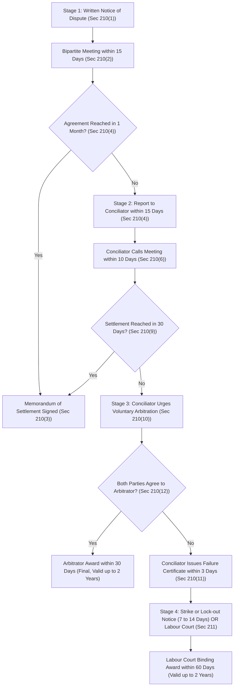

[← Previous: L11.1: Collective Bargaining and CBA (Section 202)](L11.1_Collective_Bargaining_and_CBA_Sec_202.md) | [🏠 Index](00_Index.md) | [Next: L12.1: Unfair Labour Practices (Sections 195 and 196) →](L12.1_Unfair_Labour_Practices_Sec_195_and_196.md)

---

# L11.2: Industrial Disputes and Settlement Ladder (Section 210)

> **Section:** Section A (CO1 · Legal Issues · Shoaib Islam Sir) | **Priority:** 🔴 Essential | **Exam Frequency:** High (Asked in 2024 Q.8(a), 2024 Q.3(c) Applied 4m, Core BLC Chapter XIV)  
> **Subtopics Covered:** `L11.3` (Industrial Dispute: definition under `Sec 2(62)` and standing to raise under `Sec 209`), `L11.4` (Statutory Settlement Ladder under `Sec 210` & Strike/Lock-out Rules under `Sec 211`), `L11.5` (Applied: Hypothetical industrial dispute scenarios and dispute resolution steps)  
> **Sources:** SI Sir Notes (`Chapter-4.md`), SI Sir Slides (`Chapter-4 slide.md`), BLC 2006 (`Chapter_14_Settlement_of_Disputes_and_Labour_Courts.md` Sections 209–214, Chapter 1 Section 2(62))

## Why This Topic Matters

Shoaib Sir highlighted industrial disputes as a top exam topic. In the 2024 final exam, it appeared twice: as a direct 1-mark definition and as a 4-mark case study. To get full marks, you must know the exact statutory timeline for every stage of Section 210. You must also know who holds the legal right to raise a dispute under Section 209. Remembering exact numbers like 15 days, 30 days, 10 days, 3 days, and two-thirds member consent will secure full marks.

---

## 📝 Key Definitions

> **Industrial Dispute:** "any dispute or difference of opinion between employers and employers, between employers and workers or between workers and workers in respect of appointment or conditions of service or conditions of work or environment of work of any person." (BLC 2006, Section 2(62))

In simple words, an industrial dispute is a formal disagreement at work. It covers hiring terms, wages, working hours, safety appliances, or worker discipline between bosses and workers.

> **Lock-out:** "the closing of a place of work or a part of such place, or the suspension of work therein, wholly or partly, by an employer, or refusal, absolute or conditional, by an employer to continue allow to work by any number of workers employed by him, where such closing, suspension or refusal occurs in connection with any industrial dispute or is intended for the purpose of compelling workers to accept certain terms and conditions of employment." (BLC 2006, Section 2(57))

In simple words, a lock-out is when the employer shuts factory doors or stops work. The employer uses this move to force workers to accept company terms during a dispute.

> **Strike:** "cessation of work by a body of persons employed in any establishment acting in combination or a concerted refusal, or refusal under a common understanding of any number of persons who are or have been so employed to continue to work or to accept employment." (BLC 2006, Section 2(22) and SI Sir Notes)

In simple words, a strike happens when workers stop working together. They act as a united team to pressure the employer into accepting their demands.

---

## Legal Standing to Raise an Industrial Dispute (Section 209)

Not every person or group can start an industrial dispute under the law.

Under **Section 209** of the Bangladesh Labour Act, 2006:

> "No industrial dispute shall be deemed to exist, unless it is raised by an employer or by a collective bargaining agent in accordance with the provisions of this Chapter."

This simple rule creates clear boundaries for industrial conflicts:

1. **Who Can Raise an Industrial Dispute:**
   - **The Employer:** An employer may raise a dispute regarding work rules, productivity standards, or contract terms.
   - **The Collective Bargaining Agent (CBA):** Only the certified CBA can raise an industrial dispute for workers.

2. **Who Cannot Raise an Industrial Dispute:**
   - **Individual Workers:** A single worker cannot raise an industrial dispute under Chapter XIV. An individual worker with a personal right violation must file a grievance petition under Section 33.
   - **Uncertified Minority Trade Unions:** A registered union without CBA status has no legal standing to raise an industrial dispute. If it tries, the action is void (`Section 209`).

> [!tip] Memory Hook: Who Can Knock on Section 210?
> Only two keys open Chapter XIV:
> 1. The **Employer**
> 2. The **Certified CBA**
>
> An individual worker holds no key for Section 210 (use Section 33 instead). A minority union holds no key either.

---

## Forms of Industrial Disputes: Employers vs. Workers

Disputes between labor and management take distinct practical forms. Each side uses specific tools to pressure the other party.

### Practical Action Types by Employers

1. **Lock-out (`Section 2(57)`):**
   - The employer shuts the workplace or refuses to let employees work.
   - Purpose: To force workers to accept disputed employment terms.
   - A lock-out is legal only after following conciliation procedures under Section 211.
2. **Lay-off (`Section 2(58)`):**
   - The employer fails or refuses to provide work due to operational shortages.
   - Grounds: Shortage of power, coal, or raw material, breakdown of machinery, or natural disaster.
   - A lay-off is an operational necessity, not a weapon to win a labour dispute. Laid-off workers with one year of service get compensation under Section 16 (half basic wage and full house rent).
3. **Retrenchment (`Section 2(11)`):**
   - The employer terminates workers because of surplus staff or company downsizing.
   - It is not a disciplinary punishment. The employer must give 30 days written notice. The worker receives 30 days wages per completed year of service (`Section 20`).
4. **Dismissal (`Section 2(39)`):**
   - The employer fires a worker for proven misconduct under Section 23.
   - Misconduct includes theft, fraud, riotous behavior, habitual late attendance, or taking part in an illegal strike. It requires a formal charge-sheet, 7 days explanation time, and an inquiry committee under Section 24.

### Practical Action Types by Workers

1. **Strike (`Section 2(22)`):**
   - Workers jointly stop working under a common agreement.
   - A strike is lawful only if called by the CBA after conciliation fails. Two-thirds of members must approve in a secret ballot (`Section 211(1)`).
2. **Go-slow (`Section 2(18)`):**
   - Workers deliberately slow down normal work output in an organized way.
   - The drop in production is not caused by power failure or broken machinery.
   - Under Section 196(5), a go-slow is an explicit worker unfair labour practice and illegal act.
3. **Boycott:**
   - Workers attend the workplace in person but refuse to perform their duties.
   - They sit inside the plant until management meets their demands.
4. **Gherao (`Section 196(6)`):**
   - Workers physically surround and confine managers or factory premises.
   - They block transport, cut power, or damage plant property.
   - Under Section 196(6), a gherao is an illegal unfair labour practice. Leaders face criminal prosecution and imprisonment.

### Comparison Table: Industrial Action Types

| Action Form | Undertaken By | Statutory Section | Underlying Nature and Purpose | Legal Status |
| :--- | :--- | :--- | :--- | :--- |
| **Lock-out** | Employer | `Sec 2(57)` | Closes plant to force workers to accept terms during a dispute | Lawful only after failure certificate and notice (`Sec 211`) |
| **Lay-off** | Employer | `Sec 2(58)` | Suspends work due to power, coal, material shortage, or broken tools | Lawful operational measure; requires compensation (`Sec 16`) |
| **Retrenchment** | Employer | `Sec 2(11)` | Cuts surplus staff for efficiency, not disciplinary punishment | Lawful; requires 1-month notice and severance pay (`Sec 20`) |
| **Dismissal** | Employer | `Sec 2(39)` | Fires worker for proven misconduct after formal inquiry | Lawful disciplinary action under Sections 23 and 24 |
| **Strike** | Workers | `Sec 2(22)` | United stoppage of work to compel acceptance of demands | Lawful only if called by CBA with $\frac{2}{3}$ ballot approval |
| **Go-slow** | Workers | `Sec 2(18)` | Deliberate organized reduction of normal production pace | Illegal unfair labour practice under Section 196(5) |
| **Gherao** | Workers | `Sec 196(6)` | Physical confinement of management or blocking gates | Illegal unfair labour practice; criminal penalty |

---

## The Statutory Settlement Ladder (Sections 210 and 211)

When an industrial dispute arises, the parties cannot immediately jump to strikes or court trials. The law demands peaceful negotiation first.

The Bangladesh Labour Act 2006 builds a progressive four-stage settlement ladder under **Sections 210 and 211**.

### Overview of the Four Settlement Stages

1. **Stage 1: Direct Bipartite Negotiation (`Section 210(1)–(3)`):** Direct talks between the employer and the CBA.
2. **Stage 2: Conciliation by Government Conciliator (`Section 210(4)–(11)`):** Government officer steps in to help both sides reach a compromise.
3. **Stage 3: Voluntary Arbitration (`Section 210(12)–(17)`):** An agreed neutral expert makes a final binding decision.
4. **Stage 4: Strike, Lock-out, or Labour Court Decision (`Section 211`):** Legal economic pressure or judicial ruling.

---

### Stage 1: Direct Bipartite Negotiation (Section 210(1)–(3))

Direct dialogue is the first statutory step in resolving disputes.

1. **Written Notice of Dispute (`Section 210(1)`):**
   - If an employer or CBA expects a dispute, it sends its views in writing to the other party.
   - The letter outlines the exact grievances or charter of demands.

2. **Arranging Bilateral Meeting (`Section 210(2)`):**
   - The party receiving the written notice must arrange a collective bargaining meeting within **15 days** of receipt.
   - Both parties meet through authorized representatives to seek an agreement.

3. **Negotiation Period (`Section 210(4)(b)`):**
   - The parties hold bilateral talks across the table.
   - The maximum dialogue period is **1 month** from the date of the first meeting.
   - Both sides can extend this period only by mutual written agreement.

4. **Signing Memorandum of Settlement (`Section 210(3)`):**
   - If talks succeed, the parties write down the agreed terms in a **Memorandum of Settlement**.
   - Both sides sign the document.
   - The employer forwards copies to the Government, the Director of Labour, and the Conciliator.
   - This agreement binds the company and all workers.

---

### Stage 2: Conciliation by Government Conciliator (Section 210(4)–(11))

If direct bilateral dialogue fails, the dispute moves to government conciliation.

1. **Reporting Failure to Conciliator (`Section 210(4)`):**
   - Conciliation is triggered if:
     - The receiving party fails to arrange a meeting within **15 days**, or
     - Talks fail to produce a settlement within **1 month** of the first meeting.
   - Either party may report the dispute in writing to the official Conciliator within **15 days** of deadline expiry.

2. **Appointment and Role of Conciliators (`Section 210(5)`):**
   - The Government appoints gazetted Conciliators for specific areas, industries, or establishments.
   - The Conciliator acts as an impartial mediator. He does not impose decisions. He helps parties find middle ground.

3. **Starting Conciliation (`Section 210(6)`):**
   - The Conciliator must start conciliation proceedings within **10 days** of receiving the written request.
   - He summons authorized representatives of both sides to joint meetings.

4. **Duration of Conciliation (`Section 210(9)`):**
   - The Conciliator gets **30 days** to settle the dispute.
   - The period starts from the date he received the conciliation request.
   - The parties can extend this 30-day period by mutual written consent.

5. **Successful Conciliation (`Section 210(8)`):**
   - If a compromise is reached, the parties sign a formal Memorandum of Settlement before the Conciliator.
   - The Conciliator submits a full report and the signed memorandum to the Government.

6. **Conciliation Failure (`Section 210(10)–(11)`):**
   - If no settlement is reached within 30 days, conciliation fails.
   - The Conciliator must try to persuade both parties to refer the dispute to voluntary arbitration (`Section 210(10)`).
   - If either party refuses arbitration, the Conciliator must issue a **Failure Certificate within 3 days** (`Section 210(11)`).

---

### Stage 3: Voluntary Arbitration (Section 210(12)–(17))

Arbitration is an optional, peaceful exit route before industrial warfare.

1. **Joint Written Referral (`Section 210(12)`):**
   - Both parties must agree in writing to choose arbitration.
   - If one side objects, arbitration cannot happen.

2. **Selection of Arbitrator (`Section 210(13)`):**
   - The parties select an Arbitrator from the official panel prepared by the Government.
   - They may also choose any other person agreed upon by both sides.

3. **Arbitration Award (`Section 210(14)`):**
   - The Arbitrator hears both sides and gives an award within **30 days** of receiving the referral.
   - The parties can extend this time by mutual written agreement.
   - The Arbitrator sends one copy to both parties and another copy to the Government (`Section 210(15)`).

4. **Finality and Validity (`Section 210(16)–(17)`):**
   - **The award is final.** No appeal can be filed against an Arbitrator's award in any court (`Section 210(16)`).
   - The award remains in force for up to **2 years** as fixed by the Arbitrator (`Section 210(17)`).

---

### Stage 4: Strike, Lock-out, or Labour Court Decision (Section 211)

When conciliation fails and parties reject arbitration, the conflict enters its final stage.

1. **Window to Act (`Section 211(1)`):**
   - The party raising the dispute has **15 days** from receiving the Failure Certificate to make its move.
   - It can serve a strike or lock-out notice, or apply directly to the Labour Court.

2. **Mandatory Strike Notice Rules (`Section 211(1)`):**
   - **Notice Period:** The strike notice must specify the start date. This date must be **not earlier than 7 days** and **not later than 14 days** from the notice date.
   - **Secret Ballot Requirement (Crucial Condition):** No CBA can serve a strike notice without prior member consent. It must hold a secret ballot supervised by the Conciliator. At least **two-thirds ($\frac{2}{3}$)** of union members must vote in favor.
   - *Statutory Note:* The 2013 amendment lowered this requirement from three-fourths ($\frac{3}{4}$) to two-thirds ($\frac{2}{3}$).

3. **Lock-out Notice by Employer (`Section 211(1)`):**
   - The employer may issue a lock-out notice within 15 days of receiving the Failure Certificate.
   - The notice period is likewise **7 to 14 days**.

4. **Application to Labour Court (`Section 211(1), (2)`):**
   - Either party may choose judicial settlement instead of a strike or lock-out.
   - Either party may apply to the Labour Court within the 15-day window.
   - Either side can still apply to the Labour Court at any time, even after a strike begins (`Section 211(2)`).

5. **Government Power to Prohibit Strike or Lock-out (`Section 211(3)–(5)`):**
   - **Over 30 Days (`Section 211(3)`):** The Government may ban any strike lasting over **30 days** by written order.
   - **National Interest / Public Hardship (`Section 211(3)` Proviso):** The Government can ban a strike or lock-out earlier. It acts if the dispute causes serious public hardship or harms national interest.
   - **Public Utility Services (`Section 211(4)`):** The Government may ban a strike in public utilities at any time.
   - **Automatic Referral (`Section 211(5)`):** When banning a strike, the Government refers the dispute to the Labour Court immediately.

6. **Labour Court Decision and Validity (`Section 211(6)–(7)`):**
   - The Labour Court gives both sides a hearing and makes an award within **60 days** of referral.
   - The court award remains in force for up to **2 years**.

7. **Three-Year Strike Ban in New Establishments (`Section 211(8)`):**
   - Strikes and lock-outs are completely prohibited for **3 years** from the start of production in:
     - Any newly built establishment,
     - Any establishment owned by foreign investors, or
     - Any establishment built in collaboration with foreign investors.
   - Disputes in these factories must be solved through negotiation, conciliation, arbitration, or Labour Court.

---

### Rules on Cessation of Industrial Disputes (Section 212)

Strict deadlines protect the dispute settlement process from endless delays.

Under **Section 212(1)**, an industrial dispute automatically **ceases to exist** if the party raising it fails to:
1. Request conciliation under Section 210(4) within the specified 15 days, or
2. Begin the strike or lock-out on the exact date stated in the notice, or
3. Apply to the Labour Court or serve notice within the specified 15 days after conciliation failure.

**One-Year Ban on Identical Disputes (`Section 212(2)`):**  
When a dispute ceases due to missed deadlines, parties cannot raise the same dispute within **1 year** (`Section 212(2)`).

---

### Visual Flowchart of the Settlement Ladder

> [!tip] Memory Hook: The 15-30-15-10-30-3-30 Dispute Chain
> Memorize this quick timeline formula for Section 210 and 211:
> - **15 days:** Time to arrange first bipartite meeting (`Sec 210(2)`).
> - **30 days (1 month):** Maximum duration for bipartite talks (`Sec 210(4)(b)`).
> - **15 days:** Window to report failure to Conciliator (`Sec 210(4)`).
> - **10 days:** Time for Conciliator to start proceedings (`Sec 210(6)`).
> - **30 days:** Maximum period for conciliation talks (`Sec 210(9)`).
> - **3 days:** Deadline to issue Failure Certificate (`Sec 210(11)`).
> - **30 days:** Time for Arbitrator to deliver award (`Sec 210(14)`).
> - **15 days:** Window to serve strike or lock-out notice (`Sec 211(1)`).
> - **7 to 14 days:** Notice period before strike or lock-out begins (`Sec 211(1)`).
> - **2/3 ballot approval:** Member vote needed for legal strike notice (`Sec 211(1)`).
> - **60 days:** Deadline for Labour Court award (`Sec 211(6)`).
> - **2 years:** Maximum validity of Arbitrator or Labour Court award (`Sec 210(17)`, `211(7)`).

---

## Exam Variants

| Year / Source | Question / Scenario | Marks | Key Focus / Result |
| :--- | :--- | :---: | :--- |
| **2024 Q.8(a)** | Define Industrial dispute and collective bargaining | 02 | Full 2-part definition: Section 2(62) dispute and collective bargaining |
| **Model Q.1** | Distinguish between disputes raised by employers vs workers and standing under Section 209 | 03 | Employer vs CBA standing, lock-out/lay-off vs strike/go-slow |
| **Model Q.2** | Describe the statutory ladder for settlement under Sections 210 and 211 | 04 | Full four-tier ladder with exact statutory days and thresholds |
| **2024 Q.3(c)** | Develop a hypothetical industrial dispute scenario and outline resolution steps | 04 | 4-step framework applied to electronics manufacturing factory |
| **Model Q.3** | Analytical case on minority union strike notice vs employer refusal to talk | 05 | Section 202(24) exclusivity, Section 211 strike illegality, Section 195(10) |

---

## 🏆 Golden Questions (Past Exam Archive & Model Answers)

### 🎯 GQ1 · 2024 Final Q.8(a) · Industrial Dispute and Collective Bargaining (02 Marks)

> **Appeared:** 2024 Final Exam · Question 8(a) (Sec B · CO1) · (02 Marks)  
> **Verbatim Question:** Define Industrial dispute and collective bargaining.

**Full Answer:**

#### Part 1: Industrial Dispute (01 Mark)
Under **Section 2(62)** of the Bangladesh Labour Act, 2006, an **industrial dispute** is defined as:

> "any dispute or difference of opinion between employers and employers, between employers and workers or between workers and workers in respect of appointment or conditions of service or conditions of work or environment of work of any person."

In simple words, it is a formal workplace disagreement over hiring, wages, hours, safety, or discipline. Under Section 209, an industrial dispute exists in law only when raised by an employer or by a certified CBA.

#### Part 2: Collective Bargaining (01 Mark)
**Collective Bargaining** is the process where workers negotiate employment terms with their employer through their trade union. It covers wages, working hours, leave, safety rules, and benefits.

Its core features are:
1. **Bipartite Dialogue:** Direct discussion between the employer and the workers' union.
2. **Collective Representation:** Workers act together with united strength.
3. **Binding Settlement:** The resulting agreement legally binds both parties.

---

### 🎯 GQ2 · Model Question · Standing to Raise Disputes and Action Types (03 Marks)

> **Target:** BLC Chapter XIV Sections 2(62), 209 · High-Yield Theory Question · (03 Marks)

**Question:**  
Distinguish between industrial disputes raised by employers and industrial disputes raised by workers. Explain who is legally entitled to raise an industrial dispute under Section 209 of the Bangladesh Labour Act, 2006.

**Full Answer:**

#### 1. Standing to Raise an Industrial Dispute (Section 209)
Under **Section 209** of the Bangladesh Labour Act, 2006, no industrial dispute exists in law unless raised by:
- An **employer**, or
- A certified **Collective Bargaining Agent (CBA)**.

An individual worker cannot raise an industrial dispute under Chapter XIV. An individual worker must file a grievance petition under Section 33 for individual legal rights. Likewise, an uncertified minority trade union cannot raise a dispute under Chapter XIV.

#### 2. Practical Action Types: Employers vs. Workers
Industrial disputes manifest through distinct legal and industrial actions:

1. **Actions by Employers:**
   - **Lock-out (`Section 2(57)`):** Closing the plant or suspending work to force workers to accept terms during a dispute. It is legal only after conciliation failure under Section 211.
   - **Lay-off (`Section 2(58)`):** Temporary inability to provide work due to power loss, raw material shortage, or machine breakdown. It is an operational necessity requiring statutory compensation under Section 16.
   - **Retrenchment (`Section 2(11)`):** Cutting surplus staff under Section 20. It requires 30 days notice and severance pay.
   - **Dismissal (`Section 2(39)`):** Firing a worker for misconduct under Section 23 after a formal charge-sheet and inquiry (`Section 24`).

2. **Actions by Workers:**
   - **Strike (`Section 2(22)`):** Joint cessation of work to force management to accept demands. It is lawful only when called by the CBA after conciliation fails. Two-thirds of members must approve by secret ballot (`Section 211(1)`).
   - **Go-slow (`Section 2(18)`):** Deliberate, organized reduction in work output. It is an illegal unfair labour practice under Section 196(5).
   - **Boycott / Gherao (`Section 196(6)`):** Refusing to work while on site, or physically trapping managers inside the factory (gherao). Gherao is an illegal unfair labour practice carrying criminal penalties.

---

### 🎯 GQ3 · Model Question · Statutory Dispute Settlement Ladder (04 Marks)

> **Target:** BLC Chapter XIV Sections 210 & 211 · Core Statutory Process · (04 Marks)

**Question:**  
Describe the statutory ladder for dispute settlement under Sections 210 and 211 of the Bangladesh Labour Act, 2006.

**Full Answer:**

The Bangladesh Labour Act, 2006 provides a four-tier ladder under **Sections 210 and 211** to settle industrial disputes systematically:

#### Step 1: Bipartite Negotiation (Section 210(1)–(3))
1. **Written Notice (`Sec 210(1)`):** The employer or the CBA communicates its views in writing to the other party.
2. **Arranging Meeting (`Sec 210(2)`):** The recipient must arrange a collective bargaining meeting within **15 days** of receiving the notice.
3. **Dialogue Window (`Sec 210(4)(b)`):** Both sides negotiate directly for up to **1 month** from the first meeting.
4. **Settlement (`Sec 210(3)`):** If agreed, both parties sign a written **Memorandum of Settlement**. The employer sends copies to the Government, the Director of Labour, and the Conciliator.

#### Step 2: Conciliation (Section 210(4)–(11))
1. **Reporting Failure (`Sec 210(4)`):** Either party reports to the Conciliator within **15 days** if bipartite talks stall.
2. **Starting Proceedings (`Sec 210(6)`):** The Conciliator starts conciliation within **10 days** of the request and calls a joint meeting.
3. **Time Limit (`Sec 210(9)`):** The Conciliator has **30 days** to achieve a settlement.
4. **Outcome:**
   - If settled, parties sign a Memorandum of Settlement (`Sec 210(8)`).
   - If unsettled after 30 days, conciliation fails. The Conciliator urges parties to accept voluntary arbitration (`Sec 210(10)`).
   - If parties reject arbitration, the Conciliator must issue a **Failure Certificate within 3 days** (`Sec 210(11)`).

#### Step 3: Voluntary Arbitration (Section 210(12)–(17))
1. **Joint Referral (`Sec 210(12)`):** If both parties consent, they make a joint written request to an agreed Arbitrator.
2. **Award (`Sec 210(14)`):** The Arbitrator gives an award within **30 days**.
3. **Finality (`Sec 210(16)–(17)`):** The award is **final** with no right of appeal. It remains binding for up to **2 years**.

#### Step 4: Strike, Lock-out, or Labour Court (Section 211)
1. **Window to Act (`Sec 211(1)`):** The party has **15 days** from receiving the Failure Certificate. It can serve a strike or lock-out notice, or apply to court.
2. **Notice Period (`Sec 211(1)`):** The notice must specify a start date between **7 and 14 days** from the notice date.
3. **Strike Ballot Requirement (`Sec 211(1)` Proviso):** The CBA cannot issue a strike notice without member consent. At least **two-thirds ($\frac{2}{3}$)** of members must approve by secret ballot under Conciliator supervision.
4. **Labour Court Decision (`Sec 211(2)–(7)`):**
   - Either party may apply to the Labour Court directly.
   - The Government may prohibit any strike lasting over 30 days. It then refers the dispute to the Labour Court (`Sec 211(3)–(5)`).
   - The Labour Court gives a binding award within **60 days**, valid for up to **2 years**.

---

### 🎯 GQ4 · 2024 Final Q.3(c) · Hypothetical Dispute Scenario and Resolution Steps (04 Marks)

> **Appeared:** 2024 Final Exam · Question 3(c) (Sec A · CO1) · (04 Marks)  
> **Target:** 4-Step Legal Problem Format (`Facts -> Applicable Law -> Analysis & Sequential Steps -> Direct Conclusion`)

**Question:**  
Develop a hypothetical scenario involving an industrial dispute in an industry and outline the steps that should be taken to resolve it under the Bangladesh Labor Code 2006.

**Full Answer:**

#### 1. Facts of the Hypothetical Dispute
- **Establishment:** "Apex Microelectronics Ltd.", a PCB manufacturing plant in Kaliakoir Hi-Tech Park employing 500 workers.
- **Root Cause of Dispute:**
  1. The employer introduced mandatory 12-hour shifts during an export surge but refused to pay double overtime wages under Section 108.
  2. Workers at chemical etching tanks demanded exhaust ventilation systems and protective respirators against toxic acid fumes.
  3. Technicians demanded a 15% technical skill allowance.
- **Dispute Inception:** Management rejected all three demands. The certified CBA, "Apex Workers' Union" (representing 380 members), decided to raise a formal industrial dispute.

#### 2. Applicable Law and Sections
- **The Bangladesh Labour Act, 2006 (Act XLII of 2006):**
  - **Section 2(62):** Definition of industrial dispute regarding working conditions and wages.
  - **Section 209:** Requirement that only the certified CBA or employer can raise a dispute.
  - **Section 210:** Statutory four-tier dispute settlement procedure.
  - **Section 108:** Statutory overtime wage requirement (double the ordinary rate of basic wage and dearness allowance).

#### 3. Step-by-Step Resolution under Section 210
To resolve this dispute lawfully, the parties must follow these sequential statutory steps:

1. **Step 1: Written Communication of Demands (`Sec 210(1)`):**
   - The General Secretary of Apex Workers' Union prepares a written charter of demands.
   - He delivers the letter to the Managing Director of Apex Microelectronics Ltd.
2. **Step 2: Bipartite Negotiation (`Sec 210(2)–(3)`):**
   - Management arranges a collective bargaining meeting within **15 days** of receiving the notice.
   - The parties hold discussions over three weeks. Management agrees to install ventilation hoods and pay statutory overtime under Section 108. But management rejects the 15% skill allowance due to cash flow limits.
   - The 1-month negotiation window expires without reaching full consensus.
3. **Step 3: Referral to Government Conciliator (`Sec 210(4)–(7)`):**
   - The CBA submits a written request to the regional Conciliator within **15 days** after bipartite talks end.
   - The Conciliator calls a joint conciliation meeting within **10 days** of receiving the letter.
4. **Step 4: Conciliation Compromise and Settlement (`Sec 210(8)–(9)`):**
   - During the 30-day conciliation period, the Conciliator offers a compromise formula:
     - Management immediately clears overtime arrears and installs acid exhaust hoods.
     - The union agrees to reduce the skill allowance demand to 7%, tied to daily board output targets.
   - Both parties accept this compromise on the 18th day of conciliation.
5. **Step 5: Signing Memorandum of Settlement (`Sec 210(3), (8)`):**
   - Both parties sign a formal **Memorandum of Settlement** before the Conciliator.
   - The Conciliator forwards copies to the Director of Labour and the Ministry of Labour.
6. **Contingency If Conciliation Had Failed (`Sec 210(10)–(17)` & `Sec 211`):**
   - If talks had failed, the Conciliator would have issued a Failure Certificate within 3 days.
   - Parties could have chosen voluntary arbitration within 30 days.
   - Otherwise, the CBA could hold a secret ballot under Conciliator supervision. With two-thirds member support, it could serve a 7 to 14 days strike notice (`Sec 211(1)`). Either party could also apply to court.

#### 4. Direct Conclusion of the Dispute
The dispute is lawfully resolved at Stage 2 under **Section 210(8)**. The signed Memorandum of Settlement binds the company and all 500 workers for up to 2 years. This process restores factory operations while securing acid fume safety and overtime compensation.

---

### 🎯 GQ5 · Model Analytical Question · Minority Union Illegal Strike vs Employer Bargaining (05 Marks)

> **Target:** Analytical Problem on Chapters XIII & XIV · High-Yield Intellectual Question · (05 Marks)

**Question:**  
An optical fiber manufacturing plant with 600 workers has two registered trade unions: Union A (380 members, certified as CBA) and Union B (160 members, representing specialized technicians). When the management dismisses two technicians for alleged insubordination, Union B directly serves a 7-day strike notice on the Managing Director and files an industrial dispute with the Labour Court. Meanwhile, the employer refuses to discuss annual bonus adjustments with Union A, arguing that it will only negotiate with individual department heads.

Analyze the legal validity of the actions taken by Union B and the employer under Chapter XIII and Chapter XIV of the Bangladesh Labour Act, 2006.

**Full Answer:**

#### 1. Facts of the Optical Fiber Plant Case
- **Establishment:** Optical fiber manufacturing plant with 600 workers.
- **Parties:** Union A (380 members, certified CBA); Union B (160 members, minority trade union); Plant Management.
- **Disputed Actions:**
  1. Union B directly served a 7-day strike notice and filed a dispute in the Labour Court over technician dismissals.
  2. Employer refused to negotiate annual bonus terms with certified CBA Union A, demanding separate individual departmental talks.

#### 2. Applicable Law and Sections for the Plant Case
- **The Bangladesh Labour Act, 2006:**
  - **Section 202(24)(a):** Exclusive power of the CBA to bargain with the employer.
  - **Section 202(24)(c):** Exclusive power of the CBA to issue a strike notice.
  - **Section 209:** Legal restriction that only an employer or certified CBA can raise an industrial dispute.
  - **Section 211(1):** Strike notice conditions, prior failure certificate, and two-thirds member secret ballot approval.
  - **Section 196(5):** Worker unfair labour practice for commencing an illegal strike.
  - **Section 195(10):** Employer unfair labour practice for refusing to communicate or negotiate with the CBA.

#### 3. Legal Analysis of Disputed Actions

##### Part A: Legality of Union B's Strike Notice and Court Petition
Union B's actions are **completely illegal and void**:

1. **No Legal Standing under Section 209:**
   - Under Section 209, no industrial dispute exists unless raised by the employer or the certified CBA.
   - Union B is an uncertified minority union. It has zero legal authority to raise an industrial dispute under Chapter XIV.
2. **Illegal Strike Notice (`Sec 202(24)(c)` & `Sec 211(1)`):**
   - Only certified CBA Union A has statutory power to give notice of and declare a strike (`Sec 202(24)(c)`).
   - Under Section 211(1), a strike notice can be served only after:
     - Direct bipartite negotiation and conciliation have both failed,
     - The Conciliator has issued a formal Failure Certificate under Section 210(11), and
     - At least two-thirds ($\frac{2}{3}$) of union members approve the strike in a secret ballot supervised by the Conciliator.
   - Union B skipped bipartite talks, conciliation, and the secret ballot entirely. Its notice is void. Any work stoppage under this notice constitutes an **illegal strike** (`Section 2(43)`) and an **unfair labour practice** (`Section 196(5)`). Union B leaders face imprisonment under Section 294, and the union risks losing its registration under Section 190.
3. **Premature Labour Court Petition:**
   - A minority union cannot bypass the statutory conciliation ladder.
   - The two dismissed technicians must file individual grievance petitions under Section 33. Alternatively, certified CBA Union A may take up their case under Section 202(24)(e).

##### Part B: Legality of Employer's Refusal to Negotiate with CBA
The employer's action is **completely illegal**:

1. **Breach of CBA Exclusivity (`Section 202(24)(a)`):**
   - Certified CBA Union A holds the exclusive statutory right to bargain on all employment terms and service conditions.
   - The employer cannot bypass the union to negotiate with individual department heads.
2. **Employer Unfair Labour Practice (`Section 195(10)`):**
   - Under Section 195(10), an employer commits an unfair labour practice by ignoring CBA communications about a dispute.
   - Refusing to negotiate annual bonuses with Union A violates Section 195(10). The employer is guilty of an offence punishable by imprisonment or fine under Section 291.

#### 4. Direct Conclusion and Lawful Remedies
1. **Union B's actions are entirely illegal:** Union B cannot declare a strike or raise a dispute in the Labour Court. Doing so constitutes an unfair labour practice under Section 196(5).
2. **The employer's refusal is entirely illegal:** Management cannot ignore certified CBA Union A. Doing so constitutes an unfair labour practice under Section 195(10).
3. **Lawful Corrective Course:**
   - Management must begin bilateral talks with Union A under Section 210(2) on the annual bonus.
   - The two dismissed technicians must submit individual grievance notices within 30 days (`Section 33`). Alternatively, CBA Union A can represent them.

---

## ⚡ Exam Tips & Common Mistakes

1. **Remember the Exact Number Chain:**
   - Bipartite meeting: **15 days** (`Sec 210(2)`).
   - Bipartite negotiation duration: **1 month / 30 days** (`Sec 210(4)(b)`).
   - Report to Conciliator: within **15 days** (`Sec 210(4)`).
   - Conciliator starts talks: within **10 days** (`Sec 210(6)`).
   - Conciliation duration: **30 days** (`Sec 210(9)`).
   - Failure Certificate: within **3 days** (`Sec 210(11)`).
   - Arbitrator award: within **30 days** (`Sec 210(14)`).
   - Strike notice window: within **15 days** of Failure Certificate (`Sec 211(1)`).
   - Strike notice duration: **7 to 14 days** (`Sec 211(1)`).
   - Secret ballot approval: **two-thirds ($\frac{2}{3}$)** of union members (`Sec 211(1)`).
   - Labour Court award: within **60 days** (`Sec 211(6)`).
   - Validity of award: up to **2 years** (`Sec 210(17)`, `211(7)`).

2. **Do Not Confuse Individual Grievance with Industrial Dispute:**
   - An individual worker with a personal grievance follows **Section 33**. The timeline is 30 days for notice, 30 days for reply, and 30 days for court petition.
   - An industrial dispute under **Sections 209 and 210** covers collective terms. Only an employer or the CBA can raise it.

3. **Know the 2013 Strike Ballot Amendment:**
   - The original 2006 text required three-fourths ($\frac{3}{4}$) member approval. The 2013 amendment lowered this to **two-thirds ($\frac{2}{3}$)**. Citing the updated two-thirds rule shows deep legal accuracy.

4. **Always Use the 4-Step Case Study Method:**
   - For hypothetical or applied questions like 2024 Q.3(c), always structure your answer into:
     1. Facts of the Case,
     2. Applicable Law & Sections,
     3. Legal Analysis & Resolution Steps,
     4. Direct Conclusion.
   - This clear layout guarantees maximum marks from Shoaib Sir.

---

## 🔗 Related Topics

- [L10.3: Trade Union Legal Status, Rights, and Applied Role](L10.3_Trade_Union_Legal_Status_Rights_and_Applied_Role.md)
- [L11.1: Collective Bargaining and CBA (Section 202)](L11.1_Collective_Bargaining_and_CBA_Sec_202.md)
- [L12.1: Unfair Labour Practices (Sections 195 and 196)](L12.1_Unfair_Labour_Practices_Sec_195_and_196.md)
- [L09.1: Termination of Employment (Sections 20 to 27)](L09.1_Termination_of_Employment_Sec_20_to_27.md)

---

[← Previous: L11.1: Collective Bargaining and CBA (Section 202)](L11.1_Collective_Bargaining_and_CBA_Sec_202.md) | [🏠 Index](00_Index.md) | [Next: L12.1: Unfair Labour Practices (Sections 195 and 196) →](L12.1_Unfair_Labour_Practices_Sec_195_and_196.md)
