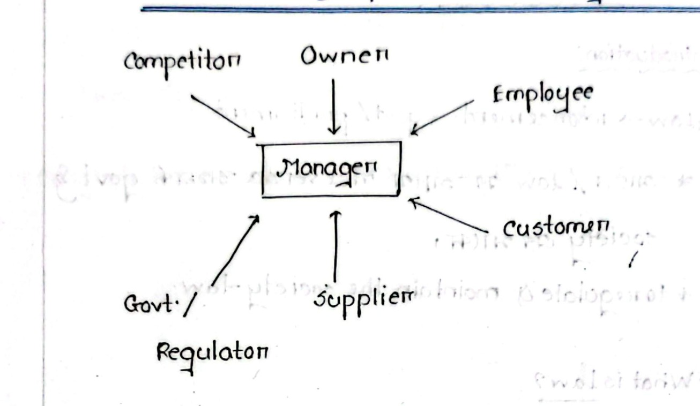
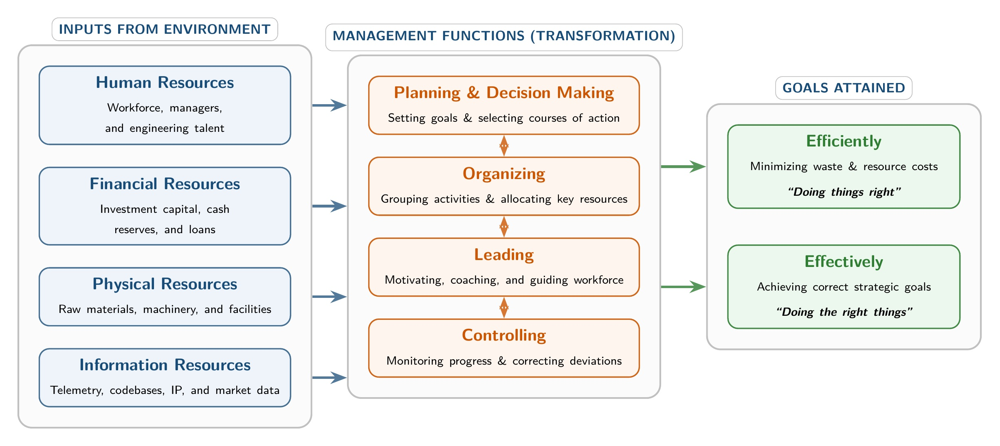
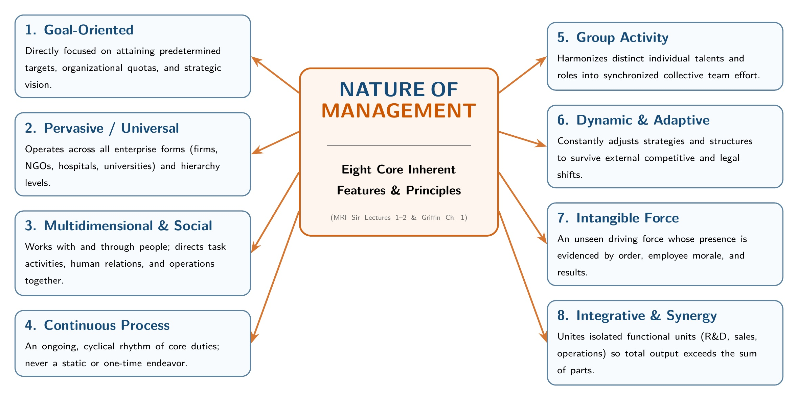

[← Previous: L12.1: Unfair Labour Practices (Sections 195 and 196)](L12.1_Unfair_Labour_Practices_Sec_195_and_196.md) | [🏠 Index](00_Index.md) | [Next: M01.2: Efficiency vs. Effectiveness and Decision Matrix →](M01.2_Efficiency_vs_Effectiveness_and_Decision_Matrix.md)

---

# M01.1: Management Definitions, Resources, and Nature

> **Section:** Section B (CO2 · Industrial Management · Md. Rafiqul Islam Sir) | **Priority:** 🔴 Essential | **Exam Frequency:** Tested in 2020, 2021, 2023, 2024, and 2025 CT-1
> **Subtopics Covered:** `M01.1` (Definitions of Management and Industrial Management, F.W. Taylor 1911, Ricky W. Griffin), `M01.2` (Stakeholders Diagram, Four Resources `H-F-P-I`, Eight Features of the Nature of Management)
> **Sources:** MRI Sir Lecture 1, Lecture 2, Raidah Class Notes (Classes 1 to 4), Griffin Chapter 1, Previous Year Questions (`2020 Q.1(a)`, `2021 Q.1(a)`, `2023 Q.5(a)`, `2024 Q.1(a)`, `2024 Q.5(a)`, `2025 IM-CT1 Q.3, Q.7, Q.8, Q.9`)

## Why This Topic Matters

Industrial management questions appear on every single HUM 2217 exam paper. Md. Rafiqul Islam Sir (MRI Sir) begins Section B with these fundamentals.

Exam questions test exact definitions and clear classifications. You must quote F.W. Taylor verbatim. You must also list the four basic resources and explain the nature of management clearly.

Examiners deduct marks for vague answers. Scoring full marks requires short, structured bullet points. You should also draw clean diagrams and provide real industry examples.

---

## 📝 Key Definitions

> **Management (F.W. Taylor, 1911):** "Management is an art of doing things in the best & cheapest way."

This classic definition comes from the father of scientific management. It highlights two goals: top technical quality ("best way") and low production cost ("cheapest way").

> **Management (Ricky W. Griffin):** "A set of activities (including planning and decision making, organizing, leading, and controlling) directed at an organization's resources (human, financial, physical, and information), with the aim of achieving organizational goals in an efficient and effective manner."

Griffin explains management as an active process. It combines four distinct administrative functions. It channels four types of resources toward clear organizational goals.

> **Industrial Management:** A specialized branch of engineering management that applies scientific and managerial principles to design, operate, control, and optimize industrial production systems.

Industrial management connects pure engineering with business management. It originated from mechanical engineering and later grew into Industrial and Production Engineering (IPE).

---

## Defining Management and Industrial Management

### 1. What Is Management?

Management is the process of getting work done through people and resources. Every organized group needs management to succeed.

Without management, people work in different directions. Resources get wasted. Deadlines are missed, and costs quickly spiral out of control.

Management provides direction. It sets targets, assigns responsibilities, and tracks actual progress against plans.

### 2. What Is Industrial Management?

Industrial management focuses directly on manufacturing, factories, and industrial operations:

1. **System Integration:** It coordinates workers, capital, tools, materials, and digital data. These elements work together as an integrated production system.
2. **Cost and Waste Reduction:** It cuts down raw material scrap, machine downtime, and unnecessary worker movements.
3. **Productivity Optimization:** It maximizes the output generated by each machine hour and labor hour.
4. **Quality and Safety:** It maintains strict product standards and ensures a safe factory work floor.

### 3. Historical Origins: F.W. Taylor and IPE

The discipline of industrial management began on the shop floor:

- **1911 Foundation:** Frederick Winslow Taylor (F.W. Taylor) published *The Principles of Scientific Management* in 1911.
- **Engineering Roots:** Taylor was a mechanical engineer. He studied worker fatigue, tool design, and time-and-motion studies.
- **Evolution of IPE:** His pioneering work transformed mechanical engineering into the modern field of Industrial and Production Engineering (IPE).

> [!tip] Memory Hook: **The 1911 Taylor Rule**
> Taylor was an engineer who wanted two things:
> - **The Best Way:** High quality and technical perfection.
> - **The Cheapest Way:** Low waste and lowest production cost.

---

## The Manager and Organizational Stakeholders

### 1. The Manager as the Central Hub

A manager does not work in isolation. The manager sits at the very center of an organizational web.

The manager must balance competing pressures from six distinct stakeholder groups. Satisfying only one group while ignoring the others leads to business failure.

*Figure 1.1: Manager and organizational stakeholders interaction model (Source: Classnotes Hum 2217, Page 1)*

### 2. Breakdown of the Six Key Stakeholders

1. **Owner:**
   - Provides investment capital and assumes business financial risk.
   - Demands strong return on equity, steady growth, and honest financial reporting.
2. **Employee:**
   - Operates machinery, writes software, and conducts day-to-day administrative tasks.
   - Expects fair salaries, safe working conditions, job security, and career training.
3. **Customer:**
   - Purchases finished goods and telecom services.
   - Demands high reliability, affordable pricing, honest advertising, and prompt customer support.
4. **Supplier:**
   - Delivers raw materials, specialized electronic parts, and industrial equipment.
   - Requires clear technical specifications, steady purchase orders, and on-time invoice payments.
5. **Government / Regulator:**
   - Enforces labor laws, factory safety codes, spectrum regulations, and tax collection.
   - Requires full statutory compliance, environmental safety, and fair corporate competition.
6. **Competitor:**
   - Challenges the firm with rival products, alternative pricing, and new features.
   - Drives continuous innovation, efficiency gains, and strategic service improvements.

---

## The Four Organizational Resources (H-F-P-I)

Every enterprise takes four primary categories of resources from its environment. Managers combine and direct these inputs to achieve corporate goals.

*Figure 1.2: The Management Process: Environmental Inputs through POLC Transformation to Attained Goals (Source: Griffin Management 8th ed. & Lecture 1)*

### 1. Human Resources (HR)

Human resources comprise the people who power the organization:

- Includes managers, engineers, software developers, administrative clerks, and factory technicians.
- Requires employee dedication, institutional loyalty, and continuous technical training.
- Employees earn salaries and wages while building company capabilities.

### 2. Financial Resources

Financial resources represent the monetary assets used to fund operations:

- Includes founder equity, bank loans, shareholder capital, and retained company earnings.
- Also includes daily cash inflows from customer billing and product sales.
- Funds payroll, raw material orders, research equipment, and plant maintenance.

### 3. Physical Resources

Physical resources are tangible assets used during production and operations:

- Includes land, manufacturing plants, office buildings, and repair warehouses.
- Also includes hardware machinery, production lines, test benches, and raw inventory supplies.
- In technology firms, physical assets include server racks, optical fiber lines, and cell towers.

### 4. Information Resources

Information resources consist of data, research, and operating intelligence:

- Captures dynamic operational awareness: what is happening, and how is it happening?
- Includes network traffic logs, customer usage analytics, circuit schematics, and market surveys.
- Accurate information allows managers to make fast, evidence-based business choices.

> [!tip] Memory Hook: **H-F-P-I Resource Ladder**
> Remember the acronym **H-F-P-I**:
> - **H**uman: Brains and hands (engineers and technicians).
> - **F**inancial: Cash and capital (bank balances and revenue).
> - **P**hysical: Concrete and silicon (buildings, machines, and cell towers).
> - **I**nformation: Data and insights (analytics, code, and circuit designs).

---

## Concrete Resource Applications: Telecom Firm vs. University

Exam questions frequently ask you to identify specific organizational resources for a concrete institution. Use the table below as an exact reference.

| Resource Type | Telecommunications Operator (e.g., Grameenphone) | Engineering University (e.g., RUET) |
| :--- | :--- | :--- |
| **Human Resources** | - Radio Frequency (RF) Network Engineers - Customer Support Representatives - Field Transmission Technicians | - Professors and Lecturers - Laboratory Technicians - University Registrar and Officers |
| **Financial Resources** | - Subscriber monthly voice and data recharge revenues - Shareholder equity and corporate debt capital - 5G spectrum license investment funds | - Government revenue grants and development funds - Student tuition, admission, and semester fees - Research grants and international endowments |
| **Physical Resources** | - Cellular Base Transceiver Station (BTS) towers - Underground optical fiber backbone cables - Server data centers and switching offices | - Academic faculty buildings and auditoriums - Engineering laboratories and computer centers - Student residential halls and campus land |
| **Information Resources** | - Real-time call data records and traffic density logs - Network packet routing analytics - Customer churn prediction models | - Curricula, syllabi, and academic course modules - Student semester grades and transcript archives - Research papers, lab manuals, and patents |

---

## Eight Core Features of the Nature of Management

Management has unique characteristics that define how it functions across modern institutions. In Lectures 1 and 2, MRI Sir detailed eight core features:

*Figure 1.3: Eight Core Inherent Features and Characteristics of Management (Source: Lecture 1 & 2 / Classnotes Hum 2217)*

### Feature 1: Goal-Oriented

Management exists to accomplish specific, pre-determined targets:

- Every organizational task must connect directly to strategic goals.
- Goals may include market share growth, profit targets, or zero production defects.
- Managers use systematic frameworks like SWOT analysis (Strengths, Weaknesses, Opportunities, Threats) to guide strategy.

### Feature 2: Universal Application

Management principles apply across every field of organized human effort:

- **Enterprise Types:** Businesses, public hospitals, engineering universities, military units, and charities all require management.
- **Geographic Reach:** The core duties of management remain identical across Bangladesh, Japan, Europe, or the United States.
- **Hierarchical Levels:** First-line supervisors, department heads, and board executives all plan, organize, lead, and control.

### Feature 3: Social Process

Management gets work done with and through human beings:

- Organizations consist of individuals with diverse personalities, emotions, and aspirations.
- Managers spend most of their working hours communicating, mentoring, listening, and resolving team friction.
- Managerial decisions also shape society through job creation, product safety, and fair wages.

### Feature 4: Dynamic and Adaptive

Management cannot remain rigid because business environments change continuously:

- Managers must react swiftly to new competitor technologies, shifting market demands, and economic trends.
- They lead change management initiatives so teams adopt new digital tools smoothly.
- Continuous evaluation helps organizations survive external market disruptions.

### Feature 5: Integrative and Group Activity

Management unites separate specialized units into one cohesive enterprise:

- A company has isolated departments: marketing, hardware engineering, software development, and accounting.
- Management synchronizes their schedules, aligns their priorities, and resolves conflicting goals.
- This creates corporate synergy, where the total team output exceeds the sum of individual efforts.

### Feature 6: Decision-Making Driven

Decision-making forms the core operational rhythm of management:

- Managers continually choose between competing options under conditions of risk and incomplete information.
- They identify root problems, generate viable alternatives, and choose the most effective course of action.
- Examples include choosing between upgrading current server hardware or migrating systems to cloud infrastructure.

### Feature 7: Resource Optimization

Management balances efficiency and effectiveness to generate the highest possible value:

- Resources like capital, skilled engineers, and factory equipment are scarce and costly.
- Managers eliminate wasteful practices to lower unit production costs (efficiency).
- At the same time, they ensure that finished products satisfy user expectations (effectiveness).

### Feature 8: Continuous Learning and Development

Modern management requires continuous institutional and personal growth:

- Managers must update their technical and managerial skills as industry standards evolve.
- They introduce modern automation tools, agile workflows, and updated engineering methods.
- Organizations that stop learning become obsolete and fail against proactive competitors.

> [!tip] Memory Hook: **The 8-Feature Formula**
> Remember the key traits of management with this memory list:
> 1. **G**oals (Aim of work)
> 2. **U**niversal (Works everywhere)
> 3. **S**ocial (Works through people)
> 4. **D**ynamic (Changes with time)
> 5. **I**ntegrative (Connects units)
> 6. **D**ecisions (Chooses best path)
> 7. **O**ptimization (Cuts waste)
> 8. **L**earning (Upgrades skills)

---

## Summary Comparison: Four Organizational Resources

| Dimension | Human Resources | Financial Resources | Physical Resources | Information Resources |
| :--- | :--- | :--- | :--- | :--- |
| **Primary Form** | People, talent, and labor | Money, credit, and equity | Land, plants, and machines | Data, code, and analytics |
| **Main Objective** | Direct effort and build skills | Fund operations and growth | Produce and store goods | Guide accurate decisions |
| **Acquisition** | Hiring and recruitment | Investment and sales cash | Purchasing or leasing | Research, testing, and telemetry |
| **Managerial Task** | Motivating and training | Budgeting and allocating | Maintaining and scheduling | Collecting and protecting |
| **Failure Risk** | Low morale and turnover | Cash crunch and insolvency | Plant breakdown and wear | Flawed strategic choices |

---

## Exam Variants

| Exam Paper | Question Summary | Marks | Target Section | Key Takeaway |
| :--- | :--- | :---: | :---: | :--- |
| **2020 Q.1(a)** | Define management. | 03 | Section A | Give Taylor's 1911 quotation and Griffin's definition. |
| **2021 Q.1(a)** | Define management, efficiency, and effectiveness. | 03 | Section A | Define management, then explain doing things right vs. doing right things. |
| **2023 Q.5(a)** | Define Industrial Management. | 02 | Section B | State engineering application, Taylor's roots, and production optimization. |
| **2024 Q.1(a)** | Define Industrial Management. | 02 | Section A | Repeat the concise definition with core production goals. |
| **2024 Q.5(a)** | Define Management, efficiency, and effectiveness. | 02 | Section B | Give Taylor's definition, efficiency formula, and effectiveness motto. |
| **2025 IM-CT1 Q.3** | Management is Universal. How? | 02 | Class Test 1 | Explain application across industries, geographies, and hierarchy levels. |
| **2025 IM-CT1 Q.7** | Management is a social process. How? | 02 | Class Test 1 | Detail human interaction, team motivation, and societal consequences. |
| **2025 IM-CT1 Q.8** | Is a university Vice-Chancellor a manager? Why or why not? | 02 | Class Test 1 | Confirm yes; map VC tasks across four resources and four POLC functions. |
| **2025 IM-CT1 Q.9** | Mention at least two names of human, physical, and financial resources of a Telecom firm. | 02 | Class Test 1 | List two real examples for HR, physical assets, and financial sources. |
| **Model Question** | Illustrate stakeholder relationships and describe eight features of management. | 04 | Section B | Draw stakeholder hexagon and detail the eight nature characteristics. |

---

## 🏆 Golden Questions (Past Exam Archive & Model Answers)

### 🎯 GQ1 · 2020 Q.1(a), 2023 Q.5(a) & 2024 Q.1(a) · Define Management and Industrial Management (03 Marks)

> **Appeared:** 2020 Final Q.1(a) (03 Marks) · 2023 Final Q.5(a) (02 Marks) · 2024 Final Q.1(a) (02 Marks)

**Question:**
- **[2020 · Q.1(a) | 03 Marks]:** Define management.
- **[2023 · Q.5(a) | 02 Marks]:** Define Industrial Management.
- **[2024 · Q.1(a) | 02 Marks]:** Define Industrial Management.

**Full Answer:**

#### GQ1.1 · Definition of Management

Management is the process of coordinating and overseeing organizational activities and resources to reach objectives efficiently and effectively.

Two authoritative definitions govern this field:

- **F.W. Taylor (1911):**
  > *"Management is an art of doing things in the best & cheapest way."*
- **Ricky W. Griffin:**
  > *"A set of activities (including planning and decision making, organizing, leading, and controlling) directed at an organization's resources (human, financial, physical, and information), with the aim of achieving organizational goals in an efficient and effective manner."*

#### GQ1.2 · Definition of Industrial Management

Industrial Management is a specialized branch of management. It applies engineering and scientific principles to design, operate, control, and optimize industrial production systems.

Key dimensions include:

1. **Origins:** Founded in 1911 by mechanical engineer Frederick Winslow Taylor. It later evolved into Industrial and Production Engineering (IPE).
2. **System Integration:** It coordinates workers, capital, machinery, materials, and digital data into an integrated operational system.
3. **Core Objectives:**
   - Minimizing manufacturing expenses and material scrap.
   - Maximizing labor and equipment productivity.
   - Maintaining high product quality, worker safety, and supply chain reliability.

---

### 🎯 GQ2 · 2021 Q.1(a) & 2024 Q.5(a) · Define Management, Efficiency, and Effectiveness (03 Marks)

> **Appeared:** 2021 Final Q.1(a) (03 Marks) · 2024 Final Q.5(a) (02 Marks)

**Question:**
Define management, efficiency and effectiveness.

**Full Answer:**

#### GQ2.1 · Management

Management is the process of coordinating organizational resources through planning, organizing, leading, and controlling. It directs human, financial, physical, and information resources toward clear organizational goals.

#### GQ2.2 · Efficiency ("Doing Things Right")

Efficiency means using resources wisely and in a cost-effective way. It focuses on the input-output relationship. The goal is to minimize waste, labor hours, and production expenses for a target output level.

$$
\text{Efficiency} = \frac{\text{Useful Output}}{\text{Total Input}}
$$

*Example:* Toyota Motor Corporation manufactures vehicles with low scrap rates and minimal assembly labor hours.

#### GQ2.3 · Effectiveness ("Doing the Right Things")

Effectiveness means making the right strategic decisions and successfully implementing them. It focuses on achieving desired organizational targets, meeting market demands, and satisfying customer expectations.

*Example:* Toyota designs hybrid and electric cars that match customer preferences and comply with global emission rules.

#### GQ2.4 · Comparison Summary Table

| Metric | Core Orientation | Primary Question | Key Measure |
| :--- | :--- | :--- | :--- |
| **Efficiency** | Means and process | How well are resources used? | Low unit cost and zero waste |
| **Effectiveness** | Ends and results | Did we achieve our goals? | High market share and customer demand |

---

### 🎯 GQ3 · 2025 IM-CT1 Q.3 · Management Is Universal (02 Marks)

> **Appeared:** 2025 Class Test 1 Q.3 (02 Marks)

**Question:**
Management is Universal. How?

**Full Answer:**

Management is universal. Its core principles and four fundamental functions (planning, organizing, leading, and controlling) apply across all collective human efforts:

1. **Across Enterprise Types:** Private corporations, public hospitals, engineering universities, military battalions, and charitable foundations all require management. Every organization must coordinate resources to reach its goals.
2. **Across Geographies:** Core management principles function everywhere, from Bangladesh to Japan or the United States. Cultural factors differ, but the basic managerial process remains identical.
3. **Across Hierarchical Levels:** First-line supervisors, middle department heads, and top corporate executives all plan, organize, lead, and monitor work. They differ only in operational scope and scale.

---

### 🎯 GQ4 · 2025 IM-CT1 Q.7 · Management Is a Social Process (02 Marks)

> **Appeared:** 2025 Class Test 1 Q.7 (02 Marks)

**Question:**
Management is a social process. How?

**Full Answer:**

Management is fundamentally a social process because it centers on human behavior, interpersonal relationships, and societal impact:

1. **Focus on People:** Management gets work done with and through people. Organizations consist of individuals with diverse personalities, emotions, and aspirations.
2. **Interpersonal Interaction:** Managers spend most of their working time communicating, motivating teams, resolving interpersonal disputes, and guiding collaborative group work.
3. **Social Impact:** Managerial decisions directly affect society. They determine employee safety, fair living wages, product quality, consumer health, and environmental sustainability.

---

### 🎯 GQ5 · 2025 IM-CT1 Q.8 · Is a University Vice-Chancellor a Manager? (02 Marks)

> **Appeared:** 2025 Class Test 1 Q.8 (02 Marks)

**Question:**
Is a university Vice-Chancellor a manager? Why or why not?

**Full Answer:**

**Yes, a university Vice-Chancellor is a top-level manager.**

A Vice-Chancellor coordinates organizational resources and executes all four fundamental management functions:

1. **Coordinates the Four Organizational Resources:**
   - *Human Resources:* Appoints, guides, and evaluates professors, lecturers, lab assistants, and administrative staff.
   - *Financial Resources:* Allocates government revenue grants, student tuition fees, and scientific research project funds.
   - *Physical Resources:* Manages campus real estate, academic faculty buildings, engineering laboratories, and computing centers.
   - *Information Resources:* Oversees academic curricula, student examination records, and institutional accreditation files.
2. **Executes the Four Management Functions:**
   - *Planning:* Sets the academic vision, opens new degree programs, and establishes university research priorities.
   - *Organizing:* Structures faculties, departments, academic councils, and administrative directorates.
   - *Leading:* Inspires academic deans and professors, resolves faculty disputes, and represents the university to the nation.
   - *Controlling:* Monitors semester examination schedules, student degree completions, and annual fiscal budget spending.

---

### 🎯 GQ6 · 2025 IM-CT1 Q.9 · Resources of a Telecom Firm (02 Marks)

> **Appeared:** 2025 Class Test 1 Q.9 (02 Marks)

**Question:**
Mention at least two names of human, physical, and financial resources of a Telecom firm,

*(Note: Verbatim question text ends with a comma as printed in the original exam paper).*

**Full Answer:**

For a telecommunications service provider (such as Grameenphone or Banglalink):

1. **Human Resources:**
   - Radio Frequency (RF) Network Planning Engineers.
   - Customer Care Service Representatives.
2. **Physical Resources:**
   - Cellular Base Transceiver Station (BTS) towers and antenna arrays.
   - Underground optical fiber transmission backbones and server data centers.
3. **Financial Resources:**
   - Shareholder equity capital and retained corporate reserves.
   - Daily operating cash inflow from subscriber prepaid and postpaid recharge packages.

---

### 🎯 GQ7 · Model Exam Question · Stakeholders and Eight Features of Management (04 Marks)

> **Appeared:** Model Exam Question (Prescribed in Lectures 1 and 2) (04 Marks)

**Question:**
Illustrate the manager's relationship with organizational stakeholders. Also list and briefly describe the eight features defining the nature of management.

**Full Answer:**

#### GQ7.1 · The Manager and Organizational Stakeholders

The modern manager sits at the central operational hub of the enterprise, actively balancing demands from six key stakeholders:

*Figure 1.1: Manager and organizational stakeholders interaction model (Source: Classnotes Hum 2217, Page 1)*

- **Owner:** Supplies financial capital and demands healthy returns on investment.
- **Employee:** Performs daily operational work and requires fair wages, leadership, and safe conditions.
- **Customer:** Buys finished products or services and expects high reliability and fair prices.
- **Supplier:** Delivers raw materials and components needed for ongoing production.
- **Government / Regulator:** Enforces legal compliance, safety laws, environmental rules, and taxes.
- **Competitor:** Drives pricing benchmarks, product quality standards, and technical innovation.

#### GQ7.2 · The Eight Features Defining the Nature of Management

1. **Goal-Oriented:** Every management activity targets pre-determined organizational objectives.
2. **Universal Application:** Management practices operate across commercial, governmental, and educational institutions.
3. **Social Process:** Management works with and through people, relying on communication and teamwork.
4. **Dynamic and Adaptive:** It continuously adjusts operations to external technological and market shifts.
5. **Integrative and Group Activity:** It synchronizes separate departments into an aligned, cooperative system.
6. **Decision-Making Driven:** It requires managers to evaluate alternatives and solve operational problems under risk.
7. **Resource Optimization:** It balances efficiency and effectiveness to generate high output from scarce inputs.
8. **Continuous Learning and Development:** It demands ongoing professional growth and adoption of modern tools.

---

## ⚡ Exam Tips & Common Mistakes

1. **Quote Taylor Accurately:** Write F.W. Taylor's 1911 quote verbatim. Quote *"Management is an art of doing things in the best & cheapest way."* Examiners give full marks for exact words.
2. **Include the Four Resources:** When citing Ricky W. Griffin, do not just list the four functions (`P-O-L-C`). Also explicitly name the four resources (`H-F-P-I`).
3. **Label All Six Stakeholders:** Draw arrows for all six stakeholders pointing to the central manager box. These are Owner, Employee, Customer, Supplier, Govt./Regulator, and Competitor.
4. **Telecom Firm Resource Examples:** In CT-1 Q.9, avoid vague words. Give exact industry terms: "Radio Frequency Engineers," "BTS Towers," and "Recharge Revenue."
5. **Vice-Chancellor Question Structure:** Answer in two clean parts. First map the VC to the four resources. Then map the VC to the four functions of management.

---

## 🔗 Related Topics

- [M01.2: Efficiency vs. Effectiveness and Decision Matrix](M01.2_Efficiency_vs_Effectiveness_and_Decision_Matrix.md)
- [M01.3: Management Functions (P-O-L-C) and Leadership](M01.3_Management_Functions_POLC_and_Leadership.md)
- [M02.1: Management Levels and Functional Areas](M02.1_Management_Levels_and_Functional_Areas.md)

---

[← Previous: L12.1: Unfair Labour Practices (Sections 195 and 196)](L12.1_Unfair_Labour_Practices_Sec_195_and_196.md) | [🏠 Index](00_Index.md) | [Next: M01.2: Efficiency vs. Effectiveness and Decision Matrix →](M01.2_Efficiency_vs_Effectiveness_and_Decision_Matrix.md)
