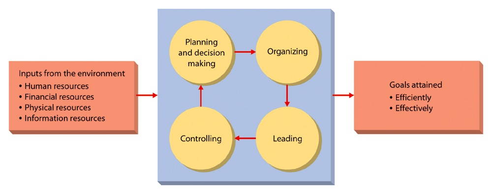
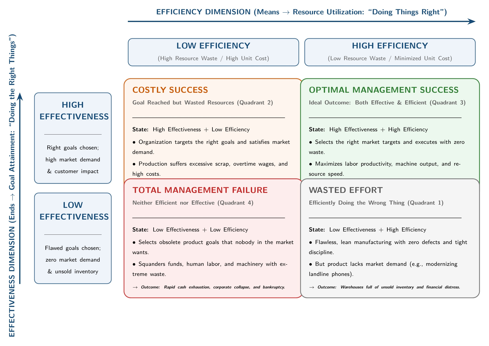

[← Previous: M01.1: Management Definitions, Resources, and Nature](M01.1_Management_Definitions_Resources_and_Nature.md) | [🏠 Index](00_Index.md) | [Next: M01.3: Management Functions (P-O-L-C) and Leadership →](M01.3_Management_Functions_POLC_and_Leadership.md)

---

# M01.2: Efficiency vs. Effectiveness and Decision Matrix

> **Section:** Section B (CO2 · Industrial Management · Dr. Md. Rabiul Islam Sir) | **Priority:** 🔴 Essential | **Exam Frequency:** Tested in 2021, 2023, 2024, and 2025 CT-1
> **Subtopics Covered:** `M01.3` (Efficiency vs. Effectiveness, $2 \times 2$ Performance Matrix, Decision Situations and Engineering Examples)
> **Sources:** MRI Sir Lecture 1, Raidah Class Notes (Classes 1 and 3), Griffin Chapter 1, Previous Year Questions (`2021 Q.1(a)`, `2021 Q.2(a)`, `2023 Q.5(b)`, `2024 Q.5(a)`, `2025 IM-CT1 Q.2`)

## Why This Topic Matters

MRI Sir tests efficiency and effectiveness in almost every final exam and class test. Many students mix up these two concepts. Examiners deduct marks if you write vague textbook definitions without real engineering examples.

To score full marks, you must state the two famous mottos. Then show the input-output ratio for efficiency. Finally, explain the $2 \times 2$ matrix with concrete telecom or manufacturing decision scenarios.

---

## 📝 Key Definitions

> **Efficiency:** "Using resources wisely and in a cost-effective way." (Ricky W. Griffin, *Fundamentals of Management*)

Efficiency focuses on the means of production. It aims to reduce waste of time, money, materials, and labor. Its popular motto is **"doing things right."**

> **Effectiveness:** "Making the right decisions and successfully implementing them." (Ricky W. Griffin, *Fundamentals of Management*)

Effectiveness focuses on the ends or final results. It ensures that the company creates products or services that customers actually want. Its popular motto is **"doing the right things."**

---

## Core Theory: Defining Efficiency and Effectiveness

### 1. Understanding Efficiency (The Means)

Efficiency measures how well an organization uses its inputs to produce goods or services. It is an internal, process-oriented measure:

1. **Input-Output Relationship:** Efficiency is the ratio of useful output produced to total resources spent.
2. **Waste Minimization:** It seeks zero defective parts, low labor idle time, and lower energy usage.
3. **Cost Control:** In class notes, MRI Sir summarized efficiency with a simple relation:

$$
\text{Expenses} \downarrow \quad \text{and} \quad \text{Output} \uparrow
$$

$$
\text{Efficiency} = \frac{\text{Useful Output}}{\text{Total Input}}
$$

*Engineering Example:* An electronics assembly plant reduces circuit board soldering defects from $5\%$ to $0.1\%$. It uses fewer raw solder rolls and saves labor hours. This makes the assembly line highly efficient.

### 2. Understanding Effectiveness (The Ends)

Effectiveness measures whether the organization achieved its intended mission and goals. It is an external, market-oriented measure:

1. **Goal Attainment:** It checks whether the firm met its strategic targets and delivery dates.
2. **Customer Satisfaction:** It ensures products match customer needs, safety norms, and technical standards.
3. **Value Creation:** Producing goods cheaply is useless if nobody buys them. Effectiveness makes sure the company chooses the right product line.

*Engineering Example:* A telecommunications operator launches a 5G data package that mobile users demand. Subscribers sign up in large numbers, and network revenue grows by $30\%$. The strategic choice was effective.

### 3. The Need for Both Dimensions

A successful enterprise cannot choose between efficiency and effectiveness. It needs both:

*Figure 1.1: The Management Process achieving goals efficiently and effectively (Source: Lecture 1, Page 1)*

- If a firm is only efficient, it makes unwanted goods with zero waste. It will soon go out of business.
- If a firm is only effective, it reaches its goals at enormous expense. Its profit margins vanish.
- High-performing companies balance both sides. They reach high-value goals while keeping costs low.

---

## Comparison Table: Efficiency vs. Effectiveness

The table below contrasts the two core pillars of managerial performance:

| Comparison Parameter | Efficiency | Effectiveness |
| :--- | :--- | :--- |
| **Popular Motto** | "Doing things right" | "Doing the right things" |
| **Core Orientation** | Means, methods, and internal processes | Ends, results, and external goals |
| **Primary Question** | "How well are we using our resources?" | "Are we achieving the right goals?" |
| **Main Objective** | Minimize waste, labor hours, and costs | Maximize goal attainment and market value |
| **Key Metric** | Input-output ratio, cost per unit, scrap rate | Sales growth, market share, customer satisfaction |
| **Focus Area** | Operations, engineering lines, and budgets | Strategy, product planning, and market demand |
| **Time Horizon** | Short-term operational focus | Long-term strategic focus |
| **Automotive Example** | Toyota assembling cars with low scrap and low labor hours | Toyota designing hybrid cars that meet global buyer demand |

> [!tip] Memory Hook: **The DO-RIGHT Rule**
> Remember these two short memory phrases for the exam:
> - **Efficiency:** Doing things **R**ight (Focus = **R**esource waste and process).
> - **Effectiveness:** Doing the **R**ight things (Focus = **R**esults and correct goals).

---

## The 2 × 2 Management Decision Matrix

Managers combine efficiency and effectiveness in four distinct operational states. We map these combinations into a $2 \times 2$ performance grid:

*Figure 1.2: Two-by-Two Efficiency versus Effectiveness Strategic Decision Matrix (Source: Griffin Management 8th ed. & Lecture 1)*

| Dimension | High Efficiency (Low Waste) | Low Efficiency (High Waste) |
| :--- | :--- | :--- |
| **High Effectiveness (Right Goals)** | **Quadrant 3: Ideal Outcome** Goals achieved with minimal cost and low waste. *Result:* High profits, strong market growth, and competitive survival. | **Quadrant 2: Costly Success** Goals achieved, but at huge expense and high resource waste. *Result:* Survives emergency, but suffers weak profit margins. |
| **Low Effectiveness (Wrong Goals)** | **Quadrant 1: Wasted Effort** High-quality production of goods that nobody wants. *Result:* Unsold stock, cash drain, and eventual bankruptcy. | **Quadrant 4: Total Failure** Wrong goals chosen, and resources squandered. *Result:* Rapid corporate collapse and business closure. |

### Detailed Analysis of Decision Situations

#### Quadrant 1: Efficient but Not Effective (Wasted Effort)

- **Definition:** The manager executes the production process with excellent discipline and zero waste. But the chosen product does not match market demand.
- **Decision Scenario (Electronics Manufacturing):** A factory manager re-engineers a production line for landline push-button telephone sets. The manager automates the component placement line. This cuts production costs by $40\%$ and lowers defective units to zero.
- **Evaluation:**
  - *Efficiency:* Very high. The team uses labor, plastics, and circuit components with minimal waste.
  - *Effectiveness:* Very low. Consumers now buy mobile smartphones instead of landline phones. The warehouse fills with unsold inventory. The company makes no sales and faces financial loss.

#### Quadrant 2: Effective but Not Efficient (Costly Success)

- **Definition:** The manager achieves the critical business goal and satisfies the customer. But the solution consumes excessive money, labor, or material resources.
- **Decision Scenario (Telecommunications Emergency):** A storm severs an underground optical fiber backbone. This happens two hours before a live Cricket World Cup broadcast. The operations director charters a private helicopter. The helicopter flies specialized splicing engineers directly to the remote river crossing. Technicians restore cellular voice and data connectivity in 50 minutes.
- **Evaluation:**
  - *Effectiveness:* Very high. The operator restores network services on time. It stops public anger and avoids huge regulatory penalty fines.
  - *Efficiency:* Very low. Hiring an emergency private helicopter costs six times the monthly field maintenance budget.

#### Quadrant 3: Both Efficient and Effective (Ideal Outcome)

- **Definition:** The manager reaches the desired organizational goal while using minimum time, labor, and capital.
- **Decision Scenario (Telecom Peak Traffic Management):** A mobile network operator faces network congestion in Rajshahi. Users experience heavy call drops during evening peak hours. Building new base stations (BTS) would cost $\$500,000$. Instead, the engineering team develops and installs an automated AI dynamic load-balancing script. The software routes excess data traffic through underused existing cell towers and local servers.
- **Evaluation:**
  - *Effectiveness:* Very high. Call drop rates fall by $95\%$. Network throughput easily meets national regulatory quality-of-service benchmarks.
  - *Efficiency:* Very high. The project uses existing compute hardware. It saves $\$500,000$ in capital expenses and monthly site tower rent.

#### Quadrant 4: Neither Efficient nor Effective (Total Failure)

- **Definition:** The manager chooses the wrong goals and wastes resources during execution.
- **Decision Scenario (Outdated Storage Media):** A computer hardware firm decides to manufacture 3.5-inch floppy disk drives in 2026. The assembly team struggles with broken tooling, high scrap rates, and frequent worker absenteeism. Unit manufacturing costs double.
- **Evaluation:**
  - *Efficiency:* Very low. Massive scrap and high labor expenses.
  - *Effectiveness:* Very low. Modern computers do not have floppy disk interfaces. Nobody buys the drives. The product line shuts down within two months.

> [!tip] Memory Hook: **The 4 Quadrant Letters (W-C-I-T)**
> - **W** $\rightarrow$ **W**asted Effort (Efficient, but Not Effective)
> - **C** $\rightarrow$ **C**ostly Success (Effective, but Not Efficient)
> - **I** $\rightarrow$ **I**deal Outcome (Both Efficient and Effective)
> - **T** $\rightarrow$ **T**otal Failure (Neither Efficient nor Effective)

---

## Exam Variants

The table below lists how RUET final exams and class tests frame questions on this topic:

| Year / Source | Question / Scenario | Marks | Key Focus / Takeaway |
| :--- | :--- | :---: | :--- |
| **2023 Q.5(b)** | Clarify efficiency and effectiveness from management perspective with decision examples | 04 | Full comparison + Landline and Helicopter examples (GQ1) |
| **2021 Q.2(a)** | What is decision making? Example of effective but not efficient decision | 03 | Define decision making + Helicopter emergency repair (GQ2) |
| **2025 IM-CT1 Q.2** | Example of a decision situation that is both efficient and effective | 02 | Telecom AI load-balancing on existing cell towers (GQ3) |
| **2021 Q.1(a)** | Define management, efficiency and effectiveness | 03 | 3 core definitions + formulas + Toyota examples (GQ4) |
| **2024 Q.5(a)** | Define Management, efficiency and effectiveness | 02 | Condensed definitions and core mottos (GQ4) |

> [!note] Syllabus Cross-Reference and Question Routing Note
> - **2021 Q.2(a) & 2023 Q.5(b):** Fully answered inline as GQ2 and GQ1 below.
> - **2024 Q.3(a) & 2024 Q.3(b):** These questions ask for Trade Union objectives (`Q.3(a)`) and registration process (`Q.3(b)`). They belong to CO1 Section A (Legal Issues) and are fully answered in `L10.1` and `L10.2`.
> - **2020 Q.2:** The 2020 paper set only parts (a) and (b) (see `M05.2` and `M06.2`). No part `2020 Q.2(c)` was set in the exam paper.

---

## 🏆 Golden Questions (Past Exam Archive & Model Answers)

### 🎯 GQ1 · 2023 Final Q.5(b) · Clarifying Efficiency and Effectiveness with Decision Examples (04 Marks)

> **Appeared:** RUET 2023 Final Exam, Section B, Q.5(b) · (04 Marks)

**Question:**
Clarify efficiency and effectiveness from the management perspective. Give example of a decision situation that is efficient but not effective, again effective but not efficient.

**Full Answer:**

#### 1. Managerial Perspective: Efficiency vs. Effectiveness

In industrial management, efficiency and effectiveness represent the two central dimensions of organizational performance:

- **Efficiency ("Doing Things Right"):** Using resources wisely and in a cost-effective manner. It measures the internal input-output relationship. The goal is to minimize waste, labor hours, and expenses:

$$
\text{Efficiency} = \frac{\text{Useful Output}}{\text{Total Resource Input}}
$$

- **Effectiveness ("Doing the Right Things"):** Making the right strategic decisions and successfully implementing them. It measures goal attainment. The goal is to satisfy customer demand, market needs, and organizational objectives.

#### 2. The 2 × 2 Management Decision Grid

| Dimension | High Efficiency | Low Efficiency |
| :--- | :--- | :--- |
| **High Effectiveness** | **Ideal Outcome:** Goals achieved with low cost and zero waste. | **Costly Success:** Goals achieved, but at huge expense. |
| **Low Effectiveness** | **Wasted Effort:** Perfect production of goods nobody wants. | **Total Failure:** Wrong goals and wasted resources. |

#### 3. Decision Situation: Efficient but Not Effective

- **Scenario:** A factory manager re-engineers a printed circuit board (PCB) assembly line for landline telephones. The team optimizes component placement, cuts unit production cost by $40\%$, and reduces assembly errors to zero.
- **Analysis:**
  - *Efficient:* The line uses raw materials, electricity, and labor with minimum waste.
  - *Not Effective:* Consumer demand has shifted completely to mobile smartphones. Nobody buys landline handsets. The company generates no revenue and piles up unsold stock.

#### 4. Decision Situation: Effective but Not Efficient

- **Scenario:** A major underground fiber-optic cable snaps two hours before a live cricket tournament broadcast. The operations manager charters an emergency helicopter. It flies fiber splicing technicians and test equipment directly to the remote swamp area. The team splices the core fibers within 45 minutes.
- **Analysis:**
  - *Effective:* Network connectivity is restored quickly. The operator keeps customers connected and avoids heavy regulatory fines.
  - *Not Efficient:* Hiring a private helicopter costs five times the routine monthly field maintenance budget.

---

### 🎯 GQ2 · 2021 Final Q.2(a) Part 2 · Decision Making and Costly Effective Decision (03 Marks)

> **Appeared:** RUET 2021 Final Exam, Section A, Q.2(a) (Part 2) · (03 of 06 Marks)

**Question:**
What is decision making? Give an example for decision making which is effective but not efficient.

*(Note: The first part of 2021 Q.2(a) asks for rational decision steps, fully covered in note M04.1. This model answer provides the exact exam-ready response for the definition and the decision example).*

**Full Answer:**

#### 1. Definition of Decision Making

Decision making is choosing the best action from several alternatives. It guides managers toward organizational goals. It is a core part of the planning process.

#### 2. Decision Making: Effective but Not Efficient

A decision is effective but not efficient when it reaches the goal, but wastes excessive money, labor, or materials.

#### 3. Telecommunications Example

- **Context:** Road construction damages a regional optical fiber backbone during business hours.
- **Managerial Decision:** To prevent long downtime, the manager deploys three independent repair teams at once. The manager also rents heavy diesel generators and pays triple-rate overtime wages.
- **Evaluation:**
  - *Effective:* The repair teams restore data traffic within one hour. The enterprise avoids contract breach penalties and maintains client trust.
  - *Not Efficient:* Deploying triple crews and paying overtime increases repair expenses to four times the standard budget. Resources were used with high economic waste.

---

### 🎯 GQ3 · 2025 IM-CT1 Q.2 · Decision Situation That Is Both Efficient and Effective (02 Marks)

> **Appeared:** RUET 2025 Class Test 1 (Industrial Management), Q.2 · (02 Marks)

**Question:**
Give an example of a decision situation that is both efficient and effective.

**Full Answer:**

- **Effective:** Making the right choice to achieve the desired organizational goal.
- **Efficient:** Using organizational resources (funds, labor, equipment) wisely without waste.

#### Engineering Decision Example

A mobile telecommunications company faces severe network congestion and call drops during peak evening hours in a university district.

- **Decision:** Constructing a new cell tower is expensive. Instead, the engineering manager deploys an automated AI traffic load-balancing algorithm across existing base stations and server hardware.
- **Effectiveness:** The call drop rate drops by $95\%$. The network satisfies all quality-of-service standards set by the telecom regulator.
- **Efficiency:** The engineering team solves the capacity problem using existing computing infrastructure. This saves $\$500,000$ in new equipment purchases and tower leasing expenses.

---

### 🎯 GQ4 · 2021 Final Q.1(a) / 2024 Final Q.5(a) · Defining Management, Efficiency, and Effectiveness (03 Marks)

> **Appeared:** RUET 2021 Final Exam Q.1(a) (03 Marks) & 2024 Final Exam Q.5(a) (02 Marks)

**Question:**
Define management, efficiency and effectiveness.

**Full Answer:**

#### 1. Management

Management is a set of core activities: planning, organizing, leading, and controlling. It directs organizational resources (human, financial, physical, and information) to achieve organizational goals efficiently and effectively.

#### 2. Efficiency ("Doing Things Right")

Efficiency means using resources wisely and in a cost-effective way. It measures the relationship between inputs and outputs. The primary objective is to minimize resource waste and production costs:

$$
\text{Efficiency} = \frac{\text{Useful Output}}{\text{Total Input}}
$$

*Example:* Toyota Motor Corporation manufactures automobiles with minimal material scrap and low assembly labor hours.

#### 3. Effectiveness ("Doing the Right Things")

Effectiveness means making the right decisions and successfully implementing them. It focuses on achieving desired targets, satisfying market demand, and creating customer value.

*Example:* Toyota designs hybrid and electric cars that match customer preferences and comply with global vehicle emission regulations.

#### Quick Summary

| Concept | Catchphrase | Core Concern | Primary Goal |
| :--- | :--- | :--- | :--- |
| **Efficiency** | "Doing things right" | Input-output ratio | Low cost and zero waste |
| **Effectiveness** | "Doing the right things" | Strategy and market demand | Goal attainment and customer satisfaction |

---

## ⚡ Exam Tips & Common Mistakes

1. **Always State the Two Mottos:** Write *"Doing things right"* for efficiency and *"Doing the right things"* for effectiveness. Instructors check for these exact phrases first.
2. **Use Concrete Engineering Scenarios:** Always use real tech examples. Mention telecom network balancing or fiber-optic cuts rather than trivial everyday chores.
3. **Keep the Formulas Prominent:** Always write down $\text{Efficiency} = \frac{\text{Useful Output}}{\text{Total Input}}$ and $\text{Expenses} \downarrow, \text{Output} \uparrow$. It shows technical mastery.
4. **Trim According to Marks:**
   - *For 2 Marks:* Give the one-sentence definition of each term and their respective mottos.
   - *For 4 Marks:* Provide core definitions, formulas, and the $2 \times 2$ matrix. Then add both engineering decision examples.

---

## 🔗 Related Topics

- [M01.1 · Management Definitions, Resources, and Nature](M01.1_Management_Definitions_Resources_and_Nature.md)
- [M01.3 · Management Functions (P-O-L-C) and Leadership](M01.3_Management_Functions_POLC_and_Leadership.md)
- [M04.1 · Planning and Rational Decision Making](M04.1_Planning_and_Rational_Decision_Making.md)
- [O03.1 · Productivity Formulas, SFP, MFP, and Numericals](O03.1_Productivity_Formulas_SFP_MFP_and_Numericals.md)

---

[← Previous: M01.1: Management Definitions, Resources, and Nature](M01.1_Management_Definitions_Resources_and_Nature.md) | [🏠 Index](00_Index.md) | [Next: M01.3: Management Functions (P-O-L-C) and Leadership →](M01.3_Management_Functions_POLC_and_Leadership.md)
