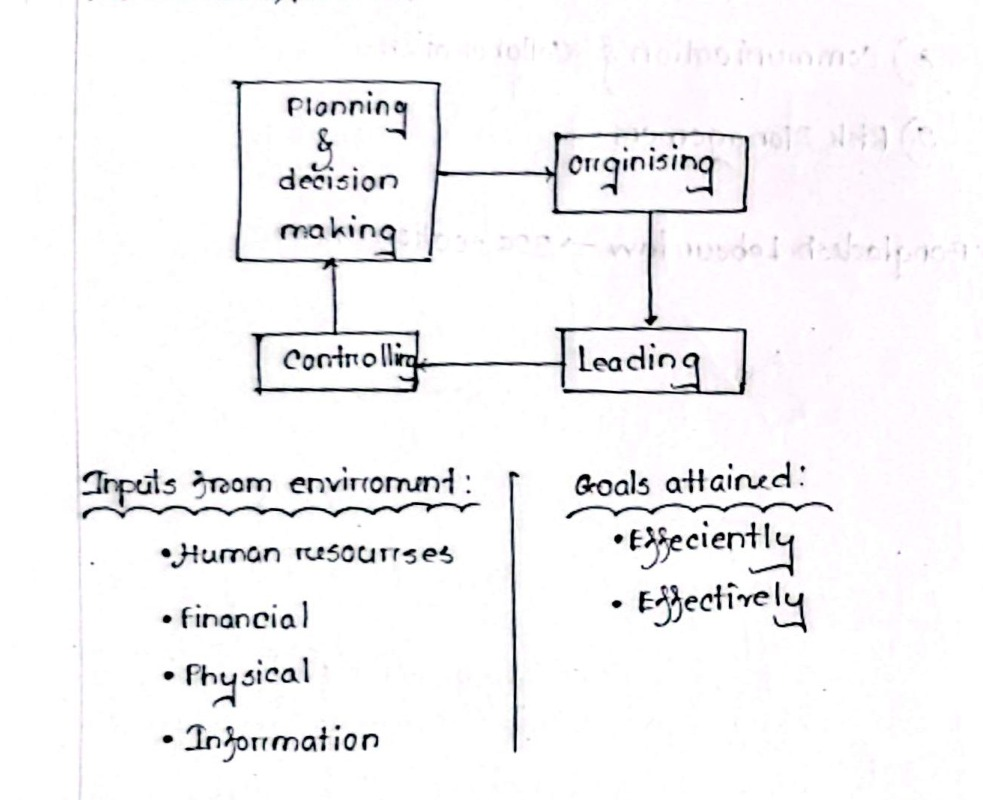
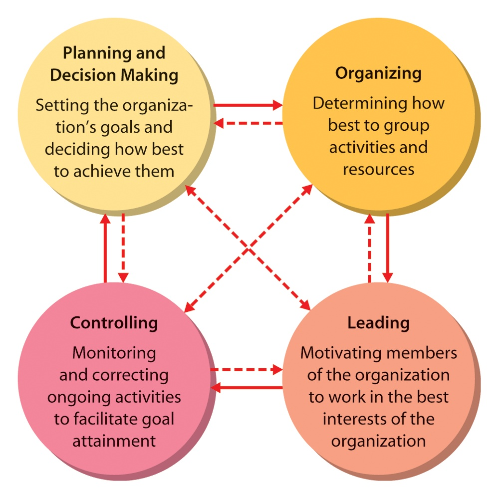
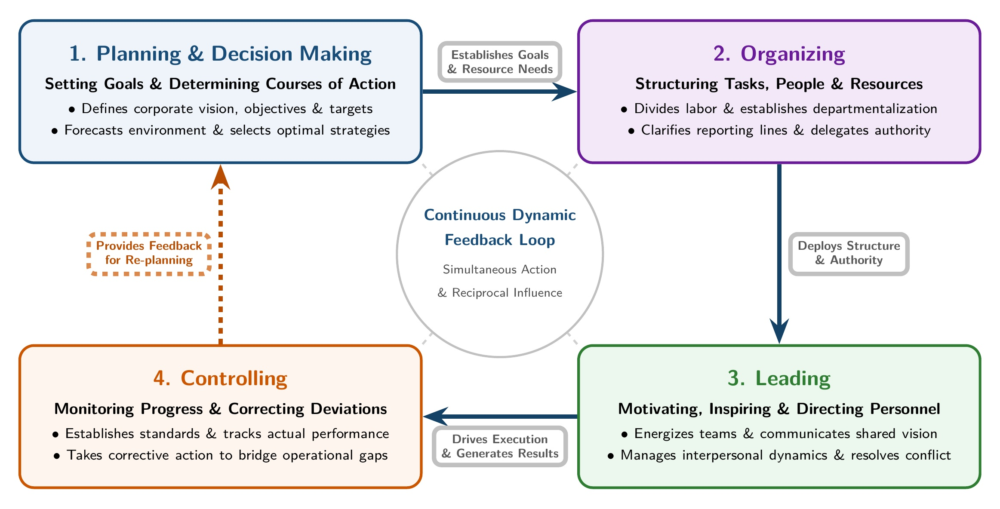
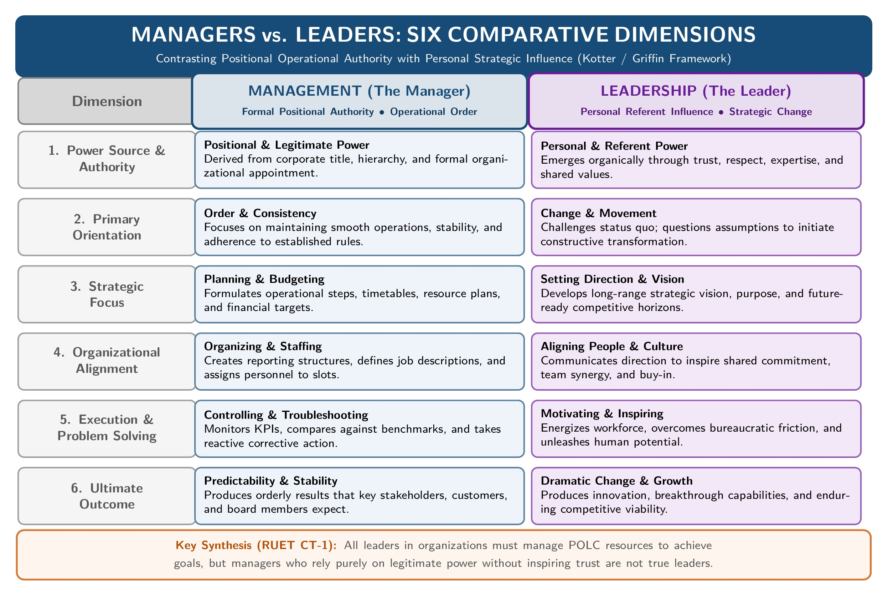
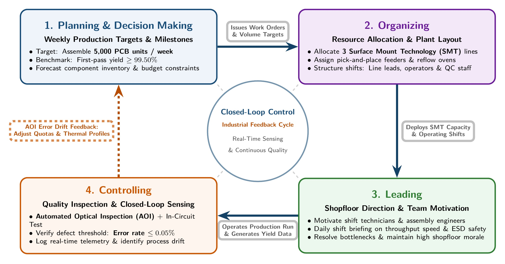

[← Previous: M01.2: Efficiency vs. Effectiveness and Decision Matrix](M01.2_Efficiency_vs_Effectiveness_and_Decision_Matrix.md) | [🏠 Index](00_Index.md) | [Next: M02.1: Management Levels and Functional Areas →](M02.1_Management_Levels_and_Functional_Areas.md)

---

# M01.3: Management Functions (P-O-L-C) and Leadership

> **Section:** Section B (CO2 · Industrial Management · Md. Rafiqul Islam Sir) | **Priority:** 🔴 Essential | **Exam Frequency:** Tested in 2020, 2024, and 2025 CT-1
> **Subtopics Covered:** `M01.4` (Functions and Process of Management: Planning and Decision Making, Organizing, Leading, Controlling), `M01.5` (Leadership vs. Management: Formal Authority vs. Personal Influence)
> **Sources:** MRI Sir Lecture 1, Raidah Class Notes (Classes 2 and 3), Griffin Chapter 1, Previous Year Questions (`2020 Q.1(b)`, `2024 Q.1(b)`, `2024 Q.5(b)`, `2025 IM-CT1 Q.4, Q.10`)

## Why This Topic Matters

The four functions of management form the core framework of industrial engineering management. Md. Rafiqul Islam Sir (MRI Sir) tests this framework regularly in both final exams and class tests.

Students often lose marks by describing management as a rigid, one-way list. In reality, management is a continuous cycle with constant feedback loops.

You must also master the distinction between management and leadership. In 2025 CT-1, MRI Sir asked why all leaders are managers, yet all managers are not leaders. Writing clear, crisp explanations with diagrams will secure full marks.

---

## 📝 Key Definitions

> **Management Process:** An ongoing, interactive cycle of four basic activities (planning and decision making, organizing, leading, and controlling) applied to organizational resources to achieve desired goals efficiently and effectively.

Management does not end when a project finishes. It is a recurring cycle where control outcomes feed directly into new planning cycles.

> **Planning and Decision Making:** Setting an organization's goals and determining in advance the best courses of action to achieve them.

Planning sets the direction. Decision making selects the best alternative among several competing options.

> **Organizing:** Determining how best to group activities, assign tasks, and allocate resources across the enterprise.

Organizing creates the structural backbone of an enterprise. It establishes authority lines and prevents duplicate work.

> **Leading:** Motivating, guiding, and directing employees to work together in the best interests of the organization.

Leading focuses on people. It channels human effort, communication, and enthusiasm toward corporate milestones.

> **Controlling:** Monitoring and evaluating organizational performance against set benchmarks and applying corrective actions whenever deviations occur.

Controlling keeps the organization on track. It acts as the feedback mechanism that informs future planning.

---

## The Management Process Overview

### 1. The Input-Process-Output Transformation Model

Management operates as an open transformation system. It draws raw inputs from the surrounding business environment, processes them through administrative functions, and delivers completed outputs.

*Figure 2.1: Management process cycle transforming organizational inputs into goals (Source: Classnotes Hum 2217, Page 3)*

The model consists of three core components:

1. **Inputs from the Environment (Four Basic Resources):**
   - *Human Resources:* Engineers, managers, software developers, and assembly technicians.
   - *Financial Resources:* Equity capital, working cash balances, bank loans, and operating revenues.
   - *Physical Resources:* Factory plants, cell towers, machinery, testing benches, and raw stock.
   - *Information Resources:* Sensor telemetry, market research, circuit designs, and performance logs.
2. **The Transformation Process (P-O-L-C):**
   - The four primary management functions coordinate and direct these inputs.
3. **Outputs Attained (Organizational Goals):**
   - *Efficiently:* Achieving low unit cost, zero waste, and minimal resource burn.
   - *Effectively:* Choosing the right strategic goals and delivering products that customers value.

### 2. Why Management Is a Continuous Interrelated Cycle

In classroom lectures and slide diagrams, MRI Sir emphasizes that management is not a straight line. It is a dynamic, interactive web:

*Figure 2.2: Interrelated feedback cycle of the four management functions (Source: Lecture 1, Page 1)*

Real-world managers do not perform these duties in isolated sequence:

- **Simultaneous Action:** A plant manager plans next month's schedule while organizing today's shift and mentoring a junior engineer.
- **Continuous Feedback:** Controlling detects production delays and cost overruns. This variance data triggers immediate revisions in original plans.
- **Reciprocal Influence:** Organizing choices dictate how managers lead. If a department is decentralized, managers rely on empowerment rather than direct orders.

*Figure 2.3: The Interlocking Circular Cycle of the Four POLC Management Functions (Source: Adapted from Griffin, Management 8th ed., Fig 1.1 & Lecture 1)*

> [!tip] Memory Hook: **The P-O-L-C Circle**
> Remember the four core activities in clockwise order:
> - **P**lan: Decide the destination.
> - **O**rganize: Build the vehicle and assign seats.
> - **L**ead: Drive and inspire the team.
> - **C**ontrol: Check the dashboard and steer back on course.

---

## In-Depth Analysis of the Four Management Functions (P-O-L-C)

### 1. Planning and Decision Making

Planning represents the foundation of all managerial work. It answers four essential questions: what, how, when, and who.

- **Definition:** The process of setting organizational goals and determining in advance how best to achieve them.
- **Forecasting and Foresight:** Managers look ahead to anticipate market disruptions, technology trends, and economic cycles.
- **Decision Making Component:** Evaluating available courses of action and selecting the optimal alternative from competing options.
- **Primary Activities:**
  - Defining long-term corporate vision and annual milestones.
  - Formulating strategic, tactical, and operational plans.
  - Allocating company budget reserves across business units.
- **Core Purpose:** Provides clear direction, reduces uncertainty, and ensures resources focus on high-priority goals.

### 2. Organizing

Once plans are established, managers must assemble people and physical resources into a coherent operating structure.

- **Definition:** The process of arranging resources and tasks in a structured manner to implement plans effectively.
- **Core Tasks of Organizing:**
  - *Division of Work:* Breaking down complex projects into discrete, manageable job positions.
  - *Departmentalization:* Grouping similar jobs into logical units (such as RF Engineering, Software, and Quality Assurance).
  - *Assignment of Duties:* Allocating specific responsibilities to individual employees based on skills.
  - *Delegation of Authority:* Granting managers the formal right to make decisions, direct subordinates, and spend budget funds.
- **Core Purposes of Organizing:**
  - Establishes clear reporting lines and accountability across the enterprise.
  - Coordinates departmental efforts and prevents wasteful duplication of work.
  - Ensures systematic and orderly use of company equipment and labor.

### 3. Leading

An organization may have flawless plans and an elegant structure, but it remains lifeless without human motivation.

- **Definition:** The process of motivating and guiding employees to work enthusiastically toward organizational goals.
- **Primary Activities:**
  - Communicating organizational vision and strategic goals clearly to all tiers.
  - Inspiring and motivating workers through recognition, incentives, and fair treatment.
  - Mentoring junior staff, encouraging teamwork, and building high team morale.
  - Resolving interpersonal disputes and eliminating workplace friction.
- **Core Purpose:** Aligns individual employee ambitions with corporate targets, ensuring high engagement and productivity.

### 4. Controlling

Controlling ensures that real-world operations match the blueprints created during planning.

- **Definition:** The process of monitoring performance. It ensures goals are met and takes corrective action when needed.
- **The Four-Step Control Sequence:**
  1. *Establish Standards:* Defining clear, measurable performance benchmarks (such as target defect rates or network uptime percentages).
  2. *Measure Actual Performance:* Collecting reliable production metrics and operational logs.
  3. *Compare Performance Against Standards:* Identifying deviations, production shortfalls, or budget overruns.
  4. *Take Corrective Action:* Adjusting machine settings, retraining staff, or revising schedules to fix the gap.
- **Core Purpose:** Closes the managerial loop by feeding variance data back into planning, ensuring the firm stays on course.

> [!tip] Memory Hook: **The S-M-C-C Control Sequence**
> Remember the four steps of controlling:
> - **S**tandards (Set the target).
> - **M**easure (Collect the data).
> - **C**ompare (Spot the gap).
> - **C**orrect (Fix the problem).

---

## Leadership vs. Management: The Core Contrast

In 2025 CT-1, MRI Sir tested a famous puzzle: *"All leaders are managers, but all managers are not leaders. Why?"*

To answer this question properly, you must contrast formal positional authority with personal influence.

*Figure 2.4: Comparative Dimensions Between Managers (Operational Stability) and Leaders (Strategic Change) (Source: Kotter / Griffin Leadership Framework & 2025 IM-CT1)*

### 1. Why All Leaders in Organizations Function as Managers

When an individual leads an organizational team toward a mission, they cannot rely on charismatic speeches alone. They must manage day-to-day realities:

1. **Direction and Planning:** A leader must set milestones, define operational paths, and choose strategies. This is the **Planning** function.
2. **Structuring and Alignment:** A leader must assemble the right mix of talent, divide duties, and clarify roles. This is the **Organizing** function.
3. **Motivation and Inspiration:** A leader must energize team members and resolve conflicts. This is the **Leading** function.
4. **Tracking and Accountability:** A leader must track project progress, evaluate performance, and adjust tactics when goals are missed. This is the **Controlling** function.

Any organizational leader must coordinate resources to achieve results. Therefore, they inevitably perform the fundamental functions of management.

### 2. Why All Managers Are Not Leaders

A manager is an individual appointed to a designated position within an organizational hierarchy:

1. **Legitimate Authority:** Managers possess legitimate power. This formal authority gives them the right to assign tasks, sign payrolls, and enforce discipline.
2. **Mechanical Administration:** Many managers carry out their jobs mechanically. They monitor schedules, file reports, and enforce company policies strictly by the book.
3. **Lack of Vision and Inspiration:** These managers command obedience because of their corporate rank. But they fail to inspire their subordinates, earn personal trust, or create an exciting vision.
4. **Compliance vs. Commitment:** Subordinates obey such managers out of contractual duty, not voluntary enthusiasm. These individuals manage the office, but they do not lead.

### 3. Positional Authority vs. Personal Influence

The difference between management and leadership rests on the source of their power:

- **Positional Authority:** Given by the organization from above. It disappears when the manager loses the job title.
- **Personal Influence:** Granted by followers from below. It comes from technical competence, character, empathy, and inspiring communication.

As organizational scholar John Kotter explained, management produces **order, consistency, and predictability**. In contrast, leadership produces **constructive change, vision, and movement**. A successful enterprise needs both qualities to thrive.

> [!tip] Memory Hook: **Title vs. Trust**
> Remember this short formula:
> - **Management = Title + Authority** (Doing things by the book).
> - **Leadership = Trust + Vision** (Inspiring people to write new books).

### 4. Comparison Table: Management vs. Leadership

| Attribute | Management | Leadership |
| :--- | :--- | :--- |
| **Power Base** | Legitimate positional authority from the hierarchy | Referent and expert power earned through personal trust |
| **Primary Focus** | Systems, structures, budgets, and operating processes | People, shared vision, corporate culture, and ideals |
| **Main Objective** | Order, stability, predictability, and efficiency | Constructive change, strategic movement, and innovation |
| **Approach to Goals** | Plans steps, allocates resources, and sets timelines | Creates long-term vision and aligns team enthusiasm |
| **Relationship with Staff** | Supervises subordinates through contractual compliance | Empowers followers through trust and personal commitment |
| **Response to Risk** | Minimizes operational risk and limits uncertainty | Embraces calculated risks to seize growth opportunities |
| **Classical Perspective** | Administrative principles and scientific rules | Trait theory ("leaders are born, not made") and style theories |
| **Kotter's Summary** | Produces order and consistency in complex organizations | Produces change and navigates dynamic environments |

---

## Exam Variants

| Exam Paper | Question Summary | Marks | Target Section | Key Takeaway |
| :--- | :--- | :---: | :---: | :--- |
| **2020 Q.1(b)** | Discuss the functions of management. | 04 | Section A | Detail P-O-L-C functions with definitions and purposes. |
| **2024 Q.1(b)** | State the functions of management. | 04 | Section A | List and explain all four functions clearly with diagrams. |
| **2024 Q.5(b)** | State the process of Management. | 03 | Section B | Draw the input-transformation-output cycle with the four functions. |
| **2025 IM-CT1 Q.4** | All leaders are managers, but all managers are not leaders. Why? | 02 | Class Test 1 | Contrast legitimate positional authority with personal leadership influence. |
| **2025 IM-CT1 Q.10** | Write the tasks and purposes of organizing. | 02 | Class Test 1 | List division of labor, departmentalization, and authority delegation. |

---

## 🏆 Golden Questions (Past Exam Archive & Model Answers)

### 🎯 GQ1 · 2020 Q.1(b) & 2024 Q.1(b) · Functions of Management (04 Marks)

> **Appeared:** 2020 Final Q.1(b) (04 Marks) · 2024 Final Q.1(b) (04 Marks)

**Question:**
Discuss the functions of management. / State the functions of management.

**Full Answer:**

#### 1. Overview of the Management Process

Management is an integrated, continuous process that coordinates organizational resources to achieve strategic goals efficiently and effectively.

The four primary functions of management form an interrelated feedback cycle, demonstrated below in an industrial production engineering application:

*Figure 2.5: Practical Application of the POLC Loop in Industrial Production Engineering (Source: RUET ECE Industrial Application Model)*

#### 2. The Four Primary Functions

##### 1. Planning and Decision Making
- *Definition:* Setting organizational objectives and deciding in advance how best to achieve them.
- *Key Activities:* Developing strategies, setting performance targets, forecasting market trends, and selecting the optimal alternative from competing options.
- *Role:* Provides strategic direction and ensures resources focus on high-priority goals.

##### 2. Organizing
- *Definition:* Arranging tasks, people, and other resources into an orderly structure to implement plans effectively.
- *Key Activities:* Dividing work into specific job positions, departmentalizing similar jobs, assigning duties, and delegating authority.
- *Role:* Establishes clean reporting lines and prevents duplicate effort.

##### 3. Leading
- *Definition:* Guiding, directing, and motivating employees to work toward organizational objectives.
- *Key Activities:* Inspiring team members, communicating corporate vision, resolving interpersonal disputes, and boosting team morale.
- *Role:* Channels human energy, talent, and creativity toward collective goals.

##### 4. Controlling
- *Definition:* Monitoring and evaluating organizational performance against predetermined benchmarks and applying corrective actions.
- *Key Activities:* Setting measurable standards, tracking actual output, identifying performance gaps, and taking corrective steps.
- *Role:* Provides vital feedback into future planning, ensuring the firm stays on course.

---

### 🎯 GQ2 · 2024 Q.5(b) · Process of Management (03 Marks)

> **Appeared:** 2024 Final Q.5(b) (03 Marks)

**Question:**
State the process of Management.

**Full Answer:**

Management is an open transformation process that converts environmental resources into finished goals efficiently and effectively:

*Figure 2.1: Management process cycle transforming organizational inputs into goals (Source: Classnotes Hum 2217, Page 3)*

#### 1. Inputs from the Environment
Organizations draw four primary resources from their surroundings:
- *Human Resources:* Technical staff, engineers, and operative labor.
- *Financial Resources:* Equity capital, loans, and operational revenues.
- *Physical Resources:* Manufacturing facilities, office buildings, and machinery.
- *Information Resources:* Sensor data, customer analytics, and operating know-how.

#### 2. The Core Managerial Process
These resources pass through four interrelated managerial functions:
- **Planning & Decision Making:** Establishing objectives and selecting the best path forward.
- **Organizing:** Structuring roles, grouping activities, and delegating authority.
- **Leading:** Motivating personnel and guiding collective team efforts.
- **Controlling:** Tracking actual progress against standards and making adjustments.

#### 3. Goals Attained
- **Efficiently:** Using resources wisely with zero waste and low costs.
- **Effectively:** Making the right decisions and meeting customer and market demands.

---

### 🎯 GQ3 · 2025 IM-CT1 Q.4 · All Leaders Are Managers, but All Managers Are Not Leaders (02 Marks)

> **Appeared:** 2025 Class Test 1 Q.4 (02 Marks)

**Question:**
All leaders are managers, but all managers are not leaders. Why?

*(Note: As printed in original exam paper. This question tests the distinction between formal managerial authority and genuine leadership influence).*

**Full Answer:**

This statement highlights the distinction between **formal positional authority** and **personal leadership influence**:

#### 1. Why All Leaders in Organizations Function as Managers
When an individual guides an organizational group toward an objective, they must:
- Set targets and define operational direction (**Planning**).
- Coordinate team members and allocate duties (**Organizing**).
- Motivate workers and communicate vision (**Leading**).
- Track progress and ensure results (**Controlling**).

Because leaders coordinate people and resources to produce results, they inevitably perform the fundamental functions of management.

#### 2. Why All Managers Are Not Leaders
A manager is appointed to a designated position within a corporate hierarchy. A manager possesses **legitimate power** (formal authority).

However, many managers rely strictly on formal rules, job descriptions, and disciplinary threats. They execute administrative tasks without inspiring, motivating, or earning the personal trust of subordinates. Subordinates obey out of duty rather than enthusiasm. Such individuals act as managers, but not leaders.

#### 3. Core Summary
- **Management** produces order, consistency, and predictability through formal systems.
- **Leadership** produces constructive change, vision, and movement through personal trust.

---

### 🎯 GQ4 · 2025 IM-CT1 Q.10 · Tasks and Purposes of Organizing (02 Marks)

> **Appeared:** 2025 Class Test 1 Q.10 (02 Marks)

**Question:**
Write the tasks and purposes of organizing.

**Full Answer:**

#### 1. Purposes of Organizing
- To establish a clear internal operating structure where roles, duties, and accountability are defined.
- To coordinate work across different departments and eliminate wasteful duplication of effort.
- To establish clean lines of communication and transparent reporting relationships.
- To ensure optimal and systematic use of human, physical, and financial resources.

#### 2. Tasks of Organizing
- **Identification and Division of Work:** Breaking total organizational operations into specific, manageable job tasks.
- **Departmentalization:** Grouping similar activities and jobs into logical functional units (such as Engineering, Production, and Marketing).
- **Assignment of Duties:** Allocating specific responsibilities to individual employees according to their qualifications.
- **Delegation of Authority:** Granting managers the necessary formal rights to make decisions, direct subordinates, and allocate resources.

---

## ⚡ Exam Tips & Common Mistakes

1. **Draw the Continuous Cycle:** When asked about the functions or process of management, never draw a one-way linear box diagram. Draw the circular cycle with reciprocal arrows showing that controlling feeds directly back into planning.
2. **Include Inputs and Outputs:** When sketching the process of management, draw environmental inputs (`H-F-P-I`) on the left. Draw attained goals (`Efficiently` and `Effectively`) on the right.
3. **Remember Kotter's Distinction:** When contrasting managers and leaders, cite John Kotter. Management produces order and consistency. Leadership produces constructive change and vision.
4. **Organizing Tasks vs. Purposes:** In CT-1 Q.10, keep tasks and purposes clearly separated into two distinct lists. Do not merge them into a single paragraph.

---

## 🔗 Related Topics

- [M01.1: Management Definitions, Resources, and Nature](M01.1_Management_Definitions_Resources_and_Nature.md)
- [M01.2: Efficiency vs. Effectiveness and Decision Matrix](M01.2_Efficiency_vs_Effectiveness_and_Decision_Matrix.md)
- [M02.1: Management Levels and Functional Areas](M02.1_Management_Levels_and_Functional_Areas.md)
- [M04.1: Planning and Rational Decision Making](M04.1_Planning_and_Rational_Decision_Making.md)
- [M04.2: Organizing, Departmentalization, Delegation, and Span](M04.2_Organizing_Departmentalization_Delegation_and_Span.md)
- [M04.3: Controlling Process and Steps](M04.3_Controlling_Process_and_Steps.md)

---

[← Previous: M01.2: Efficiency vs. Effectiveness and Decision Matrix](M01.2_Efficiency_vs_Effectiveness_and_Decision_Matrix.md) | [🏠 Index](00_Index.md) | [Next: M02.1: Management Levels and Functional Areas →](M02.1_Management_Levels_and_Functional_Areas.md)
