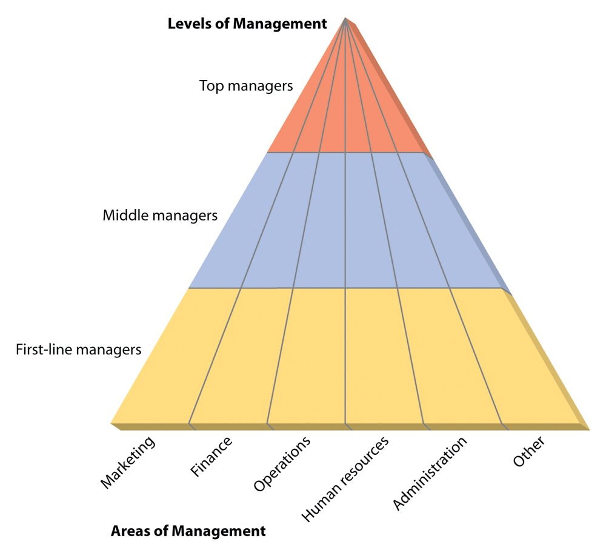

[← Previous: M01.3: Management Functions (P-O-L-C) and Leadership](M01.3_Management_Functions_POLC_and_Leadership.md) | [🏠 Index](00_Index.md) | [Next: M02.2: Managerial Skills Evaluation and Development →](M02.2_Managerial_Skills_Evaluation_and_Development.md)

---

# M02.1: Management Levels and Functional Areas

> **Section:** Section B (CO2 · Industrial Management · Md. Rokunuzzaman Sir) | **Priority:** 🟠 High | **Exam Frequency:** 2025 IM-CT1 Q.6 (2 Marks) · Core Class Lecture
> **Subtopics Covered:** `M02.1` (Levels of Management: Top, Middle, and First-Line Managers: roles, time horizons, and typical titles), `M02.2` (10 Functional Areas of Management: Marketing, Financial, Operations, HR, Administrative, R&D, PR, International, IT, Project/Risk)
> **Sources:** Lecture 3 (`Lecture 3.md`), Raidah Class Notes (Class 5), Griffin Chapter 1 (`Chapter_01_Understanding_the_Managers_Job.md`), 2025 IM-CT1 Question Paper

## Why This Topic Matters

Management structure shapes every modern tech company. Exam questions test your ability to separate executive strategy from shop-floor supervision. Instructors look for exact job titles, planning time horizons, and clear functional boundaries. Knowing this helps you answer both theory questions and practical organizational case studies.

---

## 📝 Key Definitions

> **Top Managers:** "Top managers make up the relatively small group of executives who manage the overall organization." (Ricky W. Griffin, *Fundamentals of Management*, Chapter 1)

Top managers set long-term corporate vision and strategy. They represent the enterprise to outside parties like investors and regulators.

> **Middle Managers:** "Middle managers are primarily responsible for implementing the policies and plans developed by top managers and for supervising and coordinating the activities of lower-level managers." (Ricky W. Griffin, *Fundamentals of Management*, Chapter 1)

Middle managers bridge the gap between executive suites and factory operations. They translate broad strategic goals into departmental projects.

> **First-Line Managers:** "First-line managers supervise and coordinate the activities of operating employees." (Ricky W. Griffin, *Fundamentals of Management*, Chapter 1)

First-line managers oversee daily production tasks. They work directly with technical staff, technicians, and operators.

> **Functional Area of Management:** A specialized department within an enterprise that oversees a distinct set of operational tasks and business activities. (Lecture 3)

Functional areas divide work into specialized domains like marketing, finance, operations, and human resources.

---

## The Three Hierarchical Levels of Management

Organizations divide managerial authority into three distinct hierarchical tiers. Each level focuses on different goals, plans across different time spans, and carries unique titles.

```text
                        ▲
                       / \
                      /   \
                     / TOP \         ← Strategic Vision & Policy
                    / MANAG- \         (Time Horizon: 3 to 5+ Years)
                   /   ERS    \
                  /───────────\
                 /   MIDDLE    \     ← Tactical Coordination
                /   MANAGERS    \      (Time Horizon: 6 to 12 Months)
               /─────────────────\
              /    FIRST-LINE     \  ← Operational Execution
             /      MANAGERS       \   (Time Horizon: Daily / Weekly)
            /───────────────────────\
           /   OPERATING EMPLOYEES   \ ← Non-Managerial Workers
          └───────────────────────────┘
```

### 1. Top-Level Management (Strategic Tier)

Top managers form the executive leadership team. They make decisions that affect the entire enterprise.

- **Primary Focus:** The whole organization and its external business environment.
- **Planning Time Horizon:** Long-term, usually 3 to 5 years or more.
- **Core Responsibilities:**
  1. Set corporate mission, core values, and long-term strategic goals.
  2. Establish enterprise-wide operating policies and governance standards.
  3. Allocate major capital budgets, approve mergers, and open new production facilities.
  4. Represent the company to government regulators, media outlets, and financial investors.
- **Typical Job Titles:** Chief Executive Officer (CEO), President, Managing Director (MD), Vice President (VP), Chief Technology Officer (CTO).
- **Practical Tech Example:** The CEO of a semiconductor firm invests \$200 million to build a new 5-nanometer chip plant.

### 2. Middle-Level Management (Tactical Tier)

Middle management represents the largest management group in most companies. They link executive plans with daily shop-floor reality.

- **Primary Focus:** Departmental coordination and inter-unit resource balancing.
- **Planning Time Horizon:** Medium-term, usually 6 to 12 months.
- **Core Responsibilities:**
  1. Translate long-term strategic directives into specific, actionable tactical plans.
  2. Coordinate work between separate functional units, such as engineering and procurement.
  3. Allocate departmental budgets and monitor operating costs.
  4. Supervise and evaluate first-line supervisors.
  5. Report operational progress and bottlenecks upward to top leadership.
- **Typical Job Titles:** Plant Manager, Operations Manager, Regional Sales Director, Division Head, Chief Engineer, Department Chairperson.
- **Practical Tech Example:** A regional telecom manager plans cell tower maintenance across three districts to meet annual uptime targets.

### 3. First-Line Management (Operational Tier)

First-line managers occupy the lowest hierarchical management rung. They direct non-managerial staff directly.

- **Primary Focus:** Daily production tasks, product quality, and front-line employee performance.
- **Planning Time Horizon:** Short-term, usually daily, weekly, or monthly.
- **Core Responsibilities:**
  1. Assign daily work orders and schedules to operating personnel.
  2. Supervise technical staff on factory floors, labs, or software desks.
  3. Train junior workers on equipment safety and standard operating procedures.
  4. Solve immediate operational snags, machine breakdowns, or defective parts issues.
  5. Provide performance feedback and report immediate shop-floor needs to middle managers.
- **Typical Job Titles:** Production Supervisor, Foreperson, Team Leader, Shift Coordinator, Office Manager, Quality Control Lead.
- **Practical Tech Example:** A surface-mount assembly line supervisor trains technicians to inspect solder joints and recalibrates robotic pick-and-place machines.

---

## Master Comparison of Management Levels

The following table summarizes the key distinctions across the three hierarchical tiers:

| Comparison Dimension | Top-Level Management | Middle-Level Management | First-Line (Lower) Management |
| :--- | :--- | :--- | :--- |
| **Typical Job Titles** | CEO, President, Managing Director, CTO, Board of Directors | Plant Manager, Division Head, Regional Director, Chief Engineer | Production Supervisor, Foreperson, Team Lead, Office Manager |
| **Primary Scope** | Entire organization and external environment | Departmental units and inter-unit workflows | Daily shop-floor operations and front-line workers |
| **Planning Horizon** | Long-term (3 to 5+ years) | Medium-term (6 to 12 months) | Short-term (daily, weekly, monthly) |
| **Key Responsibilities** | Set strategic vision, create corporate policy, allocate enterprise capital | Translate strategies into tactical plans, coordinate departments, manage budgets | Direct daily tasks, train operating personnel, troubleshoot immediate snags |
| **Dominant Skill Focus** | Conceptual, decision-making, and time-management skills | Interpersonal, diagnostic, and analytical skills | Technical, interpersonal, and communication skills |
| **Main Output** | Strategic plans, corporate policies, and investor relations | Operational schedules, departmental budgets, and resource plans | Finished goods, inspected circuit boards, and resolved trouble tickets |

---

## Levels and Functional Areas Matrix

Management levels cut horizontally across an organization. Functional areas cut vertically through these levels.


*Figure 2.1: Levels and Functional Areas of Management Matrix (Source: Lecture 3, Page 2 & Griffin Chapter 1)*

Every functional area has managers at all three levels:
- A top manager directs the entire functional discipline across the enterprise.
- Middle managers oversee regional or departmental units within that discipline.
- First-line supervisors direct daily functional tasks on the floor.

---

## The 10 Primary Functional Areas of Management

Industrial and technology firms divide work into 10 specialized functional areas.

> [!tip] Memory Hook: 10 Functional Areas
> Remember this simple 10-word sentence to recall all 10 areas in order:
> **"Managers Often Find Helpful Information And Resolve Public International Projects"**
>
> | Keyword | Functional Area | Primary Operational Duty |
> | :--- | :--- | :--- |
> | **M**anagers | **M**arketing | Pricing, promotional campaigns, and customer sales |
> | **O**ften | **O**perations | Production processes, inventory, and supply chain |
> | **F**ind | **F**inancial | Capital budgeting, cash flows, and cost controls |
> | **H**elpful | **H**uman Resource (HRM) | Recruiting, technical training, and labor relations |
> | **I**nformation | **I**nformation Technology (IT) | Enterprise software, network security, and databases |
> | **A**nd | **A**dministrative (General) | Multi-department coordination and facility support |
> | **R**esolve | **R**esearch & Development (R&D) | Scientific experiments and new product engineering |
> | **P**ublic | **P**ublic Relations (PR) | Media relations, public reputation, and disclosures |
> | **I**nternational | **I**nternational | Cross-border trade, export rules, and foreign branches |
> | **P**rojects | **P**roject & Risk | Time-bound delivery milestones and safety hazards |
>
> **Three Memory Clusters:**
> 1. **Core Business Engine (4):** Marketing, Operations, Finance, Human Resources.
> 2. **Digital & Support (2):** Information Technology, Administrative.
> 3. **Growth & Boundary Spanning (4):** R&D, Public Relations, International, Project & Risk.

### Detailed Breakdown of the 10 Functional Areas

#### 1. Operations Management
Operations management creates and delivers goods and services. It transforms raw materials, labor, and energy into finished products.
- **Core Duties:** Production scheduling, workflow design, inventory control, quality inspection, and supply chain logistics.
- **Tech Example:** Managing automated circuit board assembly lines and optimizing component replenishment schedules.

#### 2. Financial Management
Financial management oversees company capital and financial resources. It secures funding and ensures funds yield profitable returns.
- **Core Duties:** Capital budgeting, cash flow monitoring, financial reporting, risk assessment, and cost accounting.
- **Tech Example:** Evaluating whether to finance new optical fiber testing gear through bank loans or equity capital.

#### 3. Marketing Management
Marketing management drives customer adoption and sales revenue. It identifies customer needs and positions company products effectively.
- **Core Duties:** Market research, new product launch campaigns, competitive pricing, sales channels, and brand management.
- **Tech Example:** Designing promotional pricing tiers for enterprise cloud storage subscriptions.

#### 4. Human Resource Management (HRM)
Human resource management recruits, develops, and retains talented personnel. It aligns individual capabilities with organizational goals.
- **Core Duties:** Talent recruitment, skill training, compensation structures, performance reviews, and labor law compliance.
- **Tech Example:** Hiring embedded systems engineers and running safety drills to comply with statutory workplace standards.

#### 5. Information Technology (IT) and MIS Management
IT management designs, protects, and maintains computing infrastructure and business networks.
- **Core Duties:** Enterprise Resource Planning (ERP) maintenance, database administration, network security, and software deployment.
- **Tech Example:** Securing an industrial SCADA control network against external cyber attacks.

#### 6. Administrative (General) Management
Administrative managers oversee cross-departmental operations rather than a single specialized function. They operate as generalists.
- **Core Duties:** Facility coordination, office logistics, legal record keeping, and policy coordination across several departments.
- **Tech Example:** A regional tech center administrator coordinating facilities, utility billing, and general security services.

#### 7. Research and Development (R&D) Management
R&D management leads scientific inquiry and technical innovation. It invents new products and refines existing hardware designs.
- **Core Duties:** Laboratory experimentation, patent applications, rapid prototyping, and technology feasibility studies.
- **Tech Example:** Directing an engineering team developing low-power 6G wireless communication transceivers.

#### 8. Public Relations (PR) Management
Public relations management protects and enhances corporate reputation. It communicates corporate news to external communities.
- **Core Duties:** Press releases, media briefings, investor relations events, and crisis communication management.
- **Tech Example:** Issuing a transparent public statement after an unplanned telecom network blackout.

#### 9. International Management
International management coordinates business activities across national borders. It handles global expansion and foreign market challenges.
- **Core Duties:** Export-import compliance, foreign currency risk management, global supply logistics, and cultural adaptation.
- **Tech Example:** Sourcing microcontrollers from Taiwan while ensuring compliance with international trade tariffs.

#### 10. Project and Risk Management
Project and risk management leads temporary, cross-functional efforts to achieve specific targets within set deadlines and budgets.
- **Core Duties:** Project milestone tracking, critical path scheduling, workplace hazard mitigation, and disaster recovery planning.
- **Tech Example:** Leading a cross-functional squad to deploy a nationwide fiber-to-the-home broadband network in 9 months.

---

## Master Comparison of the 10 Functional Areas

| Functional Area | Primary Focus | Key Responsibilities | ECE / Industrial Example |
| :--- | :--- | :--- | :--- |
| **Operations** | Goods and service production | Production scheduling, inventory control, quality checks | Managing PCB assembly lines and cleanrooms |
| **Financial** | Capital and cash assets | Budgeting, financial statements, investment decisions | Allocating funds for spectrum auction licenses |
| **Marketing** | Customer sales and demand | Market research, pricing, branding, promotional campaigns | Marketing 5G data packages to smartphone users |
| **Human Resource** | Workforce talent and culture | Hiring, training, payroll, performance evaluation | Staffing RF design teams and managing labor safety |
| **Information Tech** | Computing networks and data | ERP software, database security, cloud infrastructure | Maintaining core telecom switching servers |
| **Administrative** | Cross-department coordination | Facility management, office policies, general logistics | Managing regional corporate headquarters facilities |
| **R&D** | Technical innovation | Lab testing, prototyping, patent filing | Developing energy-efficient IoT sensor nodes |
| **Public Relations** | Corporate image and media | Press releases, investor relations, crisis response | Briefing journalists on company green energy targets |
| **International** | Global cross-border trade | Foreign currency risk, customs rules, global shipping | Importing silicon wafers through customs checkpoints |
| **Project & Risk** | Time-bound goal execution | Milestone tracking, hazard mitigation, safety audits | Upgrading city-wide cellular base stations on deadline |

---

## Vertical and Horizontal Interactions Across Management Levels

Management levels run horizontally while functional areas run vertically. A healthy enterprise requires smooth coordination along both axes.

### How Functions Cut Vertically Through Hierarchy

Consider the Operations Management area within an electronic device manufacturing company:

```text
┌────────────────────────────────────────────────────────┐
│ TOP-LEVEL: Vice President of Operations                │
│ • Approves multi-year \$50M smart factory expansion.   │
│ • Sets company-wide quality standard (e.g. Six Sigma). │
└───────────────────────────┬────────────────────────────┘
                            │ Tactical Translation
┌───────────────────────────▼────────────────────────────┐
│ MIDDLE-LEVEL: Plant Operations Manager                 │
│ • Plans monthly circuit board production batches.      │
│ • Allocates maintenance budgets and inventory storage. │
└───────────────────────────┬────────────────────────────┘
                            │ Daily Work Orders
┌───────────────────────────▼────────────────────────────┐
│ FIRST-LINE: Surface-Mount Line Supervisor              │
│ • Assigns daily shift tasks to 15 soldering technicians│
│ • Resolves robotic feeder jams and logs scrap counts.  │
└────────────────────────────────────────────────────────┘
```

1. **Strategic Translation (Downward Flow):** The Vice President sets broad five-year efficiency goals. The Plant Manager turns those goals into monthly assembly line targets. The Line Supervisor turns monthly targets into daily technician shift schedules.
2. **Operational Feedback (Upward Flow):** Technicians detect solder defects and notify the First-Line Supervisor. The Supervisor logs repeated feeder jams and alerts the Plant Manager. The Plant Manager warns the Vice President if machinery defects threaten quarterly customer shipments.
3. **Cross-Functional Alignment (Horizontal Flow):** At each level, managers coordinate across functional boundaries. For example, an Operations Manager plans equipment needs with the Financial Manager. That same manager aligns with Marketing for demand forecasts and HR for trained technicians.

---

## Exam Variants

| Year / Source | Question Summary | Marks | Key Takeaway / Focus |
| :--- | :--- | :---: | :--- |
| **2025 IM-CT1 Q.6** | Roles and titles of top and middle management | 02 | Give 2-3 specific roles and 3-4 exact job titles for both tiers |
| **Model Q1 (M02.1)** | Comprehensive comparison of the 3 management levels | 04 | Use a 4-column table comparing scope, time horizon, titles, and responsibilities |
| **Model Q2 (M02.2)** | Describe functional areas and cross-tier interactions | 04 | List primary functional areas, cite the memory hook, and provide vertical ECE examples |

---

## 🏆 Golden Questions (Past Exam Archive & Model Answers)

### 🎯 GQ1 · 2025 IM-CT1 Q.6 · Roles and Titles of Top and Middle Management (02 Marks)

> **Appeared:** 2025 IM-CT1 (Set B) Q.6 · (02 Marks)

**Question:**
Mention the usual roles or titles of the top as well as middle-level management positions.

**Full Answer:**

1. **Top-Level Management:**
   - **Usual Roles:** Top managers set the company vision and create corporate strategy. They set broad policies and represent the firm to outside investors and government agencies.
   - **Typical Titles:** Chief Executive Officer (CEO), President, Managing Director (MD), Vice President (VP), Chief Technology Officer (CTO).
2. **Middle-Level Management:**
   - **Usual Roles:** Middle managers carry out executive policies and turn strategic goals into unit plans. They coordinate departmental workflows, allocate budgets, and supervise first-line managers.
   - **Typical Titles:** Plant Manager, Operations Manager, Regional Sales Director, Division Head, Chief Engineer.

---

### 🎯 GQ2 · Model Exam Question M02.1 · Comprehensive Comparison of Management Levels (04 Marks)

> **Target Exam Question:** Final Exam Section B (CO2) · Suggested Model Question · (04 Marks)

**Question:**
Compare the three hierarchical levels of management in terms of primary focus, time horizon, key responsibilities, and typical job titles. Support your answer with a structured comparison table.

**Full Answer:**

Organizations divide managerial authority into three hierarchical tiers: Top, Middle, and First-Line management. Each tier plays a distinct role in achieving enterprise goals:

| Feature | Top-Level Management | Middle-Level Management | First-Line (Lower) Management |
| :--- | :--- | :--- | :--- |
| **Typical Titles** | CEO, President, Managing Director, CTO, Board of Directors | Plant Manager, Division Head, Regional Director, Chief Engineer | Production Supervisor, Foreperson, Team Leader, Office Manager |
| **Primary Focus** | Whole organization and external environment | Departmental units and inter-unit workflows | Daily shop-floor operations and front-line workers |
| **Time Horizon** | Long-term (3 to 5+ years) | Medium-term (6 to 12 months) | Short-term (daily, weekly, monthly) |
| **Key Responsibilities** | Set strategic vision, create corporate policy, allocate enterprise capital | Translate strategies into tactical plans, coordinate departments, manage budgets | Direct daily tasks, train operating personnel, troubleshoot immediate snags |
| **Primary Skill Need** | Conceptual, decision-making, and time-management skills | Interpersonal, diagnostic, and analytical skills | Technical, interpersonal, and communication skills |

**Key Operational Interdependence:**
1. **Strategic Translation:** Top managers set company direction. Middle managers convert this direction into tactical unit plans. First-line supervisors ensure operating employees execute the daily tasks.
2. **Direct Shop-Floor Supervision:** First-line managers spend most of their time directly supervising non-managerial staff. In an electronics plant, the supervisor trains technicians, checks solder quality, and clears assembly line bottlenecks.

---

### 🎯 GQ3 · Model Exam Question M02.2 · Industrial Functional Areas and Cross-Tier Flow (04 Marks)

> **Target Exam Question:** Final Exam Section B (CO2) · Suggested Model Question · (04 Marks)

**Question:**
Describe the primary functional areas of management in an industrial enterprise. How do these functional areas interact across hierarchical management levels?

**Full Answer:**

An industrial enterprise divides its work activities into specialized functional areas. Regardless of hierarchical level, managers operate within these specialized domains.

#### 1. Primary Functional Areas of Management
Modern industrial enterprises rely on ten primary functional areas:
1. **Operations Management:** Directs the creation of products and services. Responsibilities cover production scheduling, inventory control, and quality assurance.
2. **Financial Management:** Manages company financial resources. Duties include capital budgeting, cash flow control, and financial reporting.
3. **Marketing Management:** Promotes and sells products to customers through pricing, market research, and sales channel management.
4. **Human Resource Management (HRM):** Recruits, trains, compensates, and manages workforce performance and labor compliance.
5. **Information Technology (IT) Management:** Maintains computing infrastructure, enterprise software (ERP), databases, and network security.
6. **Administrative Management:** Provides general management oversight and coordinates shared office services across departments.
7. **Research and Development (R&D):** Conducts laboratory experiments and designs innovative technical products.
8. **Public Relations (PR):** Protects corporate reputation and coordinates media communications.
9. **International Management:** Coordinates cross-border supply chains, export regulations, and foreign trade.
10. **Project and Risk Management:** Oversees time-bound engineering deliveries, workplace safety, and risk contingency plans.

#### 2. Cross-Level Functional Interaction
Functional areas cut vertically through the three horizontal management tiers. For example, in the Operations department of a telecommunications hardware company:
- **Top Level (VP of Operations):** Approves multi-year factory expansions and sets enterprise-wide quality benchmarks.
- **Middle Level (Plant Operations Manager):** Translates corporate targets into monthly production schedules and balances component inventory.
- **First-Line Level (Assembly Line Supervisor):** Directly assigns shift tasks to assembly technicians and resolves immediate machine stoppages.

This vertical alignment ensures high-level corporate strategies translate into daily shop-floor execution.

---

## ⚡ Exam Tips & Common Mistakes

1. **State the Time Horizon Every Time:** Always state planning horizons when describing management levels. Write 3 to 5+ years for top level. Write 6 to 12 months for middle level, and daily or weekly for first-line level. Instructors look for these exact numbers.
2. **Never Confuse First-Line Managers with Operating Employees:** Operating employees build products or write code without supervising others. First-line managers supervise those operating employees. They hold formal managerial authority.
3. **Provide Concrete Engineering Titles:** Do not just write "manager". Write specific titles like *Chief Technology Officer*, *Plant Operations Manager*, and *Electronics Assembly Line Supervisor*.
4. **Remember the 10-Area Acronym:** Use the memory phrase *"Managers Often Find Helpful Information And Resolve Public International Projects"*. This helps you recall all 10 areas quickly and avoids skipping PR, R&D, or IT.

---

## 🔗 Related Topics

- [M01.3: Management Functions (P-O-L-C) and Leadership](M01.3_Management_Functions_POLC_and_Leadership.md)
- [M02.2: Managerial Skills Evaluation and Development](M02.2_Managerial_Skills_Evaluation_and_Development.md)
- [M04.2: Organizing, Departmentalization, Delegation, and Span](M04.2_Organizing_Departmentalization_Delegation_and_Span.md)

---

[← Previous: M01.3: Management Functions (P-O-L-C) and Leadership](M01.3_Management_Functions_POLC_and_Leadership.md) | [🏠 Index](00_Index.md) | [Next: M02.2: Managerial Skills Evaluation and Development →](M02.2_Managerial_Skills_Evaluation_and_Development.md)
