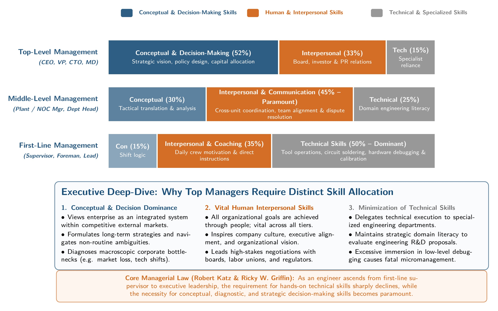
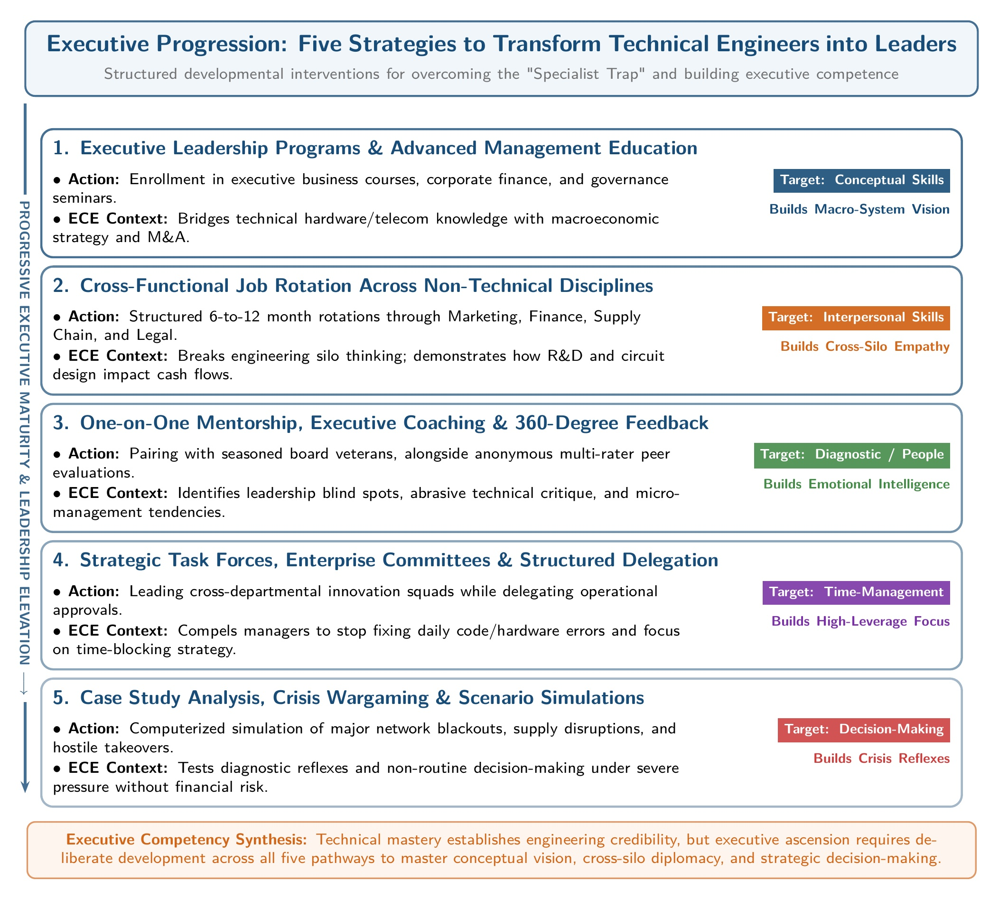

[← Previous: M02.1: Management Levels and Functional Areas](M02.1_Management_Levels_and_Functional_Areas.md) | [🏠 Index](00_Index.md) | [Next: M03.1: Fayol's 14 Principles and Scalar Chain →](M03.1_Fayols_14_Principles_and_Scalar_Chain.md)

---

# M02.2: Managerial Skills Evaluation and Development

> **Section:** Section B (CO2 · Industrial Management · Md. Rokunuzzaman Sir) | **Priority:** 🔴 Very High | **Exam Frequency:** 2021 Q.1(c) (4m) · 2023 Q.5(c) (4m) · 2024 Q.1(c) (4m) · 2025 IM-CT1 Q.1 (2m) · 2025 IM-CT1 Q.5 (2m)
> **Subtopics Covered:** `M02.3` (Critical evaluation of the 7 Managerial Skills `T-I-C-D-C-D-T` and skill distribution across Top, Middle, and First-Line levels), `M02.4` (Skills necessary for a top-level manager and actionable strategies to improve them)
> **Sources:** Lecture 3 (`Lecture 3.md`), Raidah Class Notes (Class 6), Griffin Chapter 1 (`Chapter_01_Understanding_the_Managers_Job.md`), 2025 IM-CT1 Question Paper

## Why This Topic Matters

Exam papers test managerial skills almost every year. Questions often ask you to critically evaluate all seven skills. Other questions ask how skill needs shift between company levels. Rokunuzzaman Sir grades your answers on real-world engineering examples. Clear answers with exact definitions score full marks.

---

## 📝 Key Definitions

> **Technical Skills:** "The skills necessary to accomplish or understand the specific kind of work being done in an organization." (Ricky W. Griffin, *Fundamentals of Management*, Chapter 1)

These are hands-on abilities. Supervisors use them to operate tools, test circuits, and debug code.

> **Interpersonal Skills:** "The ability to communicate with, understand, and motivate both individuals and groups." (Ricky W. Griffin, *Fundamentals of Management*, Chapter 1)

These are people skills. Managers use them to resolve conflict, inspire teams, and build trust.

> **Conceptual Skills:** "The manager's ability to think in the abstract." (Ricky W. Griffin, *Fundamentals of Management*, Chapter 1)

This is the ability to see the big picture. It helps leaders understand how company units fit together.

> **Diagnostic Skills:** "The manager's ability to visualize the most appropriate response to a situation." (Ricky W. Griffin, *Fundamentals of Management*, Chapter 1)

Like a doctor examining symptoms, a manager investigates trouble signs. This process reveals the root cause of an operational problem.

> **Communication Skills:** "The manager's abilities both to effectively convey ideas and information to others and to effectively receive ideas and information from others." (Ricky W. Griffin, *Fundamentals of Management*, Chapter 1)

This covers two-way exchanges. It includes giving instructions clearly and listening actively to employee feedback.

> **Decision-Making Skills:** "The manager's ability to correctly recognize and define problems and opportunities and to then select an appropriate course of action to solve problems and capitalize on opportunities." (Ricky W. Griffin, *Fundamentals of Management*, Chapter 1)

This is the power to choose good paths under risk. It also means fixing wrong choices quickly.

> **Time Management Skills:** "The manager's ability to prioritize work, to work efficiently, and to delegate appropriately." (Ricky W. Griffin, *Fundamentals of Management*, Chapter 1)

This allows managers to rank tasks. It keeps urgent daily noise from pushing aside long-term strategic goals.

---

## The Seven Fundamental Managerial Skills

Managers need specific competencies to plan, organize, lead, and control. Management expert Robert L. Katz identified three classical skill clusters: technical, human, and conceptual. Ricky W. Griffin expanded these into seven distinct skills.

> [!tip] Memory Hook: The 7 Managerial Skills (T-I-C-D-C-D-T)
> Remember this 7-word phrase to recall every skill in order:
> **"The Inspiring Chief Diagnoses Clearly, Decides Timely"**
>
> | Letter | Skill Name | Everyday Meaning | Primary Level |
> | :---: | :--- | :--- | :--- |
> | **T** | **T**echnical | Hands-on craft and tool knowledge | First-Line |
> | **I** | **I**nterpersonal | Working well with people | All Levels |
> | **C** | **C**onceptual | Seeing the big picture in the abstract | Top |
> | **D** | **D**iagnostic | Finding root causes of problems | Middle and Top |
> | **C** | **C**ommunication | Sharing and receiving ideas cleanly | All Levels |
> | **D** | **D**ecision-Making | Picking the best option under risk | Top and Middle |
> | **T** | **T**ime-Management | Prioritizing and delegating work | All Levels |
>
> **Two High-Yield Recall Frameworks:**
> - **Katz's Classical 3:** Technical (Hands) · Interpersonal (Heart) · Conceptual (Head).
> - **Griffin's Process 4:** Diagnostic (Find) · Communication (Share) · Decision-Making (Choose) · Time-Management (Execute).

---

### 1. Technical Skills

1. **Core Meaning:**
   - Technical skills cover specialized knowledge and methods.
   - They allow a person to execute specific operational jobs.
   - Examples include coding in C++, testing radio frequency boards, and running surface-mount machines.
2. **Application in Management:**
   - First-line supervisors rely on these skills every day.
   - They teach junior technicians and fix immediate machinery stops.
3. **Critical Evaluation:**
   - *Advantage:* Strong technical skills build early credibility with factory workers.
   - *Limitation:* Over-reliance makes managers micromanage routine tasks.
   - *Risk:* Promoting a brilliant engineer without leadership training creates a poor manager.

---

### 2. Interpersonal Skills

1. **Core Meaning:**
   - Interpersonal skills allow managers to understand, mentor, and guide individuals and teams.
   - They involve empathy, active listening, and conflict resolution.
2. **Application in Management:**
   - Every manager needs human skills.
   - First-line supervisors handle shift grievances.
   - Middle managers unite competing departments.
   - Top leaders align executive boards and outside partners.
3. **Critical Evaluation:**
   - *Advantage:* High interpersonal skills create high employee morale, trust, and low staff turnover.
   - *Limitation:* Being too nice can stop a manager from enforcing discipline or firing low performers.
   - *Balance:* Managers must pair empathy with clear accountability.

---

### 3. Conceptual Skills

1. **Core Meaning:**
   - Conceptual skills involve thinking in abstract terms.
   - A manager perceives the enterprise as a unified whole.
   - The manager sees how shifts in the market affect each department.
2. **Application in Management:**
   - This skill is vital for top-level executives.
   - Leaders use it to set five-year goals, enter new markets, or launch company mergers.
3. **Critical Evaluation:**
   - *Advantage:* Enables visionary planning and creative business models.
   - *Limitation:* Abstract ideas stay on paper if the leader ignores operational limits.
   - *Balance:* Leaders must verify that factory capacity can support their broad visions.

---

### 4. Diagnostic Skills

1. **Core Meaning:**
   - Diagnostic skills help a manager investigate trouble symptoms and uncover root causes.
   - The process mirrors medical diagnosis: analyze symptoms first, then prescribe solutions.
2. **Application in Management:**
   - Used heavily by middle and top managers during crises.
   - Helps managers trace factory bottlenecks, high scrap rates, or cash shortages to their real source.
3. **Critical Evaluation:**
   - *Advantage:* Prevents wasting money on temporary surface patches.
   - *Limitation:* Over-analyzing minor defects leads to analysis paralysis.
   - *Balance:* Managers must gather data quickly and act before small issues grow large.

---

### 5. Communication Skills

1. **Core Meaning:**
   - Communication skills cover two directions: sending ideas clearly and receiving messages accurately.
   - They include spoken briefings, written emails, technical reports, and non-verbal cues.
2. **Application in Management:**
   - Supervisors pass down daily production targets to workers.
   - Middle managers share project updates across departments.
   - Top executives deliver strategic updates to investors and the public.
3. **Critical Evaluation:**
   - *Advantage:* Eliminates confusion, aligns teams, and speeds up project execution.
   - *Limitation:* Too many emails and meetings cause information overload.
   - *Balance:* Messages must stay concise, structured, and focused on key action items.

---

### 6. Decision-Making Skills

1. **Core Meaning:**
   - Decision-making skills allow managers to identify problems, evaluate options, and pick the best path.
   - They also help managers spot new commercial opportunities early.
2. **Application in Management:**
   - Top executives decide on major capital investments under high risk.
   - Middle managers reallocate staff and budgets during production crunches.
   - First-line supervisors choose immediate work-arounds when parts arrive late.
3. **Critical Evaluation:**
   - *Advantage:* Swift decisions keep an organization agile and ahead of competitors.
   - *Limitation:* Quick decisions based on raw guesses often cause severe financial losses.
   - *Good Practice:* Effective managers make good calls most of the time. When wrong, they reverse errors quickly.

---

### 7. Time-Management Skills

1. **Core Meaning:**
   - Time-management skills enable managers to rank tasks, work efficiently, and delegate routine duties.
   - It separates urgent tasks from important long-term priorities.
2. **Application in Management:**
   - Senior executives face hundreds of competing meeting requests and emails every day.
   - Supervisors manage strict shift deadlines and delivery schedules.
3. **Critical Evaluation:**
   - *Advantage:* Protects deep-thinking time and prevents project delays.
   - *Limitation:* Rigid calendars make managers inflexible when sudden emergencies occur.
   - *Good Practice:* Delegate minor operational tasks to subordinates so critical goals stay on track.

---

## Skill Distribution Across Management Levels

Management tiers require different mixes of skills. Robert L. Katz showed that technical skill importance drops as a manager moves up. At the same time, the need for conceptual skill rises sharply.

### Hierarchical Skill Distribution Table

| Skill Category | Top-Level Management | Middle-Level Management | First-Line Management |
| :--- | :--- | :--- | :--- |
| **Conceptual Skills** | **Highest:** Sets corporate vision and direction | **Moderate:** Translates strategy into unit goals | **Lowest:** Executes existing operational plans |
| **Decision-Making Skills** | **Highest:** Unstructured, high-risk strategic choices | **High:** Operational and resource allocation calls | **Moderate:** Daily shift and scheduling decisions |
| **Diagnostic Skills** | **High:** Analyzes market risks and industry trends | **Highest:** Resolves operational and process bottlenecks | **Moderate:** Spots immediate equipment and wiring faults |
| **Time-Management Skills** | **Highest:** Shields time for long-term planning | **High:** Balances meetings and project deadlines | **High:** Meets strict daily and weekly shift targets |
| **Interpersonal Skills** | **High:** Inspires executives and negotiates with board | **Highest:** Connects top leadership with ground staff | **Highest:** Motivates daily crews and solves friction |
| **Communication Skills** | **High:** Presents corporate goals to outside world | **Highest:** Translates corporate ideas for teams | **Highest:** Delivers clear instructions to technicians |
| **Technical Skills** | **Lowest:** Relies on specialists and directors | **Moderate:** Understands department workflows | **Highest:** Guides machine setup and fixes errors |

---

### Visual Hierarchy of Managerial Skills

*Figure 2.1: Skill Distribution and Relative Importance for Executive Top-Level Management (Source: Griffin Ch. 1, p. 16 & Robert L. Katz Model)*

---

### Why Skill Requirements Shift by Level

1. **Why Technical Needs Drop at Top Levels:**
   - Top managers do not run factory tools or solder boards.
   - They hire specialized engineers to handle technical details.
   - Their job is to guide the enterprise, not turn screws.
2. **Why Conceptual Needs Dominate Top Levels:**
   - Top executives make decisions that affect the entire firm for five to ten years.
   - They must see how economic shifts, government laws, and competitor actions interact.
3. **Why Interpersonal Skills Stay Vital Across All Tiers:**
   - Every manager gets work done through other human beings.
   - First-line supervisors motivate floor workers.
   - Middle managers resolve rivalries between departments.
   - Top leaders inspire the entire organization.

---

## Top-Level Managerial Skills and Improvement Strategies

Top executives face high ambiguity and severe competition. Their choices determine whether the firm survives or fails.

### Essential Skills for Top Executives

1. **Conceptual Skills:**
   - Helps executives view the whole business ecosystem.
   - Leaders use it to spot new market niches and plan long-term growth.
2. **Decision-Making Skills:**
   - Top managers handle non-routine decisions with incomplete data.
   - Examples include opening foreign branches or acquiring technology startups.
3. **Diagnostic Skills:**
   - Allows executives to detect why overall profits fell or why product quality dipped.
4. **Interpersonal and Communication Skills:**
   - Needed to pitch ideas to shareholders, banks, government regulators, and media.
5. **Time-Management Skills:**
   - Protects executives from getting buried in minor daily squabbles.
   - Ensures time remains for quiet strategic thought.

---

### Five Actionable Strategies to Improve Top-Level Skills

Top managers cannot rely on old habits. They must actively sharpen their capabilities through five proven strategies:

*Figure 2.2: Five Strategic Pathways for Transitioning Technical Engineers to Executive Leadership (Source: Lecture 3 & Griffin Ch. 1)*

1. **Executive Coaching and Mentorship:**
   - Leaders work one-on-one with experienced board veterans or professional executive mentors.
   - *Impact:* Uncovers hidden blind spots in personal communication and sharpens high-stakes decision skills.
2. **Advanced Executive Education and Crisis Simulations:**
   - Leaders attend executive business programs at top universities.
   - They practice with complex computer simulations of supply shocks, hostile takeovers, and product recalls.
   - *Impact:* Tests conceptual and diagnostic reflexes safely without risking real corporate capital.
3. **360-Degree Feedback Systems:**
   - The company collects anonymous reviews on the executive from board members, peers, subordinates, and clients.
   - *Impact:* Reveals blind spots, improves interpersonal relationships, and builds mutual trust.
4. **Structured Delegation and Time-Blocking:**
   - Executives set rules to delegate all routine approvals to department heads.
   - They block two to three hours every morning for deep strategic planning.
   - *Impact:* Prevents minor operational noise from crowding out vital corporate priorities.
5. **Continuous Environmental Scanning and Advisory Councils:**
   - Leaders join technology boards, industry councils, and economic forums.
   - They review patents, global trade policies, and customer trends regularly.
   - *Impact:* Broadens conceptual vision and helps the manager anticipate disruptive tech changes early.

---

## Exam Variants

| Year / Source | Question Summary | Marks | Target Focus / Key Takeaway |
| :--- | :--- | :---: | :--- |
| **2021 Final Q.1(c)** | Critically discuss the skills necessary to accomplish managerial tasks. | 04 | Full evaluation of 7 skills (`T-I-C-D-C-D-T`) and tier distribution. |
| **2024 Final Q.1(c)** | Critically evaluate the skills necessary to accomplish managerial tasks. | 04 | Identical to 2021 Q.1(c). Cover benefits, limits, and level shifts. |
| **2023 Final Q.5(c)** | Identify skills for a top-level manager and suggest improvement strategies. | 04 | 5 executive skills plus 5 concrete development strategies. |
| **2025 IM-CT1 Q.1** | Which three skills are most important for a first-line manager? Justify. | 02 | Technical, Interpersonal, and Communication skills with clear examples. |
| **2025 IM-CT1 Q.5** | How would you claim that you have conceptual skills? | 02 | Big-picture view, ripple effects, and strategic problem-solving. |

---

## 🏆 Golden Questions (Past Exam Archive & Model Answers)

### 🎯 GQ1 · Critical Evaluation of Managerial Skills · 2021 Q.1(c) and 2024 Q.1(c) (04 Marks)

> **Appeared:** 2024 Final Q.1(c) (04 Marks) · 2021 Final Q.1(c) (04 Marks) · Section A (CO2)

**Question:**
Critically evaluate the skills necessary to accomplish managerial tasks.
*(Note: 2021 Q.1(c) used the wording "Critically discuss the skills necessary to accomplish managerial tasks".)*

**Full Answer:**

Managers require seven fundamental skills. These skills support the core management functions: planning, organizing, leading, and controlling. They balance technical know-how with people management and strategic vision.

#### GQ1.1 · The Seven Fundamental Skills

1. **Technical Skills:**
   - *Definition:* The ability to perform or understand specific operational tasks and tools.
   - *Critical Evaluation:* Essential for first-line supervisors to instruct workers and fix line faults. However, relying too much on technical skills causes micromanagement and prevents healthy delegation.
2. **Interpersonal (Human) Skills:**
   - *Definition:* The ability to communicate with, motivate, and understand individuals and groups.
   - *Critical Evaluation:* Essential across all management tiers to build trust and teamwork. However, managers who focus only on pleasing staff struggle to enforce discipline or correct poor work.
3. **Conceptual Skills:**
   - *Definition:* The mental capacity to think in the abstract and understand how organizational units fit together.
   - *Critical Evaluation:* Dominates top management when setting corporate strategy. However, abstract ideas fail if leaders ignore ground-level operational constraints.
4. **Diagnostic Skills:**
   - *Definition:* The ability to investigate symptoms, identify root causes, and design appropriate remedies.
   - *Critical Evaluation:* Prevents wasting resources on surface patches. However, collecting excessive data during simple issues causes analysis paralysis.
5. **Communication Skills:**
   - *Definition:* The ability to convey ideas clearly and receive messages accurately from others.
   - *Critical Evaluation:* Keeps teams aligned and prevents costly errors. However, poorly timed messages or endless meetings cause information fatigue.
6. **Decision-Making Skills:**
   - *Definition:* The ability to identify problems, generate viable options, and choose the best path under risk.
   - *Critical Evaluation:* Decisive managers seize market openings. Effective leaders make good decisions most of the time and reverse bad choices swiftly before damage spreads.
7. **Time-Management Skills:**
   - *Definition:* The ability to prioritize high-value tasks, work efficiently, and delegate routine assignments.
   - *Critical Evaluation:* Protects strategic focus. However, overly rigid scheduling limits flexibility when unexpected crises arise.

#### GQ1.2 · Skill Distribution Across Management Tiers

The required mix of managerial skills shifts systematically across company tiers:

1. **Top-Level Management:** Requires high conceptual, decision-making, and time-management skills to chart corporate direction. Technical skill demands are minimal.
2. **Middle-Level Management:** Requires high interpersonal, diagnostic, and communication skills to bridge top leadership plans with factory operations.
3. **First-Line Management:** Requires high technical and interpersonal skills to direct operative technicians and resolve daily machine faults.

---

### 🎯 GQ2 · Skills for Top-Level Managers and Improvement Strategies · 2023 Q.5(c) (04 Marks)

> **Appeared:** 2023 Final Q.5(c) (04 Marks) · Section B (CO2)

**Question:**
Identify skills necessary for a top level manager and suggest strategies to improve those skills.

**Full Answer:**

Top-level managers make long-term decisions that determine the survival, growth, and reputation of the entire organization.

#### GQ2.1 · Skills Required for Top-Level Executives

1. **Conceptual Skills:**
   - Top executives need abstract thinking to visualize the whole business and its external industry environment.
   - They use this skill to set corporate vision, design business models, and capture emerging market trends.
2. **Decision-Making Skills:**
   - Top leaders make non-programmed decisions under high risk and uncertainty.
   - Examples include approving multi-million-dollar capital investments, building new plants, or acquiring competitor firms.
3. **Diagnostic Skills:**
   - Executives must analyze broad trends and uncover the root causes of declining company profits or market threats.
4. **Interpersonal and Communication Skills:**
   - Leaders must negotiate with shareholders, financial lenders, regulatory authorities, and media while inspiring internal teams.
5. **Time-Management Skills:**
   - Executives face competing demands. They must prioritize critical strategic initiatives and delegate operational chores.

#### GQ2.2 · Actionable Strategies to Improve Executive Skills

1. **Executive Coaching and Mentorship:**
   - Leaders work one-on-one with seasoned board advisors or certified executive coaches.
   - Mentors uncover blind spots in personal communication and leadership judgment.
2. **Executive Education and Crisis Simulations:**
   - Leaders attend advanced university management courses.
   - Complex business war games sharpen conceptual thinking and crisis responses without risking real capital.
3. **360-Degree Feedback Systems:**
   - Companies collect anonymous, structured reviews from board peers, subordinate managers, and client partners.
   - These evaluations reveal hidden communication gaps and build strong self-awareness.
4. **Structured Delegation and Time-Blocking:**
   - Setting clear authority boundaries allows subordinates to handle daily operational decisions.
   - This practice protects uninterrupted blocks of time for deep strategic planning.
5. **Continuous Environmental Scanning and Advisory Boards:**
   - Joining industry advisory bodies, technology policy councils, and global forums expands executive vision.
   - This exposure helps leaders track macroeconomic trends and technological advances early.

---

### 🎯 GQ3 · Top Three Skills for First-Line Managers · 2025 IM-CT1 Q.1 (02 Marks)

> **Appeared:** 2025 IM-CT1 Q.1 (02 Marks) · Class Test 1 (Set B)

**Question:**
Which three skills are most important for a first-line manager? Justify your answer with examples.

**Full Answer:**

The three most critical skills for a first-line manager are:

1. **Technical Skills:**
   - *Justification:* First-line managers supervise daily shop-floor production directly. They must understand machine operations and job procedures to guide technicians and correct technical faults.
   - *Example:* A telecom field supervisor uses an optical reflectometer (OTDR) to locate and repair broken fiber-optic cables.
2. **Interpersonal (Human) Skills:**
   - *Justification:* First-line managers interact with operative workers every day. They must motivate staff, build morale, and resolve personal workplace friction.
   - *Example:* A circuit board assembly supervisor resolves friction between machine operators and inspectors to maintain line speed.
3. **Communication Skills:**
   - *Justification:* First-line managers act as the vital bridge between operative crews and middle management. They translate high-level weekly schedules into daily shift duties and report machine breakdowns upward.
   - *Example:* An IT helpdesk supervisor leads morning briefings and explains server crash logs clearly to the engineering director.

---

### 🎯 GQ4 · How to Claim Conceptual Skills · 2025 IM-CT1 Q.5 (02 Marks)

> **Appeared:** 2025 IM-CT1 Q.5 (02 Marks) · Class Test 1 (Set B)

**Question:**
How would you claim that you have conceptual skills?

**Full Answer:**

Conceptual skill is the mental ability to view the firm as an integrated system. It helps managers understand departmental dependencies and anticipate external market forces.

You can claim that you possess conceptual skills by showing that you:

1. **Understand the Big Picture:**
   - You see how your technical work supports company goals instead of viewing your code or circuit in isolation.
2. **Anticipate Systemic Ripple Effects:**
   - You foresee how hardware delays stall firmware testing, push back client shipments, and hurt company cash flow.
3. **Design Strategic Solutions:**
   - You connect market trends, customer needs, and technical choices together to solve ambiguous, open-ended business problems.

---

## ⚡ Exam Tips & Common Mistakes

1. **Memorize the `T-I-C-D-C-D-T` Acronym:**
   - Use the phrase *"The Inspiring Chief Diagnoses Clearly, Decides Timely"*. Writing all seven skills with bold lead-ins immediately signals mastery to the examiner.
2. **Always Include Both Katz and Griffin:**
   - Mention Robert Katz's classical 3 skills (Technical, Human, Conceptual) first. Then expand into Ricky W. Griffin's 7 skills. This earns bonus marks.
3. **Avoid the "Super-Worker" Trap:**
   - When critically evaluating technical skills, mention that too much technical focus makes a manager micromanage. Examiners look for this specific critical evaluation.
4. **Use Concrete Engineering Examples:**
   - For CT questions, always give concrete tech examples (OTDR tester, PCB soldering lines, server outages). Generic answers lose half marks.
5. **Separate Skills from Functions:**
   - Do not confuse managerial skills (`T-I-C-D-C-D-T`) with management functions (`P-O-L-C`). Functions are what managers *do*; skills are the capabilities managers *use* to do them.

---

## 🔗 Related Topics

- [M01.1: Management Definitions, Resources, and Nature](M01.1_Management_Definitions_Resources_and_Nature.md) · Covers management functions and resources.
- [M01.3: Management Functions (P-O-L-C) and Leadership](M01.3_Management_Functions_POLC_and_Leadership.md) · Details how managers execute planning, organizing, leading, and controlling.
- [M02.1: Management Levels and Functional Areas](M02.1_Management_Levels_and_Functional_Areas.md) · Covers hierarchical tiers and 10 functional departments.
- [M03.1: Fayol's 14 Principles and Scalar Chain](M03.1_Fayols_14_Principles_and_Scalar_Chain.md) · Classical administrative principles that guide managerial authority.

---

[← Previous: M02.1: Management Levels and Functional Areas](M02.1_Management_Levels_and_Functional_Areas.md) | [🏠 Index](00_Index.md) | [Next: M03.1: Fayol's 14 Principles and Scalar Chain →](M03.1_Fayols_14_Principles_and_Scalar_Chain.md)
