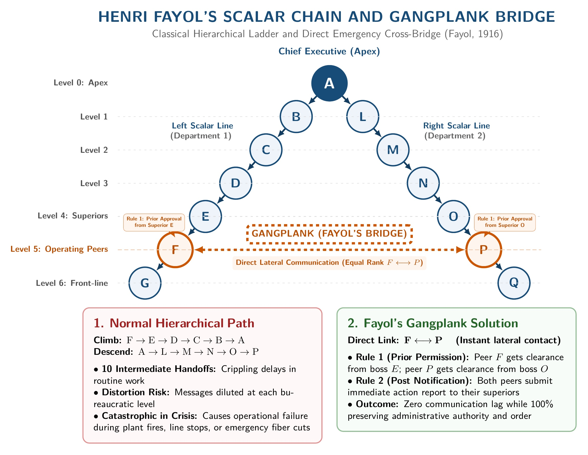
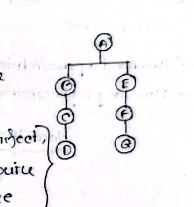
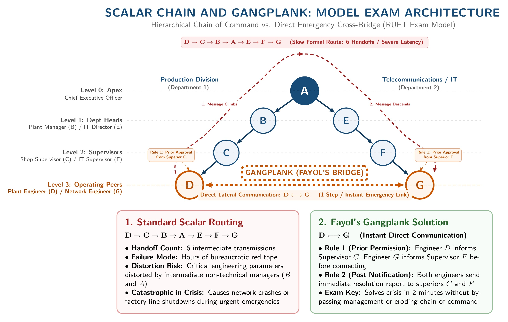

[← Previous: M02.2: Managerial Skills Evaluation and Development](M02.2_Managerial_Skills_Evaluation_and_Development.md) | [🏠 Index](00_Index.md) | [Next: M03.2: Taylor's Scientific Management →](M03.2_Taylors_Scientific_Management.md)

---

# M03.1: Fayol's 14 Principles and Scalar Chain

> **Section:** Section B (CO2 · Industrial Management · Md. Rokonuzzaman Sir) | **Priority:** 🔴 High | **Exam Frequency:** Tested in 2021 Final Q.1(b) and 2024 Final Q.5(c)
> **Subtopics Covered:** `M03.1` (Henri Fayol's 14 Principles of Administrative Management), `M03.2` (Scalar Chain and Gangplank / Fayol's Bridge diagram)
> **Sources:** MRI Sir Lecture 4, Raidah Class Notes (Class 7), Griffin Chapter 1, Previous Year Questions (`2021 Q.1(b)`, `2024 Q.5(c)`, Model Exam Question)

## Why This Topic Matters

Henri Fayol built the foundation of modern organizational management. MRI Sir tests Fayol's principles frequently in semester finals. Questions ask you to explain selected principles, evaluate all 14 rules, or sketch the scalar chain diagram.

Students often lose marks by mixing up Unity of Command with Unity of Direction. They also forget to explain the two rules of the Gangplank bridge. To score full marks, explain each principle clearly. Add real engineering examples. Draw the scalar chain tree neatly.

---

## 📝 Key Definitions

> **Administrative Management:** "Focuses on managing the total organization." (Ricky W. Griffin, *Fundamentals of Management*)

Administrative management looks at the company from the top down. It sets broad rules for coordination, authority, and control across all departments.

> **Henri Fayol (1841–1925):** French mining engineer, senior managing director, and classical management theorist known as the father of modern operational-management theory.

Fayol published his famous book in 1916. He turned executive experience into 14 universal principles and 5 core management functions.

> **Scalar Chain:** "The formal chain of command from the highest to the lowest level in the organization." (MRI Sir, Lecture 4)

The scalar chain defines the exact line of authority. Messages move up and down this ladder step by step.

> **Gangplank (Fayol's Bridge):** A direct cross-channel connecting workers of equal rank across different lines. It bypasses middle managers during urgent crises.

The gangplank cuts out long communication delays. Workers use it only with prior manager approval and full reporting.

---

## Henri Fayol and Administrative Theory

Classical management includes two distinct viewpoints:
1. **Scientific Management:** F.W. Taylor studied the shop floor. He focused on individual jobs, tools, and worker physical motions.
2. **Administrative Management:** Henri Fayol studied the total firm. He focused on overall structure, authority lines, and executive administration.

Fayol viewed management as a universal skill. He argued that all managers perform five core functions: planning, organizing, commanding, coordinating, and controlling. To guide leaders, he established 14 general principles. Fayol noted that these principles are flexible guides, not rigid laws.

---

## The 14 Principles of Administrative Management

Fayol grouped his administrative insights into 14 foundational principles.

### 1. Division of Work (Specialization)
- Dividing work into small, specialized tasks lets workers build expertise quickly.
- It reduces task switching and eliminates duplicate effort.
- Dexterity improves over time, boosting speed and quality.
- *Class Note Insight:* Raidah's class notes record that task specialization can raise factory productivity by up to $350\%$.
- *Engineering Example:* In an electronics plant, one technician solders chips, another runs automated testing, and a third packages boards.

### 2. Authority and Responsibility
- **Authority:** The official right of a manager to give orders and demand compliance.
- **Responsibility:** The obligation to carry out assigned duties and achieve results.
- **Accountability:** The duty to answer to superiors for final performance outcomes.
- **Parity Principle:** Authority and responsibility must stay balanced. Authority without responsibility leads to careless decisions. Responsibility without authority leads to frustration and missed deadlines.
- *Engineering Example:* A project lead deploying a 5G cell tower needs authority to assign field staff and buy cables.

### 3. Discipline
- Discipline means obeying company rules, honoring agreements, and respecting organizational norms.
- Good discipline requires fair supervisors at all levels, clear rules, and just penalties.
- Without discipline, teamwork fails and operations grind to a halt.
- *Engineering Example:* Lab technicians must wear electrostatic discharge wristbands in microchip assembly areas.

### 4. Unity of Command
- Each employee must receive instructions from only one direct superior.
- Dual reporting causes confusion, divided loyalties, and friction between managers.
- When two bosses issue conflicting orders, work stops and discipline weakens.
- *Engineering Example:* A software developer takes sprint tasks only from the team Scrum Master, not from separate functional managers.

### 5. Unity of Direction
- All operations working toward the same objective must follow one plan under one leader.
- It aligns company efforts and prevents fragmented, duplicate work.
- *Class Note Insight:* Raidah's class notes highlight that tasks of the same nature must follow an identical standard rule.
- *Academic Example:* Lecturer recruitment across all academic departments at RUET follows one uniform procedure.
- *Engineering Example:* All engineering squads building a new mobile app follow a single corporate release roadmap.

### 6. Subordination of Individual Interests to General Interests
- The goals of the total organization must always come before the personal interests of single workers or small teams.
- Personal ambition, greed, or departmental rivalry must not harm the firm.
- *Engineering Example:* An engineer prefers working on custom firmware, but pivots to patching urgent customer security bugs for company survival.

### 7. Fair Pay and Reward (Fair Compensation)
- Workers and employers must agree on fair wages that satisfy both sides.
- Pay should reward talent, effort, and output.
- Fair pay keeps morale high and reduces worker turnover.
- It includes base salaries, performance bonuses, and non-financial rewards.
- *Engineering Example:* A telecommunications firm pays field engineers overtime and completion bonuses for restoring networks after storms.

### 8. Centralization vs. Decentralization
- **Centralization:** Keeping decision-making authority at top executive levels.
- **Decentralization:** Pushing decision-making down to lower-level managers and teams.
- Fayol stated that firms must find the right balance for their specific size, industry, and staff competence.
- *Engineering Example:* A telecom company centralizes spectrum bidding and annual budgets at headquarters. But it decentralizes daily tower maintenance choices to local field engineers.

### 9. Scalar Chain (Chain of Command)
- The unbroken line of authority running from top management down to front-line workers.
- All regular communication must follow this ladder step by step.
- To prevent communication breakdowns during emergencies, Fayol introduced the Gangplank bridge.

### 10. Order (Material and Social Order)
- *"People and materials should be at the right place, at the right time, in proper condition."* (Class 7 Notes)
- **Material Order:** A designated place for every tool and material, and everything in its place. It prevents lost parts and wasted search time.
- **Social Order:** The right person in the right job. It matches worker skills to job requirements.
- *Engineering Example:* In an optical fiber splicing lab, every fusion splicer and cleaver sits in a numbered, anti-static slot.

### 11. Equity (Kindness and Justice)
- Managers must treat all employees with fairness, kindness, and impartial justice.
- Fair treatment builds strong worker loyalty and devotion.
- *Class Note Insight:* Raidah's notes show that organizational equity connects to social justice. It includes pure justice, perfect justice, and impure justice.
- *Engineering Example:* A team lead applies identical promotion criteria to all junior hardware engineers without personal favoritism.

### 12. Stability of Tenure of Personnel
- High employee turnover causes inefficiency, high hiring costs, and lost expertise.
- Workers need time and job security to learn their jobs and excel.
- Unnecessary job changes hurt institutional memory and stability.
- *Engineering Example:* Offering long-term contracts to embedded systems engineers keeps critical firmware knowledge inside the company.

### 13. Initiative
- Managers must encourage all employees to propose and execute new ideas.
- Allowing initiative makes workers feel valued and sparks creative solutions.
- *Engineering Example:* A technician writes an automated Python script to test server pings. This saves two hours of manual work every morning.

### 14. Esprit de Corps (Team Spirit)
- Management must build harmony, mutual trust, and unity among workers.
- Derived from the French phrase for team spirit, it urges managers to promote teamwork.
- Leaders should use face-to-face talk and avoid divide-and-rule tactics.
- *Engineering Example:* Holding weekly technical post-mortem reviews where the team shares learning without pointing fingers.

---

## Memory Hook: The 14 Principles Acronym

Use this proven mnemonic from class notes to recall all 14 principles in 15 seconds:

> [!tip] Memory Hook: **DAD U C USSR? O I SEE!**
> - **D** · Division of work
> - **A** · Authority and responsibility
> - **D** · Discipline
> - **U** · Unity of command
> - **C** · Centralization
> - **U** · Unity of direction
> - **S** · Subordination of individual interest
> - **S** · Scalar chain
> - **R** · Reward and fair pay (fair compensation)
> - **O** · Order
> - **I** · Initiative
> - **S** · Stability of tenure
> - **E** · Equity
> - **E** · Esprit de corps

---

## Detailed Comparison: Unity of Command vs. Unity of Direction

Examiners often test these two principles together because students confuse them:

| Comparison Parameter | Unity of Command | Unity of Direction |
| :--- | :--- | :--- |
| **Core Meaning** | Each worker receives orders from only one direct supervisor. | All operations with the same goal follow one leader and one plan. |
| **Primary Focus** | Focuses on the individual worker and reporting relationships. | Focuses on total departments, project groups, and strategic plans. |
| **Target Outcome** | Prevents conflicting orders, dual loyalty, and task confusion. | Prevents duplicate work, wasted effort, and clashing departmental targets. |
| **Scope** | Micro level (one employee to one immediate boss). | Macro level (the entire organization or business division). |
| **Impact of Violation** | Discipline breaks down; worker faces stress and stalled tasks. | Teams pull in different directions; resources and time are wasted. |
| **Practical Example** | A QA technician answers solely to the Quality Control Supervisor. | All engineering squads building a new drone adhere to one master launch plan. |

---

## Scalar Chain and the Gangplank Bridge

### The Concept of Scalar Chain
The scalar chain is the vertical chain of authority. It extends from the chief executive down to the lowest worker. In normal operations, messages travel through every step of the chain. Subordinates never contact managers in other departments directly without routing through each level above them.

*Figure 7.0: Henri Fayol's Scalar Chain Line of Authority and Gangplank Emergency Cross-Bridge (Source: Fayol 1916 / Griffin 8th ed.)*

*Figure 7.1: Fayol's Scalar Chain and Gangplank Bridge Diagram (Source: Raidah Class Notes Page 7 / Fig_Class07.1)*

### The Problem with Normal Routing
Look at Figure 7.1 above. Executive $A$ heads two separate operational divisions:
- The left branch runs $A \rightarrow B \rightarrow C \rightarrow D$.
- The right branch runs $A \rightarrow E \rightarrow F \rightarrow G$.

Suppose worker $D$ needs to send urgent operational data to worker $G$. Under standard scalar rules:
1. Message climbs the left chain: $D \rightarrow C \rightarrow B \rightarrow A$.
2. Top executive $A$ hands the message to executive $E$.
3. Message descends the right chain: $A \rightarrow E \rightarrow F \rightarrow G$.

This path requires six intermediate handoffs. It creates severe message delays, paperwork backlogs, and lost meaning. During urgent crises, this delay can cause catastrophic failures.

### The Gangplank Solution (Fayol's Bridge)
To fix this fatal delay, Fayol created the **Gangplank** (bridge). It allows workers $D$ and $G$ of equal hierarchical rank to communicate directly across functional lines.

Two strict rules govern the Gangplank:
1. **Prior Permission:** Both employees must receive authorization from their immediate supervisors ($C$ and $F$) before making direct contact.
2. **Full Briefing:** Both employees must promptly inform their supervisors of all discussions, agreements, and decisions made.

These two rules keep the chain intact while allowing instant communication.

### Telecom and ECE Engineering Example
Imagine a severed optical fiber backbone in an internet service provider.
- Field transmission engineer ($D$) spots the physical cable cut.
- Core network routing engineer ($G$) controls data traffic in another department.

Under the rigid scalar chain, engineer $D$ would report to manager $C$, who tells director $B$, who informs CTO $A$. Then CTO $A$ instructs director $E$, who tells manager $F$, who finally orders engineer $G$ to reroute traffic. This multi-level climb takes hours. Hundreds of thousands of internet users suffer outages.

Using the Gangplank, engineer $D$ gets quick approval from manager $C$ and contacts engineer $G$ directly. Together, $D$ and $G$ reroute data packets onto microwave backup links within two minutes. They immediately send a summary email to managers $C$ and $F$. The network stays online and authority remains respected.

---

## Critical Evaluation of Administrative Management

Semester exams often ask you to critically evaluate Fayol's 14 principles:

### Key Strengths
1. **Universal Framework:** Fayol's principles apply across all industries, government bodies, non-profits, and tech firms.
2. **Clear Lines of Authority:** They establish clear organizational charts, remove reporting confusion, and fix accountability.
3. **Operational Flexibility:** Fayol emphasized that principles are flexible guides. Good managers adapt them to changing situations.
4. **Comprehensive Administrative View:** Unlike Taylor's narrow shop-floor view, Fayol offered a complete blueprint for top-level corporate governance.

### Limitations and Criticisms
1. **Contradictory Rules:** Some principles conflict in practice. For instance, strict Unity of Command clashes with modern cross-functional teams and matrix structures.
2. **Mechanistic View:** The model treats organizations like predictable machines. It pays little attention to human emotions, informal social networks, or creative independence.
3. **Bureaucratic Inflexibility:** Rigid enforcement of the scalar chain creates slow decision cycles. In modern fast-moving software industries, rigid chains stifle speed.
4. **Lack of Empirical Testing:** Fayol derived his principles from personal executive experience rather than controlled scientific experiments.

### Balanced Conclusion
Fayol created the bedrock of modern administration. Modern tech companies use agile squads and decentralized teams. Yet the core concepts of fair pay, clear accountability, and balanced authority remain indispensable for running any business.

---

## Exam Variants

| Year / Source | Question Prompt Summary | Marks | Key Focus / Strategy |
| :--- | :--- | :---: | :--- |
| **2021 Final Q.1(b)** | Discuss: Unity of Command, Unity of Direction, Centralization, Authority and Accountability | 05 | Define each term, show parity rule, contrast command vs direction, provide telecom examples |
| **2024 Final Q.5(c)** | Critically evaluate the principles of administrative management | 05 | List 14 principles with brief notes, state major strengths and limitations, conclude |
| **Model Question** | Explain Scalar Chain and Gangplank with diagram and engineering failure example | 05 | Sketch hierarchy tree, trace $D \rightarrow A \rightarrow G$ delay, state 2 Gangplank rules, describe fiber cut |

---

## 🏆 Golden Questions (Past Exam Archive & Model Answers)

### 🎯 GQ1 · 2021 Final Q.1(b) · Four Core Administrative Principles (05 Marks)

> **Appeared:** 2021 Final Examination (Section A, Q.1(b)) · (05 Marks)
> **Question:** Discuss the following administrative management principles: Unity of Command, Unity of Direction, Centralization, Authority and Accountability.

**Full Answer:**

Henri Fayol established these foundational principles in his administrative management theory. They govern managerial coordination, power distribution, and operational structure.

#### 1. Unity of Command
- **Definition:** An employee must receive orders from only one direct superior.
- **Purpose:** Dual reporting creates confusion, divided loyalties, and friction between managers. When two bosses give conflicting instructions, work stalls and discipline breaks down.
- **Engineering Example:** In an electronics assembly factory, a quality test technician reports solely to the Quality Control Supervisor. The Production Manager cannot bypass the supervisor to redirect that technician.

#### 2. Unity of Direction
- **Definition:** All organizational activities having the same objective must follow one plan under one leader.
- **Purpose:** It unifies company efforts and stops duplicate or fragmented work.
- **Comparison with Unity of Command:** Unity of Command manages individual employees and reporting lines. Unity of Direction coordinates entire departments and project roadmaps.
- **Engineering Example:** All squads updating an enterprise app align under one unified roadmap led by the Chief Product Officer.

#### 3. Centralization
- **Definition:** The degree to which decision-making authority is concentrated at top management levels.
- **Balance Principle:** Complete centralization slows down daily operations. Complete decentralization weakens executive control. Fayol argued that managers must find the right balance based on company size, staff competence, and business conditions.
- **Engineering Example:** A national telecom operator centralizes spectrum bidding and capital investments at corporate headquarters. It decentralizes daily transmission tower repairs to local regional engineers.

#### 4. Authority and Accountability
- **Definition of Authority:** The official right of a manager to give orders and expect obedience.
- **Definition of Responsibility and Accountability:** Responsibility is the obligation to carry out assigned duties. Accountability means answering to higher authority for final outcomes.
- **Parity Principle:** Authority and responsibility must match. Authority without responsibility breeds careless decisions. Responsibility without authority leads to frustration and failure.
- **Engineering Example:** A manager accountable for delivering a fiber link needs authority to assign field staff and buy equipment.

---

### 🎯 GQ2 · 2024 Final Q.5(c) · Critical Evaluation of Administrative Management (05 Marks)

> **Appeared:** 2024 Final Examination (Section B, Q.5(c)) · (05 Marks)
> **Question:** Critically evaluate the principles of administrative management.

**Full Answer:**

Henri Fayol introduced 14 Principles of Administrative Management in 1916. Unlike F.W. Taylor's shop-floor focus, Fayol evaluated the organization from the top down.

#### Summary of the 14 Principles
1. **Division of Work:** Specializing tasks increases worker dexterity and efficiency. Raidah's class notes show it can raise factory productivity by up to $350\%$.
2. **Authority and Responsibility:** Formal authority to issue orders must match the obligation to deliver results.
3. **Discipline:** Respect for company rules upheld by fair supervisors and clear penalties.
4. **Unity of Command:** An employee should receive instructions from only one direct boss.
5. **Unity of Direction:** Operations sharing one common goal must follow one plan under one leader.
6. **Subordination of Individual Interests:** Collective organization goals take priority over personal ambitions.
7. **Fair Pay and Reward:** Equitable compensation that satisfies both employees and employers.
8. **Centralization:** Balancing top executive control with operational freedom for subordinates.
9. **Scalar Chain:** The unbroken line of authority running from top executives to front-line workers.
10. **Order:** Material and social arrangement ensuring resources and workers are in their right places.
11. **Equity:** Treating staff with kindness, justice, and fairness to earn loyalty.
12. **Stability of Tenure:** Job security reduces turnover costs and lets workers master skills.
13. **Initiative:** Encouraging staff to conceive and execute innovative plans.
14. **Esprit de Corps:** Building team spirit, harmony, and mutual trust across the organization.

#### Critical Evaluation

##### Major Strengths
- **Universal Application:** The principles apply across manufacturing, telecommunications, government agencies, and non-profits.
- **Clear Chain of Command:** They remove ambiguity by defining exact reporting channels and decision rights.
- **Managerial Flexibility:** Fayol treated principles as flexible guides that managers adapt to changing business situations.

##### Limitations and Criticisms
- **Internal Contradictions:** Principles can conflict. Strict Unity of Command prevents the cross-functional coordination required in modern matrix organizations and agile development squads.
- **Mechanistic Assumptions:** The model views organizations like machines. It largely overlooks informal social groups, individual psychology, and employee creativity.
- **Bureaucratic Delay:** Strict compliance with the scalar chain slows down communication during fast-moving market crises.

##### Conclusion
Fayol created the foundation of administrative theory. Modern tech firms use agile squads. Yet clear authority, discipline, and fair treatment remain vital today.

---

### 🎯 GQ3 · Model Exam Question · Scalar Chain and Gangplank Bridge (05 Marks)

> **Appeared:** Prescribed Model Exam Question (Lecture 4, Raidah Class 7) · (05 Marks)
> **Question:** Explain Henri Fayol's Scalar Chain principle. How does the "Gangplank" (Bridge) overcome delays in communication? Illustrate with a diagram and an engineering example.

**Full Answer:**

The **Scalar Chain** is the unbroken hierarchy of authority and communication running from the chief executive to the lowest employee.

#### Standard Communication Flow and Its Weakness
In routine operations, all messages travel step by step along this chain. Subordinates cannot communicate across functional departments without routing through every intermediate superior.

*Figure 7.2: Scalar Chain and Gangplank Model Exam Architecture (Source: Exam Model Format)*
To eliminate dangerous delays during emergencies, Fayol designed the **Gangplank** (a cross-communication bridge). It enables two employees of equal hierarchical rank ($D$ and $G$) in different functional lines to communicate directly.

Two strict rules govern the Gangplank:
1. Both employees must obtain prior permission from their immediate superiors ($C$ and $F$).
2. Both employees must inform their superiors of all decisions made immediately after the interaction.

#### Diagram Analysis
In Figure 7.1, executive $A$ oversees two operational ladders:
- Left scalar line: $A \rightarrow B \rightarrow C \rightarrow D$.
- Right scalar line: $A \rightarrow E \rightarrow F \rightarrow G$.

Under standard rules, if technician $D$ must message technician $G$, the message climbs:
$$
D \longrightarrow C \longrightarrow B \longrightarrow A
$$
Then it descends:
$$
A \longrightarrow E \longrightarrow F \longrightarrow G
$$
This path requires six intermediate handoffs. It wastes valuable time and risks distorting critical details. With the Gangplank bridge ($D \leftrightarrow G$), technician $D$ contacts technician $G$ directly, eliminating message delay while keeping supervisors informed.

#### Telecom Engineering Example
Consider an internet service provider experiencing a severed underground fiber cable.
- Field transmission engineer ($D$) spots the physical fiber break.
- Core routing engineer ($G$) manages IP traffic in the central data center.

Under standard scalar rules, engineer $D$ would notify manager $C$, who escalates to director $B$, who informs CTO $A$. Then CTO $A$ instructs director $E$, who orders manager $F$, who finally tells engineer $G$ to reroute traffic. This multi-tier process wastes hours, causing widespread subscriber outages.

Using the Gangplank, engineer $D$ secures quick approval from manager $C$ and contacts engineer $G$ directly. They reroute data traffic across backup microwave channels within minutes. Both engineers then submit a brief joint incident report to managers $C$ and $F$. The network is saved and administrative order is preserved.

---

## ⚡ Exam Tips & Common Mistakes

1. **Do Not Confuse Unity of Command and Unity of Direction:** Remember that Command is about *one boss per worker*. Direction is about *one plan per objective*. Always present the comparison table in 5-mark questions.
2. **State Both Gangplank Rules:** When explaining the Gangplank, never stop at direct contact. You must state the two prerequisites: *prior permission from immediate bosses* and *immediate follow-up reporting*.
3. **Include the Productivity Stat:** For Division of Work, cite the class note figure: task specialization raises productivity by up to **$350\%$**. MRI Sir values this classroom insight.
4. **Use Concrete Engineering Examples:** Generic retail examples receive lower marks. Use telecom routing, fiber splicing, or PCB testing scenarios.

## 🔗 Related Topics

- [M02.2: Managerial Skills Evaluation and Development](M02.2_Managerial_Skills_Evaluation_and_Development.md)
- [M03.2: Taylor's Scientific Management](M03.2_Taylors_Scientific_Management.md)
- [M04.2: Organizing, Departmentalization, Delegation, and Span](M04.2_Organizing_Departmentalization_Delegation_and_Span.md)

---

[← Previous: M02.2: Managerial Skills Evaluation and Development](M02.2_Managerial_Skills_Evaluation_and_Development.md) | [🏠 Index](00_Index.md) | [Next: M03.2: Taylor's Scientific Management →](M03.2_Taylors_Scientific_Management.md)
