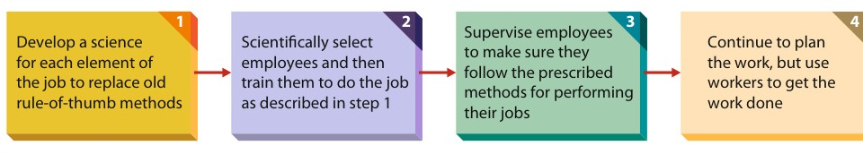
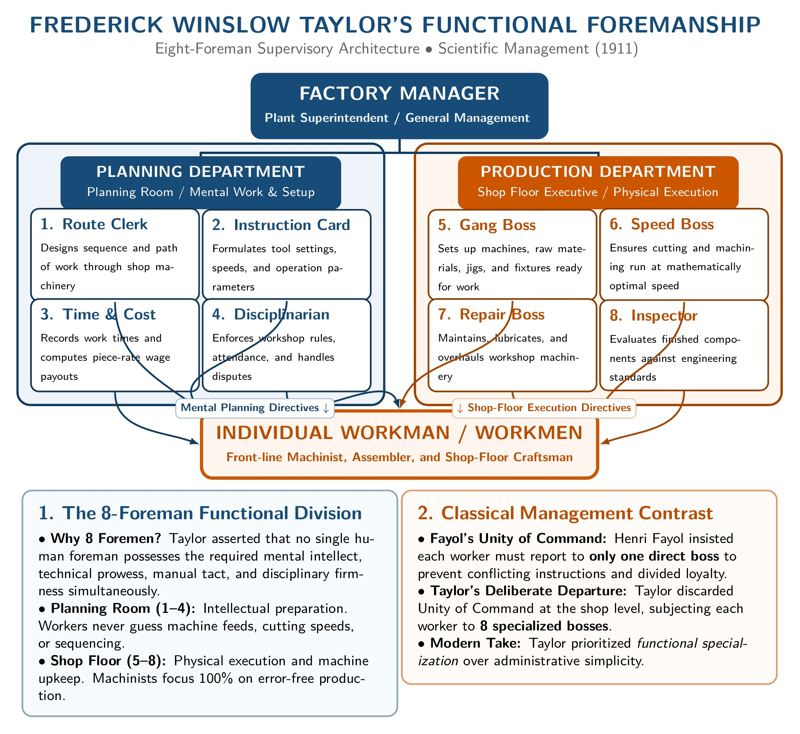

[← Previous: M03.1: Fayol's 14 Principles and Scalar Chain](M03.1_Fayols_14_Principles_and_Scalar_Chain.md) | [🏠 Index](00_Index.md) | [Next: M04.1: Planning and Rational Decision Making →](M04.1_Planning_and_Rational_Decision_Making.md)

---

# M03.2: Taylor's Scientific Management

> **Section:** Section B (CO2 · Industrial Management · Dr. Md. Rabiul Islam Sir) | **Priority:** 🔴 High | **Exam Frequency:** Tested in 2020 Final Q.1(c)
> **Subtopics Covered:** `M03.3` (F.W. Taylor's Principles of Scientific Management, Soldiering, 4 Steps, Operational Mechanisms, Functional Foremanship, Differential Piece-Rate System, Comparison with Fayol)
> **Sources:** MRI Sir Lecture 5, Griffin Chapter 1 (pp. 41-43), Previous Year Questions (`2020 Q.1(c)`, Model Comparison Question)

## Why This Topic Matters

Frederick Winslow Taylor founded Scientific Management in the early 20th century. His work laid the foundation for modern industrial engineering, assembly lines, and ergonomic work studies. MRI Sir frequently tests Taylor's principles in examinations.

Students often lose marks by writing vague bullet points about "science" without explaining the four sequential steps. They also omit Taylor's operational tools, like time-and-motion study and functional foremanship. To score full marks, explain the four steps clearly. Connect them to soldiering. Then contrast Taylor with Henri Fayol.

---

## 📝 Key Definitions

> **Scientific Management:** "Focuses on improving the performance of individual workers." (Ricky W. Griffin, *Fundamentals of Management*)

Scientific management studies shop-floor tasks using systematic observation and measurement. It replaces guesswork with verified scientific rules.

> **Management (Taylor's Definition, 1911):** "The art of knowing what you want men to do, and seeing that they do it in the best and cheapest way." (Frederick W. Taylor)

Taylor viewed management as a precise science. Managers must find the single most efficient way to perform every physical operation.

> **Soldiering:** "Employees deliberately working at a pace slower than their capabilities." (Ricky W. Griffin, *Fundamentals of Management*)

Taylor coined this term after observing steelworkers. Workers slowed down output intentionally to protect jobs and avoid lower piece rates.

> **Mental Revolution:** "A complete change in the mental attitude of both workers and management toward mutual cooperation rather than conflict over profits." (F.W. Taylor)

Both parties stop arguing about how to divide profits. Instead, they work together to maximize total production and wealth.

---

## Frederick Winslow Taylor and the Rise of Scientific Management

In the late 19th and early 20th centuries, capital was readily available. Business was expanding quickly, but skilled factory labor was scarce. Managers needed methods to extract higher output from existing workers.

Frederick Winslow Taylor (1856–1915), an American mechanical engineer, tackled this challenge. Starting as a machinist and gang boss at Midvale Steel Company in Philadelphia, Taylor studied daily shop-floor behavior. He later consulted for Bethlehem Steel and Simonds Rolling Machine Company.

Taylor observed that factories ran on crude "rule-of-thumb" habits. Workers selected their own tools, set their own pace, and trained each other haphazardly. Taylor dedicated his career to replacing this guesswork with scientific analysis.

---

## The Problem of Soldiering

Taylor identified deliberate slow working, or **soldiering**, as the greatest obstacle to factory productivity. He classified soldiering into two types:
1. **Natural Soldiering:** The natural human tendency to take it easy and avoid exertion.
2. **Systematic Soldiering:** Deliberate, coordinated slacking organized by worker groups to restrict daily output.

Taylor uncovered three root causes behind systematic soldiering:
- **Fear of Unemployment:** Workers believed that if they produced faster, fewer workers would be needed, causing layoffs.
- **Flawed Wage Systems:** Non-incentive hourly wages paid lazy and energetic workers the same. When piece-rate workers produced more, greedy owners cut the piece rate. Workers learned that higher output meant more toil for the same pay.
- **Rule-of-Thumb Inefficiency:** Workers used clumsy, unscientific methods passed down by word of mouth. Wasted motions exhausted workers without producing results.

---

## The Four Sequential Steps of Scientific Management

Taylor organized his core philosophy into four sequential steps. Griffin (*Fundamentals of Management*, p. 42) and MRI Sir (Lecture 5) emphasize this exact four-stage progression:

*Figure 3.1: Steps in Scientific Management (Source: Griffin, Fundamentals of Management 8th ed., Page 42 / Fig. 1.3)*

### Step 1: Develop a Science for Each Element of the Job
- Replace old rule-of-thumb guesswork with scientific study.
- Break every physical task down into basic motions.
- Measure the time taken for each motion with a stopwatch.
- Eliminate useless movements, redesign tools, and identify the single fastest, most efficient method ("the one best way").

### Step 2: Scientifically Select, Train, and Develop Workers
- Stop letting workers choose their own tasks and train themselves randomly.
- Assess the physical and mental capabilities of job applicants scientifically.
- Match each worker to the job for which they are best suited.
- Train workers systematically to execute the exact scientific motions established in Step 1.

### Step 3: Supervise and Cooperate Heartily with Workers
- Build genuine cooperation between managers and factory workers.
- Provide detailed daily instruction cards and continuous guidance.
- Supervise workers closely to ensure they strictly follow the prescribed scientific methods.

### Step 4: Equal Division of Work and Responsibility Between Management and Labor
- Rebalance the daily operating burden.
- In traditional shops, workers did both the planning and the physical execution.
- Under scientific management, management takes over all planning, scheduling, tool preparation, and process design.
- Workers focus entirely on executing the planned tasks. Management and labor share responsibility equally.

---

## Core Shop-Floor Mechanisms and Tools

To implement his four principles on the factory floor, Taylor developed concrete operational tools:

### 1. Time and Motion Study
- Conducted with stopwatches to observe worker movements.
- Frank and Lillian Gilbreth expanded this into micro-motion studies, identifying 17 fundamental hand motions called *therbligs*.
- The goal is to eliminate awkward bends, long reaches, and wasted seconds.

### 2. Standardization of Tools, Equipment, and Conditions
- Taylor showed that tool shape directly affects output.
- At Bethlehem Steel, he designed custom shovels. He provided small shovels for heavy iron ore and large shovels for light coal ashes.
- Standardizing machine speeds, lighting, and raw materials ensured consistent output.

### 3. Differential Piece-Rate Incentive System
- Taylor tied worker pay directly to scientific performance targets.
- He established two distinct wage rates:
  - **High Piece Rate:** Paid to employees who met or beat the scientific standard.
  - **Low Piece Rate:** Paid to employees who failed to meet the standard.
- This pay gap rewarded top performers generously while penalizing slackers.

### 4. Functional Foremanship
- Taylor rejected Henri Fayol's strict Unity of Command on the factory shop floor.
- He argued that a single general foreman cannot possess all necessary technical, planning, and disciplinary skills.
- He split factory supervision across **eight specialized functional foremen**:
  - **Planning Room (4 Foremen):**
    1. *Route Clerk:* Designs the path and sequence of work through the shop.
    2. *Instruction Card Clerk:* Writes exact machine settings and motion instructions.
    3. *Time and Cost Clerk:* Records task completion times and calculates wages.
    4. *Shop Disciplinarian:* Manages discipline, attendance, and grievances.
  - **Shop Floor (4 Foremen):**
    5. *Gang Boss:* Sets up machines and prepares raw materials for workers.
    6. *Speed Boss:* Ensures machines run at optimal cutting and operating speeds.
    7. *Repair Boss:* Maintains and overhauls machinery and tools.
    8. *Inspector:* Checks the quality of finished components against standards.

*Figure 1: Frederick Winslow Taylor's Eight-Foreman Functional Foremanship Organizational Architecture (Source: Taylor 1911 / Griffin 8th ed.)*

### 5. Instruction Cards and Output Maximization
- Every morning, workers received written cards detailing tools, speeds, and standard times.
- Guesswork vanished, and deliberate output restriction was eliminated.

---

## Memory Hooks: Scientific Management at a Glance

> [!tip] Memory Hook 1: **The 4 Sequential Steps (D-S-S-P)**
> Remember Taylor's four steps in order:
> - **D** · **Develop** a science for each task element (replace rule-of-thumb).
> - **S** · **Select** and train workers scientifically.
> - **S** · **Supervise** workers to ensure adherence to scientific methods.
> - **P** · **Plan** and divide work equally between management and labor.

> [!tip] Memory Hook 2: **The Shop-Floor Toolkit (S-T-I-F-M)**
> Recall Taylor's core operational tools:
> - **S** · **Standardization** of tools and equipment (custom shovels).
> - **T** · **Time and motion** study (stopwatches and motion economy).
> - **I** · **Incentive** pay (differential piece-rate system).
> - **F** · **Functional** foremanship (8 specialized supervisors).
> - **M** · **Mental** revolution (harmony and shared prosperity).

---

## Critical Evaluation of Scientific Management

Taylor's ideas created intense controversy in industry and government.

### Major Strengths
1. **Dramatically Increased Output:** Taylor's methods achieved astonishing productivity gains. At Bethlehem Steel, pig-iron loading jumped from $12.5$ tons to $47.5$ tons per man per day.
2. **Foundation of Industrial Engineering:** It pioneered ergonomic design, standard operating procedures, and assembly-line mass production.
3. **Merit-Based High Wages:** Hardworking employees earned substantially higher earnings through differential piece rates.
4. **Efficiency Mindset:** It proved that systematic analysis outperforms tradition and guesswork.

### Weaknesses and Criticisms
1. **Mechanistic View of Labor:** Taylor treated workers like mechanical cogs in a giant machine. He assumed financial gain was their only motivation.
2. **Worker Burnout and Fatigue:** High machine speeds and rigid repetitive tasks caused physical strain, boredom, and psychological stress.
3. **Destruction of Worker Autonomy:** Removing all planning from workers stripped them of creative thinking and pride of craftsmanship.
4. **Labor Union Backlash:** Labor unions fiercely opposed Taylorism. They viewed it as a ruthless speed-up scheme designed to destroy jobs.
5. **Congressional Investigation:** In 1912, strikes by workers at the Watertown Arsenal led to a U.S. House of Representatives investigation into Taylor's system.
6. **Violation of Unity of Command:** Functional foremanship subjected each worker to eight bosses, causing operational friction.

---

## Detailed Comparison: Henri Fayol vs. F.W. Taylor

MRI Sir frequently tests the contrast between the two fathers of classical management theory:

| Comparison Parameter | Henri Fayol (Administrative Management) | F.W. Taylor (Scientific Management) |
| :--- | :--- | :--- |
| **Pioneer Background** | French mining engineer and corporate managing director. | American mechanical engineer and shop-floor consultant. |
| **Organizational Level** | Top management and total enterprise administration. | Shop floor, machine level, and front-line workers. |
| **Primary Focus** | Overall organizational structure and management processes. | Task efficiency, worker physical motions, and tool design. |
| **Managerial Approach** | **Top-Down:** Starts at the executive suite to organize the firm. | **Bottom-Up:** Starts at the workbench to reform operations. |
| **View of Workers** | Recognizes morale, team spirit (*esprit de corps*), and initiative. | Views workers as rational economic actors driven by piece rates. |
| **Unity of Command** | Strict rule: each worker answers to only one boss. | Rejected on shop floor: workers take orders from 8 foremen. |
| **Core Tools** | 14 administrative principles and 5 management functions. | Time-motion study, standardization, and differential piece rates. |
| **Applicability** | Universal: applies to business, government, military, and tech. | Best suited for manufacturing, assembly lines, and physical tasks. |
| **Major Legacy** | Classical organizational charts and administrative theory. | Industrial engineering, ergonomics, and lean assembly lines. |

---

## Exam Variants

| Year / Source | Question Prompt Summary | Marks | Key Focus / Strategy |
| :--- | :--- | :---: | :--- |
| **2020 Final Q.1(c)** | State the principles of scientific management | 05 | Present Taylor's 4 sequential steps, list 5 shop-floor tools, mention soldiering |
| **Model Comparison Question** | Compare Henri Fayol and F.W. Taylor across level, focus, approach, and legacy | 05 | Provide a structured 8-point comparison table, contrast top-down vs bottom-up |

---

## 🏆 Golden Questions (Past Exam Archive & Model Answers)

### 🎯 GQ1 · 2020 Final Q.1(c) · Principles of Scientific Management (05 Marks)

> **Appeared:** 2020 Final Examination (Section A, Q.1(c)) · (05 Marks)
> **Question:** State the principles of scientific management.

**Full Answer:**

Frederick Winslow Taylor (1856–1915) established Scientific Management. He defined management as the art of knowing what you want men to do, and seeing that they do it in the best and cheapest way (Taylor, 1911). Taylor designed these principles to eliminate deliberate worker slacking ("soldiering") and maximize industrial efficiency.

#### The Four Core Principles of Scientific Management
Taylor and Griffin (*Fundamentals of Management*, 8th ed., p. 42) organize scientific management into four sequential steps:

1. **Develop a Science for Each Element of the Job:**
   - Replace traditional rule-of-thumb guesswork with scientific study.
   - Break tasks into basic physical motions using time-and-motion studies.
   - Standardize the single most efficient method ("the one best way") for each task.

2. **Scientifically Select, Train, and Develop Workers:**
   - End the practice of workers choosing their own tasks and training themselves.
   - Assess physical and mental traits scientifically to match workers to suitable roles.
   - Systematically train selected employees to execute standard scientific methods.

3. **Supervise and Cooperate Heartily with Workers:**
   - Establish close cooperation between managers and workers.
   - Provide clear daily work instructions.
   - Supervise employees closely to ensure work conforms to scientific standards.

4. **Equal Division of Work and Responsibility:**
   - Rebalance organizational responsibilities between management and labor.
   - Managers assume full responsibility for planning, scheduling, designing, and standardizing tasks.
   - Workers focus entirely on executing work according to management plans.

#### Key Operational Mechanisms and Tools
To apply these principles, Taylor introduced specific shop-floor mechanisms:
- **Standardization:** Uniform tools, machine speeds, and working conditions.
- **Differential Piece-Rate Incentive System:** High wage rates for meeting or beating the standard; low wage rates for failing.
- **Functional Foremanship:** Dividing shop supervision among eight specialized functional foremen.
- **Mental Revolution:** Both labor and management shift from conflict to mutual cooperation to expand overall wealth.

---

### 🎯 GQ2 · Model Exam Question · Comparative Analysis of Fayol and Taylor (05 Marks)

> **Appeared:** Prescribed Model Exam Question (Lecture 4, Lecture 5, Griffin Ch. 1) · (05 Marks)
> **Question:** Compare Henri Fayol's Administrative Management with F.W. Taylor's Scientific Management in terms of focus, organizational level, approach, and primary contribution.

**Full Answer:**

Henri Fayol and Frederick Winslow Taylor were the twin pioneers of classical management theory. While both sought maximum organizational efficiency, they approached the problem from opposite directions.

#### Comparative Summary Table

| Dimension | Henri Fayol (Administrative Management) | F.W. Taylor (Scientific Management) |
| :--- | :--- | :--- |
| **Origin & Background** | French mining engineer and corporate managing director. | American mechanical engineer and shop-floor consultant. |
| **Organizational Level** | Top management and general administrative hierarchy. | Shop floor, workbench, and physical production line. |
| **Primary Focus** | Managing the total organization, authority lines, and policy. | Optimizing individual tasks, tools, and worker motions. |
| **Management Approach** | **Top-Down:** Establishes executive guidelines down to workers. | **Bottom-Up:** Studies micro tasks to reform upper management. |
| **View of Human Workers** | Recognizes morale, team spirit (*esprit de corps*), and initiative. | Views workers as rational economic actors driven by money. |
| **Unity of Command** | Strict rule: every employee has only one immediate boss. | Rejected on the floor: workers report to 8 functional foremen. |
| **Core Methodologies** | 14 principles of management and 5 administrative functions. | Time-motion study, standardization, and differential piece rates. |
| **Applicability** | Universal: applies to manufacturing, tech, government, and armies. | Best suited for manufacturing plants and physical operations. |
| **Major Contribution** | Classical organizational theory and executive governance. | Industrial engineering, ergonomics, and assembly-line methods. |

#### Analytical Synthesis
- **Fayol's Perspective:** Fayol looked downward from the boardroom. He wanted to structure the entire organization cleanly so managers could coordinate large teams without chaos.
- **Taylor's Perspective:** Taylor looked upward from the factory lathe. He wanted to eliminate wasted physical movements and soldiering so machines and workers operated at peak capacity.
- **Modern Integration:** Contemporary tech and manufacturing firms combine both perspectives. They use Fayol's principles for corporate hierarchy and Taylor's methods for process optimization and agile productivity tracking.

---

## ⚡ Exam Tips & Common Mistakes

1. **Always State the 4 Steps in Order:** Taylor designed his four principles as a logical sequence: (1) Develop science $\rightarrow$ (2) Select and train $\rightarrow$ (3) Supervise methods $\rightarrow$ (4) Divide work equally. Do not scramble the sequence.
2. **Explain Soldiering:** Whenever asked about Taylor, define soldiering. Mention the three root causes: fear of job loss, wage cuts by management, and clumsy rule-of-thumb habits.
3. **Highlight Functional Foremanship:** Mention the eight functional bosses (4 in planning, 4 on the shop floor). Note that this deliberately broke Fayol's Unity of Command rule.
4. **Use Taylor's Bethlehem Steel Example:** Cite Taylor's pig-iron experiment ($12.5$ to $47.5$ tons per day) or custom shovels. This shows examiners you know the historical facts.

## 🔗 Related Topics

- [M03.1: Fayol's 14 Principles and Scalar Chain](M03.1_Fayols_14_Principles_and_Scalar_Chain.md)
- [M04.1: Planning and Rational Decision Making](M04.1_Planning_and_Rational_Decision_Making.md)
- [O03.1: Productivity Formulas (SFP, MFP) and Numericals](O03.1_Productivity_Formulas_SFP_MFP_and_Numericals.md)

---

[← Previous: M03.1: Fayol's 14 Principles and Scalar Chain](M03.1_Fayols_14_Principles_and_Scalar_Chain.md) | [🏠 Index](00_Index.md) | [Next: M04.1: Planning and Rational Decision Making →](M04.1_Planning_and_Rational_Decision_Making.md)
