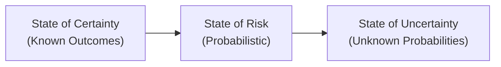
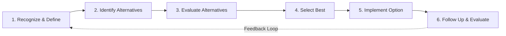
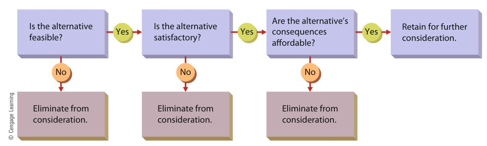

[← Previous: M03.2: Taylor's Scientific Management](M03.2_Taylors_Scientific_Management.md) | [🏠 Index](00_Index.md) | [Next: M04.2: Organizing, Departmentalization, Delegation, and Span →](M04.2_Organizing_Departmentalization_Delegation_and_Span.md)

---

# M04.1: Planning and Rational Decision Making

> **Section:** Section B (CO2 · Industrial Management · Md. Rokonuzzaman Sir) | **Priority:** 🟡 Medium | **Exam Frequency:** Tested in 2021 and 2023 Finals (8 Marks total)
> **Subtopics Covered:** `M04.1` (Meaning of planning and decision making; Strategic, Tactical, and Operational plans), `M04.2` (Rational decision-making process with example)
> **Sources:** Griffin 8th ed. (Ch. 3, Ch. 4), Topicwise_Answer/M04_Planning_Decisions_Organizing_Control.md, Raidah Class Notes (Class 1–2)

## Why This Topic Matters

MRI Sir tests planning and decision making in Section B. Past questions focus on definitions, plan tiers, and the rational decision process.

In 2023, Question 6(a) asked for planning and decision making definitions for 2 marks. Question 6(b) asked for the decision process with an example for 3 marks. In 2021, Question 2(a) tested effective but inefficient decisions for 3 marks.

To score full marks, learn the six rational steps in order. Then master the three organizational plan tiers. Always provide a concrete telecom or electronics engineering example.

---

## 📝 Key Definitions

> **Planning:** "Setting an organization's goals and deciding in advance how best to achieve them." (Ricky W. Griffin, *Fundamentals of Management*)

Planning decides what to do and how to do it before action starts. It creates a clear roadmap from where the firm is now to where it wants to be.

> **Decision Making:** "The act of choosing one alternative from among a set of alternatives." (Ricky W. Griffin, *Fundamentals of Management*)

Decision making is picking the best path among several viable options. It solves an operational problem or captures a business opportunity.

> **Strategic Plan:** "A general plan outlining decisions about resource allocation, priorities, and action steps necessary to reach strategic goals." (Ricky W. Griffin)

Strategic plans set broad, long-term directions for the entire firm. Top executives create them for a 3 to 5 year horizon.

> **Tactical Plan:** "A plan aimed at achieving tactical goals, developed to implement specific parts of a strategic plan." (Ricky W. Griffin)

Tactical plans focus on departmental actions. Middle managers create them for a 1 to 3 year intermediate horizon.

> **Operational Plan:** "A plan that focuses on carrying out tactical plans to achieve operational goals." (Ricky W. Griffin)

Operational plans direct day-to-day tasks. Lower-level supervisors create them for daily, weekly, or monthly time spans.

> **Rational Decision Making:** "A systematic, step-by-step approach to decision making that assumes managers are logical and objective." (Ricky W. Griffin)

Rational decision making follows a logical six-step chain. It evaluates all facts to select the best organizational solution.

> **Bounded Rationality:** "A concept suggesting that decision makers are limited by their values and unconscious reflexes, skills, and habits." (Herbert A. Simon)

Managers face real limits in processing data. They never possess perfect knowledge, so their rationality has natural boundaries.

> **Satisficing:** "The tendency to search for alternatives only until one is found that meets some minimum standard of sufficiency." (Herbert A. Simon)

Decision makers stop searching once they find a workable solution. They pick the first "good enough" option instead of searching forever.

---

## Core Theory: Fundamentals of Planning

### 1. What is Planning in Management?

Planning is the foundation of all management activity. It is the first step in the four management functions (Planning, Organizing, Leading, Controlling: `P-O-L-C`).

Without planning, organizations operate blindly. Managers would only react to daily crises without clear direction.

Key features of planning include:
1. **Goal Setting:** Choosing clear performance targets for the organization.
2. **Resource Allocation:** Distributing money, people, machines, and information wisely.
3. **Action Schedules:** Defining deadlines, budgets, and operational policies before work begins.

### 2. Four Purposes of Organizational Goals

Goals form the core of every plan. Ricky W. Griffin highlights four key purposes of goals:

1. **Unified Direction:** Goals show everyone where the organization is heading. They align all employees toward a shared target.
2. **Promoting Good Planning:** Setting clear targets forces managers to plan how to reach them. Good plans help set future goals.
3. **Employee Motivation:** Specific and moderately difficult goals inspire staff to work harder. They provide clear targets for rewards.
4. **Evaluation and Control:** Goals create exact benchmarks. Managers compare actual output against target goals to spot performance gaps.

### 3. Relationship: Decision Making as the Catalyst of Planning

Planning and decision making are deeply linked:
- Decision making is the catalyst of planning.
- Planning cannot happen without decisions.
- At every planning step, managers choose between alternative goals, paths, and budgets.
- Decision making also occurs in organizing, leading, and controlling. Yet it remains most active during planning.

---

## The Three Types of Organizational Plans

Organizations establish plans across three distinct management levels. Each tier has a specific scope, time horizon, and purpose.

> [!tip] Memory Hook: 3 Plan Types (`S-T-O`)
> Remember the acronym **S-T-O** for the three organizational plans:
> - **S**: **S**trategic Plans (Top management · 3 to 5+ years · Entire firm)
> - **T**: **T**actical Plans (Middle management · 1 to 3 years · Specific division)
> - **O**: **O**perational Plans (First-line supervisors · Days to months · Daily tasks)

### 1. Strategic Plans

Strategic plans are broad roadmaps set by top executives:
- **Managerial Level:** Board of Directors, Chief Executive Officer (CEO), and Managing Directors.
- **Time Horizon:** Long term, usually three to five years or longer.
- **Scope:** The entire organization across all markets.
- **Focus:** Long-term market positioning, resource deployment, external threats, and corporate survival.
- **Engineering Example:** A telecom operator decides to build a countrywide 5G fiber transmission network within five years.

### 2. Tactical Plans

Tactical plans translate strategic vision into departmental reality:
- **Managerial Level:** Middle managers, such as divisional directors, plant managers, and department heads.
- **Time Horizon:** Intermediate term, typically one to three years.
- **Scope:** A specific department or business unit (such as Engineering, Marketing, or Finance).
- **Focus:** Coordinating departmental actions, distributing divisional budgets, and executing parts of the strategic plan.
- **Engineering Example:** The Optical Transmission Division buys DWDM network gear and trains fiber technicians over 18 months.

### 3. Operational Plans

Operational plans govern specific daily work routines:
- **Managerial Level:** Lower-level managers, unit heads, shift leaders, and field supervisors.
- **Time Horizon:** Short term, ranging from daily shifts to weekly or monthly schedules.
- **Scope:** A specific task, machine, workstation, or field crew.
- **Focus:** Daily quotas, job assignments, equipment maintenance, and quality inspections.
- **Engineering Example:** A field supervisor assigns daily fiber cable inspection and OTDR testing to technicians in Rajshahi.

### Comparison of the Three Plan Tiers

| Dimension | Strategic Plan | Tactical Plan | Operational Plan |
| :--- | :--- | :--- | :--- |
| **Managerial Level** | Top management (Board, CEO) | Middle management (Divisional Heads) | First-line management (Supervisors) |
| **Time Horizon** | Long term ($3\text{ to }5+\text{ years}$) | Intermediate ($1\text{ to }3\text{ years}$) | Short term (Days, weeks, months) |
| **Scope & Breadth** | Entire organization | Specific department or unit | Specific task, machine, or shift |
| **Level of Detail** | Broad and general | Moderate and departmental | Highly specific and standardized |
| **Environmental Risk** | High external volatility | Moderate operational risk | Low internal risk |
| **Primary Goal** | Corporate growth and survival | Departmental execution | Daily task completion |
| **ECE Example** | Build countrywide 5G fiber grid | Procure DWDM gear and train crews | Run daily cable tests with OTDR |

---

## Types of Decisions and Decision Conditions

Managers make decisions of different types and under different environmental states.

### 1. Programmed vs. Non-Programmed Decisions

| Feature | Programmed Decision | Non-Programmed Decision |
| :--- | :--- | :--- |
| **Nature of Problem** | Structured, routine, repetitive | Unstructured, novel, non-routine |
| **Frequency** | Occurs often with high frequency | Occurs rarely or only once |
| **Decision Rules** | Follows standard rules, policies, and algorithms | Relies on judgment, intuition, and creative analysis |
| **Management Level** | Usually lower and middle managers | Usually top and upper-middle managers |
| **Telecom Example** | Auto-reordering optical patch cords when inventory drops to ROP | Deciding to acquire a competing regional broadband ISP |

### 2. Three Decision-Making Conditions

The external environment creates three levels of certainty and risk:

1. **State of Certainty:**
   - The decision maker knows all alternatives and their exact outcomes.
   - Ambiguity is very low, and the chance of a bad decision is minimal.
   - Truly certain conditions are rare in fast-changing engineering markets.
   - *Example:* Buying standard CAT-6 network cables from an approved vendor with guaranteed prices and fixed delivery dates.

2. **State of Risk:**
   - The availability, costs, and payoffs of each option carry probability estimates.
   - The manager does not know the exact outcome, but understands the odds.
   - Decisions rely on past data, industry trends, and statistical models.
   - *Example:* Bidding on a \$500,000 smart grid contract where past records show a $70\%$ winning probability.

3. **State of Uncertainty:**
   - The decision maker does not know all options, risks, or possible consequences.
   - Ambiguity is high, and the chance of making a costly mistake is elevated.
   - Managers must rely on experience, intuition, and careful scenario analysis.
   - *Example:* Investing in an unproven satellite broadband standard during shifting international trade sanctions.

### Summary of Decision Conditions

| Condition | Information Level | Probability Estimates | Ambiguity & Error Risk | Engineering Example |
| :--- | :--- | :--- | :--- | :--- |
| **Certainty** | Complete and accurate data | Known with $100\%$ confidence | Low ambiguity, low error | Buying fixed-price passive components |
| **Risk** | Partial data with known odds | Probabilities estimated mathematically | Moderate ambiguity, calculated risk | Choosing between two wireless vendors |
| **Uncertainty** | Highly incomplete and ambiguous | Probabilities cannot be calculated | High ambiguity, highest error risk | Entering an unproven AI telecom market |

---

## Decision Models: Classical vs. Administrative

Management theory provides two contrasting perspectives on how decisions are made.

### 1. The Classical Decision Model (Prescriptive)

The classical model is prescriptive. It tells managers how they *should* make decisions:
- It assumes managers are completely logical and objective.
- It assumes decision makers have full access to complete and perfect information.
- It assumes managers can eliminate all uncertainty and evaluate every alternative.
- It assumes the final choice will always optimize the economic interests of the organization.

In practice, these ideal conditions rarely exist in real-world organizations.

### 2. The Administrative Model (Descriptive · Herbert A. Simon)

Herbert A. Simon won the Nobel Prize in Economics for showing that human managers cannot achieve complete rationality. The administrative model describes how managers *actually* make decisions:

1. **Incomplete Information:** Managers face time limits, high research costs, and missing data.
2. **Bounded Rationality:** Human mental power has limits. Values, skills, habits, and unconscious reflexes limit our thinking.
3. **Satisficing:** Managers do not search forever for the perfect alternative. Instead, they pick the first option that meets their minimum acceptable standard.

### Classical Model vs. Administrative Model

| Feature | Classical Decision Model | Administrative Decision Model |
| :--- | :--- | :--- |
| **Nature of Model** | Prescriptive (How managers *should* decide) | Descriptive (How managers *actually* decide) |
| **Information Assumed** | Complete, perfect, and cost-free | Incomplete, imperfect, and limited |
| **Manager Rationality** | Perfectly logical and objective | Constrained by bounded rationality |
| **Search for Alternatives** | Exhaustive search of all possible options | Limited search stopping at a "good enough" option |
| **Decision Criterion** | Optimizing (Finding the single best choice) | Satisficing (Selecting an acceptable choice) |
| **Real-World Fit** | Theoretical ideal; rarely seen in practice | Realistic description of everyday management |

---

## The Six Steps of Rational Decision Making

When managers face important non-programmed decisions, they should follow a structured rational process.

Ricky W. Griffin outlines six sequential steps in the rational decision-making process:

> [!tip] Memory Hook: 6 Steps of Rational Decision Making (`R-I-E-S-I-F`)
> Remember the acronym **R-I-E-S-I-F** to recall all six steps in order:
> - **R**: **R**ecognize and define the decision situation
> - **I**: **I**dentify alternatives
> - **E**: **E**valuate alternatives (Feasibility, Satisfactoriness, Consequences)
> - **S**: **S**elect the best alternative
> - **I**: **I**mplement the chosen alternative
> - **F**: **F**ollow up and evaluate results

### Detailed Breakdown of the Six Steps

#### Step 1: Recognizing and Defining the Decision Situation
A stimulus signals that a decision is needed. This stimulus can be:
- A problem (such as rising call drop rates or declining factory yield).
- An opportunity (such as newly opened 5G spectrum or surplus investment funds).

The manager must identify the true underlying root cause, not merely treat surface symptoms.

#### Step 2: Identifying Alternatives
The manager generates both obvious and creative courses of action.
- More critical decisions require broader searches.
- Real choices face practical constraints: legal rules, company policies, available capital, and ethics.

#### Step 3: Evaluating Alternatives (The Three Essential Tests)
Each alternative must pass three successive tests. If an alternative fails any test, it must be eliminated immediately:

*Figure 4.1: Evaluating Alternatives in the Decision-Making Process (Source: Griffin Ch. 4, p. 136)*

> [!tip] Memory Hook: 3 Tests of Alternatives (`F-S-C`)
> Remember **F-S-C** when checking each alternative:
> 1. **F**: **F**easibility (Can we do it technically, legally, and within budget?)
> 2. **S**: **S**atisfactoriness (Does it fully solve the problem?)
> 3. **C**: **C**onsequences (Are the financial and operational side effects affordable?)

1. **Feasibility:** Is the option practical? Can the firm do it with existing technology, staff, and cash? If no, eliminate it.
2. **Satisfactoriness:** Does the option satisfy the decision objective? If an option increases capacity by only $10\%$ when $50\%$ is needed, eliminate it.
3. **Affordable Consequences:** What side effects will this option bring? Even feasible and satisfactory options must be dropped if their costs or disruptions harm the total system.

#### Step 4: Selecting the Best Alternative
The manager chooses the option that offers the best balance of feasibility, satisfactoriness, and affordable consequences.
- Managers often aim for optimization: balancing trade-offs across multiple goals.
- Managers can also keep a second-best option as a backup plan.

#### Step 5: Implementing the Chosen Alternative
The manager puts the selected plan into operational action:
- Allocate financial and physical resources.
- Assign clear responsibilities and deadlines to specific teams.
- Manage employee resistance to change caused by fear of the unknown or inconvenience.

#### Step 6: Following Up and Evaluating Results
The manager verifies whether the implemented decision achieved its original purpose:
- Measure real performance against target benchmarks.
- If the plan succeeds: standard operations continue.
- If the plan fails: adopt a backup alternative, adjust execution, or restart the decision process.

---

### Real-World ECE / Telecom Case: 4G Cellular Base Station (BTS) Congestion

The table below illustrates the six rational steps applied to an engineering problem in Rajshahi.

| Step | Action Taken by Telecom Engineering Team |
| :--- | :--- |
| **1. Recognize & Define** | Network monitoring logs show peak-hour call drops at a Rajshahi BTS jumped from $0.5\%$ to $6.8\%$. High data traffic is choking the cell sector. |
| **2. Identify Alternatives** | Engineers identify three options:  • **Option A:** Add an extra 4G RF transceiver card to the tower rack.  • **Option B:** Build a brand-new cell tower nearby.  • **Option C:** Throttle user download speeds during peak hours. |
| **3. Evaluate Alternatives** | • **Option B** costs \$50,000 and takes six months to construct. It fails the **Feasibility** test.  • **Option C** degrades subscriber experience and violates SLA norms. It fails the **Consequences** test.  • **Option A** costs \$4,000, takes two days to set up, and doubles cell capacity. It passes Feasibility, Satisfactoriness, and Affordable Consequences. |
| **4. Select Best Alternative** | The Operations Director selects **Option A** (adding the extra 4G RF transceiver card). |
| **5. Implement Alternative** | Technicians mount the card into the BTS rack, update antenna tilt, and configure RF routing over the weekend. |
| **6. Follow Up & Evaluate** | Traffic logs the next week show call drop rates falling to $0.4\%$. The decision solved the problem. |

---

## Exam Variants

| Year / Source | Question / Scenario | Marks | Key Focus / Result |
| :--- | :--- | :---: | :--- |
| **2023 Q.6(a)** | What do you mean by planning and decision making? | 02 | Define planning and decision making; show decision making is planning catalyst |
| **Model Q.1** | Distinguish between strategic, tactical, and operational plans with engineering examples. | 04 | Compare 3 plan tiers across level, time, scope, and detail with telecom examples |
| **2021 Q.2(a)** | What is decision making? Give an example of decision making which is effective but not efficient. | 03 | Define decision making; chartering helicopter for fiber repair vs. standby microwave |
| **2023 Q.6(b)** | State the process of decision making with example. | 03 | 6 rational steps (`R-I-E-S-I-F`), 3 evaluation tests, and 4G BTS congestion case |

---

## 🏆 Golden Questions (Past Exam Archive & Model Answers)

### 🎯 GQ1 · 2023 Final Q.6(a) · Planning and Decision Making (02 Marks)

> **Appeared:** 2023 Final Q.6(a) (Sec B · CO2) · (02 Marks)

**Question:**
What do you mean by planning and decision making?

**Full Answer:**

#### 1. Meaning of Planning
Planning is the first fundamental management function. It means setting an organization's goals and deciding in advance how best to achieve them (Ricky W. Griffin). 

Planning creates a complete roadmap before work begins:
- It establishes organizational goals across strategic, tactical, and operational levels.
- It allocates human, physical, financial, and information resources.
- It outlines specific timelines, budgets, and policies to reach targeted results.

#### 2. Meaning of Decision Making
Decision making is the act of choosing one alternative from among a set of alternatives (Griffin Ch. 4). 

As an ongoing managerial process, decision making includes:
- Recognizing an operational problem or business opportunity.
- Developing several feasible courses of action.
- Selecting the best option and putting it into practice.

#### 3. Core Relationship
Decision making serves as the catalyst of planning. Planning cannot occur without decisions. At every stage of planning, managers must choose between alternative goals, paths, and budgets.

---

### 🎯 GQ2 · Model Question · Strategic vs. Tactical vs. Operational Plans with Engineering Examples (04 Marks)

> **Appeared:** Prescribed Model Question (Griffin Ch. 3) · (04 Marks)

**Question:**
Distinguish between strategic, tactical, and operational plans. Illustrate each plan type with an example from an engineering enterprise.

**Full Answer:**

Organizations establish plans across three hierarchical tiers (Ricky W. Griffin, Chapter 3). Each plan type serves a distinct organizational level, time span, and scope:

#### 1. Strategic Plans
Strategic plans are broad, general plans developed by top management (such as the Board of Directors and CEO). They outline resource allocation priorities, market scope, and long-term directions for the entire firm.
- **Time Horizon:** Long term, usually three to five years or longer.
- **Focus:** Competitive positioning, external threats, and corporate survival.
- **Engineering Example:** An electronics firm sets a five-year plan to build an automated semiconductor packaging cleanroom plant.

#### 2. Tactical Plans
Tactical plans are developed by middle management (such as division heads and plant managers). They specify how to execute specific parts of the strategic plan within individual departments.
- **Time Horizon:** Intermediate term, typically one to three years.
- **Focus:** Departmental coordination and divisional resource distribution.
- **Engineering Example:** The Operations Director orders wire-bonding machines, prepares cleanroom space, and trains engineers within 18 months.

#### 3. Operational Plans
Operational plans are created by lower-level managers (such as line supervisors and shift leads). They direct specific daily tasks needed to reach tactical targets.
- **Time Horizon:** Short term, covering daily, weekly, or monthly periods.
- **Focus:** Routine task assignments, machine maintenance, and meeting production quotas.
- **Engineering Example:** A shift supervisor sets daily inspection quotas and maintenance schedules for Assembly Line 2.

#### Comparison Table of Organizational Plans

| Dimension | Strategic Plan | Tactical Plan | Operational Plan |
| :--- | :--- | :--- | :--- |
| **Managerial Level** | Top management (Board, CEO) | Middle management (Plant Managers) | First-line management (Supervisors) |
| **Time Horizon** | Long term ($3\text{ to }5+\text{ years}$) | Intermediate ($1\text{ to }3\text{ years}$) | Short term (Daily, weekly, monthly) |
| **Scope & Breadth** | Entire organization | Specific department or unit | Specific task, machine, or shift |
| **Degree of Detail** | Broad and general | Moderate and departmental | Highly specific and standardized |
| **Environmental Risk** | High external volatility | Moderate operational risk | Low internal risk |
| **ECE Example** | Build semiconductor plant in 5 yrs | Procure wire bonders in 18 months | Daily machine inspection on Line 2 |

---

### 🎯 GQ3 · 2021 Final Q.2(a) · Effective but Not Efficient Decision Making with Telecom Example (03 Marks)

> **Appeared:** 2021 Final Q.2(a) (Sec A · Split Question: 3 Marks in M04.2 + 3 Marks in M01.3) · (03 Marks)

**Question:**
What is decision making? Give an example for decision making which is effective but not efficient.

**Full Answer:**

#### 1. Definition of Decision Making
Decision making is the act of choosing one alternative from among a set of alternatives (Ricky W. Griffin, Chapter 4). 

As a managerial process, it recognizes problems or opportunities. Managers then develop viable options, choose the best one, and put it into practice.

#### 2. Concepts of Effectiveness and Efficiency
- **Effectiveness ("Doing the right things"):** Achieving targeted organizational goals and resolving the problem.
- **Efficiency ("Doing things right"):** Minimizing resource waste (time, money, materials, and labor) while achieving the outcome.

#### 3. Real-World ECE / Telecom Example: Effective but Not Efficient
- **The Situation:** A main optical fiber link snaps in Rajshahi during peak evening hours. Broadband service goes down for 50,000 corporate and retail users.
- **The Managerial Decision:** The network director charters an emergency helicopter crew from Dhaka. Technicians fly with duplicate optical gear to Rajshahi to splice the cable immediately.
- **Why It Was Effective:** The decision was **effective**. The primary objective was achieved within 20 minutes. Network traffic resumed, customer churn stopped, and service-level agreements were met.
- **Why It Was Not Efficient:** The decision was **not efficient**. The emergency helicopter operation cost \$25,000. In contrast, rerouting data over a standby microwave link would cost only \$100. That backup link would take just 10 minutes longer. The manager solved the problem, but wasted large financial resources.

---

### 🎯 GQ4 · 2023 Final Q.6(b) · The Process of Decision Making with Example (03 Marks)

> **Appeared:** 2023 Final Q.6(b) (Sec B · CO2) · (03 Marks)

**Question:**
State the process of decision making with example.

**Full Answer:**

The rational decision-making process consists of six sequential steps (Ricky W. Griffin, Chapter 4):

*Figure 4.1: Evaluating Alternatives in the Decision-Making Process (Source: Griffin Ch. 4, p. 136)*

#### The Six Steps of Rational Decision Making (`R-I-E-S-I-F`)

1. **Recognizing and defining the decision situation:** A stimulus indicates that a decision is needed. The stimulus can be a problem like high call drops. It can also be an opportunity like surplus bandwidth. The manager must define the true root cause rather than mere symptoms.
2. **Identifying alternatives:** The manager generates both standard and innovative courses of action. Legal rules, company policies, and resource limits constrain these options.
3. **Evaluating alternatives:** Each alternative must pass three tests:
   - *Feasibility:* Can the firm do it with available technical, financial, and human resources?
   - *Satisfactoriness:* Does it solve the original problem?
   - *Affordable Consequences:* Are the financial and non-financial side effects acceptable?
4. **Selecting the best alternative:** The manager weighs situational trade-offs and chooses the alternative that optimizes organizational performance.
5. **Implementing the chosen alternative:** The manager puts the decision into action. They allocate budgets, set schedules, and manage employee resistance to change.
6. **Following up and evaluating results:** The manager checks whether the chosen solution achieved its intended goal. If performance falls short, corrective action is taken.

#### Practical ECE / Telecom Engineering Example

| Step | Action Taken in a 4G Base Station (BTS) Congestion Case |
| :--- | :--- |
| **1. Recognize & Define** | Network monitoring logs show that peak-hour call drops at a BTS in Rajshahi jumped from $0.5\%$ to $6.8\%$. |
| **2. Identify Alternatives** | Engineers propose three options: (A) Install an extra 4G transceiver card; (B) Build a new tower; (C) Restrict user data speeds. |
| **3. Evaluate Alternatives** | Option B costs \$50,000 and takes six months (not feasible). Option C degrades customer satisfaction (unaffordable consequences). Option A costs \$4,000, takes two days, and handles peak capacity (feasible, satisfactory, and affordable). |
| **4. Select Best Alternative** | The engineering director approves Option A (adding the RF transceiver card). |
| **5. Implement Alternative** | Technicians mount the RF transceiver card, install updated firmwares, and adjust antenna tilt over the weekend. |
| **6. Follow Up & Evaluate** | Traffic logs the following week show call drop rates dropping to $0.4\%$, confirming that the solution worked. |

---

## ⚡ Exam Tips & Common Mistakes

1. **Always State Decision Making as Planning's Catalyst:** Never define planning and decision making as isolated ideas. State clearly that decision making is the core catalyst of planning.
2. **Remember the Three Tests of Alternatives:** Examiners check for three specific evaluation criteria: **Feasibility**, **Satisfactoriness**, and **Affordable Consequences**. Draw the evaluation flow or cite all three tests.
3. **Do Not Forget Step 6 (Follow-Up):** Many students end their decision process at Step 5. Forgetting Step 6 (Following up and evaluating results) loses marks.
4. **Use Concrete Engineering Scenarios:** Avoid generic everyday examples like buying a bicycle. Always use an ECE or telecom scenario, such as BTS congestion, optical fiber repair, or 5G rollout.

## 🔗 Related Topics

- [M01.2: Efficiency vs. Effectiveness and Decision Matrix](M01.2_Efficiency_vs_Effectiveness_and_Decision_Matrix.md)
- [M01.3: Management Functions (P-O-L-C) and Leadership](M01.3_Management_Functions_POLC_and_Leadership.md)
- [M04.2: Organizing, Departmentalization, Delegation, and Span](M04.2_Organizing_Departmentalization_Delegation_and_Span.md)
- [M04.3: Controlling Process and Steps](M04.3_Controlling_Process_and_Steps.md)

---

[← Previous: M03.2: Taylor's Scientific Management](M03.2_Taylors_Scientific_Management.md) | [🏠 Index](00_Index.md) | [Next: M04.2: Organizing, Departmentalization, Delegation, and Span →](M04.2_Organizing_Departmentalization_Delegation_and_Span.md)
