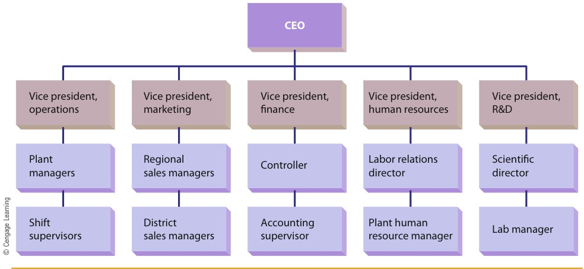
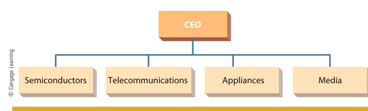
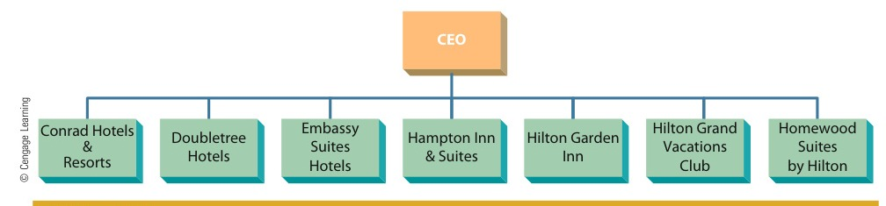
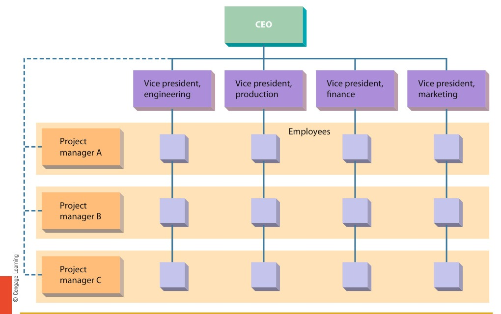

[← Previous: M04.1: Planning and Rational Decision Making](M04.1_Planning_and_Rational_Decision_Making.md) | [🏠 Index](00_Index.md) | [Next: M04.3: Controlling Process and Steps →](M04.3_Controlling_Process_and_Steps.md)

---

# M04.2: Organizing, Departmentalization, Delegation, and Span of Control

> **Section:** Section B (CO2 · Industrial Management · Md. Rokonuzzaman Sir) | **Priority:** 🔴 Essential | **Exam Frequency:** Tested in 2023 Final (5 Marks) and 2025 IM-CT1 (2 Marks)
> **Subtopics Covered:** `M04.3` (Organizing: Meaning, Tasks, and Purposes; Departmentalization: 4 Bases F-P-C-L and Matrix Design; Delegation of Authority: 3 Steps, Barriers, Centralization vs. Decentralization; Span of Control: Tall vs. Flat Structures and 8 Determining Factors)
> **Sources:** Griffin Chapter 6 (*Organization Structure and Design*), Previous Year Questions (`2023 Q.6(c)`), 2025 IM-CT1 (`Q.10`), Raidah Class Notes (Classes 1 and 2), Topicwise Answer `M04`

## Why This Topic Matters

Organizing turns strategic plans into real work. It creates the framework that holds every enterprise together. 

In the 2023 final exam, MRI Sir tested the three elements of organizing for 5 marks. In the 2025 Class Test, he tested the tasks and purposes of organizing. Students who write vague essays lose marks quickly. To score top marks, you must define each concept clearly. You must sketch clean organizational charts. You must list the four departmentalization bases and explain the eight span factors.

---

## 📝 Key Definitions

> **Organizing:** "Determining how best to group organizational activities and resources." (Ricky W. Griffin, *Fundamentals of Management*, Chapter 1)

Organizing creates a logical structure for people, tasks, and equipment. It ensures that everyone knows their duties and reporting lines.

> **Organization Structure:** "The set of building blocks that can be used to configure an organization." (Ricky W. Griffin, *Fundamentals of Management*, Chapter 6)

Structure defines formal reporting links, departmental boundaries, and decision-making power across an enterprise.

> **Departmentalization:** "The process of grouping jobs according to some logical arrangement." (Ricky W. Griffin, *Fundamentals of Management*, Chapter 6)

Small firms let owners oversee everyone directly. As firms grow, managers must group related jobs into logical units.

> **Authority:** "Power that has been legitimized by the organization." (Ricky W. Griffin, *Fundamentals of Management*, Chapter 6)

Authority gives a manager the formal right to make decisions, allocate resources, and direct subordinates.

> **Delegation:** "The process by which managers assign a portion of their total workload to others." (Ricky W. Griffin, *Fundamentals of Management*, Chapter 6)

Delegation establishes an authority pattern between a superior and one or more subordinates.

> **Span of Management (Span of Control):** "The number of people who report to a particular manager." (Ricky W. Griffin, *Fundamentals of Management*, Chapter 6)

Span of control decides how many subordinates a manager supervises directly. It determines whether an organization is tall or flat.

> **Decentralization:** "The process of systematically delegating power and authority throughout an organization to middle- and lower-level managers." (Ricky W. Griffin, *Fundamentals of Management*, Chapter 6)

In decentralized firms, frontline managers make important operational choices quickly.

> **Centralization:** "The process of systematically retaining power and authority in the hands of higher-level managers." (Ricky W. Griffin, *Fundamentals of Management*, Chapter 6)

In centralized firms, top executives keep hold of major decisions and resource approvals.

---

## The Organizing Function: Core Tasks and Purposes

### 1. Meaning of Organizing

Organizing is the second fundamental management function in the P-O-L-C framework. After setting plans, managers organize resources. They group people and equipment together to execute those plans.

Without organizing, workers face confusion. Tasks overlap, materials get lost, and projects miss deadlines.

### 2. Purposes of Organizing

Organizing serves four primary purposes in an industrial enterprise:

1. **Defines Clear Roles and Duties:** Every worker knows their exact job tasks, targets, and reporting lines.
2. **Coordinates Enterprise Resources:** It connects human, financial, physical, and information resources smoothly.
3. **Avoids Duplication of Work:** Grouping similar tasks prevents two teams from doing the same job.
4. **Builds an Unbroken Chain of Command:** It establishes a clear line of authority from top executives down to shop-floor workers.

### 3. Four Fundamental Tasks of Organizing

Managers carry out four essential tasks during the organizing process:

1. **Identification and Division of Work:** Break the total operating workload into smaller, specialized job packages.
2. **Departmentalization:** Group related jobs into logical units like engineering, sales, or production.
3. **Assignment of Duties:** Match specific responsibilities and workstations to qualified employees.
4. **Delegation of Authority:** Give workers the formal power, budget access, and tools to complete their duties.

> [!tip] Memory Hook: **Tasks of Organizing (`I-D-A-D`)**
> Remember the acronym **I-D-A-D** for the four tasks of organizing:
> - **I**: **I**dentification and division of work
> - **D**: **D**epartmentalization of related jobs
> - **A**: **A**ssignment of specific duties
> - **D**: **D**elegation of formal authority

---

## Departmentalization: The Four Common Bases and Matrix Design

In a startup, the founder oversees all workers directly. But as sales and headcount grow, one person cannot supervise everyone.

Managers then group individual jobs into departments. Griffin identifies four classic bases: Functional, Product, Customer, and Location. Organizations can also combine them into a Matrix design.

```text
               ┌────────────────────────────────────────────────────────┐
               │           BASES OF DEPARTMENTALIZATION                 │
               └────────────────────────────────────────────────────────┘
                                           │
         ┌───────────────────┬─────────────┴──────┬───────────────────┐
         ▼                   ▼                    ▼                   ▼
    Functional            Product              Customer            Location
  (By Specialty)      (By Product Line)     (By Client Type)     (By Territory)
```

---

### 1. Functional Departmentalization

Functional departmentalization groups jobs that involve the same or similar activities. It is the most common base, especially for small to mid-sized firms.


*Figure 6.2: Functional Departmentalization Structure (Source: Griffin Ch. 6, p. 206)*

#### How Functional Departmentalization Works

The CEO oversees functional Vice Presidents. Typical areas include Operations, Marketing, Finance, Human Resources, and R&D. Each Vice President directs specialized managers and supervisors down the line.

#### Advantages of Functional Departmentalization

1. **Deep Technical Expertise:** Each department hires and trains specialists in that specific discipline.
2. **Simple Supervision:** A manager needs expertise in only one narrow skill set.
3. **Internal Coordination:** Work flows easily between specialists inside the same functional unit.

#### Disadvantages of Functional Departmentalization

1. **Slow Decision Making:** Decisions must cross multiple department boundaries, creating red tape.
2. **Narrow Departmental Silos:** Workers focus on their own department goals and lose sight of the entire business.
3. **Difficult Accountability:** Pinpointing failure is hard. If a product fails, marketing blames production, and production blames engineering.

*Industrial Example:* An electronics design firm groups its staff into Hardware Design, Firmware Coding, Quality Testing, and Finance.

---

### 2. Product Departmentalization

Product departmentalization groups and arranges activities around specific products or product lines. Large multidivisional businesses use this design widely.


*Figure 6.3: Product Departmentalization Structure (Source: Griffin Ch. 6, p. 207)*

#### How Product Departmentalization Works

The CEO oversees distinct product divisions. For example, Samsung groups operations into Semiconductors, Telecommunications, Appliances, and Media. Each division operates with dedicated functional support.

#### Advantages of Product Departmentalization

1. **Tight Product Integration:** All activities for one product line stay closely linked.
2. **Fast Decision Speed:** Division heads make quick decisions without waiting for external departments.
3. **Clear Profit Accountability:** Management can evaluate the sales and profits of each product line easily.

#### Disadvantages of Product Departmentalization

1. **Duplicated Overhead Costs:** Every product division hires its own accountants, market researchers, and HR staff.
2. **Narrow Product Focus:** Division managers focus only on their own product line, ignoring company-wide goals.

*Industrial Example:* Bangladeshi electronics manufacturer Walton organizes operations into separate divisions for Refrigerators, Air Conditioners, Televisions, and Mobile Devices.

---

### 3. Customer Departmentalization

Customer departmentalization groups activities to interact with specific customer groups or market segments.


*Figure 6.4: Customer Departmentalization Structure at Hilton Hotels (Source: Griffin Ch. 6, p. 208)*

#### How Customer Departmentalization Works

The enterprise tailors separate units to distinct client categories. For example, commercial banks set up separate loan desks for retail consumers, business corporations, mortgages, and agricultural clients. Similarly, Hilton Hotels divides its operations into luxury brands (Conrad), suites (Embassy Suites), and budget travel (Hampton Inn).

#### Advantages of Customer Departmentalization

1. **Tailored Customer Service:** Skilled specialists handle the unique needs of each client category.
2. **High Customer Satisfaction:** Clients deal with staff who understand their specific requirements.

#### Disadvantages of Customer Departmentalization

1. **High Administrative Overhead:** The firm needs extra managers to integrate policies across all customer departments.
2. **Resource Duplication:** Marketing and support staff exist separately in each client group.

*Industrial Example:* Telecom operators like Grameenphone divide business accounts into Enterprise Corporate Solutions, Mass Retail Consumers, and Government Accounts.

---

### 4. Location Departmentalization

Location departmentalization groups jobs on the basis of defined geographical territories, regions, or physical sites.

#### How Location Departmentalization Works

The organization creates semi-autonomous branches across geographic zones. Sites can range from city blocks to whole countries. Transportation firms, police precincts, and national utilities rely heavily on location groupings.

#### Advantages of Location Departmentalization

1. **Local Market Responsiveness:** Regional teams adapt quickly to local customer habits, language, and culture.
2. **Fast Regional Logistics:** Local offices manage local supply chains and environmental factors directly.

#### Disadvantages of Location Departmentalization

1. **Large Administrative Staff:** The firm requires regional directors and local administrative teams in every location.
2. **Coordination Challenges:** Top management struggles to maintain uniform operating standards across scattered regional sites.

*Industrial Example:* An electric power utility organizes its maintenance crews into Dhaka North, Dhaka South, Rajshahi, and Chittagong zones.

---

### 5. Matrix Organization Design

A matrix organization structure overlays a product or project design onto an existing functional hierarchy.


*Figure 6.5: Matrix Organization Structure Combining Functional and Project Lines (Source: Griffin Ch. 6, p. 209)*

#### How Matrix Organization Works

In a matrix structure, two distinct chains of command exist at the same time:

- **Vertical Hierarchy:** Functional Vice Presidents (Engineering, Production, Finance, Marketing) run ongoing technical departments.
- **Horizontal Flow:** Project Managers (Project A, Project B, Project C) direct specific cross-functional programs.
- **Dual Reporting:** Employees report to two bosses at once. They report to their functional manager for technical development. They report to their project manager for daily project execution.

#### Advantages of Matrix Design

1. **High Flexibility:** The enterprise can assign technical experts to urgent projects quickly.
2. **Strong Team Motivation:** Employees collaborate directly across disciplinary lines.
3. **Broad Skill Development:** Technical specialists gain valuable project management and business experience.

#### Disadvantages of Matrix Design

1. **Dual Command Conflict:** Violates the classical unity of command principle. Employees often face conflicting orders from two bosses.
2. **High Meeting Overhead:** Managers spend excess time coordinating schedules, resolving disputes, and sharing resources.

*Industrial Example:* An aerospace engineering contractor builds a satellite communication payload. It assigns RF engineers, embedded programmers, and thermal specialists to Project Team A under a dedicated Project Director.

---

### Master Comparison Table of Departmentalization Bases

| Base | Primary Grouping Basis | Key Strength | Major Weakness | Typical Tech Example |
| :--- | :--- | :--- | :--- | :--- |
| **Functional** | Core business function | Deep technical expertise | Departmental silos and slow decisions | Hardware startup with Engineering, Sales, and Finance |
| **Product** | Product line or service | Clear profit accountability | High cost from duplicated staff | Walton consumer goods (AC, Fridge, TV) |
| **Customer** | Client segment or category | Tailored customer handling | High administrative coordination cost | Telecom corporate vs retail divisions |
| **Location** | Geographic area or territory | Fast local responsiveness | Hard to keep uniform standards | Power grid regional maintenance circles |
| **Matrix** | Function plus project overlay | High operational flexibility | Dual boss conflict and role ambiguity | Defense aerospace satellite project |

> [!tip] Memory Hook: **The F-P-C-L Acronym**
> Remember **F-P-C-L** to recall the four classic bases:
> - **F**: **F**unctional (Grouping by technical specialty)
> - **P**: **P**roduct (Grouping by product line)
> - **C**: **C**ustomer (Grouping by client segment)
> - **L**: **L**ocation (Grouping by geographic region)

---

## Delegation of Authority: Process, Barriers, and Distribution

Managers cannot complete all organizational work by themselves. They must delegate.

Authority is legitimized power. Delegation establishes a formal pattern of authority between a manager and subordinates.

---

### 1. The Three-Step Delegation Process

The delegation process moves through three clear, sequential steps:

```text
┌─────────────────────────┐      ┌─────────────────────────┐      ┌─────────────────────────┐
│ 1. ASSIGN               │      │ 2. GRANT                │      │ 3. CREATE               │
│    RESPONSIBILITY       │ ───> │    AUTHORITY            │ ───> │    ACCOUNTABILITY       │
│ Manager assigns a task  │      │ Manager gives resources │      │ Subordinate accepts     │
│ and duties to worker    │      │ and official power      │      │ obligation for results  │
└─────────────────────────┘      └─────────────────────────┘      └─────────────────────────┘
```

1. **Assigning Responsibility:** The manager gives a specific job or project to a subordinate. For example, a chief engineer instructs a junior engineer to design a microinverter circuit.
2. **Granting Authority:** The manager provides the official right, power, and resources to do the job. The junior engineer receives budget access, component requisition rights, and lab access.
3. **Creating Accountability:** The subordinate accepts the obligation to carry out the assigned duty. The worker must complete the task on schedule and report progress.

> [!important] The Delegation Paradox: Ultimate Accountability
> While a manager can delegate authority and responsibility, **the manager cannot delegate ultimate accountability**. 
> If the subordinate fails, top leadership holds the delegating manager responsible. As the popular saying states: *"The buck stops here."*

---

### 2. Barriers to Effective Delegation

In many companies, delegation breaks down. Barriers come from both managers and subordinates.

#### Managerial Barriers

1. **Reluctance to Let Go:** Some managers believe they can do the task better and faster themselves.
2. **Lack of Trust in Subordinates:** Managers doubt the competence or reliability of their team members.
3. **Fear of Being Outshined:** Insecure managers fear that a skilled subordinate will replace them.
4. **Poor Communication:** Managers fail to state task goals, guidelines, and authority limits clearly.

#### Subordinate Barriers

1. **Fear of Failure and Criticism:** Subordinates worry about making mistakes and receiving blame.
2. **Lack of Self-Confidence:** Workers doubt their own technical abilities.
3. **Lack of Incentives:** Subordinates resist taking on extra workload if they receive no extra pay, praise, or promotion.
4. **Information Deficits:** Workers lack the training or data required to handle the new duty.

---

### 3. Decentralization vs. Centralization

Delegation happens between individual people. Decentralization and centralization describe how authority spreads across the entire enterprise.

- **Decentralization:** Power and authority are systematically pushed down to middle and lower managers.
- **Centralization:** Power and authority are systematically kept at the top executive level.

Decentralization and centralization form two ends of a continuous spectrum:

```text
CENTRALIZED                                                   DECENTRALIZED
◄─────────────────────────────────────────────────────────────────────────►
Top management makes                                  Lower-level managers make
all operational calls                                 direct operational calls
(e.g., Walmart, McDonald's)                           (e.g., General Electric, J&J)
```

#### Determinants of Centralization and Decentralization

Four main factors decide where a company sits on this spectrum:

1. **External Environmental Uncertainty:** Fast-changing, complex markets require decentralization. Frontline managers need authority to react immediately.
2. **Organization Size and History:** Large organizations tend to decentralize to prevent executive bottlenecks. Also, firms follow past habits.
3. **Cost and Risk of Decisions:** High-cost decisions push firms toward centralization. A \$50 million capital purchase requires board approval, while a \$500 tool purchase does not.
4. **Competence of Lower-Level Managers:** When frontline supervisors have strong skills, top managers feel comfortable decentralizing authority.

#### Comparison Table: Centralization vs. Decentralization

| Dimension | Centralized Organization | Decentralized Organization |
| :--- | :--- | :--- |
| **Decision Level** | Top-level executives | Middle and first-line managers |
| **Speed of Action** | Slow, bureaucratic approvals | Fast, flexible frontline decisions |
| **Operational Burden** | Top executives face overload | Workload spreads across all tiers |
| **Worker Morale** | Lower; employees feel micromanaged | Higher; employees enjoy autonomy |
| **Control and Consistency** | Uniform rules across all units | Potential inconsistency across units |
| **Real-World Examples** | McDonald's, Walmart | General Electric, Johnson & Johnson |

---

## Span of Control and Organizational Height

Span of management (or span of control) refers to the number of people who report directly to a particular manager.

Span size directly determines the shape and height of the organizational pyramid.

---

### 1. Tall vs. Flat Organizations

Organizations configure their reporting levels into either tall or flat structures:

```text
      TALL STRUCTURE (Narrow Span)                   FLAT STRUCTURE (Wide Span)
                  [CEO]                                         [CEO]
                 /     \                                 /    /   |   \    \
              [VP1]   [VP2]                            [M1] [M2] [M3] [M4] [M5]
              /   \   /   \                              │    │   │    │    │
            [M1] [M2] [M3] [M4]                       [Operating Employees Reporting Directly]
            /  \ /  \ /  \ /  \
           [Operating Employees]
```

#### Tall Organization (Narrow Span)

In a tall organization, each manager supervises only a few subordinates. This arrangement creates many hierarchical tiers.

- **Strengths:** Managers maintain tight control and close personal supervision. Subordinates receive detailed feedback.
- **Weaknesses:** High administrative cost due to many managerial salaries. Communication moves slowly through multiple layers. Information gets distorted along the way.

#### Flat Organization (Wide Span)

In a flat organization, each manager supervises many subordinates. This arrangement creates very few hierarchical tiers.

- **Strengths:** Low overhead costs because the firm employs fewer managers. Information travels quickly between executives and frontline staff. Employees enjoy higher autonomy and morale.
- **Weaknesses:** Managers face heavy supervisory workloads. They risk losing track of daily operational details.

#### Comparison Table: Tall vs. Flat Structures

| Parameter | Tall Organization | Flat Organization |
| :--- | :--- | :--- |
| **Span of Management** | Narrow (few workers per boss) | Wide (many workers per boss) |
| **Hierarchical Levels** | Many vertical tiers | Few vertical tiers |
| **Administrative Overhead** | High (many managerial salaries) | Low (fewer managers needed) |
| **Communication Speed** | Slower; messages get delayed and distorted | Faster; direct link from top to bottom |
| **Manager Workload** | Low supervisory burden per manager | High supervisory and coordination load |
| **Employee Morale** | Lower; strict supervision limits initiative | Higher; workers enjoy autonomy and trust |
| **Modern Trend** | Decreasing in favor of delayering | Increasing due to modern communication tools |

---

### 2. Eight Factors Determining the Optimal Span of Control

There is no single magic number for the perfect span of control. Griffin outlines eight operational factors that determine whether a manager should have a wide or narrow span:

1. **Competence of Staff:** Highly skilled workers need little supervision. This allows a **wide span**. Inexperienced workers need a **narrow span**.
2. **Physical Dispersion:** When workers operate in one room, supervision is easy, allowing a **wide span**. Dispersed field sites require a **narrow span**.
3. **Nonsupervisory Workload:** If a manager has heavy nonsupervisory work, they have less time for supervision. This requires a **narrow span**.
4. **Degree of Required Interaction:** Tasks that demand constant personal communication require a **narrow span**.
5. **Standardized Procedures (SOPs):** Clear written rules and checklists let workers operate independently. This allows a **wide span**.
6. **Similarity of Tasks:** When workers perform identical tasks, a manager can oversee a **wide span**. Diverse tasks need a **narrow span**.
7. **Frequency of New Problems:** In stable operations, problems rarely occur, supporting a **wide span**. Dynamic environments need a **narrow span**.
8. **Communication Technology:** Tools like email, chat apps, and automated dashboards allow managers to coordinate a **wide span** easily.

> [!tip] Memory Hook: **8 Span Factors (`C-D-N-I-S-T-P-T`)**
> Remember these eight trigger words:
> - **C**: **C**ompetence of workers
> - **D**: **D**ispersion of physical work sites
> - **N**: **N**onsupervisory duties of manager
> - **I**: **I**nteraction frequency required
> - **S**: **S**tandard operating procedures (SOPs)
> - **T**: **T**ask similarity
> - **P**: **P**roblem novelty and frequency
> - **T**: **T**echnology for communication

---

## Exam Variants

The table below summarizes past exam questions and high-yield variations on organizing:

| Year / Source | Exam Question Summary | Marks | Core Focus / Key Takeaway |
| :--- | :--- | :---: | :--- |
| **2023 Final Q.6(c)** | Discuss Departmentalization, Delegation of authority, and Span of control | 05 | Core elements of organizing; define and explain all three with practical examples |
| **2025 IM-CT1 Q.10** | Write the tasks and purposes of organizing | 02 | Clear separation of organizing purposes (why) and tasks (what actions managers take) |
| **Griffin Ch. 6 Model Q.1** | Four bases of departmentalization with organizational diagrams | 05 | Functional, Product, Customer, Location plus Matrix; strengths and trade-offs |
| **Griffin Ch. 6 Model Q.2** | 3-step delegation process and managerial vs. subordinate barriers | 04 | Assigning responsibility, granting authority, creating accountability, and overcoming barriers |
| **Griffin Ch. 6 Model Q.3** | Tall vs. Flat structures and 8 factors determining span of control | 05 | Contrast tall/flat pyramids; explain 8 factors that justify wide vs. narrow spans |

---

## 🏆 Golden Questions (Past Exam Archive & Model Answers)

### 🎯 GQ1 · 2023 Final Q.6(c) · Elements of Organizing (05 Marks)

> **Appeared:** 2023 Final Examination · Question 6(c) · (05 Marks) · Section B · CO2

**Question:**
Discuss the following elements of organizing:  
(i) Departmentalization  
(ii) Delegation of authority  
(iii) Span of control

**Full Answer:**

Organizing is the management process of grouping activities and resources into a logical framework (Ricky W. Griffin). The three fundamental elements of organizing are:

#### GQ1.1 · (i) Departmentalization

Departmentalization is the process of grouping jobs into logical units or departments as an enterprise expands.

The four primary bases of departmentalization are:

1. **Functional Departmentalization:** Grouping jobs by organizational function, such as Engineering, Operations, Marketing, and Finance.
   - *Advantage:* High technical expertise and straightforward supervision.
   - *Disadvantage:* Slower cross-functional decisions; departments focus on their own goals rather than corporate success.
2. **Product Departmentalization:** Grouping activities around specific products or product lines. For example, Walton organizes divisions into refrigerators, ACs, and mobile phones.
   - *Advantage:* Direct coordination of product activities and clear profit accountability.
   - *Disadvantage:* High administrative costs from duplicating functional staff across product lines.
3. **Customer Departmentalization:** Grouping activities to interact with distinct customer segments. For example, telecom operators divide sales into corporate accounts, retail consumers, and government bodies.
   - *Advantage:* Tailored service delivery matching specific client needs.
   - *Disadvantage:* Large administrative overhead to coordinate separate client programs.
4. **Location (Geographical) Departmentalization:** Grouping jobs by defined geographic territories (e.g., power utilities divided into Dhaka, Rajshahi, and Chittagong zones).
   - *Advantage:* Quick responsiveness to regional market conditions and local laws.
   - *Disadvantage:* Requires duplicate managerial staff in each location.

#### GQ1.2 · (ii) Delegation of Authority

Delegation is the process by which managers assign a portion of their total workload and power to subordinates. Authority is power legitimized by the organization.

The delegation process involves three sequential steps:

1. **Assigning Responsibility:** The manager assigns a specific duty to a subordinate. For example, directing an engineer to design a power supply.
2. **Granting Authority:** The manager provides the formal power, budget access, and resources needed to complete the task.
3. **Creating Accountability:** The subordinate accepts the obligation to perform the task. 

*Key Rule:* While a manager delegates authority and responsibility, the manager retains ultimate accountability for the final outcome.

*Barriers to Delegation:*
- *Manager barriers:* Reluctance to let go of control ("I can do it better myself"). Also, fearing competition and lacking trust in subordinates.
- *Subordinate barriers:* Fear of failure, lack of self-confidence, and absence of extra rewards for taking on extra work.

#### GQ1.3 · (iii) Span of Control

Span of control (or span of management) refers to the number of people who report directly to a particular manager. It determines the height of an organization:

- **Tall Structure (Narrow Span):** Few subordinates report to each manager, creating many hierarchical tiers.
  - *Strength:* Close supervision and tight quality control.
  - *Weakness:* High executive salary costs and slow communication through multiple levels.
- **Flat Structure (Wide Span):** Many subordinates report to each manager, creating few hierarchical tiers.
  - *Strength:* Lower overhead costs, faster decision making, and higher employee autonomy.
  - *Weakness:* Managers face heavy supervisory workloads and may lose track of operational details.

*Factors Determining Span Size:* Key factors include worker competence, task standardization (SOPs), physical dispersion, task similarity, and modern communication tools.

---

### 🎯 GQ2 · 2025 IM-CT1 Q.10 · Tasks and Purposes of Organizing (02 Marks)

> **Appeared:** 2025 Class Test 1 (Industrial Management) · Question 10 · (02 Marks) · CO2

**Question:**
Write the tasks and purposes of organizing.

**Full Answer:**

#### GQ2.1 · Purposes of Organizing

The purposes of organizing explain why the management function is needed:

1. **Role Clarity:** To establish a clear internal framework where roles, duties, and accountability are clearly defined.
2. **Resource Coordination:** To connect human, financial, and physical resources and avoid duplication of work.
3. **Chain of Command:** To build clean reporting relationships and an unbroken line of formal authority.

#### GQ2.2 · Tasks of Organizing

The tasks of organizing describe the specific actions managers carry out:

1. **Identification and Division of Work:** Breaking down the total operational workload into manageable, specialized tasks.
2. **Departmentalization:** Grouping similar jobs into logical units (functional, product, customer, or geographical).
3. **Assignment of Duties:** Allocating specific work responsibilities to qualified personnel.
4. **Delegation of Authority:** Granting managers and subordinates the formal power and resources to make decisions and carry out their duties.

---

### 🎯 GQ3 · Model Exam Question 1 · Bases of Departmentalization and Matrix Design (05 Marks)

> **Appeared:** Griffin Chapter 6 Model Exam Question · (05 Marks) · CO2

**Question:**
Explain the four common bases of departmentalization. How does a matrix organization structure differ from classic departmentalization? Support your answer with organizational diagrams.

**Full Answer:**

Departmentalization is the process of grouping jobs into logical units as an organization expands (Ricky W. Griffin).

#### GQ3.1 · The Four Common Bases of Departmentalization

##### A. Functional Departmentalization Base
Groups jobs involving the same or similar activities (Operations, Marketing, Finance, HR, R&D).


*Figure 6.2: Functional Departmentalization Structure (Source: Griffin Ch. 6, p. 206)*

- *Pros:* High technical specialization, easy supervision within the department.
- *Cons:* Slow cross-functional decisions, narrow departmental silos.

##### B. Product Departmentalization Base
Groups jobs around specific products or product families (e.g., Semiconductors, Telecommunications, Appliances, Media).


*Figure 6.3: Product Departmentalization Structure (Source: Griffin Ch. 6, p. 207)*

- *Pros:* Direct coordination of product activities, clear profit and loss accountability.
- *Cons:* Duplication of administrative and functional personnel increases costs.

##### C. Customer Departmentalization Base
Groups activities to interact with distinct customer categories (e.g., luxury, business, and budget hotel guests).


*Figure 6.4: Customer Departmentalization Structure at Hilton Hotels (Source: Griffin Ch. 6, p. 208)*

- *Pros:* Tailored services that match specific customer segment requirements.
- *Cons:* High overhead required to coordinate multiple customer divisions.

##### D. Location Departmentalization Base
Groups activities on the basis of defined geographical regions or territories.
- *Pros:* Rapid adaptation to local consumer preferences, regional laws, and logistics.
- *Cons:* Requires duplicate management teams across scattered geographic sites.

#### GQ3.2 · Matrix Organization Structure

A matrix structure overlays a horizontal project management structure onto a vertical functional hierarchy.


*Figure 6.5: Matrix Organization Structure Combining Functional and Project Lines (Source: Griffin Ch. 6, p. 209)*

##### Distinct Traits of Matrix Design

1. **Dual Command:** Classic departmentalization follows unity of command (one employee, one boss). The matrix design uses dual reporting. Employees report to both a functional manager and a project manager.
2. **Resource Sharing:** Specialists remain in their permanent functional home while temporarily joining project teams.
3. **Flexibility:** When a project ends, employees rotate to a new assignment without restructuring the entire company.
4. **Trade-off:** The matrix offers high flexibility, but dual reporting often creates authority conflicts and role ambiguity.

---

### 🎯 GQ4 · Model Exam Question 2 · Delegation Process, Barriers, and Centralization (04 Marks)

> **Appeared:** Griffin Chapter 6 Model Exam Question · (04 Marks) · CO2

**Question:**
Outline the three steps of the delegation process. Why do managers often fail to delegate? Distinguish between centralization and decentralization.

**Full Answer:**

#### GQ4.1 · The Three Steps of Delegation

Delegation is the process by which managers assign a portion of their workload to subordinates:

1. **Assigning Responsibility:** The manager assigns a task to a subordinate.
2. **Granting Authority:** The manager provides official power, resources, and decision rights to complete the task.
3. **Creating Accountability:** The subordinate accepts the obligation to perform the work. The delegating manager retains ultimate accountability for overall results.

#### GQ4.2 · Barriers to Delegation

Managers often fail to delegate due to three main reasons:

- **Reluctance to Relinquish Control:** The manager believes nobody can do the work as well as they can.
- **Insecurity and Fear of Competition:** The manager fears that a capable subordinate will outperform them and threaten their job.
- **Lack of Trust:** The manager doubts the skill, reliability, and commitment of team members.

Subordinates also resist delegation when they fear failure, lack self-confidence, or receive no incentives for extra work.

#### GQ4.3 · Centralization vs. Decentralization

- **Centralization:** Systematic retention of decision-making power and authority at the top executive level (e.g., Walmart, McDonald's).
- **Decentralization:** Systematic delegation of power down to middle- and lower-level managers throughout the firm (e.g., General Electric, Johnson & Johnson).

Firms facing dynamic, unpredictable markets decentralize to enable rapid frontline response. Firms making high-risk, expensive capital decisions tend to centralize.

---

### 🎯 GQ5 · Model Exam Question 3 · Tall vs. Flat Organizations and Span of Control Factors (05 Marks)

> **Appeared:** Griffin Chapter 6 Model Exam Question · (05 Marks) · CO2

**Question:**
Compare tall and flat organizational structures. Describe the factors that determine whether an organization should adopt a wide or narrow span of control.

**Full Answer:**

#### GQ5.1 · Comparison of Tall and Flat Organizations

Span of control refers to the number of subordinates who report directly to a manager. It determines the height of an organizational structure:

| Parameter | Tall Structure (Narrow Span) | Flat Structure (Wide Span) |
| :--- | :--- | :--- |
| **Span Size** | Narrow (few subordinates per manager) | Wide (many subordinates per manager) |
| **Hierarchical Layers** | Many vertical tiers | Few vertical tiers |
| **Administrative Cost** | High (many managerial salaries) | Low (fewer managers needed) |
| **Communication Speed** | Slow; messages get distorted across tiers | Fast; direct link from top to bottom |
| **Manager Workload** | Low supervisory burden per manager | High supervisory and coordination load |
| **Employee Initiative** | Lower; close supervision limits autonomy | Higher; employee empowerment and trust |

#### GQ5.2 · Factors Determining the Optimal Span of Control

Griffin identifies eight operational factors that determine span size:

1. **Competence of Staff:** High employee competence allows a **wide span**. Inexperienced staff require a **narrow span**.
2. **Physical Dispersion:** Workers in one location support a **wide span**. Dispersed field locations require a **narrow span**.
3. **Nonsupervisory Duties:** If a manager has extensive personal duties (budgeting, planning), they require a **narrow span**.
4. **Required Interaction:** Tasks that need frequent personal communication require a **narrow span**.
5. **Standard Operating Procedures (SOPs):** Clear rules, manuals, and checklists allow a **wide span**.
6. **Task Similarity:** Supervised employees doing identical routine tasks allow a **wide span**. Diverse tasks need a **narrow span**.
7. **Frequency of New Problems:** Stable environments with few unexpected issues support a **wide span**. Highly dynamic, problem-heavy operations need a **narrow span**.
8. **Communication Technology:** Tools like email, instant messaging, and automated dashboards allow managers to oversee a **wide span** effectively.

---

## ⚡ Exam Tips & Common Mistakes

1. **Do Not Confuse Tasks and Purposes:** Purposes answer *why* we organize (role clarity, resource coordination). Tasks answer *what actions* managers perform (work division, departmentalization, assigning duties, delegating authority).
2. **State the Ultimate Accountability Rule:** Always mention that while managers delegate authority and responsibility, they cannot delegate ultimate accountability. Top leadership still holds the manager responsible.
3. **Memorize the F-P-C-L Acronym:** Remember Functional, Product, Customer, and Location for departmentalization. Always mention the trade-offs of each base.
4. **Draw the Tall vs. Flat Pyramids:** A quick pyramid sketch takes 30 seconds. It shows the examiner that you understand structural height.
5. **Cite the 8 Span Factors by Name:** When asked about span of control, list all eight Griffin factors. Use clear bold headings. This guarantees full marks.

---

## 🔗 Related Topics

- [M01.3: Management Functions (P-O-L-C) and Leadership](M01.3_Management_Functions_POLC_and_Leadership.md)
- [M02.1: Management Levels and Functional Areas](M02.1_Management_Levels_and_Functional_Areas.md)
- [M03.1: Fayol's 14 Principles and Scalar Chain](M03.1_Fayols_14_Principles_and_Scalar_Chain.md)
- [M04.1: Planning and Rational Decision Making](M04.1_Planning_and_Rational_Decision_Making.md)
- [M04.3: Controlling Process and Steps](M04.3_Controlling_Process_and_Steps.md)

---

[← Previous: M04.1: Planning and Rational Decision Making](M04.1_Planning_and_Rational_Decision_Making.md) | [🏠 Index](00_Index.md) | [Next: M04.3: Controlling Process and Steps →](M04.3_Controlling_Process_and_Steps.md)
