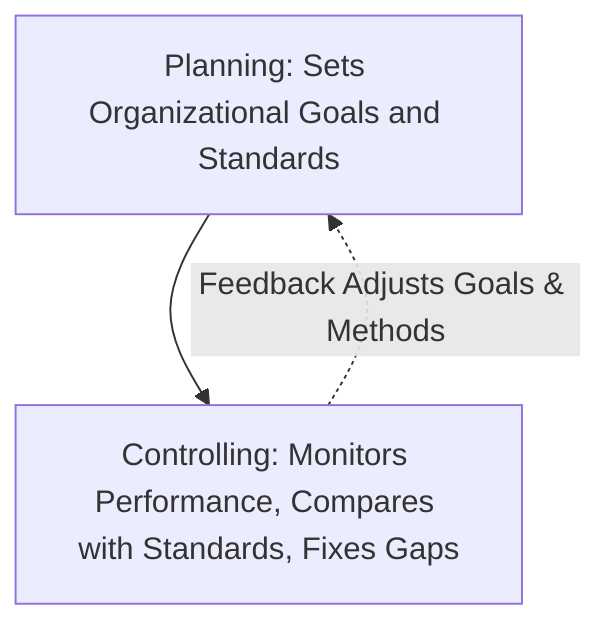
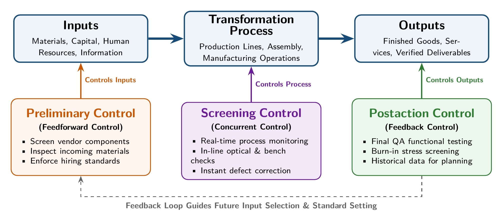
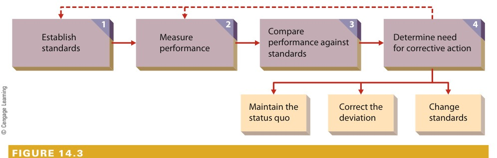
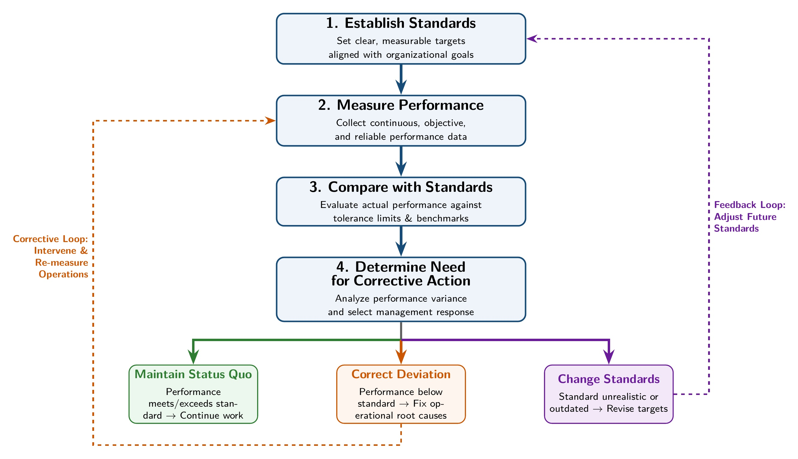
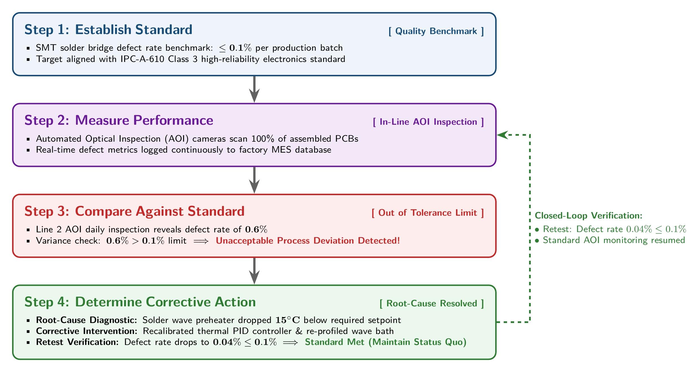
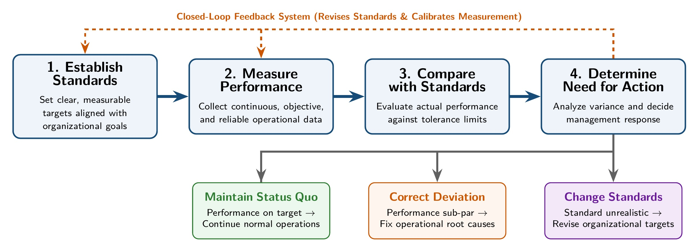
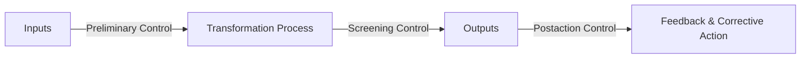

[← Previous: M04.2: Organizing, Departmentalization, Delegation, and Span](M04.2_Organizing_Departmentalization_Delegation_and_Span.md) | [🏠 Index](00_Index.md) | [Next: M05.1: Motivation Basics and Financial vs. Non-Financial →](M05.1_Motivation_Basics_and_Financial_vs_NonFinancial.md)

---

# M04.3: Controlling: Purpose, Types, and the Control Process

> **Section:** Section B (CO2 · Industrial Management · Dr. Md. Rabiul Islam Sir) | **Priority:** 🔴 Essential | **Exam Frequency:** Tested in 2021 Final Q.2(b) (06m)
> **Subtopics Covered:** `M04.4` (Controlling: Meaning and Nature, Four Core Purposes, Types and Levels of Control, and Four Steps of the Controlling Process)
> **Sources:** Griffin Chapter 14 (*Basic Elements of Control*), MRI Sir Lectures, Topicwise Answer `M04_Planning_Decisions_Organizing_Control.md`, Previous Year Questions (`2021 Q.2(b)`)

## Why This Topic Matters

Controlling is the final phase of the P-O-L-C management cycle. It ensures that work matches plans. Without control, managers cannot know if their projects succeed.

Examiners frequently ask for the definition of control and its four steps. Students often lose easy marks by forgetting the three corrective action paths. You will also score higher marks by including the feedback loop and a concrete engineering example.

---

## 📝 Key Definitions

> **Control:** "The regulation of organizational activities in such a way as to facilitate goal attainment." (Ricky W. Griffin, *Fundamentals of Management*, Chapter 14)

In plain words, control acts like a ship's rudder. It keeps the organization moving in the right direction. It compares actual performance with planned targets. If work drifts off course, control provides the tools to correct it.

> **Control Standard:** "A target against which subsequent performance will be compared." (Ricky W. Griffin, Chapter 14)

A standard is an objective benchmark. Examples include producing 500 circuit boards per shift or keeping network latency below 20 milliseconds.

---

## Core Theory: Nature and Purposes of Organizational Control

Planning sets the goals. Controlling makes sure the organization achieves those goals. If managers could predict the future perfectly, control would not be necessary. But real business environments face constant disruption.

### The Four Purposes of Control

Griffin identifies four core purposes of organizational control:

1. **Adapting to Environmental Change:**
   - Business markets, customer tastes, and technologies shift quickly.
   - Control systems help managers track these changes and adjust operations.
   - *Example:* A metal casting supplier satisfied a 99.7% quality rate. But its Japanese automotive client demanded near perfection. Control helped the supplier raise its quality targets.

2. **Limiting the Accumulation of Error:**
   - Small daily errors do not look dangerous at first.
   - But small mistakes compound over time into massive financial losses.
   - *Example:* A radar detector factory ignored minor defects during high demand. The defect rate rose from 4% to 25%. Soon, 100 out of 250 workers were busy fixing broken units. Early quality control prevents this waste.

3. **Coping with Organizational Complexity:**
   - A growing firm buys diverse materials, makes many products, and hires thousands of staff.
   - A single manager cannot watch every task directly.
   - Systematic controls allow top managers to track multiple facilities from central dashboards.

4. **Minimizing Costs and Waste:**
   - Effective control cuts scrap, reduces labor idle time, and stops unnecessary spending.
   - It keeps operating expenses within budget limits.
   - *Example:* Automated inventory tracking alerts engineers before raw parts run out. This stops costly assembly line shutdowns.

> [!tip] Memory Hook: **A-L-C-M** (The Four Purposes of Control)
> Remember the acronym **A-L-C-M** to recall the four purposes:
> - **A:** **A**dapt to environmental change.
> - **L:** **L**imit the accumulation of error.
> - **C:** **C**ope with organizational complexity.
> - **M:** **M**inimize operating costs and waste.

---

## Classification and Types of Organizational Control

Organizations apply control at multiple operational stages, structural levels, and resource areas.

### 1. Types of Control by Timing (Operations Control)

Operations control focuses on transformation processes. Managers apply control at three distinct points:

*Figure 1: Operations Control Pipeline: Preliminary, Screening, and Postaction Control Points (Source: Griffin Ch. 14, p. 464)*

1. **Preliminary Control (Feedforward Control):**
   - Focuses on inputs before they enter the organization.
   - It checks materials, hiring standards, and capital before work starts.
   - *Example:* An electronics factory tests incoming microchips from vendors before placing them in the warehouse.

2. **Screening Control (Concurrent Control):**
   - Focuses on work during the transformation process.
   - It relies heavily on immediate feedback to catch errors on the spot.
   - *Example:* Technicians inspect circuit boards after wave soldering. If solder bridges appear, they adjust the solder wave temperature right away.

3. **Postaction Control (Feedback Control):**
   - Focuses on finished outputs after production ends.
   - It ensures final products meet customer standards before shipping.
   - It also provides historical data to plan future production runs.
   - *Example:* Running a final 24-hour burn-in stress test on assembled power supply units.

#### Comparison of the Three Timing Controls

| Dimension | Preliminary Control | Screening Control | Postaction Control |
| :--- | :--- | :--- | :--- |
| **Point of Focus** | Inputs (raw materials, people, funds) | Transformation process (ongoing work) | Outputs (finished goods and services) |
| **Timing** | Before the activity begins | During the activity | After the activity ends |
| **Primary Goal** | Prevent problems from entering the system | Catch and fix problems during production | Verify final quality and guide future plans |
| **Key Advantage** | Saves money by rejecting bad inputs early | Spots defects before products finish | Provides clear proof of final performance |
| **Key Limitation** | Cannot catch process mistakes | Can slow down line operations | Expensive because bad units are already made |
| **Factory Example** | Screening vendor silicon wafers | Checking PCB trace soldering at each bench | Final functional testing of packed devices |

> [!tip] Memory Hook: **P-S-P** (Timing of Control)
> - **P:** **P**reliminary (Inputs · Before).
> - **S:** **S**creening (Process · During).
> - **P:** **P**ostaction (Outputs · After).

### 2. Levels of Control in Organizations

Griffin divides control into four systemic levels:

1. **Operations Control:** Focuses on production processes, equipment reliability, and product quality.
2. **Financial Control:** Focuses on monetary resources, financial statements, audits, and budgets.
3. **Structural Control:** Focuses on organizational design. It includes bureaucratic control (strict rules, top-down hierarchy) and decentralized control (employee empowerment, shared values).
4. **Strategic Control:** Focuses on high-level goals. It ensures the firm's overall strategy fits its market environment.

### 3. Areas of Control by Resource Type

Control systems also track the four basic organizational resources:

- **Physical Resources:** Inventory counts, equipment maintenance, and scrap rates.
- **Human Resources:** Hiring tests, employee training, performance appraisals, and safety compliance.
- **Information Resources:** Accurate sales forecasts, computer security, and network uptime.
- **Financial Resources:** Cash flow management, debt repayment, and expense accounts.

---

## The Four Steps in the Control Process

Control follows a logical four-step cycle. Feedback connects the final step back to the beginning.

*Figure 2: Steps in the Organizational Control Process (Source: Griffin Ch. 14, p. 461)*

*Figure 3: Four-Step Closed-Loop Organizational Control Process (Source: Griffin Ch. 14 & Operational Framework)*

### Detailed Breakdown of the Four Steps

#### Step 1: Establish Standards
- A standard is a target benchmark for future performance.
- Standards must follow organizational goals.
- Standards must be clear, objective, and measurable. For example, "keep scrap rate below 0.5%" is much better than "improve quality."
- Managers define performance indicators. These are specific operational metrics directly tied to the target.

#### Step 2: Measure Performance
- Performance measurement is an ongoing, continuous activity.
- Data collection must be valid, objective, and reliable.
- Metrics vary by task. In factory lines, managers measure unit costs, defect rates, and cycle times. In communications systems, engineers measure packet loss, bandwidth, and system uptime.

#### Step 3: Compare Performance Against Standards
- Managers compare measured performance against the standard.
- Performance can be higher than, lower than, or equal to the standard.
- Managers set an allowable tolerance range. If small differences fall inside this band, no action is needed.
- Timetables depend on task importance. High-speed routers monitor traffic every second. But managers check financial budgets monthly.

#### Step 4: Determine Need for Corrective Action
After comparing performance with the standard, managers make one of three choices:

1. **Maintain the Status Quo:**
   - Chosen when actual performance meets or exceeds the standard within tolerance.
   - The manager does nothing and lets work continue.

2. **Correct the Deviation:**
   - Chosen when performance falls below the acceptable standard.
   - The manager intervenes quickly to solve the root problem.
   - Actions include repairing broken machines, updating software, retraining staff, or adding resources.

3. **Change the standards:**
   - Management updates the standard if the original target was flawed.
   - A standard may have been set unrealistically high or too low.
   - Changing market or technical conditions also require updated standards.

#### Why the Feedback Loop Matters
Information from Step 4 feeds back into Step 1 and Step 2. If standards were unrealistic, the feedback loop prompts management to adjust them. If measurement methods were inaccurate, feedback helps technicians improve sensor accuracy.

> [!tip] Memory Hook: **S-M-C-C** (The 4 Control Steps)
> - **S:** **S**et standards.
> - **M:** **M**easure performance.
> - **C:** **C**ompare against standards.
> - **C:** **C**orrective action (Maintain, Correct, or Change).

---

## Practical Engineering Example: PCB Assembly Line Quality Control

An electronics plant produces printed circuit boards (PCBs) for smart energy meters. Here is how the four control steps operate on the shop floor:

*Figure 4: Industrial Case Study: PCB SMT Wave Soldering Quality Control Workflow (Source: ECE Practical Application)*

1. **Establish Standards:** The quality target requires a solder bridging defect rate $\le 0.1\%$ per production run.
2. **Measure Performance:** Automated Optical Inspection (AOI) cameras scan every finished board. The inspection data feeds directly into a quality database.
3. **Compare Against Standards:** The quality engineer reviews the daily inspection log. Line 2 shows a defect rate of $0.6\%$. This exceeds the allowable $0.1\%$ tolerance limit.
4. **Determine Corrective Action:** The engineer investigates Line 2 and discovers that the solder wave bath dropped $15^\circ\text{C}$ below setpoint. The technician recalibrates the thermal controller. In the next run, the defect rate falls to $0.04\%$. The team maintains the status quo.

---

## Exam Variants

| Year / Source | Question / Scenario | Marks | Key Focus / Takeaway |
| :--- | :--- | :---: | :--- |
| **2021 Q.2(b)** | What is controlling? Discuss the steps of controlling method. | 06m | Define control, state Griffin's quote, draw the 4-step flowchart, and explain each step with the 3 corrective paths. |
| **Model Q.1** | Distinguish among preliminary, screening, and postaction control with examples. | 04m | Compare input, process, and output controls with a clear table and engineering cases. |
| **Model Q.2** | Explain the four fundamental purposes of organizational control. | 04m | Explain the A-L-C-M purposes (environmental change, error accumulation, complexity, and cost minimization). |

---

## 🏆 Golden Questions (Past Exam Archive & Model Answers)

### 🎯 GQ1 · 2021 Final Q.2(b) · Meaning and Steps of the Controlling Process (06 Marks)

> **Appeared:** 2021 Final Exam Q.2(b) · (06 Marks) · Section A

**Question:**
What is controlling? Discuss the steps of controlling method.

**Full Answer:**

#### GQ1 Part 1 · Definition and Nature of Controlling

Controlling is the process of regulating organizational activities so that actual performance matches planned goals. Ricky W. Griffin defines control as:

> *"The regulation of organizational activities in such a way as to facilitate goal attainment."*

Control works like a ship's rudder. It keeps the organization moving on course. At any given time, control compares where the firm is with where it planned to be. If performance drifts outside acceptable boundaries, control provides the tools to adjust course.

#### GQ1 Part 2 · The Four Fundamental Steps of the Control Method

Control follows four interrelated steps connected by a feedback loop:

*Figure 5: Control Process Model Exam Diagram with Closed-Loop Corrective Options (Source: 2021 Final Q.2(b) Model Solution)*

##### GQ1 Step 1 · Establish Standards
- A control standard is a planned target against which future performance is measured.
- Standards must come directly from organizational goals.
- Standards must be objective and measurable (for example, achieving a defect rate $\le 0.1\%$ or shipping 1,000 units daily).
- Managers identify specific performance indicators to track.

##### GQ1 Step 2 · Measure Performance
- Performance measurement is an ongoing, continuous process.
- The measurement system must collect valid and reliable operational data.
- In manufacturing, common measures include daily output, machine downtime, and scrap percentages. In software networks, engineers measure latency and uptime.

##### GQ1 Step 3 · Compare Performance Against Standards
- Managers evaluate actual measured performance against the established standard.
- Actual performance can be higher, lower, or equal to the target.
- Managers apply an acceptable tolerance range. Small variations within this range require no action.
- Significant gaps trigger root-cause analysis.

##### GQ1 Step 4 · Determine Need for Corrective Action
Management evaluates the comparison results and chooses one of three distinct actions:
1. **Maintain the status quo:** If performance meets or exceeds standards within tolerance, no intervention is required.
2. **Correct the deviation:** If performance falls below standard, managers take corrective action. They repair machinery, retrain technicians, or optimize processes.
3. **Change the standards:** Management adjusts the target if it was set unrealistically high or low. Market shifts also demand new standards.

##### GQ1 Step 5 · The Role of the Feedback Loop
Information from Step 4 loops back to Step 1 and Step 2. This continuous loop refines future standards and improves measurement accuracy.

---

### 🎯 GQ2 · Model Exam Question · Forms of Operations Control (04 Marks)

> **Appeared:** Model Exam Question · (04 Marks) · Operational Management & Control

**Question:**
Distinguish among preliminary, screening, and postaction control with appropriate industrial examples.

**Full Answer:**

#### GQ2 Part 1 · Overview of Operations Control

Operations control monitors how an organization transforms inputs into finished products or services. It uses three basic control types based on timing:

#### GQ2 Part 2 · Comparison Table: Forms of Operations Control

| Feature | Preliminary Control | Screening Control | Postaction Control |
| :--- | :--- | :--- | :--- |
| **Point of Focus** | Inputs (raw materials, capital, staff) | In-process transformation activities | Finished goods and final outputs |
| **Operational Timing** | Before the transformation begins | During the transformation process | After production is complete |
| **Main Objective** | Prevent defects from entering the plant | Detect and correct errors on the spot | Confirm final quality and plan ahead |
| **Feedback Mechanism** | Feedforward checks on input quality | Real-time feedback during production | Historical feedback after completion |
| **Industrial Example** | Testing raw silicon wafers before processing | Inspecting PCB solder joints after wave bath | Final 48-hour functional burn-in test |
| **Key Limitation** | Does not catch assembly line mistakes | Can disrupt or slow down assembly flow | Costly if defective units are already finished |

#### GQ2 Part 3 · Why Modern Firms Combine All Three

Relying on a single control type creates blind spots:
- Postaction control alone wastes money because defective units are already built.
- Preliminary control alone misses assembly line errors.
- So world-class manufacturers like Toyota and Honda use all three controls together to ensure zero defects.

---

### 🎯 GQ3 · Model Exam Question · Four Purposes of Organizational Control (04 Marks)

> **Appeared:** Model Exam Question · (04 Marks) · Industrial Management Foundations

**Question:**
Discuss the four fundamental purposes of organizational control as outlined by Ricky W. Griffin.

**Full Answer:**

Organizations operate in unpredictable environments. Control provides four key benefits to ensure organizational survival and goal attainment:

1. **Adapting to Environmental Change:**
   - Modern business environments change rapidly. Customer preferences shift, competitors launch new features, and material prices fluctuate.
   - Control systems monitor these changes and help managers adjust plans before losses occur.
   - For instance, quality control helps a supplier meet tightening international safety standards.

2. **Limiting the Accumulation of Error:**
   - Small operational mistakes rarely damage a firm on their own.
   - However, uncorrected errors accumulate over time into catastrophic failures.
   - Small fastener defects go unchecked on an aircraft line. Later, thousands of parts need replacement. Control catches small errors immediately.

3. **Coping with Organizational Complexity:**
   - As an organization expands, it adds new product lines, physical locations, and specialized departments.
   - Top managers cannot directly supervise thousands of daily activities.
   - A structured control system gives managers clear metrics to oversee complex multi-site operations from a central dashboard.

4. **Minimizing Costs and Waste:**
   - Effective control keeps operations lean by reducing scrap, eliminating redundant labor, and lowering energy waste.
   - It ensures that every department stays within its approved budget.
   - For example, automated inventory control stops excessive holding costs and prevents stockouts.

---

## ⚡ Exam Tips & Common Mistakes

1. **Always Mention the Three Options in Step 4:** Never just say "take corrective action." Explicitly list all three paths: *Maintain status quo*, *Correct deviation*, and *Change standard*.
2. **Draw the Flowchart with the Feedback Loop:** When 2021 Q.2(b) appears, draw the 4-step flowchart. Connect Step 4 back to Step 1 and Step 2 with the dashed feedback arrow.
3. **Use Concrete Engineering Metrics:** Avoid vague phrases like "make good products." Always write real numbers like defect rate $\le 0.1\%$ or network latency $< 20\text{ ms}$. Examiners award full marks for real engineering examples.
4. **Do Not Confuse Screening and Postaction Control:** Screening happens *during* transformation. Postaction happens *after* transformation is completely finished.

---

## 🔗 Related Topics

- [M01.3: Management Functions (P-O-L-C) and Leadership](M01.3_Management_Functions_POLC_and_Leadership.md)
- [M04.1: Planning and Rational Decision Making](M04.1_Planning_and_Rational_Decision_Making.md)
- [M04.2: Organizing, Departmentalization, Delegation, and Span](M04.2_Organizing_Departmentalization_Delegation_and_Span.md)
- [M05.1: Motivation Basics and Financial vs. Non-Financial](M05.1_Motivation_Basics_and_Financial_vs_NonFinancial.md)

---

[← Previous: M04.2: Organizing, Departmentalization, Delegation, and Span](M04.2_Organizing_Departmentalization_Delegation_and_Span.md) | [🏠 Index](00_Index.md) | [Next: M05.1: Motivation Basics and Financial vs. Non-Financial →](M05.1_Motivation_Basics_and_Financial_vs_NonFinancial.md)
