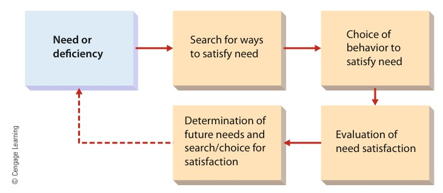

[← Previous: M04.3: Controlling Process and Steps](M04.3_Controlling_Process_and_Steps.md) | [🏠 Index](00_Index.md) | [Next: M05.2: Maslow's Hierarchy and Herzberg's Two-Factor Theory →](M05.2_Maslow_Hierarchy_and_Herzberg_Two_Factor_Theory.md)

---

# M05.1: Motivation Basics, Framework, and Financial vs. Non-Financial Rewards

> **Section:** Section B (CO2 · Industrial Management · Md. Rokonuzzaman Sir) | **Priority:** 🔴 Essential | **Exam Frequency:** Tested in 2020, 2021, 2023, and 2024 (Every Final Paper!)
> **Subtopics Covered:** `M05.1` (Employee Motivation Nature and Definition, The Motivation Framework, Performance Determinants $P = M \times A \times E$, Organizational Importance), `M05.5` (Financial and Non-Financial Sources of Motivation)
> **Sources:** Griffin Chapter 10 Part 1 & Part 2, MRI Sir Lecture Notes, Raidah Class Notes (Class 8), Topicwise Answer `M05_Motivation.md`, Previous Year Questions (`2020 Q.2(a)`, `2021 Q.3(a)`, `2021 Q.3(c)`, `2023 Q.8(a)`, `2024 Q.2(b)`)

## Why This Topic Matters

Employee motivation appears in every single RUET final exam paper. It is one of the highest-scoring topics in industrial management.

To get full marks, memorize Ricky W. Griffin's definition and the performance equation $P = M \times A \times E$. Then explain the five steps of the motivation framework and compare financial and non-financial rewards.

---

## 📝 Key Definitions

> **Employee Motivation:** "The set of forces that cause people to behave in certain ways." (Ricky W. Griffin, *Fundamentals of Management*, Chapter 10)

In plain words, motivation is the internal drive that initiates, directs, and sustains human effort. It decides how hard an employee works and how long they keep trying.

> **Performance Determinants:** Individual job performance depends on three factors:
>
> $$
> P = M \times A \times E
> $$
>
> where $P = \text{Performance}$, $M = \text{Motivation}$, $A = \text{Ability}$, and $E = \text{Work Environment}$.

---

## Core Theory: Nature and Determinants of Motivation

### 1. The Nature of Motivation

On any given workday, an employee can choose between three levels of effort:
1. Work as hard as possible.
2. Work just hard enough to avoid reprimand.
3. Do as little as possible.

A manager's primary duty is to inspire the first behavior. Managers want employees to put in maximum productive effort.

### 2. The Performance Equation ($P = M \times A \times E$)

Individual job performance does not depend on effort alone. It requires three distinct pillars:

$$
P = M \times A \times E
$$

```text
       ┌────────────────────────────────────────────────────────┐
       │             Individual Performance (P)                 │
       └───────────────────────────┬────────────────────────────┘
                                   │
         ┌─────────────────────────┼─────────────────────────┐
         ▼                         ▼                         ▼
   Motivation (M)             Ability (A)             Environment (E)
(Desire to do work)      (Capability and skills)   (Tools, tech, resources)
```

1. **Motivation ($M$):** The desire and willingness to do the job.
2. **Ability ($A$):** The technical skills and capability to do the work.
3. **Work Environment ($E$):** The tools, equipment, materials, and information needed to do the job.

#### Why Motivation is the Hardest Factor to Manage
- If an employee lacks ability, the manager provides training or reassigns the task.
- If resources are missing, the company buys better computers, test equipment, or materials.
- But if motivation is lacking, fixing it is difficult. Motivation is intangible. It depends on complex human feelings, personal values, and psychological needs.

> [!tip] Memory Hook: **M-A-E** (The Performance Pillars)
> Remember that Performance needs all three:
> - **M:** **M**otivation (Heart and desire).
> - **A:** **A**bility (Head and skills).
> - **E:** **E**nvironment (Hands and tools).
>
> If any factor is zero, total performance drops to zero!

---

## The Motivation Framework

Human motivation follows a continuous five-step cycle. Griffin outlines this framework to show how needs trigger behavior:


*Figure 1: The Motivation Framework (Source: Griffin Ch. 10, p. 324)*

```text
┌──────────────────────────────────────────────────────────────────────────┐
│                                                                          │
▼                                                                          │ (Feedback Loop)
[1. Need or Deficiency] ──> [2. Search for Ways to Satisfy Need]           │
                                           │                               │
                                           ▼                               │
                       [3. Choice of Behavior to Satisfy Need]             │
                                           │                               │
                                           ▼                               │
                       [4. Evaluation of Need Satisfaction]                │
                                           │                               │
                                           ▼                               │
                       [5. Determination of Future Needs] ─────────────────┘
```

### The Five Steps of the Framework

1. **Need or Deficiency:**
   - The process starts when an employee feels a shortage.
   - For example, an engineer feels underpaid or lacks recognition.
2. **Search for Ways to Satisfy the Need:**
   - The employee looks for alternatives to relieve this internal tension.
   - The worker might think of working overtime, asking for a promotion, or looking for a new job.
3. **Choice of Behavior to Satisfy the Need:**
   - The worker selects an action plan and carries it out.
   - For example, the engineer commits to putting in extra hours to ship a project early.
4. **Evaluation of Need Satisfaction:**
   - The employee assesses the outcome after working hard for a reasonable period.
   - Did the manager notice the extra effort? Did the company give a salary raise or bonus?
5. **Determination of Future Needs and Search:**
   - If the effort brought a raise, the worker feels satisfied and continues working hard.
   - If the company ignored the effort, the worker feels frustrated. The feedback loop triggers a search for other choices, like changing jobs.

> [!tip] Memory Hook: **N-S-C-E-D** (The 5 Steps of Motivation)
> - **N:** **N**eed deficiency.
> - **S:** **S**earch for ways.
> - **C:** **C**hoice of behavior.
> - **E:** **E**valuation of satisfaction.
> - **D:** **D**etermination of future needs.

---

## Importance and Significance of Employee Motivation

Why do organizations invest heavily in motivating their employees? Highly motivated employees bring five critical benefits:

1. **Drives High Productivity and Superior Quality:**
   - Motivation turns human potential into active performance.
   - Motivated engineers build reliable code, solder cleaner circuits, and inspect parts carefully. This lowers product defect rates.

2. **Reduces Absenteeism and Employee Turnover:**
   - Happy and motivated workers show up on time and stay loyal.
   - This saves the company large recruitment and onboarding expenses.

3. **Encourages Creative Problem-Solving and Innovation:**
   - Motivated technical teams take initiative.
   - They troubleshoot tough hardware bugs without waiting for orders. They find faster ways to complete test runs.

4. **Builds Teamwork and Goal Alignment:**
   - Motivated workers share a common purpose.
   - They help their colleagues, share information, and resolve conflicts quickly.

5. **Eases Acceptance of Organizational and Technological Change:**
   - Unmotivated workers resist new software, automated tools, or restructured shifts.
   - Motivated workers welcome new tools because they want the business to succeed.

---

## Financial vs. Non-Financial Sources of Motivation

Organizations motivate employees using two main reward types: financial (monetary) and non-financial (non-monetary).

### Core Theory: Financial Sources of Motivation

Financial motivators involve direct or indirect cash compensation:

1. **Base Salary and Regular Wages:**
   - The foundational payment for normal working hours.
   - It provides basic food, shelter, and financial security.
2. **Merit Pay Plans:**
   - Permanent base salary increases awarded annually.
   - The raise depends on an employee's performance appraisal score.
3. **Performance Bonuses and Cash Incentives:**
   - Lump-sum cash payouts given for hitting specific short-term targets.
   - *Example:* Paying a \$1,000 bonus for releasing a bug-free firmware build ahead of schedule.
4. **Profit Sharing and Gainsharing Plans:**
   - Sharing a set percentage of company profits or team cost savings with employees.
   - This aligns individual interests with overall corporate earnings.
5. **Stock Option Plans and ESOPs:**
   - Granting employees the right to purchase company shares at a discount.
   - Workers become co-owners, giving them a direct stake in long-term company value.

### Core Theory: Non-Financial Sources of Motivation

Non-financial motivators provide psychological, social, and professional satisfaction without direct cash payments:

1. **Recognition, Appreciation, and Praise:**
   - Formal certificates of excellence, employee-of-the-month awards, or sincere verbal praise.
   - Public recognition satisfies human self-esteem.
2. **Job Enrichment and Autonomy:**
   - Giving engineers freedom to choose their own design tools and methods.
   - Reducing micromanagement makes work meaningful and engaging.
3. **Career Advancement and Promotion:**
   - Clear promotional paths, prestigious job titles, and leadership responsibilities.
   - Engineers stay motivated when they see a bright future at the firm.
4. **Flexible Work Arrangements:**
   - Offering flextime, compressed workweeks, and work-from-home options.
   - This helps employees balance personal life and work duties.
5. **Supportive Work Culture and Facilities:**
   - Modern laboratory test benches, ergonomic workstations, safety, and a friendly team culture.
   - A clean and supportive workplace keeps morale high.

---

## Comparison Table: Financial vs. Non-Financial Motivators

The table below summarizes the key differences between monetary and non-monetary rewards:

| Comparison Parameter | Financial Motivators | Non-Financial Motivators |
| :--- | :--- | :--- |
| **Form of Reward** | Direct cash, bonuses, pay raises, and company shares. | Psychological, social, and professional benefits. |
| **Target Need Level** | Primarily satisfies lower-level Physiological and Safety needs. | Primarily satisfies higher-level Social, Esteem, and Growth needs. |
| **Duration of Impact** | Often short-lived. Employees quickly get used to higher pay. | Longer lasting. It creates deep loyalty, pride, and personal commitment. |
| **Cost to Organization** | High direct cash expense and recurring balance sheet liability. | Low monetary cost. Requires thoughtful leadership and positive culture. |
| **Primary Risk** | May create unhealthy competition or greed if poorly designed. | Can lose impact if praise feels insincere or empty. |
| **Employee Retention** | Competitors can easily offer higher cash to steal staff. | Hard for rivals to replicate a supportive culture and high autonomy. |
| **Engineering Example** | An annual \$2,000 performance bonus for zero line stops. | Allowing an engineer to lead an open-source research initiative. |

> [!tip] Memory Hook: **CASH vs. CARE**
> - **Financial = CASH:** Compensation, Awards, Shares, Hard currency (Short-term satisfaction).
> - **Non-Financial = CARE:** Culture, Autonomy, Recognition, Empowerment (Long-term commitment).

---

## Exam Variants

| Year / Source | Question / Scenario | Marks | Key Focus / Takeaway |
| :--- | :--- | :---: | :--- |
| **2021 Q.3(a)** | What is employee motivation? Why is it important? | 03m | State Griffin's definition, write the $P = M \times A \times E$ equation, and explain four key reasons for importance. |
| **2023 Q.8(a)** | What is employee Motivation? Why is it important? | 03m | Identical to 2021 Q.3(a). Provide the core definition, performance formula, and five organizational benefits. |
| **2024 Q.2(b)** | State the significance of employee motivation in organization. | 03m | Focus directly on organizational significance: productivity, turnover, innovation, teamwork, and change. |
| **2020 Q.2(a) Part 1** | What is employee motivation? | 02m | Write the exact definition and state the $P = M \times A \times E$ performance equation. |
| **2021 Q.3(c)** | Explain the financial and non-financial sources of motivation. | 03m | List the 5 financial rewards, the 5 non-financial rewards, and provide the concise comparison table. |

---

## 🏆 Golden Questions (Past Exam Archive & Model Answers)

### 🎯 GQ1 · 2021 Final Q.3(a) & 2023 Final Q.8(a) · Nature and Importance of Motivation (03 Marks)

> **Appeared:** 2021 Final Q.3(a) (03m) & 2023 Final Q.8(a) (03m) · Section A / B

**Question:**
What is employee motivation? Why is it important?
*(Asked verbatim in 2021 Final Q.3(a) and 2023 Final Q.8(a))*

**Full Answer:**

#### GQ1 Part 1 · Definition of Employee Motivation
Employee motivation is the internal psychological force that initiates, directs, and sustains goal-oriented human action. Ricky W. Griffin defines motivation as:

> *"The set of forces that cause people to behave in certain ways."*

In plain terms, motivation determines how hard an employee works and how long they keep trying.

#### GQ1 Part 2 · Determinants of Individual Performance
Individual job performance is determined by three interrelated factors:

$$
P = M \times A \times E
$$

where:
- $P = \text{Individual Performance}$
- $M = \text{Motivation (the desire to do the job)}$
- $A = \text{Ability (the capability and skills to do the job)}$
- $E = \text{Work Environment (tools, equipment, materials, and information)}$

If an employee lacks ability, the manager provides training. If equipment is missing, the manager buys tools. But if motivation is missing, fixing performance is hardest because human motivation is intangible and psychological.

#### GQ1 Part 3 · Why Motivation is Important in an Organization
1. **Drives High Productivity:** Motivation turns worker potential into actual output. Motivated workers produce higher volume and better quality.
2. **Reduces Absenteeism and Turnover:** Motivated staff show loyalty. They arrive on time and stay with the firm longer, lowering hiring costs.
3. **Encourages Creative Problem-Solving:** Motivated engineers take initiative. They troubleshoot tough technical bugs and optimize workflows without constant supervision.
4. **Builds Teamwork and Alignment:** Motivated employees align personal goals with corporate targets, reducing internal conflict.
5. **Helps Organizations Manage Change:** Motivated teams accept new software tools and technological upgrades with minimal resistance.

---

### 🎯 GQ2 · 2024 Final Q.2(b) · Significance of Motivation in Organizations (03 Marks)

> **Appeared:** 2024 Final Exam Q.2(b) · (03 Marks) · Section A (CO2)

**Question:**
State the significance of employee motivation in organization.

**Full Answer:**

Employee motivation is the foundation of organizational success. Its core significance includes:

1. **Making the Best Use of Resources:**
   - Physical equipment and software tools cannot produce results on their own.
   - Motivated workers operate machines efficiently, minimizing scrap and maximizing useful output.

2. **Lowering Operating and Recruitment Costs:**
   - Unmotivated workers frequently quit or miss work.
   - High motivation keeps turnover low. This saves substantial money on recruitment, interviews, and replacement training.

3. **Driving Innovation and Continuous Improvement:**
   - In technology firms, routine work does not guarantee survival.
   - Motivated engineers actively experiment, discover cost-saving circuit layouts, and solve complex system bugs.

4. **Improving Organizational Culture and Team Spirit:**
   - Highly motivated employees support their teammates.
   - This creates a positive work environment, lowers stress, and improves workplace safety compliance.

5. **Accelerating Strategic Goal Attainment:**
   - When employees care about their work, they work extra hours during product rollouts.
   - This ensures that projects meet delivery dates and satisfy clients.

---

### 🎯 GQ3 · 2020 Final Q.2(a) (Part 1) · Definition and Performance Determinants (02 Marks)

> **Appeared:** 2020 Final Exam Q.2(a) Part 1 · (02 of 06 Marks) · Section A

**Question:**
What is employee motivation?

**Full Answer:**

#### GQ3 Part 1 · Definition of Motivation
Motivation is the internal psychological drive that stimulates, directs, and sustains human behavior toward achieving a goal. Ricky W. Griffin defines motivation as:

> *"The set of forces that cause people to behave in certain ways."*

#### GQ3 Part 2 · The Performance Formula (P = M x A x E)
Motivation directly determines employee success, as expressed by the formula:

$$
P = M \times A \times E
$$

where $P = \text{Performance}$, $M = \text{Motivation}$, $A = \text{Ability}$, and $E = \text{Work Environment}$.

Motivation represents the worker's desire to do the job. It transforms talent and tools into productive results.

*(Note: The second part of 2020 Q.2(a) asked for Maslow's Need-Hierarchy theory, covered in note M05.2).*

---

### 🎯 GQ4 · 2021 Final Q.3(c) · Financial vs. Non-Financial Sources of Motivation (03 Marks)

> **Appeared:** 2021 Final Exam Q.3(c) · (03 Marks) · Section A

**Question:**
Explain the financial and non-financial sources of motivation.

**Full Answer:**

Organizations motivate workers through two distinct categories of rewards:

#### GQ4 Part 1 · Financial Sources of Motivation
Financial motivators involve direct or indirect cash compensation:
1. **Base Salary and Wages:** Foundational cash payment that satisfies basic physical and living needs.
2. **Merit Pay Plans:** Permanent annual salary raises based on individual performance appraisal ratings.
3. **Performance Bonuses:** Cash lump sums awarded for meeting specific targets, like delivering firmware ahead of schedule.
4. **Profit Sharing Plans:** Distributing a portion of company profits to employees to encourage ownership.
5. **Stock Options (ESOPs):** Allowing employees to purchase company shares at a fixed discounted price.

#### GQ4 Part 2 · Non-Financial Sources of Motivation
Non-financial motivators provide psychological, social, and professional satisfaction without cash payouts:
1. **Recognition and Praise:** Formal awards, public appreciation, and personal commendations from leadership.
2. **Job Autonomy and Enrichment:** Giving engineers authority to make design decisions without micromanagement.
3. **Career Advancement:** Clear promotional paths and opportunities to lead technical projects.
4. **Flexible Schedules:** Offering flextime, telecommuting, and hybrid work for healthy work-life balance.
5. **Positive Work Environment:** Modern laboratory facilities, ergonomic workstations, and respectful company culture.

#### GQ4 Part 3 · Summary Comparison

| Dimension | Financial Motivators | Non-Financial Motivators |
| :--- | :--- | :--- |
| **Form** | Direct cash, bonuses, and stocks. | Praise, autonomy, titles, and flexibility. |
| **Need Level** | Lower-order (Physiological and Safety). | Higher-order (Social, Esteem, and Self-Actualization). |
| **Duration** | Short-term impact; quickly taken for granted. | Long-term impact; builds deep organizational loyalty. |
| **Employer Cost** | Direct financial expense. | Low cash cost; requires supportive leadership. |

---

## ⚡ Exam Tips & Common Mistakes

1. **Always State the Performance Formula:** Even for a simple definition question, write $P = M \times A \times E$. Explain each letter in one line. This shows mastery.
2. **Do Not Confuse Financial Rewards with Hygiene Factors:** Higher salaries do not always create long-term passion. In Herzberg's theory, poor pay causes dissatisfaction, but true motivation requires job enrichment, autonomy, and recognition.
3. **Keep Importance Points Structured:** Write clear bold lead-ins (Productivity, Turnover, Innovation, Teamwork, Change) rather than long, unstructured paragraphs.
4. **Balance Both Reward Types in Comparison:** When asked for financial and non-financial rewards, include the comparison table. It shows the examiner you understand Maslow's need levels and organizational costs.

---

## 🔗 Related Topics

- [M01.3: Management Functions (P-O-L-C) and Leadership](M01.3_Management_Functions_POLC_and_Leadership.md)
- [M04.3: Controlling Process and Steps](M04.3_Controlling_Process_and_Steps.md)
- [M05.2: Maslow's Hierarchy and Herzberg's Two-Factor Theory](M05.2_Maslow_Hierarchy_and_Herzberg_Two_Factor_Theory.md)
- [M05.3: Vroom's Expectancy, McGregor's X/Y, and Alderfer's ERG Theories](M05.3_Vroom_Expectancy_McGregor_XY_and_ERG_Theories.md)

---

[← Previous: M04.3: Controlling Process and Steps](M04.3_Controlling_Process_and_Steps.md) | [🏠 Index](00_Index.md) | [Next: M05.2: Maslow's Hierarchy and Herzberg's Two-Factor Theory →](M05.2_Maslow_Hierarchy_and_Herzberg_Two_Factor_Theory.md)
