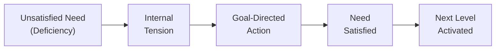
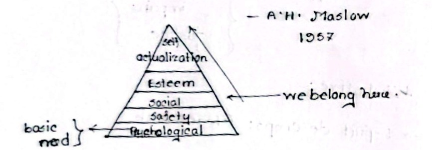
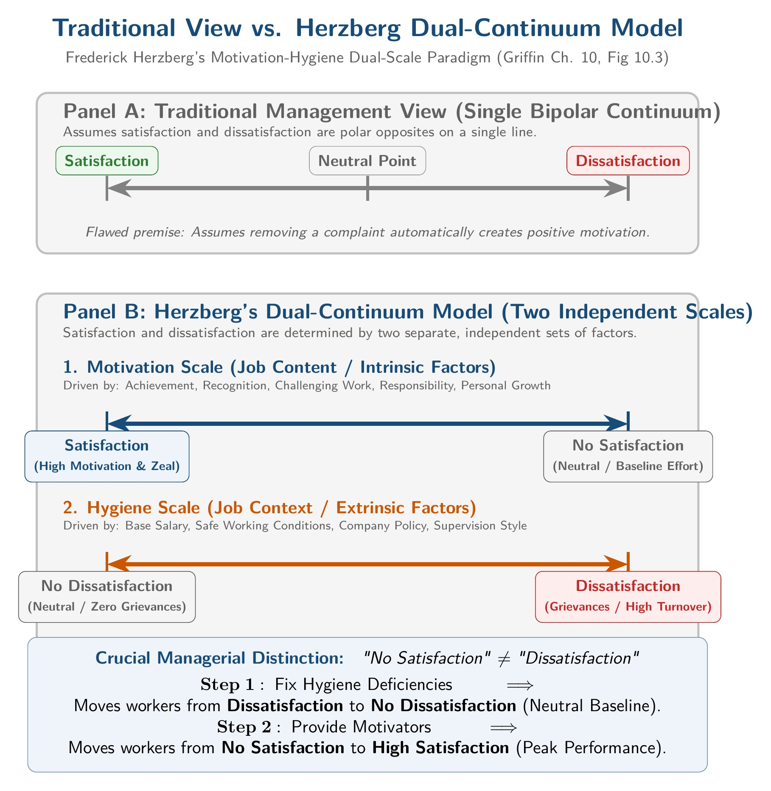
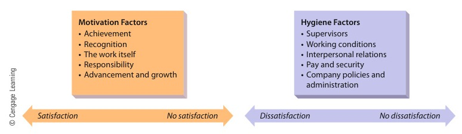
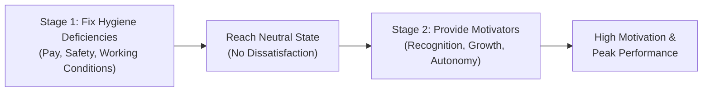
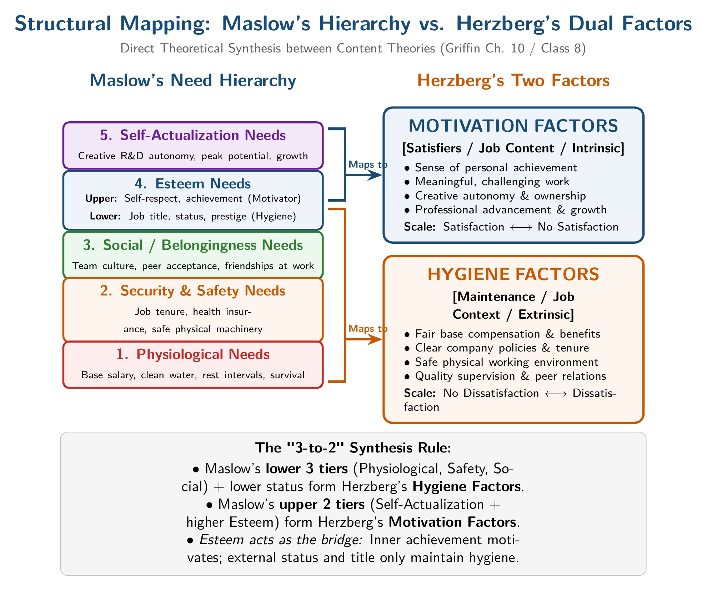
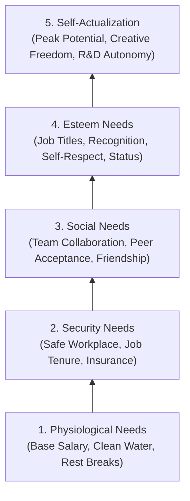

[← Previous: M05.1: Motivation Basics and Financial vs. Non-Financial](M05.1_Motivation_Basics_and_Financial_vs_NonFinancial.md) | [🏠 Index](00_Index.md) | [Next: M05.3: Vroom's Expectancy, McGregor X/Y, and ERG Theories →](M05.3_Vroom_Expectancy_McGregor_XY_and_ERG_Theories.md)

---

# M05.2: Maslow's Hierarchy of Needs and Herzberg's Two-Factor Theory

> **Section:** Section A / Section B (CO2 · Industrial Management · Dr. Md. Rabiul Islam Sir) | **Priority:** 🔴 Very High | **Exam Frequency:** Tested in 2020 (4m), 2021 (6m), and 2024 (5m)
> **Subtopics Covered:** `M05.2` (Maslow's Hierarchy of Needs Theory: 5 Levels, Satisfaction-Progression Principle, General and Workplace Examples, Criticisms, and Managerial Applications), `M05.3` (Herzberg's Two-Factor Theory: Dual Continuums, Hygiene Factors vs. Motivation Factors, Two-Stage Process, Criticisms, Managerial Applications, and Maslow vs. Herzberg Comparison)
> **Sources:** MRI Sir Lecture (Class 8), Raidah Class Notes (`Classnotes_Hum2217_Raidah.md` Class 8), Griffin Chapter 10 Part 1, Previous Year Questions (`2020 Q.2(a)`, `2021 Q.3(b)`, `2024 Q.2(c)`)

## Why This Topic Matters

Content theories explain what specific needs drive human behavior. Abraham Maslow and Frederick Herzberg built the two most famous content models in management. MRI Sir tests at least one of these theories in almost every final exam.

Examiners look for clear diagrams and correct terms. For Maslow, you must sketch the five-tier pyramid from base to apex. You must explain the satisfaction-progression rule and show real workplace examples. For Herzberg, you must draw the dual continuums. You must explain why hygiene factors alone never produce high motivation. Knowing their criticisms and practical applications guarantees top marks.

---

## 📝 Key Definitions

> **Maslow's Hierarchy of Needs:** "Suggests that people must satisfy five groups of needs in order: physiological, security, belongingness, esteem, and self-actualization." (Ricky W. Griffin, *Fundamentals of Management*)

Maslow views human needs as a five-step ladder. A person satisfies basic survival needs first. Once those needs are met, higher social and psychological needs begin to direct behavior.

> **Herzberg's Two-Factor Theory:** "Suggests that people's satisfaction and dissatisfaction are influenced by two independent sets of factors: motivation factors and hygiene factors." (Ricky W. Griffin, *Fundamentals of Management*)

Herzberg separates workplace factors into two independent scales. Hygiene factors prevent employee dissatisfaction when present. But only motivator factors build active satisfaction and drive superior performance.

---

## Abraham Maslow's Hierarchy of Needs Theory

### Background and Core Premise

Abraham Maslow introduced his theory in 1943. He expanded it in his 1954 book *Motivation and Personality*. MRI Sir noted this foundation during Class 8. Maslow stated that every human being has five basic sets of needs. These needs arrange themselves in a strict ladder of importance.

Maslow took a content perspective of motivation. He wanted to identify the specific inner needs that drive human effort. He believed human beings are wanting animals. As soon as one need is satisfied, another need appears in its place.

### The Satisfaction-Progression Principle

Maslow built his model on one core rule: the **Satisfaction-Progression Principle**.

1. **Sequential Movement:** A person moves up the ladder one step at a time. An individual cannot focus on a higher need until lower needs are met.
2. **Deficiency Drives Action:** An unsatisfied need causes internal tension. This tension forces the person to act to satisfy that deficiency.
3. **Satisfied Needs Stop Motivating:** Once an employee satisfies a need, it loses its power to motivate. The employee then shifts attention to the next higher level.

### The Five Need Levels (Base to Apex)

*Figure 1: Maslow's Hierarchy of Needs Pyramid (Source: Classnotes_Hum2217_Raidah.md, Class 8)*

> [!tip] Memory Hook: Maslow's Five Levels (P-S-S-E-S)
> Remember **P-S-S-E-S** from bottom to top:
> - **P** $\to$ **Physiological** (Base salary, clean water, rest breaks)
> - **S** $\to$ **Security** (Safe workplace, job protection, insurance)
> - **S** $\to$ **Social** (Team bonding, peer acceptance, friendly culture)
> - **E** $\to$ **Esteem** (Job titles, merit praise, respect from others)
> - **S** $\to$ **Self-Actualization** (Peak potential, creative growth, technical autonomy)

#### 1. Physiological Needs (Biological Survival)

These are basic physical needs required for human life to continue. They sit at the base of the pyramid:
- **General Life Needs:** Food, clean drinking water, air, sleep, and basic shelter.
- **Workplace Support:** Adequate base pay, clean drinking water, good lighting, proper ventilation, and mandatory lunch or rest breaks.
- **Managerial Impact:** If a worker cannot afford food or adequate rest, higher-level incentives mean nothing to them.

#### 2. Security and Safety Needs (Protection from Harm)

Once physical survival is stable, workers look for physical and emotional security:
- **General Life Needs:** Protection from danger, emotional hurt, theft, disease, and sudden poverty.
- **Workplace Support:** Job security (protection from sudden layoffs), safe machinery, protective gear, health insurance, and retirement provident funds.
- **Managerial Impact:** Workers worry less about job loss when firms offer fair grievance systems and safe equipment.

#### 3. Belongingness and Social Needs (Love and Affection)

Humans are social beings. When people feel safe, they seek friendship and social connections:
- **General Life Needs:** Family life, companionship, love, attachment, and acceptance by friends.
- **Workplace Support:** Friendly work groups, collaborative project teams, open communication, and company social or sports events.
- **Managerial Impact:** Isolation lowers worker morale. Encouraging teamwork helps employees feel accepted.

#### 4. Esteem Needs (Self-Respect and Status)

Esteem needs involve how people see themselves and how others see them. Griffin divides esteem into two parts:
- **Internal Esteem:** Self-respect, autonomy, confidence, and personal sense of accomplishment.
- **External Esteem:** Status, recognition, prestige, attention, and appreciation from peers and leaders.
- **Workplace Support:** Prestigious job titles (such as Senior Firmware Lead), merit bonuses, private offices, and public recognition awards.
- **Class Note Insight:** In Class 8, MRI Sir discussed high-ranking officials. They value prestige and public status more than extra salary.

#### 5. Self-Actualization Needs (Reaching Full Potential)

This is the highest level of human development at the top of the pyramid:
- **General Life Needs:** Personal growth, self-fulfillment, and doing work that brings deep inner peace and contentment.
- **Workplace Support:** Challenging technical projects, creative freedom, R&D opportunities, and decision-making authority.
- **Managerial Impact:** These needs must come from within the individual. Managers support them by giving talented engineers freedom to experiment and innovate.

### Table: Maslow's Five Need Levels: Life Needs vs. Workplace Support

| Level | Need Category | General Life Meaning | Workplace Support Examples |
| :---: | :--- | :--- | :--- |
| **1** | **Physiological** | Food, water, air, sleep, and rest. | Base salary, clean water, good lighting, and rest intervals. |
| **2** | **Security / Safety** | Protection from danger, illness, and poverty. | Job security, PPE, health insurance, and provident funds. |
| **3** | **Belongingness / Social** | Love, friendship, companionship, and affection. | Team projects, open communication, and social events. |
| **4** | **Esteem** | Self-respect, prestige, autonomy, and status. | Job titles, recognition awards, praise, and private workspace. |
| **5** | **Self-Actualization** | Personal growth, creative fulfillment, and inner peace. | Challenging R&D tasks, design autonomy, and learning budgets. |

---

### Major Criticisms of Maslow's Theory

Maslow's model is intuitive and popular. But academic research highlights four significant flaws:

1. **Rigid Progression is Unrealistic:** People do not always climb the ladder in strict order. A starving artist or an ECE startup founder may sacrifice food and sleep to build a dream product.
2. **Arbitrary Five-Level Division:** Empirical studies show that five distinct tiers do not always exist in practice. Many people operate on two or three combined levels at the same time.
3. **Cultural Bias:** Maslow based his model on Western individualistic society. In collectivist cultures like Bangladesh, family security and social belonging often rank higher than individual self-actualization.
4. **Multiple Needs Operate Together:** In real workplaces, several needs motivate people simultaneously. An engineer often wants a higher salary, job security, and professional recognition at the exact same time.

---

### Managerial Applications of Maslow's Model

Managers can apply Maslow's framework to build effective reward systems:

1. **Recognize Individual Differences:** Employees do not stand at the same level on the ladder. A new recruit needs competitive pay, while a senior lead seeks design autonomy. Managers must customize rewards.
2. **Secure Lower Needs First:** Management must provide competitive wages, safe factory tools, and clean facilities. Without these basics, motivational seminars and awards have no effect.
3. **Provide Higher-Order Incentives for Knowledge Workers:** For skilled software and hardware engineers, pay alone is not enough. Managers must provide challenging technical problems, design freedom, and public recognition.
4. **Design Comprehensive Compensation Packages:** Firms should create balanced benefits. These packages should cover medical care for security, team dinners for belonging, awards for esteem, and skill training for self-actualization.

---

## Frederick Herzberg's Two-Factor Theory

### Origin: The Study of Accountants and Engineers

Frederick Herzberg developed his Two-Factor Theory in 1959. It is also known as the Dual-Factor or Motivator-Hygiene Theory. Herzberg interviewed 200 accountants and engineers in Pittsburgh. He asked them two simple questions:
- Recall a time when you felt exceptionally good and motivated about your job.
- Recall a time when you felt exceptionally bad and dissatisfied with your job.

Herzberg noticed a surprising pattern. The factors that caused job satisfaction were completely different from the factors that caused job dissatisfaction. For example, workers complained about low pay when dissatisfied. But high pay did not make them actively satisfied or motivated. Instead, feelings of achievement and recognition caused satisfaction.

### The Dual-Continuum Model vs. Traditional View

Traditional management treated satisfaction and dissatisfaction as opposite ends of a single scale. Herzberg rejected that idea. He proposed two independent scales:

1. **Motivation Continuum:** Runs from **Satisfaction** to **No Satisfaction**. Work content drives this scale.
2. **Hygiene Continuum:** Runs from **No Dissatisfaction** to **Dissatisfaction**. Work context drives this scale.

*Figure 2: Traditional View vs. Herzberg Two-Factor Dual-Continuum Scales (Source: Griffin Ch. 10 / Herzberg 1959)*

*Figure 2: Frederick Herzberg's Two-Factor Dual-Continuum Model (Source: Griffin Ch. 10, Fig 10.3)*

> [!tip] Memory Hook: Herzberg's Two-Factor Split
> - **Hygiene Factors (Job Context / Environment):** Keep them healthy to prevent pain, but they never build muscle.
> - **Motivator Factors (Job Content / Growth):** Build real muscle, inspiring high effort and personal achievement.

---

### Hygiene Factors vs. Motivation Factors

#### 1. Hygiene Factors (Maintenance / Extrinsic Factors)

Hygiene factors relate to the work environment and job context. They represent external conditions surrounding the job:
- **Core Elements:** Company policy and administration, technical supervision, working conditions, base salary, job security, and interpersonal relations with peers.
- **Operating Scale:** Dissatisfaction $\longleftrightarrow$ No Dissatisfaction.
- **Effect When Deficient:** Causes severe dissatisfaction, grievances, low morale, and high employee turnover.
- **Effect When Adequate:** Removes complaints and brings workers to a neutral baseline ("No Dissatisfaction"). But hygiene factors do NOT actively inspire extra effort.

#### 2. Motivation Factors (Satisfiers / Intrinsic Factors)

Motivation factors relate directly to the actual content of the work. They satisfy higher-level human aspirations:
- **Core Elements:** Achievement, recognition for good work, challenging tasks, increased responsibility, opportunities for advancement, and personal growth.
- **Operating Scale:** Satisfaction $\longleftrightarrow$ No Satisfaction.
- **Effect When Present:** Builds strong positive satisfaction, deep commitment, and high job performance.
- **Effect When Absent:** Employees feel neutral ("No Satisfaction"). They do not feel actively motivated, but they do not harbor grievances either.

### Table: Hygiene Factors vs. Motivation Factors in the Workplace

| Comparison Feature | Hygiene Factors (Maintenance Factors) | Motivation Factors (Satisfiers) |
| :--- | :--- | :--- |
| **Factor Location** | Extrinsic (Job Context: work environment) | Intrinsic (Job Content: actual work performed) |
| **Core Elements** | Pay, company policy, supervisor style, safety, and peer relations | Achievement, recognition, responsibility, growth, and the work itself |
| **Relevant Scale** | Dissatisfaction $\longleftrightarrow$ No Dissatisfaction | Satisfaction $\longleftrightarrow$ No Satisfaction |
| **Deficiency Impact** | Produces anger, grievances, and high turnover | Produces lack of motivation, but no active anger |
| **Adequacy Impact** | Creates a calm, neutral baseline ("No Dissatisfaction") | Inspires exceptional effort, high creativity, and pride |
| **Medical Analogy** | Like sanitation: washing hands prevents disease, but does not make you strong | Like nutritious food and exercise: builds real strength and health |

---

### The Two-Stage Process for Motivating Employees

Herzberg emphasized that managers must motivate employees using a two-stage method:

#### Stage 1: Eliminate Hygiene Deficiencies (Reach Neutral Baseline)

Managers must first remove sources of dissatisfaction:
- Provide fair base pay and clear company policies.
- Ensure safe working conditions and clean work facilities.
- Maintain respectful, professional supervision.
- Providing adequate hygiene factors prevents strikes and complaints. But employees at this stage only do just enough work to get by.

#### Stage 2: Offer Motivation Factors (Generate High Effort)

Once the baseline is calm, managers introduce motivators:
- Give workers responsibility over meaningful tasks.
- Praise individual technical achievements publicly.
- Offer clear promotion paths and personal learning budgets.
- This stage transforms neutral employees into passionate, high-performing contributors.

---

### Major Criticisms of Herzberg's Theory

Researchers have pointed out four major limitations of the Two-Factor Theory:

1. **Attribution Bias in Methodology:** People take credit for their own good results (motivators). But they blame supervisors, company policies, or bad tools for failures (hygiene factors).
2. **Sample Limitation:** Herzberg surveyed only 200 accountants and engineers. His findings do not always apply to assembly-line workers or manual laborers. For low-income factory staff, higher pay acts as a direct motivator.
3. **Pay Plays a Dual Role:** Herzberg classified salary purely as a hygiene factor. But a performance bonus carries clear recognition, prestige, and status. It functions as both a hygiene factor and a motivator.
4. **Ignores Situational and Personality Differences:** The model assumes that all workers desire job enrichment and greater responsibility. Some workers prefer routine, structured tasks with low accountability.

---

### Managerial Applications of Herzberg's Theory

Herzberg's ideas transformed how modern companies design jobs:

1. **Job Enrichment (Vertical Loading):** Redesign engineering roles to give workers end-to-end ownership of projects. Allow engineers to design, test, and deploy modules rather than performing repetitive sub-tasks.
2. **Formal Recognition Programs:** Create technical awards, spot bonuses, and showcase presentations. These celebrate engineering milestones and boost intrinsic motivation.
3. **Dual Career Ladders:** Provide separate technical and managerial paths. This allows senior engineers to advance in status and pay without moving into administrative roles.
4. **Maintain a Solid Hygiene Baseline:** Regularly adjust base salaries to match inflation. Keep engineering labs well-lit, air-conditioned, and equipped with modern test instruments.

---

## Comparative Analysis: Maslow vs. Herzberg

Both Maslow and Herzberg focus on what drives human action. But they organize work factors differently.

### How Maslow's Needs Align with Herzberg's Factors

Maslow's five levels map directly across Herzberg's two categories:

*Figure 3: Direct Structural Mapping: Maslow Hierarchy of Needs to Herzberg Dual Factors (Source: Griffin Ch. 10 / Comparative Synthesis)*

### Table: Direct Mapping of Maslow's Hierarchy to Herzberg's Two Factors

| Maslow Need Level | Herzberg Factor Classification | Focus of Factor | Workplace Example |
| :--- | :--- | :--- | :--- |
| **Self-Actualization** | Motivation Factor | Intrinsic (Job Content) | Challenging R&D projects, autonomy |
| **Esteem (Higher part)** | Motivation Factor | Intrinsic (Job Content) | Sense of achievement, creative responsibility |
| **Esteem (Lower part)** | Hygiene Factor | Extrinsic (Job Context) | Job title, status symbols, private office |
| **Belongingness / Social** | Hygiene Factor | Extrinsic (Job Context) | Peer relationships, supervisory style |
| **Security / Safety** | Hygiene Factor | Extrinsic (Job Context) | Safe tools, job tenure, medical insurance |
| **Physiological** | Hygiene Factor | Extrinsic (Job Context) | Base salary, clean air, rest intervals |

> [!tip] Memory Hook: The 3-to-2 Mapping Rule
> - Maslow's **lower 3 levels** (Physiological, Safety, Social) match Herzberg's **Hygiene Factors**.
> - Maslow's **upper 2 levels** (Self-Actualization and upper Esteem) match Herzberg's **Motivator Factors**.
> - **Esteem acts as the bridge:** Praise and inner accomplishment motivate; titles and outer status maintain hygiene.

### Key Conceptual Differences

1. **Scope of the Model:** Maslow explains general human motivation across all of life. Herzberg focuses specifically on job satisfaction in the workplace.
2. **Order of Operation:** Maslow requires strict step-by-step movement up the ladder. Herzberg uses a two-stage process where hygiene and motivators operate on separate scales simultaneously.
3. **Role of Money:** Maslow treats salary as a basic physiological satisfier. Herzberg treats base pay as a hygiene factor, noting that money prevents pain but rarely inspires top performance.

---

## Exam Variants

The table below lists past final exam questions covering Maslow and Herzberg:

| Year / Paper | Question Text & Focus | Marks | Key Exam Requirements |
| :--- | :--- | :---: | :--- |
| **2021 Final Q.3(b)** | State the Need-hierarchy theory of motivation showing its criticism and potential application. | 06 | Sketch 5-tier pyramid, explain satisfaction-progression, list 4 criticisms, and give 4 workplace applications. |
| **2020 Final Q.2(a)** | What is employee motivation? State the Need-Hierarchy theory of motivation with potential application. | 04 (of 6m) | Define motivation briefly, list Maslow's 5 tiers with examples, and describe 2 to 3 managerial applications. |
| **2024 Final Q.2(c)** | Analyze the two-factor theory of motivation with criticism and potential application. | 05 | Contrast traditional vs. dual continuums, define hygiene vs. motivators, explain 2 stages, list 4 criticisms and applications. |

---

## 🏆 Golden Questions (Past Exam Archive & Model Answers)

### 🎯 GQ1 · 2021 Q.3(b) · Maslow's Need-Hierarchy Theory with Criticisms and Applications (06 Marks)

> **Appeared:** 2021 Final Exam · Question 3(b) · Section A · CO2 · (06 Marks)

**Question:**
Briefly state the "Need-hierarchy" theory of motivation showing its criticism and potential application.

**Full Answer:**

#### GQ1.1 · Premise and Satisfaction-Progression Rule

Abraham Maslow proposed the Need-Hierarchy theory in 1943. He argued that human beings have five basic levels of needs arranged in a hierarchy of importance.

The theory operates on the **Satisfaction-Progression Principle**:
1. Needs follow a strict ascending ladder.
2. A person cannot focus on a higher-order need until lower-order needs are satisfied.
3. An unsatisfied need creates tension and drives human action.
4. Once a need is satisfied, it ceases to motivate. The person then directs effort toward the next higher tier.

#### GQ1.2 · The Five Need Levels (Base to Apex)

*Figure 3: Maslow's Need-Hierarchy Pyramid (Source: Classnotes_Hum2217_Raidah.md, Class 8)*

1. **Physiological Needs:** Basic biological survival requirements such as food, water, air, and rest.
   - *Workplace Support:* Fair base wages, clean drinking water, proper ventilation, and rest breaks.
2. **Security / Safety Needs:** Freedom from physical danger, emotional hurt, and financial ruin.
   - *Workplace Support:* Safe machinery, personal protective equipment (PPE), job continuity, and health insurance.
3. **Belongingness / Social Needs:** Love, human affection, companionship, and acceptance by peers.
   - *Workplace Support:* Collaborative engineering teams, open communication, and company social gatherings.
4. **Esteem Needs:** Twofold needs for internal self-respect and external status, prestige, and recognition.
   - *Workplace Support:* Senior job titles, merit bonuses, public praise, and recognition for technical accomplishments.
5. **Self-Actualization Needs:** The desire to reach one's highest personal potential and creative growth.
   - *Workplace Support:* Design autonomy, challenging R&D assignments, and decision-making freedom.

#### GQ1.3 · Criticisms of Maslow's Theory

1. **Rigid Progression is Unrealistic:** People often pursue creative work or personal status. They do this even when basic financial or physical security is unstable.
2. **Arbitrary Five-Tier Structure:** Empirical research shows that five neat tiers do not always exist. Real workers often operate on two or three overlapping levels.
3. **Cultural Bias:** Maslow's model assumes Western individualistic values. In collectivist societies like Bangladesh, family security and social belonging often outrank personal self-actualization.
4. **Simultaneous Needs:** Workers are often motivated by pay raises, job stability, and social praise at the exact same time.

#### GQ1.4 · Potential Workplace Applications

1. **Tailor Rewards to the Individual:** Managers must realize workers sit on different levels of the ladder. They must offer appropriate rewards instead of a uniform package.
2. **Guarantee Basic Needs First:** Companies must ensure competitive salaries and safe conditions before launching motivational campaigns.
3. **Provide Higher-Order Growth for Engineers:** For senior technical staff, firms should offer challenging design tasks. They need creative freedom rather than basic pay increases alone.
4. **Offer Comprehensive Benefit Plans:** Design packages that address safety (insurance), belonging (team events), and esteem (peer awards).

---

### 🎯 GQ2 · 2020 Q.2(a) · Need-Hierarchy Theory and Potential Applications (04 Marks)

> **Appeared:** 2020 Final Exam · Question 2(a) · Section A · CO2 · (04 of 06 Marks)

**Question:**
What is employee motivation? State the Need-Hierarchy theory of motivation with potential application.

**Full Answer:**

#### GQ2.1 · Concept of Employee Motivation

Employee motivation is the set of internal forces that initiates, directs, and sustains goal-oriented human action. Griffin defines motivation as the set of forces that cause people to behave in certain ways. In simple terms, motivation determines how hard a worker tries and how long they keep trying. Individual performance follows the relation:

$$
P = M \times A \times E
$$

where $P$ is performance, $M$ is motivation, $A$ is ability, and $E$ is the work environment.

#### GQ2.2 · Maslow's Five-Tier Structure

Abraham Maslow explained that people satisfy five levels of needs in ascending order. When one level is satisfied, it stops motivating, and the individual moves up:

1. **Physiological Needs:** Food, water, and rest satisfied through base salary and clean facilities.
2. **Security Needs:** Protection from danger and job loss, satisfied through safe tools and job continuity.
3. **Social Needs:** Friendship and belonging satisfied through collaborative teamwork.
4. **Esteem Needs:** Self-respect and status satisfied through titles and performance awards.
5. **Self-Actualization Needs:** Realizing one's highest personal potential through challenging engineering projects.

#### GQ2.3 · Practical Applications in an Organization

1. **Diagnose Employee Need Levels:** Managers should find out which need level an employee is currently trying to satisfy. A junior engineer may need financial stability, while a project lead seeks autonomy.
2. **Ensure Basic Baseline Conditions:** Management must secure fair wages and safe machinery first. Without these basics, higher-level rewards fail to motivate.
3. **Empower Knowledge Workers:** Give experienced engineers ownership over challenging technical tasks to satisfy their self-actualization needs.

---

### 🎯 GQ3 · 2024 Q.2(c) · Herzberg's Two-Factor Theory with Criticisms and Applications (05 Marks)

> **Appeared:** 2024 Final Exam · Question 2(c) · Section A · CO2 · (05 Marks)

**Question:**
Analyze the two-factor theory of motivation with criticism and potential application.

**Full Answer:**

#### GQ3.1 · Dual-Continuum Basis of Herzberg's Model

Frederick Herzberg developed the Two-Factor Theory (or Motivator-Hygiene Theory) in 1959 after studying 200 accountants and engineers. He discovered that the factors causing job satisfaction are completely separate from the factors causing job dissatisfaction.

Herzberg rejected the traditional view that satisfaction and dissatisfaction sit on a single scale. Instead, he introduced two independent continuums:

*Figure 4: Herzberg's Dual-Continuum Model (Source: Griffin Ch. 10, Fig 10.3)*

#### GQ3.2 · Hygiene Factors vs. Motivation Factors

1. **Hygiene Factors (Job Context / Extrinsic):**
   - *Elements:* Company policies, supervisor quality, working conditions, base pay, job security, and peer relations.
   - *Effect:* When poor, they cause severe dissatisfaction. When adequate, they only remove dissatisfaction ("No Dissatisfaction"). They do not actively motivate.
2. **Motivation Factors (Job Content / Intrinsic):**
   - *Elements:* Achievement, recognition, challenging work, responsibility, advancement, and personal growth.
   - *Effect:* When present, they create active job satisfaction and high motivation. When absent, workers feel neutral ("No Satisfaction").

Managers must follow a **Two-Stage Process**:
- *Stage 1:* Fix hygiene issues to remove grievances and reach a neutral baseline.
- *Stage 2:* Provide motivators such as job enrichment to inspire high effort and performance.

#### GQ3.3 · Four Major Criticisms of the Theory

1. **Attribution Bias:** Workers take credit for successes (motivators). But they blame supervisors or company rules for failures (hygiene factors).
2. **Narrow Sample:** Herzberg interviewed only engineers and accountants. Low-income factory workers often treat pay as a direct motivator rather than a mere hygiene factor.
3. **Pay is Both Hygiene and Motivator:** Merit raises and bonuses signal recognition and status. This blurs the boundary between hygiene and motivator factors.
4. **Ignores Individual Differences:** The theory assumes every worker wants job enrichment. In reality, some workers prefer simple, routine jobs with minimal responsibility.

#### GQ3.4 · Potential Workplace Applications for Managers

1. **Job Enrichment (Vertical Loading):** Restructure engineering assignments. Give workers complete ownership of entire modules rather than repetitive micro-tasks.
2. **Formal Recognition Systems:** Create spot bonuses, technical excellence awards, and public recognition during department meetings.
3. **Dual Career Pathways:** Provide career ladders for top engineers. This lets them gain status and pay raises without moving into administrative management.
4. **Maintain Hygiene Standards:** Regularly calibrate salaries to industry levels and maintain clean, safe, well-equipped hardware labs.

---

## ⚡ Exam Tips & Common Mistakes

1. **Draw the Diagrams:** Always sketch the five-tier pyramid for Maslow and the dual-continuum scales for Herzberg. MRI Sir specifically rewards clear visual sketches.
2. **Label the Continuums Accurately:** In Herzberg's model, never write that the opposite of satisfaction is dissatisfaction. Write that the opposite of satisfaction is **No Satisfaction**, and the opposite of dissatisfaction is **No Dissatisfaction**.
3. **Do Not Confuse Job Context and Job Content:** Hygiene factors belong to the work environment. Motivators belong to the work itself.
4. **Use Concrete Engineering Examples:** When explaining self-actualization or job enrichment, mention embedded software debugging, hardware prototyping, or R&D autonomy. ECE-specific examples show deep understanding.
5. **Include Criticisms and Applications:** When answering theory questions, always include three criticisms. Also add three practical workplace applications.

---

## 🔗 Related Topics

- [M01.1 · Management Definitions, Resources, and Nature](M01.1_Management_Definitions_Resources_and_Nature.md)
- [M01.3 · Management Functions (P-O-L-C) and Leadership](M01.3_Management_Functions_POLC_and_Leadership.md)
- [M05.1 · Motivation Basics and Financial vs. Non-Financial](M05.1_Motivation_Basics_and_Financial_vs_NonFinancial.md)
- [M05.3 · Vroom's Expectancy, McGregor X/Y, and ERG Theories](M05.3_Vroom_Expectancy_McGregor_XY_and_ERG_Theories.md)
- [M06.2 · Performance Appraisal Methods and Rating Errors](M06.2_Performance_Appraisal_Methods_and_Rating_Errors.md)

---

[← Previous: M05.1: Motivation Basics and Financial vs. Non-Financial](M05.1_Motivation_Basics_and_Financial_vs_NonFinancial.md) | [🏠 Index](00_Index.md) | [Next: M05.3: Vroom's Expectancy, McGregor X/Y, and ERG Theories →](M05.3_Vroom_Expectancy_McGregor_XY_and_ERG_Theories.md)
