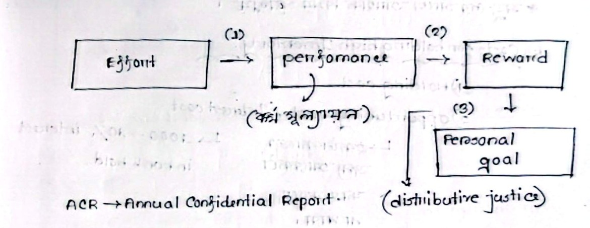
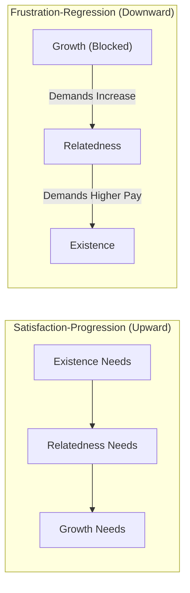

[← Previous: M05.2: Maslow's Hierarchy and Herzberg's Two-Factor Theory](M05.2_Maslow_Hierarchy_and_Herzberg_Two_Factor_Theory.md) | [🏠 Index](00_Index.md) | [Next: M06.1: HRM, Recruitment, Selection, and Training →](M06.1_HRM_Recruitment_Selection_and_Training.md)

---

# M05.3: Vroom's Expectancy, McGregor's Theory X/Y, and ERG Theories

> **Section:** Section B (CO2 · Industrial Management · Dr. Md. Rabiul Islam Sir) | **Priority:** 🔴 Very High | **Exam Frequency:** Tested in 2023 (Q.8b, 4m); core syllabus theories
> **Subtopics Covered:** `M05.4` (Vroom's Expectancy Theory, Multiplicative Formula, ACR, Distributive Justice, Applications), `M05.6` (Douglas McGregor's Theory X and Theory Y, Clayton Alderfer's ERG Theory and Frustration-Regression Principle)
> **Sources:** MRI Sir Lecture Notes, Raidah Class Notes (Class 8), Griffin Chapter 1 and Chapter 10, Previous Year Questions (`2023 Q.8(b)`)

## Why This Topic Matters

Process theories explain how motivation works rather than just listing human needs. Victor Vroom views motivation as a rational choice process. Workers evaluate effort, performance, and expected rewards before taking action.

In Class 8, MRI Sir emphasized the Annual Confidential Report (ACR) and distributive justice. Both concepts explain how performance links to organizational rewards. If trust or perceived fairness breaks down, worker motivation drops to zero.

Exam questions test Vroom's multiplicative formula and its practical engineering applications. Douglas McGregor's Theory X and Theory Y contrast autocratic control with democratic empowerment. Clayton Alderfer's ERG theory refines Maslow's hierarchy through the frustration-regression principle.

---

## 📝 Key Definitions

> **Expectancy Theory:** "Suggests that motivation depends on two things: how much we want something and how likely we think we are to get it." (Ricky W. Griffin, *Fundamentals of Management*)

Vroom explains that people choose behaviors based on expected payoffs. They work hard only when they expect their effort to bring valued rewards.

> **Theory X and Theory Y:** "Two extreme belief sets that different managers hold about their workers: Theory X is a pessimistic view, while Theory Y is an optimistic view." (Douglas McGregor, *The Human Side of Enterprise*)

Theory X assumes workers dislike work and need coercion. Theory Y assumes workers enjoy work, seek responsibility, and show creativity.

> **ERG Theory:** "A needs theory that collapses Maslow's categories into Existence, Relatedness, and Growth, and introduces the frustration-regression principle." (Clayton Alderfer, *Existence, Relatedness, and Growth*)

Alderfer shows that several needs can motivate a worker at the same time. When higher needs are blocked, workers demand more lower-level rewards.

---

## Victor Vroom's Expectancy Theory of Motivation

### Core Concept and Assumptions

Victor Vroom published his expectancy framework in 1964. He argued that motivation is a conscious cognitive choice process. People evaluate different behavioral options before putting in effort.

Griffin outlines four core assumptions of expectancy theory:

1. **Combined Forces:** Behavior results from forces inside the individual and within the workplace environment.
2. **Conscious Choices:** Employees make conscious decisions about their own actions in the organization.
3. **Diverse Needs:** Different individuals seek different types of goals, needs, and rewards.
4. **Outcome Evaluation:** People select alternatives that they believe will lead to their desired personal outcomes.

### The Multiplicative Motivation Formula

Vroom expressed motivation through a multiplicative mathematical relationship:

$$
\text{Motivation} = \text{Expectancy} \times \text{Instrumentality} \times \text{Valence}
$$

$$
M = E \times I \times V
$$

Because the three components are multiplied together, all three terms must be positive:

- If **Expectancy ($E$) = 0**, the employee thinks: "I cannot hit this target." Motivation drops to zero.
- If **Instrumentality ($I$) = 0**, the employee thinks: "Management will not deliver the reward." Motivation drops to zero.
- If **Valence ($V$) = 0**, the employee thinks: "I do not care about this reward." Motivation drops to zero.

> [!important] The Zero-Product Rule
> If any single component in Vroom's model equals zero ($0$), total employee motivation drops to zero ($0$). Motivation requires positive values across all three links.

### Diagram of Vroom's Expectancy Framework

In Class 8, MRI Sir drew the complete expectancy model on the blackboard. He included performance appraisal and distributive justice:

*Figure 8.3: Victor Vroom's Expectancy Model and Reward Pathway (Source: Classnotes_Hum2217_Raidah.md, Class 8)*

### The Three Expectancy Linkages

Vroom's model connects effort to personal goals through three sequential stages:

$$
\text{Effort} \xrightarrow{\quad\text{Expectancy }(E \to P)\quad} \text{Performance} \xrightarrow{\quad\text{Instrumentality }(P \to O)\quad} \text{Reward / Outcome} \xrightarrow{\quad\text{Valence }(V)\quad} \text{Personal Goals}
$$

#### 1. Effort-to-Performance Expectancy ($E \to P$)

- **Meaning:** The worker's subjective belief that putting in effort will lead to successful task performance.
- **Probability Scale:** Ranges from $0.0$ to $1.0$. Here, $0.0$ means zero chance, while $1.0$ means complete certainty.
- **Core Question:** "Can I achieve the required performance level if I work hard?"
- **Key Determinants:** Personal self-efficacy, technical skills, clear project goals, reliable equipment, and adequate time.

#### 2. Performance-to-Outcome Instrumentality ($P \to O$)

- **Meaning:** The worker's belief that achieving the performance target will lead to specific organizational rewards.
- **Probability Scale:** Ranges from $0.0$ (performance brings no reward) to $1.0$ (rewards are guaranteed once goals are met).
- **Core Question:** "If I perform well, will the organization actually deliver the promised reward?"
- **Key Determinants:** Trust in leadership, transparency of appraisal systems, and past track record of management consistency.

#### 3. Valence of Outcomes ($V$)

- **Meaning:** The personal value or attractiveness that an individual places on a particular reward.
- **Value Scale:** Ranges from negative to positive. Negative outcomes cause stress. Zero means indifferent. Positive outcomes represent attractive rewards.
- **Core Question:** "Do I truly value the reward that management is offering?"
- **Overall Requirement:** An employee often receives multiple outcomes from performance. Motivation requires the total sum of all valences to be positive:

$$
\sum V > 0
$$

> [!tip] Memory Hook: Vroom's Three Core Questions
> Memorize these three simple questions for the exam hall:
> - **$E$ (Expectancy):** "Can I do the job?" (Effort $\to$ Performance)
> - **$I$ (Instrumentality):** "Will I get the prize?" (Performance $\to$ Outcome)
> - **$V$ (Valence):** "Do I want the prize?" (Outcome $\to$ Personal Goal)

### ACR and Distributive Justice in the Workplace

During Class 8, MRI Sir linked Vroom's model to practical organizational governance:

1. **Annual Confidential Report (ACR):**
   - In public sector bodies and structured industries, employee performance is formally measured using an ACR.
   - The ACR documents technical output, discipline, initiative, and leadership.
   - If the ACR grading is subjective or corrupt, employees lose faith in the $P \to O$ linkage.

2. **Distributive Justice Moderation:**
   - Employees compare their rewards to the effort they expended. They also compare their rewards with peer outcomes.
   - Perceived fairness determines whether an outcome feels satisfying or insulting.
   - In class notes, organizational justice is classified into three states:
     - **Pure Justice:** Completely impartial allocation based strictly on demonstrated merit.
     - **Perfect Justice:** Flawless balance where every individual receives exactly what they earned.
     - **Impure Justice:** Biased allocation swayed by favoritism, politics, or arbitrary judgment.
   - When impure justice dominates, workers feel cheated. Instrumentality breaks down, and motivation collapses.

### The Porter-Lawler Extension

Lyman Porter and Edward Lawler extended Vroom's framework in 1968:

1. **Reversing the Direction:** Early human relations theorists thought satisfaction causes performance. Porter and Lawler showed that performance leads to satisfaction.
2. **Dual Reward Types:**
   - **Intrinsic Rewards:** Internal feelings of achievement, personal competence, and autonomy.
   - **Extrinsic Rewards:** External payoffs like salary increases, bonuses, and formal promotions.
3. **Role of Perceived Equity:** If employees view their total rewards as fair and equitable, high satisfaction results. That satisfaction reinforces future effort.

---

## Douglas McGregor's Theory X and Theory Y

### Core Philosophy of McGregor

Douglas McGregor presented Theory X and Theory Y in 1960 in his book *The Human Side of Enterprise*. He explained that a manager's actions depend on their fundamental beliefs about human nature.

These assumptions act as self-fulfilling prophecies. If a manager treats workers as lazy, workers become uncooperative. If a manager treats workers as capable partners, workers show initiative and dedication.

### Theory X Assumptions

Theory X reflects a negative, pessimistic view of human behavior. It aligns with early scientific management:

1. People have an inherent dislike for work and will avoid it whenever possible.
2. Because people dislike work, managers must coerce, control, direct, and threaten them to achieve organizational goals.
3. The average person prefers to be directed, avoids taking responsibility, has little ambition, and seeks security above all.

### Theory Y Assumptions

Theory Y reflects an optimistic, positive view of human behavior. It aligns with the human relations movement:

1. Physical and mental effort in work is as natural as play or rest.
2. People will exercise self-direction and self-control toward objectives to which they are committed.
3. Commitment to goals is tied to the rewards associated with their achievement.
4. Under proper conditions, the average person learns not only to accept but also to seek responsibility.
5. The capacity to exercise imagination, ingenuity, and creativity is widely distributed across the workforce.
6. Under modern industrial conditions, the intellectual potential of the average human is only partially used.

### Managerial Styles and Workplace Climate

- **Theory X Management:**
  - Relies on close supervision, centralized authority, and rigid rules.
  - Uses top-down orders and threats of punishment.
  - Creates a climate of fear, distrust, and low worker morale.
- **Theory Y Management:**
  - Relies on decentralized authority, employee empowerment, and participative decision-making.
  - Uses job enrichment, trust, and shared project ownership.
  - Creates a climate of open communication, innovation, and high commitment.
  - McGregor strongly advocated Theory Y as the superior approach for modern managers.

> [!tip] Memory Hook: Theory X vs. Theory Y Posture
> Use body language to remember McGregor's two theories:
> - **Theory X = Crossed Arms (X):** Closed, defensive, suspicious, lazy, needs constant policing.
> - **Theory Y = Open Arms (Y):** Welcoming, eager, creative, seeks responsibility, ready to grow.

---

## Clayton Alderfer's ERG Theory

### Three Need Levels: Existence, Relatedness, and Growth

Clayton Alderfer introduced ERG theory in 1972 to address shortcomings in Maslow's hierarchy. He collapsed Maslow's five levels into three distinct tiers:

1. **Existence ($E$):**
   - Covers basic physiological and physical safety requirements.
   - Includes adequate wages, safe working environments, clean air, and health benefits.
   - Matches Maslow's Physiological and Safety levels.
2. **Relatedness ($R$):**
   - Covers desires for interpersonal relationships, social acceptance, and mutual respect.
   - Includes team camaraderie, open communication, family life, and peer recognition.
   - Matches Maslow's Social needs and external Esteem needs.
3. **Growth ($G$):**
   - Covers desires for personal psychological development, self-fulfillment, and creative competence.
   - Includes solving complex technical challenges, leading new projects, and mastering skills.
   - Matches Maslow's internal Esteem and Self-Actualization levels.

### Satisfaction-Progression vs. Frustration-Regression

Alderfer made two major modifications to Maslow's framework:

1. **Multiple Active Needs:**
   - Maslow claimed people focus on only one level at a time.
   - Alderfer showed that multiple need levels can motivate a person simultaneously.
   - A young software engineer can desire higher pay (Existence) and creative project autonomy (Growth) at the same time.

2. **The Frustration-Regression Principle:**
   - Maslow claimed people only move upward after satisfying lower needs.
   - Alderfer discovered that if a higher-order need is blocked or frustrated, the individual regresses to a lower need.
   - The worker redirects their energy toward demanding more lower-level satisfaction.

*Workplace Example:* An embedded systems engineer is denied opportunities to lead new R&D projects (Growth frustrated). Instead of quitting, the engineer stops offering new ideas. They start demanding larger overtime bonuses and complain constantly about the office cafeteria (regressing to Existence needs).

---

## Comparison of Major Motivation Theories

### Table: Theory X vs. Theory Y

| Comparison Dimension | McGregor's Theory X | McGregor's Theory Y |
| :--- | :--- | :--- |
| **View of Human Nature** | Pessimistic, passive, resistant to change | Optimistic, active, capable of growth |
| **Attitude Toward Work** | Dislikes work and tries to avoid it | Work is natural, meaningful, and engaging |
| **Primary Motivation** | Fear of punishment, close supervision, pay | Internal pride, personal achievement, goals |
| **Responsibility** | Shuns responsibility; seeks direction | Welcomes and actively seeks responsibility |
| **Creative Potential** | Limited to managers; workers lack ingenuity | Widely distributed across all employees |
| **Management Style** | Autocratic, centralized, micromanagement | Democratic, participative, empowering |
| **Control Mechanism** | Strict rules, external audits, penalties | Self-direction, self-control, shared targets |
| **Modern Application** | Routine assembly lines with strict compliance | Engineering teams, software design, agile R&D |

### Table: Maslow vs. Herzberg vs. Alderfer vs. Vroom

| Dimension | Maslow's Hierarchy | Herzberg's Two-Factor | Alderfer's ERG Theory | Vroom's Expectancy |
| :--- | :--- | :--- | :--- | :--- |
| **Type of Theory** | Content (Need-based) | Content (Need-based) | Content (Need-based) | Process (Cognitive choice) |
| **Core Structure** | 5 rigid ascending levels | 2 independent continuums | 3 flexible categories | 3 multiplied factors |
| **Key Categories** | Physiological, Safety, Social, Esteem, Self-Actualization | Hygiene factors vs. Motivators | Existence, Relatedness, Growth | Expectancy, Instrumentality, Valence |
| **Progression Logic** | Strict upward progression | Hygiene first, then motivators | Flexible upward progression | Sequential cognitive links |
| **Handling Frustration** | Does not allow downward movement | Causes dissatisfaction if hygiene missing | Downward regression to lower needs | Motivation drops to zero if any term is $0$ |
| **Primary Manager Goal** | Identify unmet need level | Enrich job content; fix hygiene | Provide multiple avenues for growth | Build clear paths from effort to valued reward |

---

## Exam Variants

| Year / Source | Question / Scenario | Marks | Key Focus / Result |
| :--- | :--- | :---: | :--- |
| **2023 Final Q.8(b)** | State the Expectancy Theory of motivation with potential application. | 04 | State $M = E \times I \times V$, explain 3 links, and give telecom/engineering applications. |
| **Model Exam Q1** | Compare Theory X and Theory Y assumptions. How does ERG modify Maslow? | 04 | Contrast McGregor's 6 assumptions and explain ERG frustration-regression. |
| **Model Exam Q2** | Practical diagnosis: Engineering team rejects overtime bonuses. Apply Vroom. | 05 | Diagnose whether $E$, $I$, or $V$ failed; explain corrective managerial actions. |

---

## 🏆 Golden Questions (Past Exam Archive & Model Answers)

### 🎯 GQ1 · 2023 Final Q.8(b) · Vroom's Expectancy Theory and Applications (04 Marks)

> **Appeared:** 2023 Final Q.8(b) (Section B · CO2) · (04 Marks)

#### Question Text for GQ1

Briefly state the Expectancy Theory of motivation with potential application.

#### Full Exam Answer for GQ1

##### 1. Definition and Premise

Victor Vroom introduced Expectancy Theory in 1964. He explained that motivation is a conscious cognitive choice process. People decide how much effort to expend based on whether they expect that effort to lead to valued rewards.

##### 2. The Multiplicative Formula

Motivation is expressed by the mathematical equation:

$$
\text{Motivation} = \text{Expectancy } (E) \times \text{Instrumentality } (I) \times \text{Valence } (V)
$$

Because these three factors are multiplied, if any single term equals zero ($0$), total employee motivation drops to zero ($0$).

##### 3. The Three Linkages

1. **Effort-to-Performance Expectancy ($E \to P$):**
   - The worker's belief that their effort will result in successful task performance.
   - Ranges from $0.0$ to $1.0$.
   - Supported by realistic target setting, clear job descriptions, and employee training.
   - Evaluated in organizations through appraisal systems such as the Annual Confidential Report (ACR).
2. **Performance-to-Outcome Instrumentality ($P \to O$):**
   - The worker's belief that achieving the performance target will lead to promised rewards.
   - Ranges from $0.0$ to $1.0$.
   - Depends on managerial credibility, transparent bonus policies, and distributive justice.
3. **Valence of Outcomes ($V$):**
   - The perceived personal value or attractiveness of the outcome to the individual.
   - Can be positive, negative, or zero.
   - Motivation requires the total sum of valences to be positive ($\sum V > 0$).

##### 4. Potential Workplace Applications

- **Clarify the Path to Performance ($E \to P$):** Equip telecom engineers with spectrum analyzers and simulation tools. Keep performance targets achievable.
- **Honor Reward Commitments ($P \to O$):** Deliver bonuses and project allowances promptly once hardware milestones are met. Avoid changing bonus criteria after work begins.
- **Individualize Rewards ($V$):** Offer a flexible reward menu. Junior firmware engineers may value funded cloud certifications, while senior engineers may prefer stock options or remote work days.
- **Ensure Fairness:** Maintain objective, unbiased evaluations in the ACR so that all team members perceive reward distribution as fair.

---

### 🎯 GQ2 · Model Exam Question · Theory X vs Theory Y and Alderfer's ERG Theory (04 Marks)

> **Appeared:** Prescribed Model Exam Question (Syllabus Module 3 · CO2) · (04 Marks)

#### Question Text for GQ2

Compare Douglas McGregor's Theory X and Theory Y assumptions. How does Clayton Alderfer's ERG Theory modify Maslow's hierarchy of needs?

#### Full Exam Answer for GQ2

##### 1. Douglas McGregor's Theory X and Theory Y Assumptions

Douglas McGregor (1960) identified two contrasting sets of managerial assumptions regarding worker behavior:

- **Theory X (Pessimistic / Autocratic):**
  1. Employees inherently dislike work and will avoid it if possible.
  2. Managers must control, direct, and threaten employees to achieve organizational goals.
  3. Employees prefer direction, avoid responsibility, have little ambition, and focus on security.
- **Theory Y (Optimistic / Participative):**
  1. Work is as natural as play or rest.
  2. People exercise self-direction and self-control when committed to organizational objectives.
  3. Employees commit to goals when personal rewards accompany goal achievement.
  4. Under proper conditions, people both accept and seek responsibility.
  5. Creative problem-solving ability is widely distributed across the population.
  6. Modern industry uses only a portion of employee intellectual potential.

##### 2. Comparison Summary Table

| Parameter | Theory X | Theory Y |
| :--- | :--- | :--- |
| **Worker Attitude** | Dislikes work and avoids effort | Finds work natural and satisfying |
| **Managerial Action** | Tight supervision and coercion | Delegation and empowerment |
| **Responsibility** | Avoids responsibility | Welcomes and seeks responsibility |
| **Best Leadership** | Autocratic command | Democratic and participative |

##### 3. Clayton Alderfer's ERG Modifications to Maslow's Hierarchy

Clayton Alderfer (1972) revised Maslow's model in two major ways:

1. **Consolidation into Three Categories:**
   - **Existence ($E$):** Combines Maslow's physiological and physical safety needs (wages, safe working conditions).
   - **Relatedness ($R$):** Combines Maslow's social belonging and external esteem needs (team relationships, supervisor respect).
   - **Growth ($G$):** Combines Maslow's internal esteem and self-actualization needs (skill mastery, creative achievement).
2. **Two Process Principles:**
   - **Multiple Needs at Once:** Unlike Maslow's one-level rule, Alderfer showed that multiple need levels can motivate an employee simultaneously.
   - **Frustration-Regression Principle:** Unlike Maslow's strict upward progression, Alderfer introduced frustration-regression. When a higher need like Growth is blocked, the employee regresses. They demand more lower-level satisfaction, such as higher pay or more socializing.

---

### 🎯 GQ3 · Model Exam Question · Diagnosing Motivation Breakdown in Engineering Teams (05 Marks)

> **Appeared:** Applied Engineering Model Question (CO2 · MRI Sir Focus) · (05 Marks)

#### Question Text for GQ3

A telecommunications company offers a large cash bonus to software engineers who complete a critical network migration project within two weeks. Despite the attractive bonus, none of the engineers work overtime, and the project stalls. Using Vroom's Expectancy Theory, diagnose the possible causes of this motivational failure and suggest corrective managerial actions.

#### Full Exam Answer for GQ3

##### 1. Theoretical Diagnostic Framework

Under Vroom's model, $\text{Motivation} = E \times I \times V$. For engineers to work overtime, all three terms must be positive. If any term drops to zero, total motivation collapses.

##### 2. Possible Causes of Motivation Breakdown

1. **Failure of Expectancy ($E \to P = 0$):**
   - The engineers may believe that completing the migration in two weeks is technically impossible.
   - They may lack required automated testing tools or technical documentation.
   - Because they believe success cannot be attained, effort appears pointless.
2. **Failure of Instrumentality ($P \to O = 0$):**
   - Management may have promised bonuses on past projects but failed to pay them on time.
   - Engineers may believe that bonuses will be awarded based on office politics rather than technical delivery.
   - Distributive justice is perceived as impure.
3. **Failure of Valence ($V \le 0$):**
   - While the cash bonus is large, two weeks of continuous overtime may cause extreme family disruption and burnout.
   - If the negative value of exhaustion outweighs the cash value, net valence becomes zero or negative.

##### 3. Corrective Managerial Actions

- **Restore Expectancy ($E \to P$):** Break the migration into realistic milestone sprints. Provide backup testing tools and bring in senior network architects to assist.
- **Restore Instrumentality ($P \to O$):** Put the bonus commitment in writing with explicit, objective technical metrics. Show transparency in past payout records.
- **Improve Valence ($V$):** Supplement the cash bonus with compensatory leave days and paid meal deliveries during overtime shifts. This offsets personal stress and makes total valence positive.

---

## ⚡ Exam Tips & Common Mistakes

1. **Always Write the Multiplicative Formula:** When answering Vroom's theory, write $\text{Motivation} = E \times I \times V$ at the start. State the zero-product rule clearly.
2. **Include Raidah's Class 8 Concepts:** Mention the Annual Confidential Report (ACR) and distributive justice. These specific lecture details impress the examiner.
3. **Do Not Confuse ERG with Herzberg:** Alderfer deals with three core needs and frustration-regression. Herzberg deals with hygiene factors and motivators along two independent scales.
4. **Distinguish Theory X from Scientific Management:** Theory X describes a manager's beliefs about worker nature. Scientific management is a system of time studies and standardized tasks.
5. **Use Clean Math Fences:** Ensure every display math fence sits on its own line without attached text.

---

## 🔗 Related Topics

- [M05.1: Motivation Basics and Financial vs. Non-Financial](M05.1_Motivation_Basics_and_Financial_vs_NonFinancial.md)
- [M05.2: Maslow's Hierarchy and Herzberg's Two-Factor Theory](M05.2_Maslow_Hierarchy_and_Herzberg_Two_Factor_Theory.md)
- [M06.1: HRM, Recruitment, Selection, and Training](M06.1_HRM_Recruitment_Selection_and_Training.md)
- [M06.2: Performance Appraisal Methods and Rating Errors](M06.2_Performance_Appraisal_Methods_and_Rating_Errors.md)

---

[← Previous: M05.2: Maslow's Hierarchy and Herzberg's Two-Factor Theory](M05.2_Maslow_Hierarchy_and_Herzberg_Two_Factor_Theory.md) | [🏠 Index](00_Index.md) | [Next: M06.1: HRM, Recruitment, Selection, and Training →](M06.1_HRM_Recruitment_Selection_and_Training.md)
