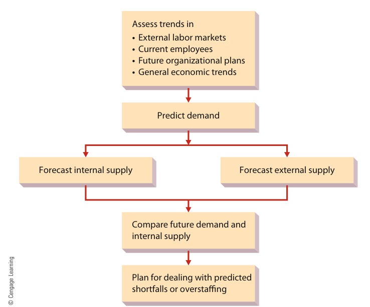

[← Previous: M05.3: Vroom's Expectancy, McGregor X/Y, and ERG Theories](M05.3_Vroom_Expectancy_McGregor_XY_and_ERG_Theories.md) | [🏠 Index](00_Index.md) | [Next: M06.2: Performance Appraisal Methods and Rating Errors →](M06.2_Performance_Appraisal_Methods_and_Rating_Errors.md)

---

# M06.1: HRM, Recruitment, Selection, and Training

> **Section:** Section B (CO2 · Industrial Management · Dr. Md. Rabiul Islam Sir) | **Priority:** 🟡 Medium | **Exam Frequency:** Tested in 2020 Final (12 marks total across Q.3)
> **Subtopics Covered:** `M06.1` (Human Resource Management definition, human capital, core activities, Job Analysis, and HR Planning Process), `M06.2` (Recruitment vs. Selection, Internal vs. External sources, selection tools, Realistic Job Previews), `M06.3` (Employee Training vs. Development, Training Methods, training needs assessment, and necessity of training)
> **Sources:** Griffin Chapter 8 (Part 1 and Part 2), MRI Sir Lecture Notes, Previous Year Questions (`2020 Q.3(a)`, `2020 Q.3(b)`, `2020 Q.3(c)`)

## Why This Topic Matters

Human resource management forms the people foundation of modern engineering companies. Plants and tech firms need skilled engineers and operators. Without proper hiring and training, equipment breaks down and defect rates climb.

In the 2020 exam, Question 3 tested HRM across three sub-questions for 12 total marks. Examiners expect clear definitions, sharp comparison tables, and concrete engineering workplace examples.

---

## 📝 Key Definitions

> **Human Resource Management (HRM):** "The set of organizational activities directed at attracting, developing, and maintaining an effective workforce." (Ricky W. Griffin)

HRM covers the full employee life cycle. It starts with workforce planning. It continues through training and daily work. It ends when a worker retires or leaves.

> **Human Capital:** "Reflects the organization's investment in attracting, retaining, and motivating an effective workforce." (Ricky W. Griffin)

Human capital treats people as valuable business assets. Just like financial capital, human capital creates long-term competitive value.

> **Job Analysis:** "A systematic analysis of jobs within an organization." (Ricky W. Griffin)

Job analysis studies what workers actually do. It produces two distinct written documents: a job description and a job specification.

> **Recruiting:** "The process of attracting individuals to apply for jobs that are open." (Ricky W. Griffin)

Recruiting builds a large, qualified applicant pool. It encourages people inside and outside the company to apply.

> **Selection:** The process of gathering information from applicants, predicting job success, and hiring the best candidate.

Selection filters applicants through tests and interviews. It chooses the candidate most likely to succeed.

> **Training:** "Teaching operational or technical employees how to do the job for which they were hired." (Ricky W. Griffin)

Training focuses on current technical skills. It improves immediate, short-term operational performance.

> **Development:** "Teaching managers and professionals the skills needed for both present and future jobs." (Ricky W. Griffin)

Development focuses on broad conceptual and human skills. It prepares leaders for future career responsibilities.

---

## Core Theory: Human Resource Management Foundations

### 1. The Strategic Importance of HRM

Years ago, companies treated human resources as a simple clerical unit called personnel. Today, managers view talent as a key competitive advantage:

1. **Impact on Profitability:** Poor hiring leads to high turnover and costly training cycles. Strategic hiring puts the right talent into critical growth projects.
2. **Legal Compliance:** Modern labor laws regulate equal employment, wages, hours, and workplace safety. Sound HR policies protect companies from expensive lawsuits and penalties.
3. **Shared Responsibility:** Line managers and HR specialists share HR duties. The HR department designs hiring policies and runs initial screening. The line manager makes the final hiring choice and coaches workers.

### 2. The Three Core Activities of HRM

HRM includes three broad activities:

1. **Attracting Human Resources:** Human resource planning, job analysis, forecasting labor needs, recruiting applicants, and selecting candidates.
2. **Developing Human Resources:** Running onboarding programs, technical training, executive development, performance appraisal, and coaching sessions.
3. **Maintaining Human Resources:** Setting fair wages, managing employee benefits, enforcing safety rules, and handling labor union relations.

> [!tip] Memory Hook: **A-D-M**
> Remember the three core activities of HRM:
> - **A** = **A**ttracting (planning, recruitment, and selection)
> - **D** = **D**eveloping (training, coaching, and performance appraisal)
> - **M** = **M**aintaining (compensation, employee benefits, and workplace safety)

---

## Core Theory: Human Resource Planning and Job Analysis

### 1. Job Analysis: Job Description vs. Job Specification

Job analysis breaks every position into clear requirements. It provides the foundation for hiring, wage setting, and appraisal. It creates two distinct documents:

- **Job Description:** Focuses on the job itself. It lists the job title, main duties, physical working conditions, tools, and machinery used.
- **Job Specification:** Focuses on the person performing the job. It lists the required education, technical skills, certifications, experience, and physical abilities.

| Basis of Comparison | Job Description | Job Specification |
| :--- | :--- | :--- |
| **Primary Focus** | The job itself (tasks and workplace environment) | The person (human qualifications and skills) |
| **Key Question** | "What does this job involve?" | "Who is qualified to do this job?" |
| **Typical Contents** | Duties, responsibilities, machinery used, work conditions | Education, technical skills, credentials, years of experience |
| **Primary Use** | Writing job advertisements and performance standards | Screening candidate applications and setting test hurdles |
| **Electronics Plant Example** | "Solder surface-mount circuit boards on assembly line 3" | "B.Sc. in EEE or Diploma in Electronics with 2 years experience" |

> [!tip] Memory Hook: **The D vs. S Rule**
> - Job **D**escription = **D**uties and work environment.
> - Job **S**pecification = **S**kills and personal credentials.

### 2. The Human Resource Planning Process

Human resource planning ensures a firm has the right skilled workers at the right time. The process follows logical steps:

1. **Assess Past and Current Trends:** Review past workforce usage, future sales plans, and economic conditions.
2. **Predict Labor Demand:** Use sales forecasts and staffing ratios to estimate future workforce needs.
3. **Forecast Internal Labor Supply:** Count current workers ready for open jobs at future dates. Managers use two planning tools:
   - **Replacement Chart:** Lists each key managerial job, the current occupant, expected tenure, and qualified internal successors.
   - **Skills Inventory (Employee Information System):** A database recording each worker's education, skills, certifications, and career goals.
4. **Forecast External Labor Supply:** Estimate the number of qualified workers available in the general labor market. Planners check government labor reports and college graduation figures.
5. **Compare Demand and Internal Supply:** Check if future needs match internal worker availability.
6. **Plan for Shortfalls or Overstaffing:**
   - *If a shortfall occurs:* Hire new external workers, retrain current staff, or delay worker retirements.
   - *If overstaffing occurs:* Transfer extra workers, pause hiring, offer early retirements, or lay off workers.

*Figure 8.1: The Human Resource Planning Process (Source: Griffin, Fundamentals of Management, 8th ed., p. 260)*

---

## Core Theory: Recruitment and Selection

### 1. Recruitment: Building the Applicant Pool

Recruiting attracts qualified individuals to apply for open jobs. Companies recruit from two sources:

#### A. Internal Recruiting
Internal recruiting considers current employees for promotions or lateral transfers.
- *Methods:* Internal job postings on company intranets, skills inventory searches, and manager recommendations.
- *Advantages:* Boosts worker morale, protects investments in trained staff, and uses proven worker performance records.
- *Disadvantages:* Creates a **ripple effect**. Moving one employee leaves another position empty. It also limits fresh ideas from the outside.

#### B. External Recruiting
External recruiting seeks candidates from outside the organization.
- *Methods:* College campus drives, online job boards, newspaper ads, employment agencies, and walk-in applicants.
- *Advantages:* Brings new ideas, modern technical knowledge, and diverse perspectives into the firm.
- *Disadvantages:* Costs more in advertising and agency fees. It also requires longer onboarding and orientation periods.

| Basis of Comparison | Internal Recruiting | External Recruiting |
| :--- | :--- | :--- |
| **Target Candidate Pool** | Current company employees | People outside the company |
| **Main Tools** | Intranet job postings, replacement charts, skills database | Job websites, campus recruiting, ads, headhunters |
| **Morale Impact** | High (rewards hard work with promotion) | Lower for existing staff passed over for promotion |
| **Cost and Speed** | Cheaper and quicker to fill vacancies | More expensive and takes longer to screen |
| **New Ideas** | Limited (reinforces existing workplace habits) | High (introduces fresh techniques and viewpoints) |
| **Side Effect** | Creates a ripple effect of successor vacancies | Solves the vacancy without creating another inside opening |

### 2. Realistic Job Previews (RJP)

Some managers exaggerate job benefits to attract top candidates. When new hires discover routine or dull tasks, they quit quickly. 

A **Realistic Job Preview (RJP)** shows applicants both good and bad job aspects before hiring. It describes actual duties, physical demands, and work hours. Candidates form accurate expectations. As a result, early job dissatisfaction and employee turnover drop significantly.

### 3. Selection: Choosing the Best Candidate

Selection gathers information from applicants to predict future job performance. A selection device is valid if test scores directly predict real job success. This quality is called **validation**.

Companies use five main selection tools:

1. **Application Blanks:** Gathers factual information about education, previous jobs, and technical credentials. By law, it must avoid personal questions about religion, race, or family plans.
2. **Employment Tests:** Measures ability, technical skill, or mechanical aptitude. Tests must be validated and given under identical, fair conditions.
3. **Interviews:** Evaluators speak directly with applicants. Unstructured interviews often suffer from personal biases. Organizations use **structured interviews**, where every candidate answers the same prepared questions.
4. **Assessment Centers:** A multi-day simulation of managerial tasks. Groups of candidates handle public speaking, business cases, and group exercises. Trained managers evaluate their leadership skills.
5. **Other Techniques:** Physical exams, drug screening tests, and professional reference checks confirm fitness and reliability.

---

## Comparison Table: Recruitment vs. Selection

Recruitment and selection work together in sequence. But they differ in purpose, method, and outcome:

| Basis of Comparison | Recruitment | Selection |
| :--- | :--- | :--- |
| **1. Meaning** | Attracting qualified candidates to apply for open positions | Evaluating applicants to hire the most suitable candidate |
| **2. Primary Goal** | Creates a large pool of applicants | Filters the pool to pick the best individual |
| **3. Nature of Process** | **Positive process** (encourages many people to apply) | **Negative process** (screens out and rejects applicants) |
| **4. Sequence** | First step (precedes selection) | Second step (begins only after recruiting creates a pool) |
| **5. Core Methods** | Campus visits, online job ads, referrals, internal postings | Application forms, skill tests, interviews, reference checks |
| **6. Cost and Time** | Less expensive per applicant; quick broad outreach | Costly and time-consuming due to thorough testing |
| **7. Final Outcome** | Produces a list of interested job seekers | Results in an official job offer and employment contract |

> [!tip] Memory Hook: **Positive vs. Negative Filter**
> - **Recruitment is Positive:** It opens the door and welcomes everyone qualified.
> - **Selection is Negative:** It shuts the door on unsuitable applicants until only one remains.

---

## Core Theory: Employee Training and Development

### 1. Training vs. Development

Organizations invest heavily in learning programs. Training and development target different groups and time horizons:

| Basis of Comparison | Employee Training | Employee Development |
| :--- | :--- | :--- |
| **Target Group** | Operational, manual, and technical workers | Managers, supervisors, and professional staff |
| **Core Objective** | Teaches specific skills for the current job | Builds conceptual and leadership skills for future roles |
| **Time Horizon** | Short-term focus (immediate job tasks) | Long-term focus (career growth and future positions) |
| **Content Type** | Concrete technical steps, machine safety, tool usage | Strategic planning, conflict resolution, decision making |
| **Engineering Example** | Teaching an operator how to run a pick-and-place robot | Coaching a senior engineer to manage an entire design team |

### 2. Assessing Training Needs

Managers must diagnose performance problems before creating training courses:
- If workers lack skill or equipment knowledge, training solves the issue.
- If workers lack motivation or use obsolete machines, training will not help. Managers must fix incentives or tools instead.

### 3. Common Training Methods

Organizations choose training methods based on the learning material:

1. **On-the-Job Training:** Trainees practice actual work tasks under an experienced mentor. Methods include apprenticeships, job rotation, and direct coaching. It provides immediate feedback.
2. **Vestibule Training:** Trainees work on real equipment in a separate area away from the actual production floor. This setup lets workers practice safety and precision without the pressure of production quotas.
3. **Simulations:** Uses hardware or software models of real equipment. Common examples include flight simulators for pilots and circuit simulation tools for electronics engineers.
4. **Classroom Lectures and Web-Based Modules:** Delivers factual rules, safety codes, and company policies. Web modules allow self-paced study and cut travel expenses.
5. **Corporate Universities:** Dedicated in-house learning facilities run by large companies. Examples include McDonald's Hamburger University and General Electric's Crotonville facility.

### 4. Evaluating Training

Companies evaluate training programs to verify their return on investment. Managers measure:
- Trainee reactions during the course.
- Skill test scores after the training ends.
- **On-the-job performance improvement:** This is the most critical test. Training succeeds only when actual workplace output, quality, and safety improve.

### 5. Why Employee Training Is Necessary

In modern industrial and engineering firms, systematic training is essential for six major reasons:

1. **Adapting to Technological Change:** Industrial plants frequently adopt automated SMT lines, PLCs, robotics, and new CAD software. Training helps technical staff master these tools quickly.
2. **Higher Productivity and Product Quality:** Untrained operators make errors and work slowly. Training builds speed and manual precision. It reduces scrap rates and ensures consistent product quality.
3. **Workplace Health and Safety:** Engineering plants feature high-voltage lines, chemicals, and heavy machinery. Safety training teaches correct handling rules and emergency routines. This prevents fatal accidents.
4. **Reduced Maintenance and Machine Downtime:** Trained workers operate sensitive equipment within safe limits. They spot minor equipment faults early, preventing expensive breakdowns.
5. **Reduced Need for Close Supervision:** Skilled workers solve routine technical problems independently. This frees managerial time and lets supervisors guide larger teams.
6. **Higher Morale and Worker Retention:** Investing in employee skills shows that the company values its workforce. This boosts loyalty, job satisfaction, and worker retention.

> [!tip] Memory Hook: **T-E-C-H-S-M**
> Remember the six reasons for employee training:
> - **T** = **T**echnological adaptation (mastering robots, PLCs, and new tools)
> - **E** = **E**rror reduction and quality (lower scrap and higher output)
> - **C** = **C**ost and downtime drop (fewer machinery breakdowns)
> - **H** = **H**ealth and safety (preventing industrial accidents)
> - **S** = **S**upervision reduction (operators work independently)
> - **M** = **M**orale and retention (workers feel valued and stay longer)

---

## Exam Variants

| Year / Paper | Question Text | Marks | Key Focus / Takeaway |
| :--- | :--- | :---: | :--- |
| **2020 Q.3(a)** | What is human resources management? | 03 | State Griffin's definition and explain the three activities: attracting, developing, and maintaining. |
| **2020 Q.3(b)** | Distinguish between recruitment and selection. | 04 | Contrast recruitment (positive pool building) against selection (negative filtering) across 7 parameters. |
| **2020 Q.3(c)** | What is meant by employee training? Why is it necessary? | 05 | Define training versus development, outline training methods, and give 6 core reasons for training. |

---

## 🏆 Golden Questions (Past Exam Archive and Model Answers)

### 🎯 GQ1 · 2020 Q.3(a) · Human Resources Management: Definition and Scope (03 Marks)

> **Appeared:** 2020 Final Exam · Section A · Q.3(a) · (03 Marks)

**Question:**  
What is human resources management?

**Full Answer:**

#### 1. Definition
**Human Resource Management (HRM)** is the set of organizational activities directed at attracting, developing, and maintaining an effective workforce (Ricky W. Griffin).

HRM treats employees as **human capital**. Human capital represents an organization's investment in hiring, training, and retaining skilled people. It serves as a tangible measure of the value of an organization's workforce.

#### 2. Scope and Core Functional Activities
The scope of HRM covers three interrelated activities:

1. **Attracting Human Resources:**
   - Conducting job analysis to generate job descriptions and job specifications.
   - Forecasting labor demand and supply using sales estimates, replacement charts, and skills inventories.
   - Recruiting applicants through internal and external channels.
   - Selecting qualified candidates using application forms, skill tests, and structured interviews.
2. **Developing Human Resources:**
   - Designing employee training programs for technical staff.
   - Providing development programs for managers and professionals.
   - Conducting formal performance appraisals to measure job results.
   - Providing performance feedback and career coaching.
3. **Maintaining Human Resources:**
   - Setting competitive wage levels, wage structures, and individual pay rates.
   - Managing employee benefit plans including health insurance and pensions.
   - Maintaining labor relations with trade unions and handling employee grievances.
   - Enforcing workplace safety and statutory health standards.

---

### 🎯 GQ2 · 2020 Q.3(b) · Distinction Between Recruitment and Selection (04 Marks)

> **Appeared:** 2020 Final Exam · Section A · Q.3(b) · (04 Marks)

**Question:**  
Distinguish between recruitment and selection.

**Full Answer:**

#### 1. Conceptual Distinction
Recruitment and selection are two consecutive stages in acquiring human resources. Recruitment identifies potential job seekers and encourages them to apply. Selection evaluates those applicants to choose the best individual for the open job.

#### 2. Detailed Comparison Table

| Comparison Parameter | Recruitment | Selection |
| :--- | :--- | :--- |
| **1. Meaning** | The process of finding prospective workers and stimulating them to apply for vacancies. | The process of evaluating candidates to choose the best person for employment. |
| **2. Objective** | Creates a large pool of qualified candidates for open jobs. | Picks the most suitable person and rejects unsuitable applicants. |
| **3. Nature of Process** | A **positive process** because it invites as many qualified candidates as possible. | A **negative process** because it eliminates candidates at each evaluation stage. |
| **4. Order and Sequence** | First phase. It comes before the selection process. | Second phase. It begins only after recruitment creates an applicant pool. |
| **5. Methods Used** | Campus drives, online job boards, newspaper ads, internal job postings. | Application blanks, skill tests, structured interviews, assessment centers. |
| **6. Cost and Time** | Incurs lower cost and less administrative time per applicant. | Demands substantial cost and time for testing, interviewing, and background checks. |
| **7. Contractual Result** | Does not create an employment contract; it only produces applications. | Concludes with an official appointment letter and a binding employment contract. |

#### 3. Recruitment Sources Note
Organizations attract recruits from two sources:
- **Internal Sources:** Transfers and promotions through skills inventories and company intranets. This boosts worker morale but causes a ripple effect.
- **External Sources:** Campus visits, online ads, and agencies. This brings fresh skills into the company but costs more money.

---

### 🎯 GQ3 · 2020 Q.3(c) · Employee Training: Meaning and Necessity (05 Marks)

> **Appeared:** 2020 Final Exam · Section A · Q.3(c) · (05 Marks)

**Question:**  
What is meant by employee training? Why is it necessary?

**Full Answer:**

#### 1. Meaning of Employee Training
**Employee training** is the process of teaching operational or technical employees how to do the specific job for which they were hired (Ricky W. Griffin).

Training focuses on immediate operational tasks and short-term job skills. In contrast, **development** teaches managers and professionals broader conceptual, human, and leadership skills for future responsibilities.

Common training methods include:
- **On-the-Job Training:** Trainees learn while working on actual equipment under supervisory coaching.
- **Vestibule Training:** Trainees practice on real equipment in a separate mock facility. This focuses on safety and learning without production pressure.
- **Simulations and Computer Modules:** Trainees practice on simulated hardware or software tools.
- **Classroom Instruction:** Instructors teach operating rules, safety regulations, and company policies.

#### 2. Necessity of Employee Training
Systematic training is essential in modern industrial and engineering enterprises for six major reasons:

1. **Mastery of Technological Change:** Engineering industries frequently introduce computerized equipment, automated assembly lines, and new software. Training enables technical workers to operate new tools safely and proficiently.
2. **Improved Productivity and Quality:** Untrained workers work slowly and make costly errors. Proper training sharpens manual precision, speeds up work cycles, reduces scrap rates, and ensures uniform product quality.
3. **Workplace Health and Industrial Safety:** Industrial plants contain hazards like high voltage, toxic chemicals, and high-speed machinery. Safety training teaches correct operating procedures and emergency reactions. This minimizes fatal workplace accidents.
4. **Reduced Machine Breakdown and Downtime:** Trained operators handle delicate equipment properly and detect minor malfunctions early. This cuts repair costs and prevents production shutdowns.
5. **Reduced Need for Close Supervision:** Trained employees understand their job duties and solve routine technical problems independently. This frees up managerial time and expands the manager's span of control.
6. **Higher Morale and Lower Employee Turnover:** When an enterprise invests in worker skills, employees feel valued. This raises job satisfaction, enhances company loyalty, and lowers employee turnover.

---

## ⚡ Exam Tips and Common Mistakes

1. **Memorize Griffin's Three Verbs:** Always define HRM using *attracting, developing, and maintaining*. Writing only "hiring people" loses marks.
2. **Remember Positive vs. Negative:** State clearly that recruitment is positive (gathering applicants). In contrast, selection is negative (filtering applicants).
3. **Do Not Confuse Description with Specification:** Job *description* covers the job tasks and conditions. Job *specification* covers the human qualities and credentials.
4. **Distinguish Training from Development:** Remember that training trains operational staff for current jobs. Development develops managers for future career growth.
5. **Always Give Engineering Examples:** Mention real examples like high-voltage safety, automated assembly lines, or circuit testing.

## 🔗 Related Topics

- [M05.3: Vroom's Expectancy, McGregor X/Y, and ERG Theories](M05.3_Vroom_Expectancy_McGregor_XY_and_ERG_Theories.md)
- [M06.2: Performance Appraisal Methods and Rating Errors](M06.2_Performance_Appraisal_Methods_and_Rating_Errors.md)
- [M02.1: Management Levels and Functional Areas](M02.1_Management_Levels_and_Functional_Areas.md)

---

[← Previous: M05.3: Vroom's Expectancy, McGregor X/Y, and ERG Theories](M05.3_Vroom_Expectancy_McGregor_XY_and_ERG_Theories.md) | [🏠 Index](00_Index.md) | [Next: M06.2: Performance Appraisal Methods and Rating Errors →](M06.2_Performance_Appraisal_Methods_and_Rating_Errors.md)
