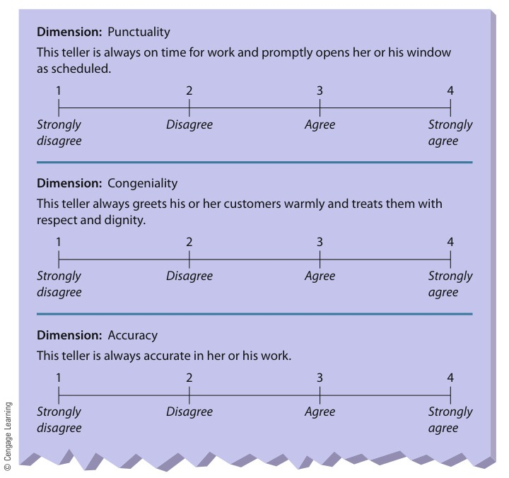
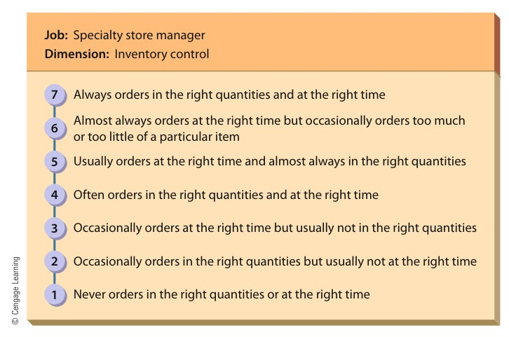

[← Previous: M06.1: HRM, Recruitment, Selection, and Training](M06.1_HRM_Recruitment_Selection_and_Training.md) | [🏠 Index](00_Index.md) | [Next: O01.1: Inventory Control and Holding Costs →](O01.1_Inventory_Control_and_Holding_Costs.md)

---

# M06.2: Performance Appraisal Methods and Rating Errors

> **Section:** Section B (CO2 · Industrial Management · Md. Rokonuzzaman Sir) | **Priority:** 🔴 Essential | **Exam Frequency:** Tested in every single paper (2020, 2021, 2023, 2024)
> **Subtopics Covered:** `M06.4` (Performance Management vs. Performance Appraisal, appraisal objectives, evaluators, appraisal methods), `M06.5` (Potential rating-scale appraisal problems `H-L-S-C-R-C` and 5 remedies to avoid them)
> **Sources:** Griffin Chapter 8 (Part 1 and Part 2), MRI Sir Lecture Notes, Previous Year Questions (`2020 Q.2(b)`, `2021 Q.4(c)`, `2023 Q.8(c)`, `2024 Q.8(b)`)

## Why This Topic Matters

Performance appraisal appears in every single HUM 2217 final examination. It is one of the highest-yield topics in Industrial Management.

Examiners test both theory and practical application. You will be asked who should evaluate employees and how graphic rating scales compare to BARS. You will also explain the six rating scale errors and how to eliminate them. Master this topic to secure 4 to 6 easy marks.

---

## 📝 Key Definitions

> **Performance Appraisal:** "A formal assessment of how well an employee is doing his or her job." (Ricky W. Griffin)

Performance appraisal evaluates past work. It provides documentation for salary increases, promotions, and training needs.

> **Performance Management:** The continuous process of identifying, measuring, and developing employee performance to match company goals.

Performance management is broader than appraisal. It combines goal setting, regular feedback, coaching, and annual performance evaluation.

> **Graphic Rating Scale:** A rating method that lists job traits alongside a fixed numerical or descriptive scale.

Supervisors circle numbers or check boxes indicating whether an employee agrees with specific behavioral statements.

> **Behaviorally Anchored Rating Scale (BARS):** "A sophisticated rating method in which supervisors construct a rating scale associated with behavioral anchors." (Ricky W. Griffin)

BARS replaces vague numbers with clear descriptions of observable job behaviors for each point on the scale.

> **360-Degree Feedback:** "A performance appraisal system in which managers are evaluated by everyone around them: their boss, their peers, and their subordinates." (Ricky W. Griffin)

This system gathers feedback from all angles. It gives workers a complete view of their strengths and blind spots.

---

## Core Theory: Performance Appraisal vs. Performance Management

### 1. Conceptual Distinction

Many students confuse performance appraisal with performance management:
- **Performance Appraisal:** A periodic, backward-looking event. It usually happens once or twice a year to score past results.
- **Performance Management:** An ongoing, forward-looking managerial system. It defines goals, monitors progress, coaches workers daily, and reviews overall results.

| Basis of Comparison | Performance Appraisal | Performance Management |
| :--- | :--- | :--- |
| **1. Nature** | A formal, periodic evaluation event | An ongoing, continuous organizational system |
| **2. Time Focus** | Backward-looking (evaluates past work) | Forward-looking (develops future capability) |
| **3. Primary Goal** | Assess past performance for administrative decisions | Align daily individual output with company goals |
| **4. Frequency** | Conducted annually or semi-annually | Carried out continuously through daily coaching |
| **5. Scope** | Individual evaluation tool | Broad system including goals, feedback, and rewards |
| **6. Role of Manager** | Acts as an evaluator and judge | Acts as a coach, guide, and mentor |

### 2. Three Core Objectives of Performance Appraisal

Organizations conduct regular performance evaluations for three reasons:

1. **Administrative Decisions:** Appraisals supply documented proof for salary raises, promotions, demotions, transfers, and terminations.
2. **Employee Development:** Appraisals identify specific skill gaps and training needs. They guide career planning and provide coaching feedback.
3. **Selection Device Validation:** Appraisals show whether hiring tests and selection interviews actually predicted job success.

> [!tip] Memory Hook: **The A-D-V Objectives**
> Remember the three purposes of performance appraisal:
> - **A** = **A**dministrative (pay raises, promotions, and job transfers)
> - **D** = **D**evelopmental (feedback, training needs, and coaching)
> - **V** = **V**alidation (verifying tests and selection tools)

---

## Core Theory: Who Should Do the Appraisal (Evaluator Sources)

Choosing the right rater ensures balanced and fair feedback. Organizations use six evaluation sources:

1. **Immediate Supervisor:**
   - The most common and traditional evaluator.
   - The direct supervisor assigns tasks, observes daily output, and knows job requirements best.
   - *Limitation:* The supervisor may hold personal biases or miss informal peer interactions.

2. **Peers and Coworkers:**
   - Peers work alongside the employee every day.
   - They see teamwork, reliability, and technical cooperation directly.
   - *Limitation:* Peers may hesitate to criticize friends or may compete for the same promotion.

3. **Subordinates (Upward Appraisal):**
   - Subordinates evaluate their direct managers.
   - They offer valuable insight into leadership style, communication clarity, and fairness.
   - *Limitation:* Subordinates may fear retaliation unless ratings remain strictly anonymous.

4. **Self-Appraisal:**
   - The employee evaluates their own work and lists key accomplishments.
   - It encourages personal reflection and helps prepare the employee for the appraisal meeting.
   - *Limitation:* Employees often rate their own performance too generously.

5. **Customers and External Clients:**
   - Used for service jobs, technical support, and project management.
   - Clients judge responsiveness, courtesy, and product reliability.

6. **360-Degree Feedback:**
   - Evaluates a manager using ratings from everyone around them: boss, peers, subordinates, and clients.
   - It provides a well-rounded picture of workplace performance.
   - *Limitation:* It takes substantial time to compile and requires high trust among staff.

> [!tip] Memory Hook: **S-P-S-S-C-3 (The Appraisal Circle)**
> - **S** = **S**upervisor (direct daily manager)
> - **P** = **P**eers (coworkers on the team)
> - **S** = **S**ubordinates (upward feedback from below)
> - **S** = **S**elf (personal self-reflection)
> - **C** = **C**ustomers (external client satisfaction)
> - **3** = **3**60-degree feedback (combines all sources)

---

## Core Theory: Performance Appraisal Methods

Organizations use objective methods and judgmental methods to evaluate performance.

### 1. Objective Methods

Objective methods evaluate measurable work facts rather than supervisor opinions.

1. **Measurable Output:**
   - Tracks physical volume: circuit boards soldered, software modules coded, or sales dollars generated.
   - **Opportunity Bias:** Raw output can mislead managers if territory conditions differ. For example, a sales rep in Dhaka has more customer opportunities than one in a remote village. Managers must adjust figures for opportunity bias.
2. **Special Performance Tests:**
   - Employees perform standardized tasks under identical laboratory or test booth conditions.
   - This eliminates opportunity bias and tests pure ability.
   - *Limitation:* Tests measure ability, but they do not measure daily work motivation.

### 2. Judgmental Methods

Judgmental methods evaluate employee behaviors and performance qualities through human judgment.

#### A. Graphic Rating Scales
A graphic rating scale lists performance traits (such as punctuality, congeniality, and accuracy). The supervisor marks a number or checkbox on a rating scale for each trait.

*Figure 8.2: Graphic Rating Scales for a Bank Teller (Source: Griffin, Fundamentals of Management, 8th ed., p. 267)*

- *Advantages:* Inexpensive to create, simple to use, and easy to score across large departments.
- *Disadvantages:* Scale numbers are vague. Different managers define "agree" or "average" differently.

#### B. Behaviorally Anchored Rating Scales (BARS)
BARS improves on standard rating scales. Supervisors define a performance dimension (such as inventory control). Then, they anchor each scale point (1 to 7) to specific, observable job actions.

*Figure 8.3: Behaviorally Anchored Rating Scale (BARS) for Inventory Control (Source: Griffin, Fundamentals of Management, 8th ed., p. 268)*

- *Advantages:* High evaluation accuracy, objective anchors, and clear behavioral feedback for employees.
- *Disadvantages:* Very expensive and time-consuming. Experts must develop custom scales for every distinct job.

#### C. Ranking Techniques
- **Simple Ranking:** Ranks employees from best to worst on overall performance.
- **Forced Distribution:** Assigns employees into fixed percentage brackets (e.g., $10\%$ top, $80\%$ middle, $10\%$ bottom).
- *Drawbacks:* Difficult in large departments. Middle employees are hard to separate. It offers poor diagnostic feedback.

#### D. Management by Objectives (MBO)
Subordinates and managers agree on specific, measurable goals at the start of the period. At the end, they meet to evaluate actual results against targets.

#### E. Critical Incident Method
Supervisors record notable positive and negative employee actions in a written log over the year. This provides factual evidence during appraisal interviews.

---

## Comparison Table: Graphic Rating Scales vs. BARS

| Comparison Basis | Graphic Rating Scale | Behaviorally Anchored Rating Scale (BARS) |
| :--- | :--- | :--- |
| **1. Scale Anchors** | Vague numbers (1 to 5) or adjectives (poor, average, good) | Concrete descriptions of observable job behaviors |
| **2. Development Cost** | Very low; generic templates fit many jobs | Very high; requires job analysis for each position |
| **3. Objectivity** | Low; subject to personal interpretation and rating bias | High; anchors force raters to focus on factual actions |
| **4. Feedback Quality** | Poor; employee only learns their numerical score | Excellent; employee sees which behaviors raise their score |
| **5. Rater Agreement** | Low; different raters interpret points differently | High; distinct anchors lead to consistent ratings |
| **6. Example Scale Point** | Point 4: "Above average accuracy" | Point 6: "Checks inventory weekly and reorders on time" |

---

## Core Theory: Potential Rating-Scale Appraisal Problems

Even well-designed rating scales suffer from human judgment errors. Supervisors frequently fall into six perceptual traps:

> [!tip] Memory Hook: **H-L-S-C-R-C (The 6 Appraisal Errors)**
> Remember the six rating scale errors in order:
> - **H** = **H**alo / Horns error (one trait colors the entire evaluation)
> - **L** = **L**eniency error (rating everyone too generously)
> - **S** = **S**trictness error (rating everyone too harshly)
> - **C** = **C**entral tendency error (putting everyone in the safe middle)
> - **R** = **R**ecency error (remembering only the last few weeks)
> - **C** = **C**ontrast error (judging a worker against the previous person)

### 1. Halo and Horns Error
- **Halo Error:** A supervisor lets an outstanding rating on one trait influence all other ratings. For example, an engineer is always punctual. The boss gives high marks for circuit design, even when designs contain errors.
- **Horns Error:** The opposite mistake. A single weak trait pulls down every other score on the evaluation sheet.

### 2. Leniency Error
The supervisor rates all workers near the top of the scale. Managers do this to avoid interpersonal conflict, please subordinates, or help them get company bonuses. However, it fails to reward real top performers.

### 3. Strictness (Severity) Error
The evaluator rates all workers near the bottom of the scale. The supervisor applies unrealistically severe standards. Even outstanding contributors receive mediocre marks, which damages morale.

### 4. Central Tendency Error
The evaluator rates every employee as "average" by sticking to the middle of the scale. Supervisors do this to play it safe and avoid justifying high or low marks. This conceals true differences in performance.

### 5. Recency Error
The evaluator bases scores only on performance from the past two or three weeks. They forget work done earlier in the year. A worker who coasts for ten months gets high marks after a single good week.

### 6. Contrast Error and Personal Bias
- **Contrast Error:** The supervisor compares a worker to the person evaluated just before them, instead of against job standards. An average worker looks terrible right after a superstar.
- **Personal Bias:** The evaluator lets personal prejudices based on age, gender, race, or background distort performance scores.

---

## Core Theory: Ways to Avoid Appraisal Problems (Remedies)

Organizations use five proven methods to eliminate rating scale errors:

1. **Adopt Behaviorally Anchored Rating Scales (BARS):** BARS replaces vague numbers with explicit descriptions of job actions. This forces raters to evaluate actual facts rather than subjective impressions.
2. **Conduct Systematic Rater Training:** Train managers to spot perceptual traps like halo, leniency, and central tendency errors. Video exercises teach raters how to apply standards consistently.
3. **Keep Critical Incident Performance Diaries:** Supervisors maintain a year-round log of notable positive and negative employee actions. This provides factual evidence and eliminates recency error.
4. **Use Multiple Evaluators and 360-Degree Feedback:** Collect ratings from supervisors, coworkers, and subordinates. Combining multiple viewpoints cancels out individual supervisor bias.
5. **Establish Objective Benchmarks and Use MBO:** Define measurable targets together using Management by Objectives. Concrete numbers leave no room for subjective guesswork.

> [!tip] Memory Hook: **B-R-D-M-M (The 5 Remedies)**
> - **B** = **B**ARS (anchoring scales to observable behaviors)
> - **R** = **R**ater training (teaching managers to avoid bias)
> - **D** = **D**iaries of critical incidents (eliminating recency error)
> - **M** = **M**ultiple evaluators and 360-degree feedback (canceling rater bias)
> - **M** = **M**BO and measurable benchmarks (setting clear objective goals)

---

## Exam Variants

| Year / Paper | Question Summary | Marks | Key Focus / Takeaway |
| :--- | :--- | :---: | :--- |
| **2023 Q.8(c)** | What is performance management? Who should do the appraisal and in what ways? | 03 | Define performance management, list 5 evaluation sources, and contrast objective vs. judgmental methods. |
| **2024 Q.8(b)** | State potential rating-scale appraisal problems and suggest ways to avoid the problems. | 04 | Detail all 6 rating errors using `H-L-S-C-R-C` and outline 5 concrete managerial remedies. |
| **2020 Q.2(b)** | What is performance appraisal? Explain the potential rating scale appraisal problems. | 06 | Define performance appraisal (2m) and explain the 6 rating scale errors in depth (4m). |
| **2021 Q.4(c)** | What is performance management? State the potential rating scale appraisal problems. | 04 | Define performance management (2m) and list the 6 rating scale appraisal errors (2m). |

---

## 🏆 Golden Questions (Past Exam Archive and Model Answers)

### 🎯 GQ1 · 2023 Q.8(c) · Performance Management, Evaluators, and Appraisal Methods (03 Marks)

> **Appeared:** 2023 Final Exam · Section B · Q.8(c) · (03 Marks)

**Question:**  
What is performance management? Who should do the appraisal and in what ways?

**Full Answer:**

#### 1. Definition of Performance Management
**Performance management** is the continuous process of identifying, measuring, and developing employee performance to meet strategic goals. It integrates clear goal setting, ongoing supervisory coaching, periodic appraisal, and feedback.

#### 2. Who Should Do the Appraisal (Evaluator Sources)
Organizations obtain performance evaluations from multiple sources:
1. **Immediate Supervisor:** The direct manager who assigns daily tasks and observes job performance firsthand.
2. **Peers and Coworkers:** Team members who observe daily collaboration, communication, and technical teamwork.
3. **Subordinates (Upward Appraisal):** Direct reports who evaluate a manager's leadership, fairness, and delegation skills.
4. **Self-Appraisal:** The employee evaluates their own work to prepare for performance discussions.
5. **360-Degree Feedback:** Gathers evaluation input from all directions: supervisors, peers, subordinates, and clients.

#### 3. In What Ways (Appraisal Methods)
Organizations evaluate performance through two broad methodological categories:

- **Objective Methods:**
  - *Measurable Output:* Tracking units produced, dollar sales volume, or scrap rates, adjusted for opportunity bias.
  - *Special Performance Tests:* Assessing employees under standardized, controlled test conditions to evaluate ability.
- **Judgmental Methods:**
  - *Graphic Rating Scales:* Rating traits like punctuality and quality on a fixed numerical or descriptive scale.
  - *Behaviorally Anchored Rating Scales (BARS):* Anchoring scale points to specific, observable behavioral descriptions.
  - *Ranking Techniques:* Ordering workers from best to worst within a work group.
  - *Management by Objectives (MBO):* Agreeing on measurable goals and evaluating results against targets.

---

### 🎯 GQ2 · 2024 Q.8(b) · Potential Rating-Scale Appraisal Problems and Remedies (04 Marks)

> **Appeared:** 2024 Final Exam · Section B · Q.8(b) · (04 Marks)

**Question:**  
State potential rating-scale appraisal problems and suggest ways to avoid the problems.

**Full Answer:**

#### 1. Potential Rating-Scale Appraisal Problems
Supervisors often introduce subjective judgment errors when using rating scales:

1. **Halo and Horns Error:** Allowing a rating on one dimension to spread to all other dimensions. For example, a punctual employee is rated high on technical design despite making schematic errors. The horns error occurs when one weak trait drags down all other scores.
2. **Leniency Error:** Rating all workers too high on the scale to avoid workplace conflict.
3. **Strictness (Severity) Error:** Rating all workers too low on the scale because of overly harsh standards.
4. **Central Tendency Error:** Grouping all workers near the scale midpoint to avoid defending high or low marks.
5. **Recency Error:** Basing ratings only on recent weeks while ignoring work done during earlier months.
6. **Contrast Error and Personal Bias:** Evaluating a worker against the person reviewed previously, rather than using fixed job standards. It also includes letting personal prejudices distort marks.

#### 2. Ways to Avoid the Problems (Remedies)
Organizations eliminate rating scale problems using five managerial practices:

1. **Implement BARS:** Use Behaviorally Anchored Rating Scales where each scale point represents a concrete, observable job behavior.
2. **Conduct Rater Training:** Train supervisors to spot and avoid rating traps like halo, leniency, and central tendency errors.
3. **Maintain Critical Incident Performance Diaries:** Keep written logs of notable employee actions across the year to eliminate recency error.
4. **Adopt Multiple Evaluators (360-Degree Feedback):** Collect ratings from supervisors, peers, and subordinates to balance individual rater bias.
5. **Set Clear Standards with MBO:** Set clear, measurable targets in advance using MBO to reduce subjective guesswork.

---

### 🎯 GQ3 · 2020 Q.2(b) · Performance Appraisal and Rating Scale Appraisal Problems (06 Marks)

> **Appeared:** 2020 Final Exam · Section A · Q.2(b) · (06 Marks)

**Question:**  
What is performance appraisal? Explain the potential rating scale appraisal problems.

**Full Answer:**

#### 1. What is Performance Appraisal?
**Performance appraisal** is a formal assessment of how well an employee is doing his or her job (Ricky W. Griffin).

Performance appraisal serves three core organizational purposes:
- **Administrative Support:** Provides formal documentation for wage increases, promotions, demotions, and dismissals.
- **Employee Development:** Pinpoints training needs, diagnoses performance deficiencies, and guides career coaching.
- **Validation:** Helps determine whether employee selection devices and training programs are predictive and effective.

#### 2. Explanation of Potential Rating Scale Appraisal Problems
Rating scales evaluate employees on fixed dimensions. However, subjective human perception introduces six common rating errors:

1. **Halo Error:**
   - Occurs when an evaluator lets a high score on one trait influence ratings on all other traits.
   - *Example:* An engineer is very friendly. The supervisor gives them top marks for troubleshooting, even when their reports contain mistakes.
   - *Note:* The reverse problem is the **horns effect**, where a single deficiency pulls down all ratings.
2. **Leniency Error:**
   - Evaluators assign scores near the top of the scale to all subordinates.
   - Managers do this to avoid conflict, appear supportive, or help subordinates earn annual bonuses.
3. **Strictness Error:**
   - Evaluators score all workers near the lower end of the scale.
   - The supervisor holds unreasonably high expectations, meaning even superior performers receive low scores.
4. **Central Tendency Error:**
   - Evaluators rate all employees as "average" by choosing only the midpoint of the rating scale.
   - Raters take the safe route to avoid justifying high or low marks, masking real performance differences.
5. **Recency Error:**
   - Evaluators remember only what the employee did during the final two or three weeks before appraisal.
   - A poor performer who works hard right before the review gets an inflated rating. Conversely, one recent mistake can ruin a year of good work.
6. **Contrast Error and Personal Prejudice:**
   - **Contrast Error:** Evaluating an employee against the colleague reviewed just before them, instead of against objective job standards.
   - **Personal Bias:** Permitting conscious or unconscious bias regarding gender, age, or background to influence scores.

---

### 🎯 GQ4 · 2021 Q.4(c) · Performance Management and Potential Rating Scale Errors (04 Marks)

> **Appeared:** 2021 Final Exam · Section A · Q.4(c) · (04 Marks)

**Question:**  
What is performance management? State the potential rating scale appraisal problems.

**Full Answer:**

#### 1. What is Performance Management?
**Performance management** is the continuous organizational process of defining, measuring, and developing employee performance to match strategic goals.

It is broader than performance appraisal. Performance management includes setting measurable objectives, providing ongoing supervisory coaching, conducting periodic appraisals, and distributing performance-based rewards.

#### 2. Potential Rating Scale Appraisal Problems
When managers use rating scales, subjective judgment leads to six potential appraisal errors:

1. **Halo / Horns Error:** Allowing a high or low score on one trait to color all other ratings.
2. **Leniency Error:** Rating all workers too high on the scale to avoid confrontation or please employees.
3. **Strictness Error:** Rating all workers too low on the scale because of excessively harsh standards.
4. **Central Tendency Error:** Rating all employees near the scale midpoint to avoid making difficult scoring decisions.
5. **Recency Error:** Over-weighting actions from the past few weeks while ignoring work done earlier in the year.
6. **Contrast Error:** Scoring an employee relative to the worker evaluated previously, rather than comparing them to job benchmarks.

---

## ⚡ Exam Tips and Common Mistakes

1. **Do Not Confuse Appraisal with Management:** Remember that performance appraisal is a periodic evaluation event. Performance management is an ongoing, year-round system.
2. **Always Use the H-L-S-C-R-C Acronym:** Write down all six errors. Students often mention only halo and recency, losing half the marks.
3. **Explain How BARS Fixes Rating Scales:** Point out that BARS uses observable behavioral descriptions instead of vague numbers.
4. **Define Opportunity Bias for Output Measures:** When explaining objective methods, note that output figures must be adjusted. Sales territories and machine conditions create unfair advantages.
5. **Mention Upward Appraisal:** When listing evaluators, include subordinates rating their managers (upward appraisal) and 360-degree feedback.

## 🔗 Related Topics

- [M06.1: HRM, Recruitment, Selection, and Training](M06.1_HRM_Recruitment_Selection_and_Training.md)
- [M05.1: Motivation Basics and Financial vs. Non-Financial Factors](M05.1_Motivation_Basics_and_Financial_vs_NonFinancial.md)
- [M04.3: Controlling Process and Steps](M04.3_Controlling_Process_and_Steps.md)
- [O01.1: Inventory Control and Holding Costs](O01.1_Inventory_Control_and_Holding_Costs.md)

---

[← Previous: M06.1: HRM, Recruitment, Selection, and Training](M06.1_HRM_Recruitment_Selection_and_Training.md) | [🏠 Index](00_Index.md) | [Next: O01.1: Inventory Control and Holding Costs →](O01.1_Inventory_Control_and_Holding_Costs.md)
