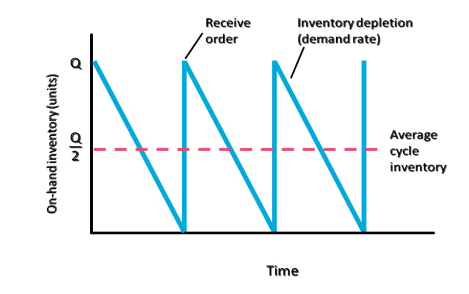
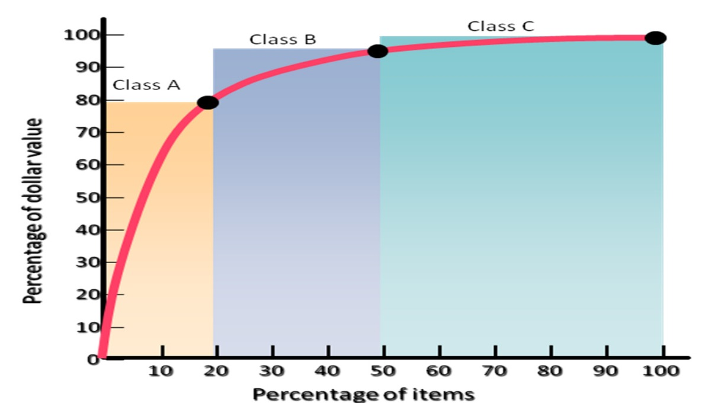

[← Previous: O01.1: Inventory Control and Holding Costs](O01.1_Inventory_Control_and_Holding_Costs.md) | [🏠 Index](00_Index.md) | [Next: O02.1: EOQ Model, ROP, Safety Stock, and Cost Curves →](O02.1_EOQ_Model_ROP_Safety_Stock_and_Cost_Curves.md)

---

# O01.2: Types of Inventory and ABC Analysis

> **Section:** Section B (CO3 · Operational Management · MRI Sir) | **Priority:** 🔴 High (Core Theory & Classification) | **Exam Frequency:** Tested in 2020 and 2023 Finals + Prescribed in Module 6
> **Subtopics Covered:** `O01.3` (4 Functional Types of Inventory: Cycle, Safety Stock, Anticipation, Pipeline), `O01.4` (ABC Inventory Analysis: Pareto Principle, Classification, and Policies)
> **Sources:** MRI Sir Inventory Control Notes (`Inventory Control.md`), Raidah Class Notes (Class 9 & 10)

## Why This Topic Matters

Operations managers cannot treat every item in a warehouse the same way. Some parts move through transit pipelines. Other parts buffer seasonal demand spikes. A few costly chips consume most of the purchase budget. Meanwhile, thousands of cheap screws take up physical shelf space. This note explains the four functional inventory types. It also covers the ABC Pareto method to focus control on high-value stock.

---

## 📝 Key Definitions

> **Cycle Inventory:** "The portion of total inventory that varies directly with lot size is called cycle inventory. Determining how frequently to order, and in what quantity, is called lot sizing." (MRI Sir, Inventory Control Notes, Page 1)

Plain English meaning: Cycle inventory is the normal stock used up between regular supplier shipments. Its average level equals half the order batch size ($Q / 2$).

> **Safety Stock Inventory:** "Safety stock inventory is surplus inventory that protects against uncertainties in demand, lead time, and supply." (MRI Sir, Inventory Control Notes, Page 1)

Plain English meaning: Safety stock is an extra cushion. It protects the factory when suppliers deliver late or customer orders spike suddenly.

> **Anticipation Inventory:** "Inventory used to absorb uneven rates of demand or supply, which business often face, is referred to as anticipation inventory." (MRI Sir, Inventory Control Notes, Page 1)

Plain English meaning: Anticipation inventory is stock built up ahead of time. Companies use it before seasonal sales rushes, supplier strikes, or plant maintenance shutdowns.

> **Pipeline Inventory:** "Inventory moving from point to point in the materials flow system is called pipeline inventory... Pipeline inventory consists of orders that have been placed but not yet received." (MRI Sir, Inventory Control Notes, Page 1)

Plain English meaning: Pipeline inventory is goods in transit. It covers materials traveling from suppliers to plants, between workstations, or to retail warehouses.

> **ABC Analysis:** "The process of dividing inventory items into three classes according to their dollar usage so that managers can focus on items that have the highest dollar value." (MRI Sir, Inventory Control Notes, Page 1)

Plain English meaning: ABC analysis divides warehouse parts into three groups by annual spending. It lets managers control high-value items tightly and manage cheap items simply.

---

## Four Functional Types of Inventory

An inventory manager cannot tell inventory types apart by looking at a physical stock pile. A resistor in transit looks identical to a resistor in safety stock. But inventory items differ fundamentally in their operational purpose.

Operations management classifies inventory into four functional categories:

1. **Cycle Inventory**
2. **Safety Stock Inventory**
3. **Anticipation Inventory**
4. **Pipeline Inventory**

> [!tip] Memory Hook · 4 Functional Inventory Types (`C-S-A-P`)
> Remember the four functional types with the acronym **C-S-A-P**:
> - **C**: **C**ycle Inventory (satisfies normal demand between orders, average level is $Q / 2$).
> - **S**: **S**afety Stock (cushions against unexpected demand surges or supplier delays).
> - **A**: **A**nticipation Inventory (buffers predictable seasonal rushes or factory shutdowns).
> - **P**: **P**ipeline Inventory (materials in transit across the supply network, $I_p = \bar{d} L$).

---

## Detailed Breakdown of Inventory Types

### 1. Cycle Inventory

Cycle inventory is the primary stock that satisfies regular day-to-day demand between shipments.

- **Lot Sizing:**
  - Deciding how frequently to order and how many units to buy is called lot sizing.
- **Two Core Operating Principles:**
  - If a firm orders stock every five weeks, the lot size ($Q$) must equal five weeks of demand.
  - The longer the time between orders, the larger the cycle inventory must be.
- **Sawtooth Pattern and Average Level:**
  - When an order of size $Q$ arrives, inventory jumps up to $Q$.
  - Items are consumed steadily at demand rate $d$ until stock hits zero.
  - The average cycle inventory equals half the order quantity:

$$
\text{Average Cycle Inventory} = \frac{Q}{2}
$$


*Figure 1: Cycle Inventory Replenishment and Depletion Sawtooth Pattern (Source: Inventory Control Notes, Page 3)*

- **ECE Example:**
  - A plant places a monthly batch order of 1200 Wi-Fi controller microchips.
  - Average cycle inventory held in the warehouse is $1200 / 2 = 600\text{ chips}$.

---

### 2. Safety Stock Inventory

Safety stock is surplus buffer stock kept on hand. It prevents assembly lines from shutting down when actual conditions deviate from forecasts.

- **Primary Causes for Holding Safety Stock:**
  - **Supplier Delays:** Vendors ship shipments behind schedule or face border customs holds.
  - **Incomplete Deliveries:** Suppliers deliver short shipments or send defective parts.
  - **Manufacturing Scrap:** In-house assembly lines produce defective printed circuit boards requiring rework.
  - **Demand Surges:** Sudden spikes in market demand exceed standard weekly forecasts.
- **Buffer Formula Preview:**
  - In continuous review systems, safety stock ($SS$) depends on service level factor ($z$), demand variability ($\sigma_d$), and lead time ($L$):

$$
SS = z \, \sigma_d \sqrt{L}
$$

- **ECE Example:**
  - A telecom equipment maker keeps an extra cushion of 250 RF amplifier modules.
  - If an overseas cargo flight is grounded for three days, the plant continues assembling cellular base stations without interruption.

---

### 3. Anticipation Inventory

Anticipation inventory is stock built up to absorb predictable, uneven rates of demand or supply. Unlike safety stock, which protects against random shocks, anticipation inventory handles planned events.

- **Common Operating Scenarios:**
  - **Seasonal Demand:** Consumer electronics companies build inventory during slow summer months. This satisfies peak December holiday demand without paying expensive factory overtime.
  - **Supplier Strikes:** A factory stockpiles imported semiconductors when an overseas port union announces an upcoming strike.
  - **Planned Plant Maintenance:** Production teams build extra inventory before a two-week factory overhaul or machine retooling shutdown.
  - **Supplier Capacity Bottlenecks:** Placing orders in advance avoids vendor supply quotas during industry-wide shortages.
- **ECE Example:**
  - A manufacturer of digital energy meters runs extra production shifts in April.
  - The company accumulates 10,000 completed meters before its primary surface-mount assembly line shuts down for yearly calibration in May.

---

### 4. Pipeline Inventory (In-Transit Inventory)

Pipeline inventory consists of materials moving from one point to another within the materials flow system.

- **Supply Chain Movement Locations:**
  - Moving from component vendors to the factory.
  - Moving between manufacturing stages inside the plant (work-in-process in transit).
  - Moving from the central factory to regional distribution warehouses.
  - Moving from distribution centers to retail outlets.
- **Core Characteristic:**
  - Pipeline inventory consists of orders placed and shipped. However, the destination plant has not yet received or unpacked them.
- **Pipeline Inventory Formula:**
  - The average pipeline inventory ($I_p$, also written as $\overline{I}_p$) depends directly on average demand rate and transit lead time:

$$
I_p = \bar{d} L
$$

Where:
- $I_p$ = Pipeline inventory (in units).
- $\bar{d}$ = Average demand per time period (units per day, week, or month).
- $L$ = Transit lead time (in matching time periods: days, weeks, or months).

- **Worked Numerical Example:**
  - An electronics assembly facility uses an average of $\bar{d} = 80\text{ microcontrollers per day}$.
  - The component vendor ships parts by ocean freight with a transit lead time of $L = 15\text{ days}$.
  - The pipeline inventory is:

$$
I_p = \bar{d} L = 80 \times 15 = 1200\text{ units}
$$

  - At any given moment, 1200 microcontrollers are in transit across the ocean freight pipeline.
  - If the firm switches to air freight with a lead time of 3 days, pipeline inventory drops to $80 \times 3 = 240\text{ units}$.

---

## Comparison Table of the Four Inventory Types

| Inventory Type | Primary Purpose | Key Driver | Standard Formula | Management Strategy | ECE Plant Example |
| :--- | :--- | :--- | :--- | :--- | :--- |
| **Cycle Inventory** | Meet normal demand between deliveries | Order lot size ($Q$) | $\text{Average} = \frac{Q}{2}$ | Cut ordering or setup costs to reduce batch size | Standard batch of 1000 microcontroller chips |
| **Safety Stock** | Protect against random demand and supply spikes | Forecast error and delivery delays | $SS = z \sigma_d \sqrt{L}$ | Improve vendor reliability and forecast accuracy | 150 buffer modules to absorb delivery delays |
| **Anticipation** | Absorb predictable seasonal demand or planned shutdowns | Seasonality and scheduled events | Cumulative planned buildup | Smooth production rates to avoid overtime wages | Stockpiling 5000 smart meters before yearly maintenance |
| **Pipeline** | Fill transit pipelines across the supply chain | Lead time and shipment distance | $I_p = \bar{d} L$ | Select closer suppliers or faster freight carriers | 1200 microchips traveling on ocean cargo vessels |

---

## ABC Inventory Analysis

Managing thousands of individual parts in a large plant is expensive and complex. An operations manager cannot inspect, track, and review every single bolt with the same scrutiny as a central processing unit.

ABC Analysis solves this problem. It applies the **Pareto Principle** ($80/20$ rule) to inventory control.

### The Pareto Principle in Inventory

In the late 19th century, Italian economist Vilfredo Pareto studied wealth. He observed that $20\%$ of the population owned $80\%$ of national wealth. Operations management applies this concept to materials management:

- A small percentage of critical items accounts for the majority of inventory dollar usage.
- A large percentage of items accounts for very little inventory dollar expenditure.

### Annual Dollar Usage Calculation

ABC analysis ranks items by their annual dollar usage:

$$
\text{Annual Dollar Usage} = \text{Annual Demand } (D) \times \text{Unit Cost } (C)
$$

Where:
- $D$ = Annual demand quantity (units per year).
- $C$ = Unit purchase cost (dollars or Taka per unit).

---

## The Three ABC Classification Tiers

Inventory items are divided into three distinct classes:

```text
┌─────────────────────────────────────────────────────────────────────────────┐
│                       ABC INVENTORY CLASSIFICATION                          │
├─────────┬──────────────────────────────┬────────────────────────────────────┤
│ Class   │ Percentage of Total Items    │ Percentage of Annual Dollar Usage  │
├─────────┼──────────────────────────────┼────────────────────────────────────┤
│ Class A │ ~20% of total items          │ ~80% of total dollar usage         │
│ Class B │ ~30% of total items          │ ~15% of total dollar usage         │
│ Class C │ ~50% of total items          │ ~5% of total dollar usage          │
└─────────┴──────────────────────────────┴────────────────────────────────────┘
```

> [!tip] Memory Hook · ABC Item vs. Dollar Split (`20-30-50 / 80-15-5`)
> Remember the item counts climbing and the dollar values falling:
> - **Item Counts Climb:** $20\% \rightarrow 30\% \rightarrow 50\%$ (Totals $100\%$).
> - **Dollar Values Drop:** $80\% \rightarrow 15\% \rightarrow 5\%$ (Totals $100\%$).
> - **Class A:** Few items ($20\%$), massive money ($80\%$).
> - **Class B:** Moderate items ($30\%$), moderate money ($15\%$).
> - **Class C:** Most items ($50\%$), trivial money ($5\%$).

1. **Class A Items (High Value, Low Volume):**
   - Typically make up about $20\%$ of total inventory items.
   - Account for about $80\%$ of total annual dollar usage.
   - *ECE Examples:* High-end FPGAs, multi-core microprocessors, RF power amplifiers, and cellular modem modules.
2. **Class B Items (Moderate Value, Moderate Volume):**
   - Typically make up about $30\%$ of total inventory items.
   - Account for about $15\%$ of total annual dollar usage.
   - *ECE Examples:* Custom multilayer printed circuit boards, power supply transformers, LCD displays, and connectors.
3. **Class C Items (Low Value, High Volume):**
   - Typically make up about $50\%$ of total inventory items.
   - Account for only about $5\%$ of total annual dollar usage.
   - *ECE Examples:* Surface-mount resistors, ceramic capacitors, mounting screws, solder flux, and zip ties.

---

## The ABC Classification Curve (Pareto Diagram)

The relationship between item percentages and cumulative dollar value forms a characteristic concave curve:


*Figure 2: ABC Inventory Classification Curve (Source: Inventory Control Notes, Page 2)*

### Reading the Diagram:
- The horizontal axis shows the cumulative percentage of inventory items ($0\%$ to $100\%$).
- The vertical axis shows the cumulative percentage of annual dollar value ($0\%$ to $100\%$).
- **Class A Region:** The curve shoots up steeply from $0\%$ to $80\%$ dollar value within the first $20\%$ of items.
- **Class B Region:** The curve rises moderately from $80\%$ to $95\%$ dollar value. It spans the next $30\%$ of items ($20\%$ to $50\%$ cumulative).
- **Class C Region:** The curve flattens out. It adds only the final $5\%$ dollar value across the remaining $50\%$ of items ($50\%$ to $100\%$ cumulative).

---

## Step-by-Step ABC Classification Procedure

To categorize inventory in an industrial plant, follow this four-step method:

1. **Step 1 · Determine Annual Dollar Usage:**
   - For every stock item, multiply annual demand ($D$) by unit purchase price ($C$).
2. **Step 2 · Rank in Descending Order:**
   - Sort all inventory items from highest annual dollar usage to lowest annual dollar usage.
3. **Step 3 · Compute Cumulative Percentages:**
   - Calculate each item's share of total inventory items.
   - Calculate cumulative item percentages.
   - Calculate each item's share of total annual dollar expenditure.
   - Calculate cumulative dollar percentages.
4. **Step 4 · Assign Categories:**
   - Assign the top items generating roughly $80\%$ of dollar value to **Class A**.
   - Assign the next items generating roughly $15\%$ of dollar value to **Class B**.
   - Assign all remaining low-value items generating roughly $5\%$ of dollar value to **Class C**.

---

## Managerial Control Policies by ABC Class

Operations managers use different operating levers for each class:

| Management Policy | Class A Items | Class B Items | Class C Items |
| :--- | :--- | :--- | :--- |
| **Control Level** | Tightest possible control and constant tracking | Moderate control and standard procedures | Simple and relaxed control |
| **Review System** | Continuous review ($Q$-system) with computerized logging | Periodic review (bi-weekly or monthly checks) | Visual review or physical two-bin system |
| **Safety Stock Size** | Kept very low to minimize expensive carrying costs | Moderate buffer stock | High safety stock to prevent stockouts |
| **Order Frequency** | Frequent orders in small lot sizes ($Q$) | Moderate order batches | Infrequent orders in bulk quantities |
| **Record Keeping** | Exact perpetual inventory records updated in real time | Standard periodic inventory records | Simplified bulk records or no itemized tracking |
| **Purchasing Authority** | Senior purchasing managers and department directors | Middle-level materials staff | Clerical buyers or automated reorder triggers |
| **Supplier Relations** | Close vendor partnerships and negotiated delivery schedules | Standard commercial contracts and reliable suppliers | Standard catalog orders and blanket purchase orders |
| **Physical Security** | Locked secure rooms and strict access controls | Normal warehouse storage | Open floor bins near assembly stations |

---

## Exam Variants

| Year / Source | Question / Scenario | Marks | Key Focus / Result |
| :--- | :--- | :---: | :--- |
| **2020 Q.4(c)** | Discuss the types of inventory | 03 | Define 4 functional types (`C-S-A-P`) with formulas and roles |
| **2023 Q.7(a) (Part 2)** | State its types (inventory control types) | 01 | List 4 functional types: Cycle, Safety Stock, Anticipation, Pipeline |
| **Model Exam Question 1** | Differentiate 4 types and calculate pipeline inventory | 04 | Comparative table, pipeline formula $I_p = \bar{d} L$, and numerical example |
| **Model Exam Question 2** | ABC Analysis, classification criteria, Pareto curve, policies | 04 | Pareto $80/20$ rule, $20/80$, $30/15$, $50/5$ split, curve, control table |

---

## 🏆 Golden Questions (Past Exam Archive & Model Answers)

### 🎯 GQ1 · 2020 Q.4(c) · Four Functional Types of Inventory (03 Marks)

> **Appeared:** 2020 Final Exam Q.4(c) · Section A · (03 Marks)

**Question:**
Discuss the types of inventory.

**Full Answer:**

Inventory items cannot be identified apart physically by looking at a warehouse pile. But they differ fundamentally in their operational function. 

There are four functional types of inventory:

#### GQ1.1 · Cycle Inventory
Cycle inventory is the portion of total inventory that varies directly with lot size. Determining order frequency and batch quantity is called lot sizing. 

When a batch of size $Q$ arrives, inventory rises to $Q$. As items are consumed steadily at demand rate $d$, inventory drops toward zero. The average cycle inventory held is half the order quantity:

$$
\text{Average Cycle Inventory} = \frac{Q}{2}
$$

The longer the time between orders, the greater the cycle inventory.

#### GQ1.2 · Safety Stock Inventory
Safety stock inventory is surplus inventory held to protect against uncertainties in demand, lead time, and supply. 

It prevents factory shutdowns when:
- Suppliers fail to deliver orders on the promised date.
- Customer demand surges unexpectedly above average forecasts.
- Production lines generate defective units requiring scrap or rework.

#### GQ1.3 · Anticipation Inventory
Anticipation inventory is stock built up to absorb predictable, uneven rates of demand or supply. 

Key applications include:
- Stockpiling goods during low-demand periods to satisfy peak seasonal sales without paying overtime wages.
- Building buffer stock ahead of scheduled plant maintenance shutdowns.
- Accumulating stock when suppliers face threatened labor strikes or capacity quotas.

#### GQ1.4 · Pipeline Inventory (In-Transit Inventory)
Pipeline inventory consists of materials moving from point to point within the materials flow system. It includes materials traveling from suppliers to plants, between workstations, or to distribution centers. 

Pipeline inventory consists of orders placed and dispatched but not yet received. It depends on average demand rate and transit lead time:

$$
I_p = \bar{d} L
$$

Where:
- $I_p$ = Pipeline inventory in units.
- $\bar{d}$ = Average demand per time period.
- $L$ = Transit lead time in matching time periods.

---

### 🎯 GQ2 · 2023 Q.7(a) (Part 2) · Concise Inventory Types Trimming (01 Mark)

> **Appeared:** 2023 Final Exam Q.7(a) (Part 2) · Section B (CO3) · (01 of 02 Marks)

**Question:**
State its types [types of inventory].

**Full Answer:**

There are four functional types of inventory in operations management:

1. **Cycle Inventory:** Stock that satisfies regular demand between replenishments ($\text{Average} = \frac{Q}{2}$).
2. **Safety Stock Inventory:** Surplus buffer stock held against demand and delivery uncertainties ($SS = z \sigma_d \sqrt{L}$).
3. **Anticipation Inventory:** Stock built up to buffer predictable seasonal demand surges or planned factory shutdowns.
4. **Pipeline Inventory:** Goods moving in transit across the supply chain ($I_p = \bar{d} L$).

---

### 🎯 GQ3 · Model Exam Question 1 · Inventory Types Comparison & Pipeline Problem (04 Marks)

> **Appeared:** Prescribed Model Exam Question · Operations Management (CO3) · Module 6 · (04 Marks)

**Question:**
Differentiate between the four functional types of inventory (Cycle, Safety Stock, Anticipation, and Pipeline inventory). Explain how pipeline inventory is calculated with a practical example.

**Full Answer:**

#### GQ3.1 · Functional Inventory Comparison

While all warehouse goods look similar in storage racks, they perform four distinct operational functions:

1. **Cycle Inventory:**
   - **Operational Role:** Satisfies regular demand between routine replenishment shipments.
   - **Key Mathematical Relation:** Average cycle inventory equals $\frac{Q}{2}$, where $Q$ is order batch size.
   - **Managerial Action:** Reduce order setup costs to allow smaller, more frequent lot sizes.
2. **Safety Stock Inventory:**
   - **Operational Role:** Shields factory operations from unexpected demand surges, supplier delays, or scrap.
   - **Key Mathematical Relation:** $SS = z \sigma_d \sqrt{L}$, where $z$ is the service level factor and $\sigma_d$ is demand variance.
   - **Managerial Action:** Improve forecast accuracy and partner with reliable vendors to trim buffer levels.
3. **Anticipation Inventory:**
   - **Operational Role:** Absorbs planned, predictable variations in demand or supply.
   - **Key Characteristic:** Built up ahead of scheduled sales peaks, planned maintenance, or announced strikes.
   - **Managerial Action:** Level production schedules across the year to prevent expensive overtime labor.
4. **Pipeline Inventory (In-Transit Inventory):**
   - **Operational Role:** Fills supply conduits while materials move between supply chain locations.
   - **Key Mathematical Relation:** $I_p = \bar{d} L$, where $\bar{d}$ is average demand and $L$ is transit lead time.
   - **Managerial Action:** Select closer suppliers or use faster transportation modes to reduce lead time.

#### GQ3.2 · Pipeline Inventory Calculation Method

Pipeline inventory accounts for items dispatched by the supplier. These goods have not yet arrived at the plant:

$$
I_p = \bar{d} L
$$

Where:
- $I_p$ = Pipeline inventory in units.
- $\bar{d}$ = Average demand per time unit.
- $L$ = Transit lead time in identical time units.

#### GQ3.3 · Practical Engineering Example
An electronics assembly factory in Rajshahi uses an average of $\bar{d} = 60\text{ microcontrollers per day}$. The components are shipped from an overseas supplier by air freight with a lead time of $L = 5\text{ working days}$.

The pipeline inventory is calculated as:

$$
I_p = \bar{d} L = 60\text{ units/day} \times 5\text{ days} = 300\text{ units}
$$

**Conclusion:** At any given time, 300 microcontrollers are in transit in the air freight pipeline.

---

### 🎯 GQ4 · Model Exam Question 2 · Comprehensive ABC Analysis and Control Policies (04 Marks)

> **Appeared:** Prescribed Model Exam Question · Operations Management (CO3) · Module 6 · (04 Marks)

**Question:**
What is ABC Analysis in inventory management? Explain its classification criteria, management control policies for each category, and illustrate the concept with a Pareto curve.

**Full Answer:**

#### GQ4.1 · Concept of ABC Analysis
ABC Analysis is an inventory classification technique. It divides inventory items into three classes based on annual dollar usage. 

Annual dollar usage is calculated as:

$$
\text{Annual Dollar Usage} = \text{Annual Demand } (D) \times \text{Unit Cost } (C)
$$

The system is based on the **Pareto Principle** ($80/20$ rule). A small percentage of inventory items accounts for the vast majority of inventory expenditure. Conversely, a large percentage of items accounts for very little money. 

Operations managers use ABC analysis to focus tight control on high-value parts while keeping procedures simple for low-cost items.

#### GQ4.2 · The Three Classification Categories
Items are classified into three groups:

1. **Class A Items (High Dollar Value):**
   - Represent about $20\%$ of total inventory items.
   - Account for about $80\%$ of total annual dollar usage.
   - *Examples:* Expensive microprocessors, FPGAs, and optical transceiver modules.
2. **Class B Items (Moderate Dollar Value):**
   - Represent about $30\%$ of total inventory items.
   - Account for about $15\%$ of total annual dollar usage.
   - *Examples:* Printed circuit boards, power transformers, and display panels.
3. **Class C Items (Low Dollar Value):**
   - Represent about $50\%$ of total inventory items.
   - Account for only about $5\%$ of total annual dollar usage.
   - *Examples:* Resistors, capacitors, screws, nuts, and solder flux.

#### GQ4.3 · ABC Classification Pareto Curve

```text
Cumulative %
of Dollar Usage
    100% ┼──────────────────────────────────────────────● (100%, 100%)
         │                                   Class C    │
     95% ┼─────────────────────────● Class B            │
         │                   .·····                     │
     80% ┼─────────────● Class A                        │
         │         .·                                   │
         │       .·                                     │
         │     .·                                       │
         │    .·                                        │
         │   .·                                         │
      0% ┴───┴─────────┴───────────┴────────────────────┴── Cumulative %
             0%       20%         50%                  100% of Items
```

The curve rises steeply across Class A items ($0\%$ to $20\%$ items reach $80\%$ dollar value). It rises moderately across Class B items ($20\%$ to $50\%$ items reach $95\%$ dollar value). It flattens out across Class C items ($50\%$ to $100\%$ items reach $100\%$ dollar value).

#### GQ4.4 · Managerial Control Policies by Category

| Control Dimension | Class A Items | Class B Items | Class C Items |
| :--- | :--- | :--- | :--- |
| **Control Level** | Strict and tightest control | Moderate control | Simple and relaxed control |
| **Tracking System** | Continuous review ($Q$-system) with real-time logging | Periodic review (bi-weekly or monthly) | Periodic review or visual two-bin system |
| **Safety Stock** | Kept very low to reduce carrying costs | Moderate buffer stock | High safety stock to prevent stockouts |
| **Order Policy** | Frequent orders in small batch sizes | Moderate batch sizes | Infrequent orders in bulk quantities |
| **Record Keeping** | Exact perpetual inventory records | Standard periodic counts | Simplified bulk records or no detailed tracking |
| **Management Focus** | Senior operations and purchasing managers | Middle materials staff | Clerical buyers or automated reordering |

---

## ⚡ Exam Tips & Common Mistakes

1. **Do Not Confuse Physical Forms with Functional Types:**
   - Physical forms are raw materials, work-in-process (WIP), and finished goods.
   - Functional types are cycle inventory, safety stock, anticipation inventory, and pipeline inventory (`C-S-A-P`).
   - If an exam question asks for "types of inventory", always write the four functional types.
2. **Match Time Units in Pipeline Calculations:**
   - When calculating $I_p = \bar{d} L$, ensure demand rate $\bar{d}$ and transit lead time $L$ share identical time units.
   - If demand is given per day, express lead time in days. If demand is given per week, express lead time in weeks.
3. **Remember the Cumulative Percentages for ABC Analysis:**
   - On the Pareto curve, Class A covers $0\%$ to $20\%$ of items ($80\%$ value).
   - Class B covers $20\%$ to $50\%$ of items ($80\%$ to $95\%$ value).
   - Class C covers $50\%$ to $100\%$ of items ($95\%$ to $100\%$ value).
   - Never write that Class B is $50\%$ of items. Class B is $30\%$ of items, ending at $50\%$ cumulative.
4. **Highlight the Safety Stock Trade-Off in ABC Policies:**
   - Students often mistakenly write that Class A items need the highest safety stock.
   - That is wrong. Class A items carry high holding costs, so their safety stock is kept very low.
   - Class C items carry trivial holding costs, so their safety stock is kept very high to avoid annoying line stockouts.

---

## 🔗 Related Topics

- [O01.1 · Inventory Control and Holding Costs](O01.1_Inventory_Control_and_Holding_Costs.md)
- [O02.1 · EOQ Model, ROP, Safety Stock, and Cost Curves](O02.1_EOQ_Model_ROP_Safety_Stock_and_Cost_Curves.md)
- [O02.2a · Q-System Method and Weekly Demand Problems](O02.2a_Q_System_Method_and_Weekly_Demand_Problems.md)
- [00 · Master Index](00_Index.md)

---

[← Previous: O01.1: Inventory Control and Holding Costs](O01.1_Inventory_Control_and_Holding_Costs.md) | [🏠 Index](00_Index.md) | [Next: O02.1: EOQ Model, ROP, Safety Stock, and Cost Curves →](O02.1_EOQ_Model_ROP_Safety_Stock_and_Cost_Curves.md)
