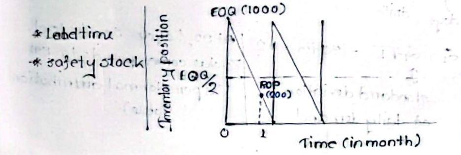
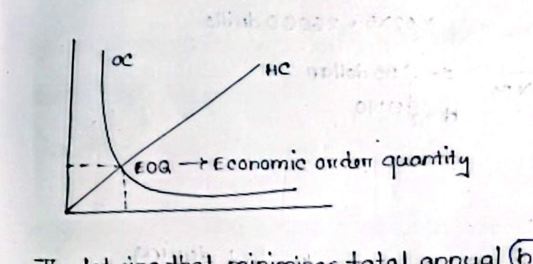

[← Previous: O01.2: Types of Inventory and ABC Analysis](O01.2_Types_of_Inventory_and_ABC_Analysis.md) | [🏠 Index](00_Index.md) | [Next: O02.2a: Q-System Method and Weekly Demand Problems →](O02.2a_Q_System_Method_and_Weekly_Demand_Problems.md)

---

# O02.1: EOQ Model, ROP, Safety Stock, and Cost Curves

> **Section:** Section B (CO3 · Operational Management · MRI Sir) | **Priority:** 🔴 Essential (Core Final Exam Anchor) | **Exam Frequency:** Tested in 2020, 2021, 2023, and twice in 2024 (5/4 papers)
> **Subtopics Covered:** `O02.1` (Definitions & Formulas: EOQ, Lead Time, Safety Stock, Reorder Point), `O02.2` (6 Key EOQ Assumptions and Cost Curves Derivation)
> **Sources:** MRI Sir Inventory Control Notes (`Inventory Control.md`), Raidah Class Notes (Class 9)

## Why This Topic Matters

Operations managers need exact mathematical rules to decide when and how much to order. The Economic Order Quantity (EOQ) balances holding costs against ordering costs. The Reorder Point (ROP) tells the warehouse when to place the order. Every single final exam paper from 2020 to 2024 has asked for these core definitions. Knowing these four definitions and the six EOQ assumptions guarantees full marks on Section B theory.

---

## 📝 Key Definitions

> **Economic Order Quantity (EOQ):** "EOQ is the lot size that minimizes total annual inventory holding and ordering costs." (MRI Sir, Inventory Control Notes, Page 2)

Plain English meaning: EOQ is the most economical order size. It hits the sweet spot where annual warehouse holding fees equal annual order placement fees.

> **Lead Time ($L$):** "The total elapsed time between the placement of an order and its receipt into usable stock." (Operations Management Lecture Series)

Plain English meaning: Lead time is the total waiting time. It runs from placing an order to having goods ready on shelves.

> **Safety Stock ($SS$):** "Safety stock inventory is surplus inventory that protects against uncertainties in demand, lead time, and supply." (MRI Sir, Inventory Control Notes, Page 1)

Plain English meaning: Safety stock is an emergency buffer. It keeps assembly lines running if customer orders surge or if suppliers ship late.

> **Reorder Point (ROP or $R$):** "A predetermined inventory level such that an order for a fixed quantity $Q$ is placed whenever the inventory position drops to or below this level." (Inventory Control Notes & Raidah Class 9)

Plain English meaning: ROP is the trigger level. When warehouse stock drops to this number, the manager places a new order immediately.

---

## The Four Core Inventory Pillars

```text
┌─────────────────────────────────────────────────────────────────────────────┐
│                       THE 4 CORE INVENTORY PILLARS                          │
├─────────────────────┬─────────────────────┬─────────────────────────────────┤
│ Concept             │ Operational Role    │ Governing Formula               │
├─────────────────────┼─────────────────────┼─────────────────────────────────┤
│ EOQ                 │ How much to order?  │ EOQ = sqrt(2DS / H)             │
│ Lead Time (L)       │ How long to wait?   │ L (in working days or weeks)    │
│ Safety Stock (SS)   │ How much buffer?    │ SS = z * sigma_d * sqrt(L)      │
│ Reorder Point (ROP) │ When to order?      │ ROP = d_bar * L + SS            │
└─────────────────────┴─────────────────────┴─────────────────────────────────┘
```

---

### 1. Economic Order Quantity ($EOQ$)

Economic Order Quantity ($EOQ$ or $Q^*$) is the optimal lot size. It minimizes total annual holding and ordering costs.

- **The Managerial Dilemma:**
  - Ordering in small batches creates low holding costs, but causes high ordering and setup fees.
  - Ordering in large batches lowers order frequency, but creates massive warehouse holding costs.
  - EOQ balances these two opposing forces to find the lowest total cost.
- **Mathematical Formula:**

$$
EOQ = \sqrt{\frac{2DS}{H}}
$$

Where:
- $D$ = Annual demand for the item (in units per year).
- $S$ = Cost of placing an order or setting up equipment (in dollars or Taka per order).
- $H$ = Cost of holding one unit for one year (in dollars or Taka per unit per year).

> [!note] Holding Cost Percentage Formulation
> Often, unit holding cost $H$ equals a carrying percentage ($i$) times the unit purchase price ($C$):
>
> $$
> H = i \times C
> $$
>
> For example, suppose a chip costs $\$40$ with a $20\%$ holding rate.
> Then $H = 0.20 \times 40 = \$8\text{ per unit per year}$.

---

### 2. Lead Time ($L$)

Lead time is the total waiting time. It covers the delay between placing an order and receiving usable goods.

- **Sequential Stages of Lead Time:**
  - 1. **Order Preparation:** Generating paperwork, checking approvals, and issuing purchase orders.
  - 2. **Supplier Processing:** Vendor order receipt, scheduling, and factory manufacturing.
  - 3. **Transit and Shipping:** Carrier transit by truck, rail, air, or ocean freight.
  - 4. **Receiving and Quality Inspection:** Unloading pallets, testing components, and counting units.
  - 5. **Shelving and Put-Away:** Moving accepted stock into designated warehouse storage bins.
- **Time Unit Rules:**
  - Lead time is expressed in working days or weeks.
  - Its time units must always match the time units used for demand rate $\bar{d}$ and standard deviation $\sigma_d$.

---

### 3. Safety Stock ($SS$)

Safety stock is surplus buffer inventory held on hand. It shields the firm from operational disruptions caused by random variations in demand or supply.

- **Sources of Operational Uncertainty:**
  - Unexpected surges in customer orders during the replenishment lead time.
  - Supplier transport breakdowns, port customs holds, or weather delays.
  - High scrap or defect rates on incoming supplier shipments.
- **Mathematical Formula:**

$$
SS = z \, \sigma_L = z \, \sigma_d \sqrt{L}
$$

Where:
- $z$ = Standard normal deviate corresponding to the desired cycle service level.
- $\sigma_d$ = Standard deviation of demand per time period (daily or weekly).
- $L$ = Supplier lead time (in matching daily or weekly time periods).
- $\sigma_L = \sigma_d \sqrt{L}$ = Standard deviation of demand during the entire lead time.

- **Common Cycle Service Levels and $Z$-Values:**
  - $95\%$ Service Level $\implies z = 1.645$ (or $1.43$ as given in the 2023 exam problem).
  - $92\%$ Service Level $\implies z = 1.41$.
  - $88\%$ Service Level $\implies z = 1.175$.

---

### 4. Reorder Point ($ROP$ or $R$)

The Reorder Point is a set inventory threshold. When stock drops to or below this level, place an order of size $EOQ$.

- **Two Core Components of ROP:**
  - 1. **Average Demand During Lead Time:** Expected consumption while waiting for delivery ($dl$ or $\bar{d}L$).
  - 2. **Safety Stock Buffer:** Extra cushion to absorb demand spikes during lead time ($SS$).
- **Mathematical Formula:**

$$
ROP = \bar{d} L + SS = \bar{d} L + z \sigma_d \sqrt{L}
$$

Where:
- $\bar{d}$ = Average daily or weekly demand.
- $L$ = Lead time in matching days or weeks.
- $SS$ = Safety stock buffer units.

> [!note] Deterministic Case
> If customer demand and supplier lead times are completely constant, demand variance is zero ($\sigma_d = 0$). In that case, safety stock is zero ($SS = 0$), and the formula reduces to:
>
> $$
> ROP = \bar{d} L
> $$

---

## Inventory Sawtooth Cycle and ROP Graph

The interaction between EOQ, Lead Time, Safety Stock, and ROP creates the classic inventory sawtooth cycle:


*Figure 1: Inventory Depletion Sawtooth Cycle and Reorder Point (Source: Classnotes Hum 2217 Raidah, Page 9)*

### Key Elements of the Sawtooth Diagram:
1. **Peak Inventory:** An order batch of size $EOQ = 1000\text{ units}$ arrives instantly at the peak.
2. **Depletion Line:** Stock steadily drains downward at constant demand rate $d$ over time.
3. **Average Cycle Inventory:** The dashed horizontal line marks average cycle inventory at $\frac{EOQ}{2} = 500\text{ units}$.
4. **Reorder Point Threshold:** The dot at $ROP = 200\text{ units}$ signals when to issue a new order.
5. **Lead Time Window:** The horizontal distance between the ROP trigger point and shipment arrival represents lead time $L$.
6. **Replenishment Arrival:** The new batch of 1000 units arrives just in time. Stock jumps vertically back to the top.

---

## Six Key Assumptions of the Basic EOQ Model

The basic Economic Order Quantity model relies on six fundamental operating assumptions:

1. **Constant and Known Demand Rate:**
   - Customer demand ($D$) occurs at a constant, uniform rate over time.
   - It is completely predictable and deterministic.
2. **Constant and Known Lead Time:**
   - The lead time ($L$) between issuing an order and receiving usable parts is fixed and known with certainty.
3. **Instantaneous Replenishment:**
   - The entire ordered batch ($Q$) arrives in a single delivery all at once.
   - There are no partial shipments or phased deliveries.
4. **No Stockouts or Shortages Allowed:**
   - Customer demand must always be satisfied on schedule.
   - No backorders, lost sales, or customer delay penalties occur.
5. **Constant Unit Cost Structure (No Quantity Discounts):**
   - The purchase price per unit is constant regardless of order size.
   - Ordering cost per order ($S$) and holding cost per unit per year ($H$) remain fixed.
6. **Independent Items and Relevant Costs:**
   - Replenishment decisions for an item do not affect decisions for any other items.
   - Only two cost factors vary with lot size: annual ordering costs and annual holding costs.

> [!tip] Memory Hook · 6 EOQ Assumptions (`C-C-I-N-N-O`)
> Remember the six basic assumptions in 10 seconds with **C-C-I-N-N-O**:
> - **C**: **C**onstant and known demand rate
> - **C**: **C**onstant and known lead time
> - **I**: **I**nstantaneous batch receipt
> - **N**: **N**o stockouts or backorders allowed
> - **N**: **N**o quantity discounts (unit price is fixed)
> - **O**: **O**nly holding and ordering costs vary

---

## Annual Cost Curves and Behavior

Total inventory cost is governed by two opposing cost components:


*Figure 2: Economic Order Quantity Cost Trade-Off Curves (Source: Classnotes Hum 2217 Raidah, Page 9)*

### 1. Annual Ordering Cost ($OC$)
Ordering cost represents the annual expense of placing and receiving replenishment orders.

- **Formula:**

$$
OC = \text{Number of Orders per Year} \times \text{Cost per Order} = \left(\frac{D}{Q}\right) S
$$

- **Behavior:**
  - As batch size $Q$ increases, the company places fewer orders per year.
  - Therefore, annual ordering cost decreases non-linearly with $Q$, following a downward hyperbolic curve.

### 2. Annual Holding Cost ($HC$)
Holding cost represents the annual expense of storing cycle inventory in the warehouse.

- **Formula:**

$$
HC = \text{Average Cycle Inventory} \times \text{Holding Cost per Unit per Year} = \left(\frac{Q}{2}\right) H
$$

- **Behavior:**
  - As batch size $Q$ increases, average cycle inventory ($\frac{Q}{2}$) rises in direct proportion.
  - Therefore, annual holding cost increases linearly with $Q$. It forms a straight upward line with slope $\frac{H}{2}$.

### 3. Total Annual Cycle Inventory Cost ($TC$)
Total cost is the sum of annual ordering and holding costs:

$$
TC(Q) = OC + HC = \left(\frac{D}{Q}\right) S + \left(\frac{Q}{2}\right) H
$$

- **Behavior:**
  - For small lot sizes ($Q$), total cost is very high due to frequent order fees.
  - For large lot sizes ($Q$), total cost is very high due to massive warehouse holding fees.
  - Between these two extremes, the total cost curve is convex and U-shaped.
  - Total cost reaches its lowest point where the ordering cost curve crosses the holding cost line.

---

## Mathematical Derivation of the EOQ Formula

There are two valid ways to derive the EOQ formula on an exam:

### Method 1 · Algebraic Equating Method (Cost Curve Intersection)
At the lowest point of the total cost curve, annual holding cost exactly equals annual ordering cost:

$$
HC = OC
$$

Substitute the formulas for each cost component:

$$
\left(\frac{Q}{2}\right) H = \left(\frac{D}{Q}\right) S
$$

Multiply both sides of the equation by $Q$:

$$
\left(\frac{Q^2}{2}\right) H = D S
$$

Multiply both sides by $2$ and divide by $H$:

$$
Q^2 = \frac{2DS}{H}
$$

Take the square root of both sides to obtain the Economic Order Quantity ($Q^*$):

$$
EOQ = Q^* = \sqrt{\frac{2DS}{H}}
$$

---

### Method 2 · Calculus Optimization Method (First Derivative Test)
To find the best lot size $Q$, take the first derivative of $TC(Q)$ with respect to $Q$. Set it to zero:

$$
TC(Q) = D S Q^{-1} + \frac{H}{2} Q
$$

Differentiate with respect to $Q$:

$$
\frac{d(TC)}{dQ} = - D S Q^{-2} + \frac{H}{2} = -\frac{DS}{Q^2} + \frac{H}{2}
$$

Set the first derivative to zero:

$$
-\frac{DS}{Q^2} + \frac{H}{2} = 0 \implies \frac{H}{2} = \frac{DS}{Q^2}
$$

Rearrange to solve for $Q^2$:

$$
Q^2 = \frac{2DS}{H} \implies EOQ = Q^* = \sqrt{\frac{2DS}{H}}
$$

Verify the second derivative to confirm that this critical point is a true global minimum:

$$
\frac{d^2(TC)}{dQ^2} = \frac{2DS}{Q^3}
$$

Parameters $D$, $S$, and $Q$ are all positive numbers. Thus, the second derivative is positive ($\frac{d^2(TC)}{dQ^2} > 0$). This proves that $EOQ$ gives the lowest total cost.

---

## Exam Variants

| Year / Source | Question Prompt | Marks | Key Focus / Strategy |
| :--- | :--- | :---: | :--- |
| **2020 Q.4(b)** | What do you mean by EOQ, ROP, Lead time and safety stock? | 04 | Full definitions with formulas for all four core terms |
| **2021 Q.4(b)** | Define EOQ, lead time, re-order point and safety stock inventory | 04 | Full definitions with formulas for all four core terms |
| **2023 Q.7(b)** | Define EOQ, Lead Time, Reorder point, and Safety Stock | 02 | Rapid 1-sentence definitions with formulas (trimmed for 2 marks) |
| **2024 Q.4(b)** | Define EOQ, Re-order point and lead time | 03 | Three terms only; omit safety stock because it was not asked |
| **2024 Q.7(a)** | Define EOQ, Re-order point, lead time and safety stock Inventory | 04 | Full definitions with formulas for all four core terms |
| **Model Exam Question** | State EOQ assumptions and derive cost curves | 04 | 6 assumptions (`C-C-I-N-N-O`), cost equations, and derivation |

---

## 🏆 Golden Questions (Past Exam Archive & Model Answers)

### 🎯 GQ1 · 2020 Q.4(b) & 2021 Q.4(b) & 2024 Q.7(a) · Core Four Inventory Definitions (04 Marks)

> **Appeared:** 2020 Final Q.4(b) · 2021 Final Q.4(b) · 2024 Final Q.7(a) · (04 Marks)

**Question:**
Define EOQ, Re-order point, lead time and safety stock Inventory.

**Full Answer:**

#### GQ1.1 · Economic Order Quantity (EOQ)
Economic Order Quantity ($EOQ$ or $Q^*$) is the optimal lot size. It minimizes total annual holding and ordering costs. It balances storage fees against ordering fees:

$$
EOQ = \sqrt{\frac{2DS}{H}}
$$

Where:
- $D$ = Annual demand for the item (units/year).
- $S$ = Cost of placing an order or setup cost (\$/order).
- $H$ = Cost of holding one unit in inventory for one year (\$/unit/year).

At the EOQ, annual holding cost exactly equals annual ordering cost.

#### GQ1.2 · Lead Time ($L$)
Lead time is the total waiting time from placing an order to receiving stock. It includes order processing, factory production, shipping, inspection, and shelving. Express it in working days or weeks.

#### GQ1.3 · Safety Stock ($SS$)
Safety stock is surplus buffer inventory held on hand. It shields the organization from operational disruptions caused by unpredictable surges in customer demand or supplier delivery delays:

$$
SS = z \, \sigma_d \sqrt{L}
$$

Where:
- $z$ = Normal distribution factor corresponding to the desired cycle service level.
- $\sigma_d$ = Standard deviation of demand per time period (days or weeks).
- $L$ = Supplier lead time (in matching days or weeks).

#### GQ1.4 · Reorder Point ($ROP$ or $R$)
The Reorder Point is a predetermined inventory position threshold. Reaching it signals the warehouse manager to place a new purchase order of size $EOQ$. It covers expected lead time consumption plus the safety buffer:

$$
ROP = \bar{d} L + SS = \bar{d} L + z \sigma_d \sqrt{L}
$$

Where $\bar{d}$ is average demand per period, $L$ is lead time, and $SS$ is safety stock.

---

### 🎯 GQ2 · 2023 Q.7(b) · Rapid Two-Mark Trimming (02 Marks)

> **Appeared:** 2023 Final Exam Q.7(b) · Section B (CO3) · (02 Marks)

**Question:**
Define EOQ, Lead Time, Reorder point, and Safety Stock.

**Full Answer:**

1. **Economic Order Quantity (EOQ):** The optimal order lot size that minimizes total annual holding and ordering costs:

$$
EOQ = \sqrt{\frac{2DS}{H}}
$$

2. **Lead Time ($L$):** The total elapsed time between placing an order and receiving usable stock into the warehouse.
3. **Safety Stock ($SS$):** Surplus buffer inventory held to protect against unexpected surges in customer demand or delivery delays:

$$
SS = z \sigma_d \sqrt{L}
$$

4. **Reorder Point ($ROP$):** The predetermined inventory level that triggers a replenishment order of size $EOQ$:

$$
ROP = \bar{d} L + SS
$$

---

### 🎯 GQ3 · 2024 Q.4(b) · Three-Term Variant (03 Marks)

> **Appeared:** 2024 Final Exam Q.4(b) · Section A (CO3) · (03 Marks)

**Question:**
Define EOQ, Re-order point and lead time.

**Full Answer:**

#### GQ3.1 · Economic Order Quantity (EOQ)
Economic Order Quantity ($EOQ$ or $Q^*$) is the optimal lot size. It minimizes combined annual holding and ordering costs. It balances holding fees against ordering fees:

$$
EOQ = \sqrt{\frac{2DS}{H}}
$$

Where $D$ is annual demand, $S$ is cost per order, and $H$ is unit holding cost per year.

#### GQ3.2 · Reorder Point ($ROP$)
The Reorder Point is the preset inventory position threshold that triggers a new purchase order of size $EOQ$. It covers expected demand during the delivery window plus safety stock:

$$
ROP = \bar{d} L + SS
$$

Where $\bar{d}$ is average demand per period, $L$ is lead time, and $SS$ is safety buffer stock.

#### GQ3.3 · Lead Time ($L$)
Lead time is the total waiting time from order placement to stock receipt. It includes inspection and shelving. Express it in working days or weeks.

---

### 🎯 GQ4 · Model Exam Question · EOQ Assumptions and Cost Curve Derivation (04 Marks)

> **Appeared:** Prescribed Model Exam Question · Operations Management (CO3) · Module 6 · (04 Marks)

**Question:**
State the key assumptions of the basic Economic Order Quantity (EOQ) model. Explain the annual holding cost, ordering cost, and total cost curves, and derive the mathematical expression for EOQ.

**Full Answer:**

#### GQ4.1 · Key Assumptions of the Basic EOQ Model
The classical EOQ model rests on six fundamental operating assumptions:
1. **Constant Demand:** Demand rate ($D$) is known, uniform, and continuous over time.
2. **Constant Lead Time:** Supplier lead time ($L$) is fixed and known with certainty.
3. **Instantaneous Receipt:** Each order batch arrives in a single delivery all at once.
4. **No Stockouts Permitted:** Demand must be met on schedule; no backorders or lost sales occur.
5. **Fixed Cost Structure:** Unit purchase price, order cost ($S$), and holding cost ($H$) remain constant regardless of lot size.
6. **Cost Relevance and Independence:** Only holding and ordering costs vary with lot size. Decisions for different items are independent.

#### GQ4.2 · Annual Cost Curves and Behavior
Annual inventory expenses consist of two opposing cost curves:

1. **Annual Ordering Cost ($OC = \frac{D}{Q} S$):**
   - As lot size $Q$ increases, fewer orders are placed per year ($\frac{D}{Q}$).
   - The ordering cost curve decreases non-linearly with $Q$, following a downward hyperbolic shape.
2. **Annual Holding Cost ($HC = \frac{Q}{2} H$):**
   - As lot size $Q$ increases, average cycle inventory ($\frac{Q}{2}$) rises.
   - The holding cost line increases linearly from the origin with slope $\frac{H}{2}$.
3. **Total Annual Cost ($TC(Q) = \frac{D}{Q} S + \frac{Q}{2} H$):**
   - The total cost curve is U-shaped and convex.
   - It reaches its minimum value where the downward ordering cost curve intersects the upward holding cost line.

```text
Annual Cost ($)
     ▲
     │  \                                         /  Total Cost (TC)
     │   \      Holding Cost (HC = Q/2 * H)      /
     │    \                ▲                   /
     │     \              /                  /
     │      \            /                 /
     │       \          /                /
     │        \        /               /
     │         \      /              /
     │          \    /             /
     │           \  /            /
     │            ● Minimum TC /
     │           / \         /
     │          /   \      /
     │         /     \   /
     │        /       \ /
     │       /         ● (HC = OC)
     │      /           \
     │     /             \    Ordering Cost (OC = D/Q * S)
     │    /               \
     └────┴────────────────┴─────────────────────────────────► Lot Size (Q)
         0                EOQ
```

#### GQ4.3 · Mathematical Derivation of EOQ
At the minimum total cost point, annual holding cost equals annual ordering cost:

$$
\left(\frac{Q}{2}\right) H = \left(\frac{D}{Q}\right) S
$$

Multiply both sides by $Q$:

$$
\left(\frac{Q^2}{2}\right) H = D S
$$

Multiply both sides by $2$ and divide by $H$:

$$
Q^2 = \frac{2DS}{H}
$$

Taking the square root of both sides yields the Economic Order Quantity formula:

$$
EOQ = Q^* = \sqrt{\frac{2DS}{H}}
$$

---

## ⚡ Exam Tips & Common Mistakes

1. **Watch Time Unit Consistency:**
   - In numerical problems, always convert variables to matching time units.
   - For weekly demand ($650\text{ units/week}$) over $52\text{ weeks}$, annual demand is $D = 650 \times 52 = 33,800\text{ units/year}$.
   - Ensure holding cost $H$ matches this annual basis ($\text{Tk } 30/\text{unit/year}$).
2. **Observe Question Scope for Trimming:**
   - In `2024 Q.4(b)`, the question asked for EOQ, Reorder Point, and Lead Time (3 marks). Safety stock was NOT requested. Omit safety stock to save writing time.
   - In `2023 Q.7(b)`, the question asked for all four terms for only 2 marks. Provide single-sentence definitions with formulas without long paragraphs.
3. **State the Equality of Costs at EOQ:**
   - When explaining EOQ, always state: *"At EOQ, annual holding cost equals annual ordering cost ($HC = OC$)."* Examiners look for this key phrase.
4. **Distinguish Between Average Inventory and Peak Inventory:**
   - In the sawtooth graph, peak inventory is $Q = EOQ$.
   - Average cycle inventory is $\frac{Q}{2} = \frac{EOQ}{2}$.
   - Do not label the peak as $\frac{Q}{2}$.

---

## 🔗 Related Topics

- [O01.1 · Inventory Control and Holding Costs](O01.1_Inventory_Control_and_Holding_Costs.md)
- [O01.2 · Types of Inventory and ABC Analysis](O01.2_Types_of_Inventory_and_ABC_Analysis.md)
- [O02.2a · Q-System Method and Weekly Demand Problems](O02.2a_Q_System_Method_and_Weekly_Demand_Problems.md)
- [O02.2b · Q-System Daily Demand and MCU Problems](O02.2b_Q_System_Daily_Demand_and_MCU_Problems.md)
- [00 · Master Index](00_Index.md)

---

[← Previous: O01.2: Types of Inventory and ABC Analysis](O01.2_Types_of_Inventory_and_ABC_Analysis.md) | [🏠 Index](00_Index.md) | [Next: O02.2a: Q-System Method and Weekly Demand Problems →](O02.2a_Q_System_Method_and_Weekly_Demand_Problems.md)
