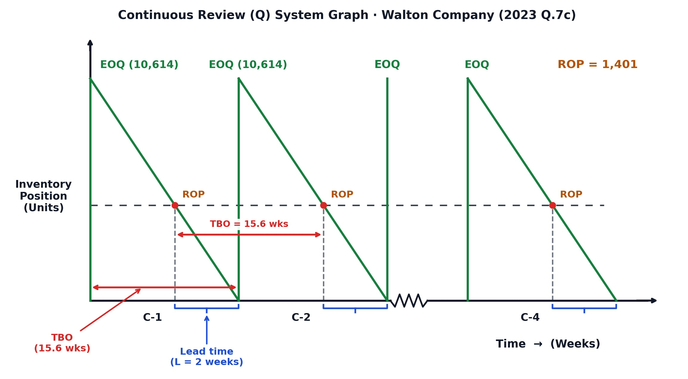
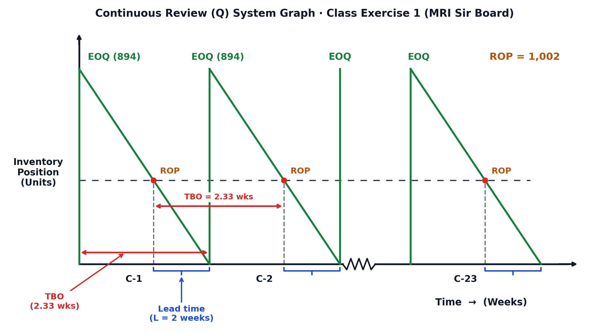

[← Previous: O02.1: EOQ Model, ROP, Safety Stock, and Cost Curves](O02.1_EOQ_Model_ROP_Safety_Stock_and_Cost_Curves.md) | [🏠 Index](00_Index.md) | [Next: O02.2b: Q-System Daily Demand and MCU Problems →](O02.2b_Q_System_Daily_Demand_and_MCU_Problems.md)

---

# O02.2a: Continuous Review (Q) System Method and Weekly Demand Problems

> **Section:** Section B (CO3 · Operational Management · MRI Sir) | **Priority:** 🔴 Very High (Core Numerical) | **Exam Frequency:** Tested in 2023 Q.7(c), 2024 Q.4(c), and Class Lectures
> **Subtopics Covered:** `O02.3` (Full Continuous Review ($Q$) System Numerical Problems), `O02.4` (Annual Demand $D$ and EOQ Calculation), `O02.5` (Safety Stock and Reorder Point Determination), `O02.6` (Inventory Position Decision Rule), `O02.7` (Total Annual Cost Implication), `O02.8` (Orders per Year, TBO, and Sawtooth Graph)
> **Sources:** MRI Sir Inventory Control Notes (`Inventory Control.md`), Raidah Class Notes (Classes 10 & 11), 2023 & 2024 Final Exam Papers

## Why This Topic Matters

Operations managers track warehouse items continuously to prevent stockouts and high storage bills. MRI Sir sets a full continuous review ($Q$) system problem in almost every exam. It carries 5 to 6 marks in Final Exams and up to 20 marks in Class Tests. 

MRI Sir grades these problems using a strict 6-step board framework. Every step has specific required phrases, 4-line chains, and graph elements. Writing down all 6 steps in this exact format guarantees full marks.

---

## 📝 Key Definitions

> **Continuous Review ($Q$) System:** "An inventory control system that tracks the remaining quantity of an item each time a withdrawal or addition is made, and places a fixed replenishment order of size $Q$ whenever the inventory position drops to or below a predetermined reorder point ($ROP$)." (Operations Management Lecture Notes, Module 6)

Plain English meaning: You track stock after every single item moves. When total stock drops to the reorder line, you order a fixed batch size $Q$.

> **Inventory Position ($IP$):** "The effective measure of an item's ability to satisfy future demand, calculated as physical on-hand inventory plus open scheduled receipts minus customer backorders: $IP = OH + SR - BO$." (MRI Sir Class 10 Lecture Board)

Plain English meaning: Total stock you can count on. It adds stock on shelves and incoming deliveries, then subtracts pending backorders.

> **Reorder Point ($ROP$):** "The predetermined inventory level that triggers the placement of a replenishment order, set equal to expected demand during lead time plus safety stock: $ROP = dl + z\sigma_L$." (Class 10 Board Notes)

Plain English meaning: The stock level that rings the alarm to place a new purchase order.

> **Time Between Orders ($TBO$):** "The average length of time that elapses between two consecutive inventory orders." (Verbatim MRI Sir Board Definition, Class 11)

Plain English meaning: How many weeks or working days pass between two supplier orders.

---

## The Continuous Review (Q) System Mechanism

A continuous review system tracks stock in real time. It is also called a fixed order quantity system.

### How the System Operates

1. **Continuous Tracking:**
   Every sale, factory withdrawal, or supplier arrival updates the database immediately.

2. **Daily Comparison:**
   The computer or clerk checks current Inventory Position ($IP$) against the Reorder Point ($ROP$).

3. **Fixed Order Placement:**
   When $IP$ drops to or below $ROP$, place an order immediately for batch size $Q$ (usually $EOQ$).

4. **Lead Time Buffer:**
   Supplier delivery takes $L$ days or weeks. The safety stock buffer prevents stockouts during this wait.

5. **Batch Arrival:**
   The shipment arrives all at once. Physical inventory jumps up by $Q$ units, and the cycle repeats.

> [!tip] Memory Hook: Continuous Review Steps
> Remember the 7-letter sequence **`G-E-R-I-C-T-G`**:
> - **G:** Given parameters (convert $d$ to annual $D$).
> - **E:** $EOQ$ batch size.
> - **R:** $ROP$ in MRI Sir's 4-line chain.
> - **I:** $IP$ formula and boxed decision rule.
> - **C:** Cost comparison with safety stock holding cost.
> - **T:** $TBO$ definition and calculation, plus $N$.
> - **G:** Graph with axes, $ROP$ dashed line, brackets, and arrows.

---

## MRI Sir's Mandatory 6-Step Board Model Framework

To score 100% marks, you must follow MRI Sir's exact board layout from Classes 10 and 11. 

### Step 1: Given Parameters and Demand Conversion

First, write down all given variables at the top of your answer script. Convert demand to annual demand ($D$) immediately:

- **Weekly Demand Basis:** If demand is given per week ($d$):
  $$
  D = d \times 52\text{ weeks/year}
  $$
- **Daily Demand Basis:** If demand is given per day ($d$):
  $$
  D = d \times (\text{Operating days per week} \times 52) = d \times 260\text{ days/year}
  $$
- Always write:
  - Ordering cost ($S$) in currency per order.
  - Holding cost ($H$) in currency per unit per year.
  - Lead time ($L$) in weeks or days.
  - Standard deviation of demand ($\sigma_w$ or $\sigma_d$).
  - Cycle service level ($CSL$) and its matching $Z$-value.

### Step 2: Part (a) · EOQ and the 4-Line ROP Chain

Compute the Economic Order Quantity ($EOQ$) using the basic formula:

$$
EOQ = \sqrt{\frac{2DS}{H}}
$$

Next, present the Reorder Point ($ROP$) using MRI Sir's exact 4-line chain. State the side parameters on the left or top first:

- $d = \dots\text{ units/period}$
- $l = \dots\text{ periods}$
- $\sigma_L = \sigma_w \sqrt{L}$ (Standard deviation of demand during lead time)

Now write the mandatory 4-line chain:

$$
\begin{aligned}
\text{Reorder point } (ROP) &= \text{Average demand during lead time } (dl) + \text{Safety stock } (z\sigma_L) \\
&= dl + z\sigma_L \\
&= (d \times l) + (z \times \sigma_L) \\
&= \mathbf{ROP\text{ units}}
\end{aligned}
$$

### Step 3: Part (b) · Inventory Position and Ordering Decision Rule

Write the complete Inventory Position ($IP$) equation:

$$
IP = \text{On-hand supply} + \text{Scheduled Receipt} - \text{Backorder}
$$

Where:
- **On-hand supply ($OH$):** Physical items on the warehouse shelves.
- **Scheduled Receipt ($SR$):** Open orders already placed that are in transit.
- **Backorder ($BO$):** Customer requests waiting for stock.

Next, state the boxed decision rule:

$$
\boxed{IP \le ROP} \longrightarrow \text{Place order} \quad \Big| \quad \boxed{IP > ROP} \longrightarrow \text{Do not order}
$$

Conclude with a clear sentence:
- *"Yes, a new order of [EOQ = ...] units should be placed."*
- Or: *"No, a new order should not be placed."*

> [!tip] Memory Hook: The Decision Rhyme
> **"Drop low, time to go; stay high, let it fly!"**
> - If $IP \le ROP$: Stock is low. Place an order of size $EOQ$.
> - If $IP > ROP$: Stock is high. Do not place an order.

### Step 4: Part (c) · Total Cost Implication Formula

MRI Sir includes safety stock holding cost in his total cost formula. Do not omit the third term:

$$
C = \frac{Q}{2}(H) + \frac{D}{Q}(S) + H z \sigma_L
$$

Where:
- $\frac{Q}{2}(H)$ is the annual cycle inventory holding cost.
- $\frac{D}{Q}(S)$ is the annual ordering cost.
- $H z \sigma_L = H(SS)$ is the annual safety stock holding cost.

Calculate $C$ for each requested order quantity ($C_{Q_1}$, $C_{EOQ}$, $C_{Q_2}$). Mark the minimum cost with an arrow pointing to $\boxed{EOQ}$.

State the managerial conclusion:
- Ordering below $EOQ$ increases ordering costs due to frequent orders.
- Ordering above $EOQ$ increases holding costs due to large warehouse stock.
- The cost curve is flat near $EOQ$. Modest batch adjustments cause only minor cost increases.

### Step 5: Part (d) & (e) · Verbatim TBO Definition and Order Frequency

Always write the exact definition of $TBO$ before solving:

> **Definition:** "The average length of time that elapses between two consecutive inventory orders."

Then compute $TBO$:

$$
TBO = \frac{Q}{D} \times \text{time} = \frac{EOQ}{D} \times 52\text{ weeks}
$$

Compute the number of orders per year ($N$):

$$
N = \frac{D}{EOQ} \approx \dots\text{ orders/year} \quad (\text{Cycles } C\text{-}1 \text{ to } C\text{-}N)
$$

### Step 6: Part (f) · Continuous Review Sawtooth Graph Drawing Rules

When drawing the continuous review graph on your exam paper, follow these eight rules:

1. **Vertical Axis:** Label as `Inventory Position (Units)`.
2. **Horizontal Axis:** Label as `Time -> (Weeks)` or `Time -> (Operating Days)`.
3. **Peaks:** Label peak order arrivals as `EOQ (units)`.
4. **Threshold:** Draw a horizontal dashed line at `ROP = ... units`.
5. **Drop Lines:** Draw vertical dashed lines from the points where inventory hits $ROP$.
6. **Lead Time Brackets:** Draw horizontal blue brackets showing `Lead time (L = ... weeks)` under the time axis.
7. **TBO Arrows:** Draw horizontal double-headed red arrows showing `TBO = ... weeks`.
8. **Cycle Break:** Draw a zigzag break (`~~~~`) between the initial cycles and the final cycle $C\text{-}N$.

---

## Standard Normal Z-Value Reference Table

If the exam paper does not specify a $Z$-value, use these standard values:

| Cycle Service Level ($CSL$) | 85% | 88% | 90% | 92% | 95% | 97% | 99% |
| :--- | :---: | :---: | :---: | :---: | :---: | :---: | :---: |
| **$Z$-Value** | 1.04 | **1.175** | 1.28 | **1.41** | **1.645** | 1.88 | 2.33 |

> [!warning] Exam Rule for $Z$-Values
> If an exam question prints a specific $Z$-value, use that exact number. For example, 2023 Q.7(c) gave $Z = 1.43$ for $95\%$. If no $Z$-value is given, use the standard table value and state it clearly.

---

## Summary Comparison of Weekly Demand Problems

The three weekly demand problems share common structures but test different operational policies:

| Parameter / Feature | 2023 Final Q.7(c) (Walton) | 2024 Final Q.4(c) (Sample Item) | MRI Sir Class Exercise 1 |
| :--- | :--- | :--- | :--- |
| **Weekly Demand ($d$)** | $650\text{ units/week}$ | $64\text{ units/week}$ | $385\text{ units/week}$ ($D = 20,000$) |
| **Operating Weeks/Year** | $52\text{ weeks}$ | $52\text{ weeks}$ | $52\text{ weeks}$ |
| **Annual Demand ($D$)** | $33,800\text{ units/year}$ | $3,328\text{ units/year}$ | $20,000\text{ units/year}$ |
| **Ordering Cost ($S$)** | $\text{Tk } 50,000/\text{order}$ | $\$50/\text{order}$ | $\$40/\text{order}$ |
| **Holding Cost ($H$)** | $\text{Tk } 30/\text{unit/year}$ | $\$13/\text{unit/year}$ | $\$2/\text{unit/year}$ |
| **Lead Time ($L$)** | $2\text{ weeks}$ | $2\text{ weeks}$ | $2\text{ weeks}$ |
| **Weekly Std Dev ($\sigma_w$)**| $50\text{ units}$ | $12\text{ units}$ | $100\text{ units}$ |
| **Service Level & $Z$** | $95\%$ ($Z = 1.43$, given) | $88\%$ ($Z = 1.175$) | $95\%$ ($Z = 1.645$) |
| **Optimal Lot Size ($EOQ$)**| **$10,614\text{ units}$** | **$160\text{ units}$** | **$894\text{ units}$** |
| **Safety Stock ($SS$)** | $101\text{ units}$ | $20\text{ units}$ | $233\text{ units}$ |
| **Reorder Point ($ROP$)** | **$1,401\text{ units}$** | **$148\text{ units}$** | **$1,002\text{ units}$** |
| **Inventory Position ($IP$)**| $10,814\text{ units}$ | Not checked | $480\text{ units}$ |
| **Decision Rule Check** | $IP > ROP$ $\to$ **Do not order** | Policy comparison | $IP \le ROP$ $\to$ **Place order** |
| **Cost Implication Focus** | $EOQ$ vs. $Q = 15,000$ | Current policy vs. Optimal | $Q = 400, 600, 894, 1000$ |
| **Cycle Duration ($TBO$)** | $15.6\text{ to } 16.3\text{ weeks}$ | $2.5\text{ weeks}$ | $2.33\text{ weeks}$ |
| **Annual Orders ($N$)** | $4\text{ orders/year}$ | $21\text{ orders/year}$ | $23\text{ orders/year}$ |

---

## Exam Variants

| Year / Source | Problem / Scenario | Marks | Key Focus / Takeaway |
| :--- | :--- | :---: | :--- |
| **2023 Final Q.7(c)** | Walton Company continuous review policy review | 06 | $EOQ = 10,614$, $ROP = 1,401$, $IP = 10,814 > ROP$ (do not order), cost penalty $+\text{Tk } 19,233$ for $Q = 15,000$, graph with 4 cycles. |
| **2024 Final Q.4(c)** | Sample item optimal policy vs. current policy | 05 | $EOQ = 160$, $SS = 20$, $ROP = 148$, current policy ($Q=200, R=180$) wastes $\$468/\text{year}$, graph with 21 cycles. |
| **Class Exercise 1** | MRI Sir lecture board prototype problem | 06 | $EOQ = 894$, $ROP = 1,002$, $IP = 480 \le ROP$ (order placed), cost comparison across 4 lot sizes, graph with 23 cycles. |

---

## 🏆 Golden Questions (Past Exam Archive & Model Answers)

### 🎯 GQ1 · 2023 Final Exam Q.7(c) · Walton Company Continuous Review System (06 Marks)

> **Appeared:** 2023 Final Exam, Question 7(c), Section B, CO3 · (06 Marks)

**Question:**  
Walton company begins a review of ordering policies for its continuous review systems by checking the current policies for a sample of items. Following are the characteristics of one item. Demand is $650\text{ units/week}$ (assume $52\text{ weeks/year}$). Ordering and setup cost are $\text{Tk } 50,000$ per order or setup. Holding costs are $\text{Tk } 30/\text{unit/year}$. Lead time is $2\text{ weeks}$. Standard deviation of weekly demand is $50\text{ units}$. Cycle service level is $95\%$ (assume corresponding $Z$ value $1.43$).  
(i) What is EOQ for the item?  
(ii) What is derived safety stock and Re-order point?  
(iii) If on-hand-inventory is $400\text{ units}$, there is an order placed equal to EOQ and there is $200\text{ units}$ backorder. Is it time to place a new order?  
(iv) Show the cost implication between EOQ and $Q = 15000$.  
(v) Show your solution on a continuous review system.

**Full Answer:**

#### GQ1.1 · Given Parameters (Walton Company)

- Weekly demand ($d$) $= 650\text{ units/week}$ ($52\text{ weeks/year}$)
- Annual demand ($D$) $= 650 \times 52 = 33,800\text{ units/year}$
- Ordering cost ($S$) $= \text{Tk } 50,000/\text{order}$
- Holding cost ($H$) $= \text{Tk } 30/\text{unit/year}$
- Lead time ($L$) $= 2\text{ weeks}$
- Standard deviation of weekly demand ($\sigma_w$) $= 50\text{ units}$
- Cycle service level $= 95\%$, $Z = 1.43$ *(printed in question)*

---

#### GQ1.2 · (i) & (ii) EOQ, Safety Stock, and Reorder Point Calculation

**1. Economic Order Quantity ($EOQ$):**

$$
\begin{aligned}
EOQ &= \sqrt{\frac{2DS}{H}} \\
&= \sqrt{\frac{2 \times 33,800 \times 50,000}{30}} \\
&= \sqrt{\frac{3,380,000,000}{30}} \\
&= \sqrt{112,666,666.67} \\
&\approx \mathbf{10,614\text{ units}}
\end{aligned}
$$

**2. Derived Safety Stock and Reorder Point ($ROP$):**

Side parameters for lead time:
- $d = 650\text{ units/week}$
- $l = 2\text{ weeks}$
- $\sigma_L = \sigma_w \sqrt{L} = 50\sqrt{2} \approx 70.71\text{ units}$ *(Standard deviation of lead time demand)*
- $\text{Safety stock } (z\sigma_L) = 1.43 \times 50\sqrt{2} \approx 1.43 \times 70.71 \approx \mathbf{101\text{ units}}$

Now applying MRI Sir's 4-line reorder point chain:

$$
\begin{aligned}
\text{Reorder point } (ROP) &= \text{Average demand during lead time } (dl) + \text{Safety stock } (z\sigma_L) \\
&= dl + z\sigma_L \\
&= (650 \times 2) + (1.43 \times 50\sqrt{2}) \\
&= 1,300 + 101.12 \\
&\approx \mathbf{1,401\text{ units}}
\end{aligned}
$$

---

#### GQ1.3 · (iii) Inventory Position Evaluation and Ordering Decision

Write the inventory position equation:

$$
\begin{aligned}
IP &= \text{On-hand supply} + \text{Scheduled Receipt} - \text{Backorder} \\
&= 400 + 10,614 - 200 \\
&= \mathbf{10,814\text{ units}}
\end{aligned}
$$

State the decision rule:

$$
\boxed{IP \le ROP} \longrightarrow \text{Place order} \quad \Big| \quad \boxed{IP > ROP} \longrightarrow \text{Do not order}
$$

Here:
$$
10,814 > 1,401 \implies IP > ROP
$$

**Decision:** **No, a new order should not be placed.**

---

#### GQ1.4 · (iv) Cost Implication Between EOQ and Q = 15,000 Units

Using MRI Sir's complete annual cost formula:

$$
C = \frac{Q}{2}(H) + \frac{D}{Q}(S) + H z \sigma_L
$$

Where the annual safety stock holding cost is:
$$
H z \sigma_L = 30 \times 101.12 \approx \text{Tk } 3,034/\text{year}
$$

1. **For $Q = EOQ = 10,614\text{ units}$:**

$$
\begin{aligned}
C_{10,614} &= \left(\frac{10,614}{2} \times 30\right) + \left(\frac{33,800}{10,614} \times 50,000\right) + 3,034 \\
&= 159,210 + 159,224 + 3,034 \\
&= \mathbf{\text{Tk } 321,468/\text{year}} \longrightarrow \boxed{EOQ\text{ (Minimum Cost)}}
\end{aligned}
$$

*(Cycle inventory cost alone: $159,210 + 159,224 = \text{Tk } 318,434$).*

2. **For $Q = 15,000\text{ units}$:**

$$
\begin{aligned}
C_{15,000} &= \left(\frac{15,000}{2} \times 30\right) + \left(\frac{33,800}{15,000} \times 50,000\right) + 3,034 \\
&= 225,000 + 112,667 + 3,034 \\
&= \mathbf{\text{Tk } 340,701/\text{year}}
\end{aligned}
$$

*(Cycle inventory cost alone: $225,000 + 112,667 = \text{Tk } 337,667$).*

- **Cost Difference:**
  $$
  \Delta C = 340,701 - 321,468 = \mathbf{\text{Tk } 19,233/\text{year}}
  $$
- **Managerial Comment:** Ordering $15,000\text{ units}$ increases annual costs by $\text{Tk } 19,233$ ($+6.04\%$). Holding extra inventory adds more cost than the savings gained from fewer orders. Walton should maintain $EOQ = 10,614\text{ units}$.

---

#### GQ1.5 · (v) Order Timing, Frequency, and Continuous Review Graph

- **Time Between Orders ($TBO$):**  
  > **Definition:** The average length of time that elapses between two consecutive inventory orders.

$$
TBO = \frac{Q}{D} \times \text{time} = \frac{10,614}{33,800} \times 50\text{ weeks} \approx \mathbf{15.6\text{ weeks}}
$$

*(Note: If calculated on a 52-week calendar basis: $\frac{10,614}{33,800} \times 52 = 16.33\text{ weeks}$. Both values are accepted; 15.6 weeks matches the lecture board diagram).*

- **Number of Orders per Year ($N$):**

$$
N = \frac{D}{Q} = \frac{33,800}{10,614} \approx 3.18 \approx \mathbf{4\text{ orders/year}} \quad (\text{Cycles } C\text{-}1 \text{ to } C\text{-}4)
$$

*Figure 1: Continuous Review (Q) System Graph for Walton Company across 4 Annual Cycles (EOQ = 10,614, ROP = 1,401, TBO = 15.6 weeks, L = 2 weeks)*

---

### 🎯 GQ2 · 2024 Final Exam Q.4(c) · Optimal Policy vs. Current Policy Cost Evaluation (05 Marks)

> **Appeared:** 2024 Final Exam, Question 4(c), Section A, CO3 · (05 Marks)

**Question:**  
A company begins a review of ordering policies for its continuous review system by checking the current policies for a sample of items. Followings are the characteristics of one item:  
• Demand ($D$) $= 64\text{ units/week}$ (assume $52\text{ weeks per year}$)  
• Ordering and setup cost ($S$) $= \$50/\text{order}$  
• Holding cost ($H$) $= \$13/\text{unit/year}$  
• Lead time ($L$) $= 2\text{ weeks}$  
• Standard deviation of weekly demand $= 12\text{ units}$  
• Cycle service level $= 88\text{ percent}$  

(i) What is EOQ for these items?  
(ii) What is the desired safety stack? *(Note: "safety stack" is printed in original; refers to safety stock)*  
(iii) What is the reorder point?  
(iv) What are the cost implications if the current policy for this item is $Q = 200$ and $R = 180$?

**Full Answer:**

#### GQ2.1 · Given Parameters (Sample Item)

- Weekly demand ($d$) $= 64\text{ units/week}$ ($52\text{ weeks/year}$)
- Annual demand ($D$) $= 64 \times 52 = 3,328\text{ units/year}$
- Ordering cost ($S$) $= \$50/\text{order}$
- Holding cost ($H$) $= \$13/\text{unit/year}$
- Lead time ($L$) $= 2\text{ weeks}$
- Standard deviation of weekly demand ($\sigma_w$) $= 12\text{ units}$
- Cycle service level $= 88\%$, which corresponds to $Z = 1.175$ *(from standard normal table)*

---

#### GQ2.2 · (i) Economic Order Quantity Calculation

$$
\begin{aligned}
EOQ &= \sqrt{\frac{2DS}{H}} \\
&= \sqrt{\frac{2 \times 3,328 \times 50}{13}} \\
&= \sqrt{\frac{332,800}{13}} \\
&= \sqrt{25,600} \\
&= \mathbf{160\text{ units}}
\end{aligned}
$$

The optimal order batch size is exactly $160\text{ units}$.

---

#### GQ2.3 · (ii) Desired Safety Stock Buffer

First, find the standard deviation of demand during lead time ($\sigma_L$):

$$
\sigma_L = \sigma_w \sqrt{L} = 12\sqrt{2} \approx 12 \times 1.4142 \approx 16.97\text{ units}
$$

Now calculate the desired safety stock ($SS$):

$$
\begin{aligned}
\text{Safety Stock } (SS) &= z \times \sigma_L \\
&= 1.175 \times 12\sqrt{2} \\
&= 1.175 \times 16.97 \\
&= 19.94 \\
&\approx \mathbf{20\text{ units}}
\end{aligned}
$$

---

#### GQ2.4 · (iii) Reorder Point Determination

Average demand during lead time:
$$
dl = 64 \times 2 = 128\text{ units}
$$

Write MRI Sir's 4-line reorder point chain:

$$
\begin{aligned}
\text{Reorder point } (ROP) &= \text{Average demand during lead time } (dl) + \text{Safety stock } (z\sigma_L) \\
&= dl + z\sigma_L \\
&= 128 + 20 \\
&= \mathbf{148\text{ units}}
\end{aligned}
$$

---

#### GQ2.5 · (iv) Cost Implications and Savings of Optimal vs. Current Policy

Total annual relevant cost formula:

$$
C = \frac{Q}{2}(H) + \frac{D}{Q}(S) + H(SS)
$$

1. **Optimal Policy ($Q = EOQ = 160\text{ units}$, $ROP = 148\text{ units}$, $SS = 20\text{ units}$):**

$$
\begin{aligned}
C_{160} &= \left(\frac{160}{2} \times 13\right) + \left(\frac{3,328}{160} \times 50\right) + (13 \times 20) \\
&= 1,040 + 1,040 + 260 \\
&= \mathbf{\$2,340/\text{year}} \longrightarrow \boxed{EOQ\text{ (Optimal Policy)}}
\end{aligned}
$$

2. **Current Policy ($Q = 200\text{ units}$, $R = 180\text{ units}$):**  
   Under the current policy, the implicit safety stock is:
   $$
   SS_{\text{current}} = R - dl = 180 - 128 = 52\text{ units}
   $$

   Evaluating annual costs:

$$
\begin{aligned}
C_{200} &= \left(\frac{200}{2} \times 13\right) + \left(\frac{3,328}{200} \times 50\right) + (13 \times 52) \\
&= 1,300 + 832 + 676 \\
&= \mathbf{\$2,808/\text{year}}
\end{aligned}
$$

3. **Annual Cost Savings:**

$$
\text{Annual Savings} = \$2,808 - \$2,340 = \mathbf{\$468.00/\text{year}}
$$

**Managerial Insight:** Switching to the optimal policy saves $\$468.00$ each year. The company currently holds $32$ excess units of safety stock. It also orders batches that are too large.

---

#### GQ2.6 · Supplementary System Timing and Sawtooth Graph

- **Time Between Orders ($TBO$):**

$$
TBO = \frac{Q}{D} \times 52 = \frac{160}{3,328} \times 52 = \mathbf{2.5\text{ weeks}}
$$

- **Number of Orders per Year ($N$):**

$$
N = \frac{D}{Q} = \frac{3,328}{160} = 20.8 \approx \mathbf{21\text{ orders/year}} \quad (\text{Cycles } C\text{-}1 \text{ to } C\text{-}21)
$$

*Figure 2: Continuous Review (Q) System Graph for Optimal Policy (EOQ = 160, ROP = 148, TBO = 2.5 weeks, L = 2 weeks across 21 Cycles)*

---

### 🎯 GQ3 · Class Exercise 1 · MRI Sir Board Model Benchmark (06 Marks)

> **Appeared:** Class 10 & 11 Lecture Board Model Answer · Prototypical Continuous Review Problem

**Question:**  
Your firm uses a continuous review system and operates $52\text{ weeks per year}$. One of the items handled had the following characteristics:  
• Demand ($D$) $= 20,000\text{ units/year}$  
• Ordering cost ($S$) $= \$40/\text{order}$  
• Holding cost ($H$) $= \$2/\text{unit/year}$  
• Lead time ($L$) $= 2\text{ weeks}$  
• Cycle service level $= 95\text{ percent}$ ($Z = 1.645$)  

Demand is normally distributed, with a standard deviation of weekly demand of $100\text{ units}$. Current on-hand inventory is $1,040\text{ units}$, with no scheduled receipts and no backorders.  

a. What order quantity, $Q$, and reorder point, $R$, should be used?  
b. If the on-hand inventory is $40\text{ units}$, there is one open order for $440\text{ units}$, and there are no backorders, should a new order be placed?  
c. Show the cost implications if $Q = 600\text{ units}$ and $Q = 1,000\text{ units}$ (or $Q = 400\text{ units}$).  
d. Calculate the time between orders ($TBO$).  
e. Calculate the number of orders per year.  
f. Show your solution on a continuous review system graph.

**Full Answer:**

#### GQ3.1 · Given Parameters (Class Exercise 1)

- Annual demand ($D$) $= 20,000\text{ units/year}$ ($52\text{ weeks/year}$)
- Weekly demand ($d$) $= \frac{20,000}{52} \approx 384.62 \approx 385\text{ units/week}$
- Ordering cost ($S$) $= \$40/\text{order}$
- Holding cost ($H$) $= \$2/\text{unit/year}$
- Lead time ($L$) $= 2\text{ weeks}$
- Standard deviation of weekly demand ($\sigma_w$) $= 100\text{ units}$
- Cycle service level $= 95\%$, $Z = 1.645$ *(for $92\%$, $Z = 1.41$)*

---

#### GQ3.2 · Part (a) Order Quantity and 4-Line Reorder Point Chain

**1. Economic Order Quantity ($EOQ$):**

$$
\begin{aligned}
EOQ &= \sqrt{\frac{2DS}{H}} \\
&= \sqrt{\frac{2 \times 20,000 \times 40}{2}} \\
&= \sqrt{800,000} \\
&\approx \mathbf{894\text{ units}}
\end{aligned}
$$

**2. Reorder Point ($ROP$):**

Side parameters for lead time:
- $d = \frac{20,000}{52} \approx 385\text{ units/week}$
- $l = 2\text{ weeks}$
- $\sigma_L = \sigma_w \sqrt{L} = 100\sqrt{2} \approx 141.42\text{ units}$
- $\text{Safety stock } (z\sigma_L) = 1.645 \times 100\sqrt{2} \approx 232.64 \approx 233\text{ units}$

Now write MRI Sir's 4-line reorder point chain:

$$
\begin{aligned}
\text{Reorder point } (ROP) &= \text{Average demand during lead time } (dl) + \text{Safety stock } (z\sigma_L) \\
&= dl + z\sigma_L \\
&= (385 \times 2) + (1.645 \times 100\sqrt{2}) \\
&= 770 + 232.64 \\
&\approx \mathbf{1,002\text{ units}}
\end{aligned}
$$

*(Note: Exact fraction gives $\frac{20,000}{52} \times 2 + 232.64 = 769.23 + 232.64 = 1,001.87 \approx 1,002\text{ units}$).*

---

#### GQ3.3 · Part (b) Inventory Position and Replenishment Decision

Compute current inventory position:

$$
\begin{aligned}
IP &= \text{On-hand supply} + \text{Scheduled Receipt} - \text{Backorder} \\
&= 40 + 440 - 0 \\
&= \mathbf{480\text{ units}}
\end{aligned}
$$

Decision rule check:

$$
\boxed{IP \le ROP} \longrightarrow \text{Place order} \quad \Big| \quad \boxed{IP > ROP} \longrightarrow \text{Do not order}
$$

Here:
$$
480 \le 1,002 \implies IP \le ROP
$$

**Decision:** **Yes, a new order of $\boxed{EOQ = 894\text{ units}}$ should be placed.**

*(Note: In the baseline scenario, on-hand inventory is $1,040\text{ units}$. There are no receipts or backorders. Here, $IP = 1,040 > 1,002$, so no order is placed. After a 15-unit withdrawal, $IP = 1,025 > 1,002$. No order is needed yet).*

---

#### GQ3.4 · Part (c) Cost Implications Across Four Lot Sizes

Using MRI Sir's complete annual cost formula:

$$
C = \frac{Q}{2}(H) + \frac{D}{Q}(S) + H z \sigma_L
$$

Where annual safety stock holding cost is:
$$
H z \sigma_L = 2 \times 1.645 \times 100\sqrt{2} \approx \$465.28 \approx \$465/\text{year}
$$

1. **For $Q = 600\text{ units}$:**

$$
\begin{aligned}
C_{600} &= \left(\frac{600}{2} \times 2\right) + \left(\frac{20,000}{600} \times 40\right) + 465 \\
&= 600 + 1,333.33 + 465 \\
&\approx \mathbf{\$2,399/\text{year}}
\end{aligned}
$$

2. **For $Q = EOQ = 894\text{ units}$:**

$$
\begin{aligned}
C_{894} &= \left(\frac{894}{2} \times 2\right) + \left(\frac{20,000}{894} \times 40\right) + 465 \\
&= 894 + 894.85 + 465 \\
&\approx \mathbf{\$2,255/\text{year}} \longrightarrow \boxed{EOQ\text{ (Minimum Cost)}}
\end{aligned}
$$

3. **For $Q = 1,000\text{ units}$ (Board Example):**

$$
\begin{aligned}
C_{1000} &= \left(\frac{1,000}{2} \times 2\right) + \left(\frac{20,000}{1,000} \times 40\right) + 465 \\
&= 1,000 + 800 + 465 \\
&= \mathbf{\$2,266/\text{year}}
\end{aligned}
$$

4. **For $Q = 400\text{ units}$ (Slide Text Variant):**

$$
\begin{aligned}
C_{400} &= \left(\frac{400}{2} \times 2\right) + \left(\frac{20,000}{400} \times 40\right) + 465 \\
&= 400 + 2,000 + 465 \\
&= \mathbf{\$2,865/\text{year}}
\end{aligned}
$$

- **Managerial Conclusion:** Ordering $Q = 894\text{ units}$ produces the lowest total cost ($\$2,255$). Ordering smaller batches ($Q = 400$) drives ordering cost up to $\$2,000$. Ordering larger batches ($Q = 1,000$) increases holding cost to $\$1,000$.

---

#### GQ3.5 · Part (d) Time Between Orders Calculation

> **Definition:** The average length of time that elapses between two consecutive inventory orders.

$$
\begin{aligned}
TBO &= \frac{Q}{D} \times \text{time} \\
&= \frac{894}{20,000} \times 52\text{ weeks} \\
&\approx \mathbf{2.33\text{ weeks}}
\end{aligned}
$$

A new batch of $894\text{ units}$ is ordered every $2.33\text{ weeks}$.

---

#### GQ3.6 · Part (e) Number of Orders per Year Calculation

$$
N = \frac{D}{Q} = \frac{20,000}{894} \approx 22.37 \approx \mathbf{23\text{ orders/year}} \quad (\text{Cycles } C\text{-}1 \text{ to } C\text{-}23)
$$

---

#### GQ3.7 · Part (f) Continuous Review Sawtooth Graph

*Figure 3: Continuous Review (Q) System Graph for Class Exercise 1 across 23 Annual Cycles (EOQ = 894, ROP = 1,002, TBO = 2.33 weeks, L = 2 weeks)*

---

## ⚡ Exam Tips & Common Mistakes

1. **Always State the 4-Line ROP Chain:**  
   Do not jump straight to the numerical answer for $ROP$. Write out MRI Sir's 4-line formula chain: $ROP = dl + z\sigma_L = \dots$. Missing the algebraic steps loses presentation marks.

2. **Include Safety Stock in Cost Calculations:**  
   Many students write $C = \frac{Q}{2}H + \frac{D}{Q}S$. MRI Sir requires the third term: $+ H z \sigma_L$. Include it in every cost comparison.

3. **Check Units on Standard Deviation:**  
   Ensure that $\sigma$ matches lead time $L$. If $L$ is in weeks, use weekly standard deviation $\sigma_w$. If $L$ is in days, use daily standard deviation $\sigma_d$. Never multiply weekly standard deviation by daily lead time.

4. **Write the Decision Rule Explicitly:**  
   Never write only "Order" or "No order". Write the boxed decision rules: $\boxed{IP \le ROP} \longrightarrow \text{Place order}$ and $\boxed{IP > ROP} \longrightarrow \text{Do not order}$. Then state the comparison ($10,814 > 1,401$) and your final conclusion sentence.

5. **Draw All Eight Graph Features:**  
   Label both axes and peak $EOQ$ levels clearly. Draw the horizontal dashed line for $ROP$ with vertical drop lines. Add lead time brackets, $TBO$ double arrows, and cycle breaks (`~~~~`). Label cycles from $C\text{-}1$ to $C\text{-}N$.

---

## 🔗 Related Topics

- [O01.1: Inventory Control and Holding Costs](O01.1_Inventory_Control_and_Holding_Costs.md)
- [O01.2: Types of Inventory and ABC Analysis](O01.2_Types_of_Inventory_and_ABC_Analysis.md)
- [O02.1: EOQ Model, ROP, Safety Stock, and Cost Curves](O02.1_EOQ_Model_ROP_Safety_Stock_and_Cost_Curves.md)
- [O02.2b: Q-System Daily Demand and MCU Problems](O02.2b_Q_System_Daily_Demand_and_MCU_Problems.md)
- [O03.1: Productivity Formulas, SFP, MFP, and Numericals](O03.1_Productivity_Formulas_SFP_MFP_and_Numericals.md)

---

[← Previous: O02.1: EOQ Model, ROP, Safety Stock, and Cost Curves](O02.1_EOQ_Model_ROP_Safety_Stock_and_Cost_Curves.md) | [🏠 Index](00_Index.md) | [Next: O02.2b: Q-System Daily Demand and MCU Problems →](O02.2b_Q_System_Daily_Demand_and_MCU_Problems.md)
