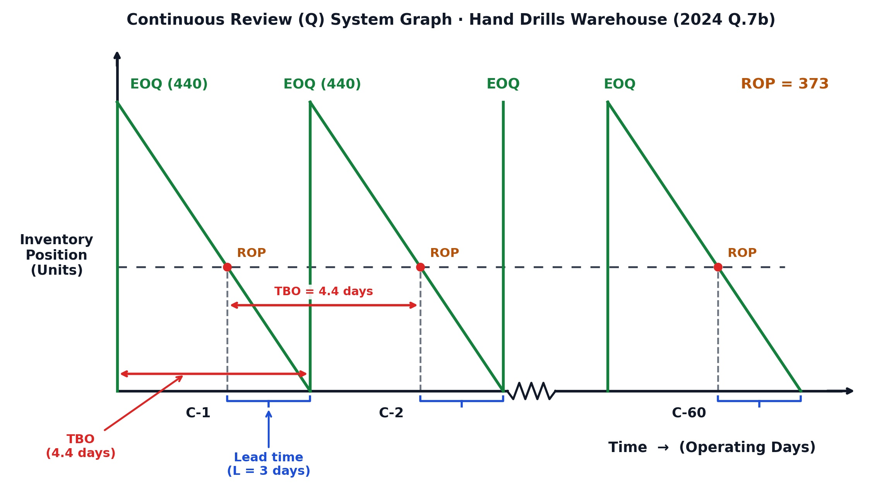
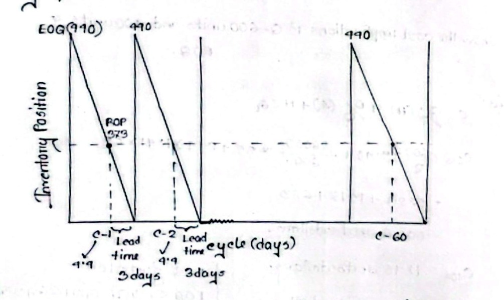
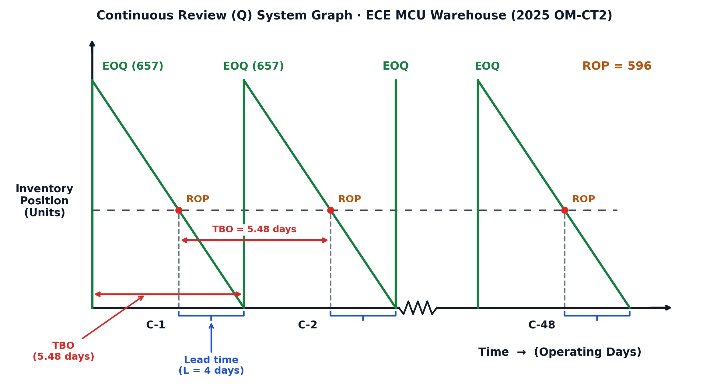

[← Previous: O02.2a: Q-System Method and Weekly Demand Problems](O02.2a_Q_System_Method_and_Weekly_Demand_Problems.md) | [🏠 Index](00_Index.md) | [Next: O03.1: Productivity Formulas, SFP, MFP, and Numericals →](O03.1_Productivity_Formulas_SFP_MFP_and_Numericals.md)

---

# O02.2b: Q-System Daily Demand and MCU Problems

> **Section:** Section B (CO3 · Operational Management · MRI Sir) | **Priority:** 🔴 High (Core Numerical) | **Exam Frequency:** Tested in 2024 Final (Q.7b, 06 Marks) and 2025 OM-CT2 (20 Marks)
> **Subtopics Covered:** `O02.3` (Full Continuous Review Numerical Problems: Daily Operating-Day Schedule), `O02.4` (Annual Demand Conversion and EOQ Calculation), `O02.5` (Safety Stock and Reorder Point Determination), `O02.6` (Inventory Position Decision Rule), `O02.7` (Total Annual Cost Comparison), `O02.8` (Orders per Year, TBO, and Sawtooth Graph)
> **Sources:** MRI Sir Lecture Notes (`Inventory Control.md`), Raidah Class Notes (Classes 10 & 11), 2024 Final Paper (Q.7b), 2025 OM-CT2 Question Paper

## Why This Topic Matters

Operations managers track stock levels daily to avoid factory shutdowns. In continuous review systems, orders arrive only on open operating days. Converting daily rates into annual figures trips up many students in exams. Both the 2024 Final and 2025 Class Test tested this exact setup. Mastering daily conversions and MRI Sir's six-step board format ensures full marks.

---

## 📝 Key Definitions

> **Operating-Day Schedule:** "An industrial calendar where warehouse receipts and deliveries occur only on active working days, typically 5 days per week and 52 weeks per year." (MRI Sir, Class 10 Lecture Notes)

Plain English meaning: The warehouse only counts active working days. It ignores weekends when computing annual demand and lead times.

> **Inventory Position ($IP$):** "The sum of actual on-hand stock and scheduled receipts minus customer backorders: $IP = OH + SR - BO$." (Inventory Control Lecture Notes)

Plain English meaning: $IP$ shows all warehouse items plus incoming orders, minus items owed to customers.

> **Continuous Review ($Q$) System:** "An inventory policy that tracks stock continuously and places a fixed replenishment order of size $Q = EOQ$ whenever inventory position drops to or below the reorder point ($IP \le ROP$)." (Class 10 Board Notes)

Plain English meaning: You track stock after every sale. When stock hits the reorder mark, you order a fresh batch of $EOQ$.

> **Time Between Orders ($TBO$):** "The average length of time that elapses between two consecutive inventory orders." (Verbatim MRI Sir Board Definition, Class 11)

Plain English meaning: $TBO$ tells the manager how many operating days pass between successive purchase orders.

---

## The Operating-Day Conversion Rule

Many exam problems state demand on a daily basis. Students must convert these figures into annual totals before solving for $EOQ$.

### Operating Schedule: 260 Days per Year

A standard factory or regional warehouse operates on a five-day work week:

$$
\text{Operating Days per Year} = 5\text{ days/week} \times 52\text{ weeks/year} = 260\text{ operating days/year}
$$

Annual demand $D$ is calculated as:

$$
D = d \times 260
$$

Where:
- $d = \text{average daily demand in units/day}$
- $D = \text{total annual demand in units/year}$

Never multiply daily demand by 365 calendar days. The problem states that orders arrive only when the warehouse is open.

### Matching Time Units for Lead Time Standard Deviation

To calculate safety stock, demand variability and lead time must share identical time units:

$$
\sigma_L = \sigma_d \sqrt{L}
$$

Where:
- $\sigma_d = \text{standard deviation of daily demand}$
- $L = \text{lead time in operating days}$
- $\sigma_L = \text{standard deviation of demand during lead time}$

If demand is daily, lead time must be in days. If demand is weekly, lead time must be in weeks. Never mix weekly standard deviation with days of lead time.

> [!tip] Memory Hook: The 260 Operating-Day Rule
> 
> - Standard calendar year: 365 days.
> - Industrial working year: 5 days/week $\times$ 52 weeks/year = 260 operating days.
> - Always multiply daily demand by 260, never by 365.

---

## MRI Sir's 6-Step Board Model Answer Format

MRI Sir evaluates Section B continuous review problems using a strict six-step sequence. Follow this exact structure to score 100% marks.

### Step 1: Extract Parameters and Annual Demand D

List every parameter clearly at the top of the answer script:
- Daily demand ($d$) and operating schedule ($260\text{ days/year}$).
- Annual demand: $D = d \times 260\text{ units/year}$.
- Ordering cost per order ($S$).
- Holding cost per unit per year ($H$).
- Lead time ($L$) in days.
- Standard deviation of daily demand ($\sigma_d$).
- Cycle service level ($CSL$) and normal deviate ($Z$).

### Step 2: Calculate EOQ and Reorder Point ROP

Calculate the Economic Order Quantity:

$$
EOQ = \sqrt{\frac{2DS}{H}}
$$

Next, write down the side parameters for lead time:
- Daily demand: $d$
- Lead time: $l$
- Standard deviation during lead time: $\sigma_L = \sigma_d \sqrt{L}$

Then write MRI Sir's four-line reorder point chain:

$$
\begin{aligned}
\text{Reorder point } (ROP) &= \text{Average demand during lead time } (dl) + \text{Safety stock } (z\sigma_L) \\
&= dl + z\sigma_L
\end{aligned}
$$

### Step 3: Check Inventory Position IP and Apply Decision Rule

Calculate total inventory position:

$$
IP = \text{On-hand supply } (OH) + \text{Scheduled Receipt } (SR) - \text{Backorder } (BO)
$$

State the boxed decision rule:

$$
\boxed{IP \le ROP} \longrightarrow \text{Place order} \quad \Big| \quad \boxed{IP > ROP} \longrightarrow \text{Do not order}
$$

Write the direct conclusion:
- If $IP \le ROP$: *"Yes, a new order of [EOQ] units should be placed."*
- If $IP > ROP$: *"No, a new order should not be placed."*

### Step 4: Compare Annual Costs Across Lot Sizes

Evaluate total annual cost using MRI Sir's complete formula:

$$
C = \frac{Q}{2}(H) + \frac{D}{Q}(S) + H z \sigma_L
$$

Calculate costs for each requested lot size ($Q_1$, $EOQ$, $Q_2$). Point out that total cost is lowest at $EOQ$. Show that both under-ordering and over-ordering increase costs.

### Step 5: Calculate Cycle Duration TBO and Orders per Year N

Write the verbatim definition for Time Between Orders:
> *"The average length of time that elapses between two consecutive inventory orders."*

Compute $TBO$ in operating days:

$$
TBO = \frac{Q}{D} \times \text{Operating Days} = \frac{EOQ}{D} \times 260\text{ days}
$$

Compute the number of orders per year:

$$
N = \frac{D}{EOQ} \approx \dots\text{ orders/year}
$$

### Step 6: Construct the Continuous Review Sawtooth Graph

Draw the clean sawtooth graph:
- Label the vertical axis: `Inventory Position (Units)`.
- Label the horizontal axis: `Time -> (Operating Days)`.
- Mark peak inventory at $EOQ$.
- Draw a horizontal dashed line at $ROP$.
- Drop dashed vertical lines from each point where inventory hits $ROP$.
- Mark lead time brackets ($L$).
- Mark order cycle arrows ($TBO$).
- Label cycles $C_1, C_2, \dots, C_N$ with a break line `~~~~` before the final cycle.

> [!tip] Memory Hook: The 6-Step Exam Chain (D-E-R-I-C-G)
> 
> - **D:** Demand conversion ($D = d \times 260$).
> - **E:** EOQ calculation ($EOQ = \sqrt{2DS/H}$).
> - **R:** ROP calculation ($ROP = dl + z\sigma_L$).
> - **I:** IP decision check ($IP = OH + SR - BO$ vs $ROP$).
> - **C:** Cost comparison ($C = \frac{Q}{2}H + \frac{D}{Q}S + H z \sigma_L$).
> - **G:** Graph with cycles ($C_1$ to $C_N$).

---

## Exam Variants

| Year / Source | Question / Scenario | Marks | Key Focus / Result |
| :--- | :--- | :---: | :--- |
| **2024 Final Q.7(b)** | Hand Drills Warehouse ($d = 100$, $L = 3\text{d}$, $CSL = 92\%$) | 06 | $EOQ = 440$, $ROP = 373$, $IP = 480 > 373 \implies$ Do NOT order |
| **2025 OM-CT2 Q.1** | ECE Microcontrollers ($d = 120$, $L = 4\text{d}$, $CSL = 95\%$) | 20 | $EOQ = 657$, $ROP = 596$, $IP = 580 \le 596 \implies$ Place order of 657 MCUs |

---

## 🏆 Golden Questions (Past Exam Archive & Model Answers)

### 🎯 GQ1 · 2024 Final Q.7(b) · Hand Drills Warehouse (06 Marks)

> **Appeared:** 2024 Final Q.7(b) (Section B · CO3 · 06 Marks) · Identical to Raidah Class Notes (Classes 10 & 11)

**Question:**

A regional warehouse purchases hand tools from various suppliers and then distribute then on demand to retailers in the region. The warehouse operates five days per week, $52\text{ weeks per year}$. Only when it is open can orders be received. The following data are estimated for $3/8\text{ inch}$ hand drills with double insulation and variable speed:
- Average daily demand = $100\text{ drills}$
- Standard deviation of daily demand = $30\text{ drills}$
- Lead time = $3\text{ days}$
- Holding cost = $\$9.40/\text{unit/year}$
- Ordering cost = $\$35/\text{order}$
- Cycle service level = $92\%$, which corresponds to $Z\text{-value } 1.41$

*(Note: "distribute then" is printed in original exam paper; refers to "distribute them")*

**Required:**
1. What order quantity, $Q$ and reorder point, $R$, should be used?
2. If on hand inventory is $40\text{ units}$, there is an open order for $440\text{ drills}$ and there are no back orders, should a new order be placed?
3. Calculate cost for $400\text{ units}$, $500\text{ units}$ and units equal to EOQ, then comment on the cost implications.

**Full Answer:**

#### Given Parameters (GQ1 · Hand Drills)

- Operating Schedule = $5\text{ days/week} \times 52\text{ weeks/year} = 260\text{ operating days/year}$
- Daily demand ($d$) = $100\text{ drills/day}$
- Annual demand ($D$) = $100 \times 260 = 26,000\text{ drills/year}$
- Ordering cost ($S$) = $\$35.00/\text{order}$
- Holding cost ($H$) = $\$9.40/\text{unit/year}$
- Lead time ($L$) = $3\text{ days}$
- Standard deviation of daily demand ($\sigma_d$) = $30\text{ drills}$
- Cycle service level = $92\% \implies Z = 1.41$ *(given)*

---

#### Part (i): Order Quantity EOQ and Reorder Point ROP (GQ1)

**1. Economic Order Quantity ($EOQ$):**

$$
\begin{aligned}
EOQ &= \sqrt{\frac{2DS}{H}} \\
&= \sqrt{\frac{2 \times 26,000 \times 35}{9.40}} \\
&= \sqrt{\frac{1,820,000}{9.40}} \\
&= \sqrt{193,617.02} \\
&\approx \mathbf{440\text{ drills}}
\end{aligned}
$$

**2. Reorder Point ($ROP$):**

Side parameters for lead time:
- $d = 100\text{ drills/day}$
- $l = 3\text{ days}$
- $\sigma_L = \sigma_d\sqrt{L} = 30\sqrt{3} \approx 51.96\text{ drills}$ *(Standard deviation of lead time demand)*

$$
\begin{aligned}
\text{Reorder point } (ROP) &= \text{Average demand during lead time } (dl) + \text{Safety stock } (z\sigma_L) \\
&= dl + z\sigma_L \\
&= 100 \times 3 + 1.41 \times 30\sqrt{3} \\
&= 300 + 73.27 \\
&\approx \mathbf{373\text{ drills}}
\end{aligned}
$$

*(Note: In class notes, using rounded $\sigma_L = 52$ gives $1.41 \times 52 = 73.32$, leading to $300 + 73.32 = 373.32 \approx 373\text{ drills}$)*.

---

#### Part (ii): Inventory Position IP and Ordering Decision (GQ1)

$$
\begin{aligned}
IP &= \text{On-hand supply} + \text{Scheduled Receipt} - \text{Backorder} \\
&= 40 + 440 - 0 \\
&= \mathbf{480\text{ drills}}
\end{aligned}
$$

- **Decision Rule:** $\boxed{IP \le ROP} \longrightarrow \text{Place order} \quad \Big| \quad \boxed{IP > ROP} \longrightarrow \text{Do not order}$
- Here, $480 > 373$ ($IP > ROP$).
- **Decision:** **No, a new order should not be placed.**

---

#### Part (iii): Cost Implications for Different Lot Sizes (GQ1)

Using MRI Sir's total annual cost formula:

$$
C = \frac{Q}{2}(H) + \frac{D}{Q}(S) + H z \sigma_L
$$

Constant safety stock holding cost:

$$
H z \sigma_L = 9.40 \times 1.41 \times 30\sqrt{3} \approx 9.40 \times 73.27 \approx \mathbf{\$688.74} \quad (\approx \$689)
$$

**1. For $Q = 400\text{ drills}$:**

$$
\begin{aligned}
C_{400} &= \frac{400}{2} \times 9.40 + \frac{26,000}{400} \times 35 + 689 \\
&= 1,880 + 2,275 + 689 \\
&= \mathbf{\$4,844\text{ dollar}} \quad (\text{exact: } \$4,843.74)
\end{aligned}
$$

**2. For $Q = EOQ = 440\text{ drills}$:**

$$
\begin{aligned}
C_{440} &= \frac{440}{2} \times 9.40 + \frac{26,000}{440} \times 35 + 689 \\
&= 2,068 + 2,068.18 + 689 \\
&= \mathbf{\$4,825\text{ dollar}} \longrightarrow \boxed{EOQ} \quad (\text{exact: } \$4,825.18)
\end{aligned}
$$

**3. For $Q = 500\text{ drills}$:**

$$
\begin{aligned}
C_{500} &= \frac{500}{2} \times 9.40 + \frac{26,000}{500} \times 35 + 689 \\
&= 2,350 + 1,820 + 689 \\
&= \mathbf{\$4,859\text{ dollar}} \quad (\text{exact: } \$4,858.74)
\end{aligned}
$$

**Managerial Comment on Cost Implications:**
- Total annual cost is minimized at $\boxed{EOQ = 440\text{ drills}}$ ($\$4,825$).
- Ordering $400\text{ drills}$ raises annual cost by $\$19$ because of higher order frequency.
- Ordering $500\text{ drills}$ raises annual cost by $\$34$ because of extra warehouse holding fees.
- Both under-ordering and over-ordering increase total cost. $EOQ$ provides the best economic balance.

---

#### Operational Cycle Parameters (GQ1: TBO and N)

- **Time Between Orders ($TBO$):** The average length of time that elapses between two consecutive inventory orders.

$$
TBO = \frac{Q}{D} \times \text{Operating Days} = \frac{440}{26,000} \times 260 = \mathbf{4.4\text{ operating days}}
$$

- **Number of Orders per Year ($N$):**

$$
N = \frac{D}{Q} = \frac{26,000}{440} \approx 59.09 \approx \mathbf{60\text{ orders/year}} \quad (\text{Cycles } C_1 \text{ to } C_{60})
$$

---

#### Continuous Review System Graphs (GQ1)

The complete continuous review sawtooth graph shows order arrivals, depletion slope, reorder threshold, lead time, and cycle duration across 60 annual cycles:

*Figure 1: Continuous Review (Q) System Graph for Hand Drills Warehouse (EOQ = 440, ROP = 373, TBO = 4.4 days, L = 3 days across 60 Cycles)*

Below is the verbatim handwritten lecture board drawing from Raidah's class notes for comparison:

*Figure 2: Handwritten Class Note Reference for Continuous Review (Q) Inventory Graph across 60 Cycles (Source: Classnotes Hum 2217 Raidah, Page 11)*

---

### 🎯 GQ2 · 2025 OM-CT2 Q.1(a–f) · ECE Microcontroller Warehouse (20 Marks)

> **Appeared:** 2025 Class Test 2 (Operational Management · MRI Sir · HUM 2113 / HUM 2217 · 20 Marks)

**Question:**

A regional Electronic and Computer Engineering equipment warehouse purchases electronic components from various suppliers and distributes them on demand to electronics manufacturers, computer assembly firms, and engineering laboratories in the region. The warehouse operates five days per week, 52 weeks per year. Orders can be received only when the warehouse is open.

The following data are estimated for microcontroller units (MCUs) used in embedded-system and computer-control applications:
- Average daily demand = $120\text{ MCUs}$
- Standard deviation of daily demand = $35\text{ MCUs}$
- Lead time ($L$) = $4\text{ days}$
- Holding cost ($H$) = $\$6.50/\text{unit/year}$
- Ordering cost ($S$) = $\$45/\text{order}$
- Cycle service level = $95\%$
- Assume demand is normally distributed.

**Required:**
- a. What order quantity (EOQ) and reorder point (ROP) should the warehouse use?
- b. If the warehouse currently has 80 MCUs on hand, there is one open order for 500 MCUs, and there are no backorders, should a new order be placed?
- c. Show the cost implication for 400 units, EOQ units, and 700 units.
- d. Calculate the number of orders per year.
- e. Calculate TBO.
- f. Show your solution in a continuous review system.

**Full Answer:**

#### Given Parameters (GQ2 · ECE Microcontrollers)

- Operating Schedule = $5\text{ days/week} \times 52\text{ weeks/year} = 260\text{ operating days/year}$
- Average daily demand ($d$) = $120\text{ MCUs/day}$
- Annual demand ($D$) = $120 \times 260 = 31,200\text{ MCUs/year}$
- Ordering cost ($S$) = $\$45.00/\text{order}$
- Holding cost ($H$) = $\$6.50/\text{unit/year}$
- Lead time ($L$) = $4\text{ days}$
- Standard deviation of daily demand ($\sigma_d$) = $35\text{ MCUs}$
- Cycle service level = $95\%$
  - From standard normal distribution tables, $Z = 1.645$.

---

#### Part (a): Order Quantity EOQ and Reorder Point ROP (GQ2)

**1. Economic Order Quantity ($EOQ$):**

$$
\begin{aligned}
EOQ &= \sqrt{\frac{2DS}{H}} \\
&= \sqrt{\frac{2 \times 31,200 \times 45}{6.50}} \\
&= \sqrt{\frac{2,808,000}{6.50}} \\
&= \sqrt{432,000} \\
&\approx 657.267 \approx \mathbf{657\text{ MCUs}}
\end{aligned}
$$

**2. Reorder Point ($ROP$):**

Side parameters for lead time:
- Daily demand: $d = 120\text{ MCUs/day}$
- Lead time: $l = 4\text{ days}$
- Lead time demand: $dl = 120 \times 4 = 480\text{ MCUs}$
- Standard deviation of lead time demand: $\sigma_L = \sigma_d\sqrt{L} = 35\sqrt{4} = 35 \times 2 = 70\text{ MCUs}$
- Safety stock: $SS = z \sigma_L = 1.645 \times 70 = 115.15\text{ MCUs}$

$$
\begin{aligned}
\text{Reorder point } (ROP) &= \text{Average demand during lead time } (dl) + \text{Safety stock } (z\sigma_L) \\
&= dl + z\sigma_L \\
&= 480 + 115.15 \\
&= 595.15 \approx \mathbf{596\text{ MCUs}} \quad (\text{or } 595\text{ MCUs})
\end{aligned}
$$

---

#### Part (b): Inventory Position Decision (GQ2)

Current inventory parameters:
- On-hand stock ($OH$) = $80\text{ MCUs}$
- Scheduled receipts ($SR$) = $500\text{ MCUs}$
- Backorders ($BO$) = $0\text{ MCUs}$

Calculate Inventory Position ($IP$):

$$
\begin{aligned}
IP &= OH + SR - BO \\
&= 80 + 500 - 0 \\
&= \mathbf{580\text{ MCUs}}
\end{aligned}
$$

- **Decision Rule:** $\boxed{IP \le ROP} \longrightarrow \text{Place order} \quad \Big| \quad \boxed{IP > ROP} \longrightarrow \text{Do not order}$
- Here, $580 \le 596$ (or $580 < 595.15$). $IP$ has fallen below $ROP$.
- **Decision:** **Yes, a new order of $\boxed{EOQ = 657\text{ MCUs}}$ should be placed immediately.**

---

#### Part (c): Cost Implication for 400 Units, EOQ, and 700 Units (GQ2)

Annual cost formula including safety stock:

$$
C = \frac{Q}{2}(H) + \frac{D}{Q}(S) + H z \sigma_L
$$

Constant safety stock holding cost:

$$
H z \sigma_L = 6.50 \times 115.15 = \mathbf{\$748.48}
$$

**1. For $Q = 400\text{ MCUs}$:**
- Annual cycle holding cost = $\frac{400}{2} \times 6.50 = \$1,300.00$
- Annual ordering cost = $\frac{31,200}{400} \times 45 = 78 \times 45 = \$3,510.00$
- Annual cycle cost: $TC(400) = 1,300.00 + 3,510.00 = \$4,810.00$
- Total cost including safety stock:

$$
C_{400} = 4,810.00 + 748.48 = \mathbf{\$5,558.48}
$$

**2. For $Q = EOQ = 657\text{ MCUs}$:**
- Annual cycle holding cost = $\frac{657}{2} \times 6.50 = 328.5 \times 6.50 = \$2,135.25$
- Annual ordering cost = $\frac{31,200}{657} \times 45 \approx 47.4886 \times 45 = \$2,136.99$
- Annual cycle cost: $TC(657) = 2,135.25 + 2,136.99 = \$4,272.24$
- Total cost including safety stock:

$$
C_{657} = 4,272.24 + 748.48 = \mathbf{\$5,020.72} \longrightarrow \boxed{EOQ}
$$

*(Using exact theoretical $EOQ = 657.267$ yields cycle cost $\$4,272.24$ and total cost $\$5,020.72$)*.

**3. For $Q = 700\text{ MCUs}$:**
- Annual cycle holding cost = $\frac{700}{2} \times 6.50 = 350 \times 6.50 = \$2,275.00$
- Annual ordering cost = $\frac{31,200}{700} \times 45 \approx 44.5714 \times 45 = \$2,005.71$
- Annual cycle cost: $TC(700) = 2,275.00 + 2,005.71 = \$4,280.71$
- Total cost including safety stock:

$$
C_{700} = 4,280.71 + 748.48 = \mathbf{\$5,029.19}
$$

**Cost Comparison Summary Table:**

| Order Quantity ($Q$) | Annual Ordering Cost | Annual Holding Cost | Total Cycle Cost | Total Cost with SS | Difference vs. $EOQ$ |
| :---: | :---: | :---: | :---: | :---: | :---: |
| **$400\text{ MCUs}$** | $\$3,510.00$ | $\$1,300.00$ | $\$4,810.00$ | **$\$5,558.48$** | $+\$537.76$ ($+10.71\%$) |
| **$EOQ = 657\text{ MCUs}$** | $\$2,136.99$ | $\$2,135.25$ | $\$4,272.24$ | **$\$5,020.72$** | **Optimal Baseline** |
| **$700\text{ MCUs}$** | $\$2,005.71$ | $\$2,275.00$ | $\$4,280.71$ | **$\$5,029.19$** | $+\$8.47$ ($+0.17\%$) |

**Managerial Insights on Cost Implications:**
1. **$EOQ$ achieves minimum cost:** Ordering $657\text{ MCUs}$ balances ordering and holding costs at roughly $\$2,136$ each.
2. **Under-ordering ($Q = 400$) carries a sharp penalty:** Ordering 400 units forces 78 orders each year. Ordering costs jump by $64\%$, adding $\$537.76$ in avoidable annual expense.
3. **Over-ordering ($Q = 700$) shows a shallow cost penalty:** Ordering 700 units adds only $\$8.47$ per year ($0.17\%$). Management can comfortably round batch sizes up to 700 units to fit standard supplier shipping boxes without financial penalty.

---

#### Part (d): Number of Orders per Year N (GQ2)

Using the optimal batch size $EOQ = 657\text{ MCUs}$:

$$
N = \frac{D}{EOQ} = \frac{31,200}{657} \approx 47.49 \approx \mathbf{48\text{ orders/year}} \quad (\text{Cycles } C_1 \text{ to } C_{48})
$$

---

#### Part (e): Time Between Orders TBO (GQ2)

Time Between Orders measures the average duration between two consecutive replenishment orders:

**In Operating Days:**

$$
TBO_{\text{days}} = \frac{EOQ}{D} \times \text{Operating Days} = \frac{657}{31,200} \times 260 = \mathbf{5.48\text{ operating days}}
$$

**In Weeks:**

$$
TBO_{\text{weeks}} = \frac{EOQ}{D} \times 52 = \frac{657}{31,200} \times 52 \approx \mathbf{1.10\text{ weeks}}
$$

The warehouse places an order roughly once every 5.5 operating days.

---

#### Part (f): Continuous Review Sawtooth Graph (GQ2)

The continuous review sawtooth graph displays inventory position dropping from $EOQ = 657$ units. It hits $ROP = 596$ units to trigger an order, cycling 48 times across the year:

*Figure 3: Continuous Review (Q) System Graph for ECE MCU Warehouse across 48 Annual Cycles (EOQ = 657, ROP = 596, TBO = 5.48 days, L = 4 days)*

---

## Master 5-Problem Exam Variant Comparison Table

This master table synthesizes all five continuous review problems across past final exams, class tests, and lecture board exercises.

### Comprehensive Parameter and Decision Matrix

| Exam / Source | Product Item | Time Basis | Annual Demand ($D$) | Cost Setup ($S, H$) | Service Level ($Z$) | $EOQ$ | $ROP$ | $IP$ Setup ($OH, SR, BO$) | Calculated $IP$ | Decision ($IP \le ROP$?) | $TBO$ | Orders / Year ($N$) |
| :--- | :--- | :--- | :---: | :---: | :---: | :---: | :---: | :---: | :---: | :---: | :---: | :---: |
| **2023 Q.7(c)** | Filter Assembly | $52\text{ weeks}$ | $33,800$ | $\text{Tk } 50,000$, $\text{Tk } 30$ | $95\%$ ($Z = 1.43$) | **$10,614$** | **$1,401$** | $400 + 10,614 - 200$ | $10,814$ | $IP > ROP \implies$ **Do NOT order** | $16.3\text{ wk}$ | $3.2$ |
| **2024 Q.4(c)** | Transceiver | $52\text{ weeks}$ | $3,328$ | $\$50$, $\$13$ | $88\%$ ($Z = 1.175$) | **$160$** | **$148$** | Current policy comparison | N/A | Optimal policy saves **$\$468/\text{yr}$** | $2.5\text{ wk}$ | $20.8$ |
| **2024 Q.7(b)** | Hand Drills | $260\text{ days}$ | $26,000$ | $\$35$, $\$9.40$ | $92\%$ ($Z = 1.41$) | **$440$** | **$373$** | $40 + 440 - 0$ | $480$ | $IP > ROP \implies$ **Do NOT order** | $4.4\text{ day}$ | $60$ |
| **2025 OM-CT2** | ECE MCUs | $260\text{ days}$ | $31,200$ | $\$45$, $\$6.50$ | $95\%$ ($Z = 1.645$) | **$657$** | **$596$** | $80 + 500 - 0$ | $580$ | $IP \le ROP \implies$ **Order 657 MCUs** | $5.5\text{ day}$ | $48$ |
| **Class Ex 1** | Board Model | $52\text{ weeks}$ | $20,000$ | $\$40$, $\$2.00$ | $95\%$ ($Z = 1.645$) | **$894$** | **$1,002$** | $40 + 440 - 0$ | $480$ | $IP \le ROP \implies$ **Order 894 units** | $2.3\text{ wk}$ | $23$ |

### Four Critical Patterns Across All 5 Exam Problems

1. **Operating Calendar Rule:**
   - When daily demand is given, multiply by 260 operating days ($5 \times 52$).
   - When weekly demand is given, multiply by 52 weeks.
2. **The Reorder Decision Binary:**
   - In 2025 OM-CT2 ($580 \le 596$) and Class Exercise 1 ($480 \le 1,002$), $IP \le ROP$. Place an order of size $EOQ$.
   - In 2023 Q.7(c) ($10,814 > 1,401$) and 2024 Q.7(b) ($480 > 373$), $IP > ROP$. Do not place an order.
3. **The Asymmetric Cost Curve:**
   - Under-ordering creates severe cost penalties. In 2025 OM-CT2, ordering 400 units instead of 657 adds $\$537.76$ ($+10.71\%$).
   - Over-ordering creates very small penalties. Ordering 700 units instead of 657 adds only $\$8.47$ ($+0.17\%$). The total cost curve is flat near the minimum.
4. **Sawtooth Graph Mapping:**
   - Always label the horizontal axis using the problem's time unit (operating days or weeks).
   - Show the break line `~~~~` before the final cycle $C_N$.

---

## ⚡ Exam Tips & Common Mistakes

1. **Convert to 260 Operating Days:** When the problem says the warehouse operates 5 days a week, multiply daily demand by 260 days. Never use 365 days.
2. **Check Time Units in Lead Time Standard Deviation:** Ensure $\sigma_d$ and $L$ share the same unit. For daily demand, use $\sigma_L = \sigma_d \sqrt{L_{\text{days}}}$.
3. **Include Safety Stock Holding Cost in Total Cost:** MRI Sir's total annual cost formula includes safety stock holding cost: $C = \frac{Q}{2}H + \frac{D}{Q}S + H z \sigma_L$. Always sum all three terms.
4. **State the Boxed Decision Rule Explicitly:** Always write $\boxed{IP \le ROP} \longrightarrow \text{Place order}$ and $\boxed{IP > ROP} \longrightarrow \text{Do not order}$. Then state your final ordering decision clearly.
5. **Draw All Eight Graph Features:** In your sawtooth graph, label eight core elements: vertical axis ($IP$), horizontal axis (time), peak $EOQ$, dashed $ROP$, vertical drop lines, lead time $L$, cycle time $TBO$, and cycles ($C_1$ to $C_N$).

---

## 🔗 Related Topics

- [O01.1 · Inventory Control and Holding Costs](O01.1_Inventory_Control_and_Holding_Costs.md)
- [O01.2 · Types of Inventory and ABC Analysis](O01.2_Types_of_Inventory_and_ABC_Analysis.md)
- [O02.1 · EOQ Model, ROP, Safety Stock, and Cost Curves](O02.1_EOQ_Model_ROP_Safety_Stock_and_Cost_Curves.md)
- [O02.2a · Q-System Method and Weekly Demand Problems](O02.2a_Q_System_Method_and_Weekly_Demand_Problems.md)
- [O03.1 · Productivity Formulas, SFP, MFP, and Numericals](O03.1_Productivity_Formulas_SFP_MFP_and_Numericals.md)
- [99 · Master Formula and Statutory Sheet](99_Master_Formula_and_Statutory_Sheet.md)

---

[← Previous: O02.2a: Q-System Method and Weekly Demand Problems](O02.2a_Q_System_Method_and_Weekly_Demand_Problems.md) | [🏠 Index](00_Index.md) | [Next: O03.1: Productivity Formulas, SFP, MFP, and Numericals →](O03.1_Productivity_Formulas_SFP_MFP_and_Numericals.md)
