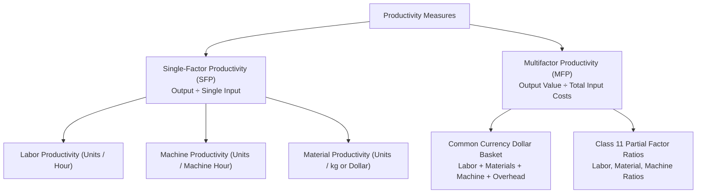

[← Previous: O02.2b: Q-System Daily Demand and MCU Problems](O02.2b_Q_System_Daily_Demand_and_MCU_Problems.md) | [🏠 Index](00_Index.md) | [Next: O03.2: Productivity Decline, Human Factors, and Industry 4.0 →](O03.2_Productivity_Decline_Human_Factors_and_Industry_4_0.md)

---

# O03.1: Productivity Formulas, SFP, MFP, and Numericals

> **Section:** Section B (CO3 · Operational Management · Md. Rokonuzzaman Sir) | **Priority:** 🔴 Very Likely (Prime Candidate for Section B Final) | **Exam Frequency:** Class 11 Core Board Topic
> **Subtopics Covered:** `O03.1` (Definition of Productivity Output/Input and Key Points), `O03.2` (Types: Single-Factor Productivity $SFP$ vs. Multifactor Productivity $MFP$ & Partial Factor Ratios), `O03.3` (Single-Factor Numericals & Month-over-Month $\% \Delta P = \frac{P_{\text{new}} - P_{\text{old}}}{P_{\text{old}}} \times 100\%$), `O03.4` (Multifactor Productivity Numericals in Common Currency)
> **Sources:** MRI Sir Lecture Notes (`Productivity.md`), Raidah Class Notes (Class 11), `Topicwise_Answer/O03_Productivity.md`

## Why This Topic Matters

Operations managers track factory output every single shift. If input costs rise faster than output, the business loses money. MRI Sir taught this topic right after inventory control in Class 11. He emphasized that students must calculate both single-factor and multifactor ratios accurately. Final exams frequently test these formulas through numerical problems. Knowing the step-by-step math guarantees full marks in Section B.

---

## 📝 Key Definitions

> **Productivity:** "Productivity is a measure of how efficiently inputs (such as labor, materials, and capital) are used to produce outputs (goods or services). In its simplest form, productivity is expressed as the ratio of output to input." (MRI Sir Lecture Notes, Slide 2)

In plain words: Productivity shows how much useful work you get out of the resources you spend.

> **Single-Factor Productivity (SFP):** "A productivity measure that evaluates output relative to a single input resource, such as labor hours, machine hours, or capital." (Class 11 Lecture Notes)

In plain words: It looks at only one resource at a time. The most common example is output per labor hour.

> **Multifactor Productivity (MFP):** "A productivity measure that evaluates output relative to a combination of resources, such as labor, materials, energy, and capital, expressed in a common monetary currency." (Class 11 Lecture Notes)

In plain words: It adds up all input costs in dollars. Then it divides total revenue by total spending.

> **Partial Factor Ratios:** "Monetary or unit ratios that compare total output value directly against individual cost items in a multifactor setting." (MRI Sir, Raidah Class 11 Board Notes)

In plain words: These ratios check how many revenue dollars come from each dollar spent on labor, materials, or machines.

---

## The Productivity Ratio and Core Concepts (Subtopic O03.1)

Productivity is the foundation of operational efficiency. Every factory manager seeks to get maximum output from minimum inputs.

### Fundamental Mathematical Formula

At its core, productivity is a simple fraction:

$$
\text{Productivity} = \frac{\text{Output}}{\text{Input}}
$$

A higher number means better performance. You want the numerator as high as possible and the denominator as low as possible.

### Dissecting the Numerator: Physical Output vs. Monetary Value

The numerator represents goods created or services completed during a fixed period:
1. **Physical Quantity:** Counted in real physical units. Examples include 500 desks, 1,800 shirts, or 200,000 smartphones.
2. **Monetary Value:** Total dollar sales value produced. It equals physical units multiplied by unit selling price:

$$
\text{Output Value} = \text{Quantity} \times \text{Selling Price}
$$

### Dissecting the Denominator: The Resource Cost Basket

The denominator represents the operational resources used to make the output:
- **Labor:** Worker hours or direct wage payroll.
- **Materials:** Raw parts, fabric, wood, solder alloy, or electronic chips.
- **Capital & Machines:** Machine run hours, tool depreciation, and maintenance fees.
- **Energy & Overhead:** Electricity, rent, water, and factory administrative costs.

### Three Operational Paths to Boost Productivity

A plant manager can increase productivity in three distinct ways:

1. **Grow Output with the Same Input:**
   - Keep labor and machine hours unchanged.
   - Improve worker skill or line balance to produce more units.
2. **Produce the Same Output with Less Input:**
   - Keep production targets steady.
   - Cut waste, reduce scrap, and lower energy consumption.
3. **Grow Output While Cutting Input (The Ideal Case):**
   - Modernize equipment and automate repetitive steps.
   - Output rises while overtime hours and defective parts fall.

### Why Productivity is a Relative Metric

A single productivity figure means very little on its own. If a factory produces 4.0 phones per labor hour, is that good or bad? You cannot know until you compare it.

Managers evaluate productivity against three reference points:
1. **Historical Records:** Compare this month against last month or last year.
2. **Planned Operating Quotas:** Compare actual line output against the engineering target.
3. **Industry Benchmarks:** Compare factory efficiency against direct competitors.

> [!tip] Memory Hook · The Output Triangle
> Think of productivity as a simple three-variable triangle:
>
> $$
> \text{Output} = \text{Productivity} \times \text{Input}
> $$
>
> - Put **Output** at the top.
> - Put **Productivity** and **Input** at the bottom.
> - Cover any variable with your thumb to find its formula instantly!

---

## Single-Factor vs. Multifactor Productivity (Subtopic O03.2)

Operations managers use two primary categories of productivity metrics. The choice depends on the scope of resources they want to evaluate.

### Single-Factor Productivity (SFP) Formulas

Single-Factor Productivity compares total output to exactly one input resource:

$$
\text{Labor Productivity} = \frac{\text{Total Output (Units)}}{\text{Total Labor Hours}}
$$

$$
\text{Machine Productivity} = \frac{\text{Total Output (Units)}}{\text{Machine Operating Hours}}
$$

$$
\text{Capital Productivity} = \frac{\text{Total Output Value}}{\text{Capital Invested}}
$$

### The Single-Factor Trap: Why SFP Alone Can Mislead

Relying only on labor productivity can fool an operations manager. Consider this real factory scenario:
- A factory buys an expensive automatic welding robot for \$500,000.
- Worker hours drop from 1,000 hours down to 200 hours.
- Labor productivity jumps five-fold ($500\%$).
- But machine depreciation and electricity costs surge.
- Overall production cost per unit actually increased!

Looking only at labor productivity hides the heavy capital investment. That is why managers must calculate Multifactor Productivity.

### Multifactor Productivity (MFP) in Common Currency

Multifactor Productivity combines multiple input resources into a single ratio. You cannot add worker hours directly to fabric meters or kilowatt-hours. So you must convert all inputs into a common currency:

$$
\text{MFP} = \frac{\text{Total Output Value}}{\text{Labor Cost} + \text{Material Cost} + \text{Machine Cost} + \text{Overhead Cost}}
$$

When both numerator and denominator use currency (\$):
- If $\text{MFP} > 1.0$: The plant generates more revenue than its operational expenses. The operation is profitable.
- If $\text{MFP} = 1.0$: The plant just breaks even on operating costs.
- If $\text{MFP} < 1.0$: Operating costs exceed sales value. The plant is losing money.

### The Three Partial Factor Ratios from Class 11

In Class 11, MRI Sir demonstrated three partial factor ratios on the board. These ratios isolate the return on individual resources while keeping revenue or output on top:

1. **Labour Factor Ratio (Revenue per Labor Dollar):**

$$
\text{Labour Ratio} = \frac{\text{Total Output Value}}{\text{Total Labor Cost}} = \frac{\text{Units} \times \text{Price}}{\text{Labor Hours} \times \text{Hourly Wage}}
$$

2. **Material Factor Ratio (Units or Revenue per Material Dollar):**

$$
\text{Material Ratio (Physical)} = \frac{\text{Total Output Units}}{\text{Total Material Cost}}
$$

$$
\text{Material Ratio (Monetary)} = \frac{\text{Total Output Value}}{\text{Total Material Cost}}
$$

3. **Machine Factor Ratio (Units or Revenue per Machine Dollar):**

$$
\text{Machine Ratio (Physical)} = \frac{\text{Total Output Units}}{\text{Total Machine Overhead Cost}}
$$

$$
\text{Machine Ratio (Monetary)} = \frac{\text{Total Output Value}}{\text{Total Machine Overhead Cost}}
$$

### Side-by-Side Comparison Table: SFP vs. MFP

| Dimension | Single-Factor Productivity (SFP) | Multifactor Productivity (MFP) |
| :--- | :--- | :--- |
| **Input Scope** | Exactly one input resource (labor, machine, or material). | Multiple inputs combined into a unified denominator. |
| **Measurement Unit** | Physical units (e.g. units per labor hour, shirts per hour). | Pure numeric ratio (dimensionless) or physical units per dollar spent. |
| **Managerial View** | Narrow. It can hide trade-offs when capital replaces labor. | Comprehensive. It captures total operating expenditure. |
| **Data Collection** | Quick and simple to collect on the shop floor. | Requires cost data, wage sheets, and accounting overhead rates. |
| **Primary Use** | Daily line tracking, shift comparisons, and worker scheduling. | Strategic budgeting, capital investment reviews, and annual planning. |

> [!tip] Memory Hook · The 4-Part Input Basket
> Remember the four inputs in the MFP denominator using the word **L-M-M-O**:
>
> - **L** : Labor (Hours $\times$ Wage Rate)
> - **M** : Materials (Raw Parts, Wood, Fabric)
> - **M** : Machines (Depreciation, Run Hours $\times$ Hourly Rate)
> - **O** : Overhead (Electricity, Rent, IT, Admin)

---

## Period-over-Period Percentage Change (Subtopic O03.3)

Tracking productivity over time reveals whether factory efficiency is improving or declining.

### Mathematical Growth Formula

The percentage change in any productivity metric over two time periods is:

$$
\% \Delta P = \frac{P_{\text{new}} - P_{\text{old}}}{P_{\text{old}}} \times 100\%
$$

Where:
- $P_{\text{new}}$ is the productivity index in the current period (e.g. Month 2).
- $P_{\text{old}}$ is the productivity index in the base or preceding period (e.g. Month 1).

### Interpreting Directional Change

- **Positive Value ($+\% \Delta P$):** Efficiency improved. The plant produced more output per unit of input.
- **Negative Value ($-\% \Delta P$):** Efficiency declined. Resources were wasted, scrap increased, or lines faced downtime.

### MRI Sir's Three Diagnostic Questions from Class 11

In Class 11, MRI Sir stated that whenever productivity falls in an exam problem, you must answer three questions:
1. **Why has productivity decreased?** Identify root causes like bottlenecks, worker fatigue, machine breakdown, or high defect rates.
2. **What is the operational solution?** Propose practical remedies divided into Human Factors and Technological Modernization.
3. **What actions must management take?** Outline steps like enforcing standard operating procedures (SOPs), retraining staff, and revising quality incentives.

---

## Master Summary Table of All 7 Solved Problems

The lecture notes and Class 11 feature seven distinct operational scenarios. Here is a complete comparison table summarizing all seven problems:

| Problem & Sector | Output Details | Major Inputs & Costs | Labor SFP | Total MFP Ratio |
| :--- | :--- | :--- | :--- | :--- |
| **Prob 1: Furniture** (Desk Factory) | 500 desks Price: \$100/desk Value: \$50,000 | Labor: 1,200 hrs @ \$15 = \$18,000 Wood: \$9,000 Machine: 500 hrs @ \$10 = \$5,000 Other: \$2,000 | $0.4167\text{ desks/hr}$ ($2.40\text{ hrs/desk}$) | $\mathbf{1.5625}$ (specified) $1.4706$ (all costs) |
| **Prob 2: Garment** (T-Shirt Factory) | 1,800 shirts Price: \$10/shirt Value: \$18,000 | Labor: 600 hrs @ \$14 = \$8,400 Fabric: \$2,500 Machine: 300 hrs @ \$8 = \$2,400 Overhead: \$700 (excluded) | $3.00\text{ shirts/hr}$ | $\mathbf{1.3534}$ (specified) $1.2857$ (all costs) |
| **Prob 3: University** (Certificate Courses) | 25 courses 500 students total Tuition: \$500/student Revenue: \$250,000 | Faculty: 1,000 hrs @ \$30 = \$30,000 Materials: \$4,000 IT Infrastructure: \$2,000 | $0.025\text{ courses/hr}$ ($0.50\text{ students/hr}$) | $\mathbf{6.944}$ |
| **Prob 4: NGO Training** (Youth Workshops) | 40 workshops 600 trainees total | Trainers: 800 hrs @ \$20 = \$16,000 Materials: \$3,200 Venue: \$2,000 Total Cost: \$21,200 | $0.050\text{ w'shops/hr}$ ($0.750\text{ trainees/hr}$) | $0.001887\text{ w'shops/\$}$ $0.0283\text{ trainees/\$}$ |
| **Prob 5: Micro-Credit** (Small Loans) | 300 micro-loans | Loan Officers: 900 hrs @ \$18 = \$16,200 Admin: \$2,700 Field Travel: \$1,800 Total Cost: \$20,700 | $0.3333\text{ loans/hr}$ ($3.00\text{ hrs/loan}$) | $0.01449\text{ loans/\$}$ (\$69.00 cost/loan) |
| **Prob 6: Apple Factory** (iPhone Assembly) | 200,000 iPhones Wholesale: \$700 Value: \$140,000,000 | Labor: 50,000 hrs @ \$25 = \$1.25M Materials: \$25.00M Machine/Power: \$5.00M Total Cost: \$31.25M | $4.00\text{ iPhones/hr}$ | $\mathbf{4.48}$ (\$5M machine) $4.34$ (\$6M machine) |
| **Prob 7: Bakery** (Bread Loaves) | 2,400 loaves (Weekly) | Labor: 300 hrs @ \$12 = \$3,600 Flour: \$600 Electricity: \$200 Other: \$400 | $8.00\text{ loaves/hr}$ | $0.5455\text{ loaves/\$}$ (spec.) $0.5000\text{ loaves/\$}$ (full) |

---

## Exam Variants

| Scenario / Source | Question Type | Marks | Core Focus / Key Takeaway |
| :--- | :--- | :---: | :--- |
| **Model Q1 (Slide 2 & Class 11)** | Theory & Definitions | 02 | Define productivity; explain why it is a relative metric. |
| **Model Q2 (Slide 4 & Class 11)** | Theory Comparison | 03 | Distinguish SFP from MFP with formulas and a 5-row table. |
| **Problems 1, 2, 4, 5 Suite** | Multi-Sector SFP Numericals | 04 | Compute labor productivity for manufacturing, services, and NGOs. |
| **Class 11 Apple Plant Problem** | Period-over-Period Evaluation | 04 | Compare Month 1 vs. Month 2; compute $\% \Delta P$ and interpret. |
| **Problems 1, 2, 3, 7 Suite** | Common Currency MFP Numericals | 04 | Express all inputs in dollars; compute total MFP ratio. |
| **Class 11 Problem 6 Variant** | MFP & Partial Factor Ratios | 04 | Calculate overall MFP and the three partial factor ratios. |
| **10-Mark Multi-Part Model Q** | Comprehensive Board Problem | 10 | Part (a) definitions, Part (b) SFP/MFP math, Part (c) diagnosis. |

---

## 🏆 Golden Questions (Past Exam Archive & Model Answers)

### 🎯 GQ1 · Definition of Productivity and Relative Nature (2 Marks)

> **Appeared:** Prescribed Model Question · Operational Management (CO3) · (02 Marks)

**Question:**  
Define productivity in operations management. Why is productivity considered a relative measure rather than an absolute indicator?

**Full Answer:**

#### Full Answer for GQ1
Productivity measures how efficiently an organization converts inputs into useful outputs. In operations management, it is defined as the mathematical ratio of output produced to input consumed:

$$
\text{Productivity} = \frac{\text{Output}}{\text{Input}}
$$

Key components of this metric include:
- **Output:** The quantity of finished goods produced or services delivered. Units include physical items (desks, smartphones) or total sales revenue.
- **Input:** The resources consumed during production. Units include labor hours, machine time, raw materials, energy, or total operating expenses.

Productivity is considered a relative measure because an isolated numerical value provides little operational insight. For example, knowing that a factory produces 4.0 units per hour does not reveal whether the line is efficient. It becomes meaningful only when compared against:
1. **Past Performance:** Comparing current productivity against previous shifts or months.
2. **Operational Targets:** Comparing actual output against budgeted management quotas.
3. **Industry Benchmarks:** Comparing plant performance against competing manufacturers.

---

### 🎯 GQ2 · SFP vs. MFP Comparison and Mathematical Formulas (3 Marks)

> **Appeared:** Prescribed Model Question · Operational Management (CO3) · (03 Marks)

**Question:**  
Distinguish between Single-Factor Productivity (SFP) and Multifactor Productivity (MFP). Provide mathematical formulas and a structured comparison table.

**Full Answer:**

#### Full Answer for GQ2
Operations managers classify productivity into two main categories based on the scope of resources evaluated:

**1. Single-Factor Productivity (SFP):**  
Single-Factor Productivity evaluates output relative to a single input resource:

$$
\text{SFP} = \frac{\text{Total Output}}{\text{Single Resource Input}}
$$

The most common single-factor metric is labor productivity:

$$
\text{Labor Productivity} = \frac{\text{Total Output (Units)}}{\text{Total Labor Hours}}
$$

**2. Multifactor Productivity (MFP):**  
Multifactor Productivity evaluates output relative to multiple combined inputs. Because different resources use different physical units (hours, kilograms, kilowatt-hours), managers convert all inputs into a common monetary currency:

$$
\text{MFP} = \frac{\text{Total Output Value}}{\text{Labor Cost} + \text{Material Cost} + \text{Machine Cost} + \text{Overhead Cost}}
$$

**Comparison Table:**

| Feature | Single-Factor Productivity (SFP) | Multifactor Productivity (MFP) |
| :--- | :--- | :--- |
| **Resource Scope** | Evaluates one single input (e.g. labor hours). | Evaluates multiple inputs together (labor, materials, overhead). |
| **Unit of Measurement** | Physical units per input unit (e.g. shirts/hour). | Dimensionless monetary ratio or units per dollar. |
| **Operational Perspective** | Narrow. May show false gains if machines replace workers. | Comprehensive. Captures total cost trade-offs across all inputs. |
| **Ease of Data Collection** | Fast and simple to record on the factory floor. | Requires detailed cost sheets, wages, and accounting data. |
| **Primary Decision Use** | Daily line tracking and worker scheduling. | Strategic budgeting, automation reviews, and plant investments. |

---

### 🎯 GQ3 · Single-Factor Labor Productivity Across Four Sectors (4 Marks)

> **Appeared:** Prescribed Model Question · Operational Management (CO3) · (04 Marks)

**Question:**  
Calculate the single-factor labor productivity for each of the following four operational scenarios:  
(a) An office furniture factory produces 500 desks using 1,200 labor hours.  
(b) A garment plant produces 1,800 T-shirts using 600 labor hours.  
(c) A training organization conducts 40 workshops using 800 trainer hours with an average of 15 participants per workshop.  
(d) A micro-credit agency disburses 300 loans using 900 loan officer hours.

**Full Answer:**

#### Full Answer for GQ3: Problem 1 Furniture Desk Plant
- Given: $\text{Output} = 500\text{ desks}$, $\text{Labor Input} = 1,200\text{ hours}$.

$$
P_{\text{labor}} = \frac{500\text{ desks}}{1,200\text{ hours}} = 0.4167\text{ desks/hour}
$$

Equivalently, producing one desk requires:

$$
\text{Unit Labor Requirement} = \frac{1,200\text{ hours}}{500\text{ desks}} = 2.40\text{ labor hours/desk}
$$

#### Full Answer for GQ3: Problem 2 Garment T-Shirt Plant
- Given: $\text{Output} = 1,800\text{ T-shirts}$, $\text{Labor Input} = 600\text{ hours}$.

$$
P_{\text{labor}} = \frac{1,800\text{ T-shirts}}{600\text{ hours}} = 3.00\text{ T-shirts/hour}
$$

Equivalently, each T-shirt requires $0.333$ labor hours (20 minutes).

#### Full Answer for GQ3: Problem 4 NGO Vocational Training
- Given: $\text{Workshops} = 40$, $\text{Participants per Workshop} = 15$, $\text{Trainer Input} = 800\text{ hours}$.
- Total participants trained = $40 \times 15 = 600\text{ participants}$.

1. Workshop Productivity:

$$
P_{\text{workshop}} = \frac{40\text{ workshops}}{800\text{ hours}} = 0.050\text{ workshops/trainer hour}
$$

Equivalently, each workshop requires $\frac{800}{40} = 20\text{ trainer hours}$.

2. Trainee Participant Productivity:

$$
P_{\text{participant}} = \frac{600\text{ participants}}{800\text{ hours}} = 0.750\text{ participants/trainer hour}
$$

#### Full Answer for GQ3: Problem 5 NGO Micro-Credit Program
- Given: $\text{Output} = 300\text{ micro-loans}$, $\text{Labor Input} = 900\text{ loan officer hours}$.

$$
P_{\text{loan}} = \frac{300\text{ loans}}{900\text{ hours}} = 0.3333\text{ loans/officer hour}
$$

Equivalently, processing each loan requires:

$$
\text{Time per Loan} = \frac{900\text{ hours}}{300\text{ loans}} = 3.00\text{ loan officer hours/loan}
$$

---

### 🎯 GQ4 · Period-over-Period Labor Productivity Evaluation (4 Marks)

> **Appeared:** Class 11 Apple Plant Problem · Operational Management (CO3) · (04 Marks)

**Question:**  
Apple's smartphone assembly plant in China produced 200,000 iPhones in Month 2 using 50,000 labor hours. In Month 1, the same plant produced 220,000 iPhones using 50,000 labor hours.  
(i) Compute the labor productivity for both Month 1 and Month 2.  
(ii) Calculate the period-over-period percentage change in labor productivity.  
(iii) Interpret the operational meaning of this result for the plant manager.

**Full Answer:**

#### Full Answer for GQ4: Step 1 Compute Monthly Labor Indices

For Month 1 (Base Period):
- $\text{Output}_1 = 220,000\text{ iPhones}$
- $\text{Labor Input}_1 = 50,000\text{ hours}$

$$
P_1 = \frac{\text{Output}_1}{\text{Labor Input}_1} = \frac{220,000\text{ iPhones}}{50,000\text{ hours}} = 4.40\text{ iPhones/hour}
$$

For Month 2 (Current Period):
- $\text{Output}_2 = 200,000\text{ iPhones}$
- $\text{Labor Input}_2 = 50,000\text{ hours}$

$$
P_2 = \frac{\text{Output}_2}{\text{Labor Input}_2} = \frac{200,000\text{ iPhones}}{50,000\text{ hours}} = 4.00\text{ iPhones/hour}
$$

#### Full Answer for GQ4: Step 2 Compute Percentage Change

The period-over-period percentage change is given by:

$$
\% \Delta P = \frac{P_{\text{new}} - P_{\text{old}}}{P_{\text{old}}} \times 100\% = \frac{P_2 - P_1}{P_1} \times 100\%
$$

Substituting the calculated indices:

$$
\% \Delta P = \frac{4.00 - 4.40}{4.40} \times 100\% = \frac{-0.40}{4.40} \times 100\% = -9.09\%
$$

#### Full Answer for GQ4: Step 3 Managerial Interpretation
Labor productivity dropped by $9.09\%$. For the exact same labor investment (50,000 worker hours), the factory produced 20,000 fewer phones. 

In line with MRI Sir's Class 11 diagnostic framework:
1. **Diagnosis:** The drop indicates assembly line slowdowns, worker fatigue, component shortages, or machine downtime.
2. **Operational Solution:** The manager must rebalance the assembly stations, check supply chain deliveries, and inspect equipment.
3. **Management Action:** Management should enforce standard assembly procedures and provide refresher training to reduce line stoppages.

---

### 🎯 GQ5 · Multifactor Productivity Suite in Common Currency (4 Marks)

> **Appeared:** Prescribed Model Question · Operational Management (CO3) · (04 Marks)

**Question:**  
Calculate the Multifactor Productivity (MFP) for each of the following manufacturing and service operations:  
(a) A furniture factory produces 500 desks selling at \$100 each. Inputs include 1,200 labor hours at \$15/hr, \$9,000 wood materials, and 500 machine hours at \$10/hr.  
(b) A garment unit produces 1,800 T-shirts selling at \$10 each. Inputs include 600 labor hours at \$14/hr, \$2,500 fabric, and 300 machine hours at \$8/hr.  
(c) A university delivers 25 certificate courses to 20 students per course at \$500 tuition per student. Inputs include 1,000 faculty hours at \$30/hr, \$4,000 materials, and \$2,000 IT infrastructure.  
(d) A commercial bakery produces 2,400 loaves of bread in a week. Inputs include 300 labor hours at \$12/hr, \$600 ingredients, and \$200 oven electricity.

**Full Answer:**

#### Full Answer for GQ5: Problem 1 Furniture Desk Plant MFP
- $\text{Total Output Value} = 500\text{ desks} \times \$100 = \$50,000$.
- Input Costs:
  - $\text{Labor Cost} = 1,200\text{ hours} \times \$15/\text{hour} = \$18,000$
  - $\text{Material Cost} = \$9,000$
  - $\text{Machine Cost} = 500\text{ hours} \times \$10/\text{hour} = \$5,000$

$$
\text{Total Specified Input Cost} = \$18,000 + \$9,000 + \$5,000 = \$32,000
$$

$$
\text{MFP} = \frac{\$50,000}{\$32,000} = 1.5625
$$

*(Note: If management includes other overhead of \$2,000, total input cost is \$34,000. That gives $\text{MFP} = \frac{\$50,000}{\$34,000} = 1.4706$)*.

#### Full Answer for GQ5: Problem 2 Garment T-Shirt Plant MFP
- $\text{Total Output Value} = 1,800\text{ T-shirts} \times \$10 = \$18,000$.
- Input Costs:
  - $\text{Labor Cost} = 600\text{ hours} \times \$14/\text{hour} = \$8,400$
  - $\text{Material Cost} = \$2,500$
  - $\text{Machine Cost} = 300\text{ hours} \times \$8/\text{hour} = \$2,400$
  - Other overhead of \$700 is excluded per management instruction.

$$
\text{Total Input Cost} = \$8,400 + \$2,500 + \$2,400 = \$13,300
$$

$$
\text{MFP} = \frac{\$18,000}{\$13,300} \approx 1.3534
$$

#### Full Answer for GQ5: Problem 3 Professional University MFP
- Total Enrolled Students = $25\text{ courses} \times 20\text{ students} = 500\text{ students}$.
- $\text{Total Tuition Revenue} = 500\text{ students} \times \$500 = \$250,000$.
- Input Costs:
  - $\text{Faculty Labor Cost} = 1,000\text{ hours} \times \$30/\text{hour} = \$30,000$
  - $\text{Course Materials} = \$4,000$
  - $\text{IT Infrastructure} = \$2,000$

$$
\text{Total Input Cost} = \$30,000 + \$4,000 + \$2,000 = \$36,000
$$

$$
\text{MFP} = \frac{\$250,000}{\$36,000} \approx 6.944
$$

Interpretation: The university generates \$6.944 of tuition revenue for every \$1.00 spent on delivering the courses.

#### Full Answer for GQ5: Problem 7 Commercial Bakery MFP
- $\text{Physical Output} = 2,400\text{ loaves of bread}$.
- Input Costs:
  - $\text{Labor Cost} = 300\text{ hours} \times \$12/\text{hour} = \$3,600$
  - $\text{Ingredients (Flour)} = \$600$
  - $\text{Oven Electricity} = \$200$

$$
\text{Total Specified Input Cost} = \$3,600 + \$600 + \$200 = \$4,400
$$

Physical Multifactor Productivity:

$$
\text{MFP (Physical)} = \frac{2,400\text{ loaves}}{\$4,400} \approx 0.5455\text{ loaves/\$}
$$

Equivalently, the operating cost per loaf is $\frac{\$4,400}{2,400} = \$1.833\text{ per loaf}$.

*(Note: If bread sells at \$2.50 per loaf, total output value is $2,400 \times \$2.50 = \$6,000$. In monetary terms, $\text{MFP} = \frac{\$6,000}{\$4,400} \approx 1.3636$. If all overheads of \$400 are added, total cost is \$4,800. That gives $\text{MFP} = \frac{\$6,000}{\$4,800} = 1.25$)*.

---

### 🎯 GQ6 · Apple Factory Multifactor Productivity and Partial Factor Ratios (4 Marks)

> **Appeared:** Class 11 Board Demonstration · Operational Management (CO3) · (04 Marks)

**Question:**  
Apple's smartphone assembly plant produced 200,000 iPhones last month. Each phone sells for a wholesale price of \$700. The plant incurred the following production inputs:  
- Labor: 50,000 hours at \$25 per hour  
- Components and raw materials: \$25,000,000  
- Machine depreciation and electricity overhead: \$5,000,000  
(i) Compute the total input cost and overall Multifactor Productivity (MFP).  
(ii) Calculate the three partial factor ratios taught by MRI Sir in Class 11 (Labour Factor Ratio, Material Factor Ratio, and Machine Factor Ratio).

**Full Answer:**

#### Full Answer for GQ6: Step 1 Total Input Cost and Overall MFP

Total Output Value:

$$
\text{Total Output Value} = 200,000\text{ iPhones} \times \$700 = \$140,000,000
$$

Component Input Costs:
- $\text{Labor Cost} = 50,000\text{ hours} \times \$25/\text{hour} = \$1,250,000$
- $\text{Material Cost} = \$25,000,000$
- $\text{Machine Overhead} = \$5,000,000$

$$
\text{Total Input Cost} = \$1,250,000 + \$25,000,000 + \$5,000,000 = \$31,250,000
$$

Overall Multifactor Productivity:

$$
\text{MFP} = \frac{\text{Total Output Value}}{\text{Total Input Cost}} = \frac{\$140,000,000}{\$31,250,000} = 4.48
$$

Interpretation: The assembly plant generates $\$4.48$ of wholesale revenue for every $\$1.00$ of total operating expenses.

*(Note on Class 11 Variant: Raidah's notes listed machine overhead as \$6,000,000. Total input cost then equals $\$1,250,000 + \$25,000,000 + \$6,000,000 = \$32,250,000$. That gives $\text{MFP} = \frac{\$140,000,000}{\$32,250,000} \approx 4.34$)*.

#### Full Answer for GQ6: Step 2 The Three Class 11 Partial Factor Ratios

As taught by MRI Sir in Class 11, the three partial factor ratios are:

1. **Labour Factor Ratio (Revenue per Labor Dollar):**

$$
\text{Labour Ratio} = \frac{\text{Output Units} \times \text{Price}}{\text{Labor Hours} \times \text{Wage Rate}} = \frac{200,000 \times 700}{50,000 \times 25} = \frac{\$140,000,000}{\$1,250,000} = 112.0
$$

Interpretation: Every \$1.00 paid to assembly workers supports \$112.00 of wholesale smartphone output.

2. **Material Factor Ratio:**
   - In physical units per dollar spent on components:

$$
\text{Material Ratio (Physical)} = \frac{200,000\text{ iPhones}}{\$25,000,000} = 0.008\text{ iPhones/\$}
$$

   - In revenue generated per material dollar:

$$
\text{Material Ratio (Monetary)} = \frac{\$140,000,000}{\$25,000,000} = 5.60
$$

3. **Machine Factor Ratio:**
   - In physical units per dollar spent on machine overhead (with \$5M overhead):

$$
\text{Machine Ratio (Physical)} = \frac{200,000\text{ iPhones}}{\$5,000,000} = 0.040\text{ iPhones/\$}
$$

   - In revenue generated per machine dollar:

$$
\text{Machine Ratio (Monetary)} = \frac{\$140,000,000}{\$5,000,000} = 28.00
$$

*(With Raidah's \$6M machine variant: $\text{Physical Ratio} = \frac{200,000}{6,000,000} \approx 0.0333\text{ iPhones/\$}$, and $\text{Monetary Ratio} = \frac{\$140,000,000}{\$6,000,000} \approx 23.33$)*.

---

### 🎯 GQ7 · Comprehensive 10-Mark Multi-Part Model Exam Question (10 Marks)

> **Appeared:** Comprehensive Board Model Exam Question · Operational Management (CO3) · (10 Marks)

**Question:**  
A regional packaging company produces corrugated shipping cartons selling at \$5 per carton. The production records for Month 1 and Month 2 show:  
- **Month 1:** Produced 32,000 cartons using 8,000 labor hours at \$5/hr, \$40,000 raw cardboard materials, and \$10,000 machine overhead.  
- **Month 2:** Produced 25,600 cartons using 8,000 labor hours at \$5/hr, \$45,000 raw cardboard materials, and \$10,000 machine overhead.  
(a) Define Single-Factor Productivity and Multifactor Productivity with mathematical formulas. *(02 Marks)*  
(b) Calculate for both Month 1 and Month 2:  
    (i) Labor Productivity (cartons per labor hour),  
    (ii) Total Multifactor Productivity (MFP), and  
    (iii) The percentage change in both productivity measures. *(04 Marks)*  
(c) Construct a comparative summary table and provide a concise managerial diagnosis explaining why productivity declined. *(04 Marks)*

**Full Answer:**

#### Full Answer for GQ7: Part (a) Definitions and Mathematical Formulations

**1. Single-Factor Productivity (SFP):**  
Measures output relative to a single input resource:

$$
\text{SFP} = \frac{\text{Total Output}}{\text{Single Input Resource}}
$$

For labor productivity:

$$
P_{\text{labor}} = \frac{\text{Total Output (Units)}}{\text{Total Labor Hours}}
$$

**2. Multifactor Productivity (MFP):**  
Measures output relative to all combined operating costs converted into a common currency:

$$
\text{MFP} = \frac{\text{Total Output Value}}{\sum \text{Input Costs}} = \frac{\text{Output Quantity} \times \text{Unit Selling Price}}{\text{Labor Cost} + \text{Material Cost} + \text{Machine Cost} + \text{Overhead Cost}}
$$

#### Full Answer for GQ7: Part (b) Month 1 Calculations

- Output Quantity: $Q_1 = 32,000\text{ cartons}$
- Output Value: $\text{Value}_1 = 32,000 \times \$5 = \$160,000$
- Labor Hours: $L_1 = 8,000\text{ hours}$
- Labor Cost: $8,000 \times \$5 = \$40,000$
- Material Cost: $\$40,000$
- Machine Overhead: $\$10,000$
- Total Input Cost: $\$40,000 + \$40,000 + \$10,000 = \$90,000$

1. Labor Productivity:

$$
P_{\text{labor}, 1} = \frac{32,000\text{ cartons}}{8,000\text{ hours}} = 4.00\text{ cartons/hour}
$$

2. Multifactor Productivity:

$$
\text{MFP}_1 = \frac{\$160,000}{\$90,000} \approx 1.778
$$

#### Full Answer for GQ7: Part (b) Month 2 Calculations

- Output Quantity: $Q_2 = 25,600\text{ cartons}$
- Output Value: $\text{Value}_2 = 25,600 \times \$5 = \$128,000$
- Labor Hours: $L_2 = 8,000\text{ hours}$
- Labor Cost: $8,000 \times \$5 = \$40,000$
- Material Cost: $\$45,000$ (increased due to high cardboard scrap and defects)
- Machine Overhead: $\$10,000$
- Total Input Cost: $\$40,000 + \$45,000 + \$10,000 = \$95,000$

1. Labor Productivity:

$$
P_{\text{labor}, 2} = \frac{25,600\text{ cartons}}{8,000\text{ hours}} = 3.20\text{ cartons/hour}
$$

2. Multifactor Productivity:

$$
\text{MFP}_2 = \frac{\$128,000}{\$95,000} \approx 1.347
$$

#### Full Answer for GQ7: Part (b) Percentage Change Computations

1. Percentage Change in Labor Productivity:

$$
\% \Delta P_{\text{labor}} = \frac{P_{\text{labor}, 2} - P_{\text{labor}, 1}}{P_{\text{labor}, 1}} \times 100\% = \frac{3.20 - 4.00}{4.00} \times 100\% = \frac{-0.80}{4.00} \times 100\% = -20.00\%
$$

2. Percentage Change in Multifactor Productivity:

$$
\% \Delta \text{MFP} = \frac{\text{MFP}_2 - \text{MFP}_1}{\text{MFP}_1} \times 100\% = \frac{1.347 - 1.778}{1.778} \times 100\% = \frac{-0.431}{1.778} \times 100\% = -24.24\%
$$

#### Full Answer for GQ7: Part (c) Comparative Summary and Diagnostic Findings

**Comparative Summary Table:**

| Metric / Parameter | Month 1 (Base Period) | Month 2 (Current Period) | Absolute Change | Percentage Change |
| :--- | :--- | :--- | :--- | :--- |
| **Output Quantity** | $32,000\text{ cartons}$ | $25,600\text{ cartons}$ | $-6,400\text{ cartons}$ | $-20.00\%$ |
| **Output Sales Value** | $\$160,000$ | $\$128,000$ | $-\$32,000$ | $-20.00\%$ |
| **Labor Hours** | $8,000\text{ hours}$ | $8,000\text{ hours}$ | $0\text{ hours}$ | $0.00\%$ |
| **Total Input Cost** | $\$90,000$ | $\$95,000$ | $+\$5,000$ | $+5.56\%$ |
| **Labor Productivity** | $4.00\text{ cartons/hr}$ | $3.20\text{ cartons/hr}$ | $-0.80\text{ cartons/hr}$ | $\mathbf{-20.00\%}$ |
| **Multifactor Productivity** | $1.778$ | $1.347$ | $-0.431$ | $\mathbf{-24.24\%}$ |

**Managerial Diagnosis:**
1. **Labor Productivity Drop ($-20.00\%$):** Workers spent the same 8,000 hours but produced 6,400 fewer cartons. This points to manual folding bottlenecks, fatigue, and rework time.
2. **Multifactor Productivity Drop ($-24.24\%$):** MFP fell even faster than labor productivity. Cardboard material costs rose from \$40,000 to \$45,000 despite lower finished output. This proves that high defect rates caused severe scrap and wasted raw material.
3. **Core Finding:** The plant worked just as many hours and spent more money, but generated less usable product. Management must address assembly line bottlenecks and scrap rates immediately.

---

## ⚡ Exam Tips & Common Mistakes

1. **Watch the Denominator Units:**
   - In Single-Factor Labor Productivity, the denominator is **labor hours** (e.g. $500 / 1,200 = 0.4167\text{ desks/hour}$).
   - In Multifactor Productivity, the denominator is **total dollars spent** (e.g. $\$50,000 / \$32,000 = 1.5625$).
   - Never mix hours and dollars in the same denominator.

2. **Always Convert Output to Dollars for MFP:**
   - If a problem gives physical units and a selling price, multiply them to get total output value before calculating MFP.
   - For example: $200,000\text{ iPhones} \times \$700 = \$140,000,000$.

3. **Check Management Overhead Instructions:**
   - Look carefully at the exam prompt. In Problem 1, management specified labor, materials, and machine costs (\$32,000). In Problem 2, overhead was explicitly excluded.
   - If an exam question mentions other overhead without exclusions, state both calculations clearly. This guarantees full credit under any grading interpretation.

4. **Retain the Minus Sign in Percentage Change:**
   - Always write $\% \Delta P = \frac{P_{\text{new}} - P_{\text{old}}}{P_{\text{old}}} \times 100\%$.
   - If productivity drops, include the minus sign (e.g. $-9.09\%$ or $-20.00\%$). Then write a clear one-line statement: *"Productivity declined by 9.09%."*

5. **Write the Three Class 11 Questions for Declining Productivity:**
   - Whenever an exam numerical shows a negative percentage change, always state the three questions highlighted by MRI Sir:
     1. Why has productivity decreased?
     2. What is the operational solution?
     3. What actions must management take?

---

## 🔗 Related Topics

- [O01.1: Inventory Control and Holding Costs](O01.1_Inventory_Control_and_Holding_Costs.md)
- [O01.2: Types of Inventory and ABC Analysis](O01.2_Types_of_Inventory_and_ABC_Analysis.md)
- [O02.1: EOQ Model, ROP, Safety Stock, and Cost Curves](O02.1_EOQ_Model_ROP_Safety_Stock_and_Cost_Curves.md)
- [O02.2a: Q-System Method and Weekly Demand Problems](O02.2a_Q_System_Method_and_Weekly_Demand_Problems.md)
- [O02.2b: Q-System Daily Demand and MCU Problems](O02.2b_Q_System_Daily_Demand_and_MCU_Problems.md)
- [O03.2: Productivity Decline, Human Factors, and Industry 4.0](O03.2_Productivity_Decline_Human_Factors_and_Industry_4_0.md)
- [M01.2: Efficiency vs. Effectiveness and Decision Matrix](M01.2_Efficiency_vs_Effectiveness_and_Decision_Matrix.md)
- [99: Master Formula and Statutory Sheet](99_Master_Formula_and_Statutory_Sheet.md)

---

[← Previous: O02.2b: Q-System Daily Demand and MCU Problems](O02.2b_Q_System_Daily_Demand_and_MCU_Problems.md) | [🏠 Index](00_Index.md) | [Next: O03.2: Productivity Decline, Human Factors, and Industry 4.0 →](O03.2_Productivity_Decline_Human_Factors_and_Industry_4_0.md)
