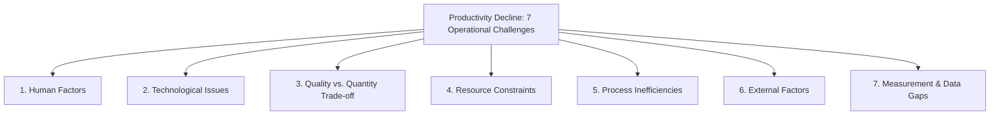
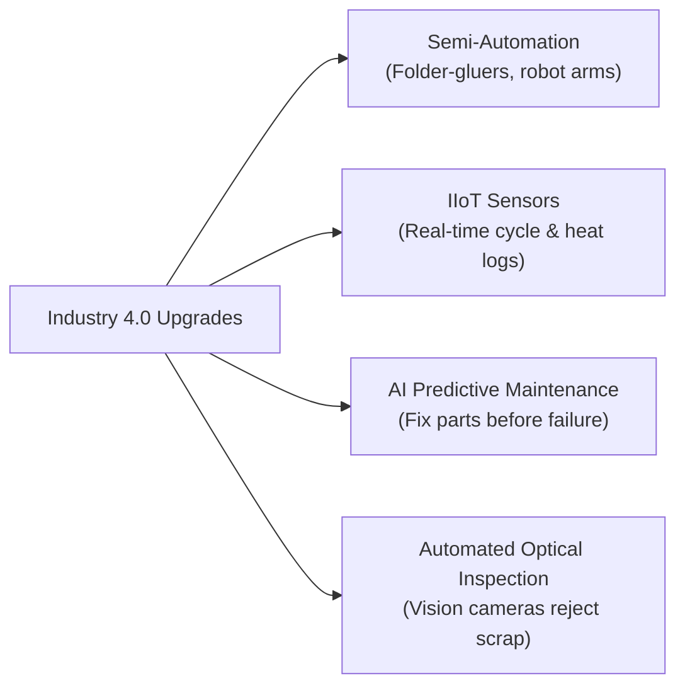
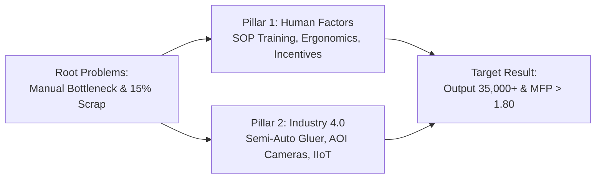

[← Previous: O03.1: Productivity Formulas, SFP, MFP, and Numericals](O03.1_Productivity_Formulas_SFP_MFP_and_Numericals.md) | [🏠 Index](00_Index.md) | [Next: 99 Master Formula and Statutory Sheet →](99_Master_Formula_and_Statutory_Sheet.md)

---

# O03.2: Productivity Decline, Human Factors, and Industry 4.0

> **Section:** Section B (CO3 · Operational Management · Dr. Md. Rabiul Islam Sir) | **Priority:** 🟠 High | **Exam Frequency:** Class 11 Core Focus
> **Subtopics Covered:** `O03.5` (Why Productivity Declines: 7 Operational Challenges), `O03.6` (Operational Solutions: Human Factors and Industry 4.0 Modernization), `O03.7` (Productivity Case Studies: Bright Packaging Ltd. and GreenLeaf Agro Processing)
> **Sources:** MRI Sir Notes (`Productivity.md`), Raidah Class Notes (Class 11), `Topicwise_Answer/O03_Productivity.md`

## Why This Topic Matters

Operations managers do not just calculate numbers. They must fix factory problems when output falls. MRI Sir stressed this topic in Class 11. He warned that exam questions will ask why productivity drops. You must diagnose root causes and suggest solutions. You can score full marks by naming the seven challenges and the two solution pillars.

---

## 📝 Key Definitions

> **Productivity Decline:** A state where output drops relative to inputs, or costs rise without extra output.

In plain words, the plant works harder but produces less usable product. Money and worker time get wasted.

> **Industry 4.0:** The modern phase of industrial production using smart machines, IoT sensors, cloud data, and automated systems.

It connects factory tools to the internet and computers. Machines talk to each other and fix line delays without human stoppage.

---

## The 7 Challenges of Productivity Decline (Subtopic O03.5)

Why does productivity fall on a factory floor? An operations manager faces seven distinct operational hurdles.

### 1. Managing Human Factors
- Workers feel tired from long shifts and heavy overtime.
- Absenteeism increases, so assembly lines stop or run slow.
- Low morale causes careless mistakes.
- Workers often resist new operating rules and tools.
- Skill gaps mean workers take too long on basic assembly tasks.

### 2. Technological Issues
- New automated machines cost a lot of money upfront.
- Old factory machines cannot easily connect with new digital software.
- Fast technology shifts make expensive tools obsolete within a few years.
- Sudden machine breakdowns halt the entire line.

### 3. Quality vs. Quantity Trade-off
- Pushing workers to hit fast volume targets creates sloppy work.
- Defect rates rise quickly when lines run too fast.
- High defect rates produce scrap and costly rework.
- Rework consumes labor hours that should make new goods. Net usable output falls.

### 4. Resource Constraints
- The factory runs short of skilled operators or quality raw materials.
- Sudden price spikes in electricity, gas, or imported parts raise costs.
- Machine capacity limits prevent the plant from handling rush orders.

### 5. Process Inefficiencies
- Bad factory floor layouts force workers to walk long distances for parts.
- Poor line balancing leaves some stations swamped while others sit idle.
- Line bottlenecks stall all downstream operations.

### 6. External Factors
- Suppliers deliver key raw materials late.
- Power cuts or grid voltage drops halt machines.
- Sudden drops in customer market demand leave capacity unused.
- Port delays or road strikes freeze shipments.

### 7. Measurement and Data Deficiencies
- Managers lack real-time digital sensors to track line cycle times.
- Supervisors use outdated paper logs that hide scrap and line delays.
- Using the wrong metric conceals true shop-floor waste.

> [!tip] Memory Hook · The 7 Causes of Productivity Decline (I-O-P-S-I-E-M)
> Use the acronym **I-O-P-S-I-E-M** to recall all seven causes in the exam:
>
> - **I** : **I**nefficiencies in Process (bottlenecks, bad layouts, idle stations)
> - **O** : **O**utdated Technology (high upgrade costs, legacy systems, breakdowns)
> - **P** : **P**eople & Human Factors (fatigue, absenteeism, low morale, skills gap)
> - **S** : **S**carcity of Resources (shortages of parts, skilled workers, power spikes)
> - **I** : **I**naccurate Measurement & Data (lack of sensors, faulty metrics)
> - **E** : **E**xternal Disruptions (vendor delays, blackouts, market drops)
> - **M** : **M**istakes & Quality Trade-offs (speed creates scrap and costly rework)
>
> *Alternate phrase:* **H**ungry **T**igers **Q**uickly **R**un **P**ast **E**very **M**onkey (**H-T-Q-R-P-E-M**).

---

## Operational Solutions: Managing Human Factors (Subtopic O03.6)

People run the factory floor. When productivity drops, managers must first help the workers.

### 1. Standard Operating Procedures (SOPs) and Skills Training
- Write clear, picture-based work instructions at every workstation.
- Train workers on standard folding, cutting, or soldering motions.
- Standard steps cut out wasteful body movements and eliminate assembly errors.

### 2. Ergonomic Workstation Redesign
- Adjust table heights so workers do not bend their backs.
- Place tool racks and part bins within normal arm reach.
- Provide anti-fatigue floor mats and supportive chairs.
- Less physical strain means fewer injuries and faster assembly speed.

### 3. Performance Incentives and Recognition
- Pay cash bonuses to shifts that hit production targets and keep defect rates low.
- Run a "Worker of the Month" program to boost team pride.
- Link bonuses to quality so workers do not rush and make scrap.

### 4. Participative Problem-Solving and Quality Circles
- Form small shop-floor teams of five to eight operators.
- Let workers meet weekly to pinpoint line delays.
- Workers know the machines best and often find simple, practical fixes.

---

## Operational Solutions: Technological Modernization and Industry 4.0 (Subtopic O03.6)

Machines must back up the workforce. Modernizing tools removes physical limits and human error.

### 1. Process Automation and Semi-Automatic Machinery
- Replace slow manual folding or gluing with semi-automatic equipment.
- Install automated conveyors to move heavy parts between stations.
- Automation keeps production speeds steady throughout long shifts.

### 2. Industrial Internet of Things (IIoT) Sensors
- Mount vibration, heat, and speed sensors on critical motors.
- Send real-time data to a central supervisor dashboard.
- Spot line slowdowns within seconds instead of waiting for end-of-shift reports.

### 3. AI Predictive Maintenance
- Run smart software that studies motor vibration and temperature trends.
- The system predicts tool failure days before it happens.
- Maintenance staff replace worn parts during scheduled breaks. This stops sudden line shutdowns.

### 4. Automated Optical Inspection (AOI)
- Place high-speed digital cameras over the conveyor belt.
- AI vision models inspect every joint, solder, or glue line instantly.
- Bad parts get kicked off the belt before wasting costly downstream work.

> [!tip] Memory Hook · Two Pillars of Productivity Recovery
> Remember the two pillars as **People vs. Machines**:
>
> | Solution Pillar | Core Focus | Practical Factory Action | Exam Keywords |
> | :--- | :--- | :--- | :--- |
> | **Pillar 1: Human Factors** | The Worker | Train motions, fix table heights, pay bonuses | SOPs, ergonomics, quality circles, incentives |
> | **Pillar 2: Industry 4.0** | The Equipment | Add semi-auto tools, smart sensors, vision cameras | IIoT sensors, AI predictive maintenance, AOI, automation |

---

## Applied Case Studies (Subtopic O03.7)

MRI Sir included two detailed industrial case studies in `Productivity.md`. Both represent prime candidates for 10-mark final exam questions.

### Case Study 1 · Bright Packaging Ltd. (Cardboard Box Factory)

#### Case 1 Background and Operational Facts
- **Location & Product:** Industrial cardboard box maker in Bangladesh.
- **Workforce & Shifts:** 150 workers across three 8-hour production shifts.
- **Demand:** Steady client orders, but shipments fall behind schedule.
- **Core Bottleneck:** Manual folding and gluing in the box assembly section.
- **Section Size:** 40 workers in the assembly section.
- **Target Output:** 1,060 boxes per worker per shift.
- **Actual Output:** 800 boxes per worker per shift (a 24.5% output deficit).
- **Defect Rate:** 15% of all assembled boxes are rejected for poor gluing and folding.
- **Underlying Flaws:** No written SOPs, zero formal training, awkward tables, and no incentive plan.

#### Case 1 Operational Diagnostic Table
| Metric / Problem | Current Level | Target Level | Operational Impact | Recommended Fix |
| :--- | :--- | :--- | :--- | :--- |
| **Worker Output** | 800 boxes/shift | 1,060 boxes/shift | 24.5% production deficit | SOP training, ergonomic tables |
| **Defect Rate** | 15% | Below 3% | High material scrap, heavy rework | Quality checkpoints, glue inspection |
| **Assembly Method** | 100% manual | Semi-automated | Slow throughput, worker fatigue | Semi-automatic folder-gluers |
| **Worker Morale** | Neutral / Low | Engaged | Absenteeism, careless gluing | Shift bonus for low defect rates |

---

### Case Study 2 · GreenLeaf Agro Processing (Fruit Packaging Plant)

#### Case 2 Background and Operational Facts
- **Location & Product:** Fruit packaging plant in Bangladesh serving local and export markets.
- **Workforce & Lines:** 200 workers across two production lines.
- **Problem:** Fruit sorting and packaging output is 15% below target. High fruit damage triggers customer complaints.
- **Packaging Line Workforce:** 50 workers on the sorting and packing line.
- **Target Output:** 5,000 packed fruit boxes per shift.
- **Actual Output:** 4,250 packed fruit boxes per shift (15% deficit).
- **Fruit Damage Rate:** 12% of handled fruit is bruised or spoiled.
- **Root Causes:**
  1. Manual sorting creates uneven flow and bottlenecks.
  2. Workers drop and bruise delicate fruits due to lack of training.
  3. Disorganized workspace forces workers to carry boxes across long distances.
  4. Outdated packing tools crush soft fruit during box closing.

#### Case 2 Operational Diagnostic Table
| Issue Identified | Shop-Floor Evidence | Operational Consequence | Practical Solution |
| :--- | :--- | :--- | :--- |
| **Manual Sorting Delays** | Visual inspection by eye only | Flow bottlenecks, uneven pacing | Roller sorting tables with size grids |
| **Fruit Bruising (12%)** | Rough manual handling | Customer returns, lost revenue | Soft-touch gloves, padded chutes |
| **Movement Waste** | Cluttered room layout | Workers walk back and forth | U-shaped packing line layout |
| **Inadequate Equipment** | Manual box stapling and taping | Crushed fruit, slow packing pace | Padded semi-automatic box tapers |

---

## Exam Variants

| Year / Source | Question / Scenario | Marks | Key Focus / Result |
| :--- | :--- | :---: | :--- |
| GQ1 (`O03_Productivity.md` §O03.5) | Seven challenges of productivity decline | 04 | Full list of 7 operational hurdles (`I-O-P-S-I-E-M`) |
| GQ2 (`O03_Productivity.md` §O03.6) | Managing Human Factors operational solutions | 04 | SOPs, ergonomics, incentives, quality circles |
| GQ3 (`O03_Productivity.md` §O03.6) | Technological Modernization and Industry 4.0 | 04 | Semi-automation, IIoT, predictive maintenance, AOI |
| GQ4 (`Productivity.md` Slides 16–21) | Bright Packaging Ltd. 4-part case | 08 | Output drop, 15% defects, bottlenecks, semi-automation |
| GQ5 (`Productivity.md` Slides 22–24) | GreenLeaf Agro Processing 4-part case | 08 | 12% fruit damage, gentle handling, U-shaped layout |
| GQ6 (`Productivity.md` Synthesis) | Cardboard packaging vs. agro-processing bottlenecks | 04 | Comparative operational diagnosis across industries |
| GQ7 (`O03_Productivity.md` §O03.7) | Bright Packaging 10-mark numerical case | 10 | SFP, MFP, % change, diagnosis, dual-pillar plan |

---

## 🏆 Golden Questions (Past Exam Archive & Model Answers)

### 🎯 GQ1 · Model Question · Seven Challenges of Productivity Decline (I-O-P-S-I-E-M) (04 Marks)

> **Appeared:** Suggested Core Theory Model Question · Subtopic O03.5 · (04 Marks)

**Question:**
Why does productivity decline in an industrial enterprise? Detail the seven challenges faced by an operations manager using the `I-O-P-S-I-E-M` framework.

**Full Answer:**

Productivity declines when output drops relative to inputs. It also falls when operating expenses rise without extra output.

An operations manager diagnoses productivity loss across seven operational dimensions (`I-O-P-S-I-E-M`):

1. **I : Inefficiencies in Process:**
   - Cluttered shop-floor layouts force workers to walk long distances.
   - Poor line balancing creates bottlenecks. Downstream stations wait idle.

2. **O : Outdated Technology:**
   - Buying new automation equipment requires heavy capital spending.
   - Legacy machines cannot connect easily with modern digital tools.
   - Sudden machine breakdowns stop entire production lines.

3. **P : People and Human Factors:**
   - Workers suffer fatigue from long shifts and heavy overtime.
   - High absenteeism, low morale, and turnover slow down assembly lines.
   - Skill gaps mean workers take too long on basic tasks.

4. **S : Scarcity of Resources:**
   - Factories face shortages of skilled labor and quality raw materials.
   - Price hikes in electricity, fuel, or imported components raise costs.

5. **I : Inaccurate Measurement and Data:**
   - Plants lack real-time digital sensors to track cycle times.
   - Inappropriate metrics conceal scrap and line waste.

6. **E : External Disruptions:**
   - Late vendor shipments freeze factory operations.
   - Grid power cuts and sudden shifts in market demand leave capacity idle.

7. **M : Mistakes and Quality Trade-Offs:**
   - Pushing workers to meet fast quotas leads to careless mistakes.
   - High defect rates produce scrap and costly rework. This cuts net usable output.

---

### 🎯 GQ2 · Model Question · Operational Solutions: Managing Human Factors (04 Marks)

> **Appeared:** Suggested Core Theory Model Question · Subtopic O03.6 · (04 Marks)

**Question:**
Explain how an operations manager can restore falling productivity by managing human factors on the factory floor.

**Full Answer:**

People run the production process. When output drops, managers must first support the workforce.

An operations manager uses four core human factor strategies:

1. **Standard Operating Procedures (SOPs) and Skills Training:**
   - Write clear, picture-based instructions at every workstation.
   - Train workers on standard cutting, folding, or assembly motions.
   - Standard steps eliminate wasted body movements and cut assembly errors.

2. **Ergonomic Workstation Redesign:**
   - Set workbench heights to elbow level.
   - Place tools and parts bins within comfortable arm reach.
   - Provide anti-fatigue floor mats and supportive chairs.
   - Lower physical strain reduces injuries and speeds up assembly work.

3. **Quality-Linked Incentive Systems:**
   - Pay cash bonuses to shifts that hit output goals while keeping defect rates low.
   - Add public recognition programs like "Worker of the Month".
   - Rewarding both speed and quality prevents careless mistakes.

4. **Participative Problem-Solving and Quality Circles:**
   - Form small teams of five to eight operators.
   - Hold short weekly meetings to identify line delays.
   - Operators know their machines best and offer fast, practical solutions.

---

### 🎯 GQ3 · Model Question · Operational Solutions: Technological Modernization and Industry 4.0 (04 Marks)

> **Appeared:** Suggested Core Theory Model Question · Subtopic O03.6 · (04 Marks)

**Question:**
Detail how technological modernization and Industry 4.0 systems overcome factory productivity limits.

**Full Answer:**

Modern machinery supports human labor. Upgrading equipment eliminates physical bottlenecks and human error.

An operations manager applies four technological solutions:

1. **Process Automation and Semi-Automatic Machinery:**
   - Replace slow manual folding or gluing with semi-automatic equipment.
   - Install powered conveyors to move parts between stations.
   - Semi-automation maintains uniform assembly speed through long shifts.

2. **Industrial Internet of Things (IIoT) Sensors:**
   - Mount smart vibration and heat sensors on critical motors.
   - Transmit live data to a central supervisor dashboard.
   - Spot line slowdowns instantly instead of waiting for end-of-shift reports.

3. **AI Predictive Maintenance:**
   - Run smart software that tracks equipment wear trends.
   - The system flags failing parts days before breakdown.
   - Technicians replace worn components during planned breaks. This prevents sudden line stops.

4. **Automated Optical Inspection (AOI):**
   - Place high-speed digital cameras over the conveyor belt.
   - Computer vision algorithms inspect every seal, solder, or joint.
   - Flawed parts get rejected before consuming costly downstream labor.

---

### 🎯 GQ4 · Model Case Study 1 · Bright Packaging Ltd. Assembly Section (08 Marks)

> **Appeared:** Primary Applied Case Study from `Productivity.md` (Slides 16–21) · (08 Marks)

**Question:**
Bright Packaging Ltd. manufactures cardboard boxes in Bangladesh. The plant employs 150 workers across three daily shifts. Management observed stagnating productivity, late client deliveries, and rising costs.

The main bottleneck is at the box assembly section, where 40 workers manually fold and glue boxes. Average output is 800 boxes per worker per shift, compared to a target of 1,060 boxes. The defect rate is 15%, causing heavy rework and scrap. Outdated methods, unstandardized work, lack of training, and no incentive plan exist.

Analyze the situation and answer the following four questions:
(a) What steps would you recommend to increase the average output per worker while reducing the defect rate?
(b) How can the company motivate workers to improve both productivity and quality?
(c) Suggest methods to identify and eliminate bottlenecks in the box assembly process.
(d) What role could technology or automation play in improving productivity here?

**Full Answer:**

#### GQ4(a) Steps to Increase Output and Reduce Defect Rate
1. **Develop Visual SOPs:** Create picture-based standard operating sheets showing exact folding and gluing steps.
2. **Hands-On Skills Training:** Train all 40 assembly workers on uniform glue application to eliminate glue spill and weak bonds.
3. **In-Line Quality Checkpoints:** Install simple pass/fail alignment gauges at workstations to catch folding flaws immediately.
4. **Ergonomic Station Setup:** Place cardboard blanks and glue guns at elbow height. This eliminates deep bending and lowers worker fatigue.
5. **Real-Time Performance Boards:** Post hourly output and defect counts on whiteboards. This helps teams spot slowdowns instantly.

#### GQ4(b) Worker Motivation Strategies
1. **Dual-Criteria Shift Bonuses:** Introduce financial bonuses for shifts that achieve at least 1,000 boxes per worker with defects below 3%.
2. **Recognition Awards:** Celebrate top-performing teams through a monthly "Best Quality Shift" award with cash prizes and certificates.
3. **Quality Circle Involvement:** Empower workers by asking them for ideas to improve workstation layout. This builds worker pride and job commitment.

#### GQ4(c) Methods to Identify and Eliminate Assembly Bottlenecks
1. **Time-and-Motion Study:** Time each assembly element (picking blank, folding, gluing, stacking) with a stopwatch to locate the slowest movement.
2. **Process Flowcharting and Value Stream Mapping:** Map every material touchpoint to spot unnecessary handling or buffer pileups.
3. **Line Balancing:** Reassign tasks across stations so folding and gluing cycle times match conveyor feed rates.
4. **Buffer Stock Control:** Keep small, organized buffer trays of pre-creased blanks next to gluers to prevent idle waiting.

#### GQ4(d) Role of Technology and Automation
1. **Semi-Automatic Folder-Gluers:** Replace manual folding with semi-automatic gluing machines. This increases shift output toward 1,200 boxes per worker.
2. **Automated Glue Dispensers:** Use electric glue heads to apply precise adhesive amounts. This eliminates the 15% defect rate caused by uneven manual gluing.
3. **Optical Sensor Verification:** Mount basic optical sensors at machine exits to detect misaligned carton edges automatically.
4. **Payback Justification:** Lower scrap and higher throughput will quickly recover machine capital expenses within 6 to 9 months.

---

### 🎯 GQ5 · Model Case Study 2 · GreenLeaf Agro Processing Fruit Line (08 Marks)

> **Appeared:** Primary Applied Case Study from `Productivity.md` (Slides 22–24) · (08 Marks)

**Question:**
GreenLeaf Agro Processing packages fresh fruits in Bangladesh for local and export markets. It employs 200 workers across two production lines. Output on the fruit sorting and packaging line is 15% below target. A high fruit damage rate of 12% causes product loss and client complaints.

Line data shows:
- Target packed boxes per shift: 5,000 boxes
- Actual packed boxes per shift: 4,250 boxes
- Fruit damage rate: 12%
- Line workforce: 50 workers

Key problems include manual sorting delays, untrained fruit handlers, disorganized workspace, and inadequate packing tools. Propose a comprehensive productivity improvement strategy by answering:
(a) What practical steps can GreenLeaf take to increase packed boxes per shift?
(b) How can the company reduce the fruit damage rate during sorting and packaging?
(c) What changes in workspace design and workflow can improve efficiency?
(d) Would investing in better packaging equipment be justified? Explain.

**Full Answer:**

#### GQ5(a) Practical Steps to Increase Output per Shift
1. **Balance the Sorting Line:** Divide the 50 workers into dedicated sizing, grading, and packing sub-teams to prevent bottleneck pileups.
2. **Install Gravity Roller Conveyors:** Use non-powered roller conveyors to move fruit boxes smoothly between stations without manual lifting.
3. **Paced Workflow Signaling:** Use gentle visual cues to maintain steady box throughput toward the 5,000-box target.
4. **Pre-Grading Sorting Bins:** Separate obvious undersized fruit early on a feeding belt before delicate manual grading.

#### GQ5(b) Steps to Reduce Fruit Damage Rate
1. **Gentle Handling Training:** Train workers on soft-grip fruit holding techniques to stop finger bruising.
2. **Padded Work Surfaces:** Line all sorting tables, collection chutes, and transfer bins with soft foam padding.
3. **Drop Height Elimination:** Lower transfer drops between conveyor belts and collection bins to zero or gentle angles.
4. **Temperature Control:** Maintain cool room temperatures during sorting to keep fruit skin firm and resistant to bruising.

#### GQ5(c) Workspace Design and Workflow Improvements
1. **Adopt a U-Shaped Flow Layout:** Redesign the line into a U-shape. This places raw fruit intake and finished palletizing close together.
2. **Apply 5S Workplace Organization:** Clear away empty cartons and discarded fruit. Mark dedicated floor lanes for box trolleys.
3. **Ergonomic Sorting Tables:** Set table heights to standing elbow level (95 to 105 cm). Add tilted trays for fast viewing.
4. **Point-of-Use Materials:** Store packaging cartons and liners directly above the packing table within arm reach.

#### GQ5(d) Justification for Investing in Modern Packaging Equipment
1. **Investment Justification:** Yes, the investment is fully justified.
2. **Loss Recovery Calculation:** A 12% damage rate on 5,000 boxes destroys 600 boxes of fruit every shift. Cutting damage to 2% saves 500 boxes per shift.
3. **Operational Speed:** Semi-automated box-formers and gentle mechanical tapers package fruit twice as fast as manual taping.
4. **Financial Return:** Saved fruit revenues and eliminated export penalties will pay back modern machine costs within one harvesting season.

---

### 🎯 GQ6 · Model Analytical Question · Bottlenecks in Manufacturing vs. Perishable Agro-Processing (04 Marks)

> **Appeared:** Suggested Analytical Question · Subtopics O03.5 and O03.7 · (04 Marks)

**Question:**
Compare the operational bottlenecks at Bright Packaging Ltd. with those at GreenLeaf Agro Processing. How do product characteristics dictate different managerial remedies?

**Full Answer:**

Operations managers must tailor solutions to specific product characteristics:

1. **Durable Goods (Bright Packaging Ltd.):**
   - **Product Nature:** Cardboard cartons are dry, non-perishable goods.
   - **Core Bottleneck:** Manual folding and gluing caused slow output and a 15% glue defect rate.
   - **Managerial Focus:** Standardize hand motions, introduce semi-automatic folder-gluers, and verify glue lines with optical sensors.
   - **Scrap Impact:** Defective cartons can be recycled or discarded without immediate decay.

2. **Perishable Goods (GreenLeaf Agro Processing):**
   - **Product Nature:** Fresh fruit is fragile, perishable, and time-sensitive.
   - **Core Bottleneck:** Rough manual sorting and clumsy box stapling caused a 12% fruit damage rate.
   - **Managerial Focus:** Soft-touch handling training, foam-padded tables, gravity roller tracks, and cool room temperatures.
   - **Damage Impact:** Bruised fruit rots quickly and triggers severe export rejections.

3. **Managerial Takeaway:**
   - Durable manufacturing benefits most from mechanization and throughput speed.
   - Perishable processing demands gentle handling, ergonomic layout, and damage prevention.

---

### 🎯 GQ7 · Comprehensive 10-Mark Model Exam Question · Bright Packaging Numerical & Strategy (10 Marks)

> **Appeared:** Suggested 10-Mark Model Final Exam Question · Section B (CO3) · (10 Marks)

**Question:**
Bright Packaging Ltd. operates an industrial carton manufacturing plant in Bangladesh. The company runs three 8-hour production shifts daily. Management observed that output fell below target due to manual folding bottlenecks and high defect rates.

Production records reveal the following data for two consecutive months:
- **Month 1:** The plant employed 40 assembly workers working 200 hours each (8,000 labor hours) at \$5/hour. It produced 32,000 finished cartons sold at \$5 each. Raw material costs were \$40,000. Machine overhead was \$10,000.
- **Month 2:** Output dropped to 25,600 finished cartons due to bottlenecks and a 15% defect rate. Labor input remained 8,000 hours at \$5/hour. Material costs rose to \$45,000 due to scrap. Machine overhead was \$10,000. Selling price stayed at \$5 per carton.

You are appointed as the Operations Manager.
(a) Define Single-Factor Productivity and Multifactor Productivity with mathematical formulas. *(02 Marks)*
(b) Calculate for both Month 1 and Month 2:
    (i) Labor Productivity (cartons per labor hour),
    (ii) Total Multifactor Productivity (MFP), and
    (iii) The percentage change in both productivity measures. *(04 Marks)*
(c) Diagnose why productivity declined. Propose practical solutions using Human Factors and Industry 4.0 modernization. *(04 Marks)*

**Full Answer:**

#### GQ7 Part (a) Definitions and Formulas (02 Marks)

**1. Single-Factor Productivity (SFP):**
Measures output relative to one chosen input resource:

$$
\text{SFP} = \frac{\text{Total Output}}{\text{Single Input Resource}}
$$

**2. Multifactor Productivity (MFP):**
Measures total output value relative to combined operational resources expressed in common currency:

$$
\text{MFP} = \frac{\text{Total Output Value}}{\sum \text{Input Costs}} = \frac{\text{Quantity} \times \text{Selling Price}}{\text{Labor Cost} + \text{Material Cost} + \text{Overhead Cost}}
$$

---

#### GQ7 Part (b) Numerical Computations and Percentage Changes (04 Marks)

##### Month 1 Computations
- $\text{Output Quantity}_1 = 32,000\text{ cartons}$
- $\text{Total Output Value}_1 = 32,000 \times \$5 = \$160,000$
- $\text{Labor Input}_1 = 8,000\text{ hours}$
- $\text{Labor Cost}_1 = 8,000 \times \$5 = \$40,000$
- $\text{Material Cost}_1 = \$40,000$
- $\text{Machine Overhead}_1 = \$10,000$
- $\text{Total Input Cost}_1 = \$40,000 + \$40,000 + \$10,000 = \$90,000$

Labor Productivity:

$$
P_{\text{labor}, 1} = \frac{32,000\text{ cartons}}{8,000\text{ hours}} = 4.00\text{ cartons/hour}
$$

Multifactor Productivity:

$$
\text{MFP}_1 = \frac{\$160,000}{\$90,000} = 1.778
$$

##### Month 2 Computations
- $\text{Output Quantity}_2 = 25,600\text{ cartons}$
- $\text{Total Output Value}_2 = 25,600 \times \$5 = \$128,000$
- $\text{Labor Input}_2 = 8,000\text{ hours}$
- $\text{Labor Cost}_2 = 8,000 \times \$5 = \$40,000$
- $\text{Material Cost}_2 = \$45,000$
- $\text{Machine Overhead}_2 = \$10,000$
- $\text{Total Input Cost}_2 = \$40,000 + \$45,000 + \$10,000 = \$95,000$

Labor Productivity:

$$
P_{\text{labor}, 2} = \frac{25,600\text{ cartons}}{8,000\text{ hours}} = 3.20\text{ cartons/hour}
$$

Multifactor Productivity:

$$
\text{MFP}_2 = \frac{\$128,000}{\$95,000} = 1.347
$$

##### Period-over-Period Percentage Change

Change in Labor Productivity:

$$
\% \Delta P_{\text{labor}} = \frac{3.20 - 4.00}{4.00} \times 100\% = \frac{-0.80}{4.00} \times 100\% = -20.00\%
$$

Change in Multifactor Productivity:

$$
\% \Delta \text{MFP} = \frac{1.347 - 1.778}{1.778} \times 100\% = \frac{-0.431}{1.778} \times 100\% = -24.24\%
$$

Interpretation: Labor productivity dropped by $20.00\%$. Overall multifactor productivity dropped by $24.24\%$.

---

#### GQ7 Part (c) Managerial Diagnosis and Action Plan (04 Marks)

##### Managerial Diagnosis for GQ7
The $24.24\%$ productivity drop reveals three critical failures:
- **Assembly Bottleneck:** Manual folding slowed line throughput, cutting finished box output by 6,400 units.
- **Material Scrap Surge:** A 15% defect rate wasted cardboard blanks, pushing material expenses up from \$40,000 to \$45,000.
- **Rework Waste:** Workers spent labor hours ungluing and patching bad boxes rather than producing new ones.

##### Action Plan for GQ7

**Pillar 1: Managing Human Factors**
1. **SOP Training:** Teach all 40 workers uniform folding and gluing motions to prevent loose joins.
2. **Ergonomic Workbenches:** Adjust packing tables to standing elbow height to lower worker back fatigue.
3. **Scrap-Linked Incentives:** Award shift bonuses when the line maintains a defect rate below 3%.

**Pillar 2: Technological Modernization and Industry 4.0**
1. **Semi-Automated Folder-Gluers:** Install semi-automatic carton machines to remove manual folding bottlenecks.
2. **Automated Optical Inspection (AOI):** Install digital cameras above conveyor belts to detect bad glue lines instantly.
3. **IIoT Line Dashboards:** Connect smart counters to the packaging belt to track real-time hourly cycle speeds.

---

## ⚡ Exam Tips & Common Mistakes

1. **State Both Output and Input Units:** When calculating labor productivity, always write the units clearly (e.g., `cartons/hour` or `desks/hour`). Do not write bare numbers.
2. **Include Dollar Signs in MFP:** Multifactor productivity uses total dollar value over total dollar cost. Ensure material, labor, and machine overhead are all summed in currency units before dividing.
3. **Watch the Sign in Percentage Change:** A drop must carry a negative sign (e.g. `$-20.00\%$`). If you write `$+20\%$`, you lose marks.
4. **Cite Both Levers for Solutions:** If asked for solutions, always split your answer into two clear sections: `1. Managing Human Factors` and `2. Technological Modernization (Industry 4.0)`. MRI Sir checks for both pillars.

## 🔗 Related Topics

- [O03.1 · Productivity Formulas, SFP, MFP, and Numericals](O03.1_Productivity_Formulas_SFP_MFP_and_Numericals.md)
- [O01.1 · Inventory Control and Holding Costs](O01.1_Inventory_Control_and_Holding_Costs.md)
- [99 · Master Formula and Statutory Sheet](99_Master_Formula_and_Statutory_Sheet.md)

---

[← Previous: O03.1: Productivity Formulas, SFP, MFP, and Numericals](O03.1_Productivity_Formulas_SFP_MFP_and_Numericals.md) | [🏠 Index](00_Index.md) | [Next: 99 Master Formula and Statutory Sheet →](99_Master_Formula_and_Statutory_Sheet.md)
