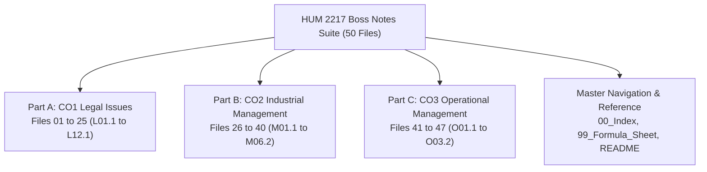

[🏠 Master Index (00_Index.md)](00_Index.md) | [📐 Master Formula & Statutory Sheet](99_Master_Formula_and_Statutory_Sheet.md) | [Start Reading: L01.1 →](L01.1_Definitions_of_Law_and_Society.md)

---

# HUM 2217: Boss Notes Study Suite

Welcome to the **Boss Notes Study Suite** for **HUM 2217: Legal Issues, Industrial & Operational Management** (RUET, Department of ECE, 2-2 / 8th Semester).

This study vault provides an exam-ready learning resource. It prepares you to score maximum marks in both Section A and Section B of the semester final examination.

---

## 1. What Are the Boss Notes?

Boss Notes are 50 focused, precision-engineered study files. They turn heavy textbooks, legal acts, and class slides into crisp, easy-to-read notes:

- **Complete Syllabus Coverage:** Covers 117 subtopics across Legal Issues (CO1), Industrial Management (CO2), and Operational Management (CO3).
- **Verbatim Past Question Bank:** Includes all 109 past Final (`2020` to `2024`) and Class Test (`2025`) questions.
- **Zero External Searching:** Every past exam question contains a full, inline model answer. You never need to hunt through other files during revision.
- **38+ High-Retention Memory Hooks:** Uses acronyms, worker count ladders, and timeline chains. These make facts easy to recall in exams.
- **26+ Verified Diagrams:** Features clear visual charts for scalar chains, organizational layouts, and continuous review sawtooth graphs.

---

## 2. Why Were These Notes Created?

Engineering students often find law and management courses frustrating. The course material is spread across many separate sources:

1. **Dense Legal Language:**
   - Reading the Contract Act 1872 or the Bangladesh Labour Act 2006 directly is exhausting.
   - Boss Notes explain legal concepts in plain, everyday words while keeping the exact statutory section numbers intact.
2. **Strict Script Evaluation:**
   - Examiner Shoaib Islam Sir warns that shorter suggestions mean stricter script evaluation.
   - Missing a section number costs marks immediately.
   - Boss Notes highlight every required section number in bold.
3. **Structured Answering Formats:**
   - Case studies need a clear 4-step legal structure.
   - Inventory calculations under Md. Rokonuzzaman Sir require a specific 6-step board layout.
   - Boss Notes train you to write answers in these exact formats.
4. **Zero Academic Stiffness:**
   - Sentences are kept short and direct (under 20 words).
   - Unnecessary academic jargon and stiff phrases are completely removed.

---

## 3. How the Suite Is Organized

The suite consists of 50 files arranged into three core academic parts and three master navigation hubs:

### Module Breakdown

- **Part A: CO1 Legal Issues (Files 01–25 · `L01.1`–`L12.1` · Shoaib Islam Sir · 30 Marks):**
  - Introduction to law and 9 ECE legal imperatives.
  - Contract Act 1872: definitions (`Sec 2`), validity elements (`Sec 10`), and consideration (`Sec 25`). Also covers discharge modes and frustration case studies (`Sec 56`).
  - Bangladesh Labour Act 2006: definitions (`Sec 2`), adolescent working hours (`Sec 41`), and maternity benefits (`Sec 45–50`). Also covers fire safety (`Sec 62`), welfare measures (`Sec 89–94`), and termination rules (`Sec 20–27`).
  - Industrial relations: trade union formation and legal status (`Sec 176–199`), plus CBA powers (`Sec 202`). Also covers the dispute settlement ladder (`Sec 210`) and unfair labour practices (`Sec 195–196`).
- **Part B: CO2 Industrial Management (Files 26–40 · `M01.1`–`M06.2` · Md. Rokonuzzaman Sir):**
  - Management definitions (Taylor vs. Griffin), resources, and nature traits.
  - Efficiency versus effectiveness 2x2 decision matrix.
  - Management functions (`P-O-L-C`) and leadership concepts.
  - Management levels, 10 functional areas, and 7 core managerial skills.
  - Classical management: Henri Fayol's 14 principles, scalar chain, gangplank, and Taylor's scientific principles.
  - Planning, rational decision making, departmentalization, delegation, and the control process.
  - Employee motivation theories: Maslow's hierarchy, Herzberg's two-factor model, and Vroom's expectancy theory.
  - Human resource management and performance appraisal rating errors.
- **Part C: CO3 Operational Management (Files 41–47 · `O01.1`–`O03.2` · Md. Rokonuzzaman Sir):**
  - Inventory holding costs, low versus high pressures, and ABC Analysis.
  - Economic Order Quantity ($EOQ$) model, assumptions, and cost curves.
  - Continuous Review ($Q$) System board problems (weekly demand, daily demand, and MCU variants).
  - Productivity formulas (Single-Factor and Multifactor), month-over-month % change, and Industry 4.0 modernization solutions.
- **Master Reference & Navigation Hubs (Files 48 to 50):**
  - [`00_Index.md`](00_Index.md): Master navigation directory, triage study plans, 2026 final exam predictions, and guaranteed marks checklist.
  - [`99_Master_Formula_and_Statutory_Sheet.md`](99_Master_Formula_and_Statutory_Sheet.md): Rapid-revision sheet containing every section number, formula, and memory hook.
  - [`README.md`](README.md): This orientation file.

### Complete 47-Note Subtopic Directory

| Part | Topic | Boss Note Files |
| :--- | :--- | :--- |
| **CO1 Legal Issues** | **L01 · Intro to Law** | [`L01.1`](L01.1_Definitions_of_Law_and_Society.md) · [`L01.2`](L01.2_Industrial_Law_vs_Labour_Law.md) · [`L01.3`](L01.3_Why_ECE_Students_Must_Learn_Law.md) |
| **CO1 Legal Issues** | **L02 · Contract Basics** | [`L02.1`](L02.1_Contract_Agreement_Void_and_Voidable.md) · [`L02.2`](L02.2_Essential_Elements_of_Valid_Contract.md) · [`L02.3`](L02.3_Offer_and_Acceptance_Rules.md) · [`L02.4`](L02.4_Applied_ECE_Tenders_and_RD_Contract_Risks.md) |
| **CO1 Legal Issues** | **L03 · Consideration** | [`L03.1`](L03.1_Consideration_Definition_Types_and_Rules.md) · [`L03.2`](L03.2_Exceptions_to_No_Consideration_No_Contract.md) |
| **CO1 Legal Issues** | **L04 · Discharge & Frustration** | [`L04.1`](L04.1_Modes_of_Discharge_of_Contract.md) · [`L04.2`](L04.2_Doctrine_of_Frustration_and_Case_Studies.md) |
| **CO1 Legal Issues** | **L05 · BLC Definitions & Hours** | [`L05.1`](L05.1_BLC_Core_Definitions_and_Age_Classes.md) · [`L05.2`](L05.2_Adolescent_Working_Hours_Sec_41.md) · [`L05.3`](L05.3_Applied_Factory_Compliance_and_Adult_Hours.md) |
| **CO1 Legal Issues** | **L06 · Maternity Benefits** | [`L06.1`](L06.1_Maternity_Benefits_Sec_45_to_50.md) |
| **CO1 Legal Issues** | **L07 · Workplace & Fire Safety** | [`L07.1`](L07.1_Fire_Safety_Precautions_Sec_62.md) · [`L07.2`](L07.2_Machinery_Safety_and_Workplace_Duties.md) |
| **CO1 Legal Issues** | **L08 · Welfare Measures** | [`L08.1`](L08.1_Welfare_Measures_Sec_89_to_99.md) |
| **CO1 Legal Issues** | **L09 · Employment Termination** | [`L09.1`](L09.1_Termination_of_Employment_Sec_20_to_27.md) |
| **CO1 Legal Issues** | **L10 · Trade Unions** | [`L10.1`](L10.1_Trade_Union_Basics_Objectives_and_Functions.md) · [`L10.2`](L10.2_Trade_Union_Registration_and_Cancellation.md) · [`L10.3`](L10.3_Trade_Union_Legal_Status_Rights_and_Applied_Role.md) |
| **CO1 Legal Issues** | **L11 · CBA & Disputes** | [`L11.1`](L11.1_Collective_Bargaining_and_CBA_Sec_202.md) · [`L11.2`](L11.2_Industrial_Disputes_and_Settlement_Ladder_Sec_210.md) |
| **CO1 Legal Issues** | **L12 · Unfair Labour Practices** | [`L12.1`](L12.1_Unfair_Labour_Practices_Sec_195_and_196.md) |
| **CO2 Industrial Mgmt** | **M01 · Management Foundations** | [`M01.1`](M01.1_Management_Definitions_Resources_and_Nature.md) · [`M01.2`](M01.2_Efficiency_vs_Effectiveness_and_Decision_Matrix.md) · [`M01.3`](M01.3_Management_Functions_POLC_and_Leadership.md) |
| **CO2 Industrial Mgmt** | **M02 · Levels, Areas & Skills** | [`M02.1`](M02.1_Management_Levels_and_Functional_Areas.md) · [`M02.2`](M02.2_Managerial_Skills_Evaluation_and_Development.md) |
| **CO2 Industrial Mgmt** | **M03 · Fayol & Taylor** | [`M03.1`](M03.1_Fayols_14_Principles_and_Scalar_Chain.md) · [`M03.2`](M03.2_Taylors_Scientific_Management.md) |
| **CO2 Industrial Mgmt** | **M04 · Planning, Organizing & Control** | [`M04.1`](M04.1_Planning_and_Rational_Decision_Making.md) · [`M04.2`](M04.2_Organizing_Departmentalization_Delegation_and_Span.md) · [`M04.3`](M04.3_Controlling_Process_and_Steps.md) |
| **CO2 Industrial Mgmt** | **M05 · Motivation Theories** | [`M05.1`](M05.1_Motivation_Basics_and_Financial_vs_NonFinancial.md) · [`M05.2`](M05.2_Maslow_Hierarchy_and_Herzberg_Two_Factor_Theory.md) · [`M05.3`](M05.3_Vroom_Expectancy_McGregor_XY_and_ERG_Theories.md) |
| **CO2 Industrial Mgmt** | **M06 · HRM & Appraisal** | [`M06.1`](M06.1_HRM_Recruitment_Selection_and_Training.md) · [`M06.2`](M06.2_Performance_Appraisal_Methods_and_Rating_Errors.md) |
| **CO3 Operations Mgmt** | **O01 · Inventory & ABC Analysis** | [`O01.1`](O01.1_Inventory_Control_and_Holding_Costs.md) · [`O01.2`](O01.2_Types_of_Inventory_and_ABC_Analysis.md) |
| **CO3 Operations Mgmt** | **O02 · EOQ & Q-System Board Math** | [`O02.1`](O02.1_EOQ_Model_ROP_Safety_Stock_and_Cost_Curves.md) · [`O02.2a`](O02.2a_Q_System_Method_and_Weekly_Demand_Problems.md) · [`O02.2b`](O02.2b_Q_System_Daily_Demand_and_MCU_Problems.md) |
| **CO3 Operations Mgmt** | **O03 · Productivity & Industry 4.0** | [`O03.1`](O03.1_Productivity_Formulas_SFP_MFP_and_Numericals.md) · [`O03.2`](O03.2_Productivity_Decline_Human_Factors_and_Industry_4_0.md) |

---

## 4. Key Learning Features Built into Every Note

Every boss note follows a standardized template designed for rapid learning and retention:

1. **Why This Topic Matters:**
   - Explains why the instructor asks the topic and how it connects to exam marks.
2. **Key Definitions:**
   - Verbatim statutory text or textbook definitions followed by a simple English explanation.
3. **Core Theory in Plain Words:**
   - Bulleted rules and clear comparison tables.
   - Sentences are kept short, simple, and conversational.
4. **Memory Hooks:**
   - Every file features `> [!tip] Memory Hook` callouts.
   - Includes acronyms like `DAD U C USSR? O I SEE!`, `D-D-L-N-W`, `P-O-L-C`, and number ladders.
5. **Exam Variants Table:**
   - Lists every year and question paper where the topic appeared.
6. **Golden Questions with Full Inline Answers:**
   - Verbatim past questions from finals and class tests.
   - Complete, self-contained model answers written to score full marks.
7. **Exam Tips and Common Mistakes:**
   - Specific advice on what examiners look for and common errors to avoid.

---

## 5. How to Use These Notes for Exam Prep

Depending on how many days you have left, pick the study path that fits your schedule:

### Step 1: Pick Your Triage Study Path in `00_Index.md`
- **7-Day Complete Mastery Plan:** Read all 47 files systematically to target 55–60/60 marks.
- **3-Day High-Yield Sprint:** Focus on confirmed locks in legal issues, core management theory, and operational numericals.
- **1-Night Emergency Survival Plan:** Master the top 12 guaranteed files to secure 35–45 marks in 6 to 8 hours.

### Step 2: Use Active Recall on Memory Hooks
- Cover the explanation and recite the memory hook from memory.
- Practice drawing the welfare worker count ladder (`25 -> 40 -> 50 -> 100 -> 150 -> 300`).
- Practice writing out the 7 exceptions to consideration (`Sec 25`) without checking the text.

### Step 3: Practice Legal Cases and Numericals on Paper
- Write out legal answers using the 4-step framework:
  1. Facts of the Case
  2. Applicable Law & Section
  3. Legal Analysis
  4. Direct Conclusion
- Solve the Continuous Review ($Q$) System problems with a calculator and draw the sawtooth graph by hand.

### Step 4: Final 30-Minute Review
- Read [`99_Master_Formula_and_Statutory_Sheet.md`](99_Master_Formula_and_Statutory_Sheet.md) right before entering the exam hall to refresh all statutory sections and formulas.

---

## 6. Quick Jump: Start Studying Now

Choose a starting point below to begin your exam preparation:

- 🚀 **[Start at the Beginning: L01.1 Definitions of Law and Society](L01.1_Definitions_of_Law_and_Society.md)**
- ⚖️ **[10-Mark Applied Case Study: L04.2 Doctrine of Frustration](L04.2_Doctrine_of_Frustration_and_Case_Studies.md)**
- 🏢 **[Adolescent Working Hours: L05.2 Section 41 Rules](L05.2_Adolescent_Working_Hours_Sec_41.md)**
- 👶 **[Maternity Benefits Scheme: L06.1 Section 45 to 50](L06.1_Maternity_Benefits_Sec_45_to_50.md)**
- 🧯 **[Workplace Fire Precautions: L07.1 Section 62](L07.1_Fire_Safety_Precautions_Sec_62.md)**
- 📈 **[Management Foundations: M01.1 Definitions and Resources](M01.1_Management_Definitions_Resources_and_Nature.md)**
- 🎯 **[Fayol's 14 Principles: M03.1 Administrative Theory](M03.1_Fayols_14_Principles_and_Scalar_Chain.md)**
- 📦 **[Continuous Review System: O02.2a Weekly Demand Problems](O02.2a_Q_System_Method_and_Weekly_Demand_Problems.md)**
- ⚙️ **[Productivity Numericals: O03.1 SFP and MFP Calculations](O03.1_Productivity_Formulas_SFP_MFP_and_Numericals.md)**
- 📐 **[Master Formula & Statutory Sheet (99_Master_Formula_and_Statutory_Sheet.md)](99_Master_Formula_and_Statutory_Sheet.md)**
- 🏠 **[Open Master Index Dashboard (00_Index.md)](00_Index.md)**

---

[🏠 Master Index (00_Index.md)](00_Index.md) | [📐 Master Formula & Statutory Sheet](99_Master_Formula_and_Statutory_Sheet.md) | [Start Reading: L01.1 →](L01.1_Definitions_of_Law_and_Society.md)
