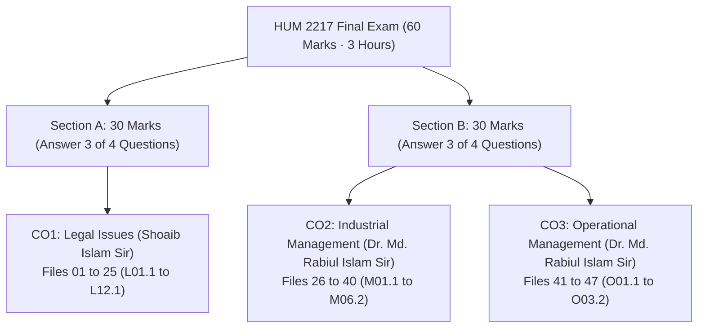

[📖 Quick Start README](README.md) | [📐 30-Min Master Sheet](99_Master_Formula_and_Statutory_Sheet.md) | [🚀 Start Block 1 Lock #1: O02.2a →](O02.2a_Q_System_Method_and_Weekly_Demand_Problems.md)

---

# HUM 2217: 1-Day Exam Rescue Dashboard & Master Directory

> [!info] ⚡ 1-Day Survival Mission Control
> - **Target:** Score **50 to 58 out of 60 marks** in 8 to 10 focused study hours.
> - **Vault Architecture:** 47 compact subtopic notes plus 1 rapid formula and statutory reference sheet.
> - **Anti-Repetition Rule:** Every statutory section, formula derivation, and management framework is stated exactly once.

---

## 1. Exam Format At-a-Glance

The semester final examination carries **60 marks** over **3 hours**, divided into two distinct sections written on separate answer scripts:

- **Section A (30 Marks · CO1 Legal Issues · Shoaib Islam Sir):**
  - Contains 4 main questions worth 10 marks each; answer any 3 questions.
  - Script evaluation strictly tests statutory precision. You must cite exact section numbers from the Contract Act 1872 and the Bangladesh Labour Act 2006 (BLC 2006).
  - One question is an applied 10-mark legal case study on contract frustration (`Sec 56`) or breach of contract.

- **Section B (30 Marks · CO2 Industrial & CO3 Operational Management · Dr. Md. Rabiul Islam Sir):**
  - Contains 4 main questions worth 10 marks each; answer any 3 questions.
  - Combines structured management theory with high-scoring numerical calculations.
  - Consistently features a 10-mark Continuous Review ($Q$) System inventory problem and a Productivity calculation.

---

## 2. 🔥 1-Day Hour-by-Hour Exam Rescue Plan

Target: **50 to 58 out of 60 marks** in approximately 8 to 10 study hours. Work through these four strategic blocks in order:

### Block 1: Guaranteed Numericals & Case Study (Hours 1.0 to 2.5 · ~25 Marks)

1. **Continuous Review ($Q$) System Math (10-Mark Lock):**
   - Files: [`O02.1`](O02.1_EOQ_Model_ROP_Safety_Stock_and_Cost_Curves.md), [`O02.2a`](O02.2a_Q_System_Method_and_Weekly_Demand_Problems.md), and [`O02.2b`](O02.2b_Q_System_Daily_Demand_and_MCU_Problems.md).
   - Core Focus: Master Dr. Md. Rabiul Islam Sir's strict 6-step board layout: annual demand conversion ($D$), economic order quantity ($EOQ$), reorder point ($ROP = dl + z\sigma_L$), inventory position check ($IP$), annual total cost evaluation ($C_Q$), and the complete sawtooth graph.

2. **Productivity Calculations & Operational Fixes (8 to 10-Mark Lock):**
   - Files: [`O03.1`](O03.1_Productivity_Formulas_SFP_MFP_and_Numericals.md) and [`O03.2`](O03.2_Productivity_Decline_Human_Factors_and_Industry_4_0.md).
   - Core Focus: Single-Factor Productivity ($SFP$), Multifactor Productivity ($MFP$), percentage changes across periods, the 7 causes of operational decline, and modernization fixes through Human Factors and Industry 4.0 automation.

3. **Doctrine of Frustration Applied Case Study (10-Mark Lock):**
   - File: [`L04.2`](L04.2_Doctrine_of_Frustration_and_Case_Studies.md).
   - Core Focus: Contract Act 1872 `Sec 56` supervening impossibility grounds (`D-D-L-N-W`) versus non-qualifying commercial excuses (`C-D-S-F-P`), structured into Shoaib Sir's 4-step case format (Facts, Law, Analysis, Conclusion).

### Block 2: Shoaib Sir's Pinpointed Legal Locks (Hours 2.5 to 5.0 · ~20 Marks)

1. **Maternity Benefits (`Sec 45–50`):**
   - File: [`L06.1`](L06.1_Maternity_Benefits_Sec_45_to_50.md).
   - Core Focus: 16-week total paid benefit (8 weeks pre-natal and 8 weeks post-natal), the 6-month continuous service qualification, the 2 surviving children entitlement cap, notice delivery procedures, and daily wage calculation.

2. **Consideration Rules & Statutory Exceptions (`Sec 2(d)`, `Sec 25`):**
   - Files: [`L03.1`](L03.1_Consideration_Definition_Types_and_Rules.md) and [`L03.2`](L03.2_Exceptions_to_No_Consideration_No_Contract.md).
   - Core Focus: Quid pro quo definition, past, present, and future consideration, and the 7 statutory exceptions to "No consideration, no contract" under `Sec 25(1–3)`, `Sec 185` (agency), and completed gifts.

3. **BLC Core Definitions & Adolescent Working Hours (`Sec 2`, `Sec 41`):**
   - Files: [`L05.1`](L05.1_BLC_Core_Definitions_and_Age_Classes.md) and [`L05.2`](L05.2_Adolescent_Working_Hours_Sec_41.md).
   - Core Focus: Statutory definitions for factory, worker, child, adolescent, and adult; strict adolescent limits of 5 hours per day and 30 hours per week in factories, plus the mandatory night work prohibition (7:00 PM to 7:00 AM).

4. **Workplace Fire Safety Precautions (`Sec 62`):**
   - File: [`L07.1`](L07.1_Fire_Safety_Precautions_Sec_62.md).
   - Core Focus: Mandatory alternative connecting stairways, outward-opening unlocked doors, exit markings in red Bangla script, and the mock fire drill interval (original 2006 text annually versus 2013 amendment every 6 months).

5. **Welfare Facilities Worker Count Ladder (`Sec 89–94`):**
   - File: [`L08.1`](L08.1_Welfare_Measures_Sec_89_to_99.md).
   - Core Focus: First-aid box (1 per 150 workers), dispensary and sick room ($\ge 300$), canteen facility ($> 100$), rest shelters ($> 50$), and children's crèche rooms ($\ge 40$ female workers).

6. **Trade Union Legal Status, CBA Powers & Dispute Settlement (`Sec 194`, `Sec 202`, `Sec 210`):**
   - Files: [`L10.3`](L10.3_Trade_Union_Legal_Status_Rights_and_Applied_Role.md), [`L11.1`](L11.1_Collective_Bargaining_and_CBA_Sec_202.md), and [`L11.2`](L11.2_Industrial_Disputes_and_Settlement_Ladder_Sec_210.md).
   - Core Focus: Body corporate legal status and statutory immunities (`Sec 197–199`), Collective Bargaining Agent determination and exclusive powers (`Sec 202`), and the three-stage dispute ladder (`Sec 210`: direct talks, conciliation, and optional arbitration).

7. **Contract Formation & Essential Elements (`Sec 2`, `Sec 10`):**
   - Files: [`L02.1`](L02.1_Contract_Agreement_Void_and_Voidable.md), [`L02.2`](L02.2_Essential_Elements_of_Valid_Contract.md), and [`L02.3`](L02.3_Offer_and_Acceptance_Rules.md).
   - Core Focus: The legal maxim "All contracts are agreements, but all agreements are not contracts", the 5 essential elements under `Sec 10`, and statutory communication rules for offer and acceptance (`Sec 4`, `Sec 8`, `Sec 9`).

### Block 3: MRI Sir's Management Locks (Hours 5.0 to 7.0 · ~15 Marks)

1. **Management Definitions, Resources & Decision Matrix:**
   - Files: [`M01.1`](M01.1_Management_Definitions_Resources_and_Nature.md) and [`M01.2`](M01.2_Efficiency_vs_Effectiveness_and_Decision_Matrix.md).
   - Core Focus: Taylor's 1911 definition versus Griffin's modern definition, the 4 organizational resources (`H-F-P-I`: Human, Financial, Physical, Information), and the efficiency versus effectiveness $2 \times 2$ decision matrix.

2. **Employee Motivation Theories:**
   - Files: [`M05.2`](M05.2_Maslow_Hierarchy_and_Herzberg_Two_Factor_Theory.md) and [`M05.3`](M05.3_Vroom_Expectancy_McGregor_XY_and_ERG_Theories.md).
   - Core Focus: Maslow's 5-tier hierarchy of needs (`P-S-S-E-S`), Herzberg's two-factor motivation-hygiene model with 4 critical limitations, and Vroom's expectancy equation ($\text{Motivation} = E \times I \times V$).

3. **Performance Appraisal Methods & Rating Scale Errors:**
   - File: [`M06.2`](M06.2_Performance_Appraisal_Methods_and_Rating_Errors.md).
   - Core Focus: Graphic Rating Scales versus Behaviorally Anchored Rating Scales (BARS), 360-degree feedback, and the 6 common appraisal rating errors (`H-L-S-C-R-C`: halo/horn, leniency, strictness, central tendency, recency, and contrast error).

4. **Classical Administrative & Scientific Principles:**
   - Files: [`M03.1`](M03.1_Fayols_14_Principles_and_Scalar_Chain.md) and [`M03.2`](M03.2_Taylors_Scientific_Management.md).
   - Core Focus: Henri Fayol's 14 principles (`DAD U C USSR? O I SEE!`), the Scalar Chain and Gangplank bridge, and Taylor's scientific management principles.

5. **Managerial Skills & Inventory Fundamentals:**
   - Files: [`M02.2`](M02.2_Managerial_Skills_Evaluation_and_Development.md), [`O01.1`](O01.1_Inventory_Control_and_Holding_Costs.md), and [`O01.2`](O01.2_Types_of_Inventory_and_ABC_Analysis.md).
   - Core Focus: 7 core managerial skills (`T-I-C-D-C-D-T`), low inventory pressures (`I-S-H`) versus high inventory pressures (`C-O-S-T-P`), and the ABC Analysis dollar-volume classification.

### Block 4: Rapid Skim & Final Sheet Drill (Hours 7.0 to 8.5)

- **Rapid Skim of Secondary Notes (60 Minutes):**
  - Quickly review supporting theory files to ensure broad coverage across peripheral exam sub-questions:
    - Legal Context: [`L01.1`](L01.1_Definitions_of_Law_and_Society.md), [`L01.2`](L01.2_Industrial_Law_vs_Labour_Law.md), [`L01.3`](L01.3_Why_ECE_Students_Must_Learn_Law.md), [`L02.4`](L02.4_Applied_ECE_Tenders_and_RD_Contract_Risks.md), [`L04.1`](L04.1_Modes_of_Discharge_of_Contract.md), [`L05.3`](L05.3_Applied_Factory_Compliance_and_Adult_Hours.md), [`L07.2`](L07.2_Machinery_Safety_and_Workplace_Duties.md), [`L09.1`](L09.1_Termination_of_Employment_Sec_20_to_27.md), [`L10.1`](L10.1_Trade_Union_Basics_Objectives_and_Functions.md), [`L10.2`](L10.2_Trade_Union_Registration_and_Cancellation.md), and [`L12.1`](L12.1_Unfair_Labour_Practices_Sec_195_and_196.md).
    - Management Context: [`M01.3`](M01.3_Management_Functions_POLC_and_Leadership.md), [`M02.1`](M02.1_Management_Levels_and_Functional_Areas.md), [`M04.1`](M04.1_Planning_and_Rational_Decision_Making.md), [`M04.2`](M04.2_Organizing_Departmentalization_Delegation_and_Span.md), [`M04.3`](M04.3_Controlling_Process_and_Steps.md), [`M05.1`](M05.1_Motivation_Basics_and_Financial_vs_NonFinancial.md), and [`M06.1`](M06.1_HRM_Recruitment_Selection_and_Training.md).

- **Final Sheet Drill (30 Minutes):**
  - Thoroughly memorize all statutory section numbers, formula definitions, and memory acronyms in [`99_Master_Formula_and_Statutory_Sheet.md`](99_Master_Formula_and_Statutory_Sheet.md).

---

## 3. 🚨 4-Hour Panic Triage (Top 12 Guaranteed Locks = 40+ Marks)

When exam time is running critically short, study these 12 high-priority files in numerical order:

| Lock # | Exam Topic | Exact File Link | Marks | Estimated Time | 1-Line Survival Focus |
| :-: | :--- | :--- | :-: | :-: | :--- |
| **1** | $Q$-System Math | [`O02.2a`](O02.2a_Q_System_Method_and_Weekly_Demand_Problems.md), [`O02.2b`](O02.2b_Q_System_Daily_Demand_and_MCU_Problems.md) | 10 Marks | ~10 min | Master the 6-step board layout, weekly and daily conversions, and the sawtooth graph. |
| **2** | Frustration Case Study | [`L04.2`](L04.2_Doctrine_of_Frustration_and_Case_Studies.md) | 10 Marks | ~6 min | Contract Act `Sec 56` grounds (`D-D-L-N-W`) versus commercial excuses (`C-D-S-F-P`). |
| **3** | Productivity Math | [`O03.1`](O03.1_Productivity_Formulas_SFP_MFP_and_Numericals.md) | 8–10 Marks | ~6 min | Single-Factor and Multifactor formulas, percentage changes, and class problems. |
| **4** | Maternity Benefits | [`L06.1`](L06.1_Maternity_Benefits_Sec_45_to_50.md) | 4–6 Marks | ~5 min | BLC `Sec 45–50`: 16-week paid leave, 6-month qualification, daily wage math, and 2 children cap. |
| **5** | Consideration Exceptions | [`L03.2`](L03.2_Exceptions_to_No_Consideration_No_Contract.md) | 4–6 Marks | ~4 min | Contract Act `Sec 25(1–3)` affection, past service, time-barred debt; `Sec 185` agency. |
| **6** | Fire Safety Precautions | [`L07.1`](L07.1_Fire_Safety_Precautions_Sec_62.md) | 4 Marks | ~4 min | BLC `Sec 62`: fire stairs, outward-opening doors, red Bangla signs, and mock drill intervals. |
| **7** | Adolescent Working Hours | [`L05.2`](L05.2_Adolescent_Working_Hours_Sec_41.md) | 4 Marks | ~4 min | BLC `Sec 41`: 5 hours/day, 30 hours/week in factories, and the 7:00 PM to 7:00 AM night ban. |
| **8** | Welfare Facilities Ladder | [`L08.1`](L08.1_Welfare_Measures_Sec_89_to_99.md) | 4 Marks | ~5 min | BLC `Sec 89–94`: first-aid (1:150), dispensary (300), canteen (100), and crèche (40 women). |
| **9** | Management Definitions | [`M01.1`](M01.1_Management_Definitions_Resources_and_Nature.md), [`M01.2`](M01.2_Efficiency_vs_Effectiveness_and_Decision_Matrix.md) | 4–6 Marks | ~6 min | Taylor 1911 definition, Griffin definition, 4 resources (`H-F-P-I`), and the $2 \times 2$ decision matrix. |
| **10** | Motivation Theories | [`M05.2`](M05.2_Maslow_Hierarchy_and_Herzberg_Two_Factor_Theory.md), [`M05.3`](M05.3_Vroom_Expectancy_McGregor_XY_and_ERG_Theories.md) | 5–6 Marks | ~6 min | Maslow 5 tiers (`P-S-S-E-S`), Herzberg hygiene versus motivators, and Vroom's expectancy formula. |
| **11** | Appraisal Rating Errors | [`M06.2`](M06.2_Performance_Appraisal_Methods_and_Rating_Errors.md) | 4–6 Marks | ~5 min | 6 rating scale errors (`H-L-S-C-R-C`: halo, leniency, strictness, central, recency, contrast). |
| **12** | Dispute Ladder & CBA | [`L11.1`](L11.1_Collective_Bargaining_and_CBA_Sec_202.md), [`L11.2`](L11.2_Industrial_Disputes_and_Settlement_Ladder_Sec_210.md) | 5–8 Marks | ~6 min | CBA determination and powers (`Sec 202`), dispute ladder (`Sec 210`), and strike notice (`Sec 211`). |

---

## 4. Complete 47-File Compact Directory

All 47 notes are formatted for 3 to 6 minute reading sessions.

### Priority Legend

- `🔴 Lock`: Tier 1 exam lock. Repeated in finals or confirmed high-probability topic.
- `🟠 High`: Tier 2 high yield. Strongly emphasized in lectures and class tests.
- `🟡 Medium`: Tier 3 regular. Rotates periodically across exam years.
- `🟢 Low`: Tier 4 context. Background reading for comprehensive coverage.

---

### Part A: CO1 Legal Issues (Files 01 to 25 · Shoaib Islam Sir · 30 Marks)

| # | Compact Note | Priority | Read | Marks | Key Focus |
| :-: | :--- | :---: | :-: | :-: | :--- |
| **01** | [`L01.1`](L01.1_Definitions_of_Law_and_Society.md) | 🟠 High | 3 min | 0 Marks | Holland, Salmond, and Wilson definitions of law; legal concepts. |
| **02** | [`L01.2`](L01.2_Industrial_Law_vs_Labour_Law.md) | 🟠 High | 3 min | 2 Marks | Industrial law versus labour law; 7-point distinction table. |
| **03** | [`L01.3`](L01.3_Why_ECE_Students_Must_Learn_Law.md) | 🟠 High | 4 min | 0 Marks | 9 ECE legal imperatives: IPR, compliance, contracts, and ethics. |
| **04** | [`L02.1`](L02.1_Contract_Agreement_Void_and_Voidable.md) | 🔴 Lock | 4 min | 4 Marks | Sec 2(e, g, h, i); legal maxim; void versus voidable agreements. |
| **05** | [`L02.2`](L02.2_Essential_Elements_of_Valid_Contract.md) | 🔴 Lock | 4 min | 14 Marks | Sec 10 essential elements; requirements of a valid contract. |
| **06** | [`L02.3`](L02.3_Offer_and_Acceptance_Rules.md) | 🔴 Lock | 4 min | 12 Marks | Sec 4, 8, 9 offer and acceptance rules; Carlill smoke ball case. |
| **07** | [`L02.4`](L02.4_Applied_ECE_Tenders_and_RD_Contract_Risks.md) | 🟠 High | 4 min | 8 Marks | Tender bidding rules and ECE R&D contract risk mitigation. |
| **08** | [`L03.1`](L03.1_Consideration_Definition_Types_and_Rules.md) | 🔴 Lock | 4 min | 0 Marks | Sec 2(d) quid pro quo, 3 consideration types, and legal rules. |
| **09** | [`L03.2`](L03.2_Exceptions_to_No_Consideration_No_Contract.md) | 🔴 Lock | 4 min | 0 Marks | 7 statutory exceptions under Sec 25(1–3), Sec 185 agency, and gifts. |
| **10** | [`L04.1`](L04.1_Modes_of_Discharge_of_Contract.md) | 🔴 Lock | 4 min | 4 Marks | 7 discharge modes: performance, mutual agreement, breach, and law. |
| **11** | [`L04.2`](L04.2_Doctrine_of_Frustration_and_Case_Studies.md) | 🔴 Lock | 6 min | 0 Marks | Sec 56 frustration grounds (D-D-L-N-W); 10-mark case study model. |
| **12** | [`L05.1`](L05.1_BLC_Core_Definitions_and_Age_Classes.md) | 🔴 Lock | 4 min | 2 Marks | BLC Sec 2: factory, worker, child, adolescent, and adult definitions. |
| **13** | [`L05.2`](L05.2_Adolescent_Working_Hours_Sec_41.md) | 🔴 Lock | 4 min | 4 Marks | Sec 41 limits: 5h/day, 30h/week, spread-over, and night work ban. |
| **14** | [`L05.3`](L05.3_Applied_Factory_Compliance_and_Adult_Hours.md) | 🟠 High | 4 min | 14 Marks | Multi-issue factory audit scenario; adult hours (Sec 100–108). |
| **15** | [`L06.1`](L06.1_Maternity_Benefits_Sec_45_to_50.md) | 🔴 Lock | 5 min | 0 Marks | Sec 45–50: 16-week leave, notice procedure, and daily wage math. |
| **16** | [`L07.1`](L07.1_Fire_Safety_Precautions_Sec_62.md) | 🔴 Lock | 4 min | 4 Marks | Sec 62: fire stairs, outward doors, signs, and mock drill intervals. |
| **17** | [`L07.2`](L07.2_Machinery_Safety_and_Workplace_Duties.md) | 🟡 Medium | 4 min | 14 Marks | Sec 64 machinery fencing; Sec 40 young persons; worker safety duties. |
| **18** | [`L08.1`](L08.1_Welfare_Measures_Sec_89_to_99.md) | 🔴 Lock | 5 min | 0 Marks | Sec 89–94: first-aid boxes, canteen, rest shelters, and crèche rules. |
| **19** | [`L09.1`](L09.1_Termination_of_Employment_Sec_20_to_27.md) | 🟡 Medium | 5 min | 0 Marks | Sec 20 retrenchment, Sec 22 discharge, Sec 23 dismissal, and notice. |
| **20** | [`L10.1`](L10.1_Trade_Union_Basics_Objectives_and_Functions.md) | 🔴 Lock | 4 min | 2 Marks | Sec 176 right to form trade unions; core objectives and functions. |
| **21** | [`L10.2`](L10.2_Trade_Union_Registration_and_Cancellation.md) | 🔴 Lock | 4 min | 4 Marks | Sec 177–182 registration; Sec 190 cancellation grounds. |
| **22** | [`L10.3`](L10.3_Trade_Union_Legal_Status_Rights_and_Applied_Role.md) | 🔴 Lock | 4 min | 4 Marks | Sec 194 corporate status; Sec 197–199 statutory immunities. |
| **23** | [`L11.1`](L11.1_Collective_Bargaining_and_CBA_Sec_202.md) | 🔴 Lock | 4 min | 3 Marks | Sec 202 CBA determination, secret ballot election, and 5 powers. |
| **24** | [`L11.2`](L11.2_Industrial_Disputes_and_Settlement_Ladder_Sec_210.md) | 🔴 Lock | 5 min | 5 Marks | Sec 210 dispute ladder: direct talks, conciliation, and arbitration. |
| **25** | [`L12.1`](L12.1_Unfair_Labour_Practices_Sec_195_and_196.md) | 🟡 Medium | 5 min | 8 Marks | Sec 195 employer unfair practices; Sec 196 worker unfair practices. |

---

### Part B: CO2 Industrial Management (Files 26 to 40 · Dr. Md. Rabiul Islam Sir · 30 Marks Shared)

| # | Compact Note | Priority | Read | Marks | Key Focus |
| :-: | :--- | :---: | :-: | :-: | :--- |
| **26** | [`M01.1`](M01.1_Management_Definitions_Resources_and_Nature.md) | 🔴 Lock | 4 min | 20 Marks | Taylor 1911 versus Griffin definition; 4 resources (H-F-P-I). |
| **27** | [`M01.2`](M01.2_Efficiency_vs_Effectiveness_and_Decision_Matrix.md) | 🔴 Lock | 4 min | 9 Marks | Doing things right versus right things; $2 \times 2$ decision matrix. |
| **28** | [`M01.3`](M01.3_Management_Functions_POLC_and_Leadership.md) | 🔴 Lock | 4 min | 13 Marks | P-O-L-C management cycle; leadership versus management. |
| **29** | [`M02.1`](M02.1_Management_Levels_and_Functional_Areas.md) | 🟠 High | 3 min | 2 Marks | Top, middle, and first-line tiers; 10 functional business areas. |
| **30** | [`M02.2`](M02.2_Managerial_Skills_Evaluation_and_Development.md) | 🟠 High | 4 min | 16 Marks | 7 core skills (T-I-C-D-C-D-T) distributed across management tiers. |
| **31** | [`M03.1`](M03.1_Fayols_14_Principles_and_Scalar_Chain.md) | 🟠 High | 5 min | 10 Marks | Fayol's 14 principles (DAD U C USSR?); Scalar Chain and Gangplank. |
| **32** | [`M03.2`](M03.2_Taylors_Scientific_Management.md) | 🟠 High | 4 min | 5 Marks | Taylor's 4 scientific principles; soldiering and time-and-motion studies. |
| **33** | [`M04.1`](M04.1_Planning_and_Rational_Decision_Making.md) | 🟡 Medium | 4 min | 8 Marks | Strategic, tactical, operational plans; 6 rational decision steps. |
| **34** | [`M04.2`](M04.2_Organizing_Departmentalization_Delegation_and_Span.md) | 🟡 Medium | 4 min | 7 Marks | 4 departmental bases (F-P-C-L); delegation and span of control. |
| **35** | [`M04.3`](M04.3_Controlling_Process_and_Steps.md) | 🟡 Medium | 3 min | 6 Marks | Meaning of managerial control; 4-step control process (S-M-C-C). |
| **36** | [`M05.1`](M05.1_Motivation_Basics_and_Financial_vs_NonFinancial.md) | 🔴 Lock | 4 min | 14 Marks | Significance of motivation; financial versus non-financial motivators. |
| **37** | [`M05.2`](M05.2_Maslow_Hierarchy_and_Herzberg_Two_Factor_Theory.md) | 🔴 Lock | 5 min | 15 Marks | Maslow's 5 tiers (P-S-S-E-S); Herzberg's two-factor motivation theory. |
| **38** | [`M05.3`](M05.3_Vroom_Expectancy_McGregor_XY_and_ERG_Theories.md) | 🔴 Lock | 4 min | 4 Marks | Vroom's formula ($\text{Motivation} = E \times I \times V$); McGregor's Theory X/Y; Alderfer's ERG theory. |
| **39** | [`M06.1`](M06.1_HRM_Recruitment_Selection_and_Training.md) | 🟢 Low | 4 min | 12 Marks | HRM environmental context; recruitment versus selection; training. |
| **40** | [`M06.2`](M06.2_Performance_Appraisal_Methods_and_Rating_Errors.md) | 🔴 Lock | 5 min | 17 Marks | Graphic Rating Scales versus BARS; 6 rating scale errors. |

---

### Part C: CO3 Operational Management (Files 41 to 47 · Dr. Md. Rabiul Islam Sir · 30 Marks Shared)

| # | Compact Note | Priority | Read | Marks | Key Focus |
| :-: | :--- | :---: | :-: | :-: | :--- |
| **41** | [`O01.1`](O01.1_Inventory_Control_and_Holding_Costs.md) | 🔴 Lock | 4 min | 12 Marks | Low holding pressures (I-S-H) versus high pressures (C-O-S-T-P). |
| **42** | [`O01.2`](O01.2_Types_of_Inventory_and_ABC_Analysis.md) | 🔴 Lock | 4 min | 4 Marks | 4 inventory types (C-S-A-P); ABC Analysis dollar-volume rules. |
| **43** | [`O02.1`](O02.1_EOQ_Model_ROP_Safety_Stock_and_Cost_Curves.md) | 🔴 Lock | 5 min | 17 Marks | EOQ assumptions (C-C-I-N-N-O); annual holding and ordering cost curves. |
| **44** | [`O02.2a`](O02.2a_Q_System_Method_and_Weekly_Demand_Problems.md) | 🔴 Lock | 6 min | 12 Marks | Continuous review board layout; weekly demand numerical problems. |
| **45** | [`O02.2b`](O02.2b_Q_System_Daily_Demand_and_MCU_Problems.md) | 🔴 Lock | 6 min | 25 Marks | Daily operating demand conversions; OM-CT2 20-mark problem. |
| **46** | [`O03.1`](O03.1_Productivity_Formulas_SFP_MFP_and_Numericals.md) | 🔴 Lock | 6 min | Class 11 | Single-Factor and Multifactor formulas; % change; solved math. |
| **47** | [`O03.2`](O03.2_Productivity_Decline_Human_Factors_and_Industry_4_0.md) | 🔴 Lock | 5 min | Class 11 | 7 operational decline causes; Human Factors; Industry 4.0. |

---

### Reference & Rapid Revision Sheet (File 48)

| # | Compact Note | Priority | Read | Marks | Key Focus |
| :-: | :--- | :---: | :-: | :-: | :--- |
| **48** | [`99_Sheet`](99_Master_Formula_and_Statutory_Sheet.md) | 🔴 Lock | 30 min | All Topics | Master statutory sections, inventory formulas, and memory hooks. |

---

## 5. Exam Hall 180-Minute Execution Order

Follow this tactical sequence during the 3-hour semester final examination (allocate approximately 30 minutes per 10-mark question):

1. **Step 1 (0:00 to 0:30 · Script B):**
   - Start immediately with the **Continuous Review ($Q$) System numerical** ([`O02.2a`](O02.2a_Q_System_Method_and_Weekly_Demand_Problems.md) or [`O02.2b`](O02.2b_Q_System_Daily_Demand_and_MCU_Problems.md)).
   - Executing MRI Sir's 6-step board layout cleanly locks in an immediate 10 out of 10 marks with zero subjectivity.

2. **Step 2 (0:30 to 1:00 · Script B):**
   - Solve the **Productivity numerical** ([`O03.1`](O03.1_Productivity_Formulas_SFP_MFP_and_Numericals.md)) or structured classical theory (Fayol's 14 principles or Performance Appraisal rating errors).
   - Secures another 10 marks within the first hour.

3. **Step 3 (1:00 to 1:30 · Script B):**
   - Answer the third question in Section B, such as Motivation theories ([`M05.2`](M05.2_Maslow_Hierarchy_and_Herzberg_Two_Factor_Theory.md)) or Management definitions and the decision matrix ([`M01.1`](M01.1_Management_Definitions_Resources_and_Nature.md), [`M01.2`](M01.2_Efficiency_vs_Effectiveness_and_Decision_Matrix.md)).
   - This completes Script B with a full 30 marks secured at the midpoint of the exam.

4. **Step 4 (1:30 to 2:00 · Script A):**
   - Switch to Section A and immediately solve the **Applied Contract Case Study** ([`L04.2`](L04.2_Doctrine_of_Frustration_and_Case_Studies.md)).
   - Apply the rigorous 4-step framework: 1. Facts of the Case, 2. Applicable Law & Section (`Sec 56`), 3. Legal Analysis, and 4. Direct Conclusion.

5. **Step 5 (2:00 to 2:45 · Script A):**
   - Answer the two statutory theory questions where you know the exact sections cold: Maternity Benefits ([`L06.1`](L06.1_Maternity_Benefits_Sec_45_to_50.md), `Sec 45–50`), Fire Safety ([`L07.1`](L07.1_Fire_Safety_Precautions_Sec_62.md), `Sec 62`), Welfare Measures ([`L08.1`](L08.1_Welfare_Measures_Sec_89_to_99.md), `Sec 89–94`), or Dispute Settlement ([`L11.2`](L11.2_Industrial_Disputes_and_Settlement_Ladder_Sec_210.md), `Sec 210`).
   - Quote exact section numbers and maintain structured bullet points.

6. **Step 6 (2:45 to 3:00 · Final Quality Review):**
   - Re-check all calculation units in Script B (e.g., units/year, orders/year, days, and BDT totals).
   - Verify every statutory section citation across Script A to ensure complete accuracy.

---

[📖 Quick Start README](README.md) | [📐 30-Min Master Sheet](99_Master_Formula_and_Statutory_Sheet.md) | [🚀 Start Block 1 Lock #1: O02.2a →](O02.2a_Q_System_Method_and_Weekly_Demand_Problems.md)
