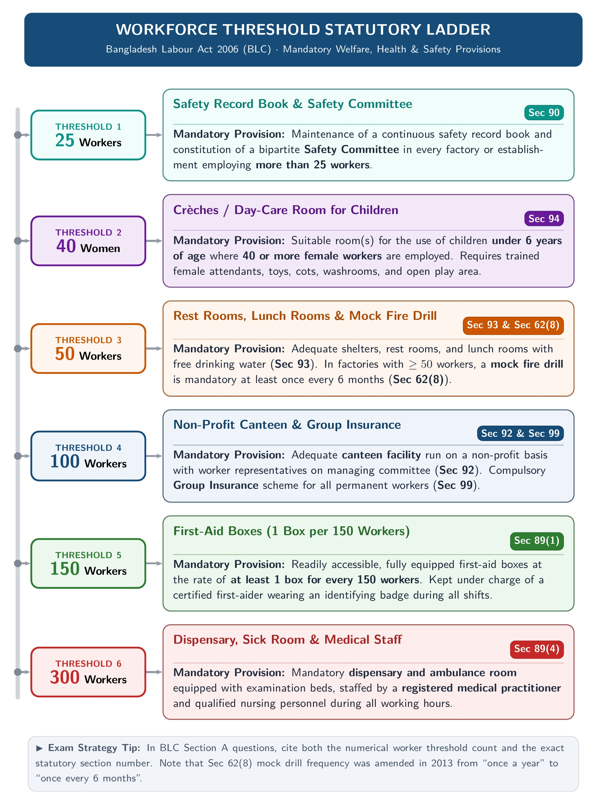
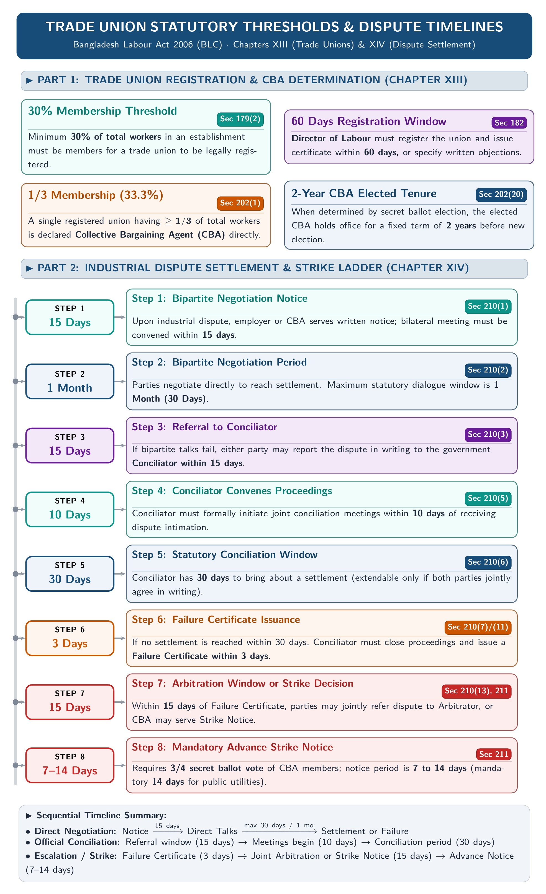

[← Previous: O03.2: Productivity Decline, Human Factors, and Industry 4.0](O03.2_Productivity_Decline_Human_Factors_and_Industry_4_0.md) | [🏠 Index](00_Index.md) | [Next: 00 Master Index →](00_Index.md)

---

# 99: Master Formula and Statutory Reference Sheet

> [!info] ⚡ Exam Snapshot
> - **Scope & Purpose:** All-in-one 30-Minute Pre-Exam Reference across CO1 (Law), CO2 (Management), and CO3 (Operations).
> - **Exam Architecture:** 60 Marks · 3 Hours · Section A (30 marks Law, answer 3 of 4) | Section B (30 marks IM & OM, answer 3 of 4).
> - **Scoring Rule:** Exact statutory section citations + 4-Step legal case format + 6-Step continuous review board format secure 55+/60.

---

## 🏛️ Part 1 · CO1 Statutory Section & Threshold Tables (Shoaib Islam Sir)

### 1. The Contract Act 1872 Master Statutory Directory

Shoaib Sir evaluates legal scripts strictly. A wrong section number loses marks immediately. Cite exact sections:

| Section(s) | Statutory Concept | Core Rule & Statutory Standard in Plain Words | Exam Focus / Case / Rule |
| :--- | :--- | :--- | :--- |
| `Sec 2(a)–(b)` | Offer & Acceptance | Willingness to do/abstain (`2a`); absolute, unqualified assent (`2b, 7`) creates binding promise. | Proposal must be communicated (`Sec 4`). |
| `Sec 2(c)–(d)` | Parties & Consideration | Promisor/promisee (`2c`). Consideration (`2d`): act/abstinence at desire of promisor; real, lawful. | Price of promise; need not be adequate. |
| `Sec 2(e)–(i)` | Agreement & Contract Types | Agreement (`2e` = offer + acceptance); Contract (`2h` = `2e` + `Sec 10`); Void (`2g`); Voidable (`2i`). | All contracts are agreements; converse not true. |
| `Sec 4–5` | Communication & Revocation | Offer complete when known; acceptance complete against proposer when posted. Revoke before line closes. | Dual postal rule (2025 Law-CT1 Q.2). |
| `Sec 8–9` | Conduct & Implied Promises | Acceptance by performing conditions (*Carlill*, `8`); express (words) vs implied (conduct, `9`). | Boarding a bus implies agreement to pay fare. |
| `Sec 10–12` | Validity & Capacity | 5 pillars (`10`). Competent: age 18+, sound mind (`12`). Minor contract void *ab initio* (*Mohori Bibee*, `11`). | Free consent, lawful object/consideration. |
| `Sec 13–14` | Consent (*Consensus ad idem*) | Agreeing on same thing in same sense (`13`). Free when not caused by `Sec 15–20` factors (`14`). | Vitiating factor makes contract voidable/void. |
| `Sec 15–18` | Vitiating Factors | Coercion (`15`, duress), Undue Influence (`16`, dominant will), Fraud (`17`, deceit), Misrepresentation (`18`). | All make contract voidable at victim option. |
| `Sec 20` | Bilateral Mistake of Fact | Both parties mistaken on essential matter of fact; agreement is void *ab initio*. | Common error on subject matter. |
| `Sec 23–24` | Lawful Object & Value | Unlawful if forbidden by law, defeats law, fraudulent, injurious, or immoral. | Unlawful agreement is void. |
| `Sec 25(1)–(3)` | Consideration Exceptions | Valid without consideration: Registered love & affection deed (`25(1)`), past service (`25(2)`), time-barred debt (`25(3)`). | 3 core statutory exceptions to *Ex nudo pacto*. |
| `Sec 25 Expl` | Inadequacy & Gifts | Completed gift valid (`Expl 1`). Consideration need not be adequate (`Expl 2`, peppercorn rule). | Court tests reality, not market equality. |
| `Sec 26–30` | Expressly Void Agreements | Restraint of marriage (`26`), trade (`27`), legal proceedings (`28`), uncertainty (`29`), wager (`30`). | Exceptions: Goodwill sale (`27`), arbitration (`28`). |
| `Sec 37–39` | Performance & Breach | Duty to perform (`37`), valid tender rejected frees promisor (`38`), anticipatory breach (`39`). | Promisee may treat breach as immediate end. |
| `Sec 56` | Doctrine of Frustration | Supervening impossibility discharges contract (`D-D-L-N-W` valid vs `C-D-S-F-P` invalid); refund under `Sec 65`. | Unforeseen post-contract impossibility. |
| `Sec 62–63` | Mutual Discharge | Novation (substitute contract), Rescission, Alteration (`62`); Remission (lesser sum), Waiver (`63`). | Discharged by consent without breach. |
| `Sec 65` | Restitution of Advantage | Party receiving benefit under void or frustrated agreement must restore or compensate. | Mandatory refund when frustrated under `Sec 56`. |
| `Sec 73–75` | Breach Damages | Ordinary natural damages arising directly from breach; remote losses barred (`Sec 73`). | Compensation for actual loss suffered. |
| `Sec 127, 185` | Guarantee & Agency | Consideration to debtor supports surety (`127`); agency requires no consideration (`185`). | Additional consideration exceptions. |

---

### 2. Landmark Contract Law Cases

| Landmark Case | Section | Established Legal Principle |
| :--- | :--- | :--- |
| *Carlill v. Carbolic Smoke Ball Co. (1893)* | `Sec 2(a), 8` | General offer accepted by performing conditions without prior notice. |
| *Balfour v. Balfour (1919)* | `Sec 10` | Domestic agreements lack intention to create legal relations; not contracts. |
| *Mohori Bibee v. Dharmodas Ghose (1903)* | `Sec 11` | Agreement with minor is completely void *ab initio*; cannot be ratified. |
| *Chinnaya v. Ramayya (1882)* | `Sec 2(d)` | Consideration may move from third party; stranger to consideration can sue. |
| *Taylor v. Caldwell (1863)* | `Sec 56` | Accidental destruction of music hall discharges contract under frustration. |
| *Robinson v. Davison (1871)* | `Sec 56` | Sudden illness of pianist frustrates personal service contract. |
| *Krell v. Henry (1903)* | `Sec 56` | Cancellation of coronation procession destroyed foundation of rental; frustrated. |
| *Herne Bay Steamboat Co. v. Hutton (1903)* | `Sec 56` | Fleet cruise still possible despite review cancellation; not frustrated. |

---

### 3. The 4-Step Legal Case Study Format (Mandatory for Section A)

Use this 4-step layout for all 10-mark legal scenario questions:
1. **Facts of the Case:** State the operational dispute in 1-2 crisp lines (parties, agreement, broken act).
2. **Applicable Law & Section:** Cite exact statute and sections (e.g., Contract Act Sec 56 and Sec 65).
3. **Legal Analysis:** Apply statutory test directly (test `D-D-L-N-W` vs `C-D-S-F-P`; check restitution rule).
4. **Direct Conclusion:** State final unambiguous verdict (e.g., "Contract frustrated; A must refund Tk 50,000").

> [!tip] Memory Hook: Frustration (D-D-L-N-W) vs. Excuses (C-D-S-F-P)
> - **5 Valid Frustrations (`D-D-L-N-W`):** **D**estruction of subject matter, **D**eath/incapacity in personal service, **L**egislative change, **N**on-occurrence of precondition, **W**ar outbreak. -> Contract void under `Sec 56`; benefits refunded under `Sec 65`.
> - **5 Non-Frustrating Excuses (`C-D-S-F-P`):** **C**ommercial hardship, **D**efault of supplier, **S**trikes/lockouts, **F**ailure of one object, **P**ersonal self-induced fault. -> Contract alive; party liable for breach under `Sec 73`.

---

### 4. The Bangladesh Labour Act 2006 Master Statutory Directory

| Section(s) | Statutory Scope | Legal Rule & Statutory Standard in Plain Words | Threshold / Timeline |
| :--- | :--- | :--- | :--- |
| `Sec 2(2), 2(7)` | Manufacturing & Factory | Manufacturing process (`2(2)`); Factory = $\ge 5$ workers + manufacturing (excludes mines, `2(7)`). | Factory threshold: $\ge 5$ workers. |
| `Sec 2(8, 36, 63)` | Age Categories | Child ($<14$, work barred `Sec 34`), Adolescent ($14$ to $<18$, capped `Sec 41`), Adult ($\ge 18$). | Three statutory age tiers. |
| `Sec 2(65)` | Worker Definition | Manual, technical, promotional, clerical work; excludes managerial/supervisory staff. | Scope of worker protection. |
| `Sec 20` | Retrenchment | Redundancy downsizing: 1 month notice or pay, 30 days pay/yr service, LIFO rule (`20(2)`). | Redundancy compensation. |
| `Sec 22` | Incapacity Discharge | Physical/mental incapacity certified by registered doctor; 30 days wages/yr service. | Medical discharge rule. |
| `Sec 23–24` | Misconduct Dismissal | Gross misconduct (theft, fraud, riot); zero pay; requires 5-step domestic inquiry (`Sec 24`). | Charge-sheet -> 7d reply -> inquiry. |
| `Sec 26` | Termination by Notice | Permanent worker: 120 days notice (monthly) or 60 days (others) + 30 days wages/yr service. | Highest notice burden in Act. |
| `Sec 27, 30` | Resignation & Settlement | Resignation: 60d notice (monthly) or 30d; pay if $\ge 5$ yrs (`27`). Dues paid within 30 working days (`30`). | $\ge 10$ yrs: 30d/yr; 5–10 yrs: 14d/yr. |
| `Sec 41` | Adolescent Hours | Factory/mine: max 5h/day, 30h/wk (36 OT); Others: 7h/day, 42h/wk (48 OT); Night barred (7 PM to 7 AM); Spread $\le 7.5$h. | Max 2 shifts; weekly holiday mandatory. |
| `Sec 45–46` | Maternity Leave | 16 weeks paid (8 pre + 8 post); requires $\ge 6$ months service; barred if $\ge 2$ living children. | If $\ge 2$ children, unpaid leave only. |
| `Sec 47–48` | Maternity Wage Formula | Paid in 3 working days of proof; Daily rate = Total wages in 3 months $\div$ Actual days worked. | Paid in cash for all 16 calendar weeks. |
| `Sec 49–50` | Maternity Protections | Payout to nominee on death (`49`); dismissal barred 6 months pre and 8 weeks post-birth (`50`). | Employer strictly liable for full benefit. |
| `Sec 62(1–6)` | Fire Safety Measures | Alternative stairs, outward/sliding doors, red Bangla exit signs, alarms, free passageways. | Basic factory safety architecture. |
| `Sec 62(7–8)` | Fire Training & Mock Drills | Escape training if $>10$ workers upstairs. Mock drill for $\ge 50$ workers: 2006 (1/yr), 2013 (every 6 mo, 18% trained). | Safety record book mandatory. |
| `Sec 63–64` | Machinery Safety | Mandatory secure fencing for prime movers, flywheels, and moving transmission machinery. | Strict employer liability. |
| `Sec 89` | First-Aid Appliances | 1 box per 150 workers under trained badged person (`89(2)`); dispensary/sick room for $\ge 300$ (`89(5)`). | Medical safety thresholds. |
| `Sec 90–91` | Safety Record & Washing | Safety record book for $>25$ (`90`), committee for $\ge 50$ (`90A`); clean screened separate washrooms (`91`). | Welfare & hygiene standards. |
| `Sec 92–93` | Canteens & Shelters | Canteen for $>100$ workers (`92`); rest and lunch rooms with free drinking water for $>50$ workers (`93`). | Dining and shelter rules. |
| `Sec 94` | Crèches / Day-Care | $\ge 40$ female workers; children $<6$; room height $\ge 360\text{ cm}$, area $\ge 6000\text{ sq. cm}$ per child. | Trained woman caregiver in charge. |
| `Sec 99` | Group Insurance | Mandatory group life and disability insurance for $\ge 100$ permanent workers (2013; $\ge 200$ in 2006). | Worker compensation safety net. |
| `Sec 100–108` | Adult Hours & Overtime | Normal: 8h/day, 48h/wk (max 10h/day, 60h/wk with OT). Overtime pay = $2 \times$ basic wage rate (`Sec 108`). | Strict double basic rate for OT. |
| `Sec 176–179` | Trade Union Registration | Right to form union (`176`); registration requires min 30% membership of total workforce (`179(2)`). | Strict 30% membership threshold. |
| `Sec 182, 190` | Registration & Cancel | Registrar decides in 60 days (`182`); 7 cancellation grounds require Labour Court order (`190`). | 60 days registration window. |
| `Sec 194` | Body Corporate Status | Registered union is body corporate with perpetual succession, common seal, power to sue/be sued. | Distinct legal personality. |
| `Sec 195–196` | Unfair Labour Practices | 12 employer practices (yellow-dog, retaliation, `195`); 6 worker practices (intimidation, gherao, `196`). | Prohibited industrial conduct. |
| `Sec 197–199` | Trade Union Immunities | Criminal conspiracy immunity (`197`); civil lawsuit immunity (`198`); agreements valid over `Sec 27` (`199`). | Shields legitimate union activity. |
| `Sec 202` | CBA Determination | Sole union with $\ge 1/3$ members or secret ballot (2-yr tenure); 5 exclusive powers under `Sec 202(24)`. | CBA represents 100% of workers. |
| `Sec 209–210` | Dispute Settlement | 4 tiers: Bipartite (15d/30d) -> Conciliation (10d/30d) -> Arbitration (15d/30d) -> Labour Court. | Strict statutory day counts. |
| `Sec 211, 291` | Strike Notice & Penalties | Strike notice in 15d of failure cert; $2/3$ ballot; 7-14d notice (`211`). Unfair practice: 2 yr / Tk 10k employer; 1 yr / Tk 5k worker (`291`). | Secret ballot mandatory. |

---

### 5. Master Statutory Threshold Ladders and Timelines

#### A. Workforce Threshold Statutory Ladder

*Figure 1: Statutory Worker-Count Thresholds under Bangladesh Labour Act 2006.*

- **$\ge 5$ Workers (`Sec 2(7)`):** Establishment qualifies as Factory (excludes mines).
- **$> 10$ Workers (`Sec 62(7)`):** Mandatory fire escape training if working above ground floor.
- **$> 25$ Workers (`Sec 90`):** Safety record book and safety board; separate female rest room if $> 25$ women (`Sec 93(3)`).
- **$\ge 40$ Female Workers (`Sec 94`):** Crèche / day-care room (height $\ge 360\text{ cm}$, area $\ge 6000\text{ sq. cm}$ per child).
- **$\ge 50$ Workers (`Sec 62(8)`, `Sec 90A`, `Sec 93`):** Mock fire drills, joint safety committee, and rest/lunch rooms ($> 50$).
- **$> 100$ Workers (`Sec 92`):** Mandatory canteen run with managing committee containing worker reps.
- **$\ge 100$ Permanent Workers (`Sec 99`):** Compulsory group insurance (2013 Amendment; $\ge 200$ in 2006 text).
- **$150$ Workers (`Sec 89(2)`):** At least 1 first-aid box per 150 workers under trained badged person.
- **$\ge 300$ Workers (`Sec 89(5)`):** Mandatory sick room and dispensary staffed by doctor and nursing staff.
- **$\ge 500$ / $\ge 5000$ Workers (`Sec 89(6)–(8)`):** Certified Welfare Officer for $\ge 500$; permanent Health Centre for $\ge 5000$.

#### B. Trade Union Thresholds and Dispute Settlement Timeline

*Figure 2: Trade Union Membership Thresholds and Dispute Resolution Timelines (BLC 2006).*

- **Trade Union Registration:** Min **30% membership** (`Sec 179(2)`) -> Director decides in **60 days** (`Sec 182`).
- **CBA Determination:** Sole union with **$\ge 33.3\%$ (1/3)** membership declared CBA; election tenure = **2 years** (`Sec 202`).
- **Dispute Settlement Ladder (`Sec 210`):**
  1. *Bipartite:* Written notice -> meeting in **15 days** -> negotiation for **30 days**.
  2. *Conciliation:* Notice to Conciliator within **15 days** -> starts in **10 days** -> conciliation for **30 days** -> Failure Certificate within **3 days**.
  3. *Arbitration:* Joint referral within **15 days** -> award within **30 days** (valid up to **2 years**).
  4. *Strike Notice (`Sec 211`):* Within **15 days** of Failure Certificate, CBA holds secret ballot (**two-thirds [$2/3$] approval** under 2013 Amendment; $>50\%$ in 2018) and serves **7 to 14 days notice**.

---

## 🏭 Part 2 · CO2 Industrial Management Master Mnemonics & Frameworks (MRI Sir)

### 1. Verbatim Management Definitions

> **F.W. Taylor (1911):**
> *"Management is an art of knowing what to do and seeing that it is done in the best and cheapest way."*

> **Ricky W. Griffin:**
> *"A set of activities (including planning and decision making, organizing, leading, and controlling) directed at an organization's resources (human, financial, physical, and information), with the aim of achieving organizational goals in an efficient and effective manner."*

- **4 Resources (`H-F-P-I`):** **H**uman (talent, labor), **F**inancial (capital, cash), **P**hysical (plant, materials), **I**nformation (data, designs).
- **4 Functions (`P-O-L-C`):** **P**lanning & Decision Making, **O**rganizing, **L**eading, **C**ontrolling.

---

### 2. Efficiency vs. Effectiveness (2x2 Decision Matrix)

- **Efficiency:** Doing things right. Minimizes resource waste ($\text{Output} \div \text{Input}$).
- **Effectiveness:** Doing the right things. Chooses and achieves appropriate strategic organizational goals.

| Dimension | Low Effectiveness (Wrong Goals) | High Effectiveness (Right Goals) |
| :--- | :--- | :--- |
| **High Efficiency** (Low Waste) | **Efficient but Not Effective (Q1):** Low cost, fast production, but wrong product fails in market. | **Both Efficient & Effective (Q3):** Optimal state. Right goals achieved with minimum resource waste. |
| **Low Efficiency** (High Waste) | **Neither Efficient nor Effective (Q4):** High waste, poor delivery, wrong product. Rapid liquidation. | **Effective but Not Efficient (Q2):** Right product, but heavy waste and high costs erode margins. |

---

### 3. TICDCDT 7 Managerial Skills and Management Levels

- **7 Skills (`T-I-C-D-C-D-T`):** **T**echnical, **I**nterpersonal, **C**onceptual, **D**iagnostic, **C**ommunication, **D**ecision-Making, **T**ime-Management.
- **Skill Distribution across Levels:**
  - *Top Management (CEO, GM):* Conceptual, Diagnostic, Strategic Decision-Making.
  - *Middle Management (Plant Manager):* Balanced mix (Interpersonal, Communication, Diagnostic).
  - *First-Line Management (Foreman):* Technical, Interpersonal, Time-Management.

---

### 4. Henri Fayol's 14 Principles: DAD U C USSR? O I SEE!

| Letter | Fayol's Principle | Core Operational Rule in Plain Words |
| :---: | :--- | :--- |
| **D** | Division of Work | Specialization increases worker dexterity and total output. |
| **A** | Authority & Responsibility | Authority to give orders must balance with accountability for outcomes. |
| **D** | Discipline | Obedience, proper conduct, and respect for organizational rules. |
| **U** | Unity of Command | An employee receives orders from **one and only one supervisor**. |
| **C** | Centralization | Balance between centralized authority and subordinate delegation. |
| **U** | Unity of Direction | One head and one plan for all activities having same objective. |
| **S** | Subordination of Individual Interest | Organizational goals prevail over private individual interests. |
| **S** | Scalar Chain | Line of authority from top to bottom. Includes the **Gangplank** bypass. |
| **R** | Remuneration of Personnel | Fair, equitable compensation rewarding worker effort. |
| **O** | Order | A place for everything, and everything in its place. |
| **I** | Initiative | Encouraging workers to originate plans and carry them out. |
| **S** | Stability of Tenure | High staff turnover causes inefficiency; job security improves focus. |
| **E** | Equity | Fairness, kindness, and justice in dealing with subordinates. |
| **E** | Esprit de Corps | Promoting team spirit, harmony, and mutual trust across the organization. |

> [!tip] Gangplank Rule
> The **Gangplank** is an authorized bridge across the scalar chain. It allows two employees at the same hierarchical level in different departments to communicate directly with prior approval from their superiors, preventing operational delays.

---

### 5. Taylor's 4 Principles of Scientific Management

1. **Develop a Science for Each Job Element:** Replace rule-of-thumb guesswork with systematic time-and-motion studies.
2. **Scientifically Select, Train, and Develop Workers:** Match employee capabilities to jobs and train them methodically.
3. **Hearty Cooperation with Workers:** Work closely with employees to ensure tasks conform to scientific principles.
4. **Equal Division of Work and Responsibility:** Managers plan and design work; workers execute operations efficiently.

---

### 6. Core Managerial Decision, Organization, and Control Frameworks

- **6 Rational Decision Steps (`R-I-E-S-I-F`):** **R**ecognize/define problem -> **I**dentify alternatives -> **E**valuate options -> **S**elect best alternative -> **I**mplement chosen path -> **F**ollow up and evaluate.
- **4 Departmentalization Bases (`F-P-C-L`):** **F**unction (expertise), **P**roduct (product lines), **C**ustomer (client types), **L**ocation/Geography (regional territory).
- **Span of Control:**
  - *Narrow Span (Tall Structure):* Few subordinates per manager. Close control, but many layers, slow communication, high cost.
  - *Wide Span (Flat Structure):* Many subordinates per manager. Low cost, fast communication, but risks supervisor overload.
- **4 Control Steps (`S-M-C-C`):** Establish **S**tandards -> **M**easure performance -> **C**ompare against standards -> **C**onsider corrective action.

---

### 7. Motivation and Appraisal Theories

- **Maslow's Need Hierarchy (`P-S-S-E-S`):** **P**hysiological (base pay) -> **S**ecurity/Safety (job tenure) -> **S**ocial/Belonging (teamwork) -> **E**steem (recognition) -> **S**elf-Actualization (creative growth). Lower levels must be satisfied first.
- **Herzberg's Two-Factor Theory:**
  - *Hygiene Factors (Extrinsic):* Base salary, company policy, supervisor relations, physical conditions. Presence avoids dissatisfaction; cannot create motivation.
  - *Motivators (Intrinsic):* Achievement, recognition, challenging work, responsibility, advancement. Presence creates true motivation and high performance.
- **Vroom's Expectancy Theory ($M = E \times I \times V$):**
  $$
  \text{Motivation} = \text{Expectancy } (E \to P) \times \text{Instrumentality } (P \to R) \times \text{Valence } (V)
  $$
  - *Multiplicative Rule:* If any single variable is zero ($E=0, I=0, V=0$), total motivation drops to zero.
- **6 Appraisal Errors (`H-L-S-C-R-C`):** **H**alo/Horn (one trait biases all), **L**eniency (consistently too generous), **S**trictness (consistently too harsh), **C**entral Tendency (clumping in middle), **R**ecency (overweighting last month), **C**ontrast (comparing against preceding person).

---

## 📈 Part 3 · CO3 Operational Management Formula & Board Sheet (MRI Sir)

### 1. Inventory Basics and Pressures

- **Low Inventory Pressures (`I-S-H`):** **I**nterest/opportunity cost, **S**torage and handling costs, **H**igh holding taxes and insurance.
- **High Inventory Pressures (`C-O-S-T-P`):** **C**ustomer service levels, **O**rdering costs, **S**etup costs, **T**ransportation savings, **P**rice discounts.
- **4 Inventory Types (`C-S-A-P`):** **C**ycle inventory ($Q/2$), **S**afety stock ($z\sigma_L$), **A**nticipation inventory (seasonal buffers), **P**ipeline inventory ($I_p = \bar{d}L$).
- **ABC Analysis:**
  - *Class A:* ~20% of items, ~80% of total annual dollar volume (tight daily control, low safety stock).
  - *Class B:* ~30% of items, ~15% of dollar volume (moderate control, standard EOQ).
  - *Class C:* ~50% of items, ~5% of dollar volume (loose control, large batch orders).
- **6 EOQ Assumptions (`C-C-I-N-N-O`):** **C**onstant demand, **C**onstant lead time, **I**nstantaneous receipt, **N**o stockouts allowed, **N**o quantity discounts, **O**nly ordering ($S$) and holding ($H$) costs exist.

---

### 2. Continuous Review ($Q$) System Complete Equation Set

#### A. Annual Demand Conversion ($D$)
For daily operating basis:
$$
D = \bar{d} \times \text{Operating Days per Year} \quad (\text{usually } 260\text{ days})
$$

For weekly operating basis:
$$
D = d_w \times 52\text{ weeks per year}
$$

#### B. Economic Order Quantity ($EOQ$)
$$
EOQ = \sqrt{\frac{2DS}{H}}
$$

#### C. Standard Deviation of Demand During Lead Time ($\sigma_L$)
$$
\sigma_L = \sigma_d \sqrt{L} \quad \text{or} \quad \sigma_L = \sigma_w \sqrt{L}
$$

*(Note: $\sigma$ and $L$ must share identical time units: both in days, or both in weeks).*

#### D. Safety Stock ($SS$)
$$
SS = z \sigma_L = z \sigma_d \sqrt{L}
$$

#### E. Reorder Point ($ROP$) Mandatory 4-Line Chain
$$
\text{Reorder Point } (ROP) = \text{Average Demand During Lead Time } (dl) + \text{Safety Stock } (z\sigma_L)
$$
$$
ROP = dl + z\sigma_L
$$

#### F. Inventory Position ($IP$) and Boxed Decision Rule
$$
IP = OH + SR - BO
$$

$$
\boxed{IP \le ROP} \implies \text{Place a new order of size } Q = EOQ
$$
$$
\boxed{IP > ROP} \implies \text{Do not place a new order}
$$

#### G. Annual Policy Cost Function
Cycle inventory total cost:
$$
TC(Q) = \frac{D}{Q}S + \frac{Q}{2}H
$$

MRI Sir's full annual policy cost formula including safety stock:
$$
C = \frac{Q}{2}(H) + \frac{D}{Q}(S) + H z \sigma_L
$$

#### H. Order Frequency ($N$) and Time Between Orders ($TBO$)
Number of orders per year:
$$
N = \frac{D}{EOQ}
$$

Time Between Orders ($TBO$):
$$
TBO = \frac{EOQ}{D} \times \text{Operating Time Basis} = \frac{\text{Operating Days or Weeks per Year}}{N}
$$

> **Verbatim Definition:** *"The average length of time that elapses between two consecutive inventory orders."*

---

### 3. Cycle Service Level $z$-Value Reference Table

| Cycle Service Level | 85% | 88% | 90% | 92% | 95% (Standard) | 95% (Exam Given 2023) | 97% | 98% | 99% |
| :--- | :---: | :---: | :---: | :---: | :---: | :---: | :---: | :---: | :---: |
| **$z$-value** | 1.04 | **1.175** | 1.28 | **1.41** | **1.645** | **1.43** | 1.88 | **2.05** | **2.33** |

*(Rule: If exam paper gives a specific $z$-value like $1.43$, use it. Otherwise use standard normal $1.645$).*

---

### 4. Master 5-Problem Continuous Review Summary Table

| Parameter | Walton (`2023 Q.7c`) | Sample Item (`2024 Q.4c`) | Hand Drills (`2024 Q.7b`) | ECE MCU (`2025 CT-2`) | Class Ex. 1 (Board) |
| :--- | :--- | :--- | :--- | :--- | :--- |
| **Time Basis** | 52 weeks/yr | 52 weeks/yr | 260 days/yr | 260 days/yr | 52 weeks/yr |
| **Demand Rate** | $650\text{ units/wk}$ | $64\text{ units/wk}$ | $100\text{ units/day}$ | $120\text{ units/day}$ | $20,000\text{ units/yr}$ |
| **Annual Demand ($D$)** | $33,800\text{ units/yr}$ | $3,328\text{ units/yr}$ | $26,000\text{ units/yr}$ | $31,200\text{ units/yr}$ | $20,000\text{ units/yr}$ |
| **Ordering Cost ($S$)** | $\text{Tk } 50,000$ | $\$50$ | $\$35$ | $\$45$ | $\$40$ |
| **Holding Cost ($H$)** | $\text{Tk } 30/\text{unit/yr}$ | $\$13/\text{unit/yr}$ | $\$9.40/\text{unit/yr}$ | $\$6.50/\text{unit/yr}$ | $\$2/\text{unit/yr}$ |
| **Lead Time ($L$)** | $2\text{ weeks}$ | $2\text{ weeks}$ | $3\text{ days}$ | $4\text{ days}$ | $2\text{ weeks}$ |
| **Demand StDev ($\sigma$)** | $\sigma_w = 50$ | $\sigma_w = 12$ | $\sigma_d = 30$ | $\sigma_d = 35$ | $\sigma_w = 100$ |
| **Lead Time StDev ($\sigma_L$)** | $50\sqrt{2} \approx 70.71$ | $12\sqrt{2} \approx 16.97$ | $30\sqrt{3} \approx 51.96$ | $35\sqrt{4} = 70.00$ | $100\sqrt{2} \approx 141.42$ |
| **Service Level & $z$** | $95\% \implies z = 1.43$ | $88\% \implies z = 1.175$ | $92\% \implies z = 1.41$ | $95\% \implies z = 1.645$ | $95\% \implies z = 1.645$ |
| **Calculated $EOQ$** | **$10,614\text{ units}$** | **$160\text{ units}$** | **$440\text{ units}$** | **$657\text{ units}$** | **$894\text{ units}$** |
| **Safety Stock ($SS$)** | **$101\text{ units}$** | **$20\text{ units}$** | **$73\text{ units}$** | **$115\text{ units}$** | **$233\text{ units}$** |
| **Reorder Point ($ROP$)** | **$1,401\text{ units}$** | **$148\text{ units}$** | **$373\text{ units}$** | **$596\text{ units}$** | **$1,002\text{ units}$** |
| **Warehouse Status** | $OH=400, SR=10614, BO=200$ | Policy change $Q=200 \to 160$ | $OH=40, SR=440, BO=0$ | $OH=80, SR=500, BO=0$ | $OH=40, SR=440, BO=0$ |
| **Calculated $IP$** | $IP = 10,814\text{ units}$ | Not applicable | $IP = 480\text{ units}$ | $IP = 580\text{ units}$ | $IP = 480\text{ units}$ |
| **Order Decision?** | **No ($10814 > 1401$)** | Saves $\$468/\text{yr}$ vs $Q=200$ | **No ($480 > 373$)** | **Yes ($580 \le 596$), order 657** | **Yes ($480 \le 1002$), order 894** |
| **Total Cost ($C$)** | $\text{Tk } 321,468$ | $\$2,340$ | $\$4,825$ | $\$5,020.72$ | $\$2,255$ |
| **Orders/Year ($N$)** | $3.18 \approx 4\text{ orders/yr}$ | $20.80 \approx 21\text{ orders/yr}$ | $59.09 \approx 60\text{ orders/yr}$ | $47.49 \approx 48\text{ orders/yr}$ | $22.37 \approx 23\text{ orders/yr}$ |
| **Cycle Time ($TBO$)** | $15.6\text{ w}$ ($16.33\text{ w}$) | $2.50\text{ weeks}$ | $4.40\text{ days}$ | $5.48\text{ days}$ | $2.33\text{ weeks}$ |

---

### 5. Productivity Formulas and Diagnostics

- **Single-Factor Productivity (SFP):**
  $$
  SFP_{\text{labor}} = \frac{\text{Total Output Units}}{\text{Labor Hours Worked}}
  $$
- **Multifactor Productivity (MFP):**
  $$
  MFP = \frac{\text{Total Output Value}}{\sum \text{Input Costs}} = \frac{\text{Output Units} \times \text{Selling Price}}{\text{Labor Cost} + \text{Material Cost} + \text{Overhead Cost}}
  $$
- **Period-over-Period Percentage Change:**
  $$
  \% \Delta P = \frac{P_{\text{new}} - P_{\text{old}}}{P_{\text{old}}} \times 100\%
  $$
- **Class 11 Partial Factor Ratios:**
  $$
  \text{Labour Ratio} = \frac{\text{Revenue}}{\text{Labor Cost}}, \quad \text{Material Ratio} = \frac{\text{Output Units}}{\text{Material Cost}}, \quad \text{Machine Ratio} = \frac{\text{Output Units}}{\text{Machine Cost}}
  $$
- **7 Causes of Productivity Decline (`I-O-P-S-I-E-M`):** Inefficiencies in process, Outdated technology, People & human factors, Scarcity of resources, Inaccurate measurement/data, External disruptions, Mistakes & quality trade-offs.
- **2 Recovery Pillars:**
  - *Pillar 1 (Human Factors):* Visual SOPs, ergonomic benches (elbow height), defect-linked incentives ($<3\%$), quality circles.
  - *Pillar 2 (Industry 4.0):* Semi-automation, IIoT sensors on motors, AI predictive maintenance, automated vision QC (AOI).

---

## ⚡ Part 4 · 10-Minute Rapid Active-Recall Checklist

Review this checklist in the final 10 minutes before entering the exam hall:

1. **Shoaib Sir Section Checklist (CO1):**
   - Contract definition: `Sec 2(h) = Agreement (2e) + Enforceability (Sec 10)`.
   - 7 Consideration exceptions: `Sec 25(1)` (Love & affection), `Sec 25(2)` (Past voluntary service), `Sec 25(3)` (Time-barred debt), `Sec 25 Expl. 1` (Completed gift), `Sec 127` (Guarantee), `Sec 185` (Agency), `Sec 63` (Remission).
   - Frustration doctrine: `Sec 56` (`D-D-L-N-W` discharges contract + `Sec 65` restitution; `C-D-S-F-P` is breach under `Sec 73`).
   - Mutual discharge: `Sec 62` (Novation, Rescission, Alteration) and `Sec 63` (Remission, Waiver).
   - Adolescent hours: `Sec 41` (5h/day, 30h/wk in factory; night barred 7 PM to 7 AM; spread $\le 7.5$h).
   - Maternity benefits: `Sec 45-50` (16 weeks leave, 8+8, $\ge 6$ mo service, barred if $\ge 2$ living children).
   - Fire safety: `Sec 62` (Stairs, red Bangla exit signs, alarms, mock drills for $\ge 50$ workers: cite 2006 once/yr and 2013 every 6 mo).
   - Welfare numbers: $25$ (Safety committee), $40$ (Crèche: height $\ge 360\text{ cm}$, area $\ge 6000\text{ sq. cm}$), $50$ (Rest rooms), $100$ (Canteen, Insurance), $150$ (First-aid box), $300$ (Dispensary).
   - Termination compensation: Retrenchment `Sec 20` (30 days/yr, LIFO), Discharge `Sec 22` (30 days/yr), Notice `Sec 26` (120d notice + 30 days/yr), Dismissal `Sec 23-24` (zero pay, 5-step inquiry).
   - Trade Union: `Sec 179(2)` (30% members), `Sec 182` (60 days), `Sec 194` (Body corporate). CBA: `Sec 202` (2-yr tenure, 5 exclusive powers), `Sec 210` (Dispute ladder), `Sec 211` (Strike notice).
2. **MRI Sir Management Mnemonics (CO2):**
   - Management: Taylor (1911) *"best and cheapest way"* + Griffin 4 resources (`H-F-P-I`), 4 functions (`P-O-L-C`).
   - Fayol 14 Principles: `DAD U C USSR? O I SEE!` (Gangplank scalar chain bypass).
   - Decision-Making: `R-I-E-S-I-F` (6 steps).
   - Control Steps: `S-M-C-C` (Standards, Measure, Compare, Correct).
   - Motivation: Maslow (`P-S-S-E-S`), Herzberg (Hygiene vs Motivator), Vroom ($M = E \times I \times V$).
   - Appraisal Errors: `H-L-S-C-R-C` (Halo, Leniency, Strictness, Central tendency, Recency, Contrast).
3. **MRI Sir Operations Math (CO3):**
   - Convert demand to annual: $D = d \times 260$ or $D = d_w \times 52$.
   - $EOQ = \sqrt{\frac{2DS}{H}}$.
   - $\sigma_L = \sigma \sqrt{L}$ (Match time units: both in days, or both in weeks).
   - $ROP = dl + z\sigma_L$ (4-line format).
   - $IP = OH + SR - BO$. If $IP \le ROP \implies \text{Order } Q = EOQ$.
   - Full annual cost: $C = \frac{Q}{2}(H) + \frac{D}{Q}(S) + H z \sigma_L$.
   - Orders/year: $N = D/Q$; Cycle time: $TBO = (Q/D) \times \text{time}$ (Verbatim definition).
   - Productivity: $SFP = \text{Output} \div \text{Labor Hours}$ and $MFP = \text{Output Value} \div \sum \text{Input Costs}$. Period change: $\% \Delta P = \frac{P_{\text{new}} - P_{\text{old}}}{P_{\text{old}}} \times 100\%$.

---

[← Previous: O03.2: Productivity Decline, Human Factors, and Industry 4.0](O03.2_Productivity_Decline_Human_Factors_and_Industry_4_0.md) | [🏠 Index](00_Index.md) | [Next: 00 Master Index →](00_Index.md)
