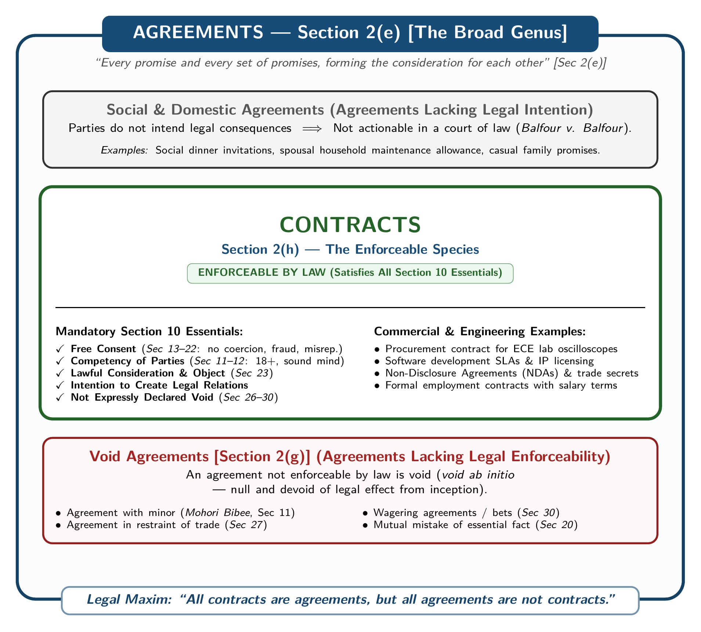

[← Previous: L01.3: Why ECE Students Must Learn Law](L01.3_Why_ECE_Students_Must_Learn_Law.md) | [🏠 Index](00_Index.md) | [📐 Master Sheet](99_Master_Formula_and_Statutory_Sheet.md) | [Next: L02.2: Essential Elements of a Valid Contract →](L02.2_Essential_Elements_of_Valid_Contract.md)

---

# L02.1: Contract, Agreement, Void, and Voidable

> [!info] ⚡ Exam Snapshot
> - **Section & Priority:** Section A (Shoaib Islam Sir) · Critical Priority
> - **Est. Read Time:** 4 minutes
> - **PYQs Covered:** 2024 Q.2(a) (2 marks), 2023 Q.3(a) (2 marks), Model Maxim Question (4 marks), Model Void Agreements Question (4 marks)
> - **Scoring Rule:** Cite exact statutory sections: Agreement [Section 2(e)], Contract [Section 2(h)], Void Agreement [Section 2(g)], and Voidable Contract [Section 2(i)].

---

## 📌 1. Verbatim Definitions (For 2-Mark Questions)

> **Agreement [Section 2(e)]:** "Every promise and every set of promises, forming the consideration for each other, is an agreement." *(The Contract Act, 1872)*

*Plain meaning:* An agreement starts when one person makes an offer and another person accepts it. Both sides exchange promises that serve as mutual value.

> **Contract [Section 2(h)]:** "An agreement enforceable by law is a contract." *(The Contract Act, 1872)*

*Plain meaning:* A contract is an agreement that courts will actually enforce. If someone breaks their promise, you can sue them in court for damages or performance.

$$
\text{Contract} = \text{Agreement} + \text{Legal Enforceability}
$$

*Jurist definitions:*

- **John Salmond:** "A contract is an agreement creating and defining obligations between the parties."
- **Sir William Anson:** "A contract is an agreement enforceable at law made between two or more persons, by which rights are acquired by one or more to acts or forbearances on the part of the other or others."

> **Void Agreement [Section 2(g)]:** "An agreement not enforceable by law is said to be void." *(The Contract Act, 1872)*

*Plain meaning:* A void agreement is dead and invalid from day one (*void ab initio*). The law completely ignores it. Neither side can go to court or sue to enforce it.

> **Voidable Contract [Section 2(i)]:** "An agreement which is enforceable by law at the option of one or more of the parties thereto, but not at the option of the other or others, is a voidable contract." *(The Contract Act, 1872)*

*Plain meaning:* Think of this as a "victim's choice" contract. If someone forced or tricked you into signing, the deal is valid at first. Only you (the victim) can choose to cancel it or keep it.

> [!tip] Memory Hook: Statutory Definition Chain (Section 2)
> - **2(a) Proposal / Offer:** Telling someone what you want to do (or not do) to get their agreement.
> - **2(b) Promise / Acceptance:** When the other person says yes, the proposal becomes an accepted promise.
> - **2(c) Promisor and Promisee:** The person making the proposal is the promisor. The person accepting it is the promisee.
> - **2(d) Consideration:** The price or value exchanged at the desire of the promisor (*quid pro quo*).
> - **2(e) Agreement:** Every promise and set of promises forming mutual consideration for each other.
> - **2(f) Reciprocal Promises:** Promises that act as consideration for each other on both sides.
> - **2(g) Void Agreement:** An agreement that courts refuse to enforce from day one (*void ab initio*).
> - **2(h) Contract:** An agreement enforceable by law in court.
> - **2(i) Voidable Contract:** A contract that only the victim can choose to cancel or enforce.

---

## ⚡ 2. Core Exam Blocks (Write Directly in Exam)

### Block A: The Core Maxim: Contracts vs. Agreements

> **"All contracts are agreements, but all agreements are not contracts."**

This famous maxim explains how agreements and contracts fit together under the Contract Act, 1872. An agreement is the bigger circle, and a contract is the smaller circle inside it:

1. **All contracts are agreements:**
   - Under **Section 2(h)**, a contract is an agreement enforceable by law.
   - Every contract starts with an offer, an acceptance, and mutual consideration under **Section 2(e)**.
   - Therefore, an agreement is the mandatory base of every contract. Without an agreement, no contract can exist.

2. **All agreements are not contracts:**
   - An agreement only becomes a contract if it passes all tests under **Section 10**.
   - These tests require free consent, competent parties, lawful consideration, a lawful object, and no legal ban.
   - If an agreement cannot be enforced in court, it stays a mere agreement. It never becomes a contract.
   - Common non-contract agreements include:
     - **Social and domestic agreements:** Dinner invitations and family promises lack legal intent (*Balfour v. Balfour*).
     - **Agreements with incompetent persons:** A deal signed by a minor is dead from day one (*Mohori Bibee v. Dharmodas Ghose*).
     - **Agreements expressly declared void:** Gambling bets and trade bans can never be enforced in court.

**Contrasting Examples:**

- **Social Agreement (Not a Contract):**
  Rahim invites Karim to dinner at his house. Karim accepts the invite, but Rahim serves no food. Karim cannot sue Rahim in court. They never intended to create a legal relationship.

- **Commercial Contract (Agreement Enforceable by Law):**
  Rahim agrees in writing to sell an oscilloscope to Karim for Tk 50,000. Karim accepts and pays the money. This deal creates a binding legal duty. If Rahim fails to deliver the oscilloscope, Karim can sue him in court for damages.

*Figure 1: Scope Relationship of Agreements and Contracts.*

| Basis of Comparison | Agreement [Section 2(e)] | Contract [Section 2(h)] |
| :--- | :--- | :--- |
| **Statutory Definition** | Every promise and set of promises forming mutual consideration for each other. | An agreement enforceable by law. |
| **Scope** | Broad concept. Includes social, domestic, and legal arrangements. | Narrow concept. Restricted only to legally enforceable agreements. |
| **Legal Enforceability** | May or may not be enforceable in a court of law. | Always enforceable by legal action in court. |
| **Essential Elements** | Requires only a valid offer and a valid acceptance ($\text{Offer} + \text{Acceptance}$). | Requires an agreement plus all Section 10 conditions. |
| **Legal Remedy** | A breach provides no legal remedy if the agreement was social or domestic. | The innocent party can sue for damages, specific performance, or a court order. |

---

### Block B: Five Expressly Void Agreements & Void vs. Voidable

The Contract Act, 1872 expressly voids five specific classes of agreements under **Sections 26 to 30**:

1. **Agreement in Restraint of Marriage [Section 26]:**
   Any agreement that stops an adult from marrying is void. The law protects personal freedom and marriage. (Note: Restraining a minor from marriage is allowed).

2. **Agreement in Restraint of Trade [Section 27]:**
   Any agreement that stops someone from exercising a lawful profession, trade, or business is void. The law protects everyone's right to earn a living.

3. **Agreement in Restraint of Legal Proceedings [Section 28]:**
   Any agreement that bans a person from going to court is void. Agreements that cut short the statutory time limit to sue are also void.

4. **Agreements Void for Uncertainty [Section 29]:**
   Agreements with vague or unclear terms are void. For example, agreeing to buy "100 tons of oil" without naming the type is void for uncertainty.

5. **Agreements by Way of Wager [Section 30]:**
   Agreements based on gambling or betting on an uncertain future event are void. You cannot sue in court to collect betting winnings.

> [!tip] Memory Hook: M-T-L-U-W & C-U-F-M
> - **Five Expressly Void Agreements (`M-T-L-U-W`):**
>   - **M**arriage restraint [Section 26]
>   - **T**rade restraint [Section 27]
>   - **L**egal proceedings restraint [Section 28]
>   - **U**ncertainty of terms [Section 29]
>   - **W**agering agreements [Section 30]
>
> - **Four Vices of Free Consent (`C-U-F-M`):**
>   - **C**oercion [Section 15]
>   - **U**ndue influence [Section 16]
>   - **F**raud [Section 17]
>   - **M**isrepresentation [Section 18]
>   *(All four make the contract voidable. Under Sections 19 and 19A, only the injured victim can choose to cancel the deal).*

| Basis of Comparison | Void Agreement [Section 2(g)] | Voidable Contract [Section 2(i)] |
| :--- | :--- | :--- |
| **Statutory Definition** | An agreement not enforceable by law. | Enforceable only if the injured victim chooses to enforce it. |
| **Initial Validity** | Dead and invalid from day one (*void ab initio*). | Valid when made. Stays valid until the victim cancels it. |
| **Enforceability** | Neither side can enforce the agreement in court. | Only the victim can choose to enforce it or walk away. |
| **Nature of Defect** | Fatal defect, such as dealing with a minor, illegal object, or no consideration. | Consent is flawed due to Coercion, Undue Influence, Fraud, or Misrepresentation (`C-U-F-M`). |
| **Third-Party Rights** | A third party gets zero legal rights or ownership. | An innocent buyer gets valid legal ownership before the contract is cancelled. |
| **Effect of Lapse of Time** | Time never cures the defect. It stays void forever. | If the victim waits too long without cancelling, the contract remains binding. |
| **Remedy for Breach** | Neither side can sue for damages or performance. | The victim can cancel the contract and claim compensation under Section 75. |

---

## 🎯 3. PYQ & Target Answer Key

### 2024 Final Q.2(a) · Definitions of Contract and Agreement (2 Marks)

**Question:** Define contract and agreement.

**Direct Answer:**

Under the **Contract Act, 1872**, these two foundational terms are defined as follows:

1. **Agreement [Section 2(e)]:**
   "Every promise and every set of promises, forming the consideration for each other, is an agreement."
   An agreement forms when one party accepts an offer made by another party. Both parties exchange promises as consideration.

2. **Contract [Section 2(h)]:**
   "An agreement enforceable by law is a contract."
   A valid contract needs two mandatory components: an agreement and legal enforceability under Section 10.

$$
\text{Contract} = \text{Agreement} + \text{Legal Enforceability}
$$

---

### 2023 Final Q.3(a) · Definitions of Void and Voidable Agreement (2 Marks)

**Question:** Define void and voidable agreement.

**Direct Answer:**

Under the **Contract Act, 1872**, the statutory definitions and legal characteristics are as follows:

1. **Void Agreement [Section 2(g)]:**
   "An agreement not enforceable by law is said to be void."
   A void agreement is dead from day one (*void ab initio*). It gives zero legal rights to either party. Common examples include agreements with minors (Section 11) and trade bans (Section 27).

2. **Voidable Contract [Section 2(i)]:**
   "An agreement which is enforceable by law at the option of one or more of the parties thereto, but not at the option of the other or others, is a voidable contract."
   *(Statutory Note: The Contract Act calls this a "voidable contract", not a "voidable agreement".)*
   This contract is valid when signed. Only the injured victim can choose to cancel it or enforce it. This happens when free consent is missing due to Coercion, Undue Influence, Fraud, or Misrepresentation (Sections 15 to 18).

---

### Target Q1 · Foundational Contract Maxim (4 Marks)

**Question:** Explain the maxim: "All contracts are agreements, but all agreements are not contracts." Distinguish between an agreement and a contract.

**Exam Writing Plan:**

1. **Opening Statutory Citation:**
   - Cite the Contract Act, 1872.
   - State the circle rule: Agreement is the bigger outer circle. Contract is the smaller inner circle.
   - Quote **Section 2(h)** ($\text{Contract} = \text{Agreement} + \text{Enforceability}$) and **Section 2(e)**.

2. **Two-Part Maxim Explanation:**
   - **Part 1 (All contracts are agreements):** Every contract starts with an offer, an acceptance, and consideration. Without an agreement, no contract can exist.
   - **Part 2 (All agreements are not contracts):** An agreement becomes a contract only if it meets all **Section 10** rules. Social promises (*Balfour v. Balfour*) and minor deals (*Mohori Bibee*) lack enforceability. They remain mere agreements.

3. **Illustrative Examples & Diagram:**
   - Give the dinner invitation example (social promise, cannot sue).
   - Contrast with the Tk 50,000 oscilloscope sale (commercial deal, can sue).
   - Draw the concentric circles diagram (Figure 1: Scope Relationship of Agreements and Contracts).

4. **Comparison Table:**
   - Draw the 5-point comparison table from §2 Block A.
   - Compare by: Statutory Definition, Scope, Legal Enforceability, Essential Elements, and Legal Remedy.

5. **Concluding Takeaway:**
   - Wrap up with the core formula: $\text{Contract} = \text{Agreement} + \text{Section 10 Enforceability}$.

---

### Target Q2 · Five Expressly Void Agreements (4 Marks)

**Question:** Enumerate five classes of agreements that are expressly declared void under the Contract Act, 1872.

**Exam Writing Plan:**

1. **Statutory Introduction:**
   - Cite **Sections 26 to 30** of the Contract Act, 1872.
   - State that the law bans these five deals on grounds of public policy.
   - They are dead and invalid from day one (*void ab initio*).

2. **Enumerate the Five Classes (`M-T-L-U-W`):**
   - **(1) Restraint of Marriage [Section 26]:** Stopping any adult from marrying is void.
   - **(2) Restraint of Trade [Section 27]:** Stopping someone from doing lawful business or work is void.
   - **(3) Restraint of Legal Proceedings [Section 28]:** Banning someone from suing in court is void. Shortening the statutory time limit to sue is also void.
   - **(4) Uncertainty [Section 29]:** Deals with vague terms (like buying "100 tons of oil" without naming the type) are void.
   - **(5) Wagering Agreements [Section 30]:** Betting or gambling deals are void. Courts will not recover gambling money.

3. **Legal Effect & Takeaway:**
   - Under **Section 2(g)**, these deals have zero legal power from day one.
   - Neither side can sue for damages, and third parties get no legal rights.

---

> [!warning] ⚠️ Examiner Traps
> - **Voidable Terminology:** The law uses the exact phrase "voidable contract" in Section 2(i), not "voidable agreement". Pointing this out scores easy bonus impression marks.
> - **Void vs. Voidable:** A void agreement is dead from day one (*void ab initio*). Time cannot fix it. A voidable contract stays valid until the victim cancels it.
> - **Mandatory Statutory Sections:** Always cite exact sections: Agreement [Section 2(e)], Contract [Section 2(h)], Void Agreement [Section 2(g)], and Voidable Contract [Section 2(i)]. Missing section numbers causes immediate mark loss.

---

[← Previous: L01.3: Why ECE Students Must Learn Law](L01.3_Why_ECE_Students_Must_Learn_Law.md) | [🏠 Index](00_Index.md) | [📐 Master Sheet](99_Master_Formula_and_Statutory_Sheet.md) | [Next: L02.2: Essential Elements of a Valid Contract →](L02.2_Essential_Elements_of_Valid_Contract.md)
