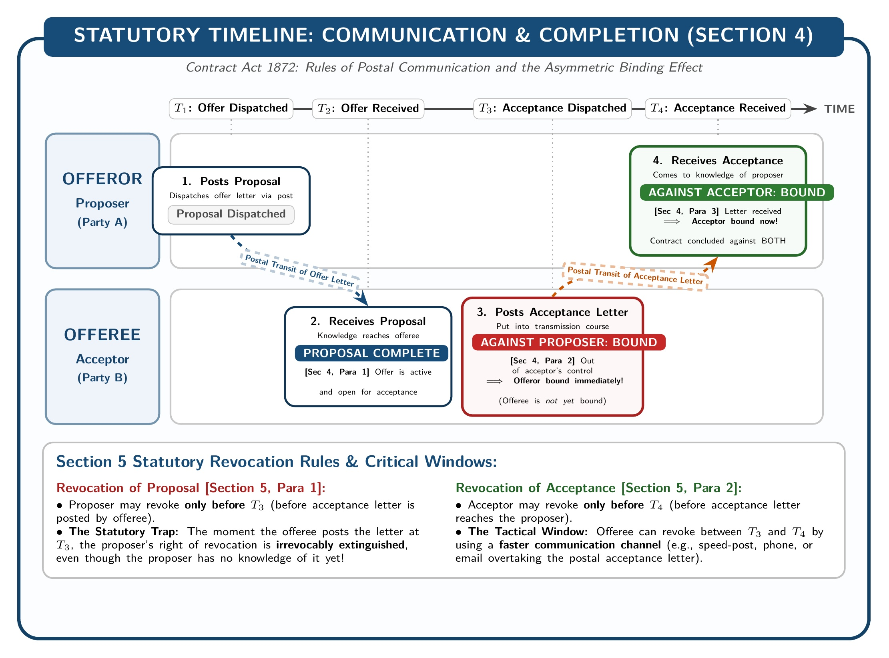

[← Previous: L02.2: Essential Elements of a Valid Contract](L02.2_Essential_Elements_of_Valid_Contract.md) | [🏠 Index](00_Index.md) | [📐 Master Sheet](99_Master_Formula_and_Statutory_Sheet.md) | [Next: L02.4: Applied ECE Tenders and R&D Contract Risks →](L02.4_Applied_ECE_Tenders_and_RD_Contract_Risks.md)

---

# L02.3: Offer and Acceptance Rules

> [!info] ⚡ Exam Snapshot
> - **Section & Priority:** Section A · Shoaib Islam Sir · 🔴 Critical
> - **Estimated Read Time:** ~5 minutes
> - **PYQs Covered:** 2024 Final Q.6(a) (02m), 2025 Law-CT1 Q.2 (10m)
> - **Core Scoring Rule:** State Section 2(a) and Section 2(b) verbatim, quote Sir William Anson's gunpowder metaphor, explain Section 4 mailbox rules with the timeline diagram, and cite *Carlill v. Carbolic Smoke Ball Co.*

---

## 📌 1. Verbatim Definitions (For 2-Mark Questions)

> **Proposal / Offer [Section 2(a)]:** "When one person signifies to another his willingness to do or to abstain from doing anything, with a view to obtaining the assent of that other to such act or abstinence, he is said to make a proposal." *(Contract Act, 1872)*

*Plain meaning:* An offer is an explicit, definite statement of willingness to perform or refrain from an act, presented specifically to invite the other party's agreement.

---

> **Acceptance / Promise [Section 2(b)]:** "When the person to whom the proposal is made signifies his assent thereto, the proposal is said to be accepted. A proposal, when accepted, becomes a promise." *(Contract Act, 1872)*

*Plain meaning:* Acceptance occurs when the recipient of an offer agrees to its terms unconditionally, transforming the open proposal into an enforceable legal promise.

---

> **Promisor and Promisee [Section 2(c)]:** "The person making the proposal is called the 'promisor', and the person accepting the proposal is called the 'promisee'." *(Contract Act, 1872)*

*Plain meaning:* The party who initiates the proposal is legally designated as the promisor or offeror, while the party who accepts the proposal is the promisee or offeree.

---

> **Express vs. Implied Contracts [Section 9]:** "In so far as the proposal or acceptance of any promise is made in words, the promise is said to be express. In so far as such proposal or acceptance is made otherwise than in words, the promise is said to be implied." *(Contract Act, 1872)*

*Plain meaning:* Promises communicated through spoken or written words are express contracts, whereas promises inferred from the conduct or actions of the parties are implied contracts.

---

## ⚡ 2. Core Exam Blocks (Write Directly in Exam)

### Legal Significance & Sir William Anson's Metaphor

Offer and acceptance bring two minds together to achieve mutual agreement (*consensus ad idem*). They pinpoint the precise moment an enforceable contract comes into existence.

Legal scholar Sir William Anson captured this dynamic with a famous metaphor:

> *"Acceptance is to an offer what a lighted match is to a train of gunpowder. It produces something which cannot be undone or recalled."*

This comparison illustrates three foundational legal principles:

1. **The Train of Gunpowder (The Open Offer):** An open offer carries potential force but remains inactive on its own. It creates no legal liability by itself and can be revoked by the offeror at any time before acceptance.
2. **The Lighted Match (The Unqualified Acceptance):** Absolute acceptance is the spark that ignites the powder. The instant acceptance touches the offer, a legally binding contract explodes into reality.
3. **The Irrevocable Explosion (The Binding Contract):** Once ignited by acceptance, the transaction produces a completed promise that cannot be recalled. Neither party can unilaterally withdraw without committing a breach of contract and facing damages.

### Rules Regarding a Valid Offer

Under the Contract Act, 1872, a valid legal offer must satisfy the following fundamental rules:

1. **Express or Implied [Section 9]:**
   - **Express Offer:** Communicated through spoken or written words (such as an email offering to supply 100 microcontrollers for Tk 50,000).
   - **Implied Offer:** Inferred entirely from the acts or conduct of the party. For instance, a public passenger bus stopping at an authorized bus stop makes an implied offer to carry passengers at the scheduled fare.

2. **Specific vs. General Offer:**
   - **Specific Offer:** Addressed to a definite person or a particular organization. Only that specified party holds the legal power to accept (*Boulton v. Jones*).
   - **General Offer:** Addressed to the public at large or the entire world. Anyone who learns of the offer and performs its stated conditions effectively accepts the contract (*Carlill v. Carbolic Smoke Ball Co.*).

3. **Communication Required [Section 4]:**
   - **Rule:** An offer is legally effective only when it comes to the knowledge of the person to whom it is made. A person cannot accept an offer without knowing it exists.
   - **Case Law (*Lalman Shukla v. Gauri Datt*):** A master dispatched his servant to trace a missing nephew. Subsequently, the master advertised a cash reward for information. The servant brought the boy back without any knowledge of the reward. The court held that the servant could not claim the reward because assent cannot be given in ignorance of the offer.

4. **Intention to Create Legal Relations:**
   - **Rule:** The proposal must contemplate binding legal consequences. Casual social invitations or domestic promises do not create legal obligations.

5. **Certainty and Definiteness [Section 29]:**
   - **Rule:** The terms of an offer must be clear, precise, and unambiguous.
   - **Statutory Effect:** Under Section 29, agreements whose meaning is uncertain or incapable of being made certain are void.
   - **Example:** Offering to buy "some circuit components at a favorable rate" is void for uncertainty.

6. **Distinction from an Invitation to Offer:**
   - **Rule:** An offer must be distinguished from a preliminary invitation to receive offers, as shown in the comparative analysis below.

### Comparison: Offer vs. Invitation to Offer (Invitation to Treat)

| Comparison Basis | Offer (Proposal) [Section 2(a)] | Invitation to Offer (Invitation to Treat) |
| :--- | :--- | :--- |
| **Meaning** | Final expression of willingness to enter into a contract on definite terms. | Preliminary invitation asking the other party to submit an offer for consideration. |
| **Intention** | Aims to secure the immediate, binding assent of the offeree. | Aims to circulate terms, open negotiations, or collect competitive bids. |
| **Legal Effect** | Unconditional acceptance immediately creates an enforceable contract. | Response constitutes an offer; no binding contract exists until accepted. |
| **Sequence** | Directly precedes contract formation. | Precedes the making of the offer. |
| **Commercial Examples** | Submitting a priced tender bid; bidding at an auction; bringing items to a cash register. | Displaying goods with price tags in a shop window; issuing an RFP or tender notice; product catalogues. |

### Rules Regarding a Valid Acceptance

Under the Contract Act, 1872, acceptance converts a revocable proposal into an irrevocable promise [Section 2(b)]. A valid acceptance must satisfy these rules:

1. **Absolute and Unqualified (Mirror-Image Rule) [Section 7(1)]:**
   - **Rule:** Acceptance must correspond exactly with every term of the offer without modification, condition, or reservation.
   - **Effect of Counter-Offer:** Any conditional acceptance or modification operates as a counter-offer, which instantly cancels and destroys the original offer.
   - **Example:** If A offers to sell a server for Tk 80,000 and B responds offering Tk 70,000, B's response terminates A's offer. B cannot later accept the original price of Tk 80,000 unless A agrees to renew it.

2. **Usual and Reasonable Manner [Section 7(2)]:**
   - **Rule:** Acceptance must be communicated in the customary business manner (such as post, email, or official portal) unless the proposer prescribes a specific mode.
   - **Prescribed Mode:** If the proposer prescribes a specific mode and the offeree uses another, the proposer must object within a reasonable time and insist on the prescribed mode. If the proposer fails to object promptly, the acceptance is deemed legally valid (statutory waiver).

3. **Acceptance by Performance of Conditions [Section 8]:**
   - **Rule:** Under Section 8, performing the conditions specified in a proposal or accepting any consideration offered with it constitutes full legal acceptance.
   - **Application:** In general offers made to the public, the offeree is not required to give prior notice of acceptance; executing the required performance completes the contract (*Carlill v. Carbolic Smoke Ball Co.*).

4. **Active Communication Required (Silence Is Not Acceptance):**
   - **Rule:** Mental agreement alone does not create a contract. The offeree must actively communicate assent to the offeror.
   - **Silence Rule:** An offeror cannot legally stipulate that silence will be treated as acceptance. In *Felthouse v. Bindley*, an uncle wrote, "If I hear no more about him, I consider the horse mine." The court held that no contract was formed because silence cannot be imposed as acceptance.

5. **Timely Acceptance and Lapse [Section 6]:**
   - **Rule:** Acceptance must be communicated within the time limit stipulated by the offeror, or within a reasonable time if no time is stated.
   - **Condition:** Acceptance must occur while the offer remains open, before it lapses or is revoked.

### Communication, Completion, and Revocation Timeline (Sections 4, 5, and 6)

The Contract Act, 1872 establishes precise statutory rules governing when communication is legally complete and when parties can exercise revocation rights.

*Figure 1: Statutory Timeline of Communication and Completion under Contract Act 1872, Sec 4.*

#### 1. When Communication Is Complete [Section 4]

The statute establishes an asymmetric timeline for postal and indirect communications:

1. **Communication of Proposal:**
   - Complete when it comes to the knowledge of the person to whom it is made.
   - *Example:* A posts an offer to B on 1st March, and B reads it on 3rd March. The offer is complete on 3rd March.

2. **Communication of Acceptance against the Proposer:**
   - Complete as soon as the acceptance is put in a course of transmission to him, so as to be out of the power of the acceptor.
   - *Critical Consequence:* The proposer is legally bound the exact moment the offeree posts the acceptance letter!

3. **Communication of Acceptance against the Acceptor:**
   - Complete only when the acceptance letter comes to the knowledge of the proposer upon physical delivery.
   - *Critical Consequence:* The acceptor is bound only when the letter reaches the proposer.

#### 2. Statutory Windows for Revocation [Section 5]

Section 5 defines the exact deadlines for revoking proposals and acceptances:

1. **Revocation of Proposal:**
   - A proposal may be revoked at any time before the communication of its acceptance is complete as against the proposer, but not afterwards.
   - *Practical Rule:* The offeror can revoke only until the offeree drops the acceptance letter into the mailbox.

2. **Revocation of Acceptance:**
   - An acceptance may be revoked at any time before the communication of the acceptance is complete as against the acceptor, but not afterwards.
   - *Practical Rule:* The offeree can revoke only until the letter reaches the offeror. A revocation message sent by a faster medium (such as a telegram or phone call) must overtake the original acceptance letter.

> [!tip] Memory Hook: 4 Modes of Offer Lapse (N-T-C-D)
> Under Section 6, an open offer terminates automatically through four distinct modes:
> - **N** · **Notice of Revocation (`Sec 6(1)`):** The offeror communicates formal notice of revocation before acceptance is posted.
> - **T** · **Time Expiry (`Sec 6(2)`):** The prescribed time limit expires, or a reasonable time elapses without acceptance.
> - **C** · **Condition Precedent Unfulfilled (`Sec 6(3)`):** The offeree fails to fulfill a condition required prior to acceptance (such as paying an earnest deposit).
> - **D** · **Death or Insanity of Proposer (`Sec 6(4)`):** The proposer dies or becomes of unsound mind before acceptance, provided the offeree learns of the death or insanity before accepting.

---

## 🎯 3. PYQ & Target Answer Key

### 2024 Final Q.6(a) · Definitions of Offer and Acceptance (02 Marks)

**Question:** Define the term offer and acceptance in a contract. [02m]

**Exam Writing Plan (2 Marks):**

1. **Offer Definition:** Quote Section 2(a) verbatim: *"When one person signifies to another his willingness to do or to abstain from doing anything, with a view to obtaining the assent of that other to such act or abstinence, he is said to make a proposal."*
2. **Acceptance Definition:** Quote Section 2(b) verbatim: *"When the person to whom the proposal is made signifies his assent thereto, the proposal is said to be accepted. A proposal, when accepted, becomes a promise."*
3. **Statutory Roles:** State Section 2(c), noting that the person making the proposal is the promisor, and the person accepting it is the promisee.
4. **Concrete ECE Example:** An engineer offers to develop custom embedded telemetry firmware for Tk 40,000, and the client accepts the proposal unconditionally.

---

### 2025 Law-CT1 Q.2 · Legal Significance of Offer and Acceptance (10 Marks)

**Question:** Evaluate the legal significance of offer and acceptance in the formation of a valid contract under the Contract Act. [10m]

**Exam-Ready Full Solution:**

#### 1. Introduction & Sir William Anson's Gunpowder Metaphor

Offer and acceptance form the starting point of every valid contract under the **Contract Act, 1872**. They establish mutual assent (*consensus ad idem*), marking the exact instant an agreement is born.

Legal scholar Sir William Anson described this legal dynamic with a classic metaphor:

> *"Acceptance is to an offer what a lighted match is to a train of gunpowder. It produces something which cannot be undone or recalled."*

This metaphor highlights three core legal principles:

1. **The Gunpowder Train:** An open offer holds potential but lacks binding force until accepted. The offeror can revoke it at any point prior to acceptance.
2. **The Lighted Match:** Absolute acceptance is the spark that instantly converts the open proposal into an enforceable contract.
3. **The Irrevocable Explosion:** Once ignited, the transaction cannot be recalled. Both parties are bound, and any unilateral withdrawal constitutes a breach of contract resulting in damages.

#### 2. Legal Nature and Rules of a Valid Offer [Sections 2(a), 4, 9]

An offer fixes the precise legal scope and obligations of the proposed contract:

- **Express or Implied [Section 9]:** An offer may be stated in words (express) or inferred from conduct (implied, such as boarding a transit bus).
- **Specific vs. General Offers:** An offer can be made to a specific individual (*Boulton v. Jones*) or to the public at large, where anyone performing the conditions accepts the offer (*Carlill v. Carbolic Smoke Ball Co.*).
- **Communication Required [Section 4]:** An offer becomes effective only when communicated to the offeree. In *Lalman Shukla v. Gauri Datt*, finding a missing person without knowing of a reward barred the finder from claiming the money.
- **Offer vs. Invitation to Treat:** Advertisements, price catalogues, and engineering tender notices (RFPs) are invitations to receive offers. Submitting a bid is the actual legal offer.

#### 3. Legal Nature and Rules of a Valid Acceptance [Sections 2(b), 7, 8]

Acceptance converts a revocable proposal into an irrevocable promise:

- **Absolute and Unqualified [Section 7(1)]:** Acceptance must match the offer terms completely (the mirror-image rule). Any modification or conditional reply operates as a counter-offer that destroys the original proposal.
- **Usual Manner [Section 7(2)]:** Acceptance must follow the prescribed or customary mode. Failure by the proposer to object promptly to a deviated mode waives the defect.
- **Performance of Conditions [Section 8]:** Performing the required conditions or accepting consideration constitutes full legal acceptance without prior notice.
- **Silence Is Not Acceptance:** Mental assent alone does not create a contract. An offeror cannot impose silence as an acceptance (*Felthouse v. Bindley*).

#### 4. Asymmetric Mailbox Rules and Completion [Sections 4 and 5]

Section 4 fixes when parties become legally bound in postal communications:

- **Binding the Proposer:** Acceptance is complete against the proposer the instant it is posted in the mailbox.
- **Binding the Acceptor:** Acceptance is complete against the acceptor only when the letter reaches the proposer.
- **Revocation Limits [Section 5]:** The proposer can revoke only before the acceptance letter is posted. The acceptor can revoke only before the acceptance letter is delivered.

#### 5. Conclusion

Offer and acceptance establish legal certainty, define jurisdiction and governing law, and transform voluntary negotiations into binding contracts enforceable by courts.

---

### Model Question · Statutory Rules Governing Valid Acceptance (04 Marks)

**Question:** State the statutory rules governing a valid acceptance under the Contract Act, 1872. [04m]

**Exam Writing Plan (4 Marks):**

1. **Opening Statutory Authority:** State Section 2(b), explaining that an accepted proposal becomes a legally binding promise.
2. **Mirror-Image Rule:** Cite Section 7(1), explaining that acceptance must be absolute and unqualified, and that a counter-offer terminates the original proposal.
3. **Manner of Communication:** Cite Section 7(2), stating that acceptance must be made in the usual and reasonable manner unless a specific mode is prescribed.
4. **Acceptance by Performance & Communication:** Cite Section 8 (performance of conditions counts as acceptance, as in *Carlill*) and mention that silence cannot be prescribed as acceptance (*Felthouse v. Bindley*).
5. **Concluding Takeaway:** Summarize that an acceptance must be communicated before the offer lapses or is revoked under Sections 4, 5, and 6.

---

### Model Question · Distinguishing Offer from Invitation to Offer (04 Marks)

**Question:** Distinguish between an Offer and an Invitation to Offer with suitable commercial examples. [04m]

**Exam Writing Plan (4 Marks):**

1. **Definition of Offer:** Define an offer under Section 2(a) as a final statement of willingness to contract on definite terms, made to obtain the other party's assent.
   - *Example:* A contractor submits a priced bid of Tk 2,000,000 to install fiber-optic cabling.
2. **Definition of Invitation to Offer:** Define an invitation to offer as a preliminary request inviting parties to submit proposals or start negotiations.
   - *Example:* A telecommunications agency publishes a tender notice or RFP in a newspaper.
3. **Comparative Table:** Reproduce the 5-point comparison table:
   - Meaning (final statement vs. preliminary invitation)
   - Intention (immediate assent vs. inviting bids)
   - Legal consequence (acceptance binds vs. response makes an offer)
   - Sequence (precedes contract vs. precedes offer)
   - Examples (auction bid / cash desk vs. window display / tender notice)
4. **Concluding Takeaway:** Highlight that confusing an invitation to treat with an offer leads to misidentifying the exact moment of contract formation.

---

> [!warning] ⚠️ Examiner Traps
> - **Trap 1 (Postal Asymmetry Misunderstanding):** Claiming that the proposer is bound only when receiving the acceptance letter loses critical marks. Under **Section 4**, the proposer is bound the exact instant the offeree posts the letter into the mail.
> - **Trap 2 (Counter-Offer Misinterpretation):** Describing a counter-offer as a partial or conditional acceptance is incorrect. Under **Section 7(1)**, any variation in terms completely terminates and extinguishes the original proposal.
> - **Trap 3 (Treating Invitations as Offers):** Identifying an RFP, newspaper advertisement, or store price tag as an "offer" is a frequent student error. These are **invitations to offer**; the bid submitted by the contractor is the actual legal offer.

---

[← Previous: L02.2: Essential Elements of a Valid Contract](L02.2_Essential_Elements_of_Valid_Contract.md) | [🏠 Index](00_Index.md) | [📐 Master Sheet](99_Master_Formula_and_Statutory_Sheet.md) | [Next: L02.4: Applied ECE Tenders and R&D Contract Risks →](L02.4_Applied_ECE_Tenders_and_RD_Contract_Risks.md)
