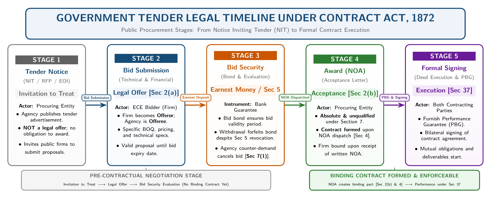
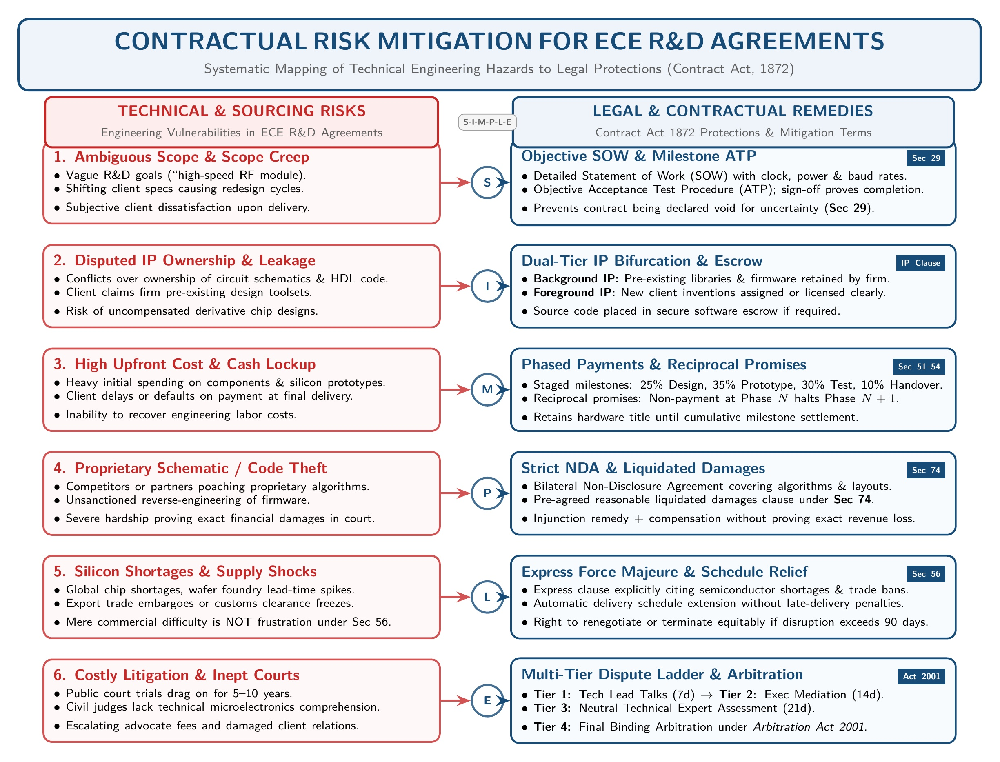

[← Previous: L02.3: Offer and Acceptance Rules](L02.3_Offer_and_Acceptance_Rules.md) | [🏠 Index](00_Index.md) | [📐 Master Sheet](99_Master_Formula_and_Statutory_Sheet.md) | [Next: L03.1: Consideration Definition, Types, and Rules →](L03.1_Consideration_Definition_Types_and_Rules.md)

---

# L02.4: Applied ECE Tenders and R&D Contract Risks

> [!info] ⚡ Exam Snapshot
> - **Section & Priority:** Section A · Shoaib Islam Sir · 🔴 Critical
> - **Read Time:** ~3 mins
> - **PYQs Covered:** 2024 Final Q.6(b) (04m), 2023 Final Q.3(c) (04m), Model Tender Case (04m)
> - **Scoring Rule:** Classify tender notices as invitations to offer. Cite exact statutory sections. Use the 4-step case analysis framework.

---

## 📌 1. Verbatim Definitions (For 2-Mark Questions)

> **Proposal / Offer [Section 2(a)]:** "When one person signifies to another his willingness to do or to abstain from doing anything, with a view to obtaining the assent of that other to such act or abstinence, he is said to make a proposal." *(Contract Act, 1872)*

*Plain meaning:* You tell someone what you are willing to do or not do. You ask for their agreement. Once they say yes, both of you are legally bound.

> **Acceptance [Section 2(b)]:** "When the person to whom the proposal is made signifies his assent thereto, the proposal is said to be accepted. A proposal when accepted becomes a promise." *(Contract Act, 1872)*

*Plain meaning:* The other person says yes to your exact offer without changing any terms. That agreement turns your offer into a binding legal promise.

> **Invitation to Offer (Invitation to Treat):** An act inviting other parties to submit offers, such as tender notices, price lists, or product catalogs. It is not an offer and cannot be accepted to form a binding contract. *(Common Law Doctrine)*

*Plain meaning:* You are not making an offer yet. You are only asking other people to send you their offers. You keep the full right to accept or reject any bid you receive.

> **Certainty of Terms [Section 29]:** "Agreements, the meaning of which is not certain, or capable of being made certain, are void." *(Contract Act, 1872)*

*Plain meaning:* Contract terms must be clear and specific. If pricing, deadlines, or technical specs are too vague to figure out, the law treats the agreement as void.

---

## ⚡ 2. Core Exam Blocks (Write Directly in Exam)

### Block A: Public Procurement and Government Tender Flow

Under the Contract Act, 1872, government engineering tenders move through five clear legal stages:

*Figure 1: Government Tender Legal Stages under Contract Law (Invitation to Offer to Formal Execution).*

1. **Tender Notice is an Invitation to Treat:**
   - **Legal Status:** A tender ad in a newspaper or online portal is not an offer. It is an invitation to treat (an invitation to receive offers).
   - **Operational Rule:** The government does not promise to award the project to anyone. It only invites qualified engineering firms to calculate costs and submit formal bids.

2. **Bid Submission is the Legal Offer [Section 2(a)]:**
   - **Legal Status:** When an engineering firm submits its technical and financial bid, that bid is the actual legal offer under Section 2(a).
   - **Roles:** The bidding firm is the offeror (the party making the offer). The government agency is the offeree (the party receiving it).
   - **Content:** The bid sets out exact unit prices, delivery schedules, technical sheets, and execution terms.

3. **Bid Security and Revocation Rules [Section 5]:**
   - **General Rule under Section 5:** An offeror can revoke a proposal at any time before acceptance is complete against them.
   - **Tender Condition (Collateral Side Contract):** Bidders deposit earnest money (a bid bond). In exchange, they promise to keep the tender open for a fixed period, such as 90 or 120 days.
   - **Consequence:** The firm cannot be forced to build the project if it pulls out early. However, the procuring agency has the full legal right to seize and forfeit the earnest money deposit.

4. **Bid Evaluation and Counter-Offer [Section 7(1)]:**
   - **Must Be Absolute [Section 7(1)]:** Acceptance must be absolute and unqualified to create a contract. It cannot change any terms.
   - **Counter-Offer Kills the Bid:** If the evaluation committee asks for a price cut or changes delivery milestones, that reply is a counter-offer. It immediately terminates the firm's original bid.

5. **Notification of Award (NOA) is Legal Acceptance [Sections 2(b) & 4]:**
   - **Binding on the Agency:** Under Section 4, the contract binds the government the moment it posts or dispatches the official Notification of Award (NOA).
   - **Binding on the Firm:** The contract binds the firm the moment the firm receives the NOA. An enforceable contract exists right then, even before anyone signs formal papers.

> [!tip] Memory Hook: 5 Tender Stages (T-B-S-C-A)
> - **T (Tender Notice):** Invitation to treat (an advertisement asking for bids).
> - **B (Bid Submission):** The true legal offer under Section 2(a).
> - **S (Security Deposit):** Earnest money bond keeping the offer open.
> - **C (Counter-Offer):** Bargaining or asking for changes cancels the original bid under Section 7(1).
> - **A (Award Notice):** Absolute acceptance creating a binding contract under Section 2(b).

---

### Block B: Mitigating Contractual Risks in ECE R&D Agreements

Engineering R&D projects face high uncertainty, prototype revisions, and component supply shocks. ECE firms protect themselves using six legal strategies:

*Figure 2: Contractual Risk Mitigation Architecture for Engineering R&D Agreements.*

1. **Define Objective Scope and Acceptance Test Procedures [Section 29]:**
   - **Legal Rule [Section 29]:** Agreements with vague or uncertain terms are void.
   - **ECE Application:** Draft a detailed Statement of Work (SOW). State exact numbers for clock speeds, power limits, and heat tolerances.
   - **Acceptance Mechanism:** Set up objective Acceptance Test Procedures (ATP). Client sign-off must depend on verified lab test data, never on personal feelings.

2. **Set Clear Ownership of Intellectual Property (IP) Rights:**
   - **Background IP (What You Bring In):** The engineering firm keeps full ownership of all pre-existing patents, circuit designs, and firmware libraries.
   - **Foreground IP (What You Build):** The contract must state clearly who owns newly developed code and schematics. Decide if the client owns them or only gets a commercial license.

3. **Adopt Milestone-Based Phased Performance [Sections 51 to 54]:**
   - **Legal Rule [Sections 51 to 54]:** Contracts can connect mutual promises so each step depends on the other party performing.
   - **ECE Application:** Break project delivery into distinct sequential steps. For example, design review (25%), prototype build (35%), system integration (30%), and documentation (10%).
   - **Risk Protection:** If the client delays a milestone payment, the firm can halt development immediately. The firm faces zero breach penalties for pausing work.

4. **Incorporate Strict Confidentiality and Liquidated Damages [Section 74]:**
   - **Trade Secret Protection:** Protect PCB Gerber files, HDL code, and communication protocols with a strict Non-Disclosure Agreement (NDA).
   - **Pre-Agreed Compensation [Section 74]:** Add a reasonable liquidated damages clause under Section 74. If someone leaks proprietary data, you can collect this pre-agreed amount without proving exact lost sales in court.

5. **Draft Full Force Majeure and Supply Relief Clauses [Section 56]:**
   - **Legal Rule [Section 56]:** Supervening impossibility excuses performance. But courts strictly reject higher component prices or ordinary market hardship as an excuse!
   - **ECE Application:** Explicitly list global semiconductor shortages, foundry backlogs, and trade bans in your force majeure clause.
   - **Relief Mechanism:** When these listed events happen, your delivery schedule extends automatically. You avoid late delivery fines and keep your performance bond safe.

6. **Implement a Multi-Tier Dispute Resolution Ladder:**
   - **Step-by-Step Escalation:** Resolve disputes through a 4-tier ladder before running to court. Start with informal technical talks between lead engineers (7 days). Next, hold executive talks (14 days). Then try mediation. Finally, go to binding arbitration.
   - **Arbitration Framework:** Send unresolved disputes to technical experts under the Arbitration Act, 2001. This avoids slow civil courts and keeps your proprietary circuit designs confidential.

> [!tip] Memory Hook: 6 R&D Risk Protections (S-I-M-P-L-E)
> - **S (Scope & Specs):** Objective Statement of Work and lab test procedures under Section 29.
> - **I (IP Allocation):** Keep older Background IP separate from newly developed Foreground IP.
> - **M (Milestones):** Step-by-step stages and payments under Sections 51 to 54.
> - **P (Protection of Secrets):** NDAs with pre-agreed liquidated damages under Section 74.
> - **L (Logistical Relief):** Express force majeure clauses covering chip shortages under Section 56.
> - **E (Expert Arbitration):** Multi-tier dispute ladder leading to binding arbitration under the Arbitration Act, 2001.

---

## 🎯 3. PYQ & Target Answer Key

### 2024 Final Q.6(b) · Offer and Acceptance in Government Tenders (04 Marks)

**Question:** Apply the rules of offer and acceptance to a situation where an ECE firm is bidding for a government project. *(Note: The phrase "a situation where" appeared duplicated in the original exam paper).*

**Full Answer (4-Step Case Method):**

1. **Facts and Legal Issues:**
   - **Facts:** A government body publishes a tender notice for an engineering project, such as optical fiber deployment. An ECE firm prepares and submits its bid.
   - **Legal Issues:**
     - Which procurement step is the legal offer?
     - Which act is legal acceptance?
     - At what exact moment does an enforceable contract form?

2. **Applicable Law and Statutory Sections:**
   - Contract Act, 1872:
     - `Section 2(a)`: Definition of Proposal / Offer.
     - `Section 2(b)`: Definition of Acceptance / Promise.
     - `Section 4`: Communication of proposal and acceptance.
     - `Section 7(1)`: Acceptance must be absolute and unqualified.
   - Common Law Doctrine: Difference between an Offer and an Invitation to Treat.

3. **Legal Analysis:**
   - **Tender Advertisement is an Invitation to Treat:** The government tender notice is not an offer. It is an invitation to treat. It merely shares project details and asks qualified bidders to submit proposals.
   - **Bid Submission is the Legal Offer [Section 2(a)]:** The ECE firm's submitted tender is the true legal offer. The firm is the offeror. The procuring government agency is the offeree.
   - **Price Negotiations Constitute Counter-Offers [Section 7(1)]:** If the agency asks for a lower price or changes terms, that reply is a counter-offer under Section 7(1). It kills the original tender offer immediately.
   - **Notification of Award (NOA) is Legal Acceptance [Sections 2(b) & 4]:** A binding contract forms when the government issues its official NOA. Under Section 4, the contract binds the government the moment the NOA is posted. It binds the bidder once the bidder receives the letter.

4. **Direct Conclusion:**
   - The tender notice is only an invitation to offer.
   - The ECE firm's submitted bid is the true legal offer.
   - The government's unconditional Notification of Award is legal acceptance, completing the contract.

---

### 2023 Final Q.3(c) · Mitigating Contractual Risks in ECE R&D Agreements (04 Marks)

**Question:** Propose strategies for mitigating contractual risks in research and development agreements within the field of ECE.

**Exam Writing Plan:**

1. **Opening Context:**
   - Engineering R&D deals face high technical uncertainty, prototype revisions, and chip shortages.
   - Smart contracts allocate these risks under the Contract Act, 1872.

2. **Core Strategies (S-I-M-P-L-E Framework):**
   - **Scope & ATP (Section 29):** State exact technical numbers in the Statement of Work. Use objective lab tests so the deal is not void for uncertainty.
   - **IP Allocation:** Keep pre-existing Background IP with your firm. Define whether the client owns newly built Foreground IP or only receives a license.
   - **Milestone Payments (Sections 51 to 54):** Split work into clear stages, like design (25%) and prototype (35%). Retain the right to pause work if payments are late.
   - **Confidentiality & Liquidated Damages (Section 74):** Protect schematics and code with NDAs. Set pre-agreed penalty sums for data leaks.
   - **Force Majeure (Section 56):** Name semiconductor shortages and trade embargoes directly in the contract. This grants extra delivery time without late fines.
   - **Dispute Ladder:** Settle conflicts through engineer talks (7 days), executive meetings (14 days), mediation, and arbitration under the Arbitration Act, 2001.

3. **Diagram Reference:**
   - Cite *Figure 2: Contractual Risk Mitigation Architecture for Engineering R&D Agreements*.

4. **Concluding Takeaway:**
   - Stage-gate milestone payments and private arbitration protect engineering firms from client payment defaults and slow court battles.

---

### Model Case · Withdrawal of Tender Bid Before Award (04 Marks)

**Question:** An ECE firm submits a bid for a smart grid telecommunications project with a bid validity period of 90 days. The firm submits a bid bond of Tk. 500,000. On day 30, component prices surge by 40%. The firm sends a letter revoking its bid before the tender committee announces any award. Analyze the legal rights of both parties under the Contract Act, 1872.

**Full Answer (4-Step Case Method):**

1. **Facts and Legal Issues:**
   - **Facts:** An ECE firm submitted a tender offer with a 90-day validity promise and a Tk. 500,000 bid security bond. On day 30, before the agency announced any award, the firm formally revoked its tender due to component price spikes.
   - **Legal Issues:**
     - Can the firm legally revoke its offer before the award is announced?
     - Can the government agency lawfully forfeit the Tk. 500,000 bid bond?

2. **Applicable Law and Statutory Sections:**
   - Contract Act, 1872:
     - `Section 5`: Revocation of proposals (an offer may be revoked at any time before communication of its acceptance is complete against the proposer).
     - Legal rules governing collateral side contracts and tender security conditions.

3. **Legal Analysis:**
   - **Revocation of Offer under Section 5:** The procuring agency had not dispatched a Notification of Award. Therefore, communication of acceptance was not complete against the bidder. Under Section 5, the firm has the full legal right to revoke its offer. No primary project contract was formed. The firm cannot be forced to execute the engineering project.
   - **Forfeiture of Bid Bond (Collateral Agreement):** The bid bond is a valid, binding side agreement (collateral contract). In return for having its bid evaluated, the firm promised to keep its offer open for 90 days. Revoking the bid on day 30 breaches this separate collateral promise.
   - **Agency's Remedy:** Under procurement law, breaching the validity promise gives the procuring entity the legal power to forfeit the earnest money deposit as pre-agreed compensation.

4. **Direct Conclusion:**
   - The firm's revocation of its main offer is legally effective. The firm cannot be forced to perform the engineering project.
   - However, the procuring agency has the full legal right to forfeit the Tk. 500,000 bid bond.

---

> [!warning] ⚠️ Examiner Traps
> - **Misclassifying Tender Notices:** Never call a tender advertisement an offer. It is an invitation to treat. The firm's submitted bid is the real legal offer under Section 2(a).
> - **Bid Withdrawal Misconception:** Never claim that pulling out of a bid before the award is illegal. Revoking the main offer is completely legal under Section 5. However, the agency keeps the lawful right to forfeit the earnest money deposit under the collateral tender terms.
> - **Omission of Statutory Sections:** Always cite exact sections for full marks. Key sections are `Sec 2(a)` (offer), `Sec 2(b)` (acceptance), `Sec 4` (communication), and `Sec 7(1)` (unconditional acceptance). Also cite `Sec 29` (certainty), `Sec 56` (force majeure), and `Sec 74` (pre-agreed damages).

---

[← Previous: L02.3: Offer and Acceptance Rules](L02.3_Offer_and_Acceptance_Rules.md) | [🏠 Index](00_Index.md) | [📐 Master Sheet](99_Master_Formula_and_Statutory_Sheet.md) | [Next: L03.1: Consideration Definition, Types, and Rules →](L03.1_Consideration_Definition_Types_and_Rules.md)
