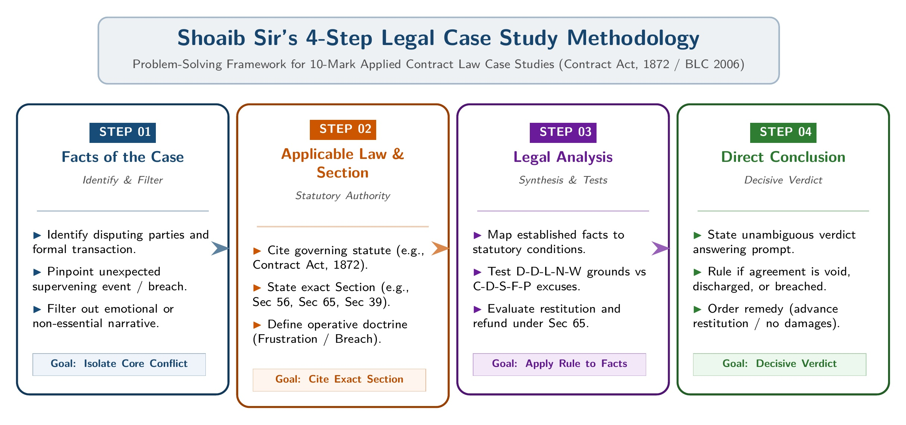

[← Previous: L04.1: Modes of Discharge of Contract](L04.1_Modes_of_Discharge_of_Contract.md) | [🏠 Index](00_Index.md) | [📐 Master Sheet](99_Master_Formula_and_Statutory_Sheet.md) | [Next: L05.1: BLC Core Definitions and Age Classes →](L05.1_BLC_Core_Definitions_and_Age_Classes.md)

---

# L04.2: Doctrine of Frustration and Applied Case Studies

> [!info] ⚡ Exam Snapshot
> - **Section & Priority:** Section A · SI Sir (Shoaib Islam) · 🔴 Critical Case Study Lock
> - **PYQs Covered:** Shoaib Sir Mandatory 10-Mark Applied Case Target (Tech Solutions, Venue/Illness/Ban, Telecom Novation)
> - **Scoring Rule:** State exact sections (`Sec 56`, `Sec 65`, `Sec 73`, `Sec 39`, `Sec 62`) using Shoaib Sir's 4-Step format for 10/10 marks.

---

## 📌 1. Verbatim Definitions (For 2-Mark Questions)

> **Initial Impossibility [Sec 56 Para 1]:** "An agreement to do an act impossible in itself is void." *(Contract Act, 1872)*

*Plain meaning:* If an act cannot be performed from the very beginning due to physical or legal impossibility, the agreement has no legal effect and is void from the start (*void ab initio*).

> **Supervening Impossibility / Doctrine of Frustration [Sec 56 Para 2]:** "A contract to do an act which, after the contract is made, becomes impossible, or, by reason of some event which the promisor could not prevent, unlawful, becomes void when the act becomes impossible or unlawful." *(Contract Act, 1872)*

*Plain meaning:* When an unforeseen outside event happens after contract formation without fault of either party, making performance physically impossible or illegal, the contract terminates automatically.

> **Restitution of Advantage [Sec 65]:** "When an agreement is discovered to be void, or when a contract becomes void, any person who has received any advantage under such agreement or contract is bound to restore it, or to make compensation for it to the person from whom he received it." *(Contract Act, 1872)*

*Plain meaning:* When a contract becomes void through frustration or illegality, any party who received an advance payment or unearned benefit must refund it in full to prevent unjust enrichment.

---

## ⚡ 2. Core Exam Blocks (Write Directly in Exam)

### Initial vs. Subsequent Impossibility (Section 56)

| Parameter | Initial Impossibility (`Sec 56 Para 1`) | Subsequent Impossibility (`Sec 56 Para 2`) |
| :--- | :--- | :--- |
| **Timing** | Exists when the agreement is made. | Arises after valid contract formation. |
| **Legal Status** | Void from the very start (*void ab initio*). | Valid when made; becomes void later. |
| **Cause** | Inherent natural or legal impossibility. | Unforeseen external supervening event. |
| **Example** | Agreement to discover treasure by magic. | Concert hall burns down before the performance. |
| **Liability** | Void agreement; no contractual duties arise. | Contract ends automatically without breach damages. |

### 5 Valid Grounds of Frustration (D-D-L-N-W)

1. **Destruction of Subject Matter:**
   - The specific physical subject matter essential to the contract is destroyed without fault of either party.
   - *Landmark Case:* *Taylor v. Caldwell* (1863) (an accidental fire destroyed the rented music hall before concert dates).
   - *ECE Example:* An accidental electrical fire destroys a custom telecom transmitter before the scheduled delivery date.

2. **Death or Personal Incapacity:**
   - Contracts based on personal artistic skill, professional expertise, or confidential service discharge if the promisor dies or suffers disabling illness.
   - *Landmark Case:* *Robinson v. Davison* (1871) (a pianist was excused from performing due to sudden, certified serious illness).

3. **Change of Law / Supervening Illegality:**
   - A subsequent legislative enactment, government ban, or statutory gazette makes continued performance illegal.
   - *ECE Example:* The government issues an emergency national security embargo on importing foreign encrypted transceivers.

4. **Non-Occurrence of Contemplated Event:**
   - The contract is formed on the mutual understanding that a specific foundational event will take place. If that event fails to occur, the foundation of the deal collapses.
   - *Landmark Case:* *Krell v. Henry* (1903) (coronation procession was postponed, discharging a flat rental taken solely to view the parade).

5. **Outbreak of War:**
   - An outbreak of war renders physical performance impossible or turns the other contracting party into an alien enemy, making commercial intercourse unlawful.

> [!tip] Memory Hook: 5 Valid Grounds (`D-D-L-N-W`)
> - **D**: **D**estruction of subject matter (*Taylor v. Caldwell*)
> - **D**: **D**eath or personal incapacity in personal skill contracts (*Robinson v. Davison*)
> - **L**: **L**aw change rendering performance unlawful
> - **N**: **N**on-occurrence of contemplated foundational event (*Krell v. Henry*)
> - **W**: **W**ar outbreak making trade with an alien enemy illegal

### 5 Non-Qualifying Excuses (C-D-S-F-P)

1. **Commercial Hardship:**
   - Higher market prices, raw material cost surges, wage hikes, or diminished profits never discharge a contract.
   - *Rule:* Performance remains physically and legally possible. Market fluctuations represent ordinary commercial risk that the promisor must absorb.

2. **Default of Third Party:**
   - A supplier cannot plead frustration because an upstream vendor, subcontractor, or manufacturer failed to deliver components.
   - *Rule:* The promisor bears sole legal responsibility for managing their own supply chain.

3. **Strikes, Lock-Outs, and Labor Disputes:**
   - Factory strikes, worker walkouts, or local transport shutdowns are temporary disruptions that do not discharge the contract.
   - *Rule:* Labor unrest excuses delay only if the contract contains an express *force majeure* clause.

4. **Failure of One of Several Objects:**
   - When a contract is entered for multiple distinct purposes, the failure of one purpose does not discharge the contract if other objects remain feasible.
   - *Landmark Case:* *Herne Bay Steamboat Co. v. Hutton* (1903) (the royal naval review was canceled, but cruising around the fleet remained possible; the contract survived).

5. **Self-Induced Impossibility:**
   - Impossibility brought about by a party's own deliberate choice, act, omission, or neglect is never frustration.
   - *Rule:* An act of self-induced impossibility constitutes an actionable breach of contract.

> [!tip] Memory Hook: 5 Rejected Excuses (`C-D-S-F-P`)
> - **C**: **C**ommercial hardship (price surges or lost profits)
> - **D**: **D**efault of third-party supplier or subcontractor
> - **S**: **S**trikes, lock-outs, or civil labor unrest
> - **F**: **F**ailure of one object when other purposes remain viable (*Herne Bay*)
> - **P**: **P**arty's self-induced impossibility (own act or neglect)

### Legal Effects of Frustration and Restitution

1. **Automatic Termination:** The contract terminates immediately and automatically on the date of the frustrating event without requiring formal notice.
2. **Mutual Release:** Both parties are discharged from all unperformed future contractual obligations.
3. **No Breach Damages [Sec 73]:** Because neither party committed a wrongful breach, no claim for compensatory damages lies under Section 73.
4. **Mandatory Restitution [Sec 65]:** Any advance payment, deposit, or unearned advantage received under the void contract must be refunded in full to prevent unjust enrichment.

### Shoaib Sir's 4-Step Case Study Method

*Figure 4.1: Shoaib Sir's 4-Step Problem-Solving Methodology for Legal Case Studies.*

1. **Facts of the Case:** Summarize the core material dispute and key dates in 1 to 2 clear sentences.
2. **Applicable Law & Section:** Cite the exact governing statute and sections (`Sec 56`, `Sec 65`, `Sec 73`, `Sec 39`, or `Sec 62`).
3. **Legal Analysis:** Apply the statutory rules and case precedents to the facts. Clearly distinguish genuine impossibility from commercial risk.
4. **Direct Conclusion:** State the concrete verdict answering each specific claim (discharge status, liability for damages, and advance refund).

### Master Case-Trigger Cheat Table

| Scenario Trigger | Section & Rule | Discharged? | Damages (`Sec 73`)? | Restitution (`Sec 65`)? |
| :--- | :--- | :---: | :---: | :---: |
| **300% Price Surge** | `Sec 56` Commercial Hardship | **No** | Yes, if work stopped | Full contract binding |
| **Accidental Fire** | `Sec 56(2)` *Taylor v. Caldwell* | **Yes (Void)** | **No** | **Yes** (Advance refunded) |
| **Artist Severe Illness** | `Sec 56(2)` *Robinson v. Davison* | **Yes (Void)** | **No** | **Yes** (Advance fee refunded) |
| **Government Import Ban** | `Sec 56(2)` Supervening Illegality | **Yes (Void)** | **No** | **Yes** (Advance refunded) |
| **Labor Strike** | `Sec 56` Non-qualifying excuse | **No** | **Yes** (Delay loss) | Liable to perform |
| **Vendor Default** | `Sec 56` Non-qualifying excuse | **No** | **Yes** (Supply risk) | Liable to perform |
| **Anticipatory Repudiation** | `Sec 39` Anticipatory Breach | **Option** | **Yes** (Immediate/due) | **Yes** (Returned on rescission) |
| **Tripartite Novation** | `Sec 62` Mutual Novation | **Yes** (Old party) | **No** | **Yes** (Unearned sum returned) |

---

## 🎯 3. PYQ & Target Answer Key

### Direct Theory Question: Supervening Impossibility & Frustration (05 Marks)

**Question:**  
Explain the Doctrine of Supervening Impossibility (Doctrine of Frustration) under Section 56 of the Contract Act, 1872. State the valid grounds of frustration and the situations that do not discharge a contract.

**Exam Writing Plan:**

1. Open by distinguishing Initial Impossibility (`Sec 56 Para 1`) from Subsequent Impossibility (`Sec 56 Para 2`), quoting the statutory text of Section 56(2).
2. Present the comparison table from Section 2 highlighting timing, legal status, and liability consequences.
3. Enumerate the 5 valid grounds (`D-D-L-N-W`), citing *Taylor v. Caldwell* (destruction of subject matter) and *Robinson v. Davison* (personal incapacity).
4. Detail the 5 rejected excuses (`C-D-S-F-P`), citing *Herne Bay* and emphasizing that commercial hardship never frustrates a contract.
5. Conclude with the 4 legal consequences, highlighting that breach damages under Section 73 are barred while advance restitution under Section 65 is mandatory.

---

### Case 1: Tech Solutions Ltd. · Price Surge vs. Factory Fire (10 Marks)

**Scenario:**  
*Tech Solutions Ltd.* (an ECE engineering firm in Dhaka) contracts with *PowerGrid Bangladesh Ltd.* to build and supply 100 custom industrial rectifiers for Tk. 5,000,000 by 15th December 2025. PowerGrid pays an advance of Tk. 1,000,000 upon signing the contract.

On 1st November 2025, a global shortage hits the semiconductor market, causing the open market price of specialized microcontroller chips to surge by 300%. Fulfilling the contract will cause Tech Solutions a loss of Tk. 1,500,000. Tech Solutions requests cancellation due to commercial hardship, but PowerGrid refuses.

On 20th November 2025, an accidental electrical fire caused by an external municipal power surge destroys Tech Solutions' only manufacturing plant, machinery, and 60 partially completed rectifiers without fault. Tech Solutions informs PowerGrid that performance is physically impossible and the contract is discharged.

PowerGrid sues Tech Solutions for breach of contract, claiming Tk. 2,000,000 in delay damages, and refuses to refund the Tk. 1,000,000 advance.

#### Sub-Question (i): Chip Price Surge (03 Marks)

**Prompt:** Can Tech Solutions Ltd. claim discharge of contract based on the chip price surge? Explain under relevant legal principles.

**1. Facts of the Case:**  
Tech Solutions sought to cancel the supply contract after a 300% price surge in microcontroller chips threatened a financial loss of Tk. 1,500,000 on the project.

**2. Applicable Law & Section:**  
Contract Act, 1872, **Section 56** (Doctrine of Supervening Impossibility) and the established legal rule governing **Commercial Hardship**.

**3. Legal Analysis:**

- The law strictly distinguishes physical impossibility from commercial difficulty or unprofitability.
- Microcontroller chips remained obtainable in the open market, although at a higher procurement cost.
- Raw material price fluctuations represent standard commercial business risks that the promisor must absorb.
- Under Section 56, commercial hardship or loss of profit never excuses a party from fulfilling their agreed contractual obligations.

**4. Direct Conclusion:**  
Tech Solutions Ltd. cannot claim discharge based on the chip price surge. The contract remained fully valid and binding on 1st November 2025.

#### Sub-Question (ii): Accidental Factory Fire (03 Marks)

**Prompt:** Did the accidental factory fire cause Supervening Impossibility under Section 56? What is the legal status of the contract?

**1. Facts of the Case:**  
On 20th November 2025, an accidental electrical fire triggered by an external municipal power surge destroyed Tech Solutions' sole manufacturing plant and custom work-in-progress rectifiers without negligence.

**2. Applicable Law & Section:**  
Contract Act, 1872, **Section 56 (Paragraph 2)** and the landmark common law doctrine of ***Taylor v. Caldwell* (1863)** (destruction of subject matter).

**3. Legal Analysis:**

- Under Section 56(2), when specific subject matter essential to performance is destroyed without fault of either party, performance becomes physically impossible.
- The 100 rectifiers were custom-designed units requiring this specific manufacturing plant for completion before the 15th December deadline.
- The fire was caused by an external power surge, proving zero fault or negligence on the part of Tech Solutions.
- Destruction of the essential facility destroyed the physical foundation of the contract.

**4. Direct Conclusion:**  
The accidental fire caused genuine Supervening Impossibility under Section 56. The contract became void automatically on 20th November 2025, freeing both parties from future performance.

#### Sub-Question (iii): Breach Damages & Advance Recovery (04 Marks)

**Prompt:** Is PowerGrid entitled to damages for breach of contract? Can PowerGrid recover its Tk. 1,000,000 advance payment?

**1. Facts of the Case:**  
PowerGrid claimed Tk. 2,000,000 in delay damages for breach of contract and sought to retain the Tk. 1,000,000 advance payment made to Tech Solutions.

**2. Applicable Law & Section:**  
Contract Act, 1872, **Section 56** (Discharge by Frustration), **Section 73** (Compensation for breach of contract), and **Section 65** (Restitution of advantage received under a void contract).

**3. Legal Analysis:**

- *Breach Damages Claim (Section 73):* Section 73 damages require a wrongful breach of contract.
  - Because the contract was discharged by operation of law under Section 56 without fault, Tech Solutions committed no breach.
  - Therefore, PowerGrid cannot claim any compensatory breach damages.
- *Advance Restitution Claim (Section 65):* Under Section 65, when a contract becomes void, any party who received an advantage is legally bound to restore it.
  - Tech Solutions received Tk. 1,000,000 as an advance for custom rectifiers it can no longer manufacture or deliver.
  - Retaining this unearned payment without consideration would constitute unjust enrichment, mandating a full refund.

**4. Direct Conclusion:**  
PowerGrid is not entitled to recover Tk. 2,000,000 in breach damages. However, PowerGrid is legally entitled to an immediate, full refund of its Tk. 1,000,000 advance payment under Section 65.

---

### Case 2: Import Ban, Artist Illness & Worker Strike (10 Marks)

**Scenario:**  
*Bengal MicroSystems Ltd.* in Dhaka enters a contract with *National Telecom Corporation (NTC)* on 1st October 2025 to supply two consignments by 31st December 2025:

- **Consignment A:** 50 encrypted satellite transceivers imported from Germany for Tk. 6,000,000 (advance Tk. 1,200,000 paid).
- **Consignment B:** 2,000 fiber patch cables and switches for Tk. 2,000,000 (advance Tk. 400,000 paid).

On 15th November 2025, the Government of Bangladesh gazettes an emergency statutory ban on importing foreign encrypted satellite equipment for national security reasons. No import permits can be issued.

For Consignment B, Bengal's factory workers launch an unauthorized 20-day strike over yearly bonuses, and Bengal's chosen local switch supplier defaults on shipments due to maintenance delays.

Separately, NTC hires classical vocalist *Ustad Farhan* for its annual gala on 20th December for Tk. 200,000 (advance Tk. 50,000 paid). On 18th December, Farhan contracts severe vocal cord paralysis, certified medically as permanent if strained.

Bengal delivers neither consignment by 31st December, claims frustration under Section 56 for both, and refuses to refund the Tk. 1,600,000 advance. Farhan also refuses to return his Tk. 50,000 advance. NTC sues for delay damages and all advance refunds.

#### Sub-Question (i): Government Import Ban on Consignment A (03 Marks)

**Prompt:** Did the government import ban discharge the contract for Consignment A under Section 56? Is Bengal liable for Tk. 1,000,000 in delay damages?

**1. Facts of the Case:**  
The government published a statutory gazette prohibiting the import of foreign encrypted satellite transceivers, preventing Bengal from legally importing Consignment A.

**2. Applicable Law & Section:**  
Contract Act, 1872, **Section 56 (Paragraph 2)** (Supervening illegality caused by a change of law).

**3. Legal Analysis:**

- Under Section 56(2), a contract becomes void when an act becomes unlawful after contract formation by reason of an event the promisor could not prevent.
- The government gazette made the importation and supply of encrypted transceivers illegal in Bangladesh.
- Performance became legally impossible by an act of state authority without fault on Bengal's part.
- The contract for Consignment A terminated automatically on 15th November 2025. Because termination occurred by operation of law, Bengal committed no wrongful breach under Section 73.

**4. Direct Conclusion:**  
The government import ban discharged the contract for Consignment A under Section 56. Bengal is not liable for Tk. 1,000,000 in delay damages.

#### Sub-Question (ii): Artist Vocal Incapacity (03 Marks)

**Prompt:** What is the legal status of the personal performance contract between NTC and Ustad Farhan? Is Ustad Farhan liable for promotional damages?

**1. Facts of the Case:**  
Ustad Farhan contracted acute viral pneumonia and vocal cord paralysis two days before the gala, with medical certification confirming that singing would cause permanent vocal damage.

**2. Applicable Law & Section:**  
Contract Act, 1872, **Section 56 (Paragraph 2)** and the landmark principle of ***Robinson v. Davison* (1871)** (discharge by personal illness or incapacity).

**3. Legal Analysis:**

- Contracts for personal artistic performance depend entirely on the personal health and physical capacity of the promisor.
- Sudden, severe illness that makes performance dangerous to life or health legally excuses the promisor without liability.
- The vocal incapacity arose without deliberate fault or neglect by Farhan.
- The personal service contract became void automatically under Section 56, shielding the artist from breach damages under Section 73.

**4. Direct Conclusion:**  
The contract became void under Section 56 due to supervening medical incapacity. Ustad Farhan is not liable for NTC's promotional or marketing damages.

#### Sub-Question (iii): Strike, Vendor Default & Restitution (04 Marks)

**Prompt:** Is NTC entitled to damages for Consignment B? Must Bengal and Farhan refund their respective advance payments under Section 65?

**1. Facts of the Case:**  
Bengal failed to deliver Consignment B due to a 20-day labor strike and local vendor delay. NTC claimed Tk. 500,000 in damages for Consignment B and demanded full advance refunds from both Bengal and Farhan.

**2. Applicable Law & Section:**  
Contract Act, 1872, **Section 56** (Non-qualifying excuses: Strikes and Third-Party Default), **Section 73** (Breach damages), and **Section 65** (Mandatory restitution).

**3. Legal Analysis:**

- *Consignment B Liability (Sections 56 & 73):* Labor strikes and supplier defaults are recognized non-qualifying commercial hurdles under Section 56.
  - Standard fiber cables and switches remained obtainable from alternative commercial sources, leaving performance physically and legally possible.
  - Bengal's unexcused failure to deliver constitutes an actionable breach of contract, entitling NTC to Tk. 500,000 in damages under Section 73.
- *Consignment A Advance Refund (Section 65):* The contract became void through supervening illegality. Under Section 65, Bengal cannot retain unearned advantages and must refund the Tk. 1,200,000 advance.
- *Consignment B Advance Refund (Section 65 / Breach):* Bengal delivered no goods whatsoever. It cannot retain the Tk. 400,000 advance payment for unperformed promises.
- *Farhan Advance Restitution (Section 65):* Farhan performed no concert. Under Section 65, he must restore the Tk. 50,000 advance fee to prevent unjust enrichment.

**4. Direct Conclusion:**  
NTC is entitled to recover Tk. 500,000 in breach damages for Consignment B. Additionally, Bengal must refund the Tk. 1,600,000 total advance (Tk. 1,200,000 + Tk. 400,000), and Ustad Farhan must refund the Tk. 50,000 advance fee under Section 65.

---

### Case 3: TeleSoft Solutions · Anticipatory Breach & Novation (10 Marks)

**Scenario:**  
*FiberNet Ltd.* (a telecom provider) contracts with *TeleSoft Solutions Ltd.* on 1st January 2025 to develop a custom fiber billing engine for Tk. 3,000,000 by 30th June 2025. FiberNet pays an advance of Tk. 600,000 upon signing.

On 1st April 2025, TeleSoft sends an official letter repudiating the contract after its key software architects resign, stating it cannot deliver the software on the due date.

FiberNet does not sue immediately. Instead, on 15th April 2025, FiberNet, TeleSoft, and *CloudCore Systems Ltd.* sign a formal tripartite agreement:

1. TeleSoft is fully released from all future obligations under the original contract.
2. CloudCore agrees to take over the codebase and complete the billing platform by 31st August 2025 for Tk. 2,400,000.
3. FiberNet accepts CloudCore in place of TeleSoft.

Two weeks later, FiberNet demands the return of its Tk. 600,000 advance. TeleSoft refuses, arguing that the original contract was discharged by novation without an express refund clause.

#### Sub-Question (i): Anticipatory Repudiation under Section 39 (03 Marks)

**Prompt:** What was the legal effect of TeleSoft's letter on 1st April 2025? What legal options did FiberNet hold under Section 39?

**1. Facts of the Case:**  
On 1st April 2025, TeleSoft sent a formal written notice renouncing the project three months before the agreed completion date of 30th June 2025.

**2. Applicable Law & Section:**  
Contract Act, 1872, **Section 39** (Anticipatory Breach of Contract through repudiation).

**3. Legal Analysis:**

- Anticipatory breach occurs when a party unequivocally refuses to perform their contractual promise before performance is due.
- TeleSoft's letter constituted a total renunciation of the contract.
- Under Section 39, FiberNet held two lawful options:
  1. *Accept the repudiation immediately:* Treat the contract as rescinded on 1st April 2025 and sue at once for breach damages.
  2. *Keep the contract alive:* Refuse repudiation, keep the contract operative for both parties' benefit, and await performance until the due date.

**4. Direct Conclusion:**  
TeleSoft's letter was an Anticipatory Breach of contract under Section 39. FiberNet held the legal right either to terminate immediately and sue for damages, or to keep the contract alive until 30th June 2025.

#### Sub-Question (ii): Tripartite Novation under Section 62 (03 Marks)

**Prompt:** Evaluate the tripartite agreement signed on 15th April 2025 under Section 62. Is TeleSoft discharged from its original contractual liabilities?

**1. Facts of the Case:**  
FiberNet, TeleSoft, and CloudCore executed a tripartite written agreement substituting CloudCore as the new contractor and releasing TeleSoft from future duties.

**2. Applicable Law & Section:**  
Contract Act, 1872, **Section 62** (Discharge of contract by Novation).

**3. Legal Analysis:**

- Novation occurs when the parties to a contract agree to substitute a new contract for it, or to substitute a new party in place of an original debtor.
- Valid novation requires the mutual consent of all three parties: the creditor (FiberNet), the original debtor (TeleSoft), and the substitute debtor (CloudCore).
- All three parties consented in writing. CloudCore assumed the development work, FiberNet accepted the substitution, and TeleSoft was discharged.
- Under Section 62, a valid novation extinguishes the original contract and replaces it with the new agreement.

**4. Direct Conclusion:**  
The tripartite agreement is a valid Novation under Section 62. TeleSoft is legally discharged from all future performance obligations under the original contract.

#### Sub-Question (iii): Restitution of Advance Payment under Section 65 (04 Marks)

**Prompt:** Must TeleSoft return the Tk. 600,000 advance payment to FiberNet? Justify your decision under the principles of Novation and Restitution.

**1. Facts of the Case:**  
TeleSoft refused to refund the Tk. 600,000 advance, claiming that novation extinguished the original contract without reserving refund rights.

**2. Applicable Law & Section:**  
Contract Act, 1872, **Section 62** (Novation) and **Section 65** (Restitution of advantage received under a contract that becomes void or is rescinded).

**3. Legal Analysis:**

- Novation discharges unperformed future obligations; it does not authorize a party to retain unearned monetary advances for work never performed.
- CloudCore agreed to complete the entire Tk. 3,000,000 platform for Tk. 2,400,000, matching the exact remaining unpaid balance.
- TeleSoft delivered no functional software to FiberNet. Allowing TeleSoft to retain Tk. 600,000 would result in direct unjust enrichment without consideration.
- Under Section 65, when a contract is discharged and replaced without delivering value, the recipient is bound to restore the advantage to the payer.

**4. Direct Conclusion:**  
TeleSoft must refund the Tk. 600,000 advance payment in full to FiberNet under Section 65 restitution principles.

---

> [!warning] ⚠️ Examiner Traps
> - **Commercial hardship is never frustration:** A 300% price surge or lost profit never discharges a contract under `Sec 56`. Performance remains possible.
> - **Strikes and vendor defaults are non-qualifying excuses:** Third-party defaults and labor strikes do not excuse performance without an express *force majeure* clause.
> - **Damages vs. Restitution distinction:** When a contract is frustrated under `Sec 56`, breach damages under `Sec 73` are barred, but advance refunds under `Sec 65` are mandatory.
> - **Strict 4-Step format:** Always write Shoaib Sir's 4 distinct headings in case studies. Omitting section numbers loses up to 50% marks.

---

[← Previous: L04.1: Modes of Discharge of Contract](L04.1_Modes_of_Discharge_of_Contract.md) | [🏠 Index](00_Index.md) | [📐 Master Sheet](99_Master_Formula_and_Statutory_Sheet.md) | [Next: L05.1: BLC Core Definitions and Age Classes →](L05.1_BLC_Core_Definitions_and_Age_Classes.md)
