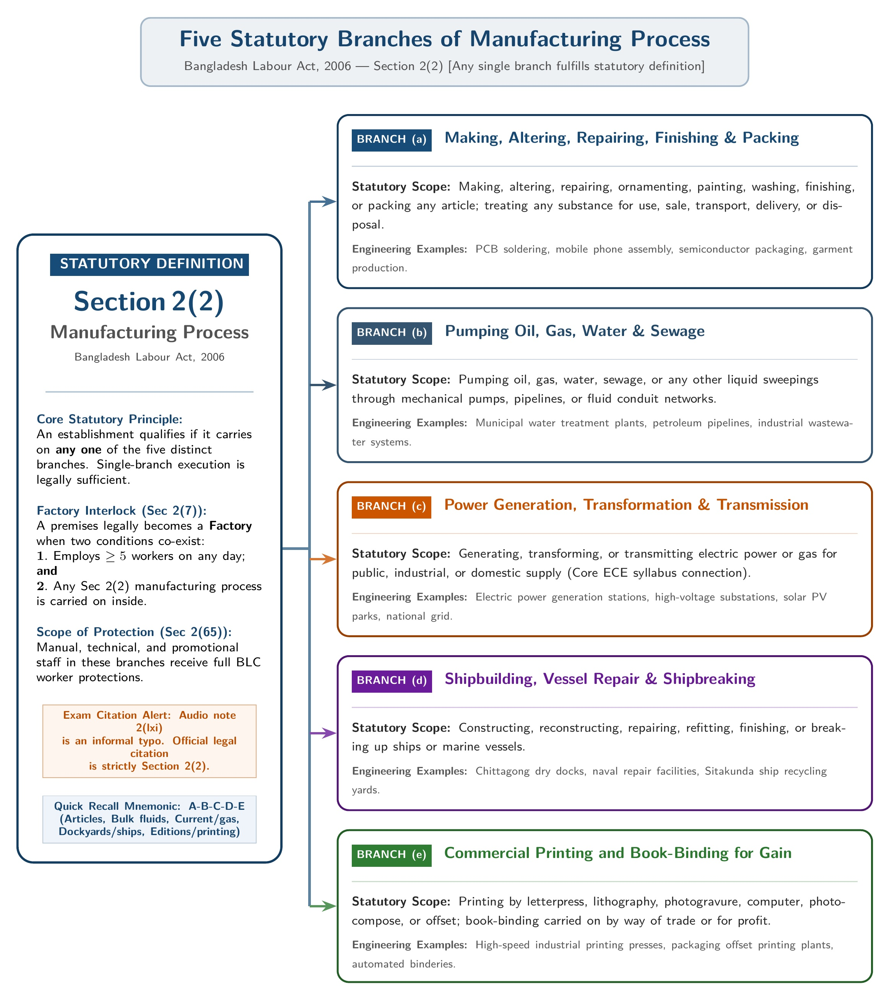

[← Previous: L04.2: Doctrine of Frustration and Case Studies](L04.2_Doctrine_of_Frustration_and_Case_Studies.md) | [🏠 Index](00_Index.md) | [📐 Master Sheet](99_Master_Formula_and_Statutory_Sheet.md) | [Next: L05.2: Adolescent Working Hours (Section 41) →](L05.2_Adolescent_Working_Hours_Sec_41.md)

---

# L05.1: BLC Core Definitions and Age Classes

> [!info] ⚡ Exam Snapshot
> - **Section & Priority:** Section A · SI Sir (Shoaib Islam) · 🔴 Essential Theory Lock
> - **PYQs Covered:** 2023 Final Q.1(a) (02m), Shoaib Sir Narrowed Chapter 3 Target
> - **Scoring Rule:** State exact statutory sections (`Sec 2(7)`, `Sec 2(65)`, `Sec 2(2)`, `Sec 2(63)`, `Sec 2(8)`, `Sec 2(36)`), the 5-worker threshold, and the managerial exclusion for 2/2 marks.

---

## 📌 1. Verbatim Definitions (For 2-Mark Questions)

> **Factory [Sec 2(7)]:** "factory means any precincts or premises where five or more workers ordinarily work on any day of the year and in any part of which a manufacturing process is carried on, but does not include a mine;" *(The Bangladesh Labour Act, 2006)*

*Plain meaning:* A factory is any physical premises where 5 or more workers are employed on any single day of the year carrying on a manufacturing process, expressly excluding mines.

> **Worker [Sec 2(65)]:** "worker means any person including an apprentice employed in any establishment or industry, either directly or through a contractor, by whatever name he is called, to do any skilled, unskilled, manual, technical, trade promotional or clerical work for hire or reward, whether the terms of employment are expressed or implied, but does not include a person employed mainly in a managerial, administrative or supervisory capacity;" *(The Bangladesh Labour Act, 2006)*

*Plain meaning:* A worker is any individual (including an apprentice) employed directly or via a contractor to perform skilled, unskilled, manual, technical, trade promotional, or clerical duties in exchange for wages, strictly excluding managerial, administrative, and supervisory personnel.

> **Manufacturing Process [Sec 2(2)]:** "manufacturing process means any of the following processes, namely: making, altering, repairing, ornamenting, painting, washing, finishing, packing or treating any articles; pumping oil, gas, or water; generating or transmitting power; ship building or breaking; or printing." *(The Bangladesh Labour Act, 2006)*

*Plain meaning:* Any industrial operation that makes, alters, repairs, or packs articles, pumps fluids, generates or transmits electric power or gas, builds or breaks ships, or prints materials for trade.

> **Child [Sec 2(63)]:** "child means a person who has not completed 14th (fourteenth) years of age;" *(The Bangladesh Labour Act, 2006)*

*Plain meaning:* Any individual under 14 years of age. Employment in factories is strictly prohibited by law.

> **Adolescent [Sec 2(8)]:** "adolescent means a person who has completed fourteenth year but has not completed eighteenth year of age;" *(The Bangladesh Labour Act, 2006)*

*Plain meaning:* A young person aged 14 to under 18 years. Permitted to work in a factory only upon obtaining a certified fitness certificate, and subject to reduced daily working hours.

> **Adult [Sec 2(36)]:** "adult means a person who has completed eighteenth year of age;" *(The Bangladesh Labour Act, 2006)*

*Plain meaning:* Any individual who has reached 18 years of age and is legally eligible to perform full standard working hours.

> **Minor [General Law / Majority Act, 1875]:** "Minor means a person who has not completed eighteenth year of age."

*Plain meaning:* An umbrella legal designation for any person under 18 years of age, covering both children and adolescents together.

---

## ⚡ 2. Core Exam Blocks (Write Directly in Exam)

### Scope and Objectives of BLC 2006 (Act XLII of 2006)

The Bangladesh Labour Act, 2006 was enacted on 11 October 2006 as Act No. XLII of 2006. It consolidated and repealed 25 separate historical labour enactments into a single modern code.

1. **Territorial and Sectoral Scope [Sec 1(3)]:**
   - Extends across the entire territory of Bangladesh.
   - Applies to all factories, commercial establishments, transport services (road, rail, water, and air), plantations, docks, construction sites, and agricultural farms employing $\ge 5$ workers.

2. **Statutory Exclusions [Sec 1(4)]:**
   - Government offices and civil servants.
   - Security printing presses and defense installations (ordnance factories).
   - Non-profit charitable homes for the sick, aged, or orphans.
   - Non-profit schools, colleges, and training institutes.
   - Non-profit hostels and hospitals.
   - Domestic household servants and agricultural farms with $< 5$ workers.

3. **Five Core Statutory Objectives:**
   - *Consolidation:* Unify 25 fragmented colonial and post-colonial enactments into a single transparent code.
   - *Employment Terms:* Regulate mandatory appointment letters, probation periods, service records, and fair termination procedures (Chapter II).
   - *Occupational Safety & Health:* Enforce clean working spaces, machine guarding, and mandatory fire precautions (Chapters V, VI, VII).
   - *Worker Welfare & Rights:* Guarantee rest intervals, canteens, rest shelters, crèches, and paid maternity benefits (Chapters IV, VIII, IX).
   - *Industrial Peace:* Establish an orderly legal mechanism for trade unions, collective bargaining agents (CBA), conciliation, and Labour Courts (Chapters XIII, XIV).

### The Factory Test and Boundary Equation

To qualify as a statutory factory under Section 2(7), an establishment must satisfy three positive criteria and satisfy one negative condition:

$$
\text{Factory} = \text{Defined Premises} + \ge 5\text{ Workers} + \text{Manufacturing Process} - \text{Mines}
$$

- *Threshold Rule:* Exactly 5 or more workers ordinarily working on any single day of the year.
- *ECE Boundary Application:*
  - 4 technicians assembling printed circuit boards in an office: Not a factory ($< 5$ workers).
  - 6 technicians soldering IoT devices in a workshop: Qualifies as a factory ($\ge 5$ workers + active manufacturing process).
  - 20 software coders in an IT center: Not a factory because software programming lacks a physical manufacturing process under Section 2(2); it is classified as a commercial establishment.
  - Coal or mineral mine with 200 workers: Not a factory because Section 2(7) explicitly excludes mines.

### The Six Worker Elements and Managerial Exclusion

Under Section 2(65), an individual must satisfy six statutory elements to qualify as a worker:

1. **Includes Apprentices:** Trainees and apprentices are legally classified as workers.
2. **Workplace:** Employed in an establishment or industry.
3. **Hiring Method:** Employed directly by the principal employer or through an outside contractor.
4. **Permitted Roles:** Engaged in skilled, unskilled, manual, technical, trade promotional, or clerical duties.
5. **Reward:** Works for hire or reward (statutory wages).
6. **Employment Form:** Terms of employment may be express (written letter) or implied.

> [!important] The Managerial Exclusion Rule
> The statutory definition strictly excludes any person employed mainly in a **managerial**, **administrative**, or **supervisory** capacity. These personnel exercise authority on behalf of the employer and direct subordinates. Consequently, they do not receive statutory worker protections, overtime benefits, or trade union voting rights.

### The Five Branches of Manufacturing Process [Sec 2(2)]

*Figure 5.1: Five Statutory Branches of Manufacturing Process under BLC 2006 [Sec 2(2)].*

1. **Making and Treating Articles [Sec 2(2)(a)]:**
   - Making, altering, repairing, ornamenting, painting, washing, finishing, or packing any article.
   - Treating any substance for use, sale, transport, delivery, or disposal (e.g. assembling electronics, soldering circuit boards, sewing garments, or packaging semiconductor chips).

2. **Pumping Operations [Sec 2(2)(b)]:**
   - Pumping oil, gas, water, sewage, or any liquid sweepings (e.g. municipal water treatment and oil pipeline stations).

3. **Power Generation and Transmission [Sec 2(2)(c)]:**
   - Generating, transforming, or transmitting electric power or gas (e.g. electrical substations, generation plants, and solar installations).

4. **Shipbuilding and Recycling [Sec 2(2)(d)]:**
   - Constructing, reconstructing, repairing, refitting, finishing, or breaking up ships or marine vessels.

5. **Commercial Printing [Sec 2(2)(e)]:**
   - Printing by letterpress, lithography, photogravure, computer, or offset, including book-binding carried on for trade or business gain.

> [!tip] Citation Alert: Section 2(2) vs Section 2(lxi)
> Informal class handouts occasionally cite Section 2(lxi). That reference stems from an outdated colonial draft misprint. The verified statutory section in the official Bangladesh Labour Act, 2006 is **Section 2(2)**. Always cite Section 2(2) on your exam script.

### Statutory Age Categories of Workers

| Legal Category | Statutory Section | Exact Age Span | Factory Employment Status | Medical Fitness Certificate? | Statutory Working Hours Rule |
| :--- | :--- | :---: | :--- | :---: | :--- |
| **Child** | `Sec 2(63)` | Under 14 ($< 14$) | **Strictly Prohibited** (`Sec 34(1)`). Light work permitted at 12–14 (`Sec 44`). | No (Cannot work) | Zero factory hours permitted. |
| **Adolescent** | `Sec 2(8)` | 14 to under 18 ($14 \le \text{age} < 18$) | **Permitted with restrictions** | **Yes** (`Sec 37`, valid 12 months) | Max 5 hours/day, 30 hours/week in factory (`Sec 41`). |
| **Adult** | `Sec 2(36)` | 18 and older ($\ge 18$) | **Fully Permitted** | No | 8 hours/day, 48 hours/week standard (`Sec 100, 102`). |
| **Minor** | Majority Act 1875 | Under 18 ($< 18$) | Umbrella legal classification | Follows specific age category | Governed by child or adolescent rules depending on age. |

> [!tip] Memory Hook: Statutory Age Ladder
> - **Under 14 (Child):** Absolute factory ban. Mandatory focus on education.
> - **14 to under 18 (Adolescent):** Doctor fitness certificate required; working hours capped at 5 hours daily.
> - **18 and Above (Adult):** Full legal capacity; standard 8-hour workday.

---

## 🎯 3. PYQ & Target Answer Key

### 2023 Final Q.1(a): Define Factory and Worker (02 Marks)

**Question:**  
Define factory and worker according to Bangladesh labor code 2006. *(2023 Final Q.1(a) · 02 Marks)*

**Exam Writing Plan:**

1. **Factory Definition:** Cite **Section 2(7)** and quote the verbatim definition emphasizing: (a) defined premises, (b) **5 or more workers** on any day of the year, (c) active manufacturing process, and (d) express exclusion of mines.
2. **Factory Formula:** Write the statutory equation: $\text{Factory} = \text{Premises} + \ge 5\text{ Workers} + \text{Manufacturing Process} - \text{Mines}$.
3. **Worker Definition:** Cite **Section 2(65)** and quote the verbatim definition highlighting: (a) inclusion of apprentices, (b) direct or contractor employment, and (c) manual, technical, promotional, or clerical duties.
4. **Managerial Exclusion:** Conclude with the mandatory statutory exclusion: Section 2(65) strictly excludes persons employed mainly in a managerial, administrative, or supervisory capacity.

---

### Target Question: Scope and Objectives of BLC 2006 (02 Marks)

**Question:**  
What is the Bangladesh Labour Code, 2006? State its scope and main objectives. *(Shoaib Sir Narrowed Blueprint · 02 Marks)*

**Exam Writing Plan:**

1. **Statutory Identity:** Identify the statute as **Act No. XLII of 2006**, enacted on 11 October 2006, which consolidated and repealed 25 historical, fragmented labour enactments.
2. **Territorial and Sectoral Scope:** Cite **Section 1(3)** (applies to all of Bangladesh, including factories, commercial establishments, transport, and farms with $\ge 5$ workers) and note **Section 1(4)** exclusions (government offices, military installations, charitable institutions).
3. **Five Core Objectives:** Enumerate the 5 statutory pillars from Section 2: (1) statutory consolidation, (2) employment regulation (Chapter II), (3) occupational health and safety (Chapters V–VII), (4) worker welfare and maternity protection (Chapters IV, VIII), and (5) industrial dispute resolution through CBA and Labour Courts (Chapters XIII–XIV).

---

### Target Question: Manufacturing Process Definition (02 Marks)

**Question:**  
Define "Manufacturing Process" under Section 2(2) of the Bangladesh Labour Act, 2006. *(Shoaib Sir Narrowed Blueprint · 02 Marks)*

**Exam Writing Plan:**

1. **Statutory Citation:** Explicitly cite **Section 2(2)** (clarifying that Section 2(lxi) is an obsolete lecture draft typo).
2. **Five Statutory Branches:** State the 5 distinct operations from Section 2:
   - Making, altering, repairing, or packing articles (`Sec 2(2)(a)`).
   - Pumping oil, gas, water, or sewage (`Sec 2(2)(b)`).
   - Generating, transforming, or transmitting electric power or gas (`Sec 2(2)(c)`).
   - Shipbuilding, repairing, or vessel breaking (`Sec 2(2)(d)`).
   - Commercial printing and book-binding (`Sec 2(2)(e)`).
3. **ECE Engineering Relevance:** Conclude with a 1-sentence note that electrical power transmission and circuit assembly fall squarely under Sections 2(2)(a) and 2(2)(c).

---

### Target Question: Statutory Age Categories (02 Marks)

**Question:**  
Define "Child", "Adolescent", "Adult", and "Minor" according to the Bangladesh Labour Act, 2006. *(Shoaib Sir Narrowed Blueprint · 02 Marks)*

**Exam Writing Plan:**

1. **Child [Sec 2(63)]:** State the age cutoff ($< 14$ years) and the absolute statutory ban on factory employment under Section 34(1).
2. **Adolescent [Sec 2(8)]:** State the age range ($14 \le \text{age} < 18$ years), noting the dual prerequisites of a medical fitness certificate (`Sec 37`) and restricted working hours (`Sec 41`).
3. **Adult [Sec 2(36)]:** State the age cutoff ($\ge 18$ years) entitled to full standard working hours under Section 100.
4. **Minor [General Law / Majority Act, 1875]:** Define as any person under 18 years ($< 18$ years), acting as the legal umbrella category for both children and adolescents.
5. **Summary Presentation:** Reproduce the 4-row statutory age table from Section 2 for full visual marks.

---

> [!warning] ⚠️ Examiner Traps
> - **Threshold Trap:** A factory requires **5 or more workers** on any day of the year. Never write 10 or 20 workers.
> - **The Mine Exclusion:** Omitting *"does not include a mine"* from Section 2(7) costs half a mark immediately.
> - **The Managerial Exclusion:** Always state that Section 2(65) strictly excludes managerial, administrative, and supervisory staff.
> - **Section 2(2) vs. 2(lxi):** Write **Section 2(2)** for manufacturing process. Section 2(lxi) is an outdated lecture draft misprint.

---

[← Previous: L04.2: Doctrine of Frustration and Case Studies](L04.2_Doctrine_of_Frustration_and_Case_Studies.md) | [🏠 Index](00_Index.md) | [📐 Master Sheet](99_Master_Formula_and_Statutory_Sheet.md) | [Next: L05.2: Adolescent Working Hours (Section 41) →](L05.2_Adolescent_Working_Hours_Sec_41.md)
