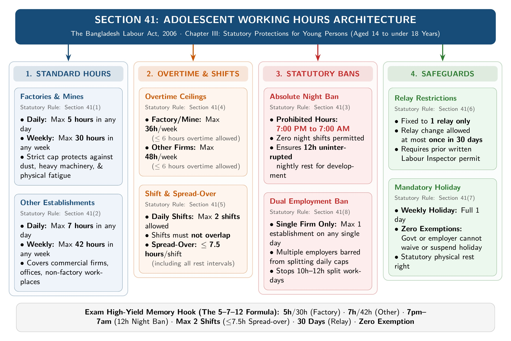

[← Previous: L05.1: BLC Core Definitions and Age Classes](L05.1_BLC_Core_Definitions_and_Age_Classes.md) | [🏠 Index](00_Index.md) | [📐 Master Sheet](99_Master_Formula_and_Statutory_Sheet.md) | [Next: L05.3: Applied Factory Compliance and Adult Hours →](L05.3_Applied_Factory_Compliance_and_Adult_Hours.md)

---

# L05.2: Adolescent Working Hours and Statutory Rules (Section 41)

> [!info] ⚡ Exam Snapshot
> - **Section & Priority:** Section A · Shoaib Islam Sir · 🔴 Essential | **Read Time:** ~4 mins
> - **PYQs Covered:** 2023 Final Q.1(b) (04m), Shoaib Sir Narrowed Chapter 3 Lock
> - **Scoring Rule:** State all 8 Section 41 subsections with exact hour caps (5h/30h vs 7h/42h), night ban, and shift rules.

---

## 📌 1. Verbatim Definitions (For 2-Mark Questions)

> **Adolescent [`Sec 2(8)`]:** "Adolescent means a person who has completed fourteen years but has not completed eighteen years of age." [The Bangladesh Labour Act, 2006]
- *Plain meaning:* A young person aged 14 to under 18 years permitted to work under statutory limits.

> **Child [`Sec 2(63)`]:** "Child means a person who has not completed fourteen years of age." [The Bangladesh Labour Act, 2006]
- *Plain meaning:* A person under 14 years barred from industrial labour (light work permitted from 12 under Section 44).

---

## ⚡ 2. Core Exam Blocks (Write Directly in Exam)

### Visual Architecture of Section 41

*Figure 1: Comprehensive Section 41 Adolescent Working Hours and Restrictions Architecture (Source: BLC 2006).*

---

### Working Hours: Factory/Mine vs Other Establishments

| Statutory Provision | Factory / Mine (`Sec 41`) | Other Establishments (`Sec 41`) |
| :--- | :--- | :--- |
| **Daily Work Cap** | Max **5 hours** | Max **7 hours** |
| **Weekly Work Cap** | Max **30 hours** | Max **42 hours** |
| **Weekly Overtime Cap** | Max **36 hours** total (max 6h OT) | Max **48 hours** total (max 6h OT) |
| **Night Work Window** | Prohibited (7:00 PM to 7:00 AM) | Prohibited (7:00 PM to 7:00 AM) |
| **Shifts Allowed** | Max 2 shifts (non-overlapping) | Max 2 shifts (non-overlapping) |
| **Shift Spread-Over** | Max 7.5 hours per shift | Max 7.5 hours per shift |
| **Weekly Holiday** | Mandatory (zero exemptions) | Mandatory (zero exemptions) |
| **Dual Employment** | Prohibited on same day | Prohibited on same day |

---

### Complete Section 41 Statutory Subsections (1 to 8)

1. **Factory and Mine Limits [Sec 41(1)]:** Max 5 hours daily and 30 hours weekly in any factory or mine.
2. **Other Establishment Limits [Sec 41(2)]:** Work cannot exceed 7 hours daily and 42 hours weekly in non-factory places.
3. **Absolute Night Work Ban [Sec 41(3)]:** Work is prohibited between 7:00 PM and 7:00 AM (12-hour mandatory night rest).
4. **Weekly Overtime Ceilings [Sec 41(4)]:** Total weekly hours with overtime cannot exceed 36 hours (factories) or 48 hours (other places).
5. **Shift and Spread-Over Caps [Sec 41(5)]:** Max 2 shifts without overlap. Spread-over cannot exceed 7.5 hours per shift.
6. **Relay Restrictions [Sec 41(6)]:** Work in only 1 relay. Relay can change once in 30 days with Inspector written permit.
7. **Mandatory Weekly Holiday [Sec 41(7)]:** Full weekly holiday applies under Section 103. Zero exemptions or suspensions allowed.
8. **Dual Employment Ban [Sec 41(8)]:** Banned from working in more than one establishment on the same day.

> [!tip] Memory Hook: The 5-7-12 Rule for Section 41
> - **5 / 30 / 36:** Factory caps (5h daily, 30h weekly, 36h with overtime).
> - **7 / 42 / 48:** Commercial caps (7h daily, 42h weekly, 48h with overtime).
> - **7 to 7:** 12-hour night ban (no work between 7:00 PM and 7:00 AM).
> - **2 & 7.5:** Max 2 shifts; shift spread-over $\le 7.5\text{ hours}$.
> - **30 Days:** Relay changes limited to once every 30 days.
> - **Zero Exemptions:** Weekly holiday cannot be waived.
> - **Single Job:** Never work in two establishments on the same day.

---

### Other Statutory Rules for Young Persons (Sections 34 to 44)

1. **Child Labour Ban [Sec 34(1), 35]:** No child under 14 may work. Agreements pledging child labour are void.
2. **Fitness Certificate & Token [Sec 34(2), 37]:** Requires valid medical fitness certificate (valid 12 months, employer-paid) and reference token.
3. **Moving Machinery Ban [Sec 39(3)]:** Adolescents cannot clean, lubricate, or adjust machinery while in motion.
4. **Dangerous Machines [Sec 40]:** Permitted only after safety instruction, practical training, or under experienced supervision.
5. **Underground Ban & Light Work [Sec 42, 44]:** Underground work is banned (`Sec 42`). Children aged 12 to 14 may do light schooling-safe work (`Sec 44`).

---

## 🎯 3. PYQ & Target Answer Key

### 2023 Final Q.1(b) (04 Marks)
**Question:** Briefly discuss rules regarding the employment of children and adolescent according to Bangladesh Labor code 2006.

**Answer Blueprint:**
- **Child Rules:** State absolute ban under 14 (`Sec 34(1)`), pledge void (`Sec 35`), and light work at 12 (`Sec 44`).
- **Fitness Preconditions:** Cite medical certificate (`Sec 37`, 12 months validity, employer-paid) and work token (`Sec 34(2)`).
- **Working Hours:** State Section 41 limits: 5h/30h factory vs 7h/42h other, night ban, and mandatory holiday.
- **Safety Prohibitions:** Cite moving parts ban (`Sec 39(3)`), dangerous machines training (`Sec 40`), and underground ban (`Sec 42`).

---

### Shoaib Sir Standalone Target / Model Exam (04 Marks)
**Question:** State the statutory rules regarding working hours for adolescent workers under Section 41 of the Bangladesh Labour Act, 2006.

**Answer Blueprint:**
- **Step 1:** Write the 8 numbered subsections directly from §2 (`Sec 41(1)` to `Sec 41(8)`).
- **Step 2:** Reproduce the comparison table showing Factory/Mine (5h/30h/36h) vs Other Establishments (7h/42h/48h).
- **Step 3:** Highlight non-negotiable clauses: night ban (`Sec 41(3)`), shift caps (`Sec 41(5)`), and zero holiday exemption (`Sec 41(7)`).

---

> [!warning] ⚠️ Examiner Traps
> - **Factory vs Commercial Caps:** Confusing 5h/30h/36h with 7h/42h/48h loses full marks immediately.
> - **Night Window Difference:** Adolescent ban is 7 PM to 7 AM (12h), unlike adult female 10 PM to 6 AM.
> - **Overtime Limit:** Overtime is strictly capped at 6 hours per week (36h factory, 48h elsewhere).
> - **Structural Rules:** Must state shift caps (max 2, $\le 7.5\text{h}$), 30-day relay rules, and single-job ban.

---

[← Previous: L05.1: BLC Core Definitions and Age Classes](L05.1_BLC_Core_Definitions_and_Age_Classes.md) | [🏠 Index](00_Index.md) | [📐 Master Sheet](99_Master_Formula_and_Statutory_Sheet.md) | [Next: L05.3: Applied Factory Compliance and Adult Hours →](L05.3_Applied_Factory_Compliance_and_Adult_Hours.md)
