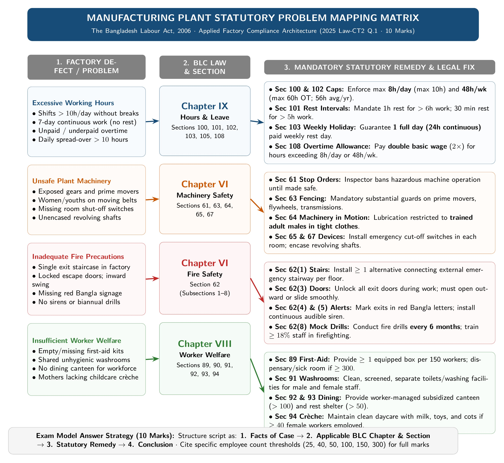

[← Previous: L05.2: Adolescent Working Hours (Section 41)](L05.2_Adolescent_Working_Hours_Sec_41.md) | [🏠 Index](00_Index.md) | [📐 Master Sheet](99_Master_Formula_and_Statutory_Sheet.md) | [Next: L06.1: Maternity Benefits (Sections 45 to 50) →](L06.1_Maternity_Benefits_Sec_45_to_50.md)

---

# L05.3: Applied Factory Compliance and Adult Hours

> [!info] ⚡ Exam Snapshot
> - **Course Component:** Section A (CO1 · Legal Issues · Shoaib Islam Sir)
> - **Priority & Exam Frequency:** 🔴 Essential · 2025 Law-CT2 Q.1 (10 Marks), 2023 Final Q.1(c) (4 Marks), Model Adult Hours (4 Marks)
> - **Core Requirement:** Structure multi-issue audits into 4 distinct pillars (Hours, Machinery, Fire, Welfare) citing exact sections and worker thresholds.

---

## 📌 1. Verbatim Definitions & Formula (For 2-Mark Questions)

> **Adult [Section 2(36)]:** "Adult means a person who has completed eighteen years of age." *(The Bangladesh Labour Act, 2006)*

*Plain meaning:* An adult is a worker who is at least 18 years old. Adults can work standard full shifts, overtime, and night shifts under legal rules.

> **Overtime Allowance [Section 108]:** "Where a worker works in an establishment on any day or week for more than the hours fixed under this Act, he shall, in respect of overtime work, be entitled to allowance at the rate of twice his ordinary rate of basic wage and dearness allowance and ad-hoc or interim pay, if any." *(The Bangladesh Labour Act, 2006)*

$$
\text{Overtime Wage Rate} = 2 \times (\text{Basic Wage} + \text{Dearness Allowance} + \text{Ad-hoc Pay})
$$

*Plain meaning:* If an employee works extra hours past standard limits, the employer must pay double their normal rate. This double rate applies to basic pay, dearness allowance, and ad-hoc pay. It leaves out allowances like house rent, medical, and transport.

---

## ⚡ 2. Core Exam Blocks (Write Directly in Exam)

### Summary Table of Adult Working Hours (Sections 100 to 110)

| Statutory Provision | Section | Standard Rule | Overtime or Special Condition |
| :--- | :--- | :--- | :--- |
| **Daily Hours** | `Sec 100` | Max 8 hours in any day | Can extend up to 10 hours daily with overtime pay (`Sec 108`) |
| **Rest Intervals** | `Sec 101` | 1 hour rest for $>6$ hours work; 30 minutes rest for $>5$ hours work | Continuous work without rest breaks is banned |
| **Weekly Hours** | `Sec 102` | Max 48 hours in any week | Overtime allows up to 60 hours/week; yearly average must stay under 56 hours/week |
| **Weekly Holiday** | `Sec 103` | 1 full paid day (24 straight hours) for factories; 1.5 days for shops | Mandatory paid rest; zero pay deductions allowed |
| **Compensatory Rest** | `Sec 104` | Equal number of compensatory rest days | Granted as soon as possible if standard weekly rest was missed |
| **Spread-Over** | `Sec 105` | Max 10 hours in any day | Work time plus rest breaks cannot exceed 10 hours daily (11.5 hours in special cases) |
| **Night Shift Hours** | `Sec 106` | Shift extending past midnight | Holiday equals 24 hours from shift end; post-midnight hours count to previous day |
| **Overtime Wage Rate** | `Sec 108` | Double the ordinary basic wage rate | Formula: $2 \times (\text{Basic Wage} + \text{Dearness} + \text{Ad-hoc Pay})$ |
| **Women Night Work** | `Sec 109` | Prohibited between 10:00 PM and 6:00 AM | Night work requires the woman worker's explicit written consent |
| **Dual Employment** | `Sec 110` | Strictly banned on the same day | Worker cannot work in another workplace without an Inspector permit |

---

### Master Factory Compliance Architecture

*Figure 1: Manufacturing Plant Statutory Problem Mapping and Compliance Matrix (Source: BLC 2006).*

---

> [!tip] Memory Hook: Welfare Worker Threshold Ladder
> - **$> 25$ Workers:** Safety Record Book and Board (`Sec 90`).
> - **$\ge 40$ Female Workers:** Crèche for children under 6 years (`Sec 94`).
> - **$> 50$ Workers:** Rest room and lunch shelter (`Sec 93`); Safety Committee for $\ge 50$ (`Sec 90A`).
> - **$> 100$ Workers:** Subsidized canteen (`Sec 92`); Group insurance for $\ge 100$ permanent workers (`Sec 99`).
> - **150 Workers:** 1 first-aid box per 150 workers (`Sec 89(2)`).
> - **$\ge 300$ Workers:** Dedicated medical sick room and dispensary (`Sec 89(5)`).

---

> [!tip] Memory Hook: Machine Safety Rules (F-T-S-C)
> - **F:** Fencing moving parts of prime movers and transmission machines (`Sec 63`).
> - **T:** Trained adult male in Tight clothes on live machines (`Sec 64`).
> - **S:** Shut-off switches and belt-shifters in every workroom (`Sec 65`).
> - **C:** Casing of revolving shafts, bolts, and spur gears (`Sec 67`).

---

## 🎯 3. PYQ & Target Answer Key

### 2025 Law-CT2 Q.1 · Multi-Issue Manufacturing Audit (10 Marks)

**Question:**  
A manufacturing establishment has problems involving excessive working hours, unsafe machinery, inadequate fire protection, and insufficient welfare facilities. Analyze which provisions of the Bangladesh Labour Code apply to each problem.

**Full Answer:**

The **Bangladesh Labour Act, 2006 (BLC 2006)** sets clear, complete legal rules across four main areas to fix each problem:

#### Pillar 1: Excessive Working Hours (Chapter IX & Chapter III)

To resolve worker fatigue and excessive hours, the factory must enforce statutory limits:

1. **Daily and Weekly Hour Limits [Sections 100, 102]:**  
   Standard work is limited to **8 hours a day** (`Sec 100`).  
   With overtime, daily work can reach at most **10 hours**.  
   Standard weekly work is capped at **48 hours a week** (`Sec 102`).  
   With overtime, weekly work can reach up to **60 hours**.  
   However, the annual weekly average must not exceed **56 hours a week**.

2. **Rest Breaks and Spread-Over [Sections 101, 105]:**  
   Workers must get at least **1 hour of rest** for work over 6 hours (`Sec 101`).  
   They must get at least **30 minutes of rest** for work over 5 hours.  
   Continuous work without rest breaks is banned.  
   Total daily spread-over cannot exceed **10 hours a day** (`Sec 105`).  
   This includes all work periods and meal breaks combined.  
   In approved cases, spread-over may extend up to **11.5 hours**.

3. **Weekly Holidays and Overtime Pay [Sections 103, 108]:**  
   Factory workers must receive **one full paid day (24 straight hours)** of rest each week (`Sec 103`).  
   Employers cannot deduct any pay for this weekly holiday.  
   Any work past regular hours requires overtime pay at double the basic wage rate (`Sec 108`):

$$
\text{Overtime Wage Rate} = 2 \times (\text{Basic Wage} + \text{Dearness Allowance} + \text{Ad-hoc Pay})
$$

4. **Adolescent Working Hours [Section 41]:**  
   If the factory employs adolescents (aged 14 to under 18), special caps apply.  
   Their work is capped at **5 hours a day** and **30 hours a week** (max 36 hours with overtime).  
   Adolescents are strictly banned from night work between **7:00 PM and 7:00 AM**.

---

#### Pillar 2: Unsafe Machinery (Chapter VI: Safety)

The factory must eliminate mechanical hazards and protect workers from severe physical injury:

1. **Urgent Orders for Dangerous Machinery [Section 61]:**  
   If a machine or structure endangers human life, the Labour Inspector steps in.  
   The Inspector can issue a written order banning its operation until repairs are made.

2. **Fencing and Casing of Machinery [Sections 63, 67]:**  
   All moving parts of engines, flywheels, and transmission gears must be safely fenced (`Sec 63`).  
   These fences must be substantial guards kept in position while machines run.  
   Under Section 67, all revolving shafts, bolts, and gears must be completely encased.  
   This prevents workers' loose clothing from getting caught in machines.

3. **Work on Machinery in Motion [Section 64]:**  
   Only trained adult male workers in tight-fitting clothes may examine or lubricate running machines.  
   Their names must be entered in the factory register.  
   Women and adolescents are strictly banned from working near moving machine parts.

4. **Emergency Power Cut-Off Devices [Section 65]:**  
   Every workroom must have fast emergency power shut-off switches.  
   Belt-shifting devices must also be installed to move driving belts onto loose pulleys quickly.  
   This cuts machine power immediately during an accident.

5. **Safety Training for Dangerous Machines [Section 40]:**  
   No young or new worker can operate dangerous machines without proper training.  
   They must receive full instruction on hazards and complete practical operational training.  
   Otherwise, an experienced supervisor must guide them directly at all times.

---

#### Pillar 3: Inadequate Fire Protection (Chapter VI: Section 62)

The factory must put complete fire safety steps in place:

1. **Alternative Emergency Staircases and Exits [Section 62(1)]:**  
   Every floor must have at least one alternative emergency staircase.  
   This staircase must connect all floors safely.  
   The factory must also keep working fire-fighting equipment ready for immediate use.

2. **Exit Door Rules and Clear Walkways [Section 62(3), 62(6)]:**  
   Exit doors must never be locked while workers are inside the premises (`Sec 62(3)`).  
   All doors must open outwards toward the exit or slide open easily.  
   Corridors, walkways, and stairs must stay clear of raw materials and boxes (`Sec 62(6)`).

3. **Visual Signs and Warning Sirens [Section 62(4), 62(5)]:**  
   Every emergency exit door must be marked in clearly visible **red Bangla letters** (`Sec 62(4)`).  
   The sign must read *জরুরী নির্গমন পথ*.  
   The factory must also install an audible fire whistle or siren (`Sec 62(5)`).  
   It must be loud enough for every worker on site to hear clearly.

4. **Evacuation Training and Mock Fire Drills [Section 62(7), 62(8)]:**  
   If over 10 workers work above the ground floor, they must be trained in emergency evacuation (`Sec 62(7)`).  
   Factories with **50 or more workers** must hold mock fire drills (`Sec 62(8)`).  
   The original 2006 Act required drills **at least once a year**.  
   The 2013 Amendment requires drills **at least once every 6 months**, with 18% of staff trained.

---

#### Pillar 4: Insufficient Welfare Facilities (Chapter VIII: Welfare Measures)

The employer must provide statutory welfare amenities based on workforce size:

1. **First-Aid Boxes and Medical Dispensary [Section 89(2), Section 89(5)]:**  
   Provide at least one first-aid box for every 150 workers (`Sec 89(2)`).  
   A trained first-aider wearing an official badge must manage each box.  
   In factories with **300 or more workers**, provide a dedicated sick room and dispensary (`Sec 89(5)`).  
   This facility must have qualified medical doctors and nursing staff.

2. **Safety Record Book and Safety Committee [Section 90, Section 90A]:**  
   Maintain a safety record book in establishments employing more than **25 workers** (`Sec 90`).  
   Set up a joint worker-management Safety Committee in establishments with **50 or more workers** (`Sec 90A`).

3. **Washing Facilities and Rest Shelters [Sections 91, 93]:**  
   Provide clean and screened washrooms separated for male and female workers (`Sec 91`).  
   In factories with more than **50 workers**, provide clean rest and lunch rooms (`Sec 93`).  
   These rooms must supply potable drinking water.  
   If employing over 25 female workers, provide a separate screened rest area.

4. **Canteens and Child Crèches [Sections 92, 94]:**  
   Provide an affordable, subsidized canteen in factories employing more than **100 workers** (`Sec 92`).  
   A joint committee must manage the canteen.  
   Where **40 or more female workers** are employed, provide an on-site crèche (`Sec 94`).  
   It must care for children under 6 years, with cots, toys, and clean milk.

---

### 2023 Final Q.1(c) · Assessing Law Effectiveness for Safe and Fair Work (04 Marks)

**Question:**  
Assess the effectiveness of a specific Industrial Law in Promoting a safe and fair working environment for workers.

**Full Answer:**

The **Bangladesh Labour Act, 2006 (BLC 2006)** sets binding legal rules to build a safe and fair workplace:

#### 1. Major Statutory Strengths

1. **Workplace Physical Safety (Chapter VI):**  
   - Section 62 mandates fire exits, outward-opening doors, alarm sirens, and mock drills.  
   - Section 63 requires physical guards on moving machinery.  
   - These rules have cut fatal factory fires and industrial accidents significantly since 2013.

2. **Fair Working Hours and Fair Wages (Chapter IX):**  
   - Regular work is capped at 8 hours a day (`Sec 100`) and 48 hours a week (`Sec 102`).  
   - Section 108 mandates double pay for overtime work.  
   - These limits prevent physical burnout and stop unpaid worker exploitation.

3. **Protection for Women and Young Workers (Chapters III, IV, VIII):**  
   - Section 46 grants 16 weeks of fully paid maternity benefit.  
   - Section 94 requires on-site crèches for children under 6 in factories with 40 or more female workers.  
   - Section 41 strictly shields young adolescents from long hours and night shifts.

4. **Worker Voice and Dispute Settlement (Chapters XIII & XIV):**  
   - Section 176 protects workers' rights to form trade unions.  
   - Section 202 empowers Collective Bargaining Agents (CBAs) to negotiate directly with employers.  
   - This resolves disputes peacefully through negotiation, conciliation, or arbitration.

#### 2. Practical Enforcement Challenges

1. **Shortage of Factory Inspectors:**  
   - The Department of Inspection for Factories and Establishments (DIFE) lacks manpower.  
   - Too few inspectors cover thousands of industrial facilities, so routine audits remain rare.

2. **Unregulated Subcontracting Workshops:**  
   - Small subcontractor factories often operate in cramped commercial or residential buildings.  
   - Many operate informally and escape official safety monitoring.

3. **Low Statutory Fines:**  
   - Penalties under Chapter XIX are sometimes too low.  
   - Small fines fail to stop large factory owners from breaking working hour or safety laws.

**Conclusion:**  
The Bangladesh Labour Act, 2006 provides a strong legal foundation on paper.  
To make work truly safe in practice, Bangladesh needs more field inspectors, digital monitoring, and stricter penalties.

---

### Model Exam Question · Adult Working Hours and Overtime (04 Marks)

**Question:**  
State the statutory rules for adult working hours, rest intervals, weekly holidays, spread-over, and overtime under Chapter IX.

**Model Exam Solution:**

Chapter IX of the Bangladesh Labour Act, 2006 sets mandatory working hour protections for adult workers:

1. **Daily Working Hours [Section 100]:**  
   Standard daily work is capped at **8 hours a day**.  
   Daily work may extend up to **10 hours** with overtime pay.

2. **Intervals for Rest or Meals [Section 101]:**  
   Workers cannot work continuously without a rest break.  
   They must receive at least **1 hour of rest** for work exceeding 6 hours.  
   They must receive at least **30 minutes of rest** for work exceeding 5 hours.

3. **Weekly Working Hours [Section 102]:**  
   Standard weekly work is capped at **48 hours a week**.  
   Overtime work can extend this up to **60 hours a week**.  
   However, the annual weekly average must not exceed **56 hours a week**.

4. **Weekly Paid Holiday [Section 103]:**  
   Factory workers get **one full paid day (24 consecutive hours)** off each week.  
   Commercial shop workers get **1.5 days** off each week.  
   Employers cannot deduct any pay for these rest days.

5. **Daily Spread-Over Limits [Section 105]:**  
   Total spread-over cannot exceed **10 hours a day**.  
   This includes all working hours, rest breaks, and meal intervals combined.  
   In approved cases, it may extend up to **11.5 hours a day**.

6. **Overtime Pay [Section 108]:**  
   Any work past normal daily or weekly hours requires overtime pay.  
   Employers must pay twice the ordinary basic wage rate:

$$
\text{Overtime Wage Rate} = 2 \times (\text{Basic Wage Rate} + \text{Dearness Allowance} + \text{Ad-hoc Pay})
$$

---

> [!warning] ⚠️ Examiner Traps
> - **Incomplete Pillar Coverage:** In a 10-mark multi-issue audit, never discuss safety or hours alone. You must cover all four distinct pillars: Hours, Machinery, Fire, and Welfare.
> - **Fire Drill Dual Citation:** Cite both the original 2006 text and the 2013 Amendment. The 2006 text requires drills once a year (`Sec 62(8)`). The 2013 Amendment requires drills once every 6 months with 18% trained staff.
> - **Overtime Base Calculation:** Overtime only doubles basic wage, dearness allowance, and ad-hoc pay. It legally excludes house rent, medical allowance, and conveyance.
> - **Annual Average Weekly Cap:** Overtime can reach 60 hours in a single week. However, the annual weekly average cannot exceed 56 hours under Section 102.

---

[← Previous: L05.2: Adolescent Working Hours (Section 41)](L05.2_Adolescent_Working_Hours_Sec_41.md) | [🏠 Index](00_Index.md) | [📐 Master Sheet](99_Master_Formula_and_Statutory_Sheet.md) | [Next: L06.1: Maternity Benefits (Sections 45 to 50) →](L06.1_Maternity_Benefits_Sec_45_to_50.md)
