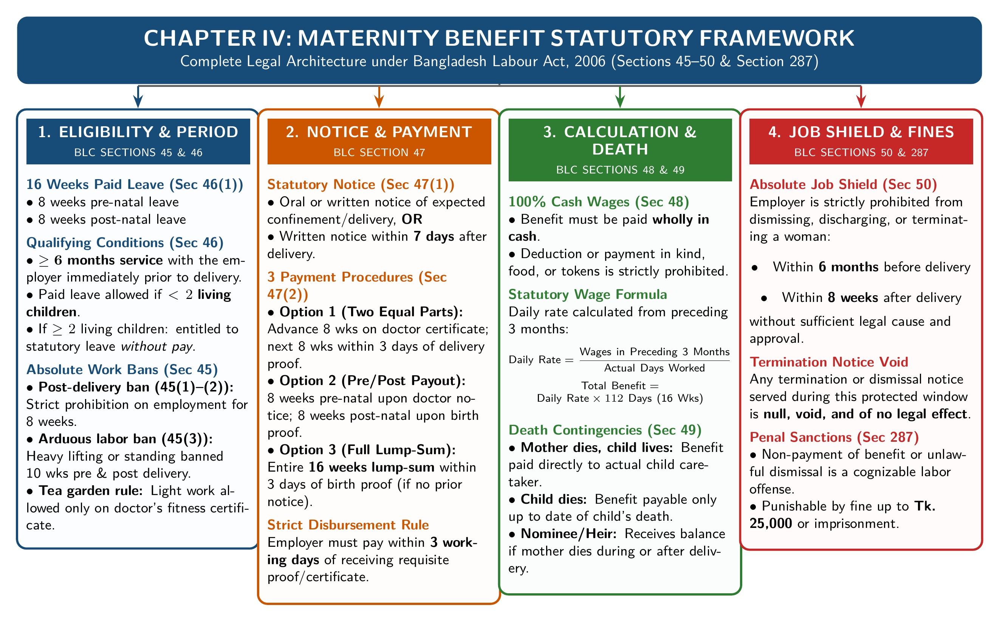

[← Previous: L05.3: Applied Factory Compliance and Adult Hours](L05.3_Applied_Factory_Compliance_and_Adult_Hours.md) | [🏠 Index](00_Index.md) | [📐 Master Sheet](99_Master_Formula_and_Statutory_Sheet.md) | [Next: L07.1: Fire Safety Precautions (Section 62) →](L07.1_Fire_Safety_Precautions_Sec_62.md)

---

# L06.1: Maternity Benefits (Sections 45 to 50)

> [!info] ⚡ Exam Snapshot
> - **Section & Priority:** Section A · SI Sir · 🔴 Essential Target (Shoaib Sir Lock) · **Read Time:** ~4 mins
> - **PYQs Covered:** Shoaib Sir #1 Chapter 3 Final Exam Target. This topic covers the full rules in Sections 45 to 50 and dismissal protection. It carried 0 marks in 2020–2024 finals, so it is a top target for this exam.
> - **Scoring Rule:** State exact section numbers (Sections 45 to 50). Mention the 16-week split (8 weeks before birth + 8 weeks after). State the 6-month work rule, the two-child limit, the 3 payout options, and the average daily wage formula.

---

## 📌 1. Verbatim Definitions (For 2-Mark Questions)

> **Maternity Benefit [Sec 46(1)]:** "Every woman worker shall be entitled to maternity benefit from her employer for the period of 8 weeks preceding the expected day of her delivery and 8 weeks immediately following the day of her delivery, and her employer shall be bound to give her this benefit." *(The Bangladesh Labour Act, 2006, Section 46(1))*

*Plain meaning:* A female worker gets 16 weeks of paid leave from her boss around childbirth. She gets 8 weeks before delivery and 8 weeks after, so she can rest safely without losing any pay.

> **Prohibition of Employment [Sec 45(1)]:** "No employer shall knowingly engage a woman in his establishment during the 8 weeks immediately following the day of her delivery." *(The Bangladesh Labour Act, 2006, Section 45(1))*

*Plain meaning:* An employer must never let a new mother work for 8 weeks after giving birth. Also, the mother is not allowed to work during this time. It gives her a mandatory break to rest and recover.

> **Payment wholly in Cash [Sec 48(1)]:** "The maternity benefit which is payable under this Act shall be paid at the rate of daily, weekly or monthly average wages... and such payment shall be made wholly in cash." *(The Bangladesh Labour Act, 2006, Section 48(1))*

*Plain meaning:* The employer must pay the full maternity money in real cash. They cannot use vouchers, tokens, company goods, or food items.

---

## ⚡ 2. Core Exam Blocks (Write Directly in Exam)

*Figure 6.1: Comprehensive Statutory Framework for Maternity Benefits under BLC Sections 45 to 50 (Source: Bangladesh Labour Act 2006, Chapter IV, Sections 45 to 50).*

### Statutory Rules: Sections 45 to 50

1. **Section 45 (Ban on Employing Women Workers):**
   - **Absolute Post-Delivery Ban [Sec 45(1)–(2)]:** An employer cannot employ any woman for 8 weeks after she gives birth. Also, the woman cannot work in any workplace during this time. Both sides must strictly obey this ban.
   - **Heavy Work Ban [Sec 45(3)]:** An employer cannot assign a woman to heavy physical work, long standing, or tasks that could harm her health. This ban applies if delivery is expected within 10 weeks. It also applies for 10 weeks after she gives birth.
   - **Tea Estate Exception [Sec 45(3) Proviso]:** A female worker in a tea estate may do certified light work if an approved doctor approves it. The employer must pay regular daily wages for this light work. This pay comes on top of her normal maternity benefit.

2. **Section 46 (Right to Maternity Benefit & Eligibility Tests):**
   - **Benefit Duration [Sec 46(1)]:** Every female worker has a legal right to 16 weeks of paid maternity leave. This covers 8 weeks before delivery and 8 weeks after. The employer is legally bound to pay this benefit.
   - **Qualifying Service Test [Sec 46(1) Proviso]:** The worker must work for the employer for at least 6 months before delivery. If she worked less than 6 months, she only gets unpaid leave. She receives zero cash maternity pay.
   - **Two-Child Limit [Sec 46(2)]:** A woman cannot receive cash maternity benefit if she already has 2 or more living children. In that case, she can only take ordinary leave, like casual or sick leave.

3. **Section 47 (Notice Procedure & Three Statutory Payment Options):**
   - **Pre-Natal Notice [Sec 47(1)]:** A pregnant worker can give verbal or written notice to her boss. She states that she expects delivery within 8 weeks and names a nominee. The boss must let her go on leave starting the next day.
   - **Post-Natal Notice [Sec 47(2)]:** If she did not give advance notice, she must notify her boss within 7 days after delivery. The boss must give her 8 weeks of leave starting from the delivery day.
   - **Option 1 (Split Installments):** The employer pays the first 8 weeks within 3 working days after she gives a doctor's certificate. The remaining 8 weeks are paid within 3 working days after she submits proof of birth.
   - **Option 2 (Two Post-Natal Installments):** The first 8 weeks are paid within 3 working days after submitting proof of birth. The second 8 weeks are paid within 8 weeks after submitting that proof.
   - **Option 3 (Single Lump Sum):** The boss pays all 16 weeks of benefit in one single cash payment. This payment is due within 3 working days after she submits proof of birth.
   - **Proof Deadline [Sec 47(5)]:** The mother must give official proof of birth within 3 months of delivery. Examples include a birth register certificate or a doctor's report.

4. **Section 48 (Amount and Calculation of Maternity Benefit):**
   - **Cash Mandate [Sec 48(1)]:** All maternity benefits must be paid fully in real cash. Employers cannot make deductions. They cannot give vouchers, coupons, or food instead of money.
   - **Average Daily Wage Formula [Sec 48(2)]:** Find the daily rate by dividing total wages earned in the past 3 months by actual days worked in that period:

$$
\text{Daily Average Wage} = \frac{\text{Total Wages Earned in Preceding 3 Months}}{\text{Total Days Actually Worked in That Period}}
$$

   - **Total Benefit Entitlement:** The leave lasts 16 weeks, which equals 112 calendar days. So the total cash payment is:

$$
\text{Total Maternity Benefit} = \text{Daily Average Wage} \times 112\text{ days}
$$

   - **Worked Numerical Example:** An electronics technician earns BDT 36,000 over 75 actual working days during the past 3 months:

$$
\text{Daily Average Wage} = \frac{\text{BDT } 36{,}000}{75\text{ days}} = \text{BDT } 480\text{ per day}
$$

$$
\text{Total Maternity Benefit} = \text{BDT } 480 \times 112\text{ days} = \text{BDT } 53{,}760
$$

   - The employer must pay the full sum of BDT 53,760 in real cash. Payment follows the option chosen by the worker under Section 47.

5. **Section 49 (Benefit Payment upon Death of Woman or Child):**
   - **Mother Dies at or After Delivery [Sec 49(1)]:** If the child lives, the boss pays the benefit to the person caring for the baby. If the baby also dies, the boss pays the mother's chosen nominee. If she named no nominee, it goes to her legal heirs.
   - **Mother Dies Before Delivery [Sec 49(2)]:** The employer only pays benefits earned up to the day of her death. This money is paid to her nominee or legal heirs.
   - **No Recovery of Advance Payments [Sec 49(2)]:** Suppose the boss paid advance maternity money before her death. If that advance exceeds what she earned up to that day, the boss cannot take the extra money back. The employer cannot recover it from her family or estate.

6. **Section 50 (Protection of Pregnant Workers Against Dismissal):**
   - **Protected Window:** The law protects the woman for 6 months before delivery and 8 weeks after delivery.
   - **Ban on Unfair Firing:** An employer cannot fire, dismiss, or terminate a female worker without sufficient cause during this protected window.
   - **Maternity Pay Remains Protected:** Suppose an employer fires her without sufficient cause during this time. That termination cannot take away her maternity rights. The employer must still pay her full maternity benefit in cash.

---

> [!tip] Memory Hook: Section 45 to 50 Statutory Ladder
> - **Section 45 (Work Ban):** Absolute 8-week dual post-delivery work ban. 10-week pre- and post-natal ban on heavy physical work.
> - **Section 46 (Right & Limits):** 16 weeks of paid leave (8 weeks before birth + 8 weeks after). Requires 6 months service. Capped at fewer than 2 living children.
> - **Section 47 (Notice & 3 Options):** Advance notice or 7-day notice after birth. Worker picks 1 of 3 payout options. Every payment is due within 3 working days.
> - **Section 48 (Cash Wages):** Past 3 months wages divided by actual days worked, multiplied by 112 days. 100% real cash.
> - **Section 49 (Death Rules):** Money goes to child caretaker, nominee, or legal heir. Employer cannot recover extra advance money.
> - **Section 50 (Dismissal Shield):** Complete protection against unfair firing from 6 months before delivery to 8 weeks after.

---

> [!tip] Memory Hook: The Power of 3s in Maternity Law
> - **3 Payment Options:** The worker chooses between split payments (Option 1), two post-natal installments (Option 2), or a single lump sum (Option 3).
> - **3 Working Days:** Boss must pay each installment within 3 working days after receiving medical proof or birth certificate.
> - **3 Months:** The mother has up to 3 months after delivery to submit official proof of birth.
> - **3 Preceding Months:** Average daily wage is calculated from total earnings over the 3 months before notice.

---

## 🎯 3. PYQ & Target Answer Key

### Target Question 1 · Work Ban Rules under Section 45 (03 Marks)

**Question:** Under what circumstances does the Bangladesh Labour Act, 2006 prohibit the employment of women workers before and after childbirth? State the statutory rules under Section 45.

**Exam Writing Plan:**

1. *Verbatim Statutory Basis:*
   - Cite Section 45(1) directly.
   - Explain the strict ban on work for 8 weeks after delivery.
   - Note that both the employer and the woman worker must obey this ban.

2. *Core Statutory Elements:*
   - Detail the 10-week ban on heavy physical work or long standing before and after delivery under Section 45(3).
   - Explain the tea estate exception under the Section 45(3) proviso. A doctor must certify light work, and the worker gets extra daily wages.

3. *Concluding Takeaway:*
   - Section 45 creates strict liability.
   - Commercial convenience or busy seasons can never excuse putting a new or expecting mother to work.

---

### Target Question 2 · Conditions for Maternity Benefit under Section 46 (04 Marks)

**Question:** Explain the conditions governing maternity benefit rights and employer liability under Section 46 of the Bangladesh Labour Act, 2006.

**Exam Writing Plan:**

1. *Verbatim Statutory Basis:*
   - Quote Section 46(1).
   - State the employer's duty to provide 16 weeks of paid leave (8 weeks before birth and 8 weeks after).

2. *Core Statutory Conditions:*
   - Explain the 6-month continuous service test under the Section 46(1) proviso.
   - Explain the two-child limit under Section 46(2).

3. *Summary Condition Table:*
   - Draw a clear 3-row condition table:
     - Benefit Duration: 16 weeks (8 weeks pre-natal + 8 weeks post-natal).
     - Qualifying Service: At least 6 months under the same employer.
     - Family Size: Fewer than 2 living children at delivery.

4. *Concluding Takeaway:*
   - Workers who fail the service or child test can still take ordinary unpaid or medical leave.
   - However, they lose the right to cash maternity benefits.

---

### Target Question 3 · Complete Maternity Framework under Chapter IV (05 Marks)

**Question:** Discuss the statutory rules regarding maternity welfare facilities and benefits under Chapter IV of the Bangladesh Labour Code, 2006.

**Exam Writing Plan:**

1. *Statutory Overview:*
   - Identify Chapter IV (Sections 45 to 50) as the complete maternity code of BLC 2006.
   - Cite Figure 6.1.

2. *Six-Step Section Breakdown:*
   - Section 45: 8-week post-delivery work ban and 10-week heavy work ban.
   - Section 46: 16-week paid leave entitlement, 6-month service rule, and two-child limit.
   - Section 47: Pre-natal/post-natal notice and 3 payout options.
   - Section 48: Daily average wage cash formula for 112 days.
   - Section 49: Dues paid to baby caretaker, nominee, or heirs on death.
   - Section 50: Complete dismissal shield from 6 months before delivery to 8 weeks after.

3. *Memory Hook Integration:*
   - Draw the 6-rung Section 45 to 50 Statutory Ladder to show structured mastery.

4. *Concluding Takeaway:*
   - Chapter IV sets a mandatory social security standard.
   - It protects maternal health and guarantees cash support during childbirth.

---

### Target Question 4 · Notice Procedure and Payment Options under Section 47 (04 Marks)

**Question:** Describe the procedure regarding notice and disbursement of maternity benefits under Section 47 of the Bangladesh Labour Act, 2006. State the three statutory options available for payment.

**Exam Writing Plan:**

1. *Notice Rules:*
   - Explain advance pre-natal notice under Section 47(1) (expected delivery within 8 weeks, naming nominee).
   - Explain post-natal notice under Section 47(2) (given within 7 days after delivery).

2. *Three Statutory Payout Options:*
   - Option 1: Split payments (first 8 weeks before delivery, remaining 8 weeks after birth proof).
   - Option 2: Two post-natal installments (first 8 weeks right after birth, second 8 weeks within next 8 weeks).
   - Option 3: Single lump sum (all 16 weeks paid at once after birth proof).

3. *Deadlines and Proof:*
   - Every payment must be made within 3 working days of receiving proof.
   - The mother has 3 months after delivery to submit official birth proof under Section 47(5).

4. *Concluding Takeaway:*
   - The worker decides which payment option to use.
   - The employer cannot force an option on her.

---

### Target Question 5 · Benefit Calculation and Numerical Application under Section 48 (03 Marks)

**Question:** Explain how the amount of maternity benefit is calculated under Section 48 of the Bangladesh Labour Act, 2006. Illustrate with a concise numerical example.

**Full Exam-Ready Solution:**

1. **Statutory Rule and Payment Method [Sec 48(1)–(2)]:**
   Section 48(1) requires that all maternity benefits must be paid fully in real cash. Employers cannot make deductions or give vouchers. Under Section 48(2), the benefit is based on the worker's average daily wage over the past 3 months:

$$
\text{Daily Average Wage} = \frac{\text{Total Wages Earned in Preceding 3 Months}}{\text{Total Days Actually Worked in That Period}}
$$

$$
\text{Total Maternity Benefit} = \text{Daily Average Wage} \times 112\text{ days}
$$

2. **Given Numbers:**
   - Preceding 3 months total earnings = $\text{BDT } 36{,}000$
   - Actual days worked in preceding 3 months = $75\text{ days}$
   - Statutory benefit duration = $16\text{ weeks} = 112\text{ calendar days}$

3. **Step-by-Step Calculation:**
   - *Step 1: Calculate Daily Average Wage:*

$$
\text{Daily Average Wage} = \frac{\text{BDT } 36{,}000}{75\text{ days}} = \text{BDT } 480\text{ per day}
$$

   - *Step 2: Calculate Total Benefit for 112 Days:*

$$
\text{Total Maternity Benefit} = \text{BDT } 480 \times 112\text{ days} = \text{BDT } 53{,}760
$$

4. **Legal Conclusion:**
   The employer must pay BDT 53,760 in real cash. Payments must follow the timeline selected by the worker under Section 47.

---

### Target Question 6 · Benefit Payment upon Death of Woman or Child under Section 49 (03 Marks)

**Question:** State the rules under Section 49 of the Bangladesh Labour Act, 2006 when a mother or newborn child dies.

**Exam Writing Plan:**

1. *Death at or After Childbirth [Sec 49(1)]:*
   - If the baby survives, pay the money to the person taking care of the baby.
   - If the baby also dies, pay the mother's chosen nominee or legal heirs.

2. *Death Prior to Childbirth [Sec 49(2)]:*
   - Employer liability stops on the day of her death.
   - Any maternity benefit earned up to that day goes to her nominee or legal heirs.

3. *No Recovery of Advance Payments:*
   - Suppose the boss paid advance money that exceeds what she earned before death.
   - The boss cannot legally recover or demand this extra money back.

4. *Concluding Takeaway:*
   - Section 49 ensures that earned maternity benefits never stay with the employer.

---

### Applied Case Study · Dismissal of Pregnant Worker under Section 50 (04 Marks)

**Question:** An employer dismisses a female quality inspector citing departmental restructuring. The dismissal notice was issued when she was six months pregnant, shortly after she informed management of her condition. The company refused to disburse maternity benefits, arguing that she was no longer on company payroll on her delivery date. Evaluate the legality of the employer's actions under Section 50 of the Bangladesh Labour Act, 2006.

**Solution (4-Step Legal Analysis):**

1. **Facts and Issues of the Case:**
   The company fired a female worker during her sixth month of pregnancy, claiming departmental restructuring. The boss refused to pay maternity benefits because she was not on the payroll on delivery day. The legal issue is whether this firing is valid under BLC 2006, and whether she still gets her maternity pay.

2. **Applicable Law and Section:**
   Section 50 (*Restrictions on termination of employment of a woman in certain cases*), read with Section 46 (*Right to maternity benefit*) of the Bangladesh Labour Act, 2006.

3. **Legal Analysis:**
   - Section 50 strictly forbids firing or dismissing any pregnant worker without sufficient cause. This protection lasts from 6 months before delivery until 8 weeks after delivery.
   - Routine office restructuring or reorganization is not a "sufficient cause" under the law.
   - Section 50 clearly states that an unfair dismissal notice within this window cannot take away her maternity rights.
   - She had completed over 6 months of continuous service under Section 46(1) and notified management. Therefore, her right to maternity benefits remains 100% valid and enforceable.

4. **Direct Conclusion:**
   The dismissal violates Section 50. It has no legal power to stop her maternity rights. The employer must pay her full 16-week maternity benefit in cash under Section 48.

---

> [!warning] ⚠️ Examiner Traps
> - **Leave Duration Trap:** The statutory duration is exactly 16 weeks (112 calendar days). It splits into 8 weeks before delivery and 8 weeks after. Never write 12 weeks.
> - **Qualifying Service Requirement:** To get cash benefits, she must have at least 6 months of continuous service with the employer before delivery.
> - **Two-Child Limit Trap:** Having 2 or more living children at delivery blocks cash maternity benefit under Section 46(2). She can only take ordinary leave.
> - **Payment Deadline:** Every installment under Section 47 must be paid within 3 working days after receiving the medical certificate or birth proof.

---

[← Previous: L05.3: Applied Factory Compliance and Adult Hours](L05.3_Applied_Factory_Compliance_and_Adult_Hours.md) | [🏠 Index](00_Index.md) | [📐 Master Sheet](99_Master_Formula_and_Statutory_Sheet.md) | [Next: L07.1: Fire Safety Precautions (Section 62) →](L07.1_Fire_Safety_Precautions_Sec_62.md)
