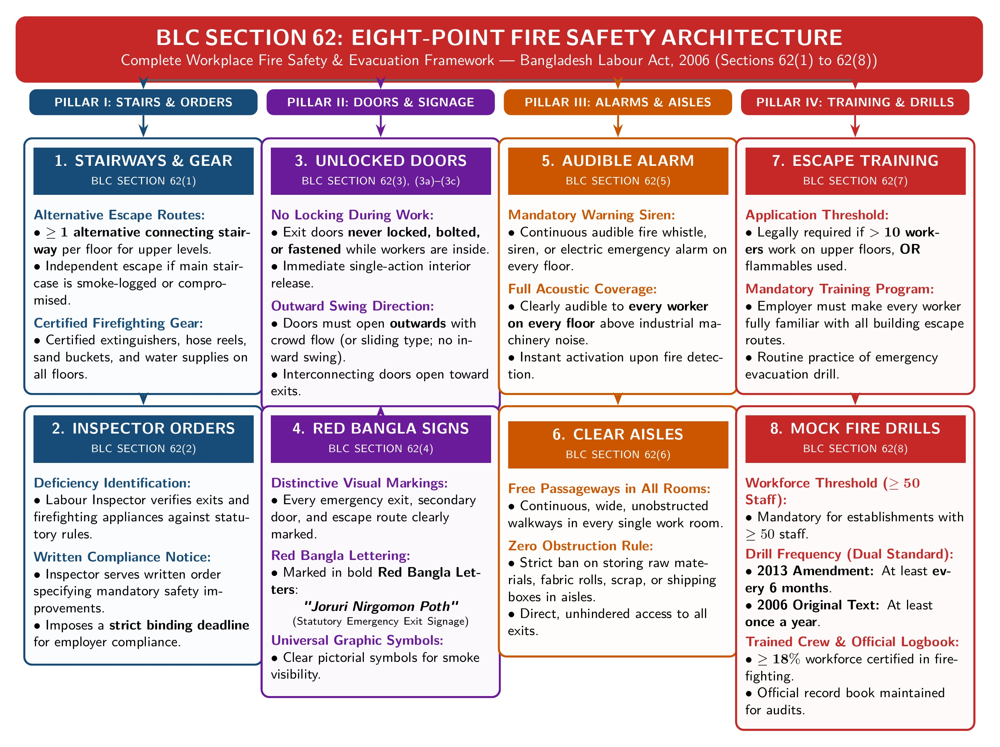

[← Previous: L06.1: Maternity Benefits (Sections 45 to 50)](L06.1_Maternity_Benefits_Sec_45_to_50.md) | [🏠 Index](00_Index.md) | [📐 Master Sheet](99_Master_Formula_and_Statutory_Sheet.md) | [Next: L07.2: Machinery Safety and Workplace Duties →](L07.2_Machinery_Safety_and_Workplace_Duties.md)

# L07.1: Fire Safety Precautions (Section 62)

> [!info] ⚡ Exam Snapshot
> - **Section & Priority:** Section A · SI Sir · 🔴 Essential Target (Shoaib Sir Lock) | **Read Time:** ~3 mins
> - **PYQs Covered:** 2023 Final Q.2(b) (04m), 2025 Law-CT2 Q.1 (Inadequate Fire Protection · 10m CT), SI Sir 2026 Exclusive Safety Lock (Note: 2024 Q.1(c) is a cross-file question on managerial skills in M02.2)
> - **Scoring Rule:** State all 8 subsections (`62(1)–(8)`), worker thresholds (>10 upstairs, $\ge 50$ for drills), unlocked outward doors, and both drill rules (yearly / 6-month).

## 📌 1. Verbatim Definitions (For 2-Mark Questions)

> **Precaution as to Fire [Sec 62(1)]:**
> "Every establishment shall be provided with such means of exit including at least one alternative staircase connecting with every floor at the time of fire and requisite number of fire fighting equipments in every floor as may be prescribed by rules." (The Bangladesh Labour Act, 2006, Section 62(1))
- *Plain meaning:* Every floor needs a secondary escape staircase and approved firefighting gear.

> **Unlocked Exit Door Rule [Sec 62(3)]:**
> "In every establishment the doors affording exit from any room shall not be locked or fastened so that they can be easily and immediately opened from inside while any person is within the room..." (The Bangladesh Labour Act, 2006, Section 62(3))
- *Plain meaning:* Room exits must stay unlocked from inside during work hours.

## ⚡ 2. Core Exam Blocks (Write Directly in Exam)

*Figure 7.1: Section 62 Eight-Point Workplace Fire Safety Architecture under BLC 2006 (Source: Bangladesh Labour Act 2006, Chapter VI, Section 62).*

### The 8 Subsections of Section 62

1. **Alternative Stairs & Appliances [Sec 62(1)]:** At least one alternative connecting staircase and certified fire appliances (extinguishers, hose reels) per floor.
2. **Inspector Orders [Sec 62(2)]:** Written compliance orders with fixed repair deadlines served for deficient exits or fire gear.
3. **Unlocked Outward Doors [Sec 62(3), (3a)–(3c)]:** Doors must never be locked during work; must open outward (or slide); connecting doors must lead toward nearest exit.
4. **Red Bangla Signage [Sec 62(4)]:** Exits clearly marked in red Bangla letters (*জরুরী নির্গমন পথ*) or universal emergency symbols.
5. **Audible Fire Alarm [Sec 62(5)]:** Audible warning whistle, siren, or electric bell heard across every floor.
6. **Free Passageways [Sec 62(6)]:** Wide, clear room aisles with zero clutter, giving unhindered access to all exits.
7. **Escape Training [Sec 62(7)]:** Mandatory where **$> 10$ workers** work upstairs or near flammables; covers evacuation routines.
8. **Mock Fire Drills [Sec 62(8)]:** Mandatory for **$\ge 50$ workers**. Cite both: original 2006 Act (*at least once a year*) and 2013 Amendment (*at least once every 6 months*). 18% workforce trained; record book maintained.

> [!tip] Memory Hook: S-I-D-R-A-P-T-M Subsection Sequence
> `S`tairways (`62(1)`) | `I`nspector (`62(2)`) | `D`oors unlocked (`62(3)`) | `R`ed signs (`62(4)`) | `A`larm (`62(5)`) | `P`assageways (`62(6)`) | `T`raining (`62(7)`) | `M`ock drills (`62(8)`).

> [!tip] Memory Hook: The 10 / 50 / 18% Threshold Ladder
> - **$> 10$ workers upstairs or near flammables [Sec 62(7)]:** Mandatory escape training.
> - **$\ge 50$ workers [Sec 62(8)]:** Mandatory mock fire drill every 6 months + record book.
> - **18% workforce:** Mandatory certified training in formal firefighting techniques under Labour Rules.

## 🎯 3. PYQ & Target Answer Key

### 2023 Final Q.2(b) · Workplace Safety Rules under BLC 2006 (04 Marks)
- **Question:** Briefly discuss worker safety rules in the workplace according to the Bangladesh Labor Code 2006.
- **Answer Blueprint:** Cite Chapter VI (`Sec 61–78A`): structural orders (`Sec 61`), fire precautions (`Sec 62`), fencing (`Sec 63`), running machinery (`Sec 64`), and PPE (`Sec 78A`).

### 2025 Law-CT2 Q.1 (Part) · Inadequate Fire Protection in Factory (10 Marks CT)
- **Question:** A manufacturing establishment has problems involving excessive working hours, unsafe machinery, inadequate fire protection, and insufficient welfare facilities. Analyze which provisions of BLC 2006 apply to inadequate fire protection.
- **Answer Blueprint:** Apply Section 62 (`62(1)–(8)`): alternative staircase (`62(1)`), unlocked outward doors (`62(3)`), red Bangla signage (`62(4)`), fire alarm (`62(5)`), clear aisles (`62(6)`), escape training (`62(7)`), and biannual mock fire drill with record book for $\ge 50$ workers (`62(8)`).

### Master Model Question · Complete Fire Precautions under Section 62 (10 Marks)
- **Question:** Detail the rules regarding fire precaution under Section 62 of the Bangladesh Labour Act, 2006.
- **Answer Blueprint:** Embed Figure 7.1. State all 8 subsections from §2, S-I-D-R-A-P-T-M sequence, and both drill rules (yearly / 6-month) plus 18% trained staff.

### Applied Case Study · Locked Exit Doors and Missed Fire Drills (04 Marks)
- **Question:** An Inspector finds exit doors padlocked to prevent theft, stairwells blocked with boxes, and no fire drills for 14 months in a 4-story plant with 120 workers. Evaluate legality under BLC 2006.
- **Solution (4-Step Legal Analysis):**
  1. **Facts & Issue:** Factory locked doors to stop theft, blocked stairs, and skipped drills for 14 months (120 workers). Legal issue: Section 62 violations.
  2. **Applicable Law & Section:** Sections 62(3), 62(6), 62(8), and 61/62(2) of the Bangladesh Labour Act, 2006.
  3. **Legal Analysis:** Locking doors to prevent theft violates Section 62(3); security never excuses locking fire exits during work. Stacking boxes violates Section 62(6). Skipping drills violates Section 62(8) (mandatory every 6 months for $\ge 50$ workers).
  4. **Direct Conclusion:** Severe Section 62 violations. Inspector issues a compliance order under Section 62(2) and can halt operations under Section 61(2) due to imminent danger.

> [!warning] ⚠️ Examiner Traps
> - **Dual Citation Trap:** Under Section 62(8), cite BOTH 2006 yearly rule and 2013 6-month amendment.
> - **Door Swing Direction:** Exit doors must open outward or slide; inward doors trap fleeing crowds.
> - **Threshold Confusion:** Escape training triggers at $> 10$ upstairs; mock drills trigger at $\ge 50$ workers.
> - **Theft Excuse Trap:** Preventing theft never legalizes locking emergency exit doors during work.

[← Previous: L06.1: Maternity Benefits (Sections 45 to 50)](L06.1_Maternity_Benefits_Sec_45_to_50.md) | [🏠 Index](00_Index.md) | [📐 Master Sheet](99_Master_Formula_and_Statutory_Sheet.md) | [Next: L07.2: Machinery Safety and Workplace Duties →](L07.2_Machinery_Safety_and_Workplace_Duties.md)
