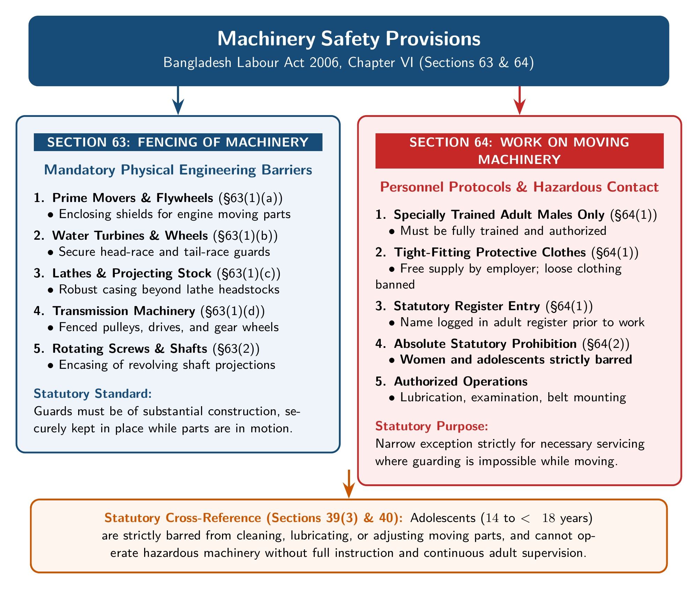

[← Previous: L07.1: Fire Safety Precautions (Section 62)](L07.1_Fire_Safety_Precautions_Sec_62.md) | [🏠 Index](00_Index.md) | [📐 Master Sheet](99_Master_Formula_and_Statutory_Sheet.md) | [Next: L08.1: Welfare Measures (Sections 89 to 99) →](L08.1_Welfare_Measures_Sec_89_to_99.md)

---

# L07.2: Machinery Safety and Workplace Duties

> [!info] ⚡ Exam Snapshot
> - **Section & Priority:** Section A (CO1 · Shoaib Sir) · 🟡 Medium Priority | **Read Time:** ~3 mins
> - **PYQs Covered:** 2025 Law-CT2 Q.2 (10m), 2023 Final Q.2(c) (04m), 2025 Law-CT2 Q.1 (part)
> - **Scoring Rule:** State the 5 conditions of Section 64, contrast with Section 40/39(3), and cite Section 78A(2) worker liability.

---

## 📌 1. Verbatim Definitions (For 2-Mark Questions)

> **Work on Machinery in Motion [BLC Sec 64(1)]:**  
> "Where... it becomes necessary to examine any part of machinery... while the machinery is in motion... such examination or operation shall be carried out only by a specially trained adult male worker wearing tight-fitting clothing whose name has been recorded in the register..."
> - *Plain meaning:* Only specially trained adult men in tight clothing may touch running machinery.

> **Adolescents on Dangerous Machines [BLC Sec 40(1)]:**  
> "No adolescent shall work at any machine unless he has been fully instructed as to the dangers... and has received sufficient training... or is under adequate supervision by a person who has thorough knowledge and experience of the machine."
> - *Plain meaning:* Adolescents may operate dangerous machines only after hazard training or experienced adult supervision.

> **Prohibition of Adolescents on Moving Machinery [BLC Sec 39(3)]:**  
> "No adolescent shall clean, lubricate or adjust any part of machinery while that part is in motion, or work between moving parts..."
> - *Plain meaning:* Adolescents are strictly barred from cleaning, lubricating, or adjusting running machinery, with zero exceptions.

> **Personal Protective Equipment Duty [BLC Sec 78A(1)–(2)]:**  
> "No authority shall engage any worker in work without providing him with personal safety equipments and ensuring uses thereof... If any personal safety equipment is supplied but not used, the worker concerned shall be liable."
> - *Plain meaning:* Employers must provide safety gear free, but workers are liable if they refuse to wear it.

---

## ⚡ 2. Core Exam Blocks (Write Directly in Exam)

*Figure 1: Industrial Machinery Safety Rules under BLC Sections 63 and 64.*

### 1. Mandatory Fencing of Machinery [Sec 63]
Every dangerous moving part must have secure physical guards:
1. **Prime Movers:** Engine parts and flywheels need secure fencing [Sec 63(1)(a)].
2. **Water Turbines:** Fixed guards on head-race and tail-race channels [Sec 63(1)(b)].
3. **Lathe Stocks:** Shield bars projecting beyond lathe headstocks [Sec 63(1)(c)].
4. **Transmission:** Continuous safety casings on gears, motors, and shafts [Sec 63(1)(d)].
5. **Shaft Fasteners:** Bolts, keys, and screws on rotating shafts must be encased [Sec 63(2)].
6. **Maintenance:** Guards must remain in position while machinery runs [Sec 63(3)].

### 2. Work on Machinery in Motion [Sec 64]
Handling running machinery is strictly restricted to five statutory conditions (Memory Hook: **M-T-R-B-N**):
1. **M: Male Adult Only [Sec 64(1)]:** Age $\ge 18$. Women and adolescents strictly barred.
2. **T: Tight Clothing [Sec 64(1)]:** Employer supplies; worker must wear to avoid entanglement.
3. **R: Registered Name [Sec 64(1)]:** Recorded in factory register before starting work.
4. **B: Belt Limits [Sec 64(2)]:** Belt width $< 15\text{ cm}$ with flush or laced joints.
5. **N: No Young Persons [Sec 39(3)]:** Moving parts strictly barred for adolescents.

### 3. Comparison: Section 64 vs. Section 40 & 39(3)
Tested for 10 marks in 2025 Law-CT2 Q.2.

**Similarities:** Both prevent traumatic injuries, require safety training before work, enforce strict employer criminal liability under Chapter XIX, and require official inspection registers.

**Statutory Contrast:**

| Basis | Moving Machinery (`Sec 64`) | Dangerous Machines (`Sec 40`, `39(3)`) |
| :--- | :--- | :--- |
| **BLC Chapter** | Chapter VI (*Safety*) | Chapter III (*Adolescent Workers*) |
| **Target Worker** | Adult males only ($\ge 18\text{ yrs}$) | Adolescent workers ($14$ to $< 18\text{ yrs}$) |
| **Eligibility Bar** | Absolute bar on women and adolescents | Permitted if trained or supervised |
| **Machine State** | Actively running or in motion | Gazetted dangerous; routine work |
| **Clothing Mandate** | Mandatory tight-fitting clothing [Sec 64(1)] | No specific clothing rule; focus is on training and supervision |
| **Supervision** | Cannot waive adult male requirement | Permitted under adult supervision |
| **Moving Parts** | Permitted for registered adult male | Strictly banned under Section 39(3) |

### 4. Shared Workplace Safety Duties [Sec 78A & Chapter VI]

**A. Responsibilities of Employers:**
1. Maintain sound buildings, safe floors, and clear passageways [Sec 61, 72].
2. Encase revolving shafts and fence moving gears securely [Sec 63, 67].
3. Restrict running machine work to registered adult males in tight clothes [Sec 64].
4. Supply certified PPE free of cost and log issuance [Sec 78A(1)].
5. Provide safety training and conduct emergency drills [Sec 62, 78A(3)].

**B. Responsibilities of Employees:**
1. Wear and use all personal safety gear supplied by the employer [Sec 78A(2)].
2. Bear personal legal liability if supplied PPE is not used on duty [Sec 78A(2)].
3. Wear tight clothing and avoid loose sleeves near rotating pulleys [Sec 64(1)].
4. Participate in scheduled fire and evacuation drills [Sec 62(7)–(8)].

**C. Analytical Opinion on Shared Safety Liability:**
- Employers must fund structural guards, alarms, and certified safety gear.
- Workers must practice discipline; unfastened gear causes accidents regardless of spending.
- Section 78A balances liability: free gear from employer, personal liability for worker.

---

## 🎯 3. PYQ & Target Answer Key

### 2025 Law-CT2 Q.2 [10 Marks]
*Compare safety requirements for work on machinery in motion with dangerous machines involving adolescent workers.*

> **Answer Blueprint:**  
> - Quote Section 64(1) and 40(1) definitions from §1.  
> - State the 4 similarities from §2.3.  
> - Reproduce the 7-row Statutory Contrast Table from §2.3.  
> - Conclude: Section 64 enforces a strict adult male tight-clothes rule for moving parts. Section 40 provides a training route for adolescents on dangerous machines, subject to the absolute moving-parts ban in Section 39(3).

### 2023 Final Q.2(c) [04 Marks]
*What responsibilities do employers and employees have regarding workplace safety regulation? Give your opinion.*

> **Answer Blueprint:**  
> - List employer duties under Sections 61, 63, 64, and 78A(1) from §2.4.A.  
> - List employee duties under Sections 64(1) and 78A(2) from §2.4.B.  
> - State the 3-point analytical opinion on Section 78A shared liability from §2.4.C.

### Model Case Study: Unsafe Machine Maintenance [04 Marks]
*A supervisor orders an adolescent (age 16) in loose clothes to oil active gears without PPE. His sleeve catches, causing arm injury. Analyze liabilities.*

1. **Facts of the Case:** Supervisor ordered an adolescent (age 16) in loose clothes to lubricate moving gears without PPE, causing serious arm injury.
2. **Applicable Law & Section:** BLC Section 39(3) (moving parts ban), Section 64(1) (adult males), and Section 78A(1) (mandatory free PPE).
3. **Legal Analysis:** The worker is an adolescent under Section 2(8). Section 39(3) strictly bans adolescents from moving parts; supervision cannot waive this. Ordering him to oil moving gears breaks Section 39(3) and 64(1). The employer failed to supply PPE under Section 78A(1). Worker liability under Section 78A(2) applies only if PPE was supplied; here, no PPE was provided.
4. **Direct Conclusion:** Employer is 100% liable under Sections 39(3), 64(1), and 78A(1), facing Chapter XIX fines and Chapter XII compensation. Worker bears zero liability.

---

> [!warning] ⚠️ Examiner Traps
> - **Sec 39(3) vs Sec 40:** Section 39(3) is an absolute ban on moving parts with zero exceptions. Section 40 permits dangerous machine operation with training or supervision.
> - **Section 64 Elements:** State all five conditions (M-T-R-B-N). Missing tight clothing or factory register entry loses marks.
> - **Section 78A(2) Worker Liability:** Mention that workers face personal legal liability if they fail to wear supplied PPE.

---

[← Previous: L07.1: Fire Safety Precautions (Section 62)](L07.1_Fire_Safety_Precautions_Sec_62.md) | [🏠 Index](00_Index.md) | [📐 Master Sheet](99_Master_Formula_and_Statutory_Sheet.md) | [Next: L08.1: Welfare Measures (Sections 89 to 99) →](L08.1_Welfare_Measures_Sec_89_to_99.md)
