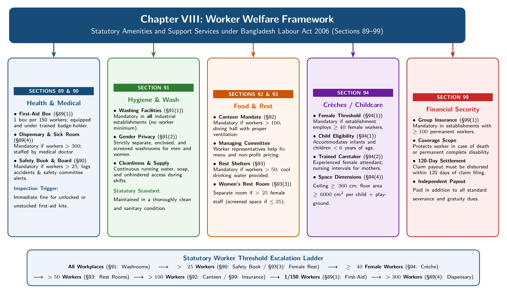
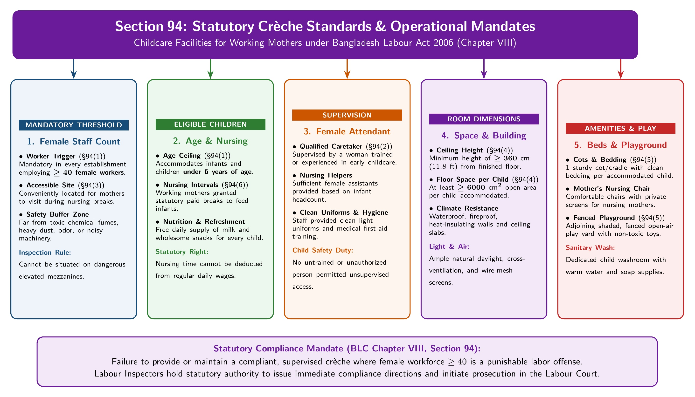

[← Previous: L07.2: Machinery Safety and Workplace Duties](L07.2_Machinery_Safety_and_Workplace_Duties.md) | [🏠 Index](00_Index.md) | [📐 Master Sheet](99_Master_Formula_and_Statutory_Sheet.md) | [Next: L09.1: Termination of Employment (Sections 20 to 27) →](L09.1_Termination_of_Employment_Sec_20_to_27.md)

---

# L08.1: Welfare Measures (Sections 89 to 99)

> [!info] ⚡ Exam Snapshot
> - **Section & Priority:** Section A (CO1 · Shoaib Sir) · 🟠 High Priority (Shoaib Sir Chapter 3 Lock) | **Read Time:** ~4 mins
> - **PYQs Covered:** 2025 Law-CT2 Q.1 (10m compliance audit), Chapter VIII Model Questions (GQ1 to GQ7)
> - **Scoring Rule:** State exact worker thresholds ($25 \to 40 \to 50 \to 100 \to 150 \to 300 \to 500 \to 5{,}000$) and cite the $6000\text{ sq. cm}$ crèche area with the known English typo note.

---

## 📌 1. Verbatim Definitions (For 2-Mark Questions)

> **First-Aid Appliances [BLC Sec 89(1)]:**  
> "In every establishment the first-aid box or cupboard equipped with the contents prescribed by rules shall be provided to be readily accessible during all working hours."
> - *Plain meaning:* Every factory must provide accessible, fully equipped first-aid boxes throughout working hours.

> **Canteen [BLC Sec 92(1)]:**  
> "In an establishment where more than 100 (one hundred) workers are ordinarily employed, adequate number of canteens shall be provided for their use."
> - *Plain meaning:* Workplaces with over 100 workers must provide adequate subsidized dining canteens.

> **Rooms for Children / Crèches [BLC Sec 94(1)]:**  
> "In every establishment, where 40 (forty) or more female workers are ordinarily employed, one or more suitable rooms shall be provided and maintained for the use of their children who are under the age of 6 (six) years."
> - *Plain meaning:* Workplaces with 40 or more women must provide clean childcare rooms for children under six.

> **Compulsory Group Insurance [BLC Sec 99(1)]:**  
> "In an establishment where at least 100 (one hundred) permanent workers are employed, the employer shall introduce group insurance under the existing insurance laws."
> - *Plain meaning:* Workplaces with 100 or more permanent workers must provide life and disability group insurance.

---

## ⚡ 2. Core Exam Blocks (Write Directly in Exam)

*Figure 1: Comprehensive Worker Welfare Facilities Framework under BLC Sections 89 to 99.*

> [!tip] Memory Hook: Worker Threshold Ladder (0 → 25 → 40 → 50 → 100 → 150 → 300 → 500 → 5,000)
> - **0 workers (All workplaces):** Screened washing facilities for men and women [Sec 91].
> - **Over 25 workers ($> 25$):** Safety record book and safety board [Sec 90]; separate female rest room if $> 25$ women [Sec 93(3)].
> - **$\ge 40$ female workers:** Rooms for children / crèches for kids under 6 years [Sec 94].
> - **Over 50 workers ($> 50$):** Rest rooms, shelters, and lunch rooms [Sec 93]; Safety Committee formed if $\ge 50$ workers [Sec 90A].
> - **Over 100 workers ($> 100$):** Subsidized canteen managed with worker representation [Sec 92].
> - **$\ge 100$ permanent workers:** Compulsory group life and disability insurance [Sec 99].
> - **1 box per 150 workers:** First-aid box with a certified, badged first-aider on duty [Sec 89(2)].
> - **$\ge 300$ workers:** Dedicated sick room and dispensary with doctor and nursing staff [Sec 89(5)].
> - **$\ge 500$ workers:** Certified Welfare Officer appointed to assist workers [Sec 89(8)].
> - **$\ge 5{,}000$ workers:** Permanent medical centre operated by the employer [Sec 89(6)].

### Master Statutory Threshold Summary Table

| Section | Welfare Amenity | Mandatory Threshold | Key Statutory Specification | Operational Rule |
| :--- | :--- | :--- | :--- | :--- |
| **Sec 89(1)–(4)** | First-Aid Box | 1 box per 150 workers | Medical items only, badged first-aider on duty | Accessible in all workrooms during shifts |
| **Sec 89(5)** | Sick Room & Dispensary | 300 or more workers | Equipped clinical room, qualified doctor and nurse | Must stay operational throughout shifts |
| **Sec 89(6)–(8)** | Medical Center & Officer | 5,000+ staff (500+ officer) | Permanent hospital clinic; certified welfare officer | Treatment paid by employer until full cure |
| **Sec 90 & 90A** | Safety Book & Committee | > 25 staff (50+ committee) | Incident logbook, Bangla board, joint safety committee | Inspects shop floor and addresses hazards |
| **Sec 91** | Washing Facilities | All workplaces | Clean, adequate, separate and screened by gender | Running water, soap, and proper drainage |
| **Sec 92** | Factory Canteen | More than 100 workers | Clean dining hall, managing committee with workers | Non-profit meals, subsidized overheads |
| **Sec 93** | Rest Rooms & Lunch Rooms | More than 50 workers | Ventilated rooms, drinking water; no eating in shops | Separate room if > 25 female workers |
| **Sec 94** | Crèche (Rooms for Kids) | 40 or more female workers | Accommodates kids under 6 yrs, trained caretaker | Height $\ge 360\text{ cm}$, area $\ge 6000\text{ sq. cm}$/child |
| **Sec 94A–98** | Specialized Amenities | Disabled, tea, press | Priority housing (94A); tea school/housing; press clinic | Statutory amenities tailored to trade |
| **Sec 99** | Compulsory Group Insurance | 100+ permanent (200 in 2006) | Group life policy; claim settled within 120 days | Paid in addition to gratuity and PF |

### Key Operational Rules (Exam Essentials)

1. **First-Aid Badging & Treatment [Sec 89]:** Each box is managed by a trained first-aider wearing an identification badge during shifts. Workroom notices must state his name. For workplace injuries and occupational diseases, the employer funds specialist treatment until recovery.
2. **Safety Committee Parity [Sec 90A]:** In factories with $\ge 50$ workers, the committee consists of 50% management and 50% worker representatives to audit shop-floor safety risks.
3. **Canteen Subsidies [Sec 92]:** Run by a joint committee with 20% to 50% worker members. The employer covers capital costs, fuel, and cooks; workers pay only for raw grocery ingredients.
4. **Rest Rooms & Female Separation [Sec 93]:** If female workers exceed 25, a separate room is mandatory. Screened partitions suffice if $\le 25$. A Section 92 canteen satisfies this requirement.
5. **Crèche Standards [Sec 94]:**

*Figure 2: Statutory Crèche Standards, Dimensions, and Amenities under Section 94.*

   - **Dimensions:** Ceiling height $\ge \mathbf{360\text{ cm}}$; floor area $\ge \mathbf{6000\text{ sq. cm}}$ per child. *(Exam Note: The 2006 English text misprints $600\text{ sq. cm}$; the official Bangla gazette requires $6000\text{ sq. cm}$).*
   - **Amenities:** Supervised by a trained female attendant; clean cots with bedding, nursing chairs for mothers, safe toys, and a fenced open-air playground.
6. **Compulsory Group Insurance [Sec 99]:** Mandatory for establishments with $\ge 100$ permanent workers (2013 Amendment; $\ge 200$ in original 2006 text). Claims are paid directly to dependents in addition to gratuity and PF dues, settled within 120 days.

---

## 🎯 3. PYQ & Target Answer Key

### Model Theory Blueprints

- **Model GQ1: First-Aid & Dispensary [Sec 89] (04m):**  
  *Blueprint:* State Sec 89(1) definition. Cite the 1:150 box ratio and badged first-aider rule. State the 300-worker dispensary with doctor/nurse from §2.
- **Model GQ2: Chapter VIII Summary Table (05m):**  
  *Blueprint:* Reproduce the Master Statutory Threshold Summary Table from §2. Summarize emergency medical, shop hygiene, dining, and childcare pillars.
- **Model GQ3: Crèche Statutory Specifications [Sec 94] (04m):**  
  *Blueprint:* Quote Sec 94(1) ($\ge 40$ women, kids $< 6$ yrs). State dimensions ($\ge 360\text{ cm}$ height, $\ge 6000\text{ sq. cm}$ floor space with English typo note). List amenities from §2 and Figure 2.
- **Model GQ4: Factory Canteens [Sec 92] & Rest Rooms [Sec 93] (04m):**  
  *Blueprint:* State canteen threshold ($> 100$), joint committee (20%–50% workers), and non-profit pricing from §2. State rest room threshold ($> 50$) and female threshold ($> 25$).
- **Model GQ5: Compulsory Group Insurance [Sec 99] (02m):**  
  *Blueprint:* Quote Sec 99(1) ($\ge 100$ permanent workers). Note payout is additional to gratuity/PF. Cite 120-day claim settlement deadline from §2.
- **Model GQ6: Safety Book & Committee [Sec 90, 90A] (02m):**  
  *Blueprint:* State safety record book and Bangla board for $> 25$ workers [Sec 90]. State joint safety committee (50% worker, 50% management) for $\ge 50$ workers [Sec 90A] from §2.
- **Model GQ7: Washing Facilities [Sec 91] (02m):**  
  *Blueprint:* State general duty (adequate, clean, accessible). State mandatory gender separation with privacy screening [Sec 91(1)(b)]. Note special standards for toxic trades [Sec 91(2)] from §2.

### 2025 Law-CT2 Q.1: Multi-Issue Compliance Audit [10 Marks]
*A manufacturing plant has excessive working hours, unsafe machinery, fire hazards, and insufficient welfare facilities. Analyze applicable BLC provisions for each problem.*

1. **Working Hours (Chapter IX):** Daily limit is 8 hours, up to 10 hours with overtime [Sec 100]. Rest interval is 1 hour for $>6$h work or 30m for $>5$h [Sec 101]. Normal weekly limit is 48 hours, extending to 60 hours with overtime [Sec 102]. Weekly holiday is mandatory [Sec 103]. Daily spread-over cannot exceed 10 hours [Sec 105]. Overtime earns double basic wages [Sec 108].
2. **Unsafe Machinery (Chapter VI):** Labour Inspectors may issue urgent prohibition orders [Sec 61]. Fencing is mandatory for flywheels and gears [Sec 63]. Running machines may only be serviced by registered adult males in tight clothes [Sec 64]. Emergency power cut-offs are required [Sec 65]. Revolving shafts and gears must be encased [Sec 67].
3. **Fire Protection (Chapter VI Sec 62):** Every floor requires alternative emergency staircases [Sec 62(1)]. Exit doors must stay unlocked and open outwards [Sec 62(3)]. Exits require red Bangla signage [Sec 62(4)]. Audible fire sirens are mandatory [Sec 62(5)]. Passageways must remain clear [Sec 62(6)]. Mock fire drills are held every 6 months [Sec 62(8)].
4. **Welfare Facilities (Chapter VIII):** Provide one first-aid box per 150 workers, plus a dispensary for $\ge 300$ workers [Sec 89]. Maintain a safety book for $> 25$ workers and a safety committee for $\ge 50$ [Sec 90, 90A]. Supply screened gender-separate washrooms [Sec 91]. Provide a subsidized canteen for $> 100$ workers [Sec 92]. Supply rest rooms for $> 50$ workers, with a separate room if $> 25$ women [Sec 93]. Maintain a crèche for $\ge 40$ female workers [Sec 94]. Provide compulsory group insurance for $\ge 100$ permanent workers [Sec 99].

---

> [!warning] ⚠️ Examiner Traps
> - **Typo in Section 94(5):** Floor area is $6000\text{ sq. cm}$ per child. Mention the $600\text{ sq. cm}$ printing typo in the original English text to secure full marks.
> - **Strict Inequality vs $\ge$:** Note that Sec 90 ($> 25$), Sec 92 ($> 100$), and Sec 93 ($> 50$) use "more than", while Sec 94 ($\ge 40$ female workers) and Sec 99 ($\ge 100$ permanent workers) use "at least".
> - **Canteen Fulfills Rest Room:** A Sec 92 canteen satisfies Sec 93 rest and lunch room requirements, but a lunch room never satisfies the Sec 92 canteen mandate.
> - **Group Insurance Independence:** Sec 99 insurance payouts are independent of and additional to gratuity, retrenchment pay, or provident fund benefits.

---

[← Previous: L07.2: Machinery Safety and Workplace Duties](L07.2_Machinery_Safety_and_Workplace_Duties.md) | [🏠 Index](00_Index.md) | [📐 Master Sheet](99_Master_Formula_and_Statutory_Sheet.md) | [Next: L09.1: Termination of Employment (Sections 20 to 27) →](L09.1_Termination_of_Employment_Sec_20_to_27.md)
