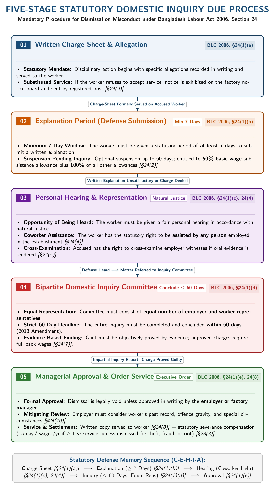

[← Previous: L08.1: Welfare Measures (Sections 89 to 99)](L08.1_Welfare_Measures_Sec_89_to_99.md) | [🏠 Index](00_Index.md) | [📐 Master Sheet](99_Master_Formula_and_Statutory_Sheet.md) | [Next: L10.1: Trade Union Basics, Objectives, and Functions →](L10.1_Trade_Union_Basics_Objectives_and_Functions.md)

# L09.1: Termination of Employment (Sections 20 to 27)

> [!info] ⚡ Exam Snapshot
> - **Section & Priority:** Section A (CO1 · Shoaib Islam Sir · High Priority) | **Read Time:** ~5 mins
> - **PYQs & Model Targets:** Model Q1–Q6 & Apex Applied Case (BLC Ch. II Separation Modes; Raidah §15 Backup Case Target)
> - **Scoring Rule:** State exact statutory notice days, severance formulas, and follow the 4-step case layout.

---

## 📌 1. Verbatim Definitions (For 2-Mark Questions)

> **Retrenchment [Sec 2(11)]:** "retrenchment means the termination of services of workers by the employer on the ground of redundancy;" (The Bangladesh Labour Act, 2006, Section 2(11))
- *Plain meaning:* Ending worker services because jobs are redundant or surplus.

> **Discharge [Sec 2(17)]:** "discharge means the termination of service of a worker by the employer for reasons of physical or mental incapacity or continued ill-health;" (The Bangladesh Labour Act, 2006, Section 2(17))
- *Plain meaning:* Releasing an unfit worker certified by a registered doctor.

> **Dismissal [Sec 2(39)]:** "dismissal means the termination of service of a worker by the employer for misconduct;" (The Bangladesh Labour Act, 2006, Section 2(39))
- *Plain meaning:* Disciplinary firing after proving misconduct through inquiry.

---

## ⚡ 2. Core Exam Blocks (Write Directly in Exam)

### Master 5-Way Separation Comparison Table

| Separation Mode | BLC Section | Primary Legal Ground | Mandatory Notice Period | Statutory Severance Rate | Domestic Inquiry? | Seniority Rule? |
| :--- | :--- | :--- | :--- | :--- | :--- | :--- |
| **Retrenchment** | **Sec 20–21** | Redundancy or surplus labor | **1 month** (or wage in lieu) | **30 days' wages/yr** (service $\ge 1\text{ yr}$) | No | **LIFO rule** [`Sec 20(4)`]; priority re-hire [`Sec 21`] |
| **Discharge** | **Sec 22** | Certified physical or mental incapacity | None required | **30 days' wages/yr** (service $\ge 1\text{ yr}$) | No (Doctor certificate) | No |
| **Dismissal** | **Sec 23–24** | Proven misconduct or conviction | None (inquiry required) | Zero for theft/riot; **15 days' wages/yr** other | **Yes** (5-step under Sec 24) | No |
| **Termination Simpliciter** | **Sec 26** | Employer discretion without cause | **120 days** (monthly); **60 days** (daily) | **30 days' wages/yr** (permanent) | No | No |
| **Resignation** | **Sec 27** | Voluntary worker exit | **60 days** (permanent); **30d / 14d** (temp) | Zero ($< 5\text{ yrs}$); **14d/yr** (5–10 yrs); **30d/yr** ($\ge 10\text{ yrs}$) | No | No |

---

### Core Statutory Rules by Separation Mode

1. **Retrenchment & LIFO Seniority [Sec 20–21]:** Requires $\ge 1\text{ yr}$ service. Employer gives 1 month written notice (or wage in lieu), sends copies to Chief Inspector and CBA, and pays 30 days' wages/yr. **LIFO rule [Sec 20(4)]** strictly requires retrenching the junior worker first within that trade. Retrenched staff hold 1-year re-employment priority by seniority (`Sec 21`).
2. **Discharge for Incapacity [Sec 22]:** Certified solely by a registered doctor for physical/mental incapacity or ill-health. Non-punitive separation paying 30 days' wages/yr (if service $\ge 1\text{ yr}$).
3. **Dismissal for Misconduct [Sec 23–24]:** Summary firing for conviction or proven misconduct (`Sec 23(4)`: theft, fraud, riot, bribery, absence $>10\text{ days}$, etc.). Severance under `Sec 23(3)`: zero for theft, fraud, or riot; 15 days' wages/yr for other acts ($\ge 1\text{ yr}$ service).
   - *5-Step Inquiry [Sec 24(1)] (`C-E-H-I-A`):* Written charge-sheet -> $\ge 7\text{ days}$ written explanation -> personal hearing with coworker assistance (`Sec 24(4)`) -> bipartite inquiry committee within 60 days -> written employer approval.
   - *Suspension [Sec 24(2)]:* Max 60 days with 50% basic subsistence allowance plus medical and housing benefits.

*Figure 1: Five-stage statutory domestic inquiry due process (BLC 2006, Section 24).*

4. **Termination Simpliciter by Employer [Sec 26]:** Contractual exit without citing cause. Notice: **120 days** (monthly permanent), **60 days** (daily permanent), 30d/14d (temporary), or wages in lieu (`Sec 26(3)`). Permanent workers receive 30 days' wages/yr (`Sec 26(4)`).
5. **Resignation by Worker [Sec 27]:** Permanent worker gives **60 days** written notice (temporary: 30d/14d) or pays in lieu (`Sec 27(3)`). Severance (`Sec 27(4)`): zero ($< 5\text{ yrs}$), **14 days' wages/yr** ($5\text{ to }< 10\text{ yrs}$), **30 days' wages/yr** or gratuity ($\ge 10\text{ yrs}$). Absence $>10\text{ days}$ triggers 10d and 7d notices before deemed release (`Sec 27(3A)`).
6. **Final Settlement [Sec 29–32]:** Employer must clear all dues within **30 working days** (`Sec 30`). Provident fund cannot be forfeited (`Sec 29`). Housing vacation within 60 days only after dues clearance (`Sec 32`).

---

### Memory Hooks

> [!tip] Memory Hook 1: Notice Timeline Ladder
> - **7 days:** Worker written explanation for alleged misconduct [`Sec 24(1)(b)`].
> - **14 days:** Temporary daily worker notice [`Sec 26(2)(b)`, `Sec 27(2)(b)`].
> - **30 days:** Retrenchment notice [`Sec 20(2)(a)`] and temporary monthly notice [`Sec 26(2)(a)`].
> - **60 days:** Resignation notice [`Sec 27(1)`]; daily permanent termination [`Sec 26(1)(b)`]; inquiry limit [`Sec 24(1)(d)`].
> - **120 days:** Simple termination notice for permanent monthly workers [`Sec 26(1)(a)`].

> [!tip] Memory Hook 2: Defense Chain (C-E-H-I-A) & Severance Tiers
> - **Defense Chain:** **C**harge-sheet -> **E**xplanation (7d) -> **H**earing -> **I**nquiry (60d) -> **A**pproval.
> - **30 days' wages/yr:** Retrenchment, Discharge, Sec 26 Termination, and Resignation ($\ge 10\text{ yrs}$).
> - **14 days' wages/yr:** Resignation ($5\text{ to }< 10\text{ yrs}$).
> - **15 days' wages/yr:** Dismissal for general misconduct. Zero for theft or riot.

---

## 🎯 3. PYQ & Target Answer Key

### Direct Theory Question Blueprints

- **Model Q1 · Retrenchment Definition, Conditions & LIFO Seniority (Sec 20–21):**
  - *Answer Blueprint:* Quote Section 2(11) from §1. Cite 1-month notice [`Sec 20(2)(a)`] or pay in lieu, notice to Chief Inspector/CBA [`Sec 20(2)(b)`], 30 days' wages/yr severance [`Sec 20(2)(c)`], Section 20(4) LIFO rule, and Section 21 re-hire priority from §2 Block 1.
- **Model Q2 · Master 5-Way Separation Comparison Table (Sec 20–27):**
  - *Answer Blueprint:* Reproduce the Master 5-Way Comparison Table from §2, comparing grounds, notice, severance, inquiry, and seniority across all five modes.
- **Model Q3 · Discharge for Incapacity vs. Dismissal for Misconduct (Sec 22 vs. 23):**
  - *Answer Blueprint:* Quote Section 2(17) and 2(39) from §1. Contrast medical unfitness under Section 22(1) (doctor certificate) with disciplinary dismissal under Section 23–24. Note non-punitive nature, 30 days' wages/yr severance, and zero stigma from §2 Block 2 & table.
- **Model Q4 · Misconduct Grounds & Domestic Inquiry Procedure (Sec 23–24):**
  - *Answer Blueprint:* List misconduct acts under Section 23(4). Write the 5 steps of Section 24(1) (`C-E-H-I-A`), cite Figure 1, 60-day inquiry limit, and 50% subsistence allowance from §2 Block 3.
- **Model Q5 · Simple Termination by Notice (Sec 26):**
  - *Answer Blueprint:* State notice ladder (120d monthly / 60d daily permanent; 30d/14d temporary), pay in lieu [`Sec 26(3)`], and 30 days' wages/yr severance [`Sec 26(4)`] from §2 Block 4.
- **Model Q6 · Resignation by Worker & Severance Tiers (Sec 27):**
  - *Answer Blueprint:* State 60d permanent notice (30d/14d temp), pay in lieu [`Sec 27(3)`], severance tiers (zero for $<5\text{ yrs}$, 14d/yr for 5–10 yrs, 30d/yr for $\ge 10\text{ yrs}$), and Section 27(3A) 10d+7d unexcused absence rule from §2 Block 5.

---

### Applied Case Study · Apex Telecommunications (10 Marks)

> **Scenario:** Apex Telecommunications Ltd. cuts 15 technician jobs due to automation. Rafiq has served 6 years as Senior Assembly Technician. Tanvir has served only 14 months in the same role. Management dismisses Rafiq without notice citing cost cuts, while retaining Tanvir. On the same day, a supervisor accuses worker Karim of theft and fires him on the spot without a charge-sheet or inquiry. Farhana, a software technician, resigns voluntarily after 8 continuous years of service.

#### Part (i): Legality of Rafiq's Termination & Severance (03 Marks)

1. **Facts:** Apex dismissed senior technician Rafiq (6 yrs service) without notice. Junior Tanvir (14 mos service) was retained.
2. **Law & Section:** **Section 20 (Retrenchment)** and **Section 20(4) (LIFO Rule)** of BLC 2006.
3. **Legal Analysis:** Automation downsizing is redundancy under Section 2(11). Retrenching senior Rafiq while keeping junior Tanvir violates the mandatory LIFO seniority rule (`Sec 20(4)`). Apex also omitted 1 month notice (`Sec 20(2)(a)`).
$$
\text{Severance Pay} = 6 \text{ completed years} \times 30 \text{ days' wages} = 180 \text{ days' wages}
$$
Adding 1 month notice wages (30 days), Rafiq is owed 210 days' wages.
4. **Direct Conclusion:** Dismissal is unlawful. Tanvir must be retrenched first. To retrench Rafiq later, Apex must pay 1 month notice plus 180 days' severance.

#### Part (ii): Lawfulness of Karim's Summary Dismissal (03 Marks)

1. **Facts:** Supervisor fired Karim on the spot for theft without charge-sheet or domestic inquiry.
2. **Law & Section:** **Section 23(4)(b) (Theft)** and **Section 24 (Inquiry Due Process)** of BLC 2006.
3. **Legal Analysis:** Theft is misconduct under Section 23(4)(b). Dismissal strictly requires the 5-step inquiry under Section 24: charge-sheet, 7-day explanation, personal hearing, 60-day inquiry, and employer approval. Summary dismissal violates statutory natural justice.
4. **Direct Conclusion:** Dismissal is illegal and void. Apex must reinstate Karim immediately or suspend him under Section 24(2) at 50% basic allowance pending a lawful inquiry.

#### Part (iii): Farhana's Resignation Severance vs. Section 26 Termination (04 Marks)

1. **Facts:** Farhana resigned voluntarily after 8 continuous years of service. Calculate her dues and compare with Section 26 termination.
2. **Law & Section:** **Section 27 (Resignation)** and **Section 26 (Termination by Employer)** of BLC 2006.
3. **Legal Analysis:** Farhana must give 60 days notice (`Sec 27(1)`). Resigning with 5 to 10 years service entitles her to 14 days' wages/yr under Section 27(4)(a):
$$
\text{Resignation Severance} = 8 \text{ completed years} \times 14 \text{ days' wages} = 112 \text{ days' wages}
$$
Under Section 26 employer termination, Apex would owe 120 days notice plus 30 days/yr severance (`Sec 26(4)`):
$$
\text{Section 26 Severance} = 8 \text{ completed years} \times 30 \text{ days' wages} = 240 \text{ days' wages}
$$
4. **Direct Conclusion:** Farhana receives **112 days' wages** under Section 27. This is 128 days' wages less than Section 26 employer termination (240 days).

---

> [!warning] ⚠️ Examiner Traps
> - **Notice Days Inversion:** Permanent monthly workers receive 120 days notice for employer termination (`Sec 26`), but give only 60 days notice when resigning (`Sec 27`).
> - **LIFO Seniority Exception:** Section 20(4) strictly demands retrenching the junior worker first within that trade. The only legal exception is an explicit written contract clause.
> - **Misconduct Severance Trap:** Dismissal for theft or riot yields zero severance pay under Section 23(3). Other misconduct yields 15 days' wages per year ($\ge 1\text{ year}$ service).
> - **Final Settlement Deadline:** Section 30 requires payment of all terminal dues within 30 working days from the separation date.

---

[← Previous: L08.1: Welfare Measures (Sections 89 to 99)](L08.1_Welfare_Measures_Sec_89_to_99.md) | [🏠 Index](00_Index.md) | [📐 Master Sheet](99_Master_Formula_and_Statutory_Sheet.md) | [Next: L10.1: Trade Union Basics, Objectives, and Functions →](L10.1_Trade_Union_Basics_Objectives_and_Functions.md)
