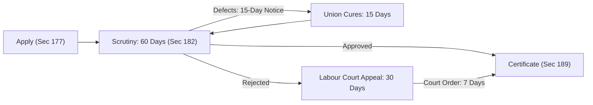

[← Previous: L10.1: Trade Union Basics, Objectives, and Functions](L10.1_Trade_Union_Basics_Objectives_and_Functions.md) | [🏠 Index](00_Index.md) | [📐 Master Sheet](99_Master_Formula_and_Statutory_Sheet.md) | [Next: L10.3: Trade Union Legal Status, Rights, and Applied Role →](L10.3_Trade_Union_Legal_Status_Rights_and_Applied_Role.md)

---

# L10.2: Trade Union Registration and Cancellation

> [!info] ⚡ Exam Snapshot
> - **Section & Priority:** Section A · SI Sir (Shoaib Islam) · 🔴 High Priority
> - **Estimated Read Time:** ~3 mins
> - **PYQs Covered:** 2024 Final Q.3(b) (04 Marks)
> - **Scoring Rule:** State statutory sections (Sections 177 to 190) and the 30% membership threshold. Include the 15-15-60-30-7 timeline chain and mandatory Labour Court permission for cancellation.

---

## 📌 1. Verbatim Definitions (For 2-Mark Questions)

> **Registration of Trade Union [SI Sir Notes, Ch. 4]:** "Registration of a trade union is the process by which the trade union gets the legal existence as an entity that is separated from its members."

*Plain meaning:* Registration gives the union its own legal identity. It turns an informal group of workers into an official legal body that is completely separate from its members.

> **Registrar of Trade Unions [BLC 2006, Sec 177(2)]:** "The Registrar of Trade Unions ... shall mean the Director of Labour or any representative authorized by him in this behalf."

*Plain meaning:* The Registrar is the Director of Labour or an officer chosen by him. This official checks union applications, verifies member lists, approves registrations, and oversees trade unions.

---

## ⚡ 2. Core Exam Blocks (Write Directly in Exam)

### 2.1 Step-by-Step Registration Procedure (Sections 177 to 189)

1. **Application Submission [Sec 177]:**
   - The President (or Chairman) and the General Secretary must apply in writing.
   - Both leaders must sign the application together and submit it to the Director of Labour (the Registrar).

2. **Accompanying Documents [Sec 178]:**
   - Three signed copies of the union constitution.
   - A copy of the worker meeting resolution that adopted the constitution.
   - A copy of the resolution authorizing the officers to apply for registration.
   - A full list showing the names, ages, addresses, and jobs of all executive officers.

3. **Statutory Preconditions [Sec 179]:**
   - **30% Minimum Membership Threshold [Sec 179(2)]:** The union must enroll at least **30% of all workers** currently employed in the establishment.
   - **Payroll Check [Sec 179(2a)]:** The Director of Labour verifies this 30% threshold directly against employer payroll records.
   - **Cap of Three Unions [Sec 179(5)]:** A company or establishment can have at most **three registered trade unions** at any time.
   - **Mandatory Constitutional Rules [Sec 179(1)]:**
     - Every member must declare that they do not belong to any other union in that establishment.
     - The executive committee must have between **5 and 35 members**.
     - Officer terms must run between **2 and 3 years**.

4. **Disqualifications and Mandatory Registers [Sec 180–181]:**
   - **Officer Disqualifications [Sec 180]:**
     - Anyone convicted of a serious moral crime (moral turpitude) cannot hold office until 2 years after release.
     - Outsiders (non-workers) cannot be union officers. But in the public sector, up to 10% of officers may be non-workers.
   - **Three Mandatory Registers [Sec 181]:**
     - Register of Members (showing worker names and membership fees paid).
     - Accounts Book (showing all cash receipts and spending).
     - Minute Book (recording meeting notes, votes, and resolutions).

5. **Scrutiny and Decision Timelines [Sec 182]:**
   - **60-Day Decision Deadline [Sec 182(1)]:** The Director of Labour must register the union within **60 days** of receiving a complete application.
   - **Fixing Paperwork Defects [Sec 182(2)]:**
     - The Director must send written objections to the union within **15 days**.
     - The union gets **15 days** to fix the errors and reply.

6. **Appeals Process [Sec 182(4)–(6)]:**
   - **Appeal to Labour Court [Sec 182(4)]:** If the Director rejects the file or misses the 60-day deadline, the union can appeal. It must file an appeal with the Labour Court within **30 days**.
   - **Court Order to Register [Sec 182(5)]:** If the Labour Court rules for the union, it can order the Director to register it within **7 days**.
   - **Appeal to Tribunal [Sec 182(6)]:** Either side can appeal the Labour Court ruling to the Labour Appellate Tribunal within **30 days**.

7. **Certificate of Registration [Sec 189]:**
   - The Director of Labour issues an official Certificate of Registration.
   - This certificate is final and conclusive legal proof that the union is properly registered.

8. **Legal Protections While Registration is Pending [Sec 186–187]:**
   - **Job Terms Protected [Sec 186(1)]:** The employer cannot worsen service conditions for union officers without written permission from the Director.
   - **No Simple Firing [Sec 186(2)]:** The employer cannot fire any union member using simple termination (Section 26).
   - **No Punitive Transfers [Sec 187]:** The employer cannot transfer the President or General Secretary to another district without their written consent.

> [!tip] Memory Hook: 15-15-60-30-7 Timeline Chain
> - **15 Days:** Director sends written objections if paperwork has flaws [Sec 182(2)].
> - **15 Days:** Union fixes the flaws and sends back its reply [Sec 182(2)].
> - **60 Days:** Director must make a final decision to register or reject [Sec 182(1)].
> - **30 Days:** Union can appeal a rejection to the Labour Court [Sec 182(4)].
> - **7 Days:** Director must register the union if ordered by the Labour Court [Sec 182(5)].

---

### 2.2 Cancellation of Registration (Section 190)

1. **Seven Statutory Grounds [Sec 190(1)]:**
   - **Request by Union [Sec 190(1)(a)]:** The union itself applies in writing to cancel its registration.
   - **Dissolution [Sec 190(1)(b)]:** The union has shut down or stopped existing.
   - **Fraud [Sec 190(1)(c)]:** The union used fake documents, deceit, or false facts to get registered.
   - **Constitutional Violation [Sec 190(1)(d)]:** The union broke core rules of its own registered constitution.
   - **Unfair Labour Practice [Sec 190(1)(e)]:** The union committed an unfair labour practice under Section 196 (such as illegal strikes or worker intimidation).
   - **Membership Below 30% [Sec 190(1)(f)]:** Total membership dropped below the mandatory **30% threshold** required under Section 179(2).
   - **Statute Breach [Sec 190(1)(g)]:** The union violated any provision of Chapter XIII of the Labour Act or Labour Rules.

2. **Mandatory Judicial Oversight [Sec 190(2)–(4)]:**
   - **Labour Court Permission is Mandatory [Sec 190(2)]:** The Director of Labour cannot cancel registration alone. The Director must hold an inquiry and obtain prior permission from the **Labour Court**. (Exception: court permission is not needed if the union dissolves or asks to cancel itself).
   - **30-Day Cancellation Window [Sec 190(3)]:** Once the Labour Court gives permission, the Director must cancel the registration within **30 days**.
   - **3-Month Limit for ULP [Sec 190(4)]:** Cancellation applications for unfair labour practices must reach the Labour Court within **3 months** of the incident.

3. **Appeals and Legal Consequences [Sec 191–192]:**
   - **Appeal to Tribunal [Sec 191(1)]:** Any hurt party can appeal the Labour Court decision to the Labour Appellate Tribunal within **30 days**.
   - **Union Keeps Running During Appeal [Sec 191(2)]:** The union can continue running normally while the appeal is pending before the Tribunal.
   - **Immediate Effect of Cancellation [Sec 192]:** Once cancelled, the union loses its legal status. It cannot function as a union or collect money from workers.

> [!tip] Memory Hook: R-D-F-C-U-M-S (Seven Grounds for Cancellation)
> - **R (Request):** The union itself asks in writing to cancel its registration [Sec 190(1)(a)].
> - **D (Dissolution):** The union has dissolved or ceased to exist [Sec 190(1)(b)].
> - **F (Fraud):** The union got registered through fraud or fake documents [Sec 190(1)(c)].
> - **C (Constitution):** The union broke core rules of its registered constitution [Sec 190(1)(d)].
> - **U (Unfair Labour Practice):** The union committed an illegal act under Section 196 [Sec 190(1)(e)].
> - **M (Membership):** Union membership dropped below the statutory 30% threshold [Sec 190(1)(f)].
> - **S (Statute Breach):** The union broke any rule in Chapter XIII or the Labour Rules [Sec 190(1)(g)].

---

## 🎯 3. PYQ & Target Answer Key

### 2024 Final Q.3(b): Trade Union Registration Process (04 Marks)

> **Question [2024 Final Q.3(b)]:** "Explain the process of registration of a trade union as outlined in the Bangladesh Labor Code 2006." [04 Marks]

**Exam Writing Plan:**

1. **Definition and Authority:**
   - Define registration as the legal process giving a union its own separate identity.
   - State that the Director of Labour serves as the Registrar [Sec 177(2)].

2. **Application and Documents [Sec 177–178]:**
   - The President and General Secretary must sign and submit a joint written application [Sec 177].
   - Attach three copies of the constitution, meeting resolutions, and officer details [Sec 178].

3. **Statutory Preconditions [Sec 179]:**
   - State the mandatory **30% minimum membership threshold** [Sec 179(2)].
   - Note the cap of at most **three registered trade unions** per company [Sec 179(5)].
   - Mention committee size (5 to 35 members) and officer terms (2 to 3 years) [Sec 179(1)].

4. **Decision Timelines and Appeals [Sec 182]:**
   - State the **60-day deadline** for the Director to register the union [Sec 182(1)].
   - Explain the **15-day defect notice** and the union's **15-day window** to fix errors [Sec 182(2)].
   - Note the **30-day appeal** to the Labour Court if rejected [Sec 182(4)].
   - Mention the court's power to order registration within **7 days** [Sec 182(5)].

5. **Conclusive Proof [Sec 189]:**
   - The Director issues an official Certificate of Registration.
   - This certificate serves as conclusive legal proof of valid registration.

---

### Model Target Q1: Preconditions and the 30% Threshold (04 Marks)

> **Question [Model Target Q1]:** "What are the statutory preconditions for trade union registration under Section 179 of BLA 2006? Explain the mandatory 30% membership threshold." [04 Marks]

**Exam Writing Plan:**

1. **Mandatory 30% Rule [Sec 179(2)]:**
   - The union must enroll at least **30% of all workers** in the establishment.
   - The Director verifies this number directly from employer payroll records [Sec 179(2a)].

2. **Why This Rule Exists:**
   - It stops weak, fragmented paper unions from forming.
   - It guarantees that the union has real worker support and collective bargaining power.

3. **Constitutional Rules [Sec 179(1)]:**
   - Members must declare they belong to no other union in that company.
   - The executive committee must have **5 to 35 members**.
   - Officer terms must run between **2 and 3 years**.

4. **Three-Union Cap [Sec 179(5)]:**
   - No company can have more than **three registered trade unions** at any time.

5. **Legal Outcome:**
   - If the union fails any Section 179 rule, the Director must reject the registration application.

---

### Model Target Q2: Cancellation of Trade Union Registration (04 Marks)

> **Question [Model Target Q2]:** "On what grounds can the Director of Labour cancel trade union registration under Section 190 of BLA 2006? State the mandatory cancellation procedure and appeal rights." [04 Marks]

**Exam Writing Plan:**

1. **Seven Statutory Grounds [Sec 190(1)]:**
   - List all 7 grounds using the **R-D-F-C-U-M-S** memory hook.
   - Request, Dissolution, Fraud, Constitution breach, Unfair labour practice, Membership below 30%, and Statute breach.

2. **Mandatory Labour Court Permission [Sec 190(2)]:**
   - The Director cannot cancel registration alone.
   - The Director must hold an inquiry and get approval from the **Labour Court**.
   - Exception: court permission is not needed if the union itself dissolves or asks to cancel.

3. **Key Timelines [Sec 190(3)–(4)]:**
   - The Director has **30 days** to cancel the union after getting court approval [Sec 190(3)].
   - An application for unfair labour practices must be filed within **3 months** of the event [Sec 190(4)].

4. **Appeals and Union Operation [Sec 191]:**
   - Either side can appeal the court decision to the Labour Appellate Tribunal within **30 days** [Sec 191(1)].
   - The union continues running normally while the appeal is pending [Sec 191(2)].

---

## ⚠️ Examiner Traps

> [!warning] Common Traps & High-Penalty Pitfalls
> - **The 30% Rule is Exact:** Never write "majority of workers" or "50%". The statutory threshold is strictly **30% of total workers** in the establishment [Sec 179(2)].
> - **Labour Court Permission is Mandatory:** The Director cannot cancel registration alone. The Director must obtain prior permission from the **Labour Court**. Court permission is not needed only if the union dissolves or asks to cancel [Sec 190(2)].
> - **Cap of Three Unions:** A company can have at most **three registered trade unions** at any time [Sec 179(5)].
> - **Exact Days Matter:** Always write the exact timeline numbers: `15 -> 15 -> 60 -> 30 -> 7` days. Vague words like "soon" or "reasonable time" lose marks instantly.
> - **3-Month Limit for ULP:** An application to cancel a union for unfair labour practices must reach the Labour Court within **3 months** [Sec 190(4)].

---

[← Previous: L10.1: Trade Union Basics, Objectives, and Functions](L10.1_Trade_Union_Basics_Objectives_and_Functions.md) | [🏠 Index](00_Index.md) | [📐 Master Sheet](99_Master_Formula_and_Statutory_Sheet.md) | [Next: L10.3: Trade Union Legal Status, Rights, and Applied Role →](L10.3_Trade_Union_Legal_Status_Rights_and_Applied_Role.md)
