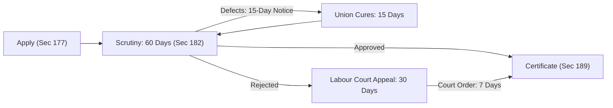

[← Previous: L10.1: Trade Union Basics, Objectives, and Functions](L10.1_Trade_Union_Basics_Objectives_and_Functions.md) | [🏠 Index](00_Index.md) | [📐 Master Sheet](99_Master_Formula_and_Statutory_Sheet.md) | [Next: L10.3: Trade Union Legal Status, Rights, and Applied Role →](L10.3_Trade_Union_Legal_Status_Rights_and_Applied_Role.md)

# L10.2: Trade Union Registration and Cancellation

> [!info] ⚡ Exam Snapshot
> - **Section & Priority:** Section A · SI Sir (Shoaib Islam) · 🔴 High Priority | **Read Time:** ~3 mins
> - **PYQs Covered:** 2024 Final Q.3(b) (04m)
> - **Scoring Rule:** State statutory sections (Sec 177 to 190), 30% threshold, 15-15-60-30-7 timeline, and Labour Court permission for cancellation.

## 📌 1. Verbatim Definitions (For 2-Mark Questions)

> **Registration of Trade Union [SI Sir Notes, Ch. 4]:** "Registration of a trade union is the process by which the trade union gets the legal existence as an entity that is separated from its members."
- *Plain meaning:* Legal process giving an informal worker group separate corporate legal existence.

> **Registrar of Trade Unions [BLC 2006, Sec 177(2)]:** "The Registrar of Trade Unions ... shall mean the Director of Labour or any representative authorized by him in this behalf."
- *Plain meaning:* The Director of Labour who verifies, registers, and oversees trade unions.

## ⚡ 2. Core Exam Blocks (Write Directly in Exam)

### 2.1 Step-by-Step Registration Procedure (Sections 177 to 189)

1. **Application [Sec 177]:** President/Chairman and General Secretary sign and submit application to the Director of Labour.
2. **Documents [Sec 178]:** Three constitution copies, adoption resolution, application authorization, and officer particulars.
3. **Preconditions [Sec 179]:**
   - **30% Threshold [Sec 179(2)]:** Union must enroll at least **30% of total workers** in the establishment; verified via payrolls [Sec 179(2a)].
   - **Mandatory Terms:** Worker declaration of no dual membership [Sec 179(1)(c)]; max **3 registered unions** per establishment [Sec 179(5)]; **5 to 35 executive members** for a 2 to 3-year term [Sec 179(1)(j)].
4. **Disqualifications & Registers [Sec 180-181]:** Moral turpitude conviction bars office unless 2 years passed; non-workers barred (except max 10% non-worker officers in public sector) [Sec 180]. Must maintain member, account, and minute registers [Sec 181].
5. **Scrutiny & Timelines [Sec 182]:**
   - Director must register union within **60 days** [Sec 182(1)].
   - Defect notices and union replies each have a **15-day limit** [Sec 182(2)].
6. **Appeals [Sec 182(4)-(6)]:** Labour Court appeal within **30 days** of rejection; Court may direct registration within **7 days**; Tribunal appeal within **30 days**.
7. **Certificate [Sec 189]:** Conclusive legal proof of valid registration.
8. **Pending Protection [Sec 186-187]:** Service conditions protected [Sec 186(1)]; no simple termination [Sec 186(2)]; no transfer without consent [Sec 187].

> [!tip] Memory Hook: 15-15-60-30-7 Timeline Chain
> - **15 Days:** Director sends objection to defects [Sec 182(2)].
> - **15 Days:** Union cures defects and replies [Sec 182(2)].
> - **60 Days:** Statutory deadline for Director to register union [Sec 182(1)].
> - **30 Days:** Window to appeal rejection to Labour Court [Sec 182(4)].
> - **7 Days:** Court deadline directing Director to register union [Sec 182(5)].

### 2.2 Cancellation of Registration (Section 190)

1. **Seven Statutory Grounds [Sec 190(1)]:**
   - **R (Request):** Union applies in writing for cancellation.
   - **D (Dissolution):** Union ceased to exist.
   - **F (Fraud):** Registration obtained by deceit.
   - **C (Constitution):** Fundamental constitution breach.
   - **U (ULP):** Unfair labour practice under Section 196.
   - **M (Membership):** Falls below mandatory **30% threshold**.
   - **S (Statute):** Violation of Chapter XIII or rules.
2. **Mandatory Judicial Oversight [Sec 190(2)-(4)]:**
   - Director cannot cancel registration alone, except on union request or dissolution.
   - Director must apply to **Labour Court** for prior permission [Sec 190(2)].
   - Cancellation executed within **30 days** of court order [Sec 190(3)]; 3-month filing limit for ULP [Sec 190(4)].
3. **Appeal & Legal Effect [Sec 191-192]:** Appeal to Tribunal within **30 days** [Sec 191(1)]; union operates normally pending appeal [Sec 191(2)]. Cancelled union cannot function or collect funds [Sec 192].

> [!tip] Memory Hook: R-D-F-C-U-M-S (7 Grounds)
> - **R**equest | **D**issolution | **F**raud | **C**onstitution breach | **U**nfair labour practice | **M**embership $< 30\%$ | **S**tatute breach.

## 🎯 3. PYQ & Target Answer Key

### 2024 Final Q.3(b): Trade Union Registration Process (04 Marks)
> **Question:** Explain the process of registration of a trade union as outlined in the Bangladesh Labor Code 2006. [04m]  
> **Answer Blueprint:** Define registration (§1). State 5 steps from §2.1 (Sec 177, 178, 179, 182, 189) and the 15-15-60-30-7 timeline hook.

### Model Target Q1: Preconditions and the 30% Threshold (04 Marks)
> **Question:** What are the statutory preconditions for trade union registration under Section 179 of BLC 2006? Explain the mandatory 30% membership rule. [04m]  
> **Answer Blueprint:** State 30% threshold [Sec 179(2)], constitution terms (5 to 35 members, 2-3 yr term) [Sec 179(1)], and 3 unions limit [Sec 179(5)].

### Model Target Q2: Cancellation of Trade Union Registration (04 Marks)
> **Question:** State the grounds and legal procedure for cancellation of trade union registration under Section 190 of BLC 2006. [04m]  
> **Answer Blueprint:** List 7 grounds via R-D-F-C-U-M-S (§2.2). State prior Labour Court permission [Sec 190(2)] and 30-day Tribunal appeal [Sec 191].

> [!warning] ⚠️ Examiner Traps
> - **30% Threshold:** Never write 50% or majority. Law strictly sets **30% of total workers** [Sec 179(2)].
> - **Labour Court Permission:** The Director cannot cancel registration alone. Prior **Labour Court permission** is mandatory [Sec 190(2)].
> - **Establishment Cap:** Maximum **3 registered trade unions** per establishment [Sec 179(5)].
> - **Exact Days:** 15 days (defects), 60 days (registration), 30 days (appeal), 7 days (court order).
> - **ULP Filing Limit:** An application to cancel registration for unfair labour practice must reach the Labour Court within **3 months** of occurrence [Sec 190(4)].

[← Previous: L10.1: Trade Union Basics, Objectives, and Functions](L10.1_Trade_Union_Basics_Objectives_and_Functions.md) | [🏠 Index](00_Index.md) | [📐 Master Sheet](99_Master_Formula_and_Statutory_Sheet.md) | [Next: L10.3: Trade Union Legal Status, Rights, and Applied Role →](L10.3_Trade_Union_Legal_Status_Rights_and_Applied_Role.md)
