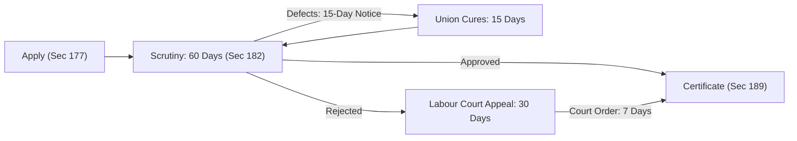

[← Previous: L10.1: Trade Union Basics, Objectives, and Functions](L10.1_Trade_Union_Basics_Objectives_and_Functions.md) | [🏠 Index](00_Index.md) | [📐 Master Sheet](99_Master_Formula_and_Statutory_Sheet.md) | [Next: L10.3: Trade Union Legal Status, Rights, and Applied Role →](L10.3_Trade_Union_Legal_Status_Rights_and_Applied_Role.md)

---

# L10.2: Trade Union Registration and Cancellation

> [!info] ⚡ Exam Snapshot
> - **Section & Priority:** Section A · SI Sir (Shoaib Islam) · 🔴 High Priority
> - **Estimated Read Time:** ~3 mins
> - **PYQs Covered:** 2024 Final Q.3(b) (04 Marks)
> - **Scoring Rule:** State statutory sections (Sections 177 to 190), the 30% membership threshold, the 15-15-60-30-7 timeline chain, and mandatory Labour Court permission for cancellation.

---

## 📌 1. Verbatim Definitions (For 2-Mark Questions)

> **Registration of Trade Union [SI Sir Notes, Ch. 4]:** "Registration of a trade union is the process by which the trade union gets the legal existence as an entity that is separated from its members."

*Plain meaning:* Registration gives an informal worker association independent legal standing, transforming it into a recognized corporate entity that is legally separate from its individual members.

> **Registrar of Trade Unions [BLC 2006, Sec 177(2)]:** "The Registrar of Trade Unions ... shall mean the Director of Labour or any representative authorized by him in this behalf."

*Plain meaning:* The Registrar is the Director of Labour or an authorized representative who is legally empowered to examine applications, verify member rolls, grant registration, and supervise trade unions.

---

## ⚡ 2. Core Exam Blocks (Write Directly in Exam)

### 2.1 Step-by-Step Registration Procedure (Sections 177 to 189)

1. **Application Submission [Sec 177]:**
   - The President (or Chairman) and the General Secretary of the trade union must jointly sign and submit the written application to the Director of Labour (the Registrar).

2. **Accompanying Documents [Sec 178]:**
   - The application must include three copies of the union constitution, a copy of the member resolution adopting the constitution, a copy of the resolution authorizing the officers to apply, and full personal particulars of all executive officers.

3. **Statutory Preconditions [Sec 179]:**
   - **30% Membership Threshold [Sec 179(2)]:** The trade union must enroll at least **30% of total workers** currently employed in the establishment. The Director of Labour verifies this threshold directly from employer payroll records [Sec 179(2a)].
   - **Establishment Limit [Sec 179(5)]:** No establishment or group of establishments may have more than **three registered trade unions** at any time.
   - **Mandatory Constitutional Terms [Sec 179(1)]:** The constitution must include a declaration that the applicant belongs to no other union in that establishment, set an executive committee size of **5 to 35 members**, and fix officer terms between **2 and 3 years**.

4. **Disqualifications and Mandatory Registers [Sec 180–181]:**
   - **Officer Disqualifications [Sec 180]:** Any person convicted of an offense involving moral turpitude is disqualified from holding union office unless 2 years have elapsed since release. Non-workers cannot serve as officers, except in the public sector where up to 10% of executive officers may be non-workers.
   - **Statutory Registers [Sec 181]:** Every registered union must maintain three official books: a Register of Members, an Accounts Book, and a Minute Book for all meetings.

5. **Scrutiny and Decision Timelines [Sec 182]:**
   - **60-Day Mandate [Sec 182(1)]:** The Director of Labour must register the union within **60 days** of receiving a complete application.
   - **Defect Rectification [Sec 182(2)]:** If deficiencies are found, the Director must issue written objections within **15 days**. The union then has **15 days** to rectify the defects and reply.

6. **Appeals Process [Sec 182(4)–(6)]:**
   - If the Director rejects the application or fails to act within 60 days, the union may appeal to the Labour Court within **30 days** [Sec 182(4)].
   - The Labour Court may order the Director to register the trade union within **7 days** [Sec 182(5)].
   - A further appeal against the Labour Court decision may be filed with the Labour Appellate Tribunal within **30 days** [Sec 182(6)].

7. **Certificate of Registration [Sec 189]:**
   - The Director of Labour issues a formal certificate of registration, which serves as conclusive legal evidence of valid registration.

8. **Legal Protections Pending Registration [Sec 186–187]:**
   - **Service Conditions Protected [Sec 186(1)]:** Employers cannot alter service conditions to the disadvantage of union officers without written permission from the Director.
   - **No Simple Termination [Sec 186(2)]:** Employers cannot terminate any union member under Section 26 while registration is pending.
   - **Transfer Protection [Sec 187]:** The Chairman and General Secretary cannot be transferred to another district without their express consent.

> [!tip] Memory Hook: 15-15-60-30-7 Timeline Chain
> - **15 Days:** Director of Labour issues written objections pointing out defects [Sec 182(2)].
> - **15 Days:** Trade union rectifies defects and replies to the objection notice [Sec 182(2)].
> - **60 Days:** Statutory deadline for the Director to complete registration [Sec 182(1)].
> - **30 Days:** Time limit for the union to appeal a rejection to the Labour Court [Sec 182(4)].
> - **7 Days:** Court-mandated deadline for the Director to register the union after a successful appeal [Sec 182(5)].

---

### 2.2 Cancellation of Registration (Section 190)

1. **Seven Statutory Grounds [Sec 190(1)]:**
   - **Request by Union:** The trade union applies in writing for cancellation of its registration [Sec 190(1)(a)].
   - **Dissolution:** The trade union has ceased to exist or dissolved [Sec 190(1)(b)].
   - **Fraud or Misrepresentation:** The union obtained registration through fraud, deceit, or false documentation [Sec 190(1)(c)].
   - **Constitutional Violation:** The union breached fundamental provisions of its registered constitution [Sec 190(1)(d)].
   - **Unfair Labour Practice:** The union committed an unfair labour practice under Section 196 [Sec 190(1)(e)].
   - **Loss of Minimum Membership:** Union membership dropped below the mandatory **30% threshold** required under Section 179(2) [Sec 190(1)(f)].
   - **Statutory Breach:** The union violated any provision of Chapter XIII of BLC 2006 or the Labour Rules [Sec 190(1)(g)].

2. **Mandatory Judicial Oversight [Sec 190(2)–(4)]:**
   - **Prior Labour Court Permission Required [Sec 190(2)]:** The Director of Labour cannot cancel registration independently (except upon union request or dissolution). The Director must hold an inquiry and obtain prior permission from the Labour Court.
   - **Execution Timeline [Sec 190(3)]:** Upon receiving permission from the Labour Court, the Director must cancel the registration within **30 days**.
   - **Filing Window for Unfair Labour Practices [Sec 190(4)]:** If cancellation is sought for an unfair labour practice, the application must reach the Labour Court within **3 months** of the occurrence.

3. **Appeals and Legal Effect [Sec 191–192]:**
   - **Tribunal Appeal [Sec 191(1)]:** Any aggrieved party may appeal against the Labour Court order to the Labour Appellate Tribunal within **30 days**.
   - **Interim Operation [Sec 191(2)]:** The trade union may continue functioning normally while an appeal remains pending before the Tribunal.
   - **Consequence of Cancellation [Sec 192]:** A trade union whose registration has been cancelled cannot function as a trade union or collect funds from workers.

> [!tip] Memory Hook: R-D-F-C-U-M-S (Seven Grounds for Cancellation)
> - **R (Request):** The trade union itself applies in writing for cancellation [Sec 190(1)(a)].
> - **D (Dissolution):** The trade union has ceased to exist or dissolved [Sec 190(1)(b)].
> - **F (Fraud):** Registration was obtained through fraud or false representation [Sec 190(1)(c)].
> - **C (Constitution):** The union violated basic provisions of its own constitution [Sec 190(1)(d)].
> - **U (Unfair Labour Practice):** The union committed an unfair labour practice under Section 196 [Sec 190(1)(e)].
> - **M (Membership):** Union membership fell below the statutory 30% threshold [Sec 190(1)(f)].
> - **S (Statute Breach):** The union violated any provision of Chapter XIII or the Labour Rules [Sec 190(1)(g)].

---

## 🎯 3. PYQ & Target Answer Key

### 2024 Final Q.3(b): Trade Union Registration Process (04 Marks)

> **Question [2024 Final Q.3(b)]:** "Explain the process of registration of a trade union as outlined in the Bangladesh Labor Code 2006." [04 Marks]

**Exam Writing Plan:**

1. **Definition and Authority:** Begin with the definition of registration from Section 1 and identify the Director of Labour as the Registrar under Section 177(2).
2. **Application and Documents:** Explain the joint application by the President and Secretary under Section 177, along with three copies of the constitution and authorizing resolutions under Section 178.
3. **Statutory Preconditions:** State the mandatory **30% membership threshold** under Section 179(2) and the cap of three registered unions per establishment under Section 179(5).
4. **Scrutiny Timeline and Appeal:** Detail the **60-day registration mandate**, the **15-day defect notice and cure window**, and the **30-day appeal** to the Labour Court under Section 182 (mentioning the 7-day court compliance directive).
5. **Conclusive Proof:** Conclude by noting that the Certificate of Registration issued under Section 189 serves as conclusive legal evidence of incorporation.

---

### Model Target Q1: Preconditions and the 30% Threshold (04 Marks)

> **Question [Model Target Q1]:** "What are the statutory preconditions for trade union registration under Section 179 of BLA 2006? Explain the mandatory 30% membership threshold." [04 Marks]

**Exam Writing Plan:**

1. **Mandatory 30% Rule:** State that under Section 179(2), a workers' trade union must represent at least **30% of total workers** in the establishment, verified directly by the Director of Labour from employer payrolls under Section 179(2a).
2. **Policy Purpose:** Explain that this threshold prevents weak, fragmented paper unions and guarantees genuine collective bargaining strength.
3. **Constitutional Requirements:** Detail key terms from Section 179(1), including the non-dual membership declaration, executive committee size (5 to 35 members), and officer terms of 2 to 3 years.
4. **Establishment Limit:** State the statutory cap under Section 179(5), which restricts any establishment to a maximum of **three registered trade unions**.
5. **Closing Takeaway:** Emphasize that failure to satisfy any Section 179 condition gives the Director statutory grounds to reject the application.

---

### Model Target Q2: Cancellation of Trade Union Registration (04 Marks)

> **Question [Model Target Q2]:** "On what grounds can the Director of Labour cancel trade union registration under Section 190 of BLA 2006? State the mandatory cancellation procedure and appeal rights." [04 Marks]

**Exam Writing Plan:**

1. **Seven Statutory Grounds:** Enumerate the grounds under Section 190(1) using the **R-D-F-C-U-M-S** memory hook (Request, Dissolution, Fraud, Constitutional breach, Unfair labour practice, Membership below 30%, and Statutory breach).
2. **Mandatory Judicial Oversight:** Emphasize that the Director of Labour cannot cancel registration unilaterally; under Section 190(2), the Director must hold an inquiry and obtain prior permission from the **Labour Court**.
3. **Execution and Filing Windows:** Note the **30-day deadline** to execute cancellation following court permission [Sec 190(3)] and the strict **3-month limit** to apply for cancellation based on unfair labour practices [Sec 190(4)].
4. **Appeals and Interim Rights:** Explain the right to appeal to the Labour Appellate Tribunal within **30 days** under Section 191(1) and the union's right to continue operating normally pending appeal under Section 191(2).

---

## ⚠️ Examiner Traps

> [!warning] Common Traps & High-Penalty Pitfalls
> - **The 30% Threshold is Strict:** Never write "majority of workers" or "50%". The statutory threshold in Bangladesh is strictly **30% of total workers** employed in the establishment [Sec 179(2)].
> - **Labour Court Permission is Mandatory:** The Director of Labour cannot cancel registration unilaterally. Prior approval from the **Labour Court** is mandatory, except when the union voluntarily dissolves or requests cancellation [Sec 190(2)].
> - **Establishment Cap:** An establishment can have at most **three registered trade unions** at any given time [Sec 179(5)].
> - **Exact Timeline Counts:** Memorize `15 -> 15 -> 60 -> 30 -> 7` days. Using vague words like "soon" or "reasonable time" costs marks with strict examiners.
> - **ULP Filing Limitation:** An application to cancel registration based on an unfair labour practice must reach the Labour Court within **3 months** of the incident [Sec 190(4)].

---

[← Previous: L10.1: Trade Union Basics, Objectives, and Functions](L10.1_Trade_Union_Basics_Objectives_and_Functions.md) | [🏠 Index](00_Index.md) | [📐 Master Sheet](99_Master_Formula_and_Statutory_Sheet.md) | [Next: L10.3: Trade Union Legal Status, Rights, and Applied Role →](L10.3_Trade_Union_Legal_Status_Rights_and_Applied_Role.md)
