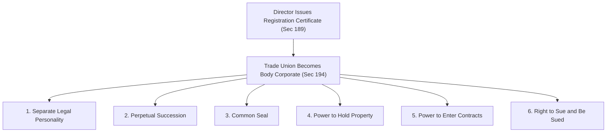
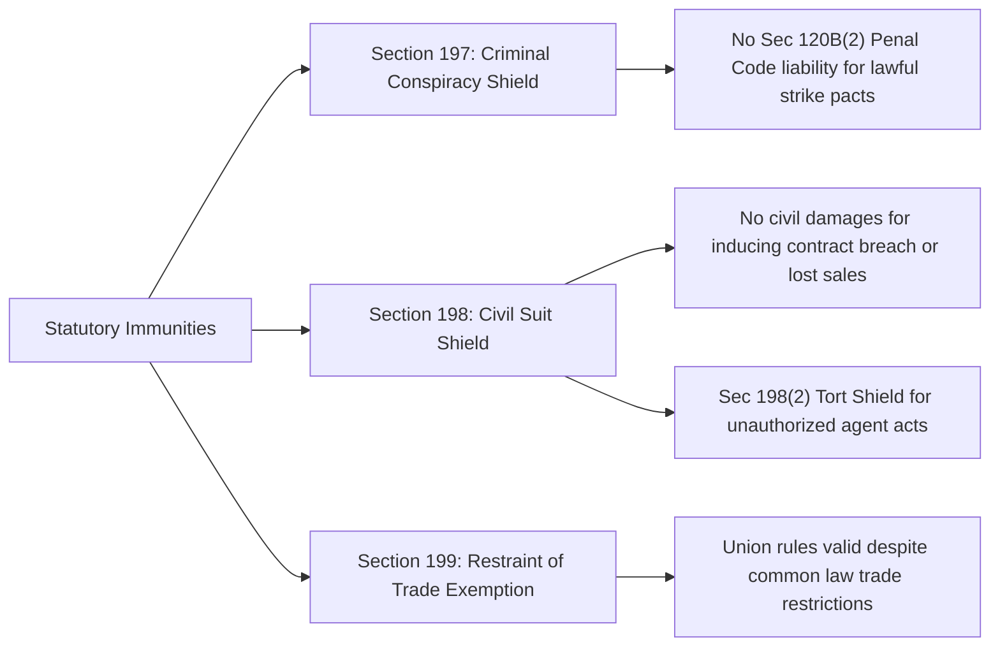

[← Previous: L10.2: Trade Union Registration and Cancellation](L10.2_Trade_Union_Registration_and_Cancellation.md) | [🏠 Index](00_Index.md) | [📐 Master Sheet](99_Master_Formula_and_Statutory_Sheet.md) | [Next: L11.1: Collective Bargaining and CBA (Section 202) →](L11.1_Collective_Bargaining_and_CBA_Sec_202.md)

---

# L10.3: Trade Union Legal Status, Rights, and Applied Role

> [!info] ⚡ Exam Snapshot
> - **Section & Priority:** Section A · SI Sir (Shoaib Islam) · 🔴 Essential
> - **Estimated Read Time:** ~4 mins
> - **PYQs Covered:** 2024 Final Q.8(c) (04 Marks) · Prescribed in Voice Note
> - **Scoring Rule:** State corporate traits under Section 194, immunities under Sections 197 to 199, SI Sir's eight general rights with exact voting quorums, and the four-step framework for applied Q.8(c).

---

## 📌 1. Verbatim Definitions (For 2-Mark Questions)

> **Incorporation of Trade Union [BLC 2006, Sec 194(1)]:** "Every registered trade union shall be a body corporate by the name under which it is registered, and it shall have perpetual succession and a common seal, and shall have power to enter into contract and to acquire, hold and dispose of property, both movable and immovable, and shall by the said name sue or be sued."

*Plain meaning:* Registration gives an informal worker association independent corporate legal standing, turning it into an artificial legal person that can hold property, enter contracts, and litigate in its own registered name.

> **Immunity from Criminal Conspiracy [BLC 2006, Sec 197]:** "No officer or member of a trade union or a collective bargaining agent shall be liable to punishment under section 120B(2) of the Penal Code, 1860 ... in respect of any agreement made between the members thereof for the purpose of furthering any such object of the trade union ... unless the agreement is an agreement to commit an offence."

*Plain meaning:* Union officers and members can collectively agree to hold strikes or advance bargaining demands without facing criminal conspiracy prosecution, provided the agreement is not to commit an actual criminal offense.

---

## ⚡ 2. Core Exam Blocks (Write Directly in Exam)

### 2.1 Legal Status and Corporate Attributes (Section 194)

1. **Body Corporate [Sec 194(1)]:**
   - The registered trade union exists as a distinct legal person under its registered name.
   - Its assets, liabilities, and debts belong strictly to the union entity, never to individual worker members.

2. **Perpetual Succession:**
   - The union enjoys unbroken legal continuity.
   - Member turnover, resignations, retirement, or deaths do not alter or terminate its corporate existence.

3. **Common Seal:**
   - The union possesses an official corporate seal.
   - The seal functions as the corporate signature on formal contracts, legal deeds, and official notices.

4. **Power to Acquire, Hold, and Dispose of Property:**
   - The union has full authority to own movable property (office equipment, vehicles, bank accounts).
   - It also holds authority to own immovable property (land, buildings) and may sell, lease, or mortgage assets in its registered name.

5. **Power to Enter into Contracts:**
   - The union can execute legally binding commercial agreements, office leases, supply purchases, and legal retainer contracts.

6. **Right to Sue and Be Sued:**
   - The union can institute civil lawsuits as a plaintiff in its registered name.
   - Employers and third parties may also initiate legal proceedings against the union directly under that name.

**Corporate Laws Exclusion [Sec 194(2)]:** The Companies Act 1994, the Societies Registration Act 1860, and the Co-operative Societies Ordinance 1985 do not apply to registered trade unions. Any registration attempted under those general corporate statutes is null and void.

> [!tip] Memory Hook: B-P-C-P-C-S (Six Corporate Attributes)
> - **B (Body Corporate):** Distinct legal personality separate from its members.
> - **P (Perpetual Succession):** Unbroken continuity unaffected by member turnover.
> - **C (Common Seal):** Official corporate signature for formal legal deeds.
> - **P (Property Power):** Authority to acquire, hold, and sell movable and immovable assets.
> - **C (Contract Power):** Legal capacity to enter binding commercial agreements.
> - **S (Sue and Be Sued):** Standing to litigate and defend claims in its registered name.

---

### 2.2 Statutory Immunities (Sections 197 to 199)

1. **Criminal Conspiracy Shield [Sec 197]:**
   - Under ordinary law, a collective worker agreement to halt operations could be prosecuted as a criminal conspiracy under Section 120B(2) of the Penal Code 1860.
   - Section 197 provides an absolute defense for agreements made to pursue constitutional trade union objects.
   - *Statutory Limitation:* This shield fails completely if members agree to commit an actual criminal offense such as physical assault, arson, or sabotage.

2. **Civil Suit Shield in Trade Disputes [Sec 198]:**
   - Section 198(1) bars civil courts from hearing damage suits against a registered union or its members on three specific grounds:
     - Inducing another person to break an employment contract.
     - Interfering with the trade, business, or employment of another person.
     - Interfering with the right of any person to dispose of capital or labour freely.
   - *Tort Liability Shield [Sec 198(2)]:* A registered trade union is not civilly liable for tortious acts committed by an agent, provided the agent acted without executive knowledge or contrary to express instructions.

3. **Enforceability of Agreements in Restraint of Trade [Sec 199]:**
   - Overrides Section 27 of the Contract Act 1872.
   - Internal agreements among union members (such as wage guidelines or strike compliance) remain legally valid and enforceable, even if their terms restrain trade or commerce.

---

### 2.3 Eight General Rights of a Registered Trade Union

| # | Right or Privilege | Statutory Basis | Core Legal Rule and Condition |
| :-: | :-- | :-- | :-- |
| 1 | **Incorporation** | Sec 194 | Gains body corporate status, perpetual succession, common seal, property rights, and litigation capacity. |
| 2 | **Criminal Immunity** | Sec 197 | Shields lawful dispute agreements from Section 120B(2) Penal Code conspiracy charges. |
| 3 | **Civil Suit Immunity** | Sec 198 | Blocks civil damage lawsuits for contract breach, business disruption, or capital and labour interference. |
| 4 | **Enforceability of Agreements** | Sec 199 | Internal member agreements remain valid despite general legal restrictions against restraint of trade. |
| 5 | **Inspection of Account Books** | Sec 181 | Officers and members have the statutory right to inspect account books and membership registers at scheduled times. |
| 6 | **Minor Membership** | SI Sir Notes / BLC | Workers aged **15 years or older** can join a union; holding executive office requires reaching the age of **18 years**. |
| 7 | **Change of Name** | SI Sir Notes / BLC | Requires written consent of at least **two-thirds (2/3)** of total members and adoption of a non-identical name. |
| 8 | **Amalgamation of Unions** | SI Sir Notes / BLC | Requires at least **50% voter turnout** among eligible members and at least **60% recorded votes in favor**. |

> [!tip] Memory Hook: 3 Immunities + 5 Organizational Powers
> - **3 Legal Immunities:** Criminal conspiracy shield [Sec 197], civil suit shield [Sec 198], and restraint of trade exemption [Sec 199].
> - **5 Organizational Powers:** Corporate status [Sec 194], book inspection [Sec 181], minor membership (age 15+), name change (2/3 vote), and amalgamation (50% turnout with 60% votes in favor).

---

## 🎯 3. PYQ & Target Answer Key

### Model Target Q1: Legal Status and Corporate Attributes (04 Marks)

> **Question [Model Target Q1]:** "State the legal status of a registered trade union under Section 194 of the Bangladesh Labour Act, 2006. What corporate attributes arise upon registration?" [04 Marks]

**Exam Writing Plan:**

1. **Statutory Baseline:** Cite Section 194(1) and explain that registration under Section 189 converts an informal worker association into an artificial legal person.
2. **Six Corporate Attributes:** Enumerate the six attributes using the **B-P-C-P-C-S** framework from Section 2.1 (Body corporate, Perpetual succession, Common seal, Property rights, Contract capacity, and Right to sue and be sued).
3. **Exclusion of General Laws:** Detail Section 194(2), noting that the Companies Act 1994, Societies Registration Act 1860, and Co-operative Societies Ordinance 1985 do not apply to registered unions.
4. **Concluding Takeaway:** Emphasize that registration ensures complete financial and legal separation between union assets and individual worker liabilities.

---

### Model Target Q2: Statutory Immunities and General Rights (04 Marks)

> **Question [Model Target Q2]:** "Explain the statutory immunities of a registered trade union under Sections 197 to 199 of BLC 2006. Also list its key general rights." [04 Marks]

**Exam Writing Plan:**

1. **Three Core Immunities:** Explain the criminal conspiracy shield under Section 197 (noting the exception for actual offenses), the civil suit shield against strike damages under Section 198, and the restraint of trade validity under Section 199.
2. **Agent Tort Shield:** Highlight Section 198(2), protecting the union from tort liability for unauthorized agent acts committed without executive knowledge.
3. **Five Organizational Powers:** Summarize key general rights from Section 2.3, specifically book inspection under Section 181, minor membership rules, and statutory voting quorums.
4. **Statutory Precision:** State the exact quorums: minor entry at age **15+** (executive office at **18+**), name change requiring a **2/3 majority**, and amalgamation requiring **50% turnout** with **60% votes in favor**.

---

### 2024 Final Q.8(c): Preventing Workplace Bias Against Technical Staff (04 Marks)

> **Question [2024 Final Q.8(c)]:** "Critically evaluate the role of trade unions in preventing workplace discrimination or bias agent technical staff." *(Note: "bias agent" is printed in the original exam paper; it denotes "bias against".)* [04 Marks]

**Full Exam Solution (Four-Step Applied Framework):**

#### 1. Workplace Context and Technical Challenges

Technical personnel in engineering plants, telecommunications firms, and automated manufacturing facilities face distinct workplace vulnerabilities:

- **Salary Suppression:** Technical engineers often receive lower base compensation than administrative or marketing staff of comparable seniority.
- **Subjective Appraisals:** Performance ratings frequently depend on managerial discretion rather than objective metrics like system uptime, bug resolution, or network reliability.
- **Uncompensated Overtime:** Engineers are routinely subjected to late-night shifts for emergency maintenance or system rollouts without statutory overtime remuneration.
- **Hazard Exposure:** Technicians encounter high-voltage switchgear, tower climbing, and radio-frequency radiation without certified protective equipment.
- **Retaliatory Action:** Outspoken junior engineers face threats of punitive field transfers to isolated duty stations.

#### 2. Applicable Statutory Provisions

- **Section 2(65) [BLC 2006]:** Explicitly includes technical, skilled, and manual personnel within the definition of "worker," ensuring full statutory protection unless an individual possesses exclusive managerial hire-and-fire authority.
- **Section 195(b)–(c) [BLC 2006]:** Declares employer discrimination regarding recruitment, promotion, job conditions, or tenure to be an Unfair Labour Practice.
- **Section 202(24)(a) [BLC 2006]:** Empowers the Collective Bargaining Agent (CBA) to negotiate binding collective agreements establishing objective pay scales and transparent promotion ladders.
- **Sections 62–78A and Section 108 [BLC 2006]:** Mandates workplace safety standards, protective equipment, and double the ordinary wage rate for all overtime hours worked.
- **Section 187 [BLC 2006]:** Prohibits the transfer of union officers between districts without their express consent, preventing retaliatory isolation.

#### 3. Critical Legal Evaluation

- **Positive Protective Role:**
  1. *Objective Promotion Criteria:* Collective bargaining agreements replace managerial favoritism with standardized skill matrices, certifications, and technical assessment benchmarks.
  2. *Standardized Compensation:* Structured wage scales eliminate arbitrary inter-departmental pay disparities and secure mandatory overtime payments under Section 108.
  3. *Safety and Legal Shield:* Unions compel employers to supply certified personal protective equipment (PPE) and provide institutional legal defense before the Labour Court if an engineer is victimized for reporting safety hazards.
- **Limitations and Institutional Risks:**
  1. *Non-Technical Dominance:* In mixed industrial plants, general manual workers form the voting majority, which can lead union leadership to prioritize basic wage hikes over specialized engineering hazards like radiation shielding or ergonomic tooling.
  2. *Rigid Seniority Systems:* Traditional union advocacy for seniority-based promotion can restrict rapid career advancement for high-performing young engineers possessing advanced technical expertise.

#### 4. Direct Conclusion and Recommendation

Trade unions provide an indispensable collective shield that converts individual technical vulnerability into enforceable institutional power. Under BLC 2006, unions effectively eliminate managerial discrimination in wages, promotions, and safety. Technical engineers should actively participate in union affairs and contest executive committee seats under Section 179(1)(k) to guarantee that collective bargaining priorities directly address technical hazards, skill-based pay, and meritocratic promotion.

---

## ⚠️ Examiner Traps

> [!warning] Common Traps & High-Penalty Pitfalls
> - **Minor Age Discrepancy:** Minors can enroll as union members at age **15 years or older**, but cannot hold executive office until reaching the age of **18 years**.
> - **Exact Voting Quorums:** A change of name requires the consent of at least **two-thirds (2/3)** of total members. An amalgamation requires at least **50% voter turnout** and at least **60% recorded votes in favor**.
> - **Criminal Immunity Has Boundaries:** Section 197 shields against criminal conspiracy under Section 120B(2) of the Penal Code, but never shields acts of physical violence, assault, damage to property, or sabotage.
> - **Agent Tort Protection Condition:** Section 198(2) protects the union from civil tort liability only if the agent acted without the knowledge or contrary to express instructions of the executive committee.
> - **General Corporate Acts Barred:** Trade unions cannot register under the Companies Act 1994, Societies Registration Act 1860, or Co-operative Societies Ordinance 1985 [Sec 194(2)].

---

[← Previous: L10.2: Trade Union Registration and Cancellation](L10.2_Trade_Union_Registration_and_Cancellation.md) | [🏠 Index](00_Index.md) | [📐 Master Sheet](99_Master_Formula_and_Statutory_Sheet.md) | [Next: L11.1: Collective Bargaining and CBA (Section 202) →](L11.1_Collective_Bargaining_and_CBA_Sec_202.md)
