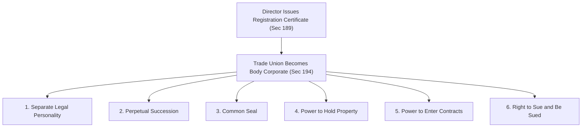
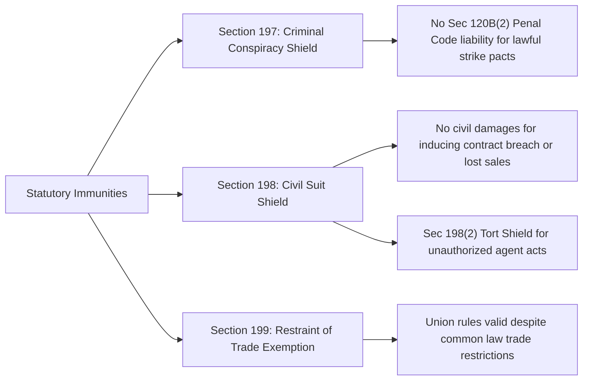

[← Previous: L10.2: Trade Union Registration and Cancellation](L10.2_Trade_Union_Registration_and_Cancellation.md) | [🏠 Index](00_Index.md) | [📐 Master Sheet](99_Master_Formula_and_Statutory_Sheet.md) | [Next: L11.1: Collective Bargaining and CBA (Section 202) →](L11.1_Collective_Bargaining_and_CBA_Sec_202.md)

---

# L10.3: Trade Union Legal Status, Rights, and Applied Role

> [!info] ⚡ Exam Snapshot
> - **Section & Priority:** Section A · SI Sir (Shoaib Islam) · 🔴 Essential
> - **Estimated Read Time:** ~4 mins
> - **PYQs Covered:** 2024 Final Q.8(c) (04 Marks) · Prescribed in Voice Note
> - **Scoring Rule:** State corporate traits under Section 194 and immunities under Sections 197 to 199. List SI Sir's eight general rights with exact quorums. Use the four-step framework for applied Q.8(c).

---

## 📌 1. Verbatim Definitions (For 2-Mark Questions)

> **Incorporation of Trade Union [BLC 2006, Sec 194(1)]:** "Every registered trade union shall be a body corporate by the name under which it is registered, and it shall have perpetual succession and a common seal, and shall have power to enter into contract and to acquire, hold and dispose of property, both movable and immovable, and shall by the said name sue or be sued."

*Plain meaning:* Once registered, a trade union becomes its own legal person, just like a company. Even if members quit or leaders die, the union stays alive as its own legal person. It can own property, sign contracts, and go to court under its own official name.

> **Immunity from Criminal Conspiracy [BLC 2006, Sec 197]:** "No officer or member of a trade union or a collective bargaining agent shall be liable to punishment under section 120B(2) of the Penal Code, 1860 ... in respect of any agreement made between the members thereof for the purpose of furthering any such object of the trade union ... unless the agreement is an agreement to commit an offence."

*Plain meaning:* Union members and leaders can agree to hold strikes or demand higher wages without facing criminal conspiracy charges. But this protection ends if they agree to commit a real crime, such as violence or property damage.

---

## ⚡ 2. Core Exam Blocks (Write Directly in Exam)

### 2.1 Legal Status and Corporate Attributes (Section 194)

1. **Body Corporate [Sec 194(1)]:**
   - The union exists as an independent legal person under its registered name.
   - Its money, property, and debts belong strictly to the union, not to individual worker members.

2. **Perpetual Succession:**
   - The union enjoys unbroken legal life.
   - Even if members quit or leaders die, the union stays alive as its own legal person, just like a company.

3. **Common Seal:**
   - The union possesses an official seal or stamp.
   - This seal acts as the union's official corporate signature on contracts, legal deeds, and formal notices.

4. **Power to Acquire, Hold, and Dispose of Property:**
   - The union can own movable property like bank accounts, vehicles, and office computers.
   - It can also own immovable property like land and office buildings.
   - It can buy, sell, rent, or mortgage assets in its own registered name.

5. **Power to Enter into Contracts:**
   - The union can sign legally binding commercial agreements in its own registered name.
   - For example, it can lease office space, hire lawyers, or purchase equipment.

6. **Right to Sue and Be Sued:**
   - The union can file lawsuits in court to protect its legal rights.
   - Employers and third parties can also sue the union directly under its registered name.

**General Corporate Laws Do Not Apply [Sec 194(2)]:**

- General corporate laws do not apply to registered trade unions.
- These barred laws include the Companies Act 1994, Societies Registration Act 1860, and Co-operative Societies Ordinance 1985.
- Any attempt to register a trade union under those general laws is completely null and void.

> [!tip] Memory Hook: B-P-C-P-C-S (Six Corporate Attributes)
> - **B (Body Corporate):** Exists as an independent legal person separate from its members.
> - **P (Perpetual Succession):** Stays alive continuously even when members or leaders change.
> - **C (Common Seal):** Uses its official stamp as a corporate signature.
> - **P (Property Power):** Can buy, own, and sell land, buildings, and bank accounts.
> - **C (Contract Power):** Can sign binding contracts in its own name.
> - **S (Sue and Be Sued):** Can sue others or be sued in court.

---

### 2.2 Statutory Immunities (Sections 197 to 199)

1. **Criminal Conspiracy Shield [Sec 197]:**
   - Under general criminal law, workers agreeing to stop work could face criminal conspiracy charges [Penal Code Sec 120B(2)].
   - Section 197 shields union officers and members from conspiracy charges when planning lawful union actions.
   - *Crucial Exception:* This shield does not protect violence, physical assault, property damage, or sabotage. Real crimes are always punished.

2. **Civil Suit Shield in Trade Disputes [Sec 198]:**
   - Section 198(1) stops employers from suing the union in civil court for financial losses caused by strikes.
   - Employers cannot sue the union for:
     - Asking workers to break their employment contracts during a strike.
     - Disrupting the employer's business or trade operations.
     - Interfering with how the employer uses capital or hires labour.
   - *Protection from Agent Misconduct [Sec 198(2)]:* The union is not liable for wrongful acts (torts) committed by an agent. This applies only if the agent acted without executive committee knowledge or against direct orders.

3. **Agreements in Restraint of Trade Are Valid [Sec 199]:**
   - Under Section 27 of the Contract Act 1872, agreements that restrict business or trade are normally void.
   - Section 199 creates an exception for registered trade unions.
   - Internal union agreements (such as agreeing on wage rules or strike actions) remain legally valid and enforceable.

---

### 2.3 Eight General Rights of a Registered Trade Union

| # | Right or Privilege | Statutory Basis | Core Legal Rule and Condition |
| :-: | :-- | :-- | :-- |
| 1 | **Incorporation** | Sec 194 | Becomes a body corporate with perpetual life, common seal, property rights, and court standing. |
| 2 | **Criminal Immunity** | Sec 197 | Protects members from Section 120B(2) conspiracy charges during lawful trade disputes. |
| 3 | **Civil Suit Immunity** | Sec 198 | Blocks employer damage lawsuits for strike-related contract breaches or business losses. |
| 4 | **Enforceability of Agreements** | Sec 199 | Internal member agreements remain valid even if they restrict trade or business. |
| 5 | **Inspection of Account Books** | Sec 181 | Union officers and members can inspect account books and membership rolls at fixed times. |
| 6 | **Minor Membership** | SI Sir Notes / BLC | Workers aged **15 or older** can join. But they must reach **18 years** to hold executive office. |
| 7 | **Change of Name** | SI Sir Notes / BLC | Requires written consent from at least **two-thirds (2/3)** of total members. |
| 8 | **Amalgamation of Unions** | SI Sir Notes / BLC | Requires at least **50% voter turnout** and at least **60% votes in favor** to merge unions. |

> [!tip] Memory Hook: 3 Immunities + 5 Organizational Powers
> - **3 Legal Shields:** Criminal conspiracy shield [Sec 197], civil suit shield [Sec 198], and restraint of trade exemption [Sec 199].
> - **5 Organizational Powers:** Body corporate status [Sec 194], book inspection [Sec 181], minor membership (join at 15+, lead at 18+), name change (2/3 consent), and union merger (50% turnout, 60% approval).

---

## 🎯 3. PYQ & Target Answer Key

### Model Target Q1: Legal Status and Corporate Attributes (04 Marks)

> **Question [Model Target Q1]:** "State the legal status of a registered trade union under Section 194 of the Bangladesh Labour Act, 2006. What corporate attributes arise upon registration?" [04 Marks]

**Exam Writing Plan:**

1. **Statutory Baseline [Sec 194(1)]:**
   - Cite Section 194(1).
   - Explain that registration turns an informal group into an independent legal person.

2. **Six Corporate Attributes (B-P-C-P-C-S):**
   - **Body Corporate:** Exists as an independent legal entity separate from its workers.
   - **Perpetual Succession:** Stays alive continuously even if members quit or die.
   - **Common Seal:** Holds an official stamp used as a formal signature.
   - **Property Rights:** Can buy, own, and sell land, buildings, and bank accounts.
   - **Contract Capacity:** Can sign legally binding contracts in its own name.
   - **Sue and Be Sued:** Can bring lawsuits or defend itself in court.

3. **Exclusion of General Laws [Sec 194(2)]:**
   - Note that general corporate laws do not apply to trade unions.
   - These include the Companies Act 1994 and Societies Registration Act 1860.

4. **Concluding Takeaway:**
   - Registration creates a total legal shield between union funds and individual worker assets.

---

### Model Target Q2: Statutory Immunities and General Rights (04 Marks)

> **Question [Model Target Q2]:** "Explain the statutory immunities of a registered trade union under Sections 197 to 199 of BLC 2006. Also list its key general rights." [04 Marks]

**Exam Writing Plan:**

1. **Three Core Legal Immunities:**
   - **Criminal Shield [Sec 197]:** Protects lawful strike agreements from Penal Code conspiracy charges.
   - **Civil Shield [Sec 198]:** Stops employers from suing for strike-related money losses.
   - **Restraint of Trade [Sec 199]:** Keeps internal union agreements valid despite Section 27 of the Contract Act.

2. **Agent Tort Protection [Sec 198(2)]:**
   - Protects the union from liability if an agent commits a wrongful act without executive knowledge.

3. **General Rights and Exact Quorums:**
   - Right to inspect account books and registers [Sec 181].
   - Minor membership: workers can join at **15+**, but must be **18+** to hold executive office.
   - Name change: requires written consent from at least **two-thirds (2/3)** of members.
   - Merger (Amalgamation): requires **50% voter turnout** and **60% approval**.

---

### 2024 Final Q.8(c): Preventing Workplace Bias Against Technical Staff (04 Marks)

> **Question [2024 Final Q.8(c)]:** "Critically evaluate the role of trade unions in preventing workplace discrimination or bias agent technical staff." *(Note: "bias agent" is printed in the original exam paper; it denotes "bias against".)* [04 Marks]

**Full Exam Solution (Four-Step Applied Framework):**

#### 1. Workplace Context and Technical Challenges

Engineers and technical workers in factories, telecom firms, and tech plants face unique workplace problems:

- **Lower Base Pay:** Technical engineers often get lower base pay than administrative or marketing staff of similar seniority.
- **Unfair Appraisals:** Performance ratings often depend on boss favoritism rather than real technical results like server uptime or bug fixes.
- **Unpaid Overtime:** Engineers are often forced to work late-night emergency shifts without legal overtime pay.
- **Dangerous Work Hazards:** Technicians work with high-voltage gear, climb towers, or face radiation without proper safety equipment.
- **Punishment Transfers:** Outspoken junior engineers face threats of forced transfers to remote, isolated field stations.

#### 2. Applicable Statutory Provisions

- **Section 2(65) [BLC 2006]:** Technical, skilled, and manual employees are legally defined as "workers". They get full legal protection unless they hold pure managerial hire-and-fire powers.
- **Section 195(b)–(c) [BLC 2006]:** Treating workers unfairly in hiring, promotion, pay, or job terms is an illegal Unfair Labour Practice by the employer.
- **Section 202(24)(a) [BLC 2006]:** The Collective Bargaining Agent (CBA) has the legal power to negotiate binding agreements. These agreements fix clear pay scales and fair promotion rules.
- **Sections 62–78A and Section 108 [BLC 2006]:** The law mandates workplace safety gear and requires double the normal wage rate for all overtime hours worked.
- **Section 187 [BLC 2006]:** Employers cannot transfer union officers to another district without their written consent, preventing revenge transfers.

#### 3. Critical Legal Evaluation

- **How Unions Help (Protective Role):**
  1. *Fair Promotion Rules:* Collective bargaining agreements replace boss favoritism with clear skill tests, certifications, and objective performance metrics.
  2. *Standardized Pay and Overtime:* Fixed wage scales stop unfair pay gaps between departments and guarantee double overtime pay under Section 108.
  3. *Safety and Legal Defense:* Unions force employers to provide certified personal protective equipment (PPE). They also defend engineers in the Labour Court if the boss punishes them for reporting hazards.
- **Limitations and Risks:**
  1. *Manual Workers Dominate:* In mixed factories, general manual workers form the voting majority. Union leaders may focus only on basic wage hikes, ignoring specialized engineering hazards like radiation shielding or ergonomic tools.
  2. *Rigid Seniority Rules:* Traditional unions often promote workers by seniority alone. This practice can slow down career growth for skilled young engineers who have advanced technical talent.

#### 4. Direct Conclusion and Recommendation

Trade unions give technical staff collective bargaining power to stop unfair treatment. Under BLC 2006, unions help eliminate boss discrimination in wages, promotions, and workplace safety. Engineers should actively join unions and contest executive committee seats under Section 179(1)(k). By holding leadership roles, engineers can ensure that collective bargaining directly addresses technical safety hazards, skill-based pay, and fair promotions.

---

## ⚠️ Examiner Traps

> [!warning] Common Traps & High-Penalty Pitfalls
> - **Minor Age Rules:** Minors can join a union at age **15 years or older**. But they cannot hold executive office until age **18 years**.
> - **Exact Voting Quorums:** Changing the union name requires written consent from at least **two-thirds (2/3)** of total members. Merging unions (amalgamation) requires at least **50% voter turnout** and at least **60% votes in favor**.
> - **Criminal Shield Has Strict Limits:** Section 197 shields against criminal conspiracy [Penal Code Sec 120B(2)]. But it never shields violence, physical assault, property damage, or sabotage.
> - **Agent Tort Protection Condition:** Section 198(2) protects the union from civil damage suits only if the agent acted without executive knowledge or against express orders.
> - **General Corporate Laws Are Barred:** A trade union cannot register under the Companies Act 1994, Societies Registration Act 1860, or Co-operative Societies Ordinance 1985 [Sec 194(2)].

---

[← Previous: L10.2: Trade Union Registration and Cancellation](L10.2_Trade_Union_Registration_and_Cancellation.md) | [🏠 Index](00_Index.md) | [📐 Master Sheet](99_Master_Formula_and_Statutory_Sheet.md) | [Next: L11.1: Collective Bargaining and CBA (Section 202) →](L11.1_Collective_Bargaining_and_CBA_Sec_202.md)
