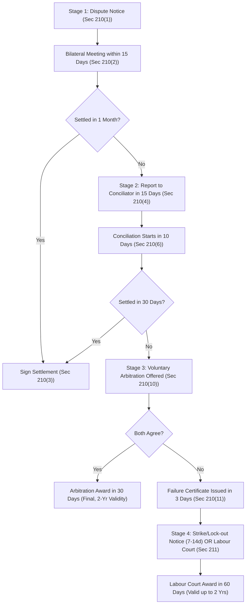

[← Previous: L11.1: Collective Bargaining and CBA (Section 202)](L11.1_Collective_Bargaining_and_CBA_Sec_202.md) | [🏠 Index](00_Index.md) | [📐 Master Sheet](99_Master_Formula_and_Statutory_Sheet.md) | [Next: L12.1: Unfair Labour Practices (Sections 195 and 196) →](L12.1_Unfair_Labour_Practices_Sec_195_and_196.md)

# L11.2: Industrial Disputes and Settlement Ladder (Section 210)

> [!info] ⚡ Exam Snapshot
> - **Section & Priority:** Section A · Shoaib Islam Sir · 🔴 Essential (Shoaib Sir Applied Lock!) | **Read Time:** ~5 mins
> - **PYQs Covered:** 2024 Final Q.8(a) Part 1 (01m), 2024 Final Q.3(c) (Hypothetical Dispute Scenario & Settlement Steps, 04m)
> - **Scoring Rule:** State the 4-stage ladder with exact timelines (15d-1m-15d-10d-30d-3d-30d-15d-7/14d-60d) and use 4-step format for cases.

---

## 📌 1. Verbatim Definitions (For 2-Mark Questions)

> **Industrial Dispute [BLC 2006, Sec 2(62)]:**  
> "any dispute or difference of opinion between employers and employers, between employers and workers or between workers and workers in respect of appointment or conditions of service or conditions of work or environment of work of any person."
> - *Plain meaning:* Formal disagreement over hiring, wages, hours, safety, or work rules.

> **Lock-out [BLC 2006, Sec 2(57)]:**  
> "the closing of a place of work or a part of such place, or the suspension of work therein, wholly or partly, by an employer, or refusal, absolute or conditional, by an employer to continue allow to work by any number of workers employed by him, where such closing, suspension or refusal occurs in connection with any industrial dispute or is intended for the purpose of compelling workers to accept certain terms and conditions of employment."
> - *Plain meaning:* Employer closes plant or bars entry to force workers to accept terms.

> **Strike [SI Sir Notes · Chapter 4 / BLC 2006, Sec 2(22)]:**  
> - *SI Sir Notes:* "cessation of work by a body of persons employed in any establishment acting in combination or a concerted refusal, or refusal under a common understanding of any number of persons who are or have been so employed to continue to work or to accept employment."  
> - *BLC 2006 Sec 2(22):* "cessation of work or refusal to work jointly by a group of workers employed in any establishment or refusal to accept work or continue to work unanimously by a body of workers employed therein."  
> - *Plain meaning:* Workers stop work together to compel management to accept demands.

---

## ⚡ 2. Core Exam Blocks (Write Directly in Exam)

### Legal Standing to Raise an Industrial Dispute [Section 209]

Under **Section 209**, an industrial dispute exists in law ONLY when raised by:
1. The **Employer**, or
2. The certified **Collective Bargaining Agent (CBA)** (or Participation Committee if no CBA exists).

- **Individual Workers Barred:** Single workers cannot raise disputes under Chapter XIV; must file individual grievance notices under **Section 33**.
- **Minority Unions Barred:** Uncertified unions have zero standing under Section 209; any dispute action is void in law.

---

### Forms of Dispute Action: Employers vs Workers

| Action Form | By | Section | Nature & Purpose | Legal Status |
| :--- | :--- | :--- | :--- | :--- |
| **Lock-out** | Employer | `Sec 2(57)` | Closes plant to compel workers to accept terms | Lawful after failure certificate & notice (`Sec 211`) |
| **Lay-off** | Employer | `Sec 2(58)` | Work halt from power/material shortage or breakdown | Lawful operational halt; compensation under `Sec 16` |
| **Retrenchment** | Employer | `Sec 2(11)` | Cuts surplus staff for operational efficiency | Lawful; 1-month notice + severance pay (`Sec 20`) |
| **Dismissal** | Employer | `Sec 2(39)` | Firing for proven misconduct after inquiry | Lawful disciplinary action under `Sec 23, 24` |
| **Strike** | Workers | `Sec 2(22)` | United work stoppage to compel acceptance of terms | Lawful if called by CBA with $\frac{2}{3}$ ballot approval |
| **Go-slow** | Workers | `Sec 2(18)` | Deliberate slowdown of production output | Illegal worker unfair labour practice (`Sec 196(2)(e)`) |
| **Gherao** | Workers | `Sec 196(2)(f)` | Physical confinement of bosses or gate blockade | Illegal worker unfair labour practice; criminal penalty |

---

### The Statutory Settlement Ladder [Sections 210 and 211]

#### The Four Statutory Stages [Sections 210 and 211]

1. **Stage 1 · Bipartite Talks [Sec 210(1)–(3)]:** Written demand served (`Sec 210(1)`). Meeting arranged within **15 days** (`Sec 210(2)`). Negotiations run up to **1 month** (`Sec 210(4)(b)`). Parties sign a binding **Memorandum of Settlement** upon accord (`Sec 210(3)`).
2. **Stage 2 · Conciliation [Sec 210(4)–(11)]:** Report deadlock to Conciliator within **15 days** (`Sec 210(4)`). Conciliator begins within **10 days** (`Sec 210(6)`). Settlement window is **30 days** (`Sec 210(9)`). Parties sign settlement on success (`Sec 210(8)`). On failure, Conciliator urges arbitration. If rejected, Conciliator issues **Failure Certificate within 3 days** (`Sec 210(11)`).
3. **Stage 3 · Voluntary Arbitration [Sec 210(12)–(17)]:** Optional joint written referral (`Sec 210(12)`). Arbitrator delivers award within **30 days** (`Sec 210(14)`). Award is **final** without appeal (`Sec 210(16)`). Award binds parties for up to **2 years** (`Sec 210(17)`).
4. **Stage 4 · Strike / Lock-out or Labour Court [Sec 211]:** Move within **15 days** of Failure Certificate (`Sec 211(1)`). CBA serves strike notice or employer declares lock-out. Either party may apply to Labour Court. Notice lead time is **7 to 14 days**. Strike requires **two-thirds ($\frac{2}{3}$)** member secret ballot approval (`Sec 211(1)` Proviso). Labour Court delivers award within **60 days**, valid up to **2 years** (`Sec 211(6)–(7)`). Government may prohibit strikes over 30 days or in public utilities (`Sec 211(3)–(5)`). Total ban for **3 years** in new or foreign-backed factories (`Sec 211(8)`).

---

### Cessation of Industrial Disputes [Section 212]

Disputes automatically cease to exist if statutory 15-day filing or notice deadlines are missed (`Sec 212(1)`).
- **One-Year Bar [Sec 212(2)]:** Parties cannot re-raise the same dispute within **1 year**.

> [!tip] Memory Hook: Statutory Dispute Timeline Chain
> **15d** (meet) $\rightarrow$ **1m** (talks) $\rightarrow$ **15d** (report) $\rightarrow$ **10d** (start) $\rightarrow$ **30d** (mediate) $\rightarrow$ **3d** (fail cert) $\rightarrow$ **30d** (arbitrate) $\rightarrow$ **15d** (notice) $\rightarrow$ **7–14d** (strike lead) $\rightarrow$ **$\frac{2}{3}$** (ballot) $\rightarrow$ **60d** (court) $\rightarrow$ **2y** (award).

---

## 🎯 3. PYQ & Target Answer Key

### 2024 Final Q.8(a) (Part 1) · Industrial Dispute Definition (01 Mark)
*Verbatim Question: Define Industrial dispute and collective bargaining.*
- **Answer Blueprint:** Quote Section 2(62) verbatim definition from §1. Mention the standing rule under Section 209 (dispute exists in law only when raised by employer or certified CBA).

---

### 2024 Final Q.3(c) · Hypothetical Dispute & Resolution Steps (04 Marks)
*Verbatim Question: Develop a hypothetical scenario involving an industrial dispute in an industry and outline the steps that should be taken to resolve it under the Bangladesh Labor Code 2006.*

1. **Facts:** Apex Microelectronics Ltd. (500 workers). Certified CBA: Apex Workers' Union. Disputed issues: uncompensated 12-hour shifts (`Sec 108`), lack of acid exhaust ventilation, and demand for 15% skill allowance. Management rejected demands.
2. **Law & Sections:** BLC 2006 `Sec 2(62)` (dispute), `Sec 209` (CBA standing), `Sec 210` (ladder), `Sec 108` (overtime).
3. **Sequential Steps to Resolve under Section 210:**
   - **Step 1 [Sec 210(1)]:** CBA delivers written charter of demands to Managing Director.
   - **Step 2 [Sec 210(2)–(3)]:** Meeting held within **15 days**. Over 3 weeks, employer agrees to ventilation and overtime pay, but rejects allowance. 1-month window ends without full accord.
   - **Step 3 [Sec 210(4)–(8)]:** CBA reports to Conciliator within **15 days**. Conciliator summons parties within **10 days**. During 30-day mediation, Conciliator brokers compromise: overtime arrears cleared, exhaust hoods installed, and 7% allowance tied to PCB output.
   - **Step 4 [Sec 210(8)]:** Parties sign binding **Memorandum of Settlement** before Conciliator, enforceable for 2 years.
   - *Contingency:* If conciliation failed, Failure Certificate issues in 3 days (`Sec 210(11)`). Parties could pursue arbitration (`Sec 210(12)`) or strike notice with $\frac{2}{3}$ ballot approval (`Sec 211(1)`).
4. **Direct Conclusion:** Dispute is lawfully settled at Stage 2 under Section 210(8). The signed settlement restores industrial peace and enforces safety and overtime rights.

---

> [!warning] ⚠️ Examiner Traps
> - **Standing Trap:** Individual workers cannot use Section 210; they must file individual grievances under **Section 33**.
> - **Strike Ballot Majority:** Strike notice requires approval of at least **two-thirds ($\frac{2}{3}$)** of union members under 2013 amendment (not $\frac{3}{4}$).
> - **Notice Window:** Strike notice must be served within **15 days** of Failure Certificate, giving **7 to 14 days** lead time.
> - **Dispute Extinction:** Under Section 212, missed deadlines extinguish the dispute, barring re-filing for **1 year**.

---

[← Previous: L11.1: Collective Bargaining and CBA (Section 202)](L11.1_Collective_Bargaining_and_CBA_Sec_202.md) | [🏠 Index](00_Index.md) | [📐 Master Sheet](99_Master_Formula_and_Statutory_Sheet.md) | [Next: L12.1: Unfair Labour Practices (Sections 195 and 196) →](L12.1_Unfair_Labour_Practices_Sec_195_and_196.md)
