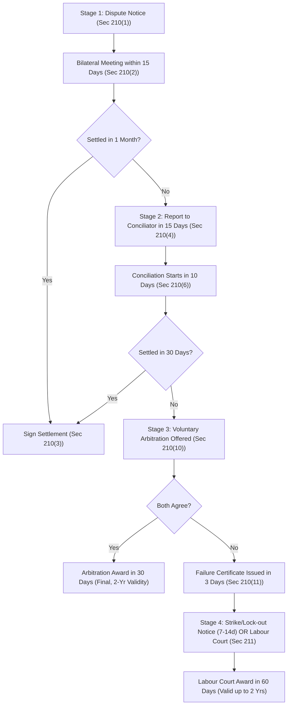

[← Previous: L11.1: Collective Bargaining and CBA (Section 202)](L11.1_Collective_Bargaining_and_CBA_Sec_202.md) | [🏠 Index](00_Index.md) | [📐 Master Sheet](99_Master_Formula_and_Statutory_Sheet.md) | [Next: L12.1: Unfair Labour Practices (Sections 195 and 196) →](L12.1_Unfair_Labour_Practices_Sec_195_and_196.md)

---

# L11.2: Industrial Disputes and Settlement Ladder (Section 210)

> [!info] ⚡ Exam Snapshot
> - **Section & Priority:** Section A · Shoaib Islam Sir · 🔴 Essential (Shoaib Sir Applied Lock)
> - **Estimated Read Time:** ~5 mins
> - **PYQs Covered:** 2024 Final Q.8(a) Part 1 (01m), 2024 Final Q.3(c) (Hypothetical Dispute Scenario & Settlement Steps, 04m)
> - **Scoring Rule:** State the 4-stage settlement ladder with exact timelines (15d-1m-15d-10d-30d-3d-30d-15d-7/14d-60d) and use the 4-step framework for applied scenarios.

---

## 📌 1. Verbatim Definitions (For 2-Mark Questions)

> **Industrial Dispute [BLC 2006, Sec 2(62)]:** "any dispute or difference of opinion between employers and employers, between employers and workers or between workers and workers in respect of appointment or conditions of service or conditions of work or environment of work of any person." *(BLC 2006, Section 2(62))*

*Plain meaning:* A formal workplace disagreement between employers and workers concerning employment terms, wage scales, working hours, safety appliances, or factory rules.

> **Lock-out [BLC 2006, Sec 2(57)]:** "the closing of a place of work or a part of such place, or the suspension of work therein, wholly or partly, by an employer, or refusal, absolute or conditional, by an employer to continue allow to work by any number of workers employed by him, where such closing, suspension or refusal occurs in connection with any industrial dispute or is intended for the purpose of compelling workers to accept certain terms and conditions of employment." *(BLC 2006, Section 2(57))*

*Plain meaning:* An employer temporarily closes down the workplace or denies entry to workers to compel them to accept specific terms and conditions of employment during an ongoing industrial dispute.

> **Strike [BLC 2006, Sec 2(22) & SI Sir Notes · Chapter 4]:** "cessation of work by a body of persons employed in any establishment acting in combination or a concerted refusal, or refusal under a common understanding of any number of persons who are or have been so employed to continue to work or to accept employment." *(BLC 2006, Section 2(22) & SI Sir Class Notes)*

*Plain meaning:* A collective, organized refusal to work by a group of workers acting together to pressure management into conceding to their demands.

---

## ⚡ 2. Core Exam Blocks (Write Directly in Exam)

### Legal Standing to Raise an Industrial Dispute [Section 209]

Under **Section 209** of the Bangladesh Labour Act 2006, an industrial dispute exists in the eyes of the law only when raised by:

1. The **Employer**, or
2. The certified **Collective Bargaining Agent (CBA)** (or the Participation Committee if no trade union exists).

**Parties Barred from Raising Chapter XIV Disputes:**

- **Individual Workers:** A single worker cannot raise an industrial dispute under Chapter XIV. An individual worker seeking redress for an individual legal right violation must file a grievance petition under **Section 33**.
- **Uncertified Minority Trade Unions:** A registered trade union that lacks certified CBA status has zero standing under Section 209. Any dispute action or strike notice initiated by a minority union is completely void in law.

---

### Forms of Dispute Action: Employers vs Workers

| Action Form | Initiated By | Statutory Section | Underlying Nature and Operational Purpose | Legal Status under BLC 2006 |
| :--- | :--- | :--- | :--- | :--- |
| **Lock-out** | Employer | `Sec 2(57)` | Closes the workplace or bars entry to force workers to accept disputed employment terms | Lawful only after a failure certificate is issued and statutory notice is served (`Sec 211`) |
| **Lay-off** | Employer | `Sec 2(58)` | Suspends work temporarily due to shortage of power, coal, or raw materials, or machine breakdown | Lawful operational measure; requires statutory compensation under `Sec 16` |
| **Retrenchment** | Employer | `Sec 2(11)` | Terminates surplus workers to streamline operations or respond to company downsizing | Lawful; requires 30 days written notice and severance compensation (`Sec 20`) |
| **Dismissal** | Employer | `Sec 2(39)` | Discharges a worker for proven misconduct following a formal disciplinary inquiry | Lawful disciplinary action following procedures under `Sec 23` and `Sec 24` |
| **Strike** | Workers | `Sec 2(22)` | Coordinated work stoppage to pressure the employer into accepting worker demands | Lawful only when called by the CBA with two-thirds member secret ballot approval (`Sec 211(1)`) |
| **Go-slow** | Workers | `Sec 2(18)` | Deliberate, organized reduction in the normal pace of production output | Illegal worker unfair labour practice under `Sec 196(2)(e)` |
| **Gherao** | Workers | `Sec 196(2)(f)` | Physical confinement of management personnel or blockade of factory gates | Illegal worker unfair labour practice carrying criminal prosecution and penalties |

---

### The Statutory Settlement Ladder [Sections 210 and 211]

#### The Four Statutory Stages [Sections 210 and 211]

1. **Stage 1 · Bipartite Direct Negotiation [Sec 210(1)–(3)]:**
   - **Written Notice of Dispute (`Sec 210(1)`):** When an industrial dispute arises or is anticipated, the employer or the certified CBA must communicate the grievances or demands in writing to the other party.
   - **Mandatory Meeting Window (`Sec 210(2)`):** The party receiving the written notice is legally required to arrange a formal collective bargaining meeting within **15 days** of receipt.
   - **Negotiation Period (`Sec 210(4)(b)`):** Both parties conduct direct dialogue across the table for a maximum statutory period of **1 month** from the date of the first meeting, unless extended by mutual written agreement.
   - **Binding Accord (`Sec 210(3)`):** If an agreement is reached, the parties execute a formal written **Memorandum of Settlement** signed by both sides, and copies are forwarded to the Government, the Director of Labour, and the Conciliator.

2. **Stage 2 · Conciliation by Government Conciliator [Sec 210(4)–(11)]:**
   - **Reporting Deadlock (`Sec 210(4)`):** If bipartite talks fail to produce a settlement within 1 month, or if the recipient fails to arrange a meeting within 15 days, either party may report the dispute in writing to the official Conciliator within **15 days**.
   - **Commencement of Proceedings (`Sec 210(6)`):** The Conciliator must initiate formal conciliation proceedings within **10 days** of receiving the written request and summon authorized representatives to joint conciliation conferences.
   - **Statutory Mediation Window (`Sec 210(9)`):** The Conciliator is allowed **30 days** from receipt of the request to mediate an accord between the parties.
   - **Successful Settlement (`Sec 210(8)`):** If a compromise is reached, the parties sign a formal Memorandum of Settlement before the Conciliator, which legally binds all employees and the employer.
   - **Failure Procedure (`Sec 210(10)–(11)`):** If no settlement is reached within 30 days, the Conciliator attempts to persuade both parties to submit the dispute to voluntary arbitration. If either party refuses arbitration, the Conciliator must issue a **Failure Certificate within 3 days** of the refusal (`Sec 210(11)`).

3. **Stage 3 · Voluntary Arbitration [Sec 210(12)–(17)]:**
   - **Joint Written Referral (`Sec 210(12)`):** Voluntary arbitration is an optional step that requires both parties to submit a joint written agreement referring the dispute to an agreed Arbitrator from the Government panel.
   - **Arbitration Award Window (`Sec 210(14)`):** The Arbitrator hears both parties and must deliver a formal award within **30 days** of receiving the referral, or within an extended timeframe mutually agreed upon in writing.
   - **Finality and Legal Validity (`Sec 210(16)–(17)`):** The Arbitrator's award is **final and conclusive**, and no appeal lies against it in any court. The award remains legally binding on all parties for a period of up to **2 years**.

4. **Stage 4 · Strike, Lock-out, or Labour Court Decision [Sec 211]:**
   - **Window to Exercise Options (`Sec 211(1)`):** Within **15 days** of receiving the Failure Certificate from the Conciliator, the party that raised the dispute may serve a strike or lock-out notice, or apply directly to the Labour Court for judicial adjudication.
   - **Notice Lead Time (`Sec 211(1)`):** Any strike or lock-out notice must specify a commencement date that is **not earlier than 7 days** and **not later than 14 days** from the date of the notice.
   - **Mandatory Secret Ballot Requirement (`Sec 211(1)` Proviso):** The CBA cannot serve a strike notice without conducting a secret ballot under Conciliator supervision, where at least **two-thirds ($\frac{2}{3}$)** of the total union members vote in favor of the strike.
   - **Labour Court Adjudication (`Sec 211(2), (6)–(7)`):** Either party may refer the dispute to the Labour Court at any point. The Labour Court conducts hearings and delivers a binding judgment within **60 days**, which remains valid for up to **2 years**.
   - **Government Prohibition Powers (`Sec 211(3)–(5)`):** The Government may issue an order prohibiting any strike or lock-out lasting more than **30 days**, or at any time if the dispute affects public utility services or causes severe national hardship, immediately referring the case to the Labour Court.
   - **Three-Year Strike Ban in New Establishments (`Sec 211(8)`):** Strikes and lock-outs are completely prohibited for **3 years** from the start of commercial production in any newly established enterprise or establishment built with foreign investment.

---

### Cessation of Industrial Disputes [Section 212]

Under **Section 212(1)** of the Bangladesh Labour Act 2006, an industrial dispute automatically ceases to exist if the party raising it fails to comply with statutory timelines:

1. Failing to apply for conciliation within **15 days** after bipartite negotiations fail.
2. Failing to serve a strike or lock-out notice, or apply to the Labour Court, within **15 days** of receiving the Failure Certificate.
3. Failing to commence a declared strike or lock-out on the exact date specified in the statutory notice.

- **One-Year Statutory Bar (`Sec 212(2)`):** Once a dispute ceases to exist due to missed statutory deadlines, the parties are legally barred from raising an identical dispute within **1 year** from the date of cessation.

> [!tip] Memory Hook: Statutory Dispute Timeline Chain
> **15d** (meet) $\rightarrow$ **1m** (talks) $\rightarrow$ **15d** (report) $\rightarrow$ **10d** (start) $\rightarrow$ **30d** (mediate) $\rightarrow$ **3d** (fail cert) $\rightarrow$ **30d** (arbitrate) $\rightarrow$ **15d** (notice) $\rightarrow$ **7–14d** (strike lead) $\rightarrow$ **$\frac{2}{3}$** (ballot) $\rightarrow$ **60d** (court) $\rightarrow$ **2y** (award).

---

## 🎯 3. PYQ & Target Answer Key

### 2024 Final Q.8(a) (Part 1) · Industrial Dispute Definition (01 Mark)

*Verbatim Question:* Define Industrial dispute and collective bargaining.

**Exam Writing Plan:**

1. **Quote Statutory Definition:** Open with the exact definition from **Section 2(62)** of the Bangladesh Labour Act 2006, highlighting that it covers differences between employers and workers regarding appointment, service conditions, work conditions, or work environment.
2. **State Practical Scope:** Explain in simple words that the dispute encompasses formal disagreements over wage rates, working hours, safety appliances, overtime pay, or worker discipline.
3. **State the Section 209 Standing Rule:** Emphasize that in the eyes of the law, an industrial dispute exists only when raised by the employer or the certified Collective Bargaining Agent (CBA).
4. **Concluding Takeaway:** Note that individual workers or uncertified minority unions cannot raise disputes under Chapter XIV.

---

### 2024 Final Q.3(c) · Hypothetical Dispute Scenario & Resolution Steps (04 Marks)

*Verbatim Question:* Develop a hypothetical scenario involving an industrial dispute in an industry and outline the steps that should be taken to resolve it under the Bangladesh Labor Code 2006.

#### 1. Facts of the Hypothetical Dispute

- **Establishment:** Apex Microelectronics Ltd., a printed circuit board (PCB) assembly plant in Kaliakoir Hi-Tech Park employing 500 workers.
- **Root Causes of Dispute:**
  - The employer introduced mandatory 12-hour shifts during an export surge but refused to pay double overtime wages under Section 108.
  - Soldering technicians demanded local exhaust ventilation hoods and respirators to prevent toxic acid fume inhalation.
  - The union demanded a 15% technical skill allowance for handling fine-pitch surface mount devices.
- **Dispute Inception:** Management rejected all three demands. The certified Collective Bargaining Agent (Apex Workers' Union, representing 380 members) decided to raise a formal industrial dispute.

#### 2. Applicable Law & Sections

- **BLC 2006 Section 2(62):** Definition of industrial dispute regarding terms of employment and working conditions.
- **BLC 2006 Section 209:** Legal requirement that only the certified CBA or employer may raise an industrial dispute.
- **BLC 2006 Section 210:** Four-stage statutory dispute settlement procedure (negotiation, conciliation, arbitration).
- **BLC 2006 Section 108:** Mandatory statutory requirement for double overtime wages.

#### 3. Step-by-Step Resolution under Section 210

To resolve the dispute lawfully, the parties must proceed sequentially through the statutory ladder:

- **Step 1 · Written Notice of Dispute (`Sec 210(1)`):**
  - The General Secretary of Apex Workers' Union prepares and delivers a formal written charter of demands to the Managing Director.

- **Step 2 · Bipartite Direct Negotiations (`Sec 210(2)–(3)`):**
  - Management arranges a collective bargaining conference within **15 days** of receiving the notice.
  - Over 3 weeks of bipartite talks, management agrees to install ventilation hoods and pay statutory double overtime under Section 108, but refuses the 15% skill allowance due to production cost constraints.
  - The statutory **1-month** bilateral negotiation window expires without full agreement.

- **Step 3 · Referral to Government Conciliator (`Sec 210(4)–(6)`):**
  - Within **15 days** after bilateral negotiations stall, the CBA submits a written report to the regional Conciliator.
  - The Conciliator summons authorized representatives of both sides within **10 days** of receiving the report to start formal conciliation.

- **Step 4 · Conciliation Dialogue and Compromise (`Sec 210(8)–(9)`):**
  - During the **30-day** conciliation window, the Conciliator proposes a balanced compromise:
    - Management immediately disburses overtime wage arrears and installs fume extraction systems.
    - The union agrees to adjust the technical allowance to 7%, linked directly to daily PCB quality yield targets.
  - Both parties accept this compromise on the 18th day of conciliation.

- **Step 5 · Execution of Memorandum of Settlement (`Sec 210(3), (8)`):**
  - Both parties execute a formal written **Memorandum of Settlement** before the Conciliator.
  - The agreement is legally binding on the company and all 500 workers for a period of **2 years**, restoring full operational harmony.

- **Contingency Procedure If Conciliation Failed (`Sec 210(10)–(17)` & `Sec 211`):**
  - If conciliation had broken down, the Conciliator would have issued a Failure Certificate within **3 days** (`Sec 210(11)`).
  - The parties could jointly opt for binding voluntary arbitration within **30 days** (`Sec 210(12)–(14)`).
  - Alternatively, the CBA could hold a secret ballot under Conciliator supervision. Upon securing approval from at least **two-thirds ($\frac{2}{3}$)** of its members, the CBA could issue a **7 to 14 days** strike notice (`Sec 211(1)`), or either party could apply directly to the Labour Court for an adjudication award within **60 days** (`Sec 211(6)`).

#### 4. Direct Conclusion

The industrial dispute is peacefully and lawfully resolved at Stage 2 under **Section 210(8)** of the Bangladesh Labour Act 2006. The executed Memorandum of Settlement guarantees statutory overtime pay and worker health protections while averting disruptive strikes and preserving enterprise productivity.

---

> [!warning] ⚠️ Examiner Traps
> - **Standing Trap:** Individual workers cannot raise a dispute under Chapter XIV; they must pursue individual legal grievances under **Section 33**.
> - **Strike Ballot Majority:** Strike notice requires approval by at least **two-thirds ($\frac{2}{3}$)** of union members via secret ballot under the 2013 amendment (not three-fourths).
> - **Notice Timelines:** A strike notice must be served within **15 days** of receiving the Failure Certificate, with a lead time of **7 to 14 days**.
> - **Dispute Extinction:** Under Section 212, missing statutory deadlines automatically extinguishes the dispute, barring the parties from re-filing an identical dispute for **1 year**.

---

[← Previous: L11.1: Collective Bargaining and CBA (Section 202)](L11.1_Collective_Bargaining_and_CBA_Sec_202.md) | [🏠 Index](00_Index.md) | [📐 Master Sheet](99_Master_Formula_and_Statutory_Sheet.md) | [Next: L12.1: Unfair Labour Practices (Sections 195 and 196) →](L12.1_Unfair_Labour_Practices_Sec_195_and_196.md)
